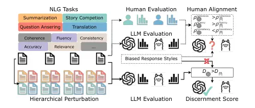
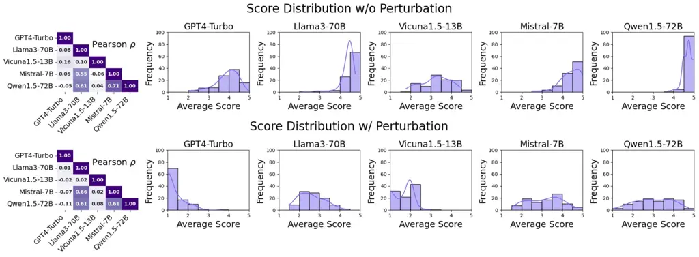
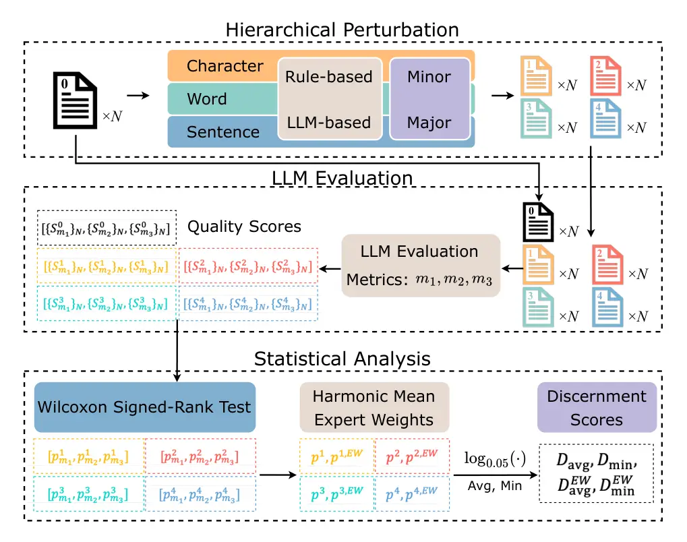
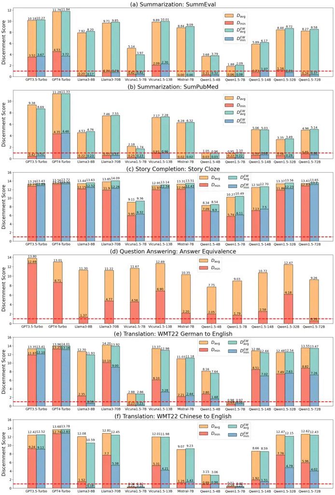
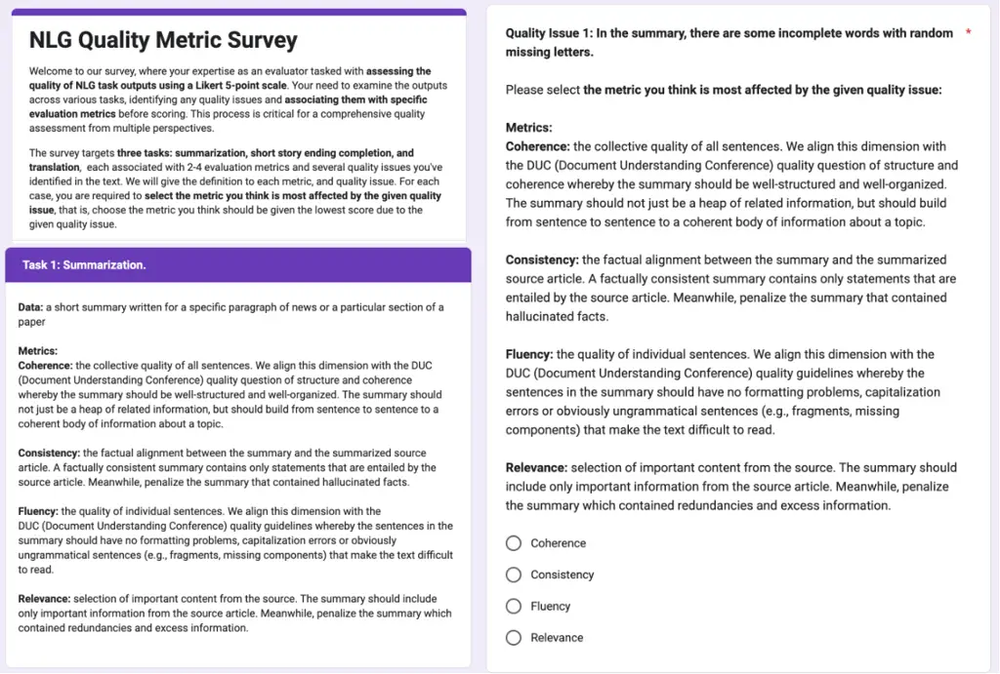

# DHP Benchmark: Are LLMs Good NLG Evaluators?

Yicheng Wang    Jiayi Yuan    Yu-Neng Chuang Affiliation: Rice
University    Zhuoer Wang Affiliation: Texas A&M University    Yingchi
Liu Affiliation: Axon Enterprise, Inc.    Mark Cusick Affiliation: Axon
Enterprise, Inc.    Param Kulkarni Affiliation: Axon Enterprise, Inc.   
Zhengping Ji Affiliation: Axon Enterprise, Inc.    Yasser Ibrahim
Affiliation: Axon Enterprise, Inc.    Xia Hu Affiliation: Rice
University

###### Abstract

Large Language Models (LLMs) are increasingly serving as evaluators in
Natural Language Generation (NLG) tasks; this is often referred to as
“LLM-as-a-judge” paradigm. However, the capabilities of LLMs in
evaluating NLG quality remain underexplored. Current studies depend on
human assessments and simple metrics that fail to capture the
discernment of LLMs across diverse NLG tasks. To address this gap, we
propose the Discernment of Hierarchical Perturbation (DHP) benchmarking
framework, which provides quantitative discernment scores for LLMs. This
framework leverages hierarchically perturbed text data and statistical
tests to systematically measure the NLG evaluation capabilities of LLMs.
We re-established six evaluation datasets for this benchmark, covering
four NLG tasks: Summarization, Story Completion, Question Answering, and
Translation. Our comprehensive benchmarking of five major LLM families
provides critical insight into their strengths and limitations as NLG
evaluators. Our dataset is available at
[https://huggingface.co/datasets/YCWANGVINCE/DHP_Benchmark](https://huggingface.co/datasets/YCWANGVINCE/DHP_Benchmark).

²²footnotetext: Equal Contribution.

## 1 Introduction

Large Language Models (LLMs) play a crucial role in the field of Natural
Language Generation (NLG), advanced wide real-world applications
including education Latif et al. (2023), healthcare Yuan et al. (2023),
business Teubner et al. (2023), etc. The strong capabilities of LLMs
allow them not only to serve as text generators but also increasingly as
powerful evaluators of text quality Chiang and Lee (2023); Liu et al.
(2023a); Li et al. (2024). Their role as evaluators is crucial for
advancements in various applications, such as summarization, story
completion, question answering, and translation Li et al. (2024); Wang
et al. (2023); Chuang et al. (2024). LLMs are expected to serve as NLG
evaluators, providing reasonable quality scores based on different
quality metrics with specially designed evaluation prompts.

Despite the growing performance of LLMs in evaluation tasks, a
significant gap remains in fully comprehending their capabilities in
evaluating NLG quality. The question, Are LLMs good NLG evaluators?
remains challenging for two main reasons illustrated in Figure 1:



Figure 1: Challenges in Assessing LLMs as NLG Evaluators: Biased
Response Styles and Multiple Evaluation Metrics. Our DHP Framework
employs hierarchical perturbation and statistical tests to address these
challenges, offering quantitative discernment scores for effective
comparison.

\(1\) Lack of Clear and Unbiased Measurement: There is no clear
measurement for the capability of LLM evaluators. Existing methods rely
on aligning with human scores Chiang and Lee (2023); Liu et al. (2023a),
but these scores themselves are subject to biased response styles Schoch
et al. (2020).

\(2\) Multiple Evaluation Metrics: Evaluating NLG quality requires
considering multiple metrics. For example, in summarization tasks,
metrics such as coherence, consistency, and fluency are essential
considerations Liu et al. (2023a); Fabbri et al. (2021); Gabriel et al.
(2021). However, LLMs might struggle with correlations between these
metrics Hu et al. (2024), potentially leading to misinterpretation and
incorrect scoring, which makes it difficult to assess their
effectiveness as evaluators.

To address these challenges, we introduce a novel DHP benchmarking
framework – Discernment of Hierarchical Perturbation – for
quantitatively measuring the evaluation capabilities of LLMs. We propose
the concept of discernment scores, systematically derived from
hierarchically perturbed text data and statistical tests. Reference data
is perturbed using multiple hierarchical methods, and differences in LLM
evaluation scores are analyzed using the Wilcoxon Signed-Rank
Test Wilcoxon (1945). To obtain more reliable overall evaluation
results, harmonic mean $`p`$-values and expert-assigned weights are
applied to integrate multiple metrics. The final $`p`$-value is then
converted into a Discernment Score, providing a quantitative measure of
the NLG evaluation capabilities of LLMs. This approach enables a more
rigorous and comprehensive assessment of LLM performance, independent of
the specific response styles exhibited by the models.

This study re-establishes six evaluation datasets across four key NLG
tasks: Summarization, Story Completion, Question Answering, and
Translation. Each dataset undergoes hierarchical perturbation and is
utilized to challenge the evaluative capabilities of LLMs in distinct
ways, providing a robust foundation for benchmarking. The datasets
include a range of text perturbation methods, from minor character-level
problems to significant sentence-level alterations, enabling a thorough
examination of the potential discernment limits of LLMs.

Our comprehensive benchmarking, based on newly defined quantitative
discernment scores, is conducted across five major LLM series. This
methodology uncovers critical insights into their effectiveness as NLG
evaluators and provides a detailed understanding of their performance.
This benchmark reveals important trends and patterns in the LLM
evaluator capacities, highlighting areas of strength as well as
potential shortcomings.

The DHP benchmark aims to fill existing gaps by offering a quantitative
framework for assessing LLMs’ evaluation capabilities and emphasizing
the necessity of considering multiple metrics for accurate and reliable
evaluations. We summarize our contributions as follows.

- •
  Develop the DHP benchmarking framework, introducing quantitative
  discernment scores for LLMs as NLG evaluators based on hierarchical
  perturbation.
- •
  Re-establish six evaluation datasets across four NLG tasks to evaluate
  the discernment of LLM evaluators.
- •
  Benchmark five LLM series to analyze their performance and
  effectiveness in NLG evaluation.



Figure 2: Response styles of five LLMs evaluated using the SummEval
dataset Fabbri et al. (2021).

## 2 Challenge: Biased Response Styles

Previous studies focus on the alignment between human and LLM
evaluators, using correlation metrics to gauge the LLMs’ performance in
NLG evaluation tasks Liu et al. (2023a); Chiang and Lee (2023). However,
these studies often overlook an important variable of evaluators:
Response Styles which refer to a respondent’s consistent manner of
answering survey questions, regardless of the content Van Vaerenbergh
and Thomas (2013). Despite similar levels of professionalism, annotators
may assign different scores to the same questionnaire due to differences
in age, gender, personality, cultural background, and ethnic
group Van Vaerenbergh and Thomas (2013); Hui and Triandis (1989); Kieruj
and Moors (2013). Similarly, LLMs, trained on diverse datasets, may also
exhibit biases in their responses Salecha et al. (2024). This
discrepancy casts doubt on the previous methods used to compare human
and LLM scores. Since quality-based scoring often relies heavily on a
few experts’ annotations, the final alignment scores tend to favor
models that share similar response styles with these specific experts.

We illustrate this with an example of the response styles of five LLMs
tasked with annotating quality scores for human reference data from the
SummEval dataset Fabbri et al. (2021). We averaged the scores across
four metrics for each data point and plotted both the Pearson
correlation coefficient ($`\rho`$) and the average score distributions
of the five models. After perturbing the original data by replacing some
named entities with fictional ones in the summaries (Fictional Named
Entities in Table 1), we repeated the quality evaluation. As shown in
Figure 2, all models detected the changes and adjusted their scores
accordingly, though their scoring distributions varied significantly.
For instance, Llama3 Dubey et al. (2024), Mistral Jiang et al. (2023),
and Qwen Bai et al. (2023) models assign higher scores to the original
data and moderate scores to the perturbed data. In contrast,
GPT4-Turbo OpenAI (2023) and Vicuna Chiang et al. (2023) models tend to
give moderate scores to the original data and much lower scores to the
perturbed data. The variance in the response distributions indicates the
presence of bias that can significantly affect alignment ($`\rho`$),
illustrating that alignment is not a direct or credible metric for
assessing the ability of LLMs as NLG evaluators. It is crucial to
develop a new metric and measurement for evaluation that is not
influenced by the evaluators’ biased response styles, ensuring a more
accurate and fair assessment of LLM capabilities.



Figure 3: The DHP framework for each NLG task. It includes three steps:
(1) Hierarchical Perturbation, (2) LLM Evaluation, and (3) Statistical
Analysis. This figure demonstrates the framework with four perturbation
types ($`P=4`$) and three evaluation metrics ($`M=3`$).

## 3 DHP Benchmarking Framework

We propose our DHP framework: Discernment of Hierarchical Perturbation.
Previous studies overlook the essence of NLG evaluation, i.e., the
content-oriented scoring Novikova et al. (2018). In other words, content
that is accurate, fluent, and consistent should receive higher scores
than content that is inaccurate, disfluent, and inconsistent. Qualified
annotators should be able to recognize inappropriate content without
additional references and then assign scores, even though the absolute
scores may still reflect their biased response styles. The fundamental
principle of our assessment is that a qualified LLM evaluator should be
able to independently identify issues in perturbed data (which contains
some quality issues) and assign relatively lower scores compared to the
original reference data during two separate evaluations. This approach
does not rely on human scores, thus eliminating the influence of human
response styles.

The overall framework is shown in Figure 3. First, for a specific NLG
task, we employ a hierarchical perturbation pipeline to transform
high-quality reference data into various forms of lower-quality data.
Subsequently, an LLM evaluates both the original and perturbed texts,
respectively, using predefined metrics, generating several sets of
rating scores. We then conduct a statistical analysis of these scores.
For each pair of scores, original and perturbed, we apply the Wilcoxon
Signed-Rank Test to determine the differences in their distributions,
achieving this with a confidence level expressed as a $`p`$-value. This
test specifically assesses differences in pairwise scores without
focusing on absolute values, thereby minimizing the impact of models’
response styles. Following this, we combine the $`p`$-values from
different metrics, incorporating Expert Weights ($`EW`$) to tailor the
aggregated $`p`$-values to the specific metrics of the corresponding
perturbation methods. These combined $`p`$-values are then transformed
into discernment scores, which serve as a direct measure for assessing
and comparing the NLG evaluation capabilities of LLMs for this
particular task.

### 3.1 Step 1: Hierarchical Perturbation

To generate data that have quality issues across various levels,
formats, and evaluation difficulties, we propose a hierarchical
perturbation approach. In contrast to the plain perturbations Sai et al.
(2021), our approach encompasses three levels of perturbation content:
character, word, and sentence levels; two methods of perturbation:
rule-based and LLM-based; and two degrees of perturbation: minor and
major as illustrated in Figure 3.

First, at the character level, we alter some characters or letters in
the given $`N`$ original texts independently. At the word and sentence
levels, we degrade the text by processing entire words or sentences,
respectively. For NLG tasks involving very short texts, sentence-level
perturbation is considered optional. For each level of perturbation, we
choose either a rule-based or an LLM-based method, enhancing the
diversity of the perturbation’s content and format. Additionally, if the
text data is sufficiently long for more perturbation, we implement two
degrees of perturbation–minor and major–for each method. These different
degrees of perturbation are the difficulty that LLMs face in detecting
issues within the text. The detailed perturbation methods for each task
are shown in Table 1.

With this approach, we generate multiple sets of perturbed data, with
each set designed to highlight a specific quality issue tied to a
distinct type of perturbation method. Competent LLM evaluators should
accurately detect these issues and assign correspondingly lower scores
to the perturbed data.

[TABLE]

Table 1: The quality metrics and perturbation methods for the four NLG
tasks. C: Character Level. W: Word Level. S: Sentence Level. (R):
Rule-based Perturbation. (L): LLM-based Perturbation. (M): Major and
Minor Perturbations for each method.

### 3.2 Step 2: LLM evaluation

Following the evaluation method outlined in G-Eval Liu et al. (2023a),
we also utilize the automatic chain-of-thought approach (Auto-CoT) Zhang
et al. (2022) to design evaluation prompts for different datasets and
evaluation metrics. These prompts are sent to LLMs to assess both the
original data and the perturbed, low-quality data. It’s important to
note that all perturbed data are evaluated independently, without their
original references, to accurately test the models’ capabilities in
identifying specific quality issues.

After conducting the LLM evaluation on $`N`$ datapoints, we obtain
several sets of absolute evaluation scores shown in Figure 3:

```math
\displaystyle[\{S^{0}_{m_{1}}\},\{S^{0}_{m_{2}}\},\dots,\{S^{0}_{m_{M}}\}],
```

```math
\displaystyle[\{S^{1}_{m_{1}}\},\{S^{1}_{m_{2}}\},\dots,\{S^{1}_{m_{M}}\}],\cdots,
```

```math
\displaystyle[\{S^{P}_{m_{1}}\},\{S^{P}_{m_{2}}\},\dots,\{S^{P}_{m_{M}}\}],
```

where each $`\{S\}`$ is a set of $`N`$ evaluation scores. The
superscripts $`0,1,\ldots,P`$ on $`S`$ represent the original data
($`0`$) and the $`P`$ types of perturbed data ($`1,\dots,P`$),
respectively. The subscripts $`m_{1},\ldots,m_{M}`$ represent the $`M`$
different metrics used in the dataset. For instance, in the SummEval
dataset Fabbri et al. (2021), there are four evaluation metrics, namely:
coherence, consistency, fluency, and relevance.

### 3.3 Step 3: Statistical Analysis

As illustrated in Figure 3, we conduct a chain of statistical analyses
to derive the final discernment scores for LLM evaluators. This process
includes the Wilcoxon Signed-Rank Test, Harmonic Mean $`p`$-value and
Expert Weights, and the final calculation of discernment scores.

#### 3.3.1 Wilcoxon Signed-Rank Test

The Wilcoxon Signed-Rank Test (W-Test) Wilcoxon (1945) is a
non-parametric hypothesis test that compares two dependent samples to
assess whether their population mean ranks differ significantly. We
apply the W-Test to evaluate whether there is a significant difference
in the score distributions between the original data and a given type of
perturbed data:

```math
p^{i}_{m_{j}}\sim z^{i}_{m_{j}}=\text{W-Test}(\{S^{0}_{m_{j}}\},\{S^{i}_{m_{j}}\}).
```

In our analysis, we adopt a one-sided alternative hypothesis. The
resulting $`p`$-value indicates the confidence level at which we can
reject the null hypothesis – that $`\{S^{0}_{m_{j}}\}`$ and
$`\{S^{i}_{m_{j}}\}`$ have the same distribution – and accept the
alternative hypothesis – that $`\{S^{0}_{m_{j}}\}`$ has a greater
distribution than $`\{S^{i}_{m_{j}}\}`$. We consider a difference to be
statistically significant if $`p^{i}_{m_{j}}<0.05`$. A lower $`p`$-value
represents a more significant score difference between the original data
and perturbed data. In total, we can get $`P`$ sets of $`p`$-values for
the $`M`$ metrics, as shown in Figure 3:

```math
[p^{1}_{m_{1}},p^{1}_{m_{2}},\dots,p^{1}_{m_{M}}],\cdots,[p^{P}_{m_{1}},p^{P}_{m_{2}},\dots,p^{P}_{m_{M}}].
```

Because the W-Test does not assume any specific distribution for the
scores and does not focus on their absolute values, the resulting
$`p`$-values solely reflect whether the LLMs are able to detect the
quality issues and assign lower scores to the perturbed data compared to
the original data. Consequently, this testing approach inherently avoids
the influence of response styles, instead focusing on the relative
quality assessment. Meanwhile, the $`p`$-values provide a quantitative
evaluation measure to the score difference, i.e., the capability of
evaluators to discern low-quality data.

#### 3.3.2 Harmonic Mean p-value and Expert Weights

Given that an evaluation task may involve multiple $`M`$ evaluation
metrics, resulting in multiple $`p`$-values
$`[p^{i}_{m_{1}},p^{i}_{m_{2}},\dots,p^{i}_{m_{M}}]`$ for a single
perturbed set, it is crucial to derive a combined $`p`$-value to measure
the overall confidence level. We employ the Harmonic Mean $`p`$-value
(HMP) method Wilson (2019) without or with the Expert Weights ($`EW`$)
presented in Figure 3:

```math
p^{i}=\frac{1}{\sum^{M}_{j=1}\frac{1}{p^{i}_{m_{j}}}},\quad p^{i,EW}=\frac{1}{\sum^{M}_{j=1}\frac{EW^{i}_{m_{j}}}{p^{i}_{m_{j}}}}.
```



Figure 4: The DHP benchmarking results across four NLG tasks. Notably,
in (d) for the Question Answering task, $`D`$ and $`D^{EW}`$ are
identical because this task utilizes only one evaluation metric. The red
lines on the charts represent $`D`$ or $`D^{EW}=1`$, which indicates the
threshold for statistical significance in discernment scores.

There are two main reasons for using the HMP method: (1) The
$`p`$-values are dependent as they are derived from the same dataset but
differ based on potentially correlated metrics. The HMP method
accommodates this dependency Wilson (2019); Vovk and Wang (2020). (2)
The harmonic mean emphasizes the effect of smaller numbers, meaning that
even if the LLMs identify and appropriately score a problem in just one
metric, the combined $`p`$-value is still apparently small enough.
However, a limitation of the simple HMP is that it does not indicate
whether the LLM evaluators correctly identify the specific problems
related to the corresponding metrics. For example, in the
SummEval Fabbri et al. (2021) dataset, if a perturbation targets the
“fluency” metric but the LLM evaluator incorrectly assigns lower scores
to “relevance”, the Harmonic Mean $`p`$-value method might still produce
a low combined $`p`$-value. This outcome may not accurately reflect the
evaluator’s ability to identify the specific issue.

To address this, we introduce HMP with Expert Weights ($`EW`$). We
conduct a survey involving $`10`$ NLP experts who are presented with the
specific NLG evaluation tasks and metric definitions. They are asked to
identify which metric should be most impacted by different quality
problems corresponding to the perturbation methods. These preferences
are then aggregated to construct $`EW`$. For instance, a particular
quality issue get votes for “coherence”, “consistency”, and “fluency”
are $`4,1,`$ and $`5`$, respectively, the $`EW`$ for the corresponding
perturbation would be $`[0.4,0.1,0.5]`$. The $`EW`$ makes the
combination more targeting those $`p`$-values that are highly influenced
by the perturbation. This weighting makes the $`p`$-value combination
more targeted, focusing on those metrics most influenced by the
perturbation. Consequently, the weighted combined $`p`$-values offer a
more precise measure of the LLM evaluators’ ability to not only detect
issues but also correctly assign lower scores to the impacted metrics.

#### 3.3.3 Discernment Scores of LLM Evaluators

To facilitate comparisons, we transform these combined $`p`$-values into
positive scores, which we define as discernment scores for a specific
perturbation $`i`$ in Figure 3:

```math
D^{i}=\log_{0.05}(p^{i}),\quad D^{i,EW}=\log_{0.05}(p^{i,EW}).
```

Here, $`D^{i}`$ and $`D^{i,EW}`$ are positive values and the higher the
better. A value of 1 for $`D^{i}`$ and $`D^{i,EW}`$ is a threshold
corresponding to a $`p`$-value of 0.05, indicating statistical
significance. If $`D^{i}`$ or $`D^{i,EW}`$ is less than 1, it means that
the LLM evaluators do not assign significantly lower scores to the
perturbed data compared to the original data, suggesting a lack of
discernment for specific quality issues during the NLG evaluation.

To observe the comprehensive capability and worst-case performance of
the LLMs, we calculate both the average and minimum of $`D^{i}`$ and
$`D^{i,EW}`$ across all perturbation methods $`i=1,\dots,P`$. This
results in overall LLM discernment scores $`D_{\text{avg}}`$,
$`D_{\text{min}}`$, $`D^{EW}_{\text{avg}}`$, and
$`D^{EW}_{\text{min}}`$. Note that the average discernment scores are
calculated using a weighted average across the perturbation levels
(character, word, and sentence levels) mentioned previously. We assign
equal weights to perturbations within the same level and make sure that
the sum of the weights is the same for each level. This weighting
approach ensures that each level of perturbation contributes equally to
the final scores.

These discernment scores allow us to explicitly evaluate and compare the
capabilities of LLMs as evaluators on specific NLG tasks, thereby
establishing comprehensive benchmarks for LLMs. Higher average
discernment scores ($`D_{\text{avg}}`$ and $`D^{EW}_{\text{avg}}`$)
indicate that the LLM can generally identify and assign appropriate
scores for quality issues in the NLG task, regardless of the specific
type of perturbation. The average discernment scores are useful for
getting a broad understanding of an LLM’s overall performance as an NLG
evaluator. On the other hand, the minimum discernment scores
$`D_{\text{min}}`$ and $`D^{EW}_{\text{min}}`$ assess the LLM’s
performance in the most challenging scenarios, where it may struggle to
identify certain types of quality issues. These scores represent the
lowest discernment score achieved by the LLM across all perturbation
methods, indicating its weakest performance. The minimum discernment
scores are crucial for understanding the limitations and potential
failure modes of an LLM as an NLG evaluator, even if its overall average
performance is acceptable.

## 4 Benchmarking LLM Discernment

We evaluate five series of LLMs with varying parameter sizes: the
GPT-series Wang et al. (2023); OpenAI (2023), which includes
GPT3.5-Turbo and GPT4-Turbo; the Llama3-series Dubey et al. (2024); the
Vicuna1.5 series Chiang et al. (2023); Mistral-7B Jiang et al. (2023);
and the Qwen-series Bai et al. (2023).

The LLMs are evaluated across four NLG tasks using six re-established
public datasets: for Summarization, we use SummEval Fabbri et al. (2021)
(news articles) and SumPubMed Gupta et al. (2020) (scientific articles);
for Story Completion, we select data from Story Cloze Test
dataset Mostafazadeh et al. (2017); for Question Answering, we utilize
the data and modify the quality metric based on the Answer Equivalence
dataset Bulian et al. (2022); and for Translation, we leverage WMT-22
German-to-English and Chinese-to-English general (news) translation
subsets Kocmi et al. (2022). To ensure comparability, we select
$`N=100`$ datapoints from each dataset. The quality metrics and
perturbation methods are detailed in Table 1.

We present our DHP benchmarking results in Figure 4. By examining the
discernment scores achieved by these models, we can gain insights into
their competence as NLG evaluators.

### 4.1 Overall Assessment

Most LLMs that we have evaluated demonstrate the ability to discern
quality issues, as indicated by most $`D_{\text{avg}}`$ and
$`D^{EW}_{\text{avg}}`$ scores exceeding 1. This suggests they can
comprehend most evaluation metrics and detect varying quality in NLG
tasks. However, an exception is noted in the WMT22 Chinese-to-English
Translation dataset in Figure 4 (f), where Vicuna1.5-7B and Qwen1.5-7B
fail to achieve favorable average discernment scores, possibly due to
their weaker multi-lingual capabilities.

Overall, for NLG evaluation, we recommend the GPT series, especially
GPT4-Turbo, which demonstrates superior stability and the highest
discernment across nearly all tasks. Among open-source models,
Vicuna1.5-13B and Llama3-70B are commendable, achieving good average
discernment scores and with most $`D_{\text{min}}`$ and
$`D^{EW}_{\text{min}}`$ above 1.

### 4.2 Other Observations

Trends regarding the size of LLMs: In general, larger models within one
series generally show better discernment. However, there are notable
inconsistencies. For example, Qwen1.5-4B unexpectedly outperforms
Qwen-7B in translation tasks in Figure 4 (e, f), and Qwen-72B displays
variable performance in the Question Answering task in Figure 4 (d),
suggesting that not all larger models uniformly perform better across
all types of tasks.

Limitations of Smaller LLMs: In more challenging scenarios, represented
by $`D_{\text{min}}`$ and $`D^{EW}_{\text{min}}`$, smaller-sized LLMs
underperform. Models with fewer than 8B parameters show significantly
lower $`D_{\text{min}}`$ and $`D^{EW}_{\text{min}}`$, particularly in
summarization and translation tasks in Figure 4 (a, b, e, f). Among
these smaller models, Llama3-8B and Mistral-7B are relatively
competitive with higher average scores but still register very low
scores in the summarization tasks. This suggests that smaller models may
become unstable and unreliable evaluators in some complex NLG evaluation
scenarios.

Metric Misunderstanding Phenomenon: Differences between discernment
scores with and without expert weights ($`D`$ and $`D^{EW}`$) are also
notable. While most LLMs display consistent $`D`$ and $`D^{EW}`$ scores,
Llama3-8B’s performance in translation tasks in Figure 4 (e, f) shows a
significant discrepancy, with $`D^{EW}_{\text{min}}`$ values being
substantially lower than $`D_{\text{min}}`$ and even dropping below 1.
This indicates the model’s misunderstanding in metrics while identifying
quality issues.

Variations in Task Performance: Among the six datasets, LLMs perform
best in the Story Cloze Test in Figure 4 (c), achieving higher and more
stable scores. However, the SumPubMed dataset presented in Figure 4 (b)
proves the most challenging; all models except GPT4-Turbo score below 1
in $`D_{\text{min}}`$ and $`D^{EW}_{\text{min}}`$ because of the
dataset’s complex scientific terminology and content. Models lacking
sufficient prior knowledge struggle to identify subtle quality issues in
such specialized content. Therefore, we encourage the community to test
LLM discernment scores for their specific NLG tasks prior to conducting
evaluations, ensuring the selected models are competent evaluators.

## 5 Related Work

Recent advancements highlight the significant potential of utilizing
LLMs as evaluators for a variety of NLP tasks. Extensive empirical
evidence supports this viewpoint, as demonstrated by studies Liu et al.
(2023a); Chiang and Lee (2023); Hu et al. (2024); Desmond et al. (2024);
Wang et al. (2023), which assert that the evaluation behaviors of
pretrained LLM-based evaluators are well-aligned with those of human
preference Liu et al. (2023b). Liusie et al.Liusie et al. (2024) further
show that comparative assessments using LLM evaluators outperform
prompt-based techniques, though they identify potential positional
biases and propose corresponding solutions. Despite the great assessment
performance of a single LLM, advanced studies involve multi-LLM
agents Chan et al. (2023); Zhang et al. (2023); Li et al. (2023) or
human experts Gao et al. (2024); Li et al. (2024) to further increase
the judging capability.

While the application of LLMs as judges is a burgeoning area of
research, it is imperative to assess their reliability and effectiveness
in evaluative roles. To this end, several benchmarks have been recently
proposed to evaluate LLMs as judges. For example, JudgeBench  Tan et al.
(2024) is designed to assess LLM-based judges on challenging response
pairs spanning knowledge, reasoning, math, and coding. Additionally,
LLM-judge-eval  Wei et al. (2024) evaluates tasks such as summarization
and alignment, incorporating metrics like flipping noise and length
bias.

However, despite the progress in LLMs as judges, several challenges
persist. First, human involvement remains a crucial factor in both
evaluation and alignment, which raises concerns about the extent to
which human biases influence LLM-based evaluations. Second, human
evaluators themselves are inherently biased, meaning that even if an LLM
aligns well with human preferences, it does not necessarily guarantee
fairness or accuracy. Additionally, LLMs may misinterpret NLG evaluation
metrics Hu et al. (2024), making simple alignment scores unreliable. To
overcome these challenges, our work focuses on developing automated and
comprehensive methodologies to test the reliability of LLM-based
evaluations.

## 6 Conclusion

We introduce the DHP benchmark to assess the discernment capabilities of
LLMs as evaluators across various NLG tasks. Our approach not only
provides benchmarking results for LLMs but also establishes a robust
framework to evaluate how effectively LLMs can identify quality issues,
thus serving as competent NLG evaluators. While most models generally
perform well, their performance is significantly influenced by factors
such as model size, task type, and dataset complexity. By identifying
specific weaknesses of LLMs in evaluating NLG tasks, this benchmark aids
researchers in enhancing “LLM-as-a-judge” methodologies and improving
overall LLM performance.

## 7 Limitations

While our DHP benchmark provides a systematic and scalable way to assess
LLMs’ ability to detect targeted quality issues, it does not offer a
complete picture of how these models perform on every aspect of NLG
evaluation. First, the discernment scores are generated on a
dataset-by-dataset basis, so a truly comprehensive assessment of LLMs
across different NLG tasks remains an open challenge. Next, although our
framework is designed to reduce reliance on human annotations, it does
not fully replace the depth and contextual insight that human
evaluations provide. Our perturbation-driven approach highlights
particular types of errors rather than capturing the broad spectrum of
real-world NLG complexities. Consequently, DHP is best viewed as a
complementary tool, and further work is needed to expand its scope to
more diverse tasks, languages, and cultural settings, as well as to
integrate human judgment for a more holistic evaluation of LLMs.

## References

- Bai et al. (2023) Jinze Bai, Shuai Bai, Yunfei Chu, Zeyu Cui, Kai
  Dang, Xiaodong Deng, Yang Fan, Wenbin Ge, Yu Han, Fei Huang,
  et al. 2023. Qwen technical report. _arXiv preprint arXiv:2309.16609_.
- Bulian et al. (2022) Jannis Bulian, Christian Buck, Wojciech Gajewski,
  Benjamin Börschinger, and Tal Schuster. 2022. Tomayto, tomahto. beyond
  token-level answer equivalence for question answering evaluation. In
  _Proceedings of the 2022 Conference on Empirical Methods in Natural
  Language Processing_, pages 291–305.
- Burchardt (2013) Aljoscha Burchardt. 2013. Multidimensional quality
  metrics: a flexible system for assessing translation quality. In
  _Proceedings of Translating and the Computer 35_.
- Chan et al. (2023) Chi-Min Chan, Weize Chen, Yusheng Su, Jianxuan Yu,
  Wei Xue, Shanghang Zhang, Jie Fu, and Zhiyuan Liu. 2023. Chateval:
  Towards better llm-based evaluators through multi-agent debate. _arXiv
  preprint arXiv:2308.07201_.
- Chiang and Lee (2023) Cheng-Han Chiang and Hung-yi Lee. 2023. Can
  large language models be an alternative to human evaluations? _arXiv
  preprint arXiv:2305.01937_.
- Chiang et al. (2023) Wei-Lin Chiang, Zhuohan Li, Zi Lin, Ying Sheng,
  Zhanghao Wu, Hao Zhang, Lianmin Zheng, Siyuan Zhuang, Yonghao Zhuang,
  Joseph E. Gonzalez, Ion Stoica, and Eric P. Xing. 2023. [Vicuna: An
  open-source chatbot impressing gpt-4 with 90%\* chatgpt
  quality](https://lmsys.org/blog/2023-03-30-vicuna/).
- Chuang et al. (2024) Yu-Neng Chuang, Ruixiang Tang, Xiaoqian Jiang,
  and Xia Hu. 2024. Spec: a soft prompt-based calibration on performance
  variability of large language model in clinical notes summarization.
  _Journal of Biomedical Informatics_, 151:104606.
- Desmond et al. (2024) Michael Desmond, Zahra Ashktorab, Qian Pan,
  Casey Dugan, and James M Johnson. 2024. Evalullm: Llm assisted
  evaluation of generative outputs. In _Companion Proceedings of the
  29th International Conference on Intelligent User Interfaces_, pages
  30–32.
- Dubey et al. (2024) Abhimanyu Dubey, Abhinav Jauhri, Abhinav Pandey,
  Abhishek Kadian, Ahmad Al-Dahle, Aiesha Letman, Akhil Mathur, Alan
  Schelten, Amy Yang, Angela Fan, et al. 2024. The llama 3 herd of
  models. _arXiv preprint arXiv:2407.21783_.
- Fabbri et al. (2021) Alexander R Fabbri, Wojciech Kryściński, Bryan
  McCann, Caiming Xiong, Richard Socher, and Dragomir Radev. 2021.
  Summeval: Re-evaluating summarization evaluation. _Transactions of the
  Association for Computational Linguistics_, 9:391–409.
- Gabriel et al. (2021) Saadia Gabriel, Asli Celikyilmaz, Rahul Jha,
  Yejin Choi, and Jianfeng Gao. 2021. [GO FIGURE: A meta evaluation of
  factuality in
  summarization](https://doi.org/10.18653/v1/2021.findings-acl.42). In
  _Findings of the Association for Computational Linguistics: ACL-IJCNLP
  2021_, pages 478–487, Online. Association for Computational
  Linguistics.
- Gao et al. (2024) Mingqi Gao, Xinyu Hu, Jie Ruan, Xiao Pu, and Xiaojun
  Wan. 2024. Llm-based nlg evaluation: Current status and challenges.
  _arXiv preprint arXiv:2402.01383_.
- Gupta et al. (2020) Vivek Gupta, Prerna Bharti, Pegah Nokhiz, and
  Harish Karnick. 2020. Sumpubmed: Summarization dataset of pubmed
  scientific article. In _Proceedings of the 2021 Conference of the
  Association for Computational Linguistics: Student Research Workshop_.
  Association for Computational Linguistics.
- Hu et al. (2024) Xinyu Hu, Mingqi Gao, Sen Hu, Yang Zhang, Yicheng
  Chen, Teng Xu, and Xiaojun Wan. 2024. [Are LLM-based evaluators
  confusing NLG quality
  criteria?](https://doi.org/10.18653/v1/2024.acl-long.516) In
  _Proceedings of the 62nd Annual Meeting of the Association for
  Computational Linguistics (Volume 1: Long Papers)_, pages 9530–9570,
  Bangkok, Thailand. Association for Computational Linguistics.
- Hui and Triandis (1989) C Harry Hui and Harry C Triandis. 1989.
  Effects of culture and response format on extreme response style.
  _Journal of cross-cultural psychology_, 20(3):296–309.
- Jiang et al. (2023) Albert Q Jiang, Alexandre Sablayrolles, Arthur
  Mensch, Chris Bamford, Devendra Singh Chaplot, Diego de las Casas,
  Florian Bressand, Gianna Lengyel, Guillaume Lample, Lucile Saulnier,
  et al. 2023. Mistral 7b. _arXiv preprint arXiv:2310.06825_.
- Kieruj and Moors (2013) Natalia D Kieruj and Guy Moors. 2013. Response
  style behavior: question format dependent or personal style? _Quality
  & Quantity_, 47:193–211.
- Kocmi et al. (2022) Tom Kocmi, Rachel Bawden, Ondřej Bojar, Anton
  Dvorkovich, Christian Federmann, Mark Fishel, Thamme Gowda, Yvette
  Graham, Roman Grundkiewicz, Barry Haddow, et al. 2022. Findings of the
  2022 conference on machine translation (wmt22). In _Proceedings of the
  Seventh Conference on Machine Translation (WMT)_, pages 1–45.
- Latif et al. (2023) Ehsan Latif, Luyang Fang, Ping Ma, and Xiaoming
  Zhai. 2023. Knowledge distillation of llm for education. _arXiv
  preprint arXiv:2312.15842_.
- Li et al. (2023) Ruosen Li, Teerth Patel, and Xinya Du. 2023. Prd:
  Peer rank and discussion improve large language model based
  evaluations. _arXiv preprint arXiv:2307.02762_.
- Li et al. (2024) Zhen Li, Xiaohan Xu, Tao Shen, Can Xu, Jia-Chen Gu,
  and Chongyang Tao. 2024. Leveraging large language models for nlg
  evaluation: A survey. _arXiv preprint arXiv:2401.07103_.
- Liu et al. (2023a) Yang Liu, Dan Iter, Yichong Xu, Shuohang Wang,
  Ruochen Xu, and Chenguang Zhu. 2023a. G-eval: Nlg evaluation using
  gpt-4 with better human alignment. In _Proceedings of the 2023
  Conference on Empirical Methods in Natural Language Processing_, pages
  2511–2522.
- Liu et al. (2023b) Yuxuan Liu, Tianchi Yang, Shaohan Huang, Zihan
  Zhang, Haizhen Huang, Furu Wei, Weiwei Deng, Feng Sun, and Qi Zhang.
  2023b. Calibrating llm-based evaluator. _arXiv preprint
  arXiv:2309.13308_.
- Liusie et al. (2024) Adian Liusie, Potsawee Manakul, and Mark
  Gales. 2024. Llm comparative assessment: Zero-shot nlg evaluation
  through pairwise comparisons using large language models. In
  _Proceedings of the 18th Conference of the European Chapter of the
  Association for Computational Linguistics (Volume 1: Long Papers)_,
  pages 139–151.
- Mostafazadeh et al. (2017) Nasrin Mostafazadeh, Michael Roth, Annie
  Louis, Nathanael Chambers, and James Allen. 2017. Lsdsem 2017 shared
  task: The story cloze test. In _Proceedings of the 2nd Workshop on
  Linking Models of Lexical, Sentential and Discourse-level Semantics_,
  pages 46–51.
- Novikova et al. (2018) Jekaterina Novikova, Ondřej Dušek, and Verena
  Rieser. 2018. Rankme: Reliable human ratings for natural language
  generation. In _Proceedings of the 2018 Conference of the North
  American Chapter of the Association for Computational Linguistics:
  Human Language Technologies, Volume 2 (Short Papers)_, pages 72–78.
- OpenAI (2023) OpenAI. 2023.
  [Gpt4-turbo](https://openai.com/index/gpt-4-research/).
- Rajpurkar et al. (2016) Pranav Rajpurkar, Jian Zhang, Konstantin
  Lopyrev, and Percy Liang. 2016. Squad: 100,000+ questions for machine
  comprehension of text. In _Proceedings of the 2016 Conference on
  Empirical Methods in Natural Language Processing_, pages 2383–2392.
- Sai et al. (2021) Ananya B Sai, Tanay Dixit, Dev Yashpal Sheth, Sreyas
  Mohan, and Mitesh M Khapra. 2021. Perturbation checklists for
  evaluating nlg evaluation metrics. In _Proceedings of the 2021
  Conference on Empirical Methods in Natural Language Processing_, pages
  7219–7234.
- Salecha et al. (2024) Aadesh Salecha, Molly E Ireland, Shashanka
  Subrahmanya, João Sedoc, Lyle H Ungar, and Johannes C
  Eichstaedt. 2024. Large language models show human-like social
  desirability biases in survey responses. _arXiv preprint
  arXiv:2405.06058_.
- Schoch et al. (2020) Stephanie Schoch, Diyi Yang, and Yangfeng
  Ji. 2020. “this is a problem, don’t you agree?” framing and bias in
  human evaluation for natural language generation. In _Proceedings of
  the 1st Workshop on Evaluating NLG Evaluation_, pages 10–16.
- Tan et al. (2024) Sijun Tan, Siyuan Zhuang, Kyle Montgomery, William Y
  Tang, Alejandro Cuadron, Chenguang Wang, Raluca Ada Popa, and Ion
  Stoica. 2024. Judgebench: A benchmark for evaluating llm-based judges.
  _arXiv preprint arXiv:2410.12784_.
- Teubner et al. (2023) Timm Teubner, Christoph M Flath, Christof
  Weinhardt, Wil van der Aalst, and Oliver Hinz. 2023. Welcome to the
  era of chatgpt et al. the prospects of large language models.
  _Business & Information Systems Engineering_, 65(2):95–101.
- Van Vaerenbergh and Thomas (2013) Yves Van Vaerenbergh and Troy D
  Thomas. 2013. Response styles in survey research: A literature review
  of antecedents, consequences, and remedies. _International journal of
  public opinion research_, 25(2):195–217.
- Vovk and Wang (2020) Vladimir Vovk and Ruodu Wang. 2020. Combining
  p-values via averaging. _Biometrika_, 107(4):791–808.
- Wang et al. (2023) Jiaan Wang, Yunlong Liang, Fandong Meng, Zengkui
  Sun, Haoxiang Shi, Zhixu Li, Jinan Xu, Jianfeng Qu, and Jie
  Zhou. 2023. Is chatgpt a good nlg evaluator? a preliminary study.
  _arXiv preprint arXiv:2303.04048_.
- Wei et al. (2024) Hui Wei, Shenghua He, Tian Xia, Andy Wong, Jingyang
  Lin, and Mei Han. 2024. Systematic evaluation of llm-as-a-judge in llm
  alignment tasks: Explainable metrics and diverse prompt templates.
  _arXiv preprint arXiv:2408.13006_.
- Wilcoxon (1945) F Wilcoxon. 1945. Individual comparisons by ranking
  methods. _Biometrics Bulletin_, 1(6):80–83.
- Wilson (2019) Daniel J Wilson. 2019. The harmonic mean p-value for
  combining dependent tests. _Proceedings of the National Academy of
  Sciences_, 116(4):1195–1200.
- Yuan et al. (2023) Jiayi Yuan, Ruixiang Tang, Xiaoqian Jiang, and Xia
  Hu. 2023. Large language models for healthcare data augmentation: An
  example on patient-trial matching. In _AMIA Annual Symposium
  Proceedings_, volume 2023, page 1324. American Medical Informatics
  Association.
- Zhang et al. (2023) Xinghua Zhang, Bowen Yu, Haiyang Yu, Yangyu Lv,
  Tingwen Liu, Fei Huang, Hongbo Xu, and Yongbin Li. 2023. Wider and
  deeper llm networks are fairer llm evaluators. _arXiv preprint
  arXiv:2308.01862_.
- Zhang et al. (2022) Zhuosheng Zhang, Aston Zhang, Mu Li, and Alex
  Smola. 2022. Automatic chain of thought prompting in large language
  models. In _The Eleventh International Conference on Learning
  Representations_.

## Appendix A NLG Tasks and Metrics

### A.1 Summarization

We utilize the SummEval Fabbri et al. (2021) (MIT license) and
SumPubMed Gupta et al. (2020) datasets (MIT license) for our
summarization tasks. The SummEval dataset comprises 100 news articles,
each accompanied by multiple reference and generated summaries. For our
analysis, we exclusively use the reference summaries, selecting the one
with the highest number of sentences from each article to facilitate
perturbation. The SumPubMed dataset contains 32,000 long scientific
articles along with their abstracts serving as reference summaries. We
only use the "BACKGROUND" sections of these articles and summaries. We
randomly select 100 pairs of articles and their corresponding summaries.

For the evaluation of summarization performance, we adhere to the
metrics defined by SummEval Fabbri et al. (2021), specifically focusing
on Coherence, Consistency, Fluency, and Relevance.

### A.2 Story Completion

In this story completion task, we utilize the public Story Cloze Test
dataset Mostafazadeh et al. (2017), which comprises four-sentence
stories each paired with a reference and wrong ending. We select 100
datapoints at random from the validation set for our analysis.

Given the absence of explicitly defined quality metrics for the dataset,
we adapt metrics from summarization tasks—Coherence, Consistency, and
Fluency. Coherence evaluates the story’s overall structure and narrative
flow. Consistency measures how well the ending maintains the established
tone, setting, character development, and narrative style of the story.
Fluency focuses on the linguistic and stylistic quality of the story’s
conclusion.

### A.3 Question Answering

For the question answering task, we employ the Answer Equivalence
dataset Bulian et al. (2022) (Apache-2.0 license), which is a modified
version of the SQuAD dataset Rajpurkar et al. (2016). We specifically
select reference answers that exceed 150 characters to facilitate
perturbation. From this filtered set, we randomly choose 100
question-answer pairs.

We adapt the original rating tasks of the dataset into a single metric:
Answer Quality. This metric assesses whether the answer provides a
comprehensive and accurate response to the question, effectively
capturing the essence of the content discussed in the paragraph.

### A.4 Translation

We utilize two subsets from the WMT-22 general (news) translation
dataset: German-to-English and Chinese-to-English sets which are freely
available for research purposes. For our analysis, we select the test
sets with reference translations, ensuring each translation exceeds 300
characters in length. We randomly choose 100 datapoints from each subset
for evaluation.

In assessing translation tasks, we adopt two principal metrics from the
Multidimensional Quality Metrics (MQM) framework Burchardt (2013):
Accuracy and Fluency. Accuracy measures how closely the translation
mirrors the source text, focusing on the absence of additions,
omissions, or mistranslations. Fluency evaluates the translation’s
compliance with the linguistic norms of the target language,
specifically examining spelling, grammar, and consistency.

[TABLE]

Table 2: Summary of hierarchical perturbation methods applied to
different NLG tasks, detailing the types of perturbations and their
respective implementations based on character (C), word (W), and
sentence-level (S) modification with rule-based (R) or LLM-based (L)
approaches.

## Appendix B Hierarchical Perturbation

The specifics of the hierarchical perturbations are detailed in Table 2.
We perform these perturbations based on character, word, and
sentence-level statistical data of the texts, which are presented in
Table 2. Our rule-based perturbations include simple text deletions,
typographical errors using existing software tools, reordering of
sentences, and the incorporation of random or incorrect sentences from
other data.

For LLM-based perturbations, we employ GPT4-Turbo, modifying the
reference text via Auto-CoT Zhang et al. (2022) prompts to generate the
detailed procedural perturbation steps. Below, we provide an example of
how the “Minor Fictional Named Entities” perturbation is applied to the
summarization tasks:

Minor Fictional Named Entities Perturbation Prompt:

You will be given one summary written for an article. Your task is to
adjust the summary by implementing a specific change.

Please make sure you read and understand these instructions carefully.

Adjustment: Please substitute only one critical named entity within the
summary (e.g., a name, a location, a specific number, a technical term,
etc.) with a fictional counterpart.

Adjustment Steps:

1. Identify the critical named entity within the summary. This could be
   a person’s name, a location, a specific number, or any other specific
   detail that is crucial to the summary.

2. Create a fictional counterpart for the identified entity. This could
   be a fictional name, a fictional location, a fictional number, a
   fictional technical term etc. Make sure that the fictional counterpart
   is appropriate and fits within the context of the summary.

3. Replace the identified entity with its fictional counterpart in the
   summary. Ensure that the replacement is grammatically correct and
   maintains the overall meaning and flow of the summary.

4. Review the adjusted summary to ensure that it still makes sense and
   conveys the main points of the article, despite the change in one
   critical named entity.

Summary:

SUMMARY_HERE

Revised Summary:



Figure 5: User interface of the expert weight survey conducted to
determine the impact of various quality issues on NLG task metrics.

Figure 6: Graphical representation of the expert weights for each NLG
task.

## Appendix C Expert Weights

We invite 10 volunteer experts with extensive backgrounds in NLP/NLG
research to complete an expert weight survey. The interface of this
survey is displayed in Figure 5, which includes the survey instructions,
definitions of the tasks and metrics, data types, and descriptions of
quality issues associated with the perturbation methods. The experts are
asked to select the metric they believe is most impacted by each quality
issue presented. We then utilize their responses as weights for
combining the $`p`$-values. The results of these expert evaluations are
detailed in Figure 6.

| Model         | Version                   | Source                                                                                                             |
| ------------- | ------------------------- | ------------------------------------------------------------------------------------------------------------------ |
| GPT3.5-Turbo  | gpt-3.5-turbo-0125        | [platform.openai.com/docs/models](https://platform.openai.com/docs/models)                                         |
| GPT4-Turbo    | gpt-4-1106-preview        | [platform.openai.com/docs/models](https://platform.openai.com/docs/models)                                         |
| Llama3-8B     | Meta-Llama-3-8B-Instruct  | [huggingface.co/meta-llama/Meta-Llama-3-8B-Instruct](https://huggingface.co/meta-llama/Meta-Llama-3-8B-Instruct)   |
| Llama3-70B    | Meta-Llama-3-70B-Instruct | [huggingface.co/meta-llama/Meta-Llama-3-70B-Instruct](https://huggingface.co/meta-llama/Meta-Llama-3-70B-Instruct) |
| Vicuna1.5-7B  | vicuna-7b-v1.5-16k        | [huggingface.co/lmsys/vicuna-7b-v1.5-16k](https://huggingface.co/lmsys/vicuna-7b-v1.5-16k)                         |
| Vicuna1.5-13B | vicuna-13b-v1.5-16k       | [huggingface.co/lmsys/vicuna-13b-v1.5-16k](https://huggingface.co/lmsys/vicuna-13b-v1.5-16k)                       |
| Mistral-7B    | Mistral-7B-Instruct-v0.2  | [huggingface.co/mistralai/Mistral-7B-Instruct-v0.2](https://huggingface.co/mistralai/Mistral-7B-Instruct-v0.2)     |
| Qwen1.5-4B    | Qwen1.5-4B-Chat           | [huggingface.co/Qwen/Qwen1.5-4B-Chat](https://huggingface.co/Qwen/Qwen1.5-4B-Chat)                                 |
| Qwen1.5-7B    | Qwen1.5-7B-Chat           | [huggingface.co/Qwen/Qwen1.5-7B-Chat](https://huggingface.co/Qwen/Qwen1.5-7B-Chat)                                 |
| Qwen1.5-14B   | Qwen1.5-14B-Chat          | [huggingface.co/Qwen/Qwen1.5-14B-Chat](https://huggingface.co/Qwen/Qwen1.5-14B-Chat)                               |
| Qwen1.5-32B   | Qwen1.5-32B-Chat          | [huggingface.co/Qwen/Qwen1.5-32B-Chat](https://huggingface.co/Qwen/Qwen1.5-32B-Chat)                               |
| Qwen1.5-72B   | Qwen1.5-72B-Chat          | [huggingface.co/Qwen/Qwen1.5-72B-Chat](https://huggingface.co/Qwen/Qwen1.5-72B-Chat)                               |

Table 3: Overview of large language models (LLMs) assessed in the DHP
benchmark, specifying model versions and sources.

## Appendix D LLM Evaluation

We evaluate five series of large language models (LLMs), details of
which are provided in Table 3. Due to the extensive length of text data
from the SumPubMed dataset Gupta et al. (2020), which can exceed the 4K
context window, we evaluate the models capable of processing long texts
($`\geq`$ 8K tokens). The GPT series is operated using the [OpenAI
API](https://platform.openai.com/docs/overview), and the open-source
LLMs are executed on a server with 8 Nvidia A100 GPUs. We set the
temperature parameters to 0 and maintain the default values for the
top_p parameters. Throughout the evaluation process, each model score 5
times on each metric to calculate a final average score. We use the
[scipy.stats.wilcoxon](https://docs.scipy.org/doc/scipy/reference/generated/scipy.stats.wilcoxon.html)
to conduct the Wilcoxon Signed-Rank Test.

## Appendix E Evaluation Prompts

We follow the guidelines of G-Eval Liu et al. (2023a) and utilize the
Auto-CoT method Zhang et al. (2022) to construct our evaluation prompts.
Below is an example of the prompt used for assessing the Coherence
metric in summarization tasks:

You will be given a summary written for an article. Your task is to rate
the summary on one metric. Please make sure you read and understand
these instructions carefully. Please keep this document open while
reviewing, and refer to it as needed.

Evaluation Criterion: Coherence (1-5) - the collective quality of all
sentences. We align this dimension with the DUC quality question of
structure and coherence whereby the summary should be well-structured
and well-organized. The summary should not just be a heap of related
information, but should build from sentence to sentence to a coherent
body of information about a topic.

Evaluation Steps:

1. Read the Summary Thoroughly: Before diving into the evaluation,
   ensure that you have a clear understanding of the entire summary.
   Reading it more than once might be necessary.

2. Identify the Central Topic: A coherent summary will have a clear
   central topic or theme. Identify this topic and see if the subsequent
   information revolves around it.

3. Check for Logical Flow: Review the summary for logical sequencing.
   Sentences should follow one another in a way that makes sense and allows
   the reader to easily follow the progression of information.

4. Look for Transitional Elements: Coherent summaries often have clear
   transitions between sentences or ideas. This could be in the form of
   transitional words, phrases, or connecting ideas that tie one sentence
   to the next.

5. Identify Redundancies: Check if the same information is repeated in
   different sentences. Redundancies can disrupt the flow and coherence of
   a summary.

6. Note Any Gaps or Jumps: If there are sudden jumps in topics or if
   crucial information seems to be missing, this can harm the coherence of
   the summary. A well-organized summary should present a holistic view of
   the topic without leaving the reader with questions.

7. Assess Clarity: Even if the content is technically accurate, if it’s
   written in a convoluted or unclear manner, it can disrupt coherence. The
   sentences should be clear and easily understandable.

8. Consider the Conclusion: A coherent summary often wraps up or comes
   to a conclusion that ties the presented information together. It doesn’t
   necessarily need a formal conclusion, but the end should feel natural
   and not abrupt.

9. Rate the Summary: Based on the above steps, assign a score between
   1-5 for coherence. - 1: Very incoherent. The summary lacks structure,
   has sudden jumps, and is difficult to follow. - 2: Somewhat incoherent.
   The summary has some semblance of structure, but has significant flaws
   in flow and organization. - 3: Neutral. The summary is decently
   organized, with minor issues in flow and structure. - 4: Mostly
   coherent. The summary is well-structured with very few minor coherence
   issues. - 5: Highly coherent. The summary is excellently organized,
   flows seamlessly, and builds information logically from start to end.

Source Article:

ARTICLE_HERE

Summary:

SUMMARY_HERE

Evaluation Score (please don’t give any feedback, just give a score
ONLY) - Coherence:
