# From Calculation to Adjudication: Examining LLM Judges on Mathematical Reasoning Tasks

Andreas Stephan Affiliation: Faculty of Computer Science
Affiliation: UniVie Doctoral School Computer Science    Dawei Zhu
Affiliation: Saarland University, Saarland Informatics Campus   
Matthias Aßenmacher Affiliation: Department of Statistics, LMU Munich
Affiliation: Munich Center for Machine Learning (MCML)
Correspondence:[andreas.stephan@univie.ac.at](mailto:andreas.stephan@univie.ac.at)
   Xiaoyu Shen Affiliation: Eastern Institute of Technology, Ningbo   
Benjamin Roth Affiliation: Faculty of Computer Science
Affiliation: Faculty of Philological and Cultural Studies, University of
Vienna, Vienna, Austria

###### Abstract

To reduce the need for human annotations, large language models (LLMs)
have been proposed as judges of the quality of other candidate models.
The performance of LLM judges is typically evaluated by measuring the
correlation with human judgments on generative tasks such as
summarization or machine translation. In contrast, we study LLM judges
on mathematical reasoning tasks. These tasks require multi-step
reasoning, and the correctness of their solutions is verifiable,
enabling a more objective evaluation. We perform a detailed performance
analysis and find that easy samples are easy to judge, and difficult
samples are difficult to judge. Our analysis uncovers a strong
correlation between judgment performance and the candidate model task
performance, indicating that judges tend to favor higher-quality models
even if their answer is incorrect. As a consequence, we test whether we
can predict the behavior of LLM judges using simple features such as
part-of-speech tags and find that we can correctly predict 70%-75% of
judgments. We conclude this study by analyzing practical use cases,
showing that LLM judges consistently detect the on-average better model
but largely fail if we use them to improve task performance. ¹¹ 1 Code
will be made available upon acceptance.

## 1 Introduction

The automatic evaluation of machine learning models promises to reduce
the need for human annotations. Specifically, the LLM-as-a-judge
paradigm Zheng et al. (2023) has gained traction, aiming to assess or
compare the quality of generated texts automatically. This approach is
beneficial for automated data labeling Tan et al. (2024),
self-improvement of LLMs Wu et al. (2024), and ranking the capabilities
of LLMs, potentially concerning specific tasks Zheng et al. (2023).

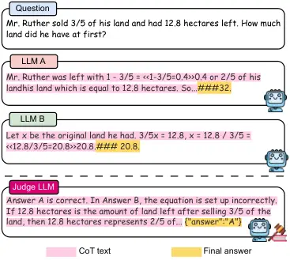

Figure 1: In our problem setup two LLMs ($`A`$ and $`B`$), provide
candidate answers for a math problem, and a judge LLM has to decide
which one is correct. All three use chain-of-thought (CoT) reasoning Wei
et al. (2022).

Much like judges in the real world, who are expected to be exact, fair,
and unbiased Bangalore Principles, 2002 (), LLM judges, should be
unbiased and logical. Previous works investigate properties and biases
of LLM judges on generative tasks such as translation or summarization
Kim et al. (2024b); Liu et al. (2024), typically evaluated using
correlation with human annotators, and thus being inherently subjective.

In this work, we investigate LLM judges on mathematical reasoning
datasets. Such tasks require complex multi-step reasoning and judgments
can be analyzed through the lense of verifiable solutions, allowing us
to investigate the relationship between judge and candidate models in a
principled manner. In our setup, LLM Judges are given two answers and
they have to classify whether both answers, one of them (which one), or
none is correct (see Figure 1. We base our analysis on four large
($`>27B`$ parameters) LLMs and four small ($`<10B`$ parameters) LLMs on
three mathematical reasoning datasets.

Our experiments contain a detailed performance examination. We find that
the best tested judge is LLama 3.1 70B, reaching 60% to 90% judgment
performance, depending on the dataset. Our results confirm the intuition
that judgment performance is aligned with task difficulty.

We perform a statistical analysis of judgment performance and model
quality. We find that the individual task performances of judge and
candidate models are highly indicative features of judgment performance,
as they explain most of the variance in a linear model (as measured by
$`R^{2}`$). On the subset of questions where the candidate models give
one correct and one incorrect answer, we uncover an intriguing
correlation between judge performance and candidate models’ task
performance, indicating that LLM judges tend to select incorrect answers
from better models.

We hypothesize that judges partially base their judgment on linguistic
cues rather than solely on the reasoning withinin the answers. We follow
literature analysing machine-generated text Shaib et al. (2024) and find
that 70%-75% of the judgments can be predicted using simple linguistic
features, highlighting the systematicity behind the judge decisions.

Lastly, we analyze practical use cases and discuss usage
recommendations. Our experiments suggest that LLM judges reliably detect
the model of higher task performance but can not reliably improve task
performance. Rather, we find that it is more sensible to use the judge
model as an answer generator, and subsequently take the majority vote of
all three answers.

In summary, our contributions are as follows:

1.  1.  We perform an in-depth performance analysis of LLM judges on three
        diverse mathematical reasoning tasks.
2.  2.  We identify a correlation between model quality, as measured by task
        performance, and judgment performance, indicating that LLM judges
        are biased towards higher-quality models.
3.  3.  We are able to predict the LLM judgment with 70%-75 accuracy using
        only stylistic patterns, e.g. N-grams of POS-tags. This indicates
        that LLMs, to a large degree, judge independently of the reasoning.
4.  4.  We find that judges reliably detect the model of higher quality but
        are not able to reliably improve task performance.

## 2 Related Work

### 2.1 LLM as Judges

Using _LLMs as judges_ to evaluate text generated by LLMs, including
their own outputs, has recently attracted significant interest because
it reduces the need for human annotation Zheng et al. (2023). Typically,
large state-of-the-art models are used as judges. Applications include
the automatic assessment of language model capabilities and, such as
ranking models with respect to their competence on a given task Zheng
et al. (2023), and reinforcement learning from AI feedback by
automatically generating data for preference optimization Bai et al.
(2022); Wu et al. (2024).

Various methods exist to make judgments Zheng et al. (2023); Liusie
et al. (2024). One approach is pairwise selection Wang et al. (2024b),
where two answers are presented, and the model is asked to select the
better one. Another approach is pointwise grading Li et al. (2024),
where the model is asked to assign a grade based on a predefined scale,
and the answer with a better grade is chosen. Judgment prompts may
involve reference solutions or not. Another body of research explicitly
trains models to act as judges Kim et al. (2024a); Wang et al. (2024b)
or closely related, as reward models Wang et al. (2024c); Li et al.
(2024).

The effectiveness of LLMs as judges is typically assessed by measuring
the correlation or overlap with human judgments Zheng et al. (2023); Kim
et al. (2024b). In contrast, we focus on tasks with a concrete final
answer. Finally, we want to stress that several works caution against
the use of LLM judges as experts Bavaresco et al. (2024); Koo et al.
(2023); Raina et al. (2024); Doddapaneni et al. (2024).

### 2.2 Biases in LLM-as-a-judge

Human-annotated data inherently reflects the annotators’ biases and
opinions. These biases can be detrimental or (intentionally) beneficial,
depending on the goals of the annotation process Plank (2022).
Similarly, several studies have explored the biases present in LLM
judges:

One linguistic bias is ordering bias Zheng et al. (2023); Koo et al.
(2023); Wang et al. (2024a), where a judge gives a different answer
depending on the order in which answers are presented. Panickssery
et al. (2024) note that it is possible to interpret position bias as a
sign that the model is unsure. There are multiple works Xu et al.
(2024); Panickssery et al. (2024); Liu et al. (2024) that find evidence
for self-bias or self-preference. Koo et al. (2023) provide a benchmark
for analyzing cognitive biases. West et al. (2024) and Oh et al. (2024)
explore the “Generative AI Paradox” where it is easier for LLMs to
generate solutions rather than analyzing them, unlike humans who often
find analysis easier than generation.

In this work, we aim to establish a better understanding of underlying
patterns that relate judgments to interpretable factors, such as task
performance or stylistic patterns.

## 3 General Setup

In the following, we describe the problem setting, including the used
notation, and the general experimental setting including used models and
datasets.

### 3.1 Problem Description

In this work, we use an LLM judge, referred to as $`J`$, to assess
answers produced by two other candidate LLMs, $`A`$ and $`B`$, in
response to math questions (see Figure 1 for an illustrative example).
The two candidate answers may both be correct, both incorrect, or either
the answer of model $`A`$ or $`B`$ correct. The judge’s task is to
determine which of these cases applies by reviewing both the CoT
reasoning and the final responses provided in candidate answers.

Thus, the judge engages in a four-class classification task. We denote
the judge’s accuracy by the score $`S^{J}_{A,B}`$ and call this metric
judgment performance. Further, we define the task performance of an
individual model $`X`$ on a specific dataset as $`S_{X}`$, e.g.
$`S_{A}`$, $`S_{B}`$ or $`S_{J}`$.

### 3.2 Datasets

The experiments encompass three mathematical reasoning datasets where
models highly benefit from multi-step CoT reasoning. For all datasets,
we use accuracy as the performance metric.  
AQUA-RAT Ling et al. (2017) is a dataset to test the quantitative
reasoning ability of LLMs. Unlike the other two datasets, the questions
are multiple-choice. GSM8K Cobbe et al. (2021) consists of grade school
math word problems. The answers are free-form numbers. MATH Hendrycks
et al. (2021) contains challenging competition mathematics problems.
Find more details in Appendix A.1

### 3.3 Models

We evaluate the performance of openly available LLMs, including four
large models including Qwen 2.5 72B Yang et al. (2024), Llama 3.1 70B
AI@Meta (2024), Yi 1.5 34B Young et al. (2024), Mixtral 8x7B Jiang
et al. (2024) and four small models, namely Llama 3 8B AI@Meta (2024),
Gemma 1.1 7B Gemma Team et al. (2024), Mistral 7B v0.3 Jiang et al.
(2023), and Mistral 7B v0.1 Jiang et al. (2023). We use the chat- or
instruction-tuned model variants and test each model as a candidate
answer generator and as a judge. More information is in Appendix A.2.

### 3.4 Text Generation

This section describes the generation of candidate answers and
judgments. Find more information on prompts and hardware details in
Appendix A.

#### Candidate answer generation.

For each model we sample two CoT solutions using 4-shot prompting by
setting the temperature to $`0.9`$. By generating two answers
$`a_{1},a_{2}`$ from the same model, we can also evaluate judgments of
two different answers by the same model.

|                      |          | Llama 3.1 70B | Qwen 2.5 72B | Qwen 2.5 14B | Gemma 2 27B | Qwen 2.5 7B | Gemma 2 9B | Llama 3.1 8B | Gemma 2 2B |
| -------------------- | -------- | ------------- | ------------ | ------------ | ----------- | ----------- | ---------- | ------------ | ---------- |
| (1) $`S^{J}_{A,B}`$  | GSM8K    | 90.05         | 85.39        | 89.2         | 81.96       | 81.92       | 83.60      | 79.96        | 64.33      |
|                      | AQUA-RAT | 74.47         | 69.26        | 72.26        | 68.48       | 65.09       | 67.48      | 66.26        | 60.97      |
|                      | MATH     | 61.18         | 58.03        | 62.36        | 55.34       | 50.70       | 52.92      | 50.96        | 50.35      |
| (2) Same answer      | GSM8K    | 95.27         | 95.46        | 95.02        | 92.27       | 92.86       | 94.70      | 88.13        | 75.50      |
|                      | AQUA-RAT | 79.8          | 77.74        | 77.19        | 78.67       | 77.21       | 77.94      | 74.52        | 76.01      |
|                      | MATH     | 79.09         | 77.91        | 76.86        | 75.39       | 73.14       | 75.65      | 71.05        | 77.85      |
| (3) Different Answer | GSM8K    | 70.04         | 55.67        | 68.43        | 47.09       | 49.93       | 49.50      | 51.41        | 31.71      |
|                      | AQUA-RAT | 57.44         | 48.92        | 57.64        | 45.55       | 40.45       | 46.31      | 44.10        | 30.76      |
|                      | MATH     | 48.95         | 45.40        | 51.47        | 42.66       | 36.70       | 38.86      | 36.41        | 32.50      |
| (4) 1-correct        | GSM8K    | 78.18         | 64.08        | 76.92        | 52.25       | 56.19       | 58.10      | 59.26        | 27.78      |
|                      | AQUA-RAT | 66.43         | 57.10        | 69.22        | 44.44       | 47.13       | 54.43      | 52.93        | 24.05      |
|                      | MATH     | 71.92         | 70.19        | 79.62        | 41.80       | 57.79       | 60.97      | 60.73        | 22.62      |

Table 1: Performance of judge LLMs (1) on all samples, (2) on samples
where $`A`$ and $`B`$ agree, (3) on samples where $`A`$ and $`B`$
disagree and (4) on samples where exactly one given answer is correct.
Results are averaged over all candidate model pairs $`(A,B)`$. The
highest accuracy is bold and the second highest underlined.

#### Judgements.

For all $`36`$ unique model combinations $`(A,B)`$²² 2 We consider all
pairs from the eight LLMs, including self-pairing, yielding
$`\binom{8+2-1}{2}=36`$ combinations., each model as judge $`J`$ and
each sample of a dataset, we generate a zero-shot judgment. In the case
of self-pairing, i.e., $`A=B`$, we use both generated candidate answers,
$`a_{1}`$ and $`a_{2}`$. Otherwise, for consistency, we always use the
same sampled candidate answer $`a_{1}`$. We accommodate positional bias
Zheng et al. (2023); Koo et al. (2023) by prompting in both possible
orders. We obtain the judgment performance by averaging how often the
judgments were correctly classified across orderings.

## 4 Performance Analysis

The experiments have multiple degrees of freedom, such as judges,
candidate models, and datasets. To gain a comprehensive understanding of
judges’ behavior, we consider two perspectives. First, we investigate
judge performance for each dataset, aiming to associate judge
performance with task difficulty. Second, for a fixed dataset, we
analyze judge performance across different pairs of candidate models.

### 4.1 General Performance

First, we compare how often the judges make a correct classification
across different datasets and different subsets of the datasets.

#### Setup.

We analyze multiple cases, each corresponding to a specific subset of
the data. Case (1) investigates the observed judgment performance
$`S^{J}_{A,B}`$ on the full dataset and Case (2) analyzes the subset
where both models give the same answer ($`A=B`$). Case (3) shows the
performance where both models give a different answer $`(A\neq B`$) and
Case (4) describes the performance on the subset where exactly one
answer is correct. The results are shown in Table 1. Further, we show
the class confusion matrix for the four best-performing judges in Figure 2.

#### Results.

In general, we observe in Table 1 that larger models outperform smaller
models, with LLama 3.1 70B performing the best. Interestingly, Qwen 2.5
14B outperforms Qwen 2.5 72B. As shown in Figure 2, the LLM judges have
a performance of larger than 95% if both answers are correct.
Conversely, the most challenging situation is when both answers are
incorrect. It seems that the difficulty of a problem also transcends the
difficulty of making a judgment. This is not necessarily intuitive. For
instance, humans may find it easier to detect individual wrong reasoning
steps and identify wrong answers, respectively.

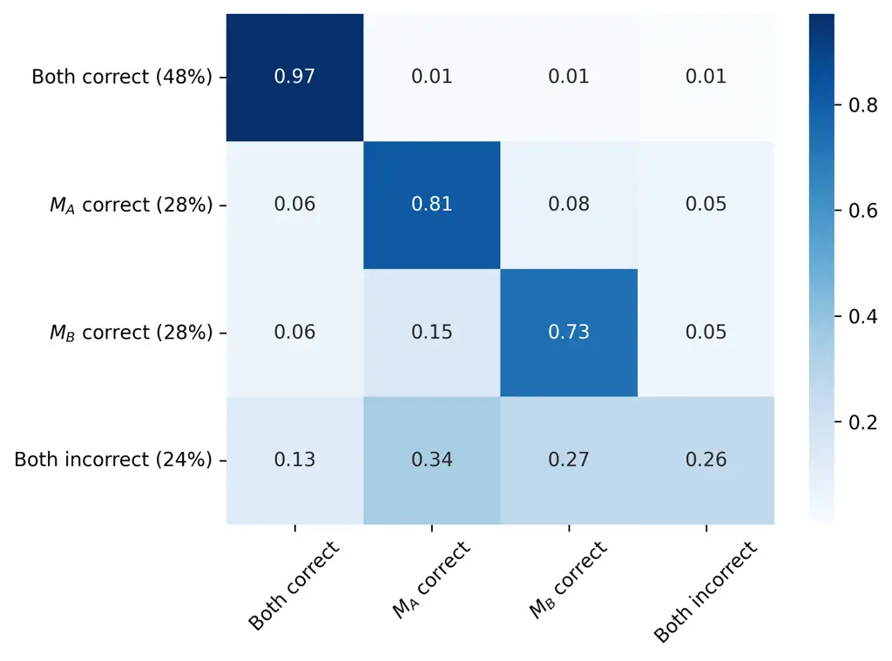

(a) Qwen2.5 72B

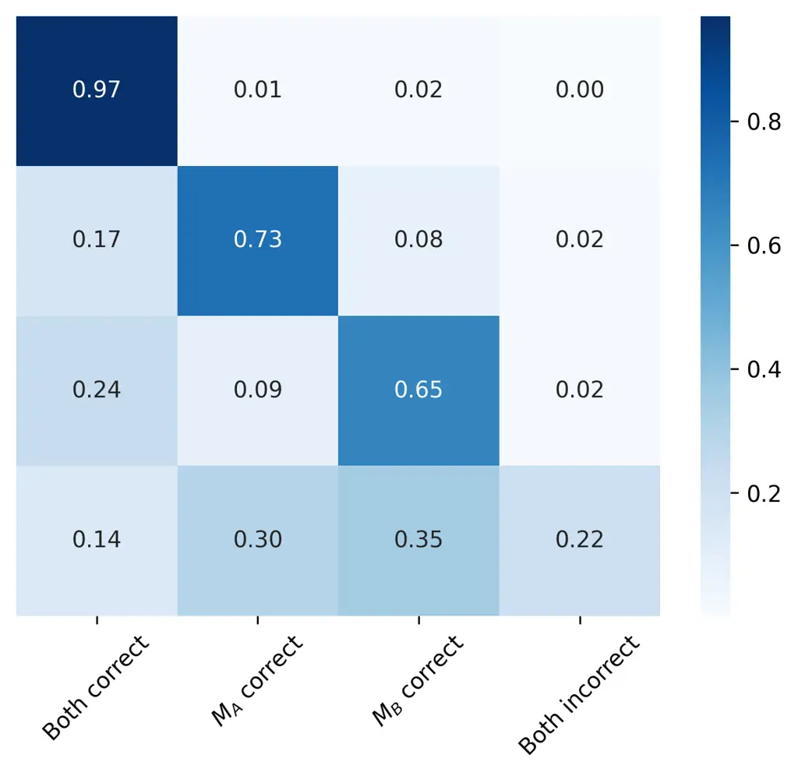

(b) Qwen 2.5 14B

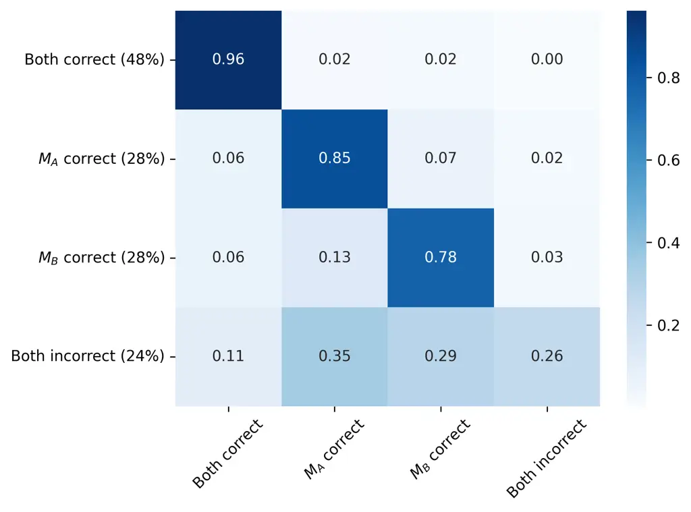

(c) Llama 3.1 70B

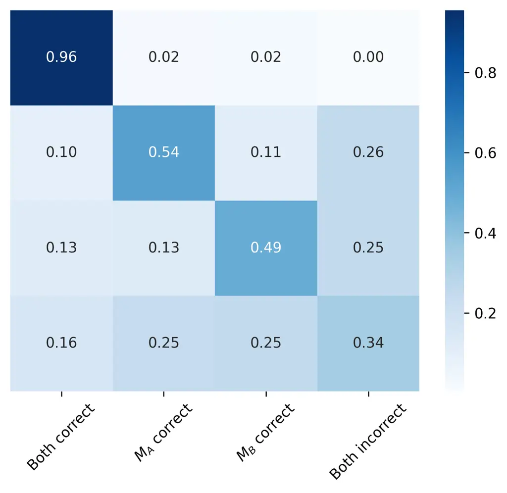

(d) Gemma 2 27B

Figure 2: Class confusion matrices per model. We observe that it is
difficult for judges to detect that both answers are incorrect.

In cases where one answer is correct and one answer is incorrect, we
observe a moderate performance of the judges, reaching up to 80%
accuracy (see Case (4) in Table 1 and Figure 2).

In Case (3) where both answers disagree, we observe moderate performance
for large models of up to 70%. Here, the smallest model Gemma 2 2B, has
a low performance of around 35%. In what follows, we mostly focus on the
analysis of the four largest LLMs as judges.

### 4.2 Performance per model combination

Each model has unique strengths and weaknesses and often answers
different questions correctly. In this section, we analyze the judgment
performance per model pair to gain a better understanding of the impact
of candidate model combinations on judgment performance.

#### Setup.

Figure 3 illustrates the judgement performance $`S^{J}_{A,B}`$ across
model pairs $`(A,B)`$, indicating the probability of a correct
judgement. The results are averaged over datasets and presented as an
upper triangular matrix due to symmetry (we always present the answers
in both possible orders and average performance). We report the
performance of all models used as judges in the Appendix B in Table 9.

#### Results.

The highest performance is achieved when two answers of Qwen 2.5 72B are
compared which is the highest performing model (see task performance in
Appendix B.1) In general, we observe that it is easier for the judge to
make a correct judgment if candidate models are of higher quality. This
seems intuitive because such models likely structure and present their
reasoning well, allowing a judge to compare solutions more easily.
Figure 2 gives an additional explanation. It shows that judges very
reliably detect whether both answers are correct. When both models are
capable, it is more likely that both give a correct answer, which makes
it easier for LLM judges to classify correctly.

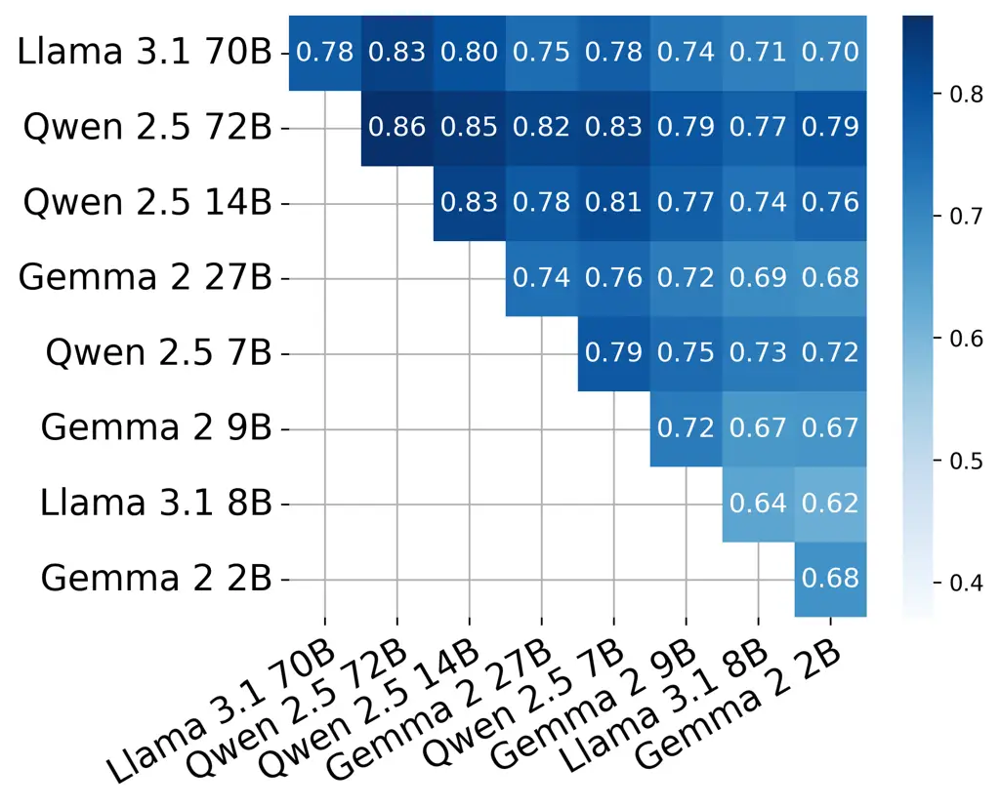

(a) LLama 3.1 70B

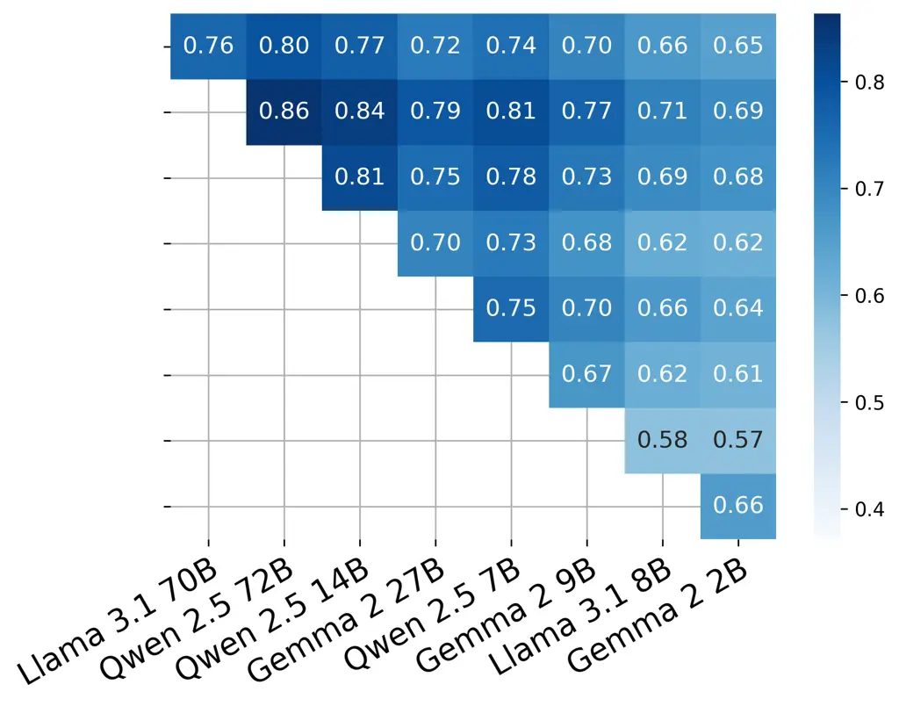

(b) Qwen 2.5 72B

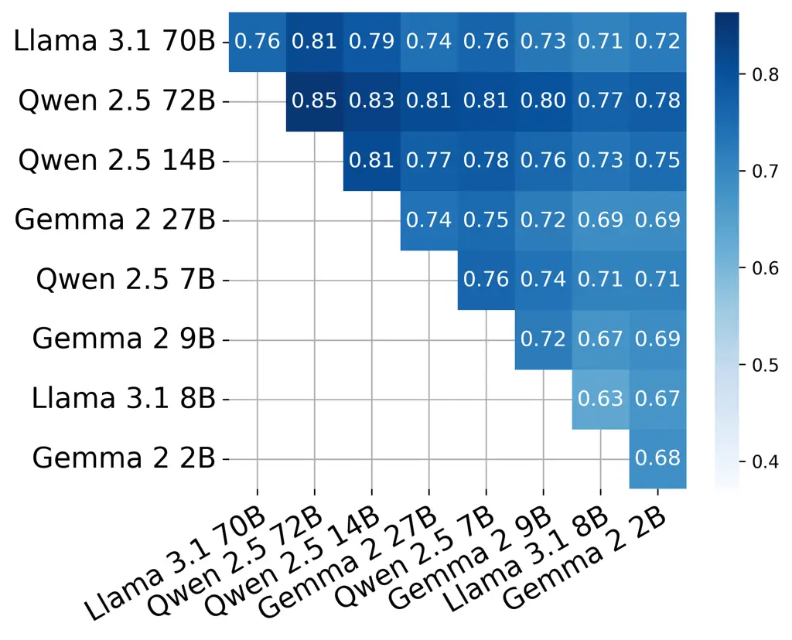

(c) Qwen 2.5 14B

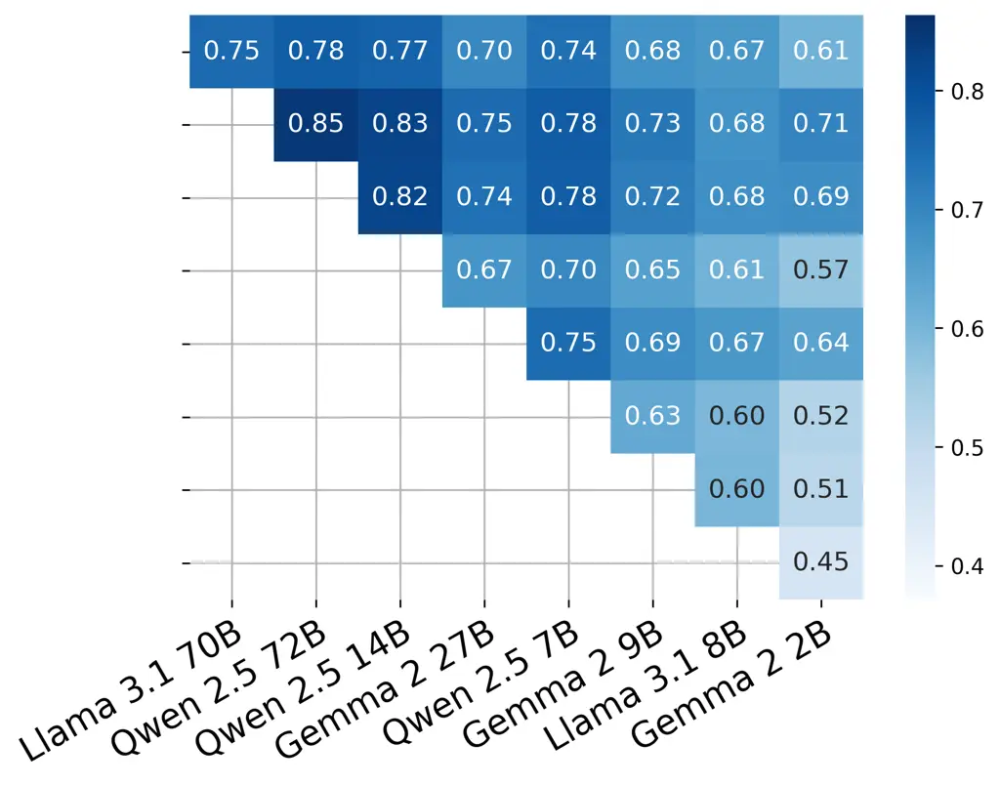

(d) Gemma 2 27B

Figure 3: Judgment Performance $`S^{J}_{A,B}`$ of LLM judges on model
pairs, averaged across datasets.

Interestingly, the judgment performances of Qwen 2.5 72B, Qwen 2.5 14B,
and LLama 3.1 70B are very similar across pairs. The former possibly
agree on a lot because of the similarity of training data and knowledge
distillation Hinton et al. (2014). The largest performance difference is
that LLama 3.1 70B performs 10% better when Qwen 2.5 72B and Gemma 2 2B
are compared.

These results show that there is a relationship between the task
performance of a candidate model and judgment performance. The following
section will provide further analysis.

## 5 Population-level Analysis: Judgements and Model Quality

In this section, we investigate the relationship between LLM judgments
and candidate LLM quality. First, we provide a statistical analysis
where we use LLM task performance to explain the variance in LLM
judgment performance. Further, we focus on the subsets where the
candidate models make exactly one correct and one incorrect prediction.
We observe a strong statistical relationship between the difference in
candidate task performances and judgment performances.

### 5.1 Can we explain Judgement Performance using Task Performance?

A good indicator of the competence of a model on a specific dataset is
its task performance. Clearly, there is a relationship between the
quality of the involved models and the made judgments. We investigate
the relationship between task performances (of candidate and judge
models) and judgment performance.

|               | Llama 3.1 70B | Qwen 2.5 72B | Qwen 2.5 14B | Gemma 2 27B |
| ------------- | ------------- | ------------ | ------------ | ----------- |
| $`R^{2}`$     | 0.89          | 0.87         | 0.85         | 0.93        |
| ($`p`$-value) | (0.0)         | (0.0)        | (0.0)        | (0.0)       |

Table 2: $`R^{2}`$ values for the regression models per judge (first
row) and corresponding $`p`$-values of the Overall F-Test (second row).
All $`R^{2}`$ values are statistically significant on the 5% level.

#### Setup.

We fit multiple different linear regression models using the judgment
performances as the target variables $`Y`$, including all variations of
judges, model pairs $`(A,B)`$, and datasets $`D`$. Regarding the
covariates $`\mathbf{X}`$ in the model, we solely use the task
performances $`S_{X},X\in\{J,A,B\}`$ of judge and candidate models, to
predict judgment performance. Since we are not specifically interested
in the individual features’ effects, but rather in their ability to
explain the variation of judgment performance, we rely on the
coefficient of determination, $`R^{2}`$, for evaluation (Fahrmeir
et al., 2013, see Appendix D).

#### Results.

The results are shown in Table 2 (excluding data sets from the
probability formulas for simplicity). We observe that the
performance-related features of the models can explain the variation in
the judgment performance (all $`R^{2}`$ values greater or equal than
0.85), very well. Logically, $`S_{A}`$ and $`S_{B}`$, have significant³³
3 We test statistical significance using an Overall-F-Test for each
fitted model. Further details are in Appendix D. explanatory power for
judgment performance, as they encompass all correct answers.

### 5.2 Are LLM judges biased towards LLMs of higher quality?

To get a better understanding of whether there is a bias of LLM judges
towards LLMs of higher quality, we investigate the subset where one
candidate answer is correct and the other candidate answer is incorrect.
This subset is of the highest practical relevance. The goal is to
investigate the relationship between the task performances of the
candidate models and the judge’s performance.

#### Setup.

For all model pairs $`(A,B),A\neq B`$ we analyze subsets where $`A`$’s
solutions are correct, and $`B`$’s solutions are incorrect, and call it
1-correct. Note that we can always order $`A`$ and $`B`$ this way. Each
plot in Figure 4 shows the relationship between judge performance on the
1-correct subset (Y-axis) and candidate model performance gap of $`A`$
and $`B`$, i.e., $`S_{A}-S_{B}`$ (X-axis). The color of the points
indicate the size of the particular subset of samples. Examples of these
subsets and their corresponding performances are in Appendix C.1.

#### Results.

The analysis reveals a strong correlation (Pearson’s $`r^{2}>0.78`$)
between judgement performance and candidate model performance gap. For
the rest of this section, we call the model of higher performance on a
dataset the more competent model. I.e., if the performance gap is larger
than $`0`$, the model giving the correct answer ($`A`$) is the more
competent model. If the correct model is the more competent model, the
judgment performance on the subset is higher, e.g., for LLama 3.1 70B,
sometimes approaching 100%. If the performance gap is more positive, it
is easier to choose the correct answer. On the other hand, if the less
competent model gives the correct answer, judgment performance is low,
often lower than $`20\%`$.

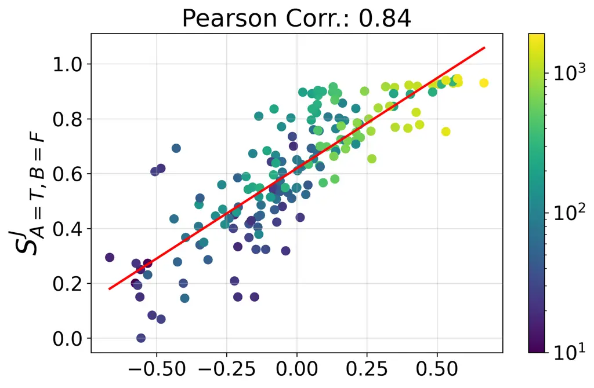

(a) Llama 3.1 70B

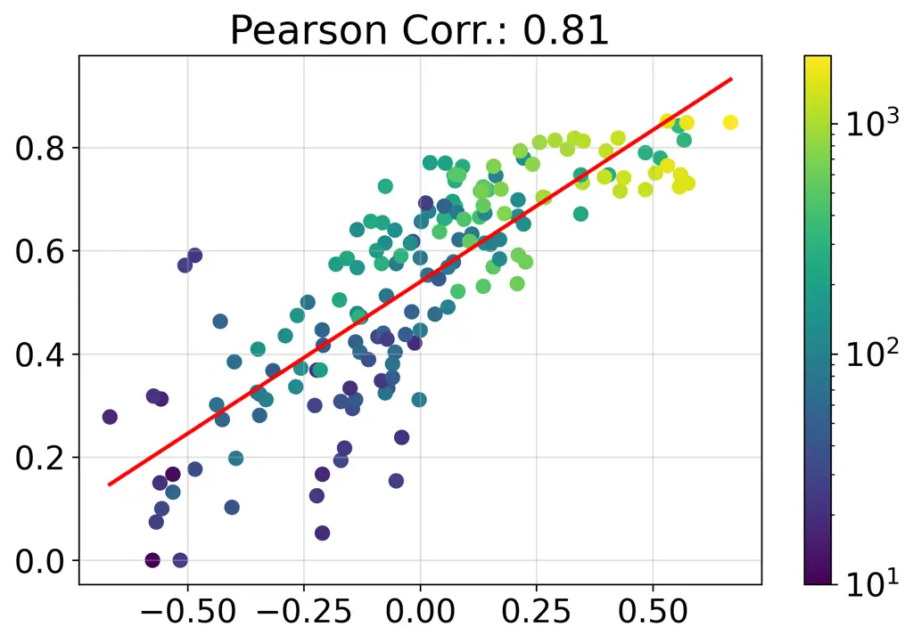

(b) Qwen2.5 72B

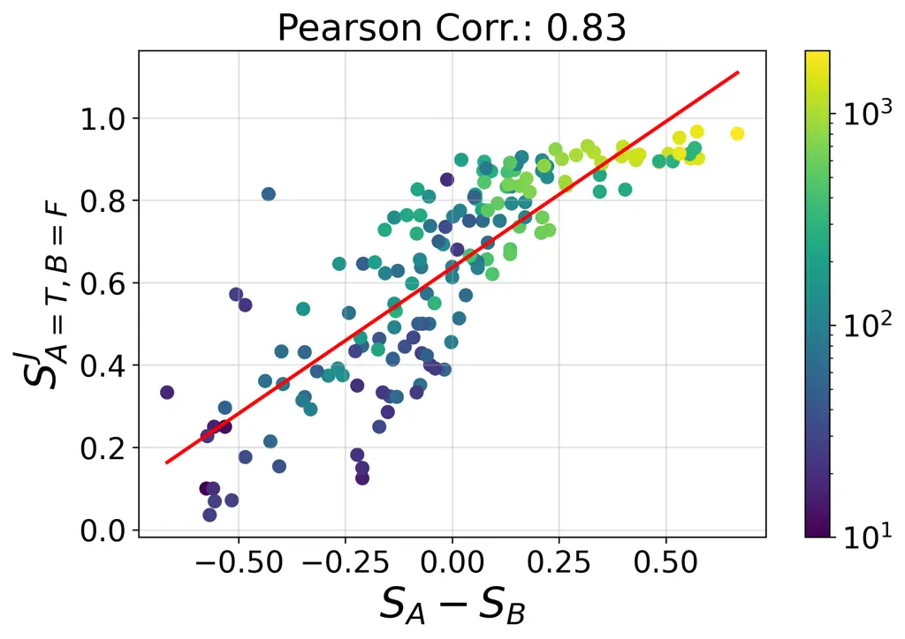

(c) Qwen 2.5 14B

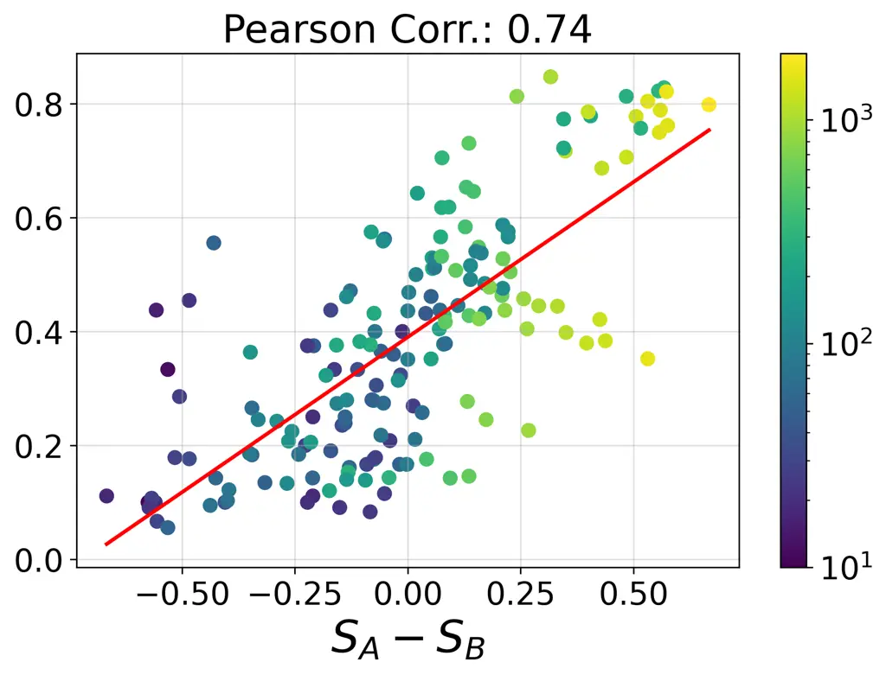

(d) Gemma 2 27B

Figure 4: Judges’ accuracy vs. performance gap between two candidate
models $`A`$ and $`B`$. Each point represents a subset where $`A`$ is
correct, and $`B`$ is incorrect. The color reflects the size of these
subsets.

We infer that LLM judges are biased towards models of higher task
performance. This finding aligns with previous research identifying
self-bias Xu et al. (2024); Panickssery et al. (2024); Liu et al.
(2024), as judge LLMs are typically of higher quality than the judged
models. We hypothesize that this bias arises because more competent
models articulate their responses more convincingly and exhibit a
specific writing style, thereby misleading the judges.

However, models of higher task performance typically answer correctly
more often (as indicated by the color of the points in Figure 4.

## 6 Sample-level analysis: Judgments and Stylistic Patterns

In Section 5, we found that the quality of a candidate LLM (as indicated
by the task performance) correlates with the made judgment. We
hypothesize that models of higher quality exhibit a particular style of
expressing themselves and judges partially base their judgment on the
incorporated textual cues. Motivated by recent work in machine-generated
text detection which finds that LLMs often exhibit certain styles Wu and
Aji (2025) or patterns Shaib et al. (2024), we aim to gain a deeper
understanding of whether shallow or even content-independent patterns
affect the final judgment.

#### Setup.

We separate all judgments each judge made into training and test splits
and train two classifiers. The test accuracy is reported in Table 3. We
use two types of features. First, we use TF-IDF embeddings. Secondly, we
use N-Grams of part-of-speech (POS) tags, motivated by Shaib et al.
(2024) who show and investigate the distinct occurrence of such in
LLM-generated text. Given two candidate answers, we create two
independent feature sets and concatenate those. Then a logistic
regression and a RandomForest classifier Breiman (2001) are trained on
these concatenated features. Find more information in Appendix E.

#### Results.

We observe that the models achieve a performance between approximately
70% and 75%. This indicates that structural information (POS tags) and
word choice (TF-IDF) are important factors in understanding the patterns
behind the behavior of LLM judges. The ground truth judgment
distribution is shown in Appendix E.

| Features Model |     | Llama 3.1 70B | Qwen 2.5 72B | Qwen 2.5 14B | Gemma 2 27B |
| -------------- | --- | ------------- | ------------ | ------------ | ----------- |
| POS            | LR  | 72.79         | 69.66        | 72.33        | 70.19       |
|                | RF  | 71.71         | 69.77        | 71.89        | 69.18       |
| TF-IDF         | LR  | 75.75         | 73.65        | 75.12        | 72.27       |
|                | RF  | 75.65         | 71.05        | 75.79        | 70.58       |

Table 3: Accuracy of predicting LLM judges’ decisions using Logistic
Regression (LR) and Random Forest (RF) classifiers based on N-Grams of
either POS tags or TF-IDF features.

Nevertheless, these results suggest that decision-making is a
multi-faceted process. While specific shallow cues hold influence, a
substantial portion of the decision-making process (25%-30%) can not be
predicted this way and is based on other contextual factors which could
include reasoning or noise.

## 7 Usage recommendations

Lastly, we aim to give some usage recommendations. We start by analyzing
two applied questions, namely, whether LLM judges can identify models of
higher task performance and whether LLMs should be used to improve task
performance. In the end, we discuss those results, connecting them to
the overall insights of this paper.

### 7.1 Do judges identify better models?

An essential application of LLM judges is whether they can accurately
identify which model performs better for a given task. This is crucial
if we want to rank LLMs by their capabilities or if a practitioner wants
to decide which model to deploy.

#### Setup.

We evaluate which model a judge perceives as better by measuring the
frequency of how often a judge selects the answer of a specific model.
Formally, let $`(A,B)`$ be a candidate model pair where we assume that
$`A`$ has higher task performance, i.e. $`S_{A}>S_{B}`$. If the judge
chooses $`A`$ more often, we say a judge correctly determines $`A`$ to
be better than $`B`$. For this analysis, we determine the proportion of
model pairs $`(A,B)`$ for which the judge chooses $`A`$ over $`B`$ for
all pairs $`(A,B),S_{A}>S_{B}`$ as shown in Figure 5.

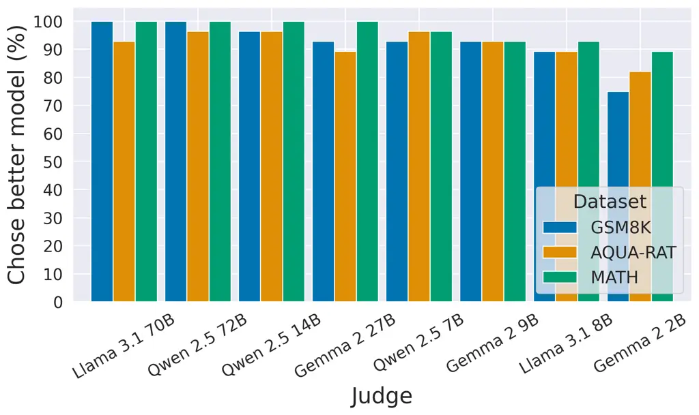

Figure 5: Percentage of model pairs $`(A,B)`$ where a judge picks a
better model $`A`$ (meaning $`S_{A}>S_{B}`$), by selecting more answers
of $`A`$ than from $`B`$.

#### Results.

We observe that all tested large models consistently select the more
competent model, i.e., the model with higher task performance. Also, the
small models with $`7`$-$`9`$B parameters choose the correct model in
over $`90`$% of the cases. In general, it seems to be the hardest on the
AQUA-RAT dataset. This is also the hardest dataset in Case (4), in Table
1, where exactly one answer is correct. Note that the bias found in
Section 5.2 is not necessarily problematic for this specific use case,
because a bias towards the more competent model supports a correct
outcome of this experiment.

### 7.2 Do judges elicit task improvement?

Another interesting question of practical relevance is whether it makes
sense to use LLM judges to improve task performance. One use case is the
application of LLM judges in agentic systems where LLM judges might
serve as a dedicated unit in a system. Another use case is the
subsequent usage of the answers chosen by the judge for self-training
Yuan et al. (2024).

#### Setup.

We separate the analysis into two questions. In Case (1), we evaluate
whether the answers chosen by the judge result in a better performance
than the individual models. Formally, for all pairs of models $`(A,B)`$,
we plot the difference of performance of chosen answers, $`C^{J}_{A,B}`$
and maximal single candidate model performance $`\max\{S_{A},S_{B}\}`$
in blue in a bar chart in Figure 6. Secondly, in Case (2), we test
whether it makes more sense to use the judge model to generate a
candidate answer $`J`$ and then take the majority vote across all three
answers. Therefore we plot the performance difference of
$`C^{J}_{A,B}-\text{MV}(A,B,J)`$ in orange in a bar chart, where
$`\text{MV}(A,B,J)`$ is the performance of the majority vote across all
three answers.

#### Results.

In general, we observe that the performance differences are almost
following a normal distribution. In Case (1), the distribution has a
mean value (dashed line) slightly larger than 0 for LLama 3.1 70B (0.3)
and Qwen 2.5 14B (0.9). That means that, on average, the answers chosen
by the judge result in slightly increased performance, e.g., an increase
from 40% accuracy to 40.9% accuracy. In Case (2), the mean value is
never larger than 0, meaning that the majority vote is more likely to be
better than the answer chosen by the judge. Especially for Qwen 2.5 14B
and Qwen 2 72B, it is more viable to use the majority voting strategy.

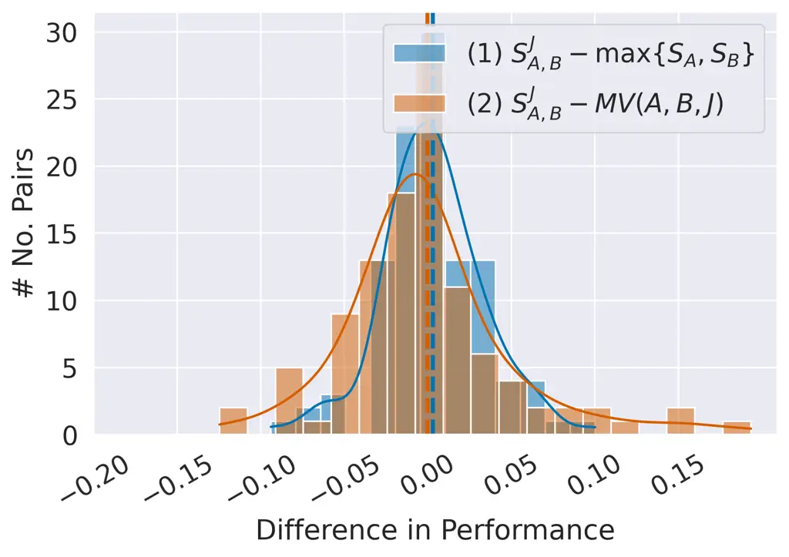

(a) LLama3.1 70B Full

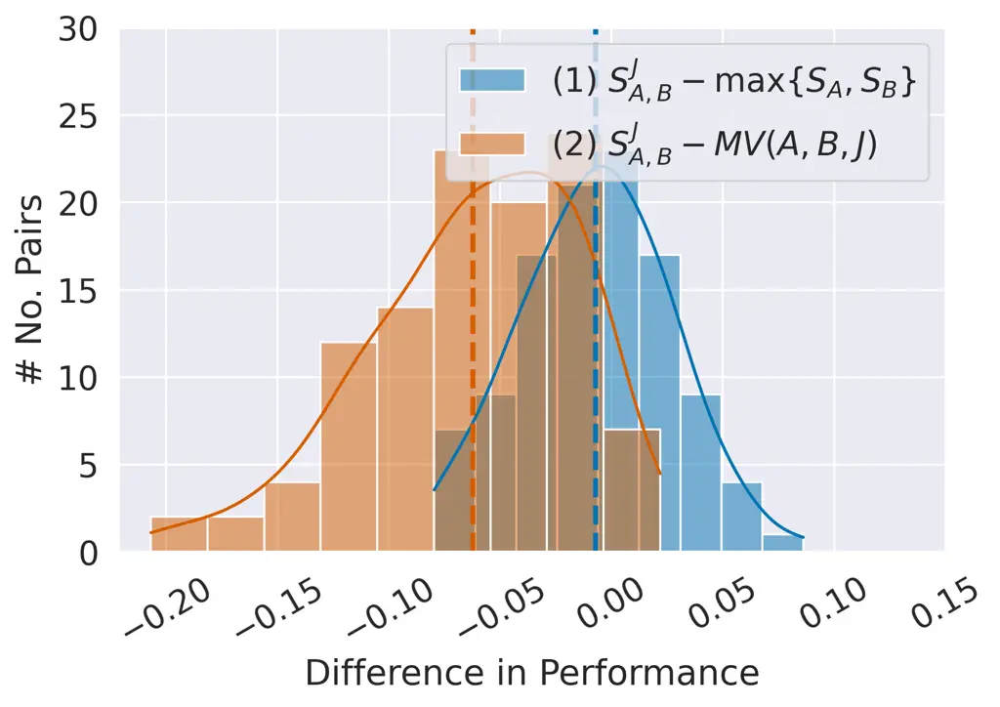

(b) Qwen 2.5 72B Full

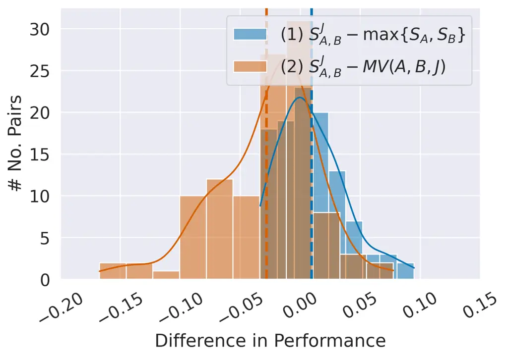

(c) Qwen 2.5 14B Full

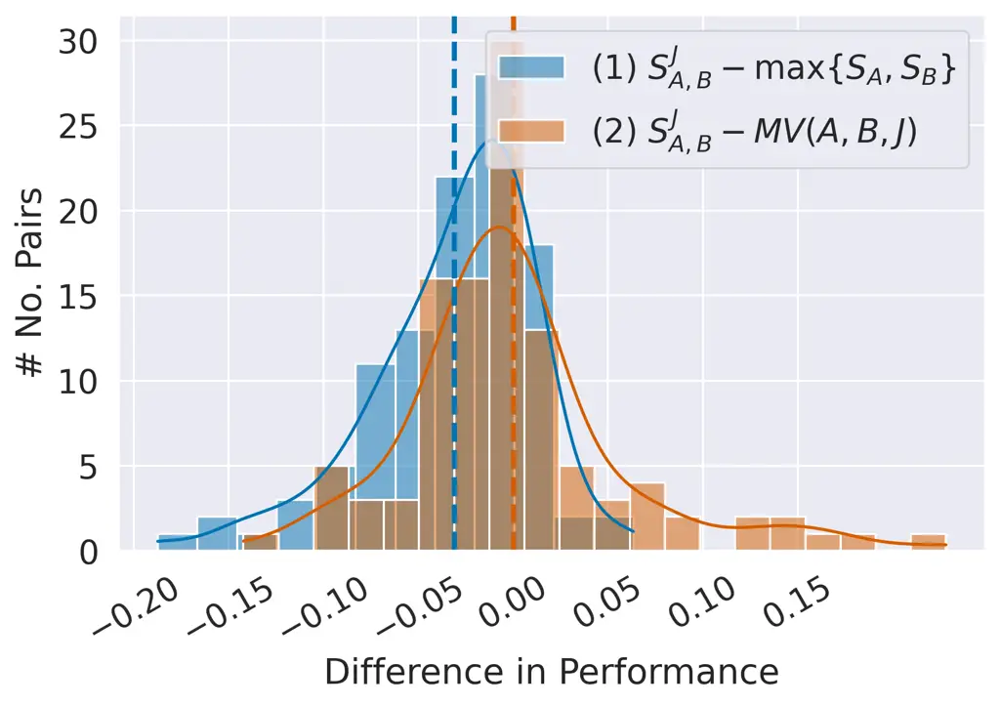

(d) Gemma 2 27B

Figure 6: The Y-axis describes the number of model pairs $`A,B`$ where
the answers chosen by the judge achieve a higher task performance than
the performances of the individual models (blue) or than the majority
vote (MV) of answers of $`A,B`$ and $`J`$ as candidate answer generator
(red). The X-axis describes the performance difference. A value of,
e.g., $`x=0.05`$ means the answers chosen by the judge result in a 5%
(absolute) performance increase.

### 7.3 Discussion

Our analysis of LLM judges on mathematical reasoning tasks reveals
several insights for practitioners, which we discuss in the following.
We separate our discussion into the sample level, i.e., the
interpretation of a single prediction, and aggregate level, i.e., the
interpretation of a set of predictions.

#### Sample level.

In Table 1, we find that LLM judges often achieve a strong judgment
performance ($`S^{J}_{A,B}`$ $`>80\%`$ accuracy) across tasks. While
this is a solid classification performance, it means that the prediction
is wrong in 20% of the cases which limits practical applicability. In
Section 4, we observe that LLM judges demonstrate high precision when
identifying correct answers from both models. This might be valuable for
filtering samples and curating training data or, e.g., self-training.
Nevertheless, one has to be careful how to use these because correctly
judged samples are biased towards simple samples. In summary, we do not
recommend fully relying on individual LLM judgments, especially not in
high-stakes domains such as legal or health care.

#### Aggregate level.

As shown in Figure 5, we find that LLM judges are consistently able to
select or rank models by their task performance. This is supported by
Section 5.1 where we show that a simple linear model can explain a high
share of the variance in judgment performance, given individual task
performances, suggesting that the performance difference of two
candidate models is linearly linked to the judgment outcome.

In summary, our results suggest that LLM judges are more effective and
consistent at aggregate-level comparisons than instance-level judgments,
for example when ranking or selecting which LLM is better for a
particular task when no ground truth data is available.

## 8 Conclusion

We conduct a thorough analysis of LLM judges on mathematical reasoning
tasks. We evaluate the judgment performance of eight models of different
sizes on three datasets. We find that larger judge models generally
outperform smaller judge models and that judges can reliably detect
whether both answers are correct. Our analysis reveals a strong
correlation between judgments and task performance, indicating that
judges tend to choose models of higher quality even if their answers are
incorrect. We hypothesize that LLM judges partially base their decisions
on linguistic cues in contrast to the reasoning within the answers. We
support this hypothesis with our experiments showing that 70% of the
judges’ decisions can be predicted using simple linguistic features such
as N-grams of part-of-speech tags. Lastly, our analysis finds that LLM
judges reliably detect LLMs of higher task performance but are not
reliably useable to improve task performance. Our results show that LLM
judges contain biases and suggest that practitioners should not blindly
trust LLM judges. We advise practitioners to carefully decide whether
LLM judges should be used in their particular application.

With this work, we set the stage for further research to investigate how
to understand, use, and improve LLM judges.

## 9 Limitations

Our analysis is primarily focused on mathematical reasoning datasets,
which allows us to explore judgments through the lens of verifiability,
i.e., problems that have a definitely correct answer. While this
approach provides valuable insights, it limits the generalizability of
our findings to other tasks or domains. Nevertheless, we want to
emphasize the importance of the class of verifiable tasks. For instance,
there is currently a focus on training so-called large reasoning models,
which demonstrate significant progress in solving complex problems such
as coding or maths. It is a possibility that an increased capability of
LLMs on verifiable tasks fuels scientific progress.

In our experiments, we focus on testing a single, specific prompt. It is
common knowledge that LLMs are highly sensitive to variations in prompt
phrasing, which can substantially influence their performance. However,
the resources available to us do not allow us to meet the computational
demands necessary to run our experiments with multiple prompts. Further,
our impression is that it is a custom approach to conduct LLM studies
using single prompts, as they are typically indicative of behavior.
Therefore we decided to run our analysis on full datasets with a single
prompt instead of using subsets of datasets with variations of the
prompt with mostly the same content.

## References

- AI@Meta (2024) AI@Meta. 2024. [Llama 3 model
  card](https://github.com/meta-llama/llama3/blob/main/MODEL_CARD.md).
- Bai et al. (2022) Yuntao Bai, Saurav Kadavath, Sandipan Kundu, Amanda
  Askell, Jackson Kernion, Andy Jones, Anna Chen, Anna Goldie, Azalia
  Mirhoseini, Cameron McKinnon, et al. 2022. Constitutional ai:
  Harmlessness from ai feedback. _arXiv preprint arXiv:2212.08073_.
- (3) Bangalore Principles, 2002. 2002. [The bangalore principles of
  judicial
  conduct](https://www.judicialintegritygroup.org/jig-principles).
  Available from the Judicial Integrity Group website.
- Bavaresco et al. (2024) Anna Bavaresco, Raffaella Bernardi, Leonardo
  Bertolazzi, Desmond Elliott, Raquel Fernández, Albert Gatt, Esam
  Ghaleb, Mario Giulianelli, Michael Hanna, Alexander Koller, André
  F. T. Martins, Philipp Mondorf, Vera Neplenbroek, Sandro Pezzelle,
  Barbara Plank, David Schlangen, Alessandro Suglia, Aditya K Surikuchi,
  Ece Takmaz, and Alberto Testoni. 2024. [Llms instead of human judges?
  a large scale empirical study across 20 nlp evaluation
  tasks](http://arxiv.org/abs/2406.18403).
- Breiman (2001) Leo Breiman. 2001. [Random
  forests](https://doi.org/10.1023/A:1010933404324). _Mach. Learn._,
  45(1):5–32.
- Cobbe et al. (2021) Karl Cobbe, Vineet Kosaraju, Mohammad Bavarian,
  Mark Chen, Heewoo Jun, Lukasz Kaiser, Matthias Plappert, Jerry Tworek,
  Jacob Hilton, Reiichiro Nakano, Christopher Hesse, and John
  Schulman. 2021. Training verifiers to solve math word problems. _arXiv
  preprint arXiv:2110.14168_.
- Doddapaneni et al. (2024) Sumanth Doddapaneni, Mohammed Safi Ur Rahman
  Khan, Sshubam Verma, and Mitesh M Khapra. 2024. [Finding blind spots
  in evaluator LLMs with interpretable
  checklists](https://doi.org/10.18653/v1/2024.emnlp-main.911). In
  _Proceedings of the 2024 Conference on Empirical Methods in Natural
  Language Processing_, pages 16279–16309, Miami, Florida, USA.
  Association for Computational Linguistics.
- Fahrmeir et al. (2013) Ludwig Fahrmeir, Thomas Kneib, Stefan Lang,
  Brian Marx, Ludwig Fahrmeir, Thomas Kneib, Stefan Lang, and Brian
  Marx. 2013. _Regression models_. Springer.
- Gemma Team et al. (2024) Google Gemma Team, Thomas Mesnard, Cassidy
  Hardin, Robert Dadashi, Surya Bhupatiraju, Shreya Pathak, Laurent
  Sifre, Morgane Rivière, Mihir Sanjay Kale, Juliette Love, Pouya Tafti,
  Léonard Hussenot, Pier Giuseppe Sessa, Aakanksha Chowdhery, Adam
  Roberts, Aditya Barua, Alex Botev, Alex Castro-Ros, Ambrose Slone,
  Amélie Héliou, Andrea Tacchetti, Anna Bulanova, Antonia Paterson, Beth
  Tsai, Bobak Shahriari, Charline Le Lan, Christopher A. Choquette-Choo,
  Clément Crepy, Daniel Cer, Daphne Ippolito, David Reid, Elena
  Buchatskaya, Eric Ni, Eric Noland, Geng Yan, George Tucker,
  George-Christian Muraru, Grigory Rozhdestvenskiy, Henryk Michalewski,
  Ian Tenney, Ivan Grishchenko, Jacob Austin, James Keeling, Jane
  Labanowski, Jean-Baptiste Lespiau, Jeff Stanway, Jenny Brennan, Jeremy
  Chen, Johan Ferret, Justin Chiu, Justin Mao-Jones, Katherine Lee,
  Kathy Yu, Katie Millican, Lars Lowe Sjoesund, Lisa Lee, Lucas Dixon,
  Machel Reid, Maciej Mikuła, Mateo Wirth, Michael Sharman, Nikolai
  Chinaev, Nithum Thain, Olivier Bachem, Oscar Chang, Oscar Wahltinez,
  Paige Bailey, Paul Michel, Petko Yotov, Rahma Chaabouni, Ramona
  Comanescu, Reena Jana, Rohan Anil, Ross McIlroy, Ruibo Liu, Ryan
  Mullins, Samuel L Smith, Sebastian Borgeaud, Sertan Girgin, Sholto
  Douglas, Shree Pandya, Siamak Shakeri, Soham De, Ted Klimenko, Tom
  Hennigan, Vlad Feinberg, Wojciech Stokowiec, Yu hui Chen, Zafarali
  Ahmed, Zhitao Gong, Tris Warkentin, Ludovic Peran, Minh Giang, Clément
  Farabet, Oriol Vinyals, Jeff Dean, Koray Kavukcuoglu, Demis Hassabis,
  Zoubin Ghahramani, Douglas Eck, Joelle Barral, Fernando Pereira, Eli
  Collins, Armand Joulin, Noah Fiedel, Evan Senter, Alek Andreev, and
  Kathleen Kenealy. 2024. [Gemma: Open models based on gemini research
  and technology](http://arxiv.org/abs/2403.08295).
- Hendrycks et al. (2021) Dan Hendrycks, Collin Burns, Saurav Kadavath,
  Akul Arora, Steven Basart, Eric Tang, Dawn Song, and Jacob
  Steinhardt. 2021. Measuring mathematical problem solving with the math
  dataset. _NeurIPS_.
- Hinton et al. (2014) Geoffrey Hinton, Jeff Dean, and Oriol
  Vinyals. 2014. Distilling the knowledge in a neural network. In _NIPS
  2014 Deep Learning Workshop_, pages 1–9.
- Jiang et al. (2023) Albert Q. Jiang, Alexandre Sablayrolles, Arthur
  Mensch, Chris Bamford, Devendra Singh Chaplot, Diego de las Casas,
  Florian Bressand, Gianna Lengyel, Guillaume Lample, Lucile Saulnier,
  Lélio Renard Lavaud, Marie-Anne Lachaux, Pierre Stock, Teven Le Scao,
  Thibaut Lavril, Thomas Wang, Timothée Lacroix, and William El
  Sayed. 2023. [Mistral 7b](http://arxiv.org/abs/2310.06825).
- Jiang et al. (2024) Albert Q. Jiang, Alexandre Sablayrolles, Antoine
  Roux, Arthur Mensch, Blanche Savary, Chris Bamford, Devendra Singh
  Chaplot, Diego de las Casas, Emma Bou Hanna, Florian Bressand, Gianna
  Lengyel, Guillaume Bour, Guillaume Lample, Lélio Renard Lavaud, Lucile
  Saulnier, Marie-Anne Lachaux, Pierre Stock, Sandeep Subramanian,
  Sophia Yang, Szymon Antoniak, Teven Le Scao, Théophile Gervet, Thibaut
  Lavril, Thomas Wang, Timothée Lacroix, and William El Sayed. 2024.
  [Mixtral of experts](http://arxiv.org/abs/2401.04088).
- Kim et al. (2024a) Seungone Kim, Jamin Shin, Yejin Cho, Joel Jang,
  Shayne Longpre, Hwaran Lee, Sangdoo Yun, Seongjin Shin, Sungdong Kim,
  James Thorne, and Minjoon Seo. 2024a. [Prometheus: Inducing
  fine-grained evaluation capability in language
  models](https://openreview.net/forum?id=8euJaTveKw). In _The Twelfth
  International Conference on Learning Representations_.
- Kim et al. (2024b) Seungone Kim, Juyoung Suk, Ji Yong Cho, Shayne
  Longpre, Chaeeun Kim, Dongkeun Yoon, Guijin Son, Yejin Cho, Sheikh
  Shafayat, Jinheon Baek, Sue Hyun Park, Hyeonbin Hwang, Jinkyung Jo,
  Hyowon Cho, Haebin Shin, Seongyun Lee, Hanseok Oh, Noah Lee, Namgyu
  Ho, Se June Joo, Miyoung Ko, Yoonjoo Lee, Hyungjoo Chae, Jamin Shin,
  Joel Jang, Seonghyeon Ye, Bill Yuchen Lin, Sean Welleck, Graham
  Neubig, Moontae Lee, Kyungjae Lee, and Minjoon Seo. 2024b. [The biggen
  bench: A principled benchmark for fine-grained evaluation of language
  models with language models](http://arxiv.org/abs/2406.05761).
- Koo et al. (2023) Ryan Koo, Minhwa Lee, Vipul Raheja, Jong Inn Park,
  Zae Myung Kim, and Dongyeop Kang. 2023. [Benchmarking cognitive biases
  in large language models as
  evaluators](http://arxiv.org/abs/2309.17012).
- Kwon et al. (2023) Woosuk Kwon, Zhuohan Li, Siyuan Zhuang, Ying Sheng,
  Lianmin Zheng, Cody Hao Yu, Joseph E. Gonzalez, Hao Zhang, and Ion
  Stoica. 2023. Efficient memory management for large language model
  serving with pagedattention. In _Proceedings of the ACM SIGOPS 29th
  Symposium on Operating Systems Principles_.
- Li et al. (2024) Junlong Li, Shichao Sun, Weizhe Yuan, Run-Ze Fan, hai
  zhao, and Pengfei Liu. 2024. [Generative judge for evaluating
  alignment](https://openreview.net/forum?id=gtkFw6sZGS). In _The
  Twelfth International Conference on Learning Representations_.
- Ling et al. (2017) Wang Ling, Dani Yogatama, Chris Dyer, and Phil
  Blunsom. 2017. [Program induction by rationale generation: Learning to
  solve and explain algebraic word
  problems](https://doi.org/10.18653/v1/P17-1015). In _Proceedings of
  the 55th Annual Meeting of the Association for Computational
  Linguistics (Volume 1: Long Papers)_, pages 158–167, Vancouver,
  Canada. Association for Computational Linguistics.
- Liu et al. (2024) Yiqi Liu, Nafise Sadat Moosavi, and Chenghua
  Lin. 2024. [Llms as narcissistic evaluators: When ego inflates
  evaluation scores](http://arxiv.org/abs/2311.09766).
- Liusie et al. (2024) Adian Liusie, Potsawee Manakul, and Mark
  Gales. 2024. [LLM comparative assessment: Zero-shot NLG evaluation
  through pairwise comparisons using large language
  models](https://aclanthology.org/2024.eacl-long.8). In _Proceedings of
  the 18th Conference of the European Chapter of the Association for
  Computational Linguistics (Volume 1: Long Papers)_, pages 139–151, St.
  Julian’s, Malta. Association for Computational Linguistics.
- Oh et al. (2024) Juhyun Oh, Eunsu Kim, Inha Cha, and Alice Oh. 2024.
  [The generative AI paradox in evaluation: “what it can solve, it may
  not evaluate”](https://aclanthology.org/2024.eacl-srw.19). In
  _Proceedings of the 18th Conference of the European Chapter of the
  Association for Computational Linguistics: Student Research Workshop_,
  pages 248–257, St. Julian’s, Malta. Association for Computational
  Linguistics.
- Panickssery et al. (2024) Arjun Panickssery, Samuel R. Bowman, and Shi
  Feng. 2024. [Llm evaluators recognize and favor their own
  generations](http://arxiv.org/abs/2404.13076).
- Pedregosa et al. (2011) F. Pedregosa, G. Varoquaux, A. Gramfort,
  V. Michel, B. Thirion, O. Grisel, M. Blondel, P. Prettenhofer,
  R. Weiss, V. Dubourg, J. Vanderplas, A. Passos, D. Cournapeau,
  M. Brucher, M. Perrot, and E. Duchesnay. 2011. Scikit-learn: Machine
  learning in Python. _Journal of Machine Learning Research_,
  12:2825–2830.
- Plank (2022) Barbara Plank. 2022. [The “problem” of human label
  variation: On ground truth in data, modeling and
  evaluation](https://doi.org/10.18653/v1/2022.emnlp-main.731). In
  _Proceedings of the 2022 Conference on Empirical Methods in Natural
  Language Processing_, pages 10671–10682, Abu Dhabi, United Arab
  Emirates. Association for Computational Linguistics.
- Raina et al. (2024) Vyas Raina, Adian Liusie, and Mark Gales. 2024.
  [Is llm-as-a-judge robust? investigating universal adversarial attacks
  on zero-shot llm assessment](http://arxiv.org/abs/2402.14016).
- Seabold and Perktold (2010) Skipper Seabold and Josef Perktold. 2010.
  statsmodels: Econometric and statistical modeling with python. In _9th
  Python in Science Conference_.
- Shaib et al. (2024) Chantal Shaib, Yanai Elazar, Junyi Jessy Li, and
  Byron C Wallace. 2024. [Detection and measurement of syntactic
  templates in generated
  text](https://doi.org/10.18653/v1/2024.emnlp-main.368). In
  _Proceedings of the 2024 Conference on Empirical Methods in Natural
  Language Processing_, pages 6416–6431, Miami, Florida, USA.
  Association for Computational Linguistics.
- Tan et al. (2024) Zhen Tan, Dawei Li, Song Wang, Alimohammad Beigi,
  Bohan Jiang, Amrita Bhattacharjee, Mansooreh Karami, Jundong Li,
  Lu Cheng, and Huan Liu. 2024. [Large language models for data
  annotation: A survey](http://arxiv.org/abs/2402.13446).
- Wang et al. (2024a) Peiyi Wang, Lei Li, Liang Chen, Zefan Cai, Dawei
  Zhu, Binghuai Lin, Yunbo Cao, Lingpeng Kong, Qi Liu, Tianyu Liu, and
  Zhifang Sui. 2024a. [Large language models are not fair
  evaluators](https://doi.org/10.18653/v1/2024.acl-long.511). In
  _Proceedings of the 62nd Annual Meeting of the Association for
  Computational Linguistics (Volume 1: Long Papers)_, pages 9440–9450,
  Bangkok, Thailand. Association for Computational Linguistics.
- Wang et al. (2024b) Yidong Wang, Zhuohao Yu, Wenjin Yao, Zhengran
  Zeng, Linyi Yang, Cunxiang Wang, Hao Chen, Chaoya Jiang, Rui Xie,
  Jindong Wang, Xing Xie, Wei Ye, Shikun Zhang, and Yue Zhang. 2024b.
  [PandaLM: An automatic evaluation benchmark for LLM instruction tuning
  optimization](https://openreview.net/forum?id=5Nn2BLV7SB). In _The
  Twelfth International Conference on Learning Representations_.
- Wang et al. (2024c) Zhilin Wang, Yi Dong, Olivier Delalleau, Jiaqi
  Zeng, Gerald Shen, Daniel Egert, Jimmy J. Zhang, Makesh Narsimhan
  Sreedhar, and Oleksii Kuchaiev. 2024c. [Helpsteer2: Open-source
  dataset for training top-performing reward
  models](http://arxiv.org/abs/2406.08673).
- Wei et al. (2022) Jason Wei, Xuezhi Wang, Dale Schuurmans, Maarten
  Bosma, brian ichter, Fei Xia, Ed H. Chi, Quoc V Le, and Denny
  Zhou. 2022. [Chain of thought prompting elicits reasoning in large
  language models](https://openreview.net/forum?id=_VjQlMeSB_J). In
  _Advances in Neural Information Processing Systems_.
- West et al. (2024) Peter West, Ximing Lu, Nouha Dziri, Faeze Brahman,
  Linjie Li, Jena D. Hwang, Liwei Jiang, Jillian Fisher, Abhilasha
  Ravichander, Khyathi Chandu, Benjamin Newman, Pang Wei Koh, Allyson
  Ettinger, and Yejin Choi. 2024. [The generative AI paradox: “what it
  can create, it may not
  understand”](https://openreview.net/forum?id=CF8H8MS5P8). In _The
  Twelfth International Conference on Learning Representations_.
- Wolf et al. (2020) Thomas Wolf, Lysandre Debut, Victor Sanh, Julien
  Chaumond, Clement Delangue, Anthony Moi, Pierric Cistac, Tim Rault,
  Remi Louf, Morgan Funtowicz, Joe Davison, Sam Shleifer, Patrick von
  Platen, Clara Ma, Yacine Jernite, Julien Plu, Canwen Xu, Teven
  Le Scao, Sylvain Gugger, Mariama Drame, Quentin Lhoest, and Alexander
  Rush. 2020. [Transformers: State-of-the-art natural language
  processing](https://doi.org/10.18653/v1/2020.emnlp-demos.6). In
  _Proceedings of the 2020 Conference on Empirical Methods in Natural
  Language Processing: System Demonstrations_, pages 38–45, Online.
  Association for Computational Linguistics.
- Wu and Aji (2025) Minghao Wu and Alham Fikri Aji. 2025. [Style over
  substance: Evaluation biases for large language
  models](https://aclanthology.org/2025.coling-main.21/). In
  _Proceedings of the 31st International Conference on Computational
  Linguistics_, pages 297–312, Abu Dhabi, UAE. Association for
  Computational Linguistics.
- Wu et al. (2024) Tianhao Wu, Weizhe Yuan, Olga Golovneva, Jing Xu,
  Yuandong Tian, Jiantao Jiao, Jason Weston, and Sainbayar
  Sukhbaatar. 2024. [Meta-rewarding language models: Self-improving
  alignment with llm-as-a-meta-judge](http://arxiv.org/abs/2407.19594).
- Xu et al. (2024) Wenda Xu, Guanglei Zhu, Xuandong Zhao, Liangming Pan,
  Lei Li, and William Yang Wang. 2024. [Pride and prejudice: Llm
  amplifies self-bias in
  self-refinement](http://arxiv.org/abs/2402.11436).
- Yang et al. (2024) An Yang, Baosong Yang, Binyuan Hui, Bo Zheng, Bowen
  Yu, Chang Zhou, Chengpeng Li, Chengyuan Li, Dayiheng Liu, Fei Huang,
  Guanting Dong, Haoran Wei, Huan Lin, Jialong Tang, Jialin Wang, Jian
  Yang, Jianhong Tu, Jianwei Zhang, Jianxin Ma, Jin Xu, Jingren Zhou,
  Jinze Bai, Jinzheng He, Junyang Lin, Kai Dang, Keming Lu, Keqin Chen,
  Kexin Yang, Mei Li, Mingfeng Xue, Na Ni, Pei Zhang, Peng Wang,
  Ru Peng, Rui Men, Ruize Gao, Runji Lin, Shijie Wang, Shuai Bai, Sinan
  Tan, Tianhang Zhu, Tianhao Li, Tianyu Liu, Wenbin Ge, Xiaodong Deng,
  Xiaohuan Zhou, Xingzhang Ren, Xinyu Zhang, Xipin Wei, Xuancheng Ren,
  Yang Fan, Yang Yao, Yichang Zhang, Yu Wan, Yunfei Chu, Yuqiong Liu,
  Zeyu Cui, Zhenru Zhang, and Zhihao Fan. 2024. Qwen2 technical report.
  _arXiv preprint arXiv:2407.10671_.
- Young et al. (2024) Alex Young, Bei Chen, Chao Li, Chengen Huang,
  Ge Zhang, Guanwei Zhang, Heng Li, Jiangcheng Zhu, Jianqun Chen, Jing
  Chang, Kaidong Yu, Peng Liu, Qiang Liu, Shawn Yue, Senbin Yang,
  Shiming Yang, Tao Yu, Wen Xie, Wenhao Huang, Xiaohui Hu, Xiaoyi Ren,
  Xinyao Niu, Pengcheng Nie, Yuchi Xu, Yudong Liu, Yue Wang, Yuxuan Cai,
  Zhenyu Gu, Zhiyuan Liu, and Zonghong Dai. 2024. [Yi: Open foundation
  models by 01.ai](http://arxiv.org/abs/2403.04652).
- Yuan et al. (2024) Weizhe Yuan, Richard Yuanzhe Pang, Kyunghyun Cho,
  Xian Li, Sainbayar Sukhbaatar, Jing Xu, and Jason Weston. 2024.
  [Self-rewarding language models](http://arxiv.org/abs/2401.10020).
- Zheng et al. (2023) Lianmin Zheng, Wei-Lin Chiang, Ying Sheng, Siyuan
  Zhuang, Zhanghao Wu, Yonghao Zhuang, Zi Lin, Zhuohan Li, Dacheng Li,
  Eric Xing, Hao Zhang, Joseph E. Gonzalez, and Ion Stoica. 2023.
  [Judging LLM-as-a-judge with MT-bench and chatbot
  arena](https://openreview.net/forum?id=uccHPGDlao). In _Thirty-seventh
  Conference on Neural Information Processing Systems Datasets and
  Benchmarks Track_.

## Appendix A Experimental Setup

We provide further details on the general setup described in Section 3.
Specifically, we include statistics and examples of the datasets,
additional information on the models used, and the exact prompts
employed in this study.

### A.1 Datasets

Additional information about the datasets is given in Table 4, which
presents an overview of the dataset statistics. Note that for the MATH
dataset, we only include the most challenging questions, called levels 4
and 5, in the dataset. Notably, it has ground truth answer sequences
that are, on average, almost three times longer than those in other
datasets.

In Table 5, we provide examples of questions and their corresponding
answers from the ground truth. Note that these examples were used for
few-shot prompting.

|          | \# questions | Avg.                   | Avg.                 |
| -------- | ------------ | ---------------------- | -------------------- |
|          |              | \# question characters | \# answer characters |
| AQUA-RAT | 254          | 239.1                  | 203.1                |
| MATH     | 1516         | 216.5                  | 643.9                |
| GSM8K    | 1319         | 239.9                  | 292.9                |

Table 4: An overview of dataset size and text length.

|          | Question                                                                                                                                                                                                                                                                | Answer                                                                                                                                                                                                                                                                                                                                                                |
| -------- | ----------------------------------------------------------------------------------------------------------------------------------------------------------------------------------------------------------------------------------------------------------------------- | --------------------------------------------------------------------------------------------------------------------------------------------------------------------------------------------------------------------------------------------------------------------------------------------------------------------------------------------------------------------- |
| AQUA-RAT | Two friends plan to walk along a 43-km trail, starting at opposite ends of the trail at the same time. If Friend P’s rate is 15% faster than Friend Q’s, how many kilometers will Friend P have walked when they pass each other? Options: A)21 B)21.5 C)22 D)22.5 E)23 | If Q complete x kilometers, then P completes 1.15x kilometers. x + 1.15x = 43 2.15x=43 x = 43/2.15 = 20 Then P will have have walked 1.15\*20=23 km. The answer is E. \#### E                                                                                                                                                                                         |
| GSM8K    | Natalia sold clips to 48 of her friends in April, and then she sold half as many clips in May. How many clips did Natalia sell altogether in April and May?                                                                                                             | Natalia sold 48/2 = \<\<48/2=24\>\>24 clips in May. Natalia sold 48+24 = \<\<48+24=72\>\>72 clips altogether in April and May. \#### 72                                                                                                                                                                                                                               |
| MATH     | Mr. Madoff invests 1000 dollars in a fund that compounds annually at a constant interest rate. After three years, his investment has grown to 1225 dollars. What is the annual interest rate, as a percentage? (Round your answer to the nearest integer.)              | Let $`r`$ be the annual interest rate. Then after three years, Mr. Madoff’s investment is $`1000\cdot\left(1+\frac{r}{100}\right)^{3}`$, so $`1000\cdot\left(1+\frac{r}{100}\right)^{3}=1225.`$ Then $`\left(1+\frac{r}{100}\right)^{3}=1.225,`$so $`[1+\frac{r}{100}=\sqrt[3]{1.225}=1.069987\dots,`$ which means $`r=\boxed{7}`$, to the nearest integer. \#### 7.0 |

Table 5: Example of ground truth answers used for few-shot prompting.

### A.2 Models

We execute all models using the VLLM software for LLM serving Kwon
et al. (2023). The weights for all models are accessible through
Huggingface Transformers Wolf et al. (2020). Table 6 includes hyperlinks
to each model for easy reference.

| Model         | URL                                                                                                                  |
| ------------- | -------------------------------------------------------------------------------------------------------------------- |
| Llama 3.1 70B | [https://huggingface.co/meta-llama/Llama-3.1-70B-Instruct](https://huggingface.co/meta-llama/Llama-3.1-70B-Instruct) |
| Qwen 2.5 72B  | [https://huggingface.co/Qwen/Qwen2.5-72B-Instruct](https://huggingface.co/Qwen/Qwen2.5-72B-Instruct)                 |
| Qwen 2.5 14B  | [https://huggingface.co/Qwen/Qwen2.5-14B-Instruct](https://huggingface.co/Qwen/Qwen2.5-14B-Instruct)                 |
| Gemma 2 27B   | [https://huggingface.co/google/gemma-2-27b-it](https://huggingface.co/google/gemma-2-27b-it)                         |
| Qwen 2.5 7B   | [https://huggingface.co/Qwen/Qwen2.5-7B-Instruct](https://huggingface.co/Qwen/Qwen2.5-7B-Instruct)                   |
| Gemma 2 9B    | [https://huggingface.co/google/gemma-1.1-9b-it](https://huggingface.co/google/gemma-1.1-9b-it)                       |
| Llama 3.1 8B  | [https://huggingface.co/meta-llama/Llama-3.1-8B-Instruct](https://huggingface.co/meta-llama/Llama-3.1-8B-Instruct)   |
| Gemma 2 2B    | [https://huggingface.co/google/gemma-1.1-2b-it](https://huggingface.co/google/gemma-1.1-2b-it)                       |

Table 6: Used models and corresponding hyperlinks.

### A.3 Prompts


Figure 7: The prompt to solve tasks. Few-shots and actual questions are
filled in within “\<\<” and “\>\>” symbols.


Figure 8: Judge Prompt. Candidate answers are filled in within “\<\<”
and “\>\>” symbols.

We used two different prompts within this project. In general, we
designed the prompts to be minimial, by assigning a minimal personality,
a quick task description, and description of the output format. The
prompt shown in Figure 7 is used for the candidate solution generation
for all datasets. Examples of the few-shots are in Table 5. The prompt
for the judges is given in Figure 8. Note that we run experiments for
both orders of the answers of the models $`A`$ and $`B`$.

### A.4 Infrastructure

The experiments were run on NVIDIA A100 and NVIDIA H100. The judgments
used in Section 4 took around 3 day equivalents on 4 A100 40GB. Using 2
H100 90GB and 4 A100 40 GB it took less than 2 days.

## Appendix B General Performance

This section provides additional information related to Section 4.
Specifically, we present the task performance of all models across all
datasets, as well as the judging performance of all models when used as
judges.

### B.1 Task Performance

|               |       |          |       |
| ------------- | ----- | -------- | ----- |
|               | GSM8K | AQUA-RAT | MATH  |
| Llama 3.1 70B | 93.25 | 78.57    | 47.11 |
| Qwen 2.5 72B  | 95.07 | 83.73    | 73.86 |
| Qwen 2.5 14B  | 93.48 | 82.54    | 64.47 |
| Gemma 2 27B   | 85.97 | 67.46    | 38.80 |
| Qwen 2.5 7B   | 88.10 | 75.40    | 60.31 |
| Gemma 2 9B    | 80.52 | 61.51    | 31.31 |
| Llama 3.1 8B  | 72.40 | 61.51    | 20.69 |
| Gemma 2 2B    | 37.53 | 26.98    | 7.15  |

Table 7: Task performance of the investigated models.

In various contexts in this work, the task performance of the individual
models is essential. Therefore, we provide the accuracy of all models
and all datasets in Table 7.

### B.2 Judging performance per model pair


(a) LLama 3.1 70B


(b) Qwen 2.5 72B


(c) Qwen 2.5 14B


(d) Gemma 2 27B

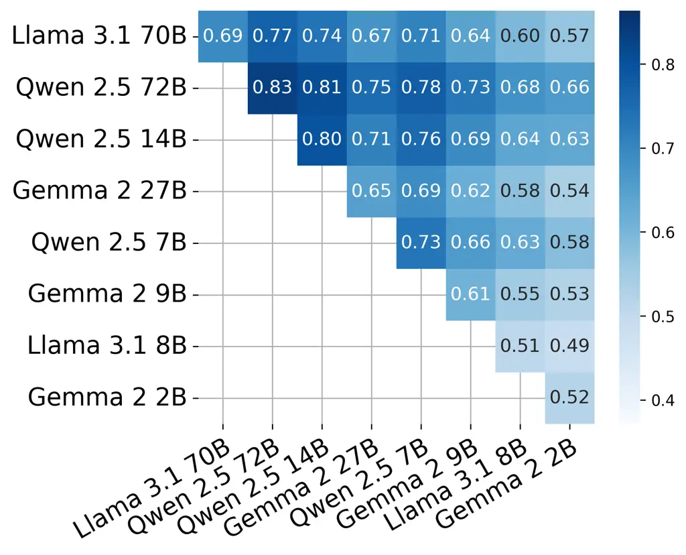

(e) Qwen 2.5 7B

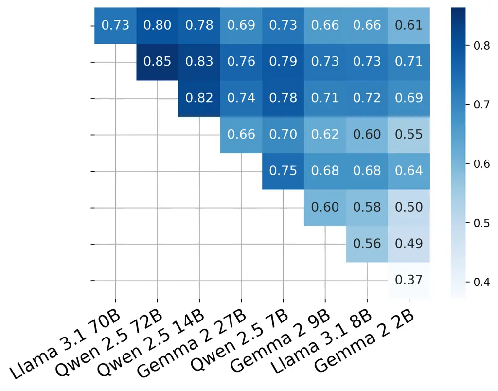

(f) Gemma 2 9B

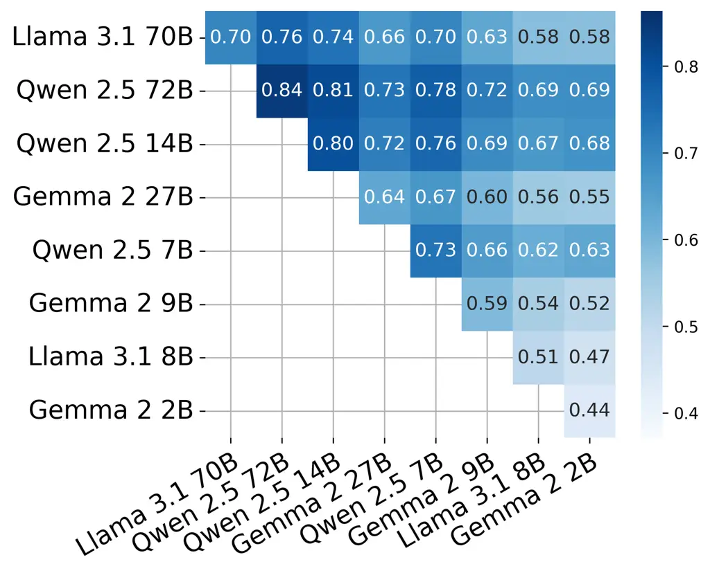

(g) LLama 3.1 8B

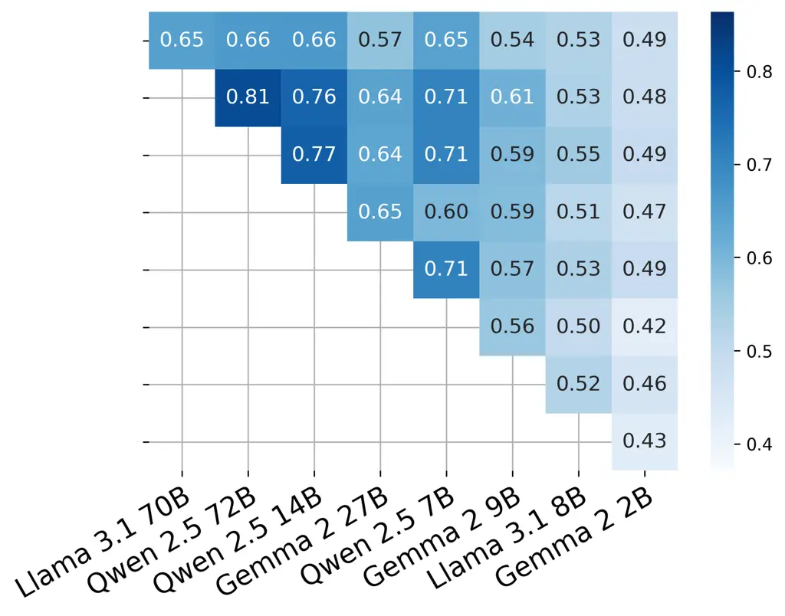

(h) Gemma 2 2B

Figure 9: Performance $`S^{J}_{A,B}`$ of LLM judges on model pairs,
averaged across datasets.

We conduct experiments with all eight models serving as judges. We
present the performance metrics of all judges across all model pairs in
Figure 9.

## Appendix C Examples

### C.1 Example Subset Performance

| Judge         | model A      | model B       | dataset  | $`S_{A}`$ | $`S_{B}`$ | $`S^{J}_{A,B}`$ | No. Samples |
| ------------- | ------------ | ------------- | -------- | --------- | --------- | --------------- | ----------- |
| Llama 3.1 70B | Qwen 2.5 14B | Gemma 2 2B    | MATH     | 64.50     | 7.10      | 94.60           | 1655        |
| Llama 3.1 70B | Qwen 2.5 72B | Gemma 2 2B    | AQUA-RAT | 83.70     | 27.00     | 94.50           | 309         |
| Llama 3.1 70B | Qwen 2.5 7B  | Gemma 2 2B    | MATH     | 60.30     | 7.10      | 94.00           | 1520        |
| Llama 3.1 70B | Qwen 2.5 72B | Qwen 2.5 7B   | AQUA-RAT | 83.70     | 75.40     | 62.50           | 64          |
| Llama 3.1 70B | Qwen 2.5 7B  | Qwen 2.5 14B  | AQUA-RAT | 75.40     | 82.50     | 42.30           | 26          |
| Llama 3.1 70B | Qwen 2.5 72B | Qwen 2.5 72B  | MATH     | 73.90     | 73.90     | 49.50           | 206         |
| Llama 3.1 70B | Gemma 2 27B  | Qwen 2.5 14B  | AQUA-RAT | 67.50     | 82.50     | 15.00           | 20          |
| Llama 3.1 70B | Gemma 2 2B   | Qwen 2.5 14B  | GSM8K    | 37.50     | 93.50     | 15.00           | 20          |
| Llama 3.1 70B | Gemma 2 2B   | Llama 3.1 70B | MATH     | 7.10      | 47.10     | 14.50           | 62          |

Table 8: Examples of judgement performances on subsets where model $`A`$
is correct and model $`B`$ is incorrect.

To better understand the correlation observed in Figure 4, we provide
examples of these subsets, which can be seen in Table 8. These examples
include the following details: the judge, the compared models, the
dataset, the performance of the correct model on the dataset (denoted by
$`S_{A}`$), the performance of the incorrect model on the dataset
$`S_{B}`$, the judgment performance on the subset (denoted by
$`S^{J}_{A,B}`$), and the size of the subset. We provide the three
subsets with the highest performance, the three subsets with the lowest
performance, and three random subsets where Llama 3.1 70B is the judge.

## Appendix D Statistical Methodology

We describe the statistical background for the tests applied in Section 6. All predictions and statistical tests in Section 6 were performed
using the statsmodels library Seabold and Perktold (2010).

### D.1 Coefficient of Determination

The coefficient of determination, $`R^{2}`$, for evaluation of linear
regression models (Fahrmeir et al., 2013) is defined as follows:

```math
R^{2}=\frac{\sum_{i=1}^{n}(\hat{y}_{i}-\bar{y})^{2}}{\sum_{i=1}^{n}(y_{i}-\bar{y})^{2}}
```

$`R^{2}`$ measures the share of the variance in $`Y`$ explained by its
covariation with the features $`\mathbf{X}`$ included in the model by
dividing the variation of the predicted values $`\hat{y}_{i}`$ by the
variation of the true target values $`y_{i}`$. If the features
$`\mathbf{X}`$ have high explanatory power for $`Y`$, the
$`\hat{y}_{i}`$ will be close to the $`y_{i}`$ and $`R^{2}`$ will be
close to 1, while in the extreme case of no correlation between
$`\mathbf{X}`$ and $`Y`$ the arithmetic mean is the best estimate (i.e.,
$`\hat{y}_{i}=\bar{y}\;\forall\;i=1,\dots,n`$) resulting in $`R^{2}=0`$.

### D.2 Overall-F-Test

The Overall-F-Test is built upon $`R^{2}`$ and tests whether the overall
model is of any significant value for explaining the variation of the
target variable. The F-distributed test statistic is calculated as

```math
\frac{R^{2}}{1-R^{2}}\cdot\frac{n-p-1}{p},
```

where $`R^{2}`$ is the coefficient of determination, $`n`$ is the number
of observations, and $`p`$ is the number of covariates included in the
model (i.e., the number of estimated coefficients excluding the
intercept). The hypotheses that can be tested this way are

```math
H_{0}:\beta_{1}=\beta_{2}=\dots=\beta_{p}=0
```

vs.

```math
\qquad H_{1}:\beta_{j}\neq 0\;\mbox{for at least one}\;j\in\{1,\dots,p\}.
```

So from a rejection of $`H_{0}`$, it can be concluded that at least one
of the included features exhibits explanatory power for the variation of
the target variable.

### D.3 Multiple Testing

Since we conduct multiple statistical tests within the scope of one
research project, it is important to consider multiple testing as a
potential problem resulting in false positive findings. The p-values
from our tests, however, also satisfy a significance level resulting
from a Bonferroni Correction of the typical significance level of 5%.

## Appendix E Sample-level Analysis

We utilize Scikit-learn Pedregosa et al. (2011) library to train and
evaluate the Logistic Regression and Random Forest Model. We use the
standard settings for the Logistic Regression model. We use the Random
Forests model with 1500 estimators, and standard settings apart from
that.

During preprocessing, we use simple word splittling by spaces. We employ
the english stop word removal integreated into Scikit-learn. We set the
maximum number of features to 5,000, for the N-Gram of part-of-speech
tags, we set the N-gram range from 5-grams up to 13-grams, following
settings of Shaib et al. (2024). For training, we use the Scikit-learn
Pedregosa et al. (2011) library. The running time was negligible.

In Table 9

| Model         | Both correct | A correct | B correct | Both incorrect |
| ------------- | ------------ | --------- | --------- | -------------- |
| Llama 3.1 70B | 51.8         | 18.1      | 21.7      | 8.4            |
| Qwen 2.5 72B  | 54.9         | 19.6      | 19.8      | 5.6            |
| Qwen 2.5 14B  | 50.2         | 20.0      | 23.0      | 6.9            |
| Gemma 2 27B   | 52.6         | 15.9      | 15.4      | 16.0           |

Table 9: Percentage of predictions individual models made.
