# Length Desensitization in Direct Preference Optimization

Wei Liu ^(†)^(†)thanks: Equal contribution.^(†)^(†)thanks: Work done
during an internship at Meituan. Affiliation: Shanghai Jiao Tong
University Email: [liuw515@sjtu.edu.cn](mailto:)    Yang
Bai¹¹footnotemark: 1 Affiliation: Meituan Inc.
Email: [baiyang28@meituan.com](mailto:)    Chengcheng Han
Affiliation: Meituan Inc.    Rongxiang Weng Affiliation: Meituan Inc.   
Jun Xu Affiliation: Meituan Inc.    Xuezhi Cao Affiliation: Meituan Inc.
   Jingang Wang Affiliation: Meituan Inc.    Xunliang Cai
Affiliation: Meituan Inc.

###### Abstract

Direct Preference Optimization (DPO) is widely utilized in the
Reinforcement Learning from Human Feedback (RLHF) phase to align Large
Language Models (LLMs) with human preferences, thereby enhancing both
their harmlessness and efficacy. However, it has been observed that DPO
tends to over-optimize for verbosity, which can detrimentally affect
both performance and user experience. In this paper, we conduct an
in-depth theoretical analysis of DPO’s optimization objective and reveal
a strong correlation between its implicit reward and data length. This
correlation misguides the optimization direction, resulting in length
sensitivity during the DPO training and leading to verbosity. To address
this issue, we propose a length-desensitization improvement method for
DPO, termed LD-DPO. The proposed method aims to desensitize DPO to data
length by decoupling explicit length preference, which is relatively
insignificant, from the other implicit preferences, thereby enabling
more effective learning of the intrinsic preferences. We utilized two
settings (Base and Instruct) of Llama2-13B, Llama3-8B, and Qwen2-7B for
experimental validation on various benchmarks including MT-Bench and
AlpacaEval 2. The experimental results indicate that LD-DPO consistently
outperforms DPO and other baseline methods, achieving more concise
responses with a 10-40% reduction in length compared to DPO. We
conducted in-depth experimental analyses to demonstrate that LD-DPO can
indeed achieve length desensitization and align the model more closely
with human-like preferences.

“Brevity is the Soul of Wit.”

—William Shakespeare

|     |
| --- |
|     |

## 1 Introduction

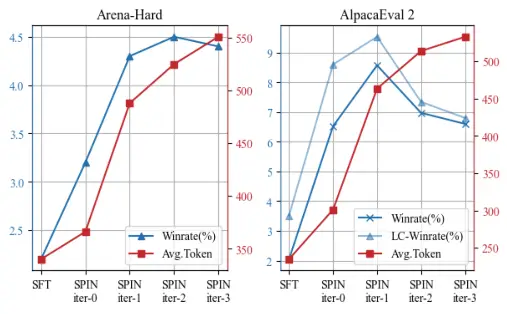

Figure 1: Performance of iterative DPO model(Chen et al., 2024d) on
Arena-Hard and Alpacaeval 2.

Large Language Models (LLMs) have revolutionized Natural Language
Processing (NLP) by empowering machines to generate human-like text,
comprehend intricate context, and execute a wide range of linguistic
tasks with unprecedented accuracy(Ouyang et al., 2022; Chang et al.,
2024; Liu et al., 2023). Aligning LLMs with human values and preferences
through learning from human feedback is crucial to ensuring these models
are helpful, honest, and harmless. Among the various methods to achieve
effective alignment (Dai et al., 2024; Yuan et al., 2024a), Direct
Preference Optimization (DPO) has emerged as a promising technique
(Rafailov et al., 2024), giving rise to numerous derivative algorithms
(Hong et al., 2024; Chen et al., 2024b; Ethayarajh et al., 2024). DPO
eliminates the reliance on online Reward Models (RMs) by
reparameterizing the reward function in Reinforcement Learning from
Human Feedback (RLHF), thereby implementing a simple and stable offline
preference learning paradigm. Among the dimensions of human language
preferences, detailedness is one of the most straightforward categories
that current alignment algorithms can effortlessly capture, as longer
texts tend to be richer in content. However, it has been demonstrated
that DPO is susceptible to an over-optimization issue in this particular
preference dimension (Xu et al., 2024). As illustrated in Fig.1, the
model post-DPO tends to generate longer responses. However, excessively
long responses can result in performance degradation, particularly
impacting its instruction-following and reasoning capabilities (Ding
et al., 2023; Yuan et al., 2024b).

The phenomenon of verbose response caused by DPO is often attributed to
the presence of length bias in the training data (Park et al., 2024;
Singhal et al., 2023). This bias arises from an inherent length
preference in offline RMs (Wang et al., 2024; Chen et al., 2024c), which
results in most preferred responses (chosen) being significantly longer
than the dispreferred ones (rejected). Based on this assumption, Yuan
et al. (2024b) proposed LIFT-DPO to mitigate the length bias in the
training data through a prompt enhancement strategy. Recently, more
researchers have questioned the efficacy of the DPO algorithm itself.
Park et al. (2024) introduce a regularization term in the optimization
objective to adjust the weight of the gradient according to the length
difference between the preference pairs. Meng et al. (2024) propose a
reference-model-free method SimPO, which used the likelihood averaged by
length to eliminate the effect of data length. Lu et al. (2024)
introduce a down-sampling approach on KL divergence to eliminate the
length reliance of DPO. Though Lu et al. (2024) have conducted a
statistical analysis of the implicit rewards during the DPO process and
found that the rewards might be overestimated or underestimated due to
length, the theoretical explanation of why DPO encounters this issue
remains inadequately explored. Meanwhile, experimental results
demonstrate that these methods either fail to achieve significant length
control or compromise the performance to some extent.

In this paper, we attribute the verbosity problem to the length
sensitivity of DPO. Specifically, the partial derivatives of the
optimization objective of DPO with respect to the chosen and rejected
responses are inversely proportional to their respective likelihood
(Feng et al., 2024a). Since the likelihood, which is calculated as the
product of the conditional probabilities of each token, decreases
rapidly with increasing sequence length, longer chosen or rejected
responses are disproportionately favored in the optimization process.
Moreover, the length disparity between the chosen and rejected responses
will substantially skew the optimization objective, ultimately biasing
the direction of optimization. Since decreasing the likelihood of any
rejected may not affect response length, the primary cause of the
verbosity problem is the model’s tendency to increase the likelihood of
longer chosen responses while ignoring shorter ones.

To address this issue, we propose an offline optimization algorithm for
Length Desensitization of DPO, termed LD-DPO. In this approach, we
decompose the likelihood of the longer response in a preference pair
into the product of the likelihood of the public-length portion and the
likelihood of the excessive portion. The excessive portion is further
broken down into verbosity preference (due to excess length) and other
preferences. LD-DPO aims to mitigate the verbosity preference caused by
excessively long responses, thereby smoothing the relationship between
the likelihood and response length. This adjustment reduces the
influence of length on the optimization direction in DPO, effectively
achieving length desensitization.

We employ two settings (Base and Instruct) of Llama2-13B (Touvron
et al., 2023), Llama3-8B (AI@Meta, 2024), and Qwen2-7B (Yang et al., 2024) for experimental validation on various benchmarks including
MT-Bench (Zheng et al., 2024) and AlpacaEval 2 (Dubois et al., 2024).
The experimental results indicate that LD-DPO consistently outperforms
DPO and other baseline methods, achieving more concise responses with a
10-40% reduction in length compared to DPO. Moreover, experiment on
reasoning-specific benchmarks shows that LD-DPO significantly improves
models’ reasoning performance. An interesting phenomenon is also
observed: the length sensitivity during DPO training exhibits a negative
correlation with the underlying model capability. we then define
$`\gamma`$ as the length sensitivity coefficient and conduct a detailed
analysis of the DPO length sensitivity across models of varying
capabilities, we believe $`\gamma`$ is instructive for the entire
preference optimization process. Our contributions are summarized as
follows:

- •
  To the best of our knowledge, we are the first to define the length
  sensitivity of DPO and provide theoretical validation for this
  phenomenon.
- •
  We propose LD-DPO, a length-desensitization preference optimization
  algorithm that mitigates length sensitivity by decoupling length
  preference from the reward.
- •
  We experimentally verify that LD-DPO enables the model to achieve
  superior results with more concise responses, reducing response length
  by 10-40% compared to DPO.

## 2 Preliminaries

In this section, we will outline the standard pipeline of Reinforcement
Learning From Human Feedback (RLHF) (Bai et al., 2022; Ziegler et al., 2019) and the Direct Preference Optimization (DPO) algorithm (Rafailov
et al., 2024), which is essential for the analysis of the length
sensitivity of DPO and the motivation of our method.

### 2.1 Reinforcement Learning From Human Feedback

The standard pipeline of RLHF aligns LLMs with human preferences in
three stages:  
Supervised Fine-tuning (SFT) stage: In this stage, labeled data is used
to fine-tune the pre-trained model so that it acquires a basic ability
to follow commands and carry on a fluent conversation, to obtain model
$`\pi^{SFT}(y|x)`$.  
Reward Model (RM) Training stage: In the second stage,
$`\pi^{SFT}(y|x)`$ is utilized by prompts $`x`$ to generate pairs of
responses $`(y_{1},y_{2})\sim\pi^{SFT}(y|x)`$, which are then labeled by
human annotators as a preferred answer $`y_{w}`$ and a dispreferred
answer $`y_{l}`$, denoted as $`y_{w}>y_{l}`$. To predict these
preferences, previous works employ the Bradley-Terry (BT) RM (Bradley &
Terry, 1952), which essentially constructs a pairwise contrast:

```math
\begin{split}\mathcal{L}_{RM}=-\log\frac{exp(r_{\phi}(x,y_{w}))}{exp(r_{\phi}(x,y_{w}))+exp(r_{\phi}(x,y_{l}))}.\end{split} \tag{1}
```

Reinforcement Learning (RL) stage: In the Final Stage, the reward
function is used to provide feedback to the language model. The
optimization objective is formulated as:

```math
\displaystyle\begin{aligned} \max_{\pi_{\theta}}\mathbb{E}_{x\sim\mathcal{D},y\sim\pi_{\theta}(y|x)}[r_{\phi}(x,y)]-\beta\mathbb{D}_{KL}[\pi_{\theta}(y|x)\|\pi_{ref}(y|x)],\end{aligned} \tag{2}
```

where $`\beta`$ is a parameter controlling the deviation from the
reference model $`\pi_{ref}`$, namely the initial SFT model
$`\pi^{SFT}(y|x)`$, and in practice, the language model $`\pi_{\theta}`$
is also initialized to $`\pi^{SFT}(y|x)`$. This objective is optimized
using a general purpose RL algorithm, such as PPO (Wu et al., 2023).

### 2.2 Direct Preference Optimization

Direct Preference Optimization (DPO) is one of the most popular offline
preference optimization methods, which starts with the same objective as
Eq.2, reparameterizes the reward function $`r`$ using a closed-form
expression with the optimal policy:

```math
r(x,y)=\beta\log\frac{\pi_{\theta}(y|x)}{\pi_{ref}(y|x)}+\beta\log Z(x), \tag{3}
```

where $`Z(x)=\sum_{y}\pi_{ref}(y|x)exp(\frac{1}{\beta}r(x,y))`$ is the
partition function, which is only relevant for $`\pi_{ref}`$ and
$`\pi_{\theta}`$, no additional training of the RM is required. By
incorporating Eq.3 into the BT ranking objective,
$`p(y_{w}>y_{l}|x)=\sigma(r(x,y_{w})-r(x,y_{l}))`$, therefore, the
optimization objective becomes:

```math
\displaystyle\begin{aligned} \mathcal{L}_{DPO}(\pi_{\theta};\pi_{ref})=-\mathbb{E}_{(x,y_{w},y_{l})\sim\mathcal{D}}[\log\sigma(\beta\log\frac{\pi_{\theta}(y_{w}|x)}{\pi_{ref}(y_{w}|x)}-\beta\log\frac{\pi_{\theta}(y_{l}|x)}{\pi_{ref}(y_{l}|x)})].\end{aligned} \tag{4}
```

DPO replaces the reward model (RM) with an implicit reward, offering
enhanced stability and ease of training compared to traditional
reinforcement learning methods such as PPO. Several related works have
validated the effectiveness of this paradigm.

## 3 methodology

In this section, we first conduct a theoretical analysis of the
optimization object of DPO and verify that differences in data length
significantly affect the optimization direction during the training
process, demonstrating that DPO is length-sensitive. We then derive our
LD-DPO algorithm, which addresses the length sensitivity problem by
reparameterizing the likelihood, thereby preventing the generation of
verbose responses and aligning the model more closely with human-like
preferences.

### 3.1 Length Sensitivity of DPO

According to the optimization objective of DPO in Eq.4, we know that the
purpose of DPO is to make the likelihood of human-preferred response
$`y_{w}`$ given $`x`$ greater than that of human-dispreferred response
$`y_{l}`$, denoted as $`\pi_{\theta}(y_{w}|x)>\pi_{\theta}(y_{l}|x)`$.
Additionally, $`\pi_{\theta}`$ serves as the actor model, while
$`\pi_{ref}`$ is introduced to prevent the model from deviating from the
reference model. Both models are tpyically products of the Supervised
Fine-Tuning (SFT) phase.

Following Feng et al. (2024a), we provide the theoretical derivation of
the optimization objective for DPO. Firstly, we denote
$`\mathcal{X}_{1}=\pi_{\theta}(y_{w}|x)`$,
$`\mathcal{X}_{2}=\pi_{\theta}(y_{l}|x)`$,
$`\mathcal{K}_{1}=\pi_{ref}(y_{w}|x)`$,
$`\mathcal{K}_{2}=\pi_{ref}(y_{l}|x)`$ and assuming that the expectation
sign is removed in the case of identically distributed training data,
the loss function of DPO can be written as:

```math
\displaystyle\begin{aligned} \mathcal{L}_{DPO}(\mathcal{X}_{1};\mathcal{X}_{2})=-\log(\frac{(\mathcal{K}_{2}\mathcal{X}_{1})^{\beta}}{(\mathcal{K}_{2}\mathcal{X}_{1})^{\beta}+(\mathcal{K}_{1}\mathcal{X}_{2})^{\beta}}).\end{aligned} \tag{5}
```

We calculate the partial derivatives of $`\mathcal{L}_{DPO}`$ with
respect to $`\mathcal{X}_{1}`$, and $`\mathcal{X}_{2}`$:

```math
\left\{\begin{array}[]{l}\dfrac{\partial\mathcal{L}_{DPO}(\mathcal{X}_{1};\mathcal{X}_{2})}{\partial\mathcal{X}_{1}}=-\dfrac{\beta(\mathcal{K}_{1}\mathcal{X}_{2})^{\beta}}{\mathcal{X}_{1}((\mathcal{K}_{2}\mathcal{X}_{1})^{\beta}+(\mathcal{K}_{1}\mathcal{X}_{2})^{\beta})},\\
\dfrac{\partial\mathcal{L}_{DPO}(\mathcal{X}_{1};\mathcal{X}_{2})}{\partial\mathcal{X}_{2}}=\dfrac{\beta\mathcal{K}_{1}^{\beta}\mathcal{X}_{2}^{\beta-1}}{(\mathcal{K}_{2}\mathcal{X}_{1})^{\beta}+(\mathcal{K}_{1}\mathcal{X}_{2})^{\beta}},\end{array}\right. \tag{6}
```

then leading to the following result:

```math
\displaystyle\begin{aligned} \left\lvert\frac{\partial\mathcal{L}_{DPO}(\mathcal{X}_{1};\mathcal{X}_{2})}{\partial\mathcal{X}_{1}}/\frac{\partial\mathcal{L}_{DPO}(\mathcal{X}_{1};\mathcal{X}_{2})}{\partial\mathcal{X}_{2}}\right\rvert=\frac{\mathcal{X}_{2}}{\mathcal{X}_{1}}=\frac{\pi_{\theta}(y_{l}|x)}{\pi_{\theta}(y_{w}|x)}.\end{aligned} \tag{7}
```

Therefore, the partial derivatives of the optimization objective with
respect to $`\pi_{\theta}(y_{w}|x)`$ and $`\pi_{\theta}(y_{l}|x)`$ are
inversely proportional to their respective values. Furthermore, the
derivation process of Eq.7 and a detailed analysis of the absolute
magnitude of the gradient is provided in Appendix A.1. When
$`\pi_{\theta}(y_{w}|x)`$ is less than $`\pi_{\theta}(y_{l}|x)`$, DPO
tends to increase the likelihood of generating human-preferred response
$`y_{w}`$. Conversely, DPO tends to avoid generating human-dispreferred
response $`y_{l}`$. Based on this conclusion, we will analyze the length
sensitivity of DPO as follows.

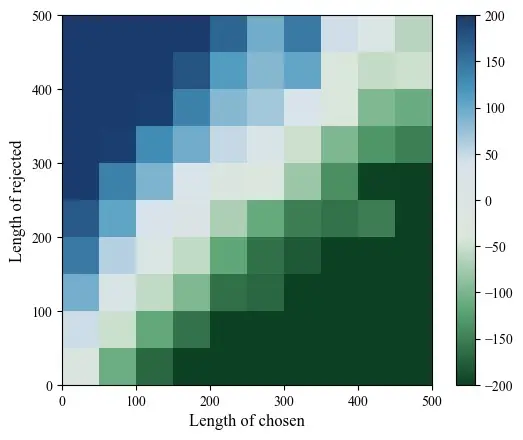

(a) DPO ($`\alpha=1`$)

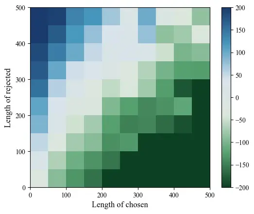

(b) $`\alpha=0.7`$

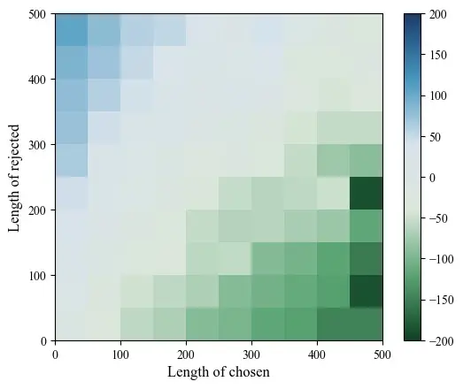

(c) $`\alpha=0.3`$

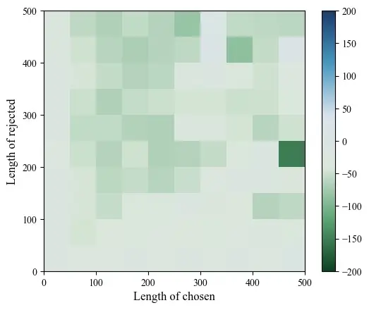

(d) $`\alpha=0`$

Figure 2: Comparison of the relationship between the length of
preference data pairs and
$`\pi_{\theta}(y_{l}|x)/\pi_{\theta}(y_{w}|x)`$ under both DPO and
LD-DPO. Measured on Llama3-8B-Instruct with UltraFeedback dataset (Cui
et al., 2023), and the heatmap values represent
$`\log\pi_{\theta}(y_{l}|x)-\log\pi_{\theta}(y_{w}|x)`$.

In DPO process, the likelihood $`\pi_{\theta}(y|x)`$ for sequence-level
output is obtained by cumulatively multiplying the conditional
probability of each token $`p(y_{t}|x,y_{<t})`$ as shown in Eq.8.

```math
\pi_{\theta}(y|x)=\prod_{i=1}^{len(y)}p(y_{i}|x,y_{<i}). \tag{8}
```

As the conditional probability of the current token from the policy
$`p(y_{t}|x,y_{<t})`$ lies within the range $`[0,1]`$, it follows that
as the sentence $`y`$ consists of more tokens, $`\pi_{\theta}(y|x)`$
will obviously be smaller. According to Eq.7, we know that if
$`len(y_{w})>len(y_{l})`$, then it is highly likely that
$`\pi_{\theta}(y_{w}|x)<\pi_{\theta}(y_{l}|x)`$, so the language model
tends to generate the longer response $`y_{w}`$ after DPO; Conversely,
if $`len(y_{w})<len(y_{l})`$, DPO prevents the output of the longer
answer $`y_{l}`$, but this does not imply that the shorter answer
$`y_{w}`$ will be preferred, then verbosity arises.

As shown in Fig.2(a) and based on the above analysis, DPO is more
sensitive to data pairs with large differences in length. Therefore, it
tends to guide the model to prioritize length preferences in the data,
ignoring other human-like preferences that are more important.

### 3.2 Derivation of LD-DPO

Based on the analysis conducted in the preceding section, it is evident
that the length sensitivity of DPO primarily originates from the
substantial influence text length exerts on the likelihood
$`\pi_{\theta}(y|x)`$. This influence consequently biases the
optimization process towards favoring data with a length advantage. To
address this issue, Length-Desensitization DPO (LD-DPO) is employed to
diminish the impact of length on the likelihood. This adjustment allows
the optimization process to focus more on the substantive content of the
text, thereby better aligning with human preference.

For a pair of preference data ($`y_{w},y_{l}`$) with lengths
$`(l_{w},l_{l})`$, we denote $`l_{p}=min(l_{w},l_{l})`$ as the public
length. Then the likelihood of response in DPO can be rewritten as:

```math
\pi_{\theta}(y|x)=\prod_{i=1}^{l_{p}}p(y_{i}|x,y_{<i})\prod_{i=l_{p}+1}^{l}p(y_{i}|x,y_{<i}), \tag{9}
```

where $`l`$ is the length of $`y`$. The second term contains extensive
length information, which directly decreases the reward and further
biases the optimization objective. This bias contributes to the overall
length sensitivity of DPO.

In LD-DPO, our objective is to attenuate the sensitivity of DPO by
eliminating the verbosity preferences induced by the excessively long
portions, while concurrently maintaining the other preferences, which
include a certain degree of length preference. Initially, as
demonstrated in Eq.10, we disassociate the verbosity preferences from
the likelihood of over-long portion (second term in Eq.9) by introducing
a hyperparameter $`\alpha\in[0,1]`$.

```math
\prod_{i=l_{p}+1}^{l}\underbrace{p^{\alpha}(y_{i}|x,y_{<i})}_{\text{{other preferences}}}\underbrace{p^{1-\alpha}(y_{i}|x,y_{<i})}_{\text{{verbosity preference}}}. \tag{10}
```

We then diminish the length sensitivity of DPO by removing verbosity
preference from $`\pi_{\theta}(y|x)`$, obtaining the modified likelihood
$`\hat{\pi}_{\theta}(y|x)`$ in LD-DPO:

```math
\hat{\pi}_{\theta}(y|x)=\prod_{i=1}^{l_{p}}p(y_{i}|x,y_{<i})\prod_{i=l_{p}+1}^{l}p^{\alpha}(y_{i}|x,y_{<i}). \tag{11}
```

When $`\alpha=1`$, $`\hat{\pi}_{\theta}(y|x)=\pi_{\theta}(y|x)`$, which
is consistent with vanilla DPO. Conversely, when $`\alpha=0`$, the
likelihood of over-length part is equal to $`1`$, meaning that only the
public-length part will be considered. Ultimately, we reformulate
$`\hat{\pi}_{\theta}(y_{k}|x)`$ in Eq.12 to present it in a more elegant
form, with the detailed derivation provided in Appendix A.2.

```math
\displaystyle\begin{aligned} \hat{\pi}_{\theta}(y|x)&=\prod_{i=1}^{l}p^{\alpha}(y_{i}|x,y_{<i})\prod_{i=1}^{l_{p}}p^{1-\alpha}(y_{i}|x,y_{<i}).\end{aligned} \tag{12}
```

It is observable that $`\hat{\pi}_{\theta}(y|x)`$ is constituted by the
complete sequence and the public-length component of the preference data
pair. The proportion between these two components can be modulated by
adjusting the hyperparameter $`\alpha`$. In scenarios where the length
sensitivity during the DPO training process is relatively pronounced, a
smaller $`\alpha`$ should be opted for in order to decouple the
verbosity preference. Conversely, a larger $`\alpha`$ should be selected
to avert the loss of genuine human preferences.

As shown in Fig.2, compared to DPO (Fig.2(a)), LD-DPO (Fig.2(b), 2(c),
2(d))) with any $`\alpha\in[0,1)`$ can smooth
$`\pi_{\theta}(y_{l}|x)/\pi_{\theta}(y_{w}|x)`$, and this effect is
markedly amplified as $`\alpha`$ diminishes. Based on the prior analysis
and Eq.7, it is evident that the optimization direction of LD-DPO is
less affected by the length disparity within the preferred data pairs.
This indicates that, relative to DPO, LD-DPO has achieved a measure of
length desensitization.

## 4 Experimental Setup

We follow the experimental setup of SimPO (Meng et al., 2024) to
objectively demonstrate the validity of our method.

Models and training settings. We perform preference optimization using
three families of models: Llama2-13B (Touvron et al., 2023), Llama3-8B
(AI@Meta, 2024) and Qwen2-7B (Yang et al., 2024) under two setups: Base
and Instruct/Chat.

For the Base setup, we train a base language model on the UltraChat-200k
dataset (Ding et al., 2023) to obtain an SFT model, which possesses a
basic capability for conversation. For the Instruct setup, we select
their corresponding instruct models (i.e., Llama2-13B-Chat,
Llama3-8B-Instruct, and Qwen2-7B-Instruct) as initial models. These
models are more powerful and robust compared to the base models. Both
setups ensure a high level of transparency as the models and training
data are open source.

In the preference optimization phase, we utilize UltraFeedback(Cui
et al., 2023) as the human preference dataset. This dataset consists of
60,000 high-quality data pairs $`(x,y_{w},y_{l})`$ designed to align
with human conversational preferences and emphasize helpfulness.

Evaluation benchmarks. We primarily evaluate our models using three of
the most popular open-ended evaluation benchmarks: MT-Bench (Zheng
et al., 2024), AlpacaEval 2 (Dubois et al., 2024) and Arena-Hard (Li
et al., 2024). These benchmarks assess the model’s versatile session
capabilities across a wide range of queries and have been widely adopted
by the community.

MT-Bench comprises 80 questions spanning 8 categories, whereas
AlpacaEval 2 encompasses 805 questions derived from 5 datasets. We
present the results in accordance with the evaluation protocol
designated for each benchmark. For MT-Bench, we present the average
score and provide a detailed breakdown of the scores for each capability
item in Appendix B.3. In the case of AlpacaEval 2, we report the
length-controlled (LC) win rate against GPT-4-preview-1106, a metric
specifically engineered to be resistant to model verbosity. For space
reasons, we present the analysis of Arena-Hard in Appendix B.1 All our
evaluations are executed utilizing GPT4-turbo-0409 as the adjudicating
model. Furthermore, we calculate the average response length on each
benchmark to compare the effects of different methods on response
length.

Baselines. We compare LD-DPO with five other offline preference
optimization techniques. Among these, DPO serves as our most crucial
comparison. R-DPO revises DPO by incorporating a length regularity term
to control the response length. SamPO avoides reward overestimation or
underestimation due to length by downsampling the KL dispersion. WPO
simulates the on-policy learning process by adding weights to the
optimization objective of DPO. SimPO introduces an optimization
objective that does not rely on a reference model, and mitigates the
impact of data length by utilizing average likelihood.

| Phase | LR   | BS  | Epoch | LS     | WP  |
| ----- | ---- | --- | ----- | ------ | --- |
| SFT   | 2e-5 | 128 | 3     | cosine | 10% |
| PO    | 5e-7 | 32  | 1     | cosine | 10% |

Table 1: General training hyperparameters settings for SFT phase and
preference optimization (PO) phase, including Leaning Rate (LR), Batch
Size (BS), Epoch, Learning rate Schedule (LS), Warmup Phase (WP).

General Training Hyperparameters. The training hyperparameters are shown
in Table.1. Additionally, to ensure the performance of the offline
preference optimization algorithms, we set the fitting tuning
hyperparameters for all methods. In general, we set $`\beta=0.1`$ for
DPO, R-DPO, SamPO, WPO and LD-DPO. Specifically, for SimPO, setting
$`\beta=2.0`$ and $`\gamma=1.0`$, for R-DPO, setting $`\alpha=0.05`$,
and for LD-DPO, we set $`\alpha=\{0.1,0.2,...,1.0\}`$ to explore its
effect on generation length and model performance. Finally, all
preference optimization training was conducted on 16 A100-80G GPUs.

## 5 Experimental Results

|        |                   |            |              |            |                      |            |              |            |
| ------ | ----------------- | ---------- | ------------ | ---------- | -------------------- | ---------- | ------------ | ---------- |
| Method | Llama2-Base (13B) |            |              |            | Llama2-Chat (13B)    |            |              |            |
|        | MT-Bench          |            | AlpacaEval 2 |            | MT-Bench             |            | AlpacaEval 2 |            |
|        | Score             | Avg. Token | LC (%)       | Avg. Token | Score                | Avg. Token | LC (%)       | Avg. Token |
| SFT    | 5.51              | 170        | 6.56         | 220        | 6.35                 | 326        | 23.46        | 452        |
| DPO    | 5.67              | 191        | 6.70         | 266        | 6.33                 | 368        | 25.52        | 487        |
| R-DPO  | 5.45              | 150        | 7.64         | 198        | 6.32                 | 346        | 26.27        | 461        |
| SimPO  | 5.45              | 180        | 7.31         | 246        | 6.40                 | 351        | 26.38        | 471        |
| WPO    | 5.76              | 185        | 9.65         | 244        | 6.40                 | 401        | 26.81        | 486        |
| SamPO  | 5.78              | 183        | 8.80         | 259        | 6.21                 | 390        | 26.09        | 484        |
| LD-DPO | 5.83              | 154        | 10.37        | 208        | 6.55                 | 329        | 28.20        | 449        |
| Method | Llama3-Base (8B)  |            |              |            | Llama3-Instruct (8B) |            |              |            |
|        | MT-Bench          |            | AlpacaEval 2 |            | MT-Bench             |            | AlpacaEval 2 |            |
|        | Score             | Avg. Token | LC (%)       | Avg. Token | Score                | Avg. Token | LC (%)       | Avg. Token |
| SFT    | 6.08              | 156        | 8.40         | 167        | 7.36                 | 255        | 38.28        | 326        |
| DPO    | 6.38              | 178        | 12.58        | 235        | 7.61                 | 323        | 40.21        | 393        |
| R-DPO  | 6.18              | 137        | 12.15        | 155        | 7.54                 | 248        | 41.07        | 318        |
| SimPO  | 6.24              | 142        | 9.96         | 194        | 7.36                 | 266        | 39.14        | 374        |
| WPO    | 6.42              | 179        | 12.99        | 226        | 7.60                 | 320        | 39.77        | 386        |
| SamPO  | 6.12              | 162        | 14.62        | 200        | 7.50                 | 294        | 40.77        | 368        |
| LD-DPO | 6.45              | 153        | 16.82        | 144        | 7.74                 | 247        | 44.00        | 308        |
| Method | Qwen2-Base (7B)   |            |              |            | Qwen2-Instruct (7B)  |            |              |            |
|        | MT-Bench          |            | AlpacaEval 2 |            | MT-Bench             |            | AlpacaEval 2 |            |
|        | Score             | Avg. Token | LC (%)       | Avg. Token | Score                | Avg. Token | LC (%)       | Avg. Token |
| SFT    | 6.30              | 160        | 7.62         | 173        | 7.95                 | 359        | 34.09        | 373        |
| DPO    | 6.73              | 181        | 10.20        | 204        | 7.79                 | 321        | 35.63        | 437        |
| R-DPO  | 6.16              | 137        | 8.79         | 168        | 7.94                 | 314        | 38.85        | 365        |
| SimPO  | 6.61              | 154        | 12.08        | 181        | 7.88                 | 352        | 35.10        | 430        |
| WPO    | 6.71              | 167        | 11.02        | 193        | 7.72                 | 361        | 37.53        | 433        |
| SamPO  | 6.79              | 180        | 10.89        | 187        | 7.78                 | 343        | 37.05        | 399        |
| LD-DPO | 6.80              | 163        | 12.14        | 155        | 8.03                 | 303        | 40.88        | 356        |

Table 2: MT-Bench and AlpacaEval 2 results under six model settings.
LC-winrate denotes length-controlled win rate against the baseline model
(GPT-4-1106-preview), which can mitigate the length preference of the
judge model (GPT-4-turbo-0409) compared to the raw win rate. Avg.Token
denotes the average length of the model’s answers.

In this section, we present the main results of our experiments,
demonstrating that LD-DPO achieves state-of-the-art (SOTA) performance
on both MT-Bench and AlpacaEval for all six settings through effective
length control. Building on these results, we further analyze the
sensitivity of different models to data length. Additionally, our
findings show that our method significantly enhances the model’s
reasoning ability, with relevant results presented in Appendix C.
Finally, we conduct ablation studys and hyperparameter analysis.

### 5.1 Main Results

As shown in Table.2, LD-DPO exhibits significant improvements in both
MT-Bench and AlpacaEval 2 compared to all other baselines. In addition,
the average response length is reduced by 7.8% to 37.9% relative to DPO,
suggesting higher quality and more concise model outputs after LD-DPO.

In the Base setting, we observe that the overall model performance is
suboptimal, with responses tending to be shorter. This phenomenon may be
attributed to the model’s performance not being fully realized during
the SFT phase. Conversely, in the Instruct setting, the model
demonstrates greater competence and generates much longer responses than
the base model, due to extensive SFT and RLHF conducted by their
publishers. However, in both settings, it is clear that DPO consistently
encourages the model to produce more verbose outputs, with experiments
showing an increase ranging from 10% to 40%, while LD-DPO can
significantly alleviate this issue. This verbosity can potentially
impair model performance, as we will illustrate with several case
studies in Appendix D.

As illustrated in Table.2, we examine the average response length and
LC-winrate (which may vary from public results due to different judge
model) of the models on AlpacaEval 2 under six different settings. Our
method achieves the state-of-the-art (SOTA) performance in LC-winrate
across all settings. When comparing the three length control methods
(R-DPO, SimPO, and SamPO), We find that R-DPO demonstrates superior
length control under the Base setting, but its overall performance is
suboptimal in terms of LC-winrate. SimPO does not show consistent
performance across different settings, likely due to the absence of a
reference model, which impacts its stability. SamPO’s performance
fluctuates less compared to DPO.

### 5.2 Length Sensitivity Analysis of Varied Model

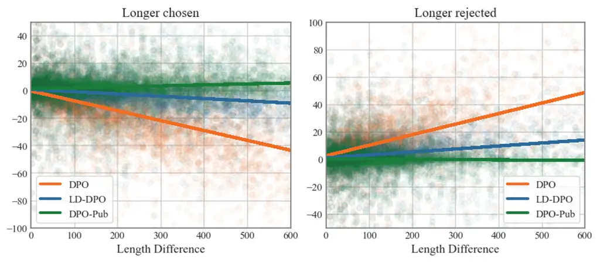

(a) Llama2-13B-Chat

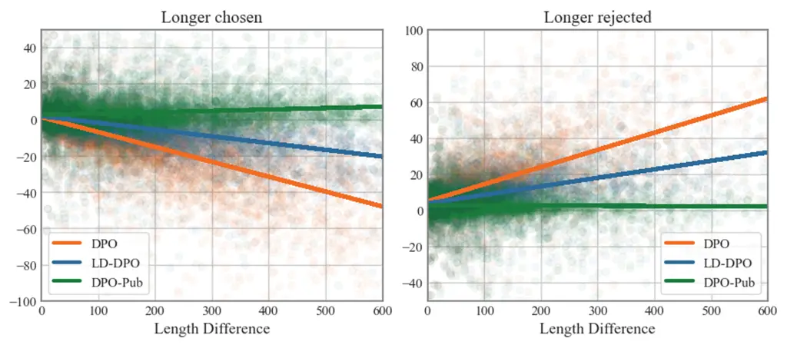

(b) Llama3-8B-Instruct

Figure 3: Exploring the relationship between predicted probability
difference $`\log\pi_{\theta}(y_{w}|x)-\log\pi_{\theta}(y_{l}|x)`$ and
data length difference under different settings: (a) Llama2-13B-Chat;
(b) Llama3-8B-Instruct. In each subplot, the left image represents data
where the chosen is longer, and the right image represents data where
the rejected is longer. DPO-Pub indicates that $`\alpha=0`$ in LD-DPO.
The images depict the true distribution on the UltraFeedback dataset
during training.

The models selected for our experiments vary in their capabilities and,
consequently, in their length sensitivity during the DPO process. Their
performance based on the choice of the hyperparameter alpha is as
follows:

In the Instruct setting, Llama2-13B achieves optimal performance at
$`\alpha=0.3`$, Llama3-8B at $`\alpha=0.5`$, and Qwen2-7B at
$`\alpha=0.6`$. In the Base setting, the optimal $`\alpha`$ values for
these models are approximately 0.1 to 0.2 lower compared to the Instruct
setting. Due to the similarity in performance between Llama3-8B and
Qwen2-7B, we subsequently just conducted an in-depth analysis of the
Llama2-13B and Llama3-8B models to explore the performance differences
between these two sizes. This selection is representative of varying
model capacities.

In Fig.3, we plot the distribution of probability difference during
preference optimization for Llama2-13B-Chat (Fig.3(a)) and
Llama3-8B-Instruct (Fig.3(b)), respectively. The data is differentiated
based on the length relationship between the chosen and rejected
responses. We will analyze the training process of the LLMs with
different hyperparameter settings:

Under the DPO setting, we can clearly observe that the difference in
predicted probability
$`\log\pi_{\theta}(y_{w}|x)-\log\pi_{\theta}(y_{l}|x)`$ is influenced by
the length of the data, which reflects the implicit reward and
determines the optimization direction in DPO. When the chosen is longer,
the probability difference is smaller than 0 and continues decrease.
Based on our previous theoretical analysis, we can infer that it is
easier to optimize in the direction of the chosen under these
conditions, leading to verbose outputs. Conversely, when the rejected is
longer, the situation is reversed.

Under the DPO-Pub setting, where only the public length portions of the
$`y_{w}`$ and $`y_{l}`$ are considered, we find that the the difference
in predicted probability is greater than 0 for a larger proportion of
the data. This indicates that the models prefer outputting $`y_{w}`$,
which suggests that both types of models possess sizable base
capabilities, with Llama3-8B-Instruct being stronger than
Llama2-13B-Chat. Additionally, compared to the DPO setting, the average
predicted probability difference of Llama2-13B-Chat increases
(decreases) by 19.66 (14.01) and Llama3-8B-Instruct increases
(decreases) by 18.37 (13.68), indicating that the former is more
significantly affected by the data length.

Under the LD-DPO setting, the fact that LD-DPO cannot achieve optimal
results in the extreme case of $`\alpha=0`$ suggests that longer
responses are necessary. This is because additional text can convey more
human-like preferences. Furthermore, compared to Llama2-13B-Chat,
Llama3-8B-Instruct is more powerful and can capture more human-like
preferences from the text. This capability can mitigate the negative
effects of response length, indicating that setting $`\alpha`$ to an
extreme value may not be appropriate.

From the above anaylsis, we know that $`\alpha`$ is actually the result
of a compromise to achieve desensitization of DPO based on model
capabilities and to prevent the loss of human-like preferences. In
addition, we know that different models have different length
sensitivities in the DPO process. We define $`\gamma`$ as the length
sensitivity coefficient, where $`\gamma=1-\alpha_{s}`$ and
$`\alpha_{s}`$ represents the $`\alpha`$ that yields the best LD-DPO
results. A smaller value of $`\gamma`$ in more capable models indicates
that such models are more likely to capture genuine human preferences
rather than being influenced by text length. For example, the length
sensitivity coefficient of Llama3-8B-Instruct is 0.5, whereas that of
Llama2-13B-Chat is 0.7. This suggests that the latter is more sensitive
to length during DPO.

### 5.3 Ablation Study

To verify the effect of the relative lengths of $`y_{w}`$(chosen) and
$`y_{l}`$(rejected) in the training data on LD-DPO, we constructed
ablation experiments: The length decoupling strategy, as shown in Eq.12,
was applied to $`y_{w}`$ and $`y_{l}`$ separately or simultaneously.

As shown in Table.3, the performance of the LLMs on MT-Bench, AlpacaEval
2 and Arena-Hard, as well as the length control effect, is inferior to
that of LD-DPO under both the chosen and rejected setups. This suggests
that length decoupling is necessary for both chosen and rejected. For
more detail, we have:

- •
  If $`y_{w}`$ is longer: According to the previous analysis, it is
  known that DPO is more inclined to optimize in the direction of
  $`y_{w}`$ under the effect of length bias, which results in redundant
  output. At this point, length decoupling for $`y_{w}`$ can alleviate
  this tendency.
- •
  If $`y_{l}`$ is longer: DPO tends to block the output of $`y_{l}`$. In
  this case, the decoupling of the length of $`y_{l}`$ may redirect the
  optimization towards a shorter $`y_{w}`$, thus reducing redundancy and
  improving the quality of the model’s answers.

Therefore, our length desensitization strategy can encourage the model
to identify and leverage more human-like preference gaps in the data
samples, rather than optimizing the training process based on
superficial length differences.

|          |          |                       |              |                       |            |                       |
| -------- | -------- | --------------------- | ------------ | --------------------- | ---------- | --------------------- |
| Method   | MT-Bench |                       | AlpacaEval 2 |                       | Arena-Hard |                       |
|          | Score    | Avg. Token            | LC (%)       | Avg. Token            | Win-Rate   | Avg. Token            |
| SFT      | 7.36     | 255                   | 38.28        | 326                   | 24.3       | 470                   |
| DPO      | 7.61     | 323                   | 40.21        | 393                   | 27.6       | 560                   |
| chosen   | 7.67     | 302($`\downarrow`$21) | 43.39        | 352($`\downarrow`$41) | 27.2       | 526($`\downarrow`$34) |
| rejected | 7.62     | 283($`\downarrow`$40) | 42.23        | 351($`\downarrow`$42) | 27.9       | 523($`\downarrow`$37) |
| LD-DPO   | 7.74     | 247($`\downarrow`$76) | 44.00        | 308($`\downarrow`$85) | 28.0       | 485($`\downarrow`$75) |

Table 3: Ablation study on Llama3-8B-Instruct: chosen denotes length
decoupling (Eq.12) applied only to $`y_{w}`$, rejected denotes only to
$`y_{l}`$, and $`\downarrow`$tokens denotes the Avg. Token drop compared
to DPO.

### 5.4 Hyperparameter Analysis

In this subsection, we verify the effect of the hyperparameter
$`\alpha`$ on the performance of LD-DPO. We present the experimental
results of Llama3-8B-Instruct. In all experiments, we set $`\beta=0.1`$,
though we encourage researchers to explore the effects of different
$`\alpha`$ selected at various $`\beta`$ settings.

When $`\alpha=1`$, LD-DPO is equivalent to DPO. As $`\alpha`$ gradually
decreases, the degree of length decoupling increases. At this point, as
shown in Fig.4, the sensitivity of the training process to length begins
to decline, resulting in a subsequent reduction in the average output
length.

We find that the decrease in average response length is pronounced as
the parameter $`\alpha`$ decreases from 1 to 0.5. However, this tendency
becomes less significant as $`\alpha`$ further decreases from 0.5 to 0.

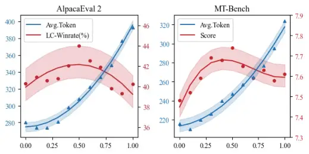

Figure 4: Hyperparametric analysis on $`\alpha`$ with Llama3-8B-Instruct
on AlpacaEval 2(left) and MT-Bench(right).

This phenomenon can likely be attributed to the fact that verbosity
preference decoupling is effectively complete when $`\alpha`$ reaches
0.5.

In terms of the performance on AlpacaEval 2 and MT-Bench, the trend is
to first increase and then decrease as $`\alpha`$ decreases, with the
best performance observed at $`\alpha=0.5`$. This indicates that when
$`\alpha`$ is too large, the model’s performance is constrained by DPO’s
length sensitivity, resulting in verbose, poor-quality content.
Conversely, when $`\alpha`$ is too small, excessive length decoupling
leads to a loss of human-like preferences in the text, thereby reducing
the optimization effectiveness.

## 6 Related Works

### 6.1 Offline Preference Optimization

In practice, traditional RLHF paradigms are more complex in terms of
coding and hyperparameter tuning, requiring four models simultaneously,
which makes them more resource-intensive and difficult to train stably.
Due to the lack of online reward models, DPO needs to construct
artificial preference datasets in advance, and many works have proposed
different data construction strategies to enable the model to better
learn human preferences (An et al., 2023; Gallego, 2024; Khaki et al.,
2024). Meanwhile, another research direction is to improve the
preference optimization objective, including the necessity of the
reference model, the selection of the reward fitting function, and the
adjustment of the update weights, and derive a variety of offline
optimization strategies, including ORPO (Hong et al., 2024), KTO
(Ethayarajh et al., 2024), NCA (Chen et al., 2024b), IPO (Azar et al.,
2024), WPO (Zhou et al., 2024), etc.

### 6.2 Length Control Strategy

Recent research has shown that DPO may lead to biased results, such as
models producing lengthy outputs, which affects the model’s ability to
follow instructions and reasoning. To address this problem, Park et al.
(2024) proposed R-DPO, which suppresses the model from producing
excessively long answers by introducing a rule term, which is a
intuitive scheme followed by several algorithms (Zhou et al., 2024; Chen
et al., 2024a). Meng et al. (2024) proposed an optimization strategy
that does not rely on the reference model, called SimPO, which uses
length-normalized rewards to prevent the model from generating
excessively long but low-quality answers. Lu et al. (2024) argued that
the phenomenon of lengthy outputs in DPO is due to the overestimation or
underestimation of implicit rewards caused by the length of the training
data. Based on this, they proposed SamPO, which mitigates the length
bias by down-sampling the KL divergence to ensure that implicit rewards
are not affected by length.

## 7 Conclusion

In this work, we propose for the first time that the optimization
process of DPO is length-sensitive and provide a theoretical proof.
Based on this, we design a length-desensitization algorithm based on
DPO: LD-DPO, which achieves length desensitization by reparameterizing
the likelihood to decouple verbosity preferences from complete
information while preserving human-like preferences. Through extensive
experimental analysis, LD-DPO consistently outperforms existing
algorithms in various training settings, achieving performance
improvements with a 10-40% reduction in output length, especially in
reasoning ability. This suggests that previous optimization algorithms
have overemphasized length at the expense of quality, validating the
value of our work. Furthermore, we perform a comparative analysis of
length sensitivity across models with different capabilities, which may
provide new insights into the preference optimization process.

## References

- AI@Meta (2024) AI@Meta. Llama 3 model card. 2024. URL
  [https://github.com/meta-llama/llama3/blob/main/MODEL_CARD.md](https://github.com/meta-llama/llama3/blob/main/MODEL_CARD.md).
- An et al. (2023) Gaon An, Junhyeok Lee, Xingdong Zuo, Norio Kosaka,
  Kyung-Min Kim, and Hyun Oh Song. Direct preference-based policy
  optimization without reward modeling. _Advances in Neural Information
  Processing Systems_, 36:70247–70266, 2023.
- Azar et al. (2024) Mohammad Gheshlaghi Azar, Zhaohan Daniel Guo, Bilal
  Piot, Remi Munos, Mark Rowland, Michal Valko, and Daniele
  Calandriello. A general theoretical paradigm to understand learning
  from human preferences. In _International Conference on Artificial
  Intelligence and Statistics_, pp. 4447–4455. PMLR, 2024.
- Bai et al. (2022) Yuntao Bai, Andy Jones, Kamal Ndousse, Amanda
  Askell, Anna Chen, Nova DasSarma, Dawn Drain, Stanislav Fort, Deep
  Ganguli, Tom Henighan, et al. Training a helpful and harmless
  assistant with reinforcement learning from human feedback. _arXiv
  preprint arXiv:2204.05862_, 2022.
- Beeching et al. (2023) Edward Beeching, Clémentine Fourrier, Nathan
  Habib, Sheon Han, Nathan Lambert, Nazneen Rajani, Omar Sanseviero,
  Lewis Tunstall, and Thomas Wolf. Open llm leaderboard.
  [https://huggingface.co/spaces/open-llm-leaderboard-old/open_llm_leaderboard](https://huggingface.co/spaces/open-llm-leaderboard-old/open_llm_leaderboard), 2023.
- Bradley & Terry (1952) Ralph Allan Bradley and Milton E Terry. Rank
  analysis of incomplete block designs: I. the method of paired
  comparisons. _Biometrika_, 39(3/4):324–345, 1952.
- Chang et al. (2024) Yupeng Chang, Xu Wang, Jindong Wang, Yuan Wu,
  Linyi Yang, Kaijie Zhu, Hao Chen, Xiaoyuan Yi, Cunxiang Wang, Yidong
  Wang, et al. A survey on evaluation of large language models. _ACM
  Transactions on Intelligent Systems and Technology_, 15(3):1–45, 2024.
- Chen et al. (2024a) Changyu Chen, Zichen Liu, Chao Du, Tianyu Pang,
  Qian Liu, Arunesh Sinha, Pradeep Varakantham, and Min Lin.
  Bootstrapping language models with dpo implicit rewards. _arXiv
  preprint arXiv:2406.09760_, 2024a.
- Chen et al. (2024b) Huayu Chen, Guande He, Hang Su, and Jun Zhu. Noise
  contrastive alignment of language models with explicit rewards. _arXiv
  preprint arXiv:2402.05369_, 2024b.
- Chen et al. (2024c) Lichang Chen, Chen Zhu, Jiuhai Chen, Davit
  Soselia, Tianyi Zhou, Tom Goldstein, Heng Huang, Mohammad Shoeybi, and
  Bryan Catanzaro. Odin: Disentangled reward mitigates hacking in rlhf.
  In _Forty-first International Conference on Machine Learning_, 2024c.
- Chen et al. (2024d) Zixiang Chen, Yihe Deng, Huizhuo Yuan, Kaixuan Ji,
  and Quanquan Gu. Self-play fine-tuning converts weak language models
  to strong language models. In _Forty-first International Conference on
  Machine Learning_, 2024d.
- Clark et al. (2018) Peter Clark, Isaac Cowhey, Oren Etzioni, Tushar
  Khot, Ashish Sabharwal, Carissa Schoenick, and Oyvind Tafjord. Think
  you have solved question answering? try arc, the AI2 reasoning
  challenge. _CoRR_, abs/1803.05457, 2018. URL
  [http://arxiv.org/abs/1803.05457](http://arxiv.org/abs/1803.05457).
- Cobbe et al. (2021) Karl Cobbe, Vineet Kosaraju, Mohammad Bavarian,
  Mark Chen, Heewoo Jun, Lukasz Kaiser, Matthias Plappert, Jerry Tworek,
  Jacob Hilton, Reiichiro Nakano, et al. Training verifiers to solve
  math word problems. _arXiv preprint arXiv:2110.14168_, 2021.
- Cui et al. (2023) Ganqu Cui, Lifan Yuan, Ning Ding, Guanming Yao, Wei
  Zhu, Yuan Ni, Guotong Xie, Zhiyuan Liu, and Maosong Sun.
  Ultrafeedback: Boosting language models with high-quality feedback.
  _arXiv preprint arXiv:2310.01377_, 2023.
- Dai et al. (2024) Josef Dai, Xuehai Pan, Ruiyang Sun, Jiaming Ji,
  Xinbo Xu, Mickel Liu, Yizhou Wang, and Yaodong Yang. Safe rlhf: Safe
  reinforcement learning from human feedback. In _The Twelfth
  International Conference on Learning Representations_, 2024.
- Ding et al. (2023) Ning Ding, Yulin Chen, Bokai Xu, Yujia Qin,
  Shengding Hu, Zhiyuan Liu, Maosong Sun, and Bowen Zhou. Enhancing chat
  language models by scaling high-quality instructional conversations.
  In _The 2023 Conference on Empirical Methods in Natural Language
  Processing_, 2023.
- Dubois et al. (2024) Yann Dubois, Balázs Galambosi, Percy Liang, and
  Tatsunori B Hashimoto. Length-controlled alpacaeval: A simple way to
  debias automatic evaluators. _arXiv preprint arXiv:2404.04475_, 2024.
- Ethayarajh et al. (2024) Kawin Ethayarajh, Winnie Xu, Niklas
  Muennighoff, Dan Jurafsky, and Douwe Kiela. Kto: Model alignment as
  prospect theoretic optimization. _arXiv preprint
  arXiv:2402.01306_, 2024.
- Feng et al. (2024a) Duanyu Feng, Bowen Qin, Chen Huang, Zheng Zhang,
  and Wenqiang Lei. Towards analyzing and understanding the limitations
  of dpo: A theoretical perspective. _arXiv preprint arXiv:2404.04626_,
  2024a.
- Feng et al. (2024b) Guhao Feng, Bohang Zhang, Yuntian Gu, Haotian Ye,
  Di He, and Liwei Wang. Towards revealing the mystery behind chain of
  thought: a theoretical perspective. _Advances in Neural Information
  Processing Systems_, 36, 2024b.
- Gallego (2024) Víctor Gallego. Refined direct preference optimization
  with synthetic data for behavioral alignment of llms. _arXiv preprint
  arXiv:2402.08005_, 2024.
- Hendrycks et al. (2021) Dan Hendrycks, Collin Burns, Steven Basart,
  Andy Zou, Mantas Mazeika, Dawn Song, and Jacob Steinhardt. Measuring
  massive multitask language understanding. In _9th International
  Conference on Learning Representations, ICLR 2021, Virtual Event,
  Austria, May 3-7, 2021_, 2021.
- Hong et al. (2024) Jiwoo Hong, Noah Lee, and James Thorne. Orpo:
  Monolithic preference optimization without reference model. _arXiv
  preprint arXiv:2403.07691_, 2(4):5, 2024.
- Khaki et al. (2024) Saeed Khaki, JinJin Li, Lan Ma, Liu Yang, and
  Prathap Ramachandra. Rs-dpo: A hybrid rejection sampling and direct
  preference optimization method for alignment of large language models.
  In _Findings of the Association for Computational Linguistics: NAACL
  2024_, pp. 1665–1680, 2024.
- Li et al. (2024) Tianle Li, Wei-Lin Chiang, Evan Frick, Lisa Dunlap,
  Tianhao Wu, Banghua Zhu, Joseph E Gonzalez, and Ion Stoica. From
  crowdsourced data to high-quality benchmarks: Arena-hard and
  benchbuilder pipeline. _arXiv preprint arXiv:2406.11939_, 2024.
- Liu et al. (2023) Yiheng Liu, Tianle Han, Siyuan Ma, Jiayue Zhang,
  Yuanyuan Yang, Jiaming Tian, Hao He, Antong Li, Mengshen He,
  Zhengliang Liu, et al. Summary of chatgpt-related research and
  perspective towards the future of large language models.
  _Meta-Radiology_, pp. 100017, 2023.
- Lu et al. (2024) Junru Lu, Jiazheng Li, Siyu An, Meng Zhao, Yulan He,
  Di Yin, and Xing Sun. Eliminating biased length reliance of direct
  preference optimization via down-sampled kl divergence. _arXiv
  preprint arXiv:2406.10957_, 2024.
- Meng et al. (2024) Yu Meng, Mengzhou Xia, and Danqi Chen. Simpo:
  Simple preference optimization with a reference-free reward. _arXiv
  preprint arXiv:2405.14734_, 2024.
- Ouyang et al. (2022) Long Ouyang, Jeffrey Wu, Xu Jiang, Diogo Almeida,
  Carroll Wainwright, Pamela Mishkin, Chong Zhang, Sandhini Agarwal,
  Katarina Slama, Alex Ray, et al. Training language models to follow
  instructions with human feedback. _Advances in neural information
  processing systems_, 2022.
- Park et al. (2024) Ryan Park, Rafael Rafailov, Stefano Ermon, and
  Chelsea Finn. Disentangling length from quality in direct preference
  optimization. _arXiv preprint arXiv:2403.19159_, 2024.
- Rafailov et al. (2024) Rafael Rafailov, Archit Sharma, Eric Mitchell,
  Christopher D Manning, Stefano Ermon, and Chelsea Finn. Direct
  preference optimization: Your language model is secretly a reward
  model. _Advances in Neural Information Processing Systems_, 36, 2024.
- Sakaguchi et al. (2021) Keisuke Sakaguchi, Ronan Le Bras, Chandra
  Bhagavatula, and Yejin Choi. Winogrande: An adversarial winograd
  schema challenge at scale. _Communications of the ACM_,
  64(9):99–106, 2021.
- Singhal et al. (2023) Prasann Singhal, Tanya Goyal, Jiacheng Xu, and
  Greg Durrett. A long way to go: Investigating length correlations in
  rlhf. _arXiv preprint arXiv:2310.03716_, 2023.
- Suzgun et al. (2023) Mirac Suzgun, Nathan Scales, Nathanael Schärli,
  Sebastian Gehrmann, Yi Tay, Hyung Won Chung, Aakanksha Chowdhery,
  Quoc V. Le, Ed H. Chi, Denny Zhou, and Jason Wei. Challenging
  big-bench tasks and whether chain-of-thought can solve them. In
  _Findings of the Association for Computational Linguistics:
  ACL_, 2023.
- Tafjord et al. (2021) Oyvind Tafjord, Bhavana Dalvi, and Peter Clark.
  Proofwriter: Generating implications, proofs, and abductive statements
  over natural language. In _Findings of the Association for
  Computational Linguistics: ACL-IJCNLP 2021_, pp. 3621–3634, 2021.
- Talmor et al. (2019) Alon Talmor, Jonathan Herzig, Nicholas Lourie,
  and Jonathan Berant. Commonsenseqa: A question answering challenge
  targeting commonsense knowledge. In _Proceedings of the 2019
  Conference of the North American Chapter of the Association for
  Computational Linguistics, NAACL-HLT, Minneapolis, MN, USA_, 2019.
- Touvron et al. (2023) Hugo Touvron, Louis Martin, Kevin Stone, Peter
  Albert, Amjad Almahairi, Yasmine Babaei, Nikolay Bashlykov, Soumya
  Batra, Prajjwal Bhargava, Shruti Bhosale, et al. Llama 2: Open
  foundation and fine-tuned chat models. _arXiv preprint
  arXiv:2307.09288_, 2023.
- Wang et al. (2024) Zhilin Wang, Yi Dong, Jiaqi Zeng, Virginia Adams,
  Makesh Narsimhan Sreedhar, Daniel Egert, Olivier Delalleau, Jane
  Scowcroft, Neel Kant, Aidan Swope, et al. Helpsteer: Multi-attribute
  helpfulness dataset for steerlm. In _Proceedings of the 2024
  Conference of the North American Chapter of the Association for
  Computational Linguistics: Human Language Technologies_, 2024.
- Wu et al. (2023) Tianhao Wu, Banghua Zhu, Ruoyu Zhang, Zhaojin Wen,
  Kannan Ramchandran, and Jiantao Jiao. Pairwise proximal policy
  optimization: Harnessing relative feedback for llm alignment. In
  _NeurIPS 2023 Foundation Models for Decision Making Workshop_, 2023.
- Xu et al. (2024) Haoran Xu, Amr Sharaf, Yunmo Chen, Weiting Tan,
  Lingfeng Shen, Benjamin Van Durme, Kenton Murray, and Young Jin Kim.
  Contrastive preference optimization: Pushing the boundaries of llm
  performance in machine translation. In _Forty-first International
  Conference on Machine Learning_, 2024.
- Yang et al. (2024) An Yang, Baosong Yang, Binyuan Hui, Bo Zheng, Bowen
  Yu, Chang Zhou, Chengpeng Li, Chengyuan Li, Dayiheng Liu, Fei Huang,
  et al. Qwen2 technical report. _arXiv preprint
  arXiv:2407.10671_, 2024.
- Yuan et al. (2024a) Hongyi Yuan, Zheng Yuan, Chuanqi Tan, Wei Wang,
  Songfang Huang, and Fei Huang. Rrhf: Rank responses to align language
  models with human feedback. _Advances in Neural Information Processing
  Systems_, 36, 2024a.
- Yuan et al. (2024b) Weizhe Yuan, Ilia Kulikov, Ping Yu, Kyunghyun Cho,
  Sainbayar Sukhbaatar, Jason Weston, and Jing Xu. Following length
  constraints in instructions. _arXiv preprint arXiv:2406.17744_, 2024b.
- Zellers et al. (2019) Rowan Zellers, Ari Holtzman, Yonatan Bisk, Ali
  Farhadi, and Yejin Choi. Hellaswag: Can a machine really finish your
  sentence? In _Proceedings of the 57th Conference of the Association
  for Computational Linguistics, ACL, Florence, Italy_, 2019.
- Zheng et al. (2024) Lianmin Zheng, Wei-Lin Chiang, Ying Sheng, Siyuan
  Zhuang, Zhanghao Wu, Yonghao Zhuang, Zi Lin, Zhuohan Li, Dacheng Li,
  Eric Xing, et al. Judging llm-as-a-judge with mt-bench and chatbot
  arena. _Advances in Neural Information Processing Systems_, 36, 2024.
- Zhou et al. (2024) Wenxuan Zhou, Ravi Agrawal, Shujian Zhang,
  Sathish Reddy Indurthi, Sanqiang Zhao, Kaiqiang Song, Silei Xu, and
  Chenguang Zhu. Wpo: Enhancing rlhf with weighted preference
  optimization. _arXiv preprint arXiv:2406.11827_, 2024.
- Ziegler et al. (2019) Daniel M Ziegler, Nisan Stiennon, Jeffrey Wu,
  Tom B Brown, Alec Radford, Dario Amodei, Paul Christiano, and Geoffrey
  Irving. Fine-tuning language models from human preferences. _arXiv
  preprint arXiv:1909.08593_, 2019.

## Appendix A Mathematical Derivations

### A.1 Derivation of Optimization Direction in DPO

```math
\displaystyle\begin{aligned} \mathcal{L}_{DPO}(\pi_{\theta};\pi_{ref})=-\mathbb{E}_{(x,y_{w},y_{l})\sim\mathcal{D}}[\log\sigma(\beta\log\frac{\pi_{\theta}(y_{w}|x)}{\pi_{ref}(y_{w}|x)}-\beta\log\frac{\pi_{\theta}(y_{l}|x)}{\pi_{ref}(y_{l}|x)})].\end{aligned} \tag{13}
```

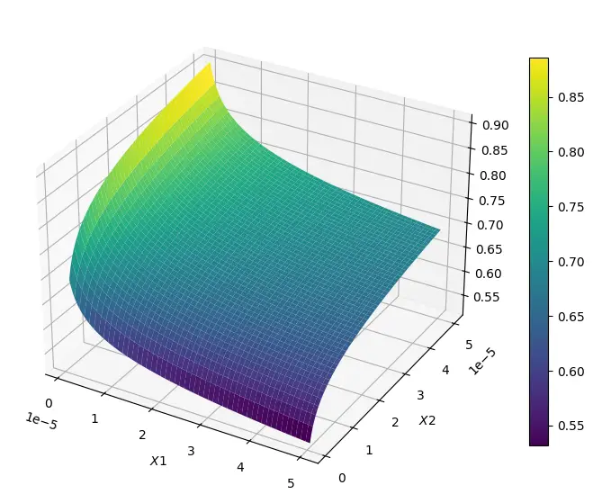

(a) $`\mathcal{L}_{DPO}(\mathcal{X}_{1};\mathcal{X}_{2})`$

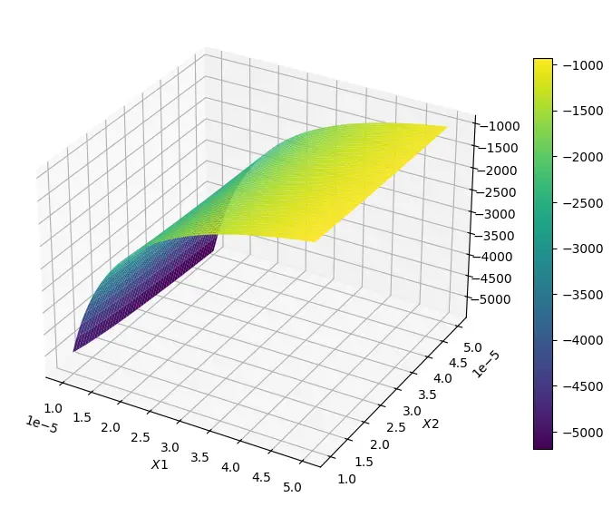

(b)
$`\partial\mathcal{L}_{DPO}(\mathcal{X}_{1};\mathcal{X}_{2})/\partial\mathcal{X}_{1}`$

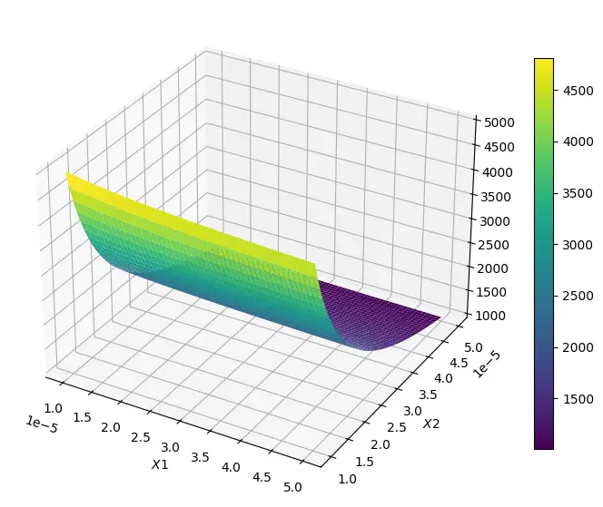

(c)
$`\partial\mathcal{L}_{DPO}(\mathcal{X}_{1};\mathcal{X}_{2})/\partial\mathcal{X}_{2}`$

Figure 5: (a)The optimization objective of DPO (b)The partial derivative
of $`\mathcal{L}_{DPO}(\mathcal{X}_{1};\mathcal{X}_{2})`$ with respect
to $`\mathcal{X}_{1}`$ (c)The partial derivative of
$`\mathcal{L}_{DPO}(\mathcal{X}_{1};\mathcal{X}_{2})`$ with respect to
$`\mathcal{X}_{2}`$, where we denote $`\pi_{\theta}(y_{w}|x)`$ by
$`\mathcal{X}_{1}`$ and $`\pi_{\theta}(y_{l}|x)`$ by
$`\mathcal{X}_{2}`$.

The optimization objective of DPO is presented in Eq.13 and its image is
shown in Fig.5(a). We define
$`\mathcal{X}_{1}=\pi_{\theta}(y_{w}|x),\mathcal{X}_{2}=\pi_{\theta}(y_{l}|x)`$
and
$`\mathcal{K}_{1}=\pi_{ref}(y_{w}|x),\mathcal{K}_{2}=\pi_{ref}(y_{l}|x)`$,
where $`\mathcal{K}_{1}`$ and $`\mathcal{K}_{2}`$ can be regarded as
constants and the optimization process of DPO is only related to
$`\mathcal{X}_{1},\mathcal{X}_{2}`$. We can rewrite the loss of DPO as:

```math
\displaystyle\begin{aligned} \mathcal{L}_{DPO}(\mathcal{X}_{1};\mathcal{X}_{2})=&-\log\sigma(\beta\log\frac{\mathcal{X}_{1}}{\mathcal{K}_{1}}-\beta\log\frac{\mathcal{X}_{2}}{\mathcal{K}_{2}})\\
=&-\log\frac{1}{1+exp\{-\beta\log(\mathcal{K}_{2}\mathcal{X}_{1}/\mathcal{K}_{1}\mathcal{X}_{2}\})}\\
=&-\log\frac{1}{1+(\mathcal{K}_{1}\mathcal{X}_{2}/\mathcal{K}_{2}\mathcal{X}_{1})^{\beta}}\\
=&-\log\frac{(\mathcal{K}_{2}\mathcal{X}_{1})^{\beta}}{(\mathcal{K}_{2}\mathcal{X}_{1})^{\beta}+(\mathcal{K}_{1}\mathcal{X}_{2})^{\beta}}.\end{aligned} \tag{14}
```

As shown in the Eq.15, the partial differentiation of
$`\mathcal{L}_{DPO}(\mathcal{X}_{1};\mathcal{X}_{2})`$ with respect to
$`\mathcal{X}_{1}`$ indicates that the model is oriented in the chosen
direction, the function image is showen in Fig.5(b).

```math
\displaystyle\begin{aligned} \frac{\partial\mathcal{L}_{DPO}(\mathcal{X}_{1};\mathcal{X}_{2})}{\partial\mathcal{X}_{1}}=&-\frac{\beta\mathcal{K}_{2}^{\beta}\mathcal{X}_{1}^{\beta-1}[(\mathcal{K}_{2}\mathcal{X}_{1})^{\beta}+(\mathcal{K}_{1}\mathcal{X}_{2})^{\beta}]-(\mathcal{K}_{2}\mathcal{X}_{1})^{\beta}\beta\mathcal{K}_{2}^{\beta}\mathcal{X}_{1}^{\beta-1}}{[(\mathcal{K}_{2}\mathcal{X}_{1})^{\beta}+(\mathcal{K}_{1}\mathcal{X}_{2})^{\beta}]^{2}}\frac{(\mathcal{K}_{2}\mathcal{X}_{1})^{\beta}+(\mathcal{K}_{1}\mathcal{X}_{2})^{\beta}}{(\mathcal{K}_{2}\mathcal{X}_{1})^{\beta}}\\
=&-\frac{\beta\mathcal{K}_{2}^{\beta}\mathcal{X}_{1}^{\beta-1}(\mathcal{K}_{2}\mathcal{X}_{1})^{\beta}+\beta\mathcal{K}_{2}^{\beta}\mathcal{X}_{1}^{\beta-1}(\mathcal{K}_{1}\mathcal{X}_{2})^{\beta}-(\mathcal{K}_{2}\mathcal{X}_{1})^{\beta}\beta\mathcal{K}_{2}^{\beta}\mathcal{X}_{1}^{\beta-1}}{[(\mathcal{K}_{2}\mathcal{X}_{1})^{\beta}+(\mathcal{K}_{1}\mathcal{X}_{2})^{\beta}](\mathcal{K}_{2}\mathcal{X}_{1})^{\beta}}\\
=&-\frac{\beta\mathcal{K}_{2}^{\beta}\mathcal{X}_{1}^{\beta-1}(\mathcal{K}_{1}\mathcal{X}_{2})^{\beta}}{[(\mathcal{K}_{2}\mathcal{X}_{1})^{\beta}+(\mathcal{K}_{1}\mathcal{X}_{2})^{\beta}](\mathcal{K}_{2}\mathcal{X}_{1})^{\beta}}\\
=&-\frac{\beta(\mathcal{K}_{1}\mathcal{X}_{2})^{\beta}}{\mathcal{X}_{1}[(\mathcal{K}_{2}\mathcal{X}_{1})^{\beta}+(\mathcal{K}_{1}\mathcal{X}_{2})^{\beta}]}.\end{aligned} \tag{15}
```

As shown in the Eq.16, the partial differentiation of
$`\mathcal{L}_{DPO}(\mathcal{X}_{1};\mathcal{X}_{2})`$ with respect to
$`\mathcal{X}_{2}`$ indicates that the model is oriented in the rejected
direction, the function image is showen in Fig.5(c).

```math
\displaystyle\begin{aligned} \frac{\partial\mathcal{L}_{DPO}(\mathcal{X}_{1};\mathcal{X}_{2})}{\partial\mathcal{X}_{2}}=&-\frac{-(\mathcal{K}_{2}\mathcal{X}_{1})^{\beta}\beta\mathcal{K}_{1}^{\beta}\mathcal{X}_{2}^{\beta-1}}{[(\mathcal{K}_{2}\mathcal{X}_{1})^{\beta}+(\mathcal{K}_{1}\mathcal{X}_{2})^{\beta}]^{2}}\frac{(\mathcal{K}_{2}\mathcal{X}_{1})^{\beta}+(\mathcal{K}_{1}\mathcal{X}_{2})^{\beta}}{(\mathcal{K}_{2}\mathcal{X}_{1})^{\beta}}\\
=&\frac{\beta\mathcal{K}_{1}^{\beta}\mathcal{X}_{2}^{\beta-1}}{(\mathcal{K}_{2}\mathcal{X}_{1})^{\beta}+(\mathcal{K}_{1}\mathcal{X}_{2})^{\beta}}.\end{aligned} \tag{16}
```

According to the Eq.15 and Eq.16, we can obtain Eq.17, which implies
that the value of the gradient of the DPO loss function in the
preference direction, compared to the non-preference direction, is
inversely proportional to its prediction probability.

```math
\displaystyle\begin{aligned} \left\lvert\frac{\partial\mathcal{L}_{DPO}(\mathcal{X}_{1};\mathcal{X}_{2})}{\partial\mathcal{X}_{1}}/\frac{\partial\mathcal{L}_{DPO}(\mathcal{X}_{1};\mathcal{X}_{2})}{\partial\mathcal{X}_{2}}\right\rvert=\frac{\mathcal{X}_{2}}{\mathcal{X}_{1}}=\frac{\pi_{\theta}(y_{l}|x)}{\pi_{\theta}(y_{w}|x)}.\end{aligned} \tag{17}
```

Next, we analyze the relationship between the partial gradient values
$`\frac{\partial\mathcal{L}_{DPO}(\mathcal{X}_{1};\mathcal{X}_{2})}{\partial\mathcal{X}_{1}}`$,$`\frac{\partial\mathcal{L}_{DPO}(\mathcal{X}_{1};\mathcal{X}_{2})}{\partial\mathcal{X}_{2}}`$
and $`\mathcal{X}_{1},\mathcal{X}_{2}`$, and we denote
$`\frac{\partial\mathcal{L}_{DPO}(\mathcal{X}_{1};\mathcal{X}_{2})}{\partial\mathcal{X}_{1}}`$
as $`\mathcal{G}_{1}(\mathcal{X}_{1};\mathcal{X}_{2})`$ and
$`\frac{\partial\mathcal{L}_{DPO}(\mathcal{X}_{1};\mathcal{X}_{2})}{\partial\mathcal{X}_{2}}`$
as $`\mathcal{G}_{2}(\mathcal{X}_{1};\mathcal{X}_{2})`$. In addition, it
is known that
$`\mathcal{X}_{1},\mathcal{X}_{2},\mathcal{K}_{1},\mathcal{K}_{2}`$ all
represent likelihood, each taking values in the range $`(0,1)`$, and
$`\beta`$ is a hyperparameter that is range from $`(0,1)`$ in DPO. We
solve for the partial derivatives with respect to $`\mathcal{X}_{1}`$
and $`\mathcal{X}_{2}`$ for
$`\mathcal{G}_{1}(\mathcal{X}_{1};\mathcal{X}_{2})`$ and
$`\mathcal{G}_{2}(\mathcal{X}_{1};\mathcal{X}_{2})`$ between Eq.18 and
Eq.21, and their images are shown in Fig. 6.

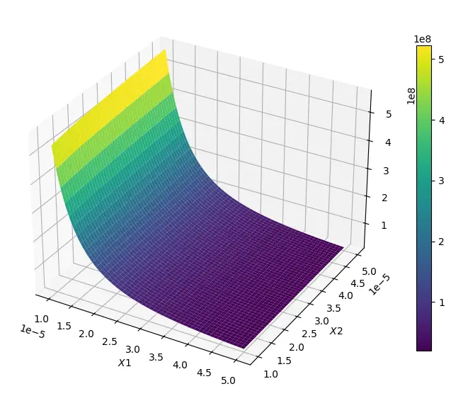

(a)
$`\frac{\partial\mathcal{G}_{1}(\mathcal{X}_{1};\mathcal{X}_{2})}{\partial\mathcal{X}_{1}}`$

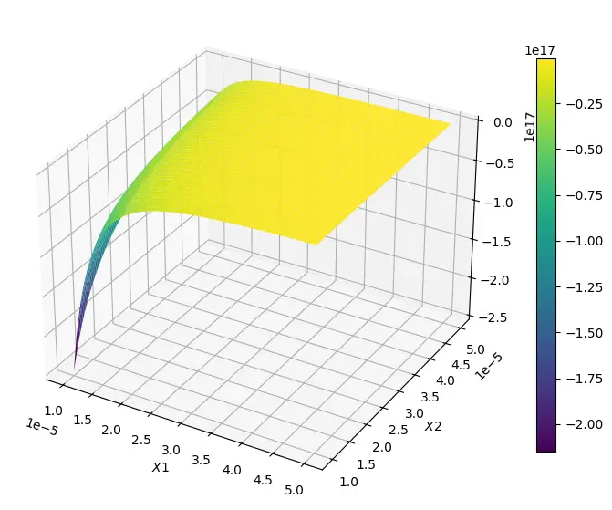

(b)
$`\frac{\partial\mathcal{G}_{1}(\mathcal{X}_{1};\mathcal{X}_{2})}{\partial\mathcal{X}_{2}}`$

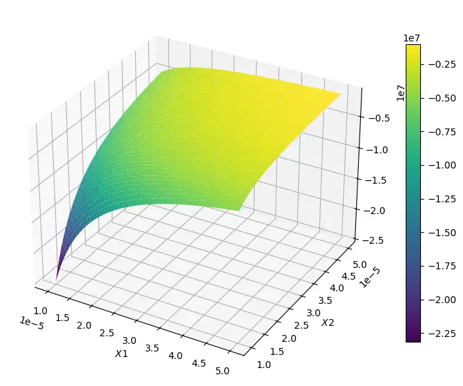

(c)
$`\frac{\partial\mathcal{G}_{2}(\mathcal{X}_{1};\mathcal{X}_{2})}{\partial\mathcal{X}_{1}}`$

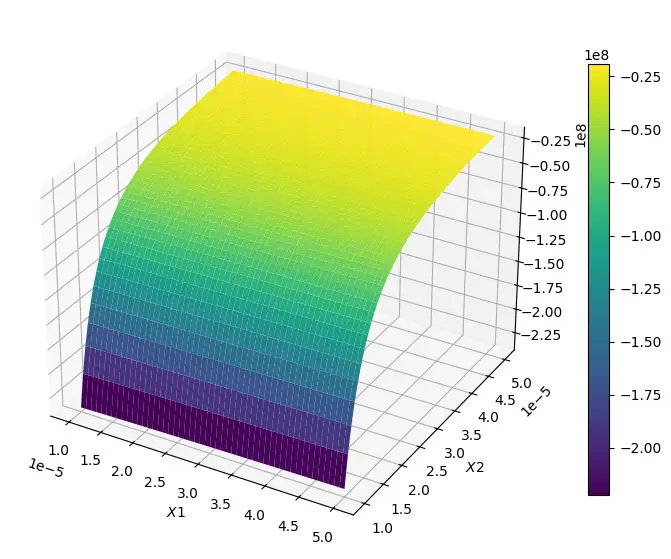

(d)
$`\frac{\partial\mathcal{G}_{2}(\mathcal{X}_{1};\mathcal{X}_{2})}{\partial\mathcal{X}_{1}}`$

Figure 6: (a)The partial derivative of
$`\mathcal{G}_{1}(\mathcal{X}_{1};\mathcal{X}_{2})`$ with respect to
$`\mathcal{X}_{1}`$; (b)The partial derivative of
$`\mathcal{G}_{1}(\mathcal{X}_{1};\mathcal{X}_{2})`$ with respect to
$`\mathcal{X}_{2}`$; (c)The partial derivative of
$`\mathcal{G}_{2}(\mathcal{X}_{1};\mathcal{X}_{2})`$ with respect to
$`\mathcal{X}_{1}`$; (d)The partial derivative of
$`\mathcal{G}_{2}(\mathcal{X}_{1};\mathcal{X}_{2})`$ with respect to
$`\mathcal{X}_{2}`$.

```math
\displaystyle\begin{aligned} \frac{\partial{\mathcal{G}_{1}(\mathcal{X}_{1};\mathcal{X}_{2})}}{\partial{\mathcal{X}_{1}}}=&\frac{\beta(\mathcal{K}_{1}\mathcal{X}_{2})^{\beta}[(\mathcal{K}_{2}\mathcal{X}_{1})^{\beta}+(\mathcal{K}_{1}\mathcal{X}_{2})^{\beta}+\mathcal{X}_{1}\beta\mathcal{K}_{2}^{\beta}\mathcal{X}_{1}^{\beta-1}]}{\mathcal{X}_{1}^{2}[(\mathcal{K}_{2}\mathcal{X}_{1})^{\beta}+(\mathcal{K}_{1}\mathcal{X}_{2})^{\beta}]^{2}}\\
=&\frac{\beta(\mathcal{K}_{1}\mathcal{X}_{2})^{2\beta}+\beta(\beta+1)(\mathcal{K}_{1}\mathcal{X}_{2})^{\beta}(\mathcal{K}_{2}\mathcal{X}_{1})^{\beta}}{\mathcal{X}_{1}^{2}[(\mathcal{K}_{2}\mathcal{X}_{1})^{\beta}+(\mathcal{K}_{1}\mathcal{X}_{2})^{\beta}]^{2}}>0.\end{aligned} \tag{18}
```

```math
\displaystyle\begin{aligned} \frac{\partial{\mathcal{G}_{1}(\mathcal{X}_{1};\mathcal{X}_{2})}}{\partial{\mathcal{X}_{2}}}=&-\frac{\beta^{2}\mathcal{K}_{1}^{\beta}\mathcal{X}_{2}^{\beta-1}\mathcal{X}_{1}[(\mathcal{K}_{2}\mathcal{X}_{1})^{\beta}+(\mathcal{K}_{1}\mathcal{X}_{2})^{\beta}]-\beta(\mathcal{K}_{1}\mathcal{X}_{2})^{\beta}\beta\mathcal{K}_{1}^{\beta}\mathcal{X}_{1}\mathcal{X}_{2}^{\beta-1}}{\mathcal{X}_{1}^{2}[(\mathcal{K}_{2}\mathcal{X}_{1})^{\beta}+(\mathcal{K}_{1}\mathcal{X}_{2})^{\beta}]^{2}}\\
=&-\frac{\beta^{2}\mathcal{K}_{1}^{\beta}\mathcal{X}_{2}^{\beta-1}\mathcal{X}_{1}(\mathcal{K}_{2}\mathcal{X}_{1})^{\beta}}{\mathcal{X}_{1}^{2}[(\mathcal{K}_{2}\mathcal{X}_{1})^{\beta}+(\mathcal{K}_{1}\mathcal{X}_{2})^{\beta}]^{2}}<0.\end{aligned} \tag{19}
```

```math
\displaystyle\begin{aligned} \frac{\partial{\mathcal{G}_{2}(\mathcal{X}_{1};\mathcal{X}_{2})}}{\partial{\mathcal{X}_{1}}}=&-\frac{\beta\mathcal{K}_{1}^{\beta}\mathcal{X}_{2}^{\beta-1}\beta\mathcal{K}_{2}^{\beta}\mathcal{X}_{1}^{\beta-1}}{[(\mathcal{K}_{2}\mathcal{X}_{1})^{\beta}+(\mathcal{K}_{1}\mathcal{X}_{2})^{\beta}]^{2}}\\
=&-\frac{\beta^{2}\mathcal{K}_{1}^{\beta}\mathcal{X}_{2}^{\beta-1}\mathcal{K}_{2}^{\beta}\mathcal{X}_{1}^{\beta-1}}{[(\mathcal{K}_{2}\mathcal{X}_{1})^{\beta}+(\mathcal{K}_{1}\mathcal{X}_{2})^{\beta}]^{2}}<0.\end{aligned} \tag{20}
```

```math
\displaystyle\begin{aligned} \frac{\partial{\mathcal{G}_{2}(\mathcal{X}_{1};\mathcal{X}_{2})}}{\partial{\mathcal{X}_{2}}}=&\frac{\beta(\beta-1)\mathcal{K}_{1}^{\beta}\mathcal{X}_{2}^{\beta-2}[(\mathcal{K}_{2}\mathcal{X}_{1})^{\beta}+(\mathcal{K}_{1}\mathcal{X}_{2})^{\beta}]-\beta\mathcal{K}_{1}^{\beta}\mathcal{X}_{2}^{\beta-1}\beta\mathcal{K}_{1}^{\beta}\mathcal{X}_{2}^{\beta-1}}{[(\mathcal{K}_{2}\mathcal{X}_{1})^{\beta}+(\mathcal{K}_{1}\mathcal{X}_{2})^{\beta}]^{2}}\\
=&\frac{\beta(\beta-1)\mathcal{K}_{1}^{\beta}\mathcal{X}_{2}^{\beta-2}\mathcal{K}_{2}^{\beta}\mathcal{X}_{1}^{\beta}-\beta\mathcal{K}_{1}^{2\beta}\mathcal{K}_{2}^{2\beta-2}}{[(\mathcal{K}_{2}\mathcal{X}_{1})^{\beta}+(\mathcal{K}_{1}\mathcal{X}_{2})^{\beta}]^{2}}<0.\end{aligned} \tag{21}
```

Based on the analysis of the aforementioned function trend, we can draw
the following conclusion: When $`\mathcal{X}_{1}`$ decreases, both
$`\left\lvert\frac{\partial\mathcal{L}_{DPO}(\mathcal{X}_{1};\mathcal{X}_{2})}{\partial\mathcal{X}_{1}}\right\lvert`$
and
$`\left\lvert\frac{\partial\mathcal{L}_{DPO}(\mathcal{X}_{1};\mathcal{X}_{2})}{\partial\mathcal{X}_{2}}\right\lvert`$
increase. When $`\mathcal{X}_{2}`$ decreases,
$`\left\lvert\frac{\partial\mathcal{L}_{DPO}(\mathcal{X}_{1};\mathcal{X}_{2})}{\partial\mathcal{X}_{1}}\right\lvert`$
decreases and
$`\left\lvert\frac{\partial\mathcal{L}_{DPO}(\mathcal{X}_{1};\mathcal{X}_{2})}{\partial\mathcal{X}_{2}}\right\lvert`$
increases. According to the analysis in Subsection 3.1, when the
training data is more extensive, the parameters will be updated at a
faster rate, thereby exacerbating the sensitivity of the DPO.

### A.2 Derivation of the Modified Likelihood in LD-DPO

```math
\displaystyle\begin{aligned} \hat{\pi}_{\theta}(y|x)=&\prod_{i=1}^{l_{p}}p(y_{i}|x,y_{<i})\prod_{i=l_{p}+1}^{l}p^{\alpha}(y_{i}|x,y_{<i})\\
=&\prod_{i=1}^{l_{p}}p^{\alpha}(y_{i}|x,y_{<i})p^{1-\alpha}(y_{i}|x,y_{<i})\prod_{i=l_{p}+1}^{l}p^{\alpha}(y_{i}|x,y_{<i})\\
=&\prod_{i=1}^{l_{p}}p^{\alpha}(y_{i}|x,y_{<i})\prod_{i=l_{p}+1}^{l}p^{\alpha}(y_{i}|x,y_{<i})\prod_{i=1}^{l_{p}}p^{1-\alpha}(y_{i}|x,y_{<i})\\
=&\prod_{i=1}^{l}p^{\alpha}(y_{i}|x,y_{<i})\prod_{i=1}^{l_{p}}p^{1-\alpha}(y_{i}|x,y_{<i}).\end{aligned} \tag{22}
```

## Appendix B Additional Experimental Results

### B.1 Arena-Hard Results

To comprehensively validate the effectiveness of LD-DPO, we conduct
experimental evaluations on Arena-Hard(Li et al., 2024), an enhanced
version of MT-Bench. Arena-Hard consists of 500 well-defined technical
problem-solving queries and presents more complex problem scenarios
compared to MT-Bench and AlpacaEval, thereby posing a greater challenge
to model performance. We select the Instruct model, known for its
superior modeling capabilities, as the initial model to compare the
performance differences between LD-DPO and five other offline
optimization algorithms.

As shown in Table.4, the overall performance of LD-DPO surpasses the
five offline preference optimization strategies, including DPO, with a
significant decrease in average response length compared to DPO. For
Llama2-13B-Chat and Llama3-8B-Instruct, LD-DPO performs suboptimally;
however, the average response length is more than 10% shorter compared
to the SOTA algorithm. In the case of Qwen2-Instruct, LD-DPO achieves
the highest Win rate of 31.2% (exceeding DPO by 7.8%), and the average
response length is 10% shorter. Notably, GPT-4-turbo-0409, the judge
model, exhibits a clear length preference, favoring longer responses
when calculating win rate. Despite this, LD-DPO achieves high win rates
with shorter responses, which strongly indicates its effectiveness in
aligning with human-like preferences.

|        |                   |            |                      |            |                     |            |           |
| ------ | ----------------- | ---------- | -------------------- | ---------- | ------------------- | ---------- | --------- |
| Method | Llama2-Chat (13B) |            | Llama3-Instruct (8B) |            | Qwen2-Instruct (7B) |            | Avg.WR(%) |
|        | WR(%)             | Avg. Token | WR(%)                | Avg. Token | WR(%)               | Avg. Token |           |
| SFT    | 9.6               | 635        | 24.3                 | 470        | 22.9                | 533        | 18.9      |
| DPO    | 10.2              | 661        | 27.6                 | 560        | 23.4                | 576        | 20.4      |
| R-DPO  | 9.8               | 607        | 27.1                 | 455        | 29.1                | 538        | 22.0      |
| SimPO  | 10.1              | 620        | 23.9                 | 495        | 26.0                | 603        | 20.0      |
| WPO    | 9.6               | 665        | 28.8                 | 553        | 24.6                | 579        | 21.0      |
| SamPO  | 9.7               | 637        | 28.2                 | 533        | 25.6                | 580        | 21.2      |
| LD-DPO | 10.1              | 603        | 28.0                 | 485        | 31.2                | 516        | 23.1      |

Table 4: Arena-Hard results under Instruct model setting: WR denotes the
win rate against the baseline model (GPT-4-0314) as judged by
GPT-4-turbo-0409. Avg.Token denotes the average length of the model’s
answers. Avg.WR denotes the average win rate of three models.

| Method             | GSM8K | BBH   | WinoGrande | CSQA  | ARC   | MMLU  | HellaSwag | ProofWriter | Average |
| ------------------ | ----- | ----- | ---------- | ----- | ----- | ----- | --------- | ----------- | ------- |
| Llama2-13B-Base    |       |       |            |       |       |       |           |             |         |
| SFT                | 34.18 | 37.61 | 53.08      | 69.37 | 73.51 | 50.79 | 36.38     | 48.69       | 50.45   |
| DPO                | 35.64 | 37.95 | 53.20      | 69.33 | 73.41 | 50.68 | 37.37     | 47.89       | 50.68   |
| R-DPO              | 32.53 | 37.68 | 53.12      | 68.84 | 73.03 | 50.52 | 38.13     | 48.19       | 50.26   |
| SimPO              | 32.68 | 36.70 | 52.29      | 66.75 | 72.88 | 50.53 | 36.26     | 47.92       | 49.50   |
| WPO                | 35.03 | 37.26 | 53.12      | 69.29 | 73.35 | 50.57 | 36.95     | 47.67       | 50.40   |
| SamPO              | 34.33 | 37.22 | 53.20      | 69.08 | 73.30 | 50.39 | 37.15     | 48.50       | 50.40   |
| LD-DPO             | 35.07 | 37.97 | 53.16      | 69.16 | 73.55 | 50.91 | 39.10     | 48.83       | 50.97   |
| Llama2-13B-Chat    |       |       |            |       |       |       |           |             |         |
| SFT                | 43.96 | 44.69 | 50.99      | 64.05 | 73.22 | 55.28 | 49.00     | 47.08       | 53.53   |
| DPO                | 44.11 | 44.98 | 51.50      | 64.91 | 73.14 | 55.40 | 49.20     | 47.72       | 53.87   |
| R-DPO              | 43.73 | 44.35 | 51.78      | 65.27 | 73.05 | 54.68 | 49.45     | 47.42       | 53.72   |
| SimPO              | 44.02 | 44.91 | 50.95      | 64.21 | 71.53 | 54.65 | 48.90     | 47.50       | 53.33   |
| WPO                | 43.65 | 44.64 | 51.42      | 64.78 | 73.19 | 55.14 | 48.81     | 47.56       | 53.65   |
| SamPO              | 44.73 | 44.57 | 51.46      | 64.74 | 73.00 | 55.36 | 48.95     | 47.94       | 53.84   |
| LD-DPO             | 43.80 | 44.70 | 51.78      | 65.32 | 73.09 | 55.21 | 49.64     | 47.89       | 53.93   |
| Llama3-8B-Base     |       |       |            |       |       |       |           |             |         |
| SFT                | 56.27 | 45.53 | 54.03      | 70.68 | 83.10 | 61.61 | 43.66     | 52.75       | 58.45   |
| DPO                | 56.66 | 46.49 | 54.70      | 71.70 | 83.23 | 62.29 | 46.42     | 48.89       | 58.80   |
| R-DPO              | 53.58 | 45.67 | 54.30      | 71.25 | 83.35 | 62.46 | 48.70     | 50.61       | 58.74   |
| SimPO              | 54.43 | 45.94 | 54.18      | 71.50 | 83.53 | 62.17 | 46.70     | 51.56       | 58.75   |
| WPO                | 56.74 | 46.27 | 54.06      | 71.74 | 83.37 | 62.35 | 46.32     | 50.50       | 58.92   |
| SamPO              | 57.74 | 45.69 | 54.38      | 71.66 | 83.44 | 62.55 | 46.75     | 49.61       | 58.98   |
| LD-DPO             | 58.12 | 46.39 | 54.54      | 71.62 | 83.56 | 62.58 | 49.33     | 51.39       | 59.69   |
| Llama3-8B-Instruct |       |       |            |       |       |       |           |             |         |
| SFT                | 82.60 | 62.07 | 61.33      | 76.17 | 87.87 | 69.40 | 58.70     | 55.19       | 69.17   |
| DPO                | 82.68 | 61.24 | 60.89      | 75.76 | 87.65 | 67.65 | 58.82     | 56.14       | 68.85   |
| R-DPO              | 83.53 | 60.21 | 59.75      | 75.35 | 86.56 | 66.68 | 58.44     | 57.19       | 68.47   |
| SimPO              | 83.22 | 58.54 | 59.94      | 75.76 | 86.60 | 66.87 | 59.55     | 53.69       | 68.02   |
| WPO                | 82.37 | 61.18 | 61.52      | 76.78 | 87.76 | 70.01 | 59.63     | 56.47       | 69.47   |
| SamPO              | 83.83 | 61.73 | 60.34      | 75.88 | 87.38 | 67.76 | 58.87     | 57.42       | 69.15   |
| LD-DPO             | 83.76 | 62.10 | 60.97      | 76.41 | 87.41 | 67.79 | 59.66     | 58.72       | 69.61   |
| Qwen2-7B-Base      |       |       |            |       |       |       |           |             |         |
| SFT                | 82.53 | 50.30 | 62.98      | 76.41 | 89.48 | 69.59 | 56.12     | 54.50       | 67.74   |
| DPO                | 82.91 | 50.83 | 62.15      | 76.00 | 89.75 | 69.05 | 55.22     | 51.64       | 67.20   |
| R-DPO              | 83.53 | 49.52 | 62.08      | 76.00 | 89.53 | 68.99 | 55.62     | 51.58       | 67.11   |
| SimPO              | 82.72 | 48.22 | 62.67      | 76.45 | 89.52 | 68.80 | 57.07     | 53.42       | 67.36   |
| WPO                | 84.30 | 49.86 | 62.12      | 75.76 | 89.74 | 68.87 | 55.24     | 54.06       | 67.41   |
| SamPO              | 83.37 | 49.92 | 62.15      | 75.96 | 89.66 | 68.95 | 55.26     | 52.97       | 67.28   |
| LD-DPO             | 84.06 | 50.46 | 62.47      | 76.29 | 89.74 | 69.12 | 56.37     | 54.61       | 67.88   |
| Qwen2-7B-Instruct  |       |       |            |       |       |       |           |             |         |
| SFT                | 88.61 | 57.82 | 66.02      | 78.54 | 89.77 | 71.06 | 70.43     | 58.14       | 72.55   |
| DPO                | 87.84 | 58.27 | 65.79      | 78.42 | 89.74 | 71.39 | 69.73     | 59.11       | 72.54   |
| R-DPO              | 88.99 | 56.99 | 65.98      | 78.05 | 89.69 | 70.73 | 71.06     | 58.31       | 72.48   |
| SimPO              | 88.14 | 59.32 | 66.30      | 78.13 | 89.83 | 71.08 | 71.75     | 58.03       | 72.83   |
| WPO                | 87.84 | 58.72 | 65.90      | 78.21 | 89.80 | 71.09 | 69.62     | 57.97       | 72.40   |
| SamPO              | 87.84 | 58.27 | 65.79      | 78.42 | 89.83 | 71.39 | 69.73     | 59.58       | 72.61   |
| LD-DPO             | 88.99 | 58.07 | 66.34      | 78.46 | 89.75 | 70.84 | 71.16     | 59.69       | 72.90   |

Table 5: Results on downstream tasks on the Huggingface OpenLLM
Leaderboard.

### B.2 Results on Downstream Tasks

We evaluate the performances of LD-DPO and all baselines on various
tasks on OpenLLM leaderboard (Beeching et al., 2023), including MMLU
(Hendrycks et al., 2021), ARC (Clark et al., 2018), BBH (Suzgun et al.,
2023), GSM8K (Cobbe et al., 2021), CommonsenseQA (Talmor et al., 2019),
WinoGrande (Sakaguchi et al., 2021), HellaSwag (Zellers et al., 2019)
and ProofWriter (Tafjord et al., 2021). The results are shown in Table
5, from where we find that:

- •
  LD-DPO outperforms SFT, DPO, and all other baselines on the average
  score across all benchmarks in all settings.
- •
  Preference optimization, whose goal is to align LLMs with human
  preference, may not significantly improve the performance on all
  downstream tasks.
- •
  All preference optimization methods perform comparably to SFT model on
  MMLU and CommonsenseQA(CSQA), with slight fluctuations, showing that
  knowledge is maintained during the preference optimization stage.
- •
  Compared to SFT, DPO, and other baselines, LD-DPO significantly
  improves the performance on HellaSwag and ProofWriter, indicating that
  LD-DPO can enhance the reasoning capability of LLMs.

| Method             | Writing | Roleplay | Reasoning | Math | Coding | Extraction | STEM | Humanities | Average |
| ------------------ | ------- | -------- | --------- | ---- | ------ | ---------- | ---- | ---------- | ------- |
| Llama2-13B-Base    |         |          |           |      |        |            |      |            |         |
| SFT                | 8.15    | 6.20     | 4.35      | 1.65 | 2.95   | 6.75       | 5.90 | 8.15       | 5.51    |
| DPO                | 7.55    | 7.05     | 4.95      | 1.70 | 3.00   | 6.55       | 6.30 | 8.30       | 5.67    |
| R-DPO              | 8.05    | 5.90     | 3.80      | 2.10 | 2.90   | 6.35       | 6.10 | 8.40       | 5.45    |
| SimPO              | 7.95    | 6.30     | 4.60      | 1.70 | 3.05   | 6.60       | 5.75 | 8.05       | 5.50    |
| WPO                | 7.75    | 6.70     | 4.60      | 1.80 | 2.85   | 7.55       | 6.30 | 8.55       | 5.76    |
| SamPO              | 7.85    | 6.55     | 4.75      | 1.35 | 3.05   | 8.05       | 6.40 | 8.25       | 5.78    |
| LD-DPO             | 7.80    | 6.50     | 4.75      | 1.60 | 3.65   | 7.40       | 6.55 | 8.45       | 5.83    |
| Llama2-13B-Chat    |         |          |           |      |        |            |      |            |         |
| SFT                | 8.45    | 7.20     | 5.35      | 3.30 | 2.75   | 7.30       | 7.50 | 9.00       | 6.35    |
| DPO                | 7.90    | 7.50     | 5.40      | 2.95 | 3.15   | 7.05       | 7.30 | 9.40       | 6.33    |
| R-DPO              | 8.75    | 7.05     | 5.65      | 3.05 | 3.00   | 7.25       | 6.80 | 9.05       | 6.32    |
| SimPO              | 8.90    | 7.25     | 5.55      | 3.05 | 3.50   | 6.75       | 7.15 | 9.05       | 6.40    |
| WPO                | 8.50    | 6.65     | 5.60      | 2.60 | 3.05   | 7.95       | 7.60 | 9.25       | 6.40    |
| SamPO              | 8.20    | 7.05     | 5.45      | 2.70 | 3.00   | 7.85       | 6.55 | 8.90       | 6.21    |
| LD-DPO             | 8.60    | 7.30     | 6.05      | 3.20 | 3.25   | 7.20       | 7.65 | 9.15       | 6.55    |
| Llama3-8B-Base     |         |          |           |      |        |            |      |            |         |
| SFT                | 7.80    | 6.25     | 3.90      | 3.05 | 4.25   | 8.40       | 6.55 | 8.50       | 6.08    |
| DPO                | 7.95    | 6.80     | 4.05      | 3.20 | 4.45   | 8.75       | 7.25 | 8.65       | 6.38    |
| R-DPO              | 8.30    | 6.30     | 4.00      | 2.65 | 4.10   | 8.30       | 7.45 | 8.35       | 6.18    |
| SimPO              | 8.10    | 6.30     | 4.40      | 3.05 | 4.35   | 8.35       | 7.15 | 8.20       | 6.24    |
| WPO                | 8.45    | 6.60     | 4.10      | 3.45 | 4.60   | 8.50       | 7.10 | 8.50       | 6.42    |
| SamPO              | 8.15    | 6.40     | 4.40      | 2.75 | 4.30   | 8.50       | 6.40 | 8.20       | 6.12    |
| LD-DPO             | 8.15    | 7.40     | 4.45      | 3.15 | 4.40   | 8.55       | 7.15 | 8.35       | 6.45    |
| Llama3-8B-Instruct |         |          |           |      |        |            |      |            |         |
| SFT                | 8.95    | 8.45     | 4.60      | 5.05 | 5.35   | 9.10       | 8.10 | 9.30       | 7.36    |
| DPO                | 9.05    | 8.55     | 5.55      | 5.30 | 5.45   | 9.00       | 8.70 | 9.35       | 7.61    |
| R-DPO              | 8.85    | 8.00     | 5.75      | 5.50 | 6.15   | 8.75       | 7.70 | 9.65       | 7.54    |
| SimPO              | 9.05    | 7.40     | 5.45      | 5.30 | 5.75   | 8.60       | 7.90 | 9.45       | 7.36    |
| WPO                | 8.20    | 8.55     | 5.50      | 5.20 | 6.20   | 9.25       | 8.50 | 9.40       | 7.60    |
| SamPO              | 9.20    | 8.65     | 5.30      | 3.55 | 6.15   | 9.25       | 8.45 | 9.50       | 7.50    |
| LD-DPO             | 8.95    | 8.35     | 5.90      | 5.35 | 6.75   | 8.70       | 8.55 | 9.40       | 7.74    |
| Qwen2-7B-Base      |         |          |           |      |        |            |      |            |         |
| SFT                | 7.45    | 6.35     | 4.65      | 6.05 | 4.45   | 6.85       | 6.50 | 8.15       | 6.30    |
| DPO                | 7.65    | 7.30     | 4.70      | 6.95 | 5.00   | 7.35       | 6.65 | 8.25       | 6.73    |
| R-DPO              | 7.40    | 6.30     | 4.50      | 6.30 | 3.95   | 6.70       | 6.15 | 8.00       | 6.16    |
| SimPO              | 7.75    | 6.60     | 4.70      | 5.95 | 5.45   | 6.60       | 7.60 | 8.30       | 6.61    |
| WPO                | 7.85    | 6.75     | 4.85      | 6.75 | 5.10   | 6.75       | 7.25 | 8.45       | 6.71    |
| SamPO              | 7.95    | 7.35     | 4.85      | 6.70 | 4.50   | 7.15       | 7.20 | 8.65       | 6.79    |
| LD-DPO             | 8.20    | 6.85     | 5.05      | 7.45 | 4.85   | 6.70       | 6.80 | 8.50       | 6.80    |
| Qwen2-7B-Instruct  |         |          |           |      |        |            |      |            |         |
| SFT                | 9.10    | 8.95     | 6.30      | 6.35 | 6.45   | 8.05       | 9.05 | 9.40       | 7.95    |
| DPO                | 9.15    | 9.05     | 6.45      | 6.40 | 4.85   | 7.90       | 9.05 | 9.45       | 7.79    |
| R-DPO              | 8.80    | 8.50     | 6.80      | 6.25 | 6.10   | 8.60       | 8.90 | 9.60       | 7.94    |
| SimPO              | 8.85    | 8.90     | 6.20      | 6.55 | 6.00   | 8.00       | 9.05 | 9.50       | 7.88    |
| WPO                | 9.00    | 8.80     | 6.80      | 6.40 | 4.90   | 8.10       | 8.20 | 9.55       | 7.72    |
| SamPO              | 8.90    | 8.80     | 6.50      | 6.15 | 5.70   | 8.45       | 8.35 | 9.40       | 7.78    |
| LD-DPO             | 8.90    | 8.55     | 7.25      | 6.25 | 5.90   | 8.75       | 9.05 | 9.55       | 8.03    |

Table 6: Scores for each capability item on the MT-Bench.

### B.3 MT-Bench Result

We provide a detailed presentation of the MT-Bench results in Table 6.
MT-Bench comprises 80 questions specifically designed to evaluate the
model’s proficiency across 8 dimensions: writing, roleplay, reasoning,
math, coding, extraction, stem, humanities. To further assess the
model’s capability in multi-round interactions and bolster the validity
of the results, each question in MT-Bench undergoes two rounds of Q&A.
The scores reported for each dimension are the averages derived from
these two rounds.

Generally, we find that LD-DPO outperforms SFT, DPO, and all other
baselines on average in all settings. In the case of slight fluctuations
in performance across other dimensions, LD-DPO significantly outperforms
all baselines in reasoning, indicating that LD-DPO can enhance the
reasoning capability of LLMs.

## Appendix C Improvement of Reasoning Capability

In further analysis of the MT-Bench, we found that the reasoning ability
of the model significantly improved after applying LD-DPO, compared to
both the SFT and DPO models. To further validate this conclusion, we
conducted experiments on ProofWriter. ProofWriter is a specialized
dataset designed to evaluate the reasoning capabilities of large
language models. It comprises a broad range of problems, from direct
reasoning tasks to those requiring more than five steps, and
distinguishes between open-world assumptions (OWA) and closed-world
assumptions (CWA), resulting in a total of 14 data subsets.

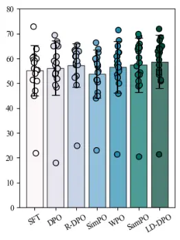

Figure 7: Performance of various methods on 14 subsets of ProofWriter
dataset for the Llama3-8B-Instruct setting.

We conducted experiments on ProofWriter and the results are shown in
Table.5. Fig.7 displays the results corresponding to the
Llama3-8B-Instruct, with the scatter indicating the score for each data
subset. After applying LD-DPO, the model shows an overall improvement
across 14 data subsets. Compared to Llama3-8B-Instruct, the average
score increases from 55.19 to 58.72, outperforming five classes of
preference optimization algorithms, including DPO, indicating a
significant improvement in reasoning. Detailed results of MT-Bench shown
in the Appendix B.3 also prove this point, and a case study of the
reasoning problems in Appendix D.

In fact, verbose responses negatively impact the reasoning abilities of
language models, particularly smaller models. Unlike Chain of Thought
(CoT), which is considered an excellent reasoning paradigm (Feng et al.,
2024b), overly lengthy responses tend to include incorrect derivations
or meaningless descriptions, which interfere with the model’s ability to
make the next step in the reasoning process or to reach the correct
conclusion. Our approach enables the model to learn a concise CoT style
while preventing overly lengthy answers, thereby improving the model’s
reasoning capabilities.

## Appendix D Case Studies

In Fig.8, we present two examples from AlpacaEval 2, where LD-DPO
generates comparably accurate outputs with less tokens compared to
vanilla DPO, showing that LD-DPO can generate more concise outputs
without sacrificing performance. Since longer outputs are not
necessarily more accurate or informative, sometimes they may contain
more redundant and unimportant information, making the outputs verbose
and lengthy. We believe that providing concise and clear outputs can
also reflect the expressive capability of LLMs.

We also present two examples from ProofWriter in Fig.9, where LD-DPO
generates more concise and direct chain-of-thought (CoT). From the cases
we find that DPO generates complex and verbose CoTs, ultimately
resulting in incorrect answers. By contrast, LD-DPO provides more direct
and clearer CoTs, resulting in correct answers. The experimental results
show that overly lengthy CoTs may detract from the accuracy of
reasoning, whereas LD-DPO can improve the reasoning capability of LLMs
by producing more concise and clearer CoTs.

Figure 8: Comparing generations of AlpacaEval 2 prompts from Llama3-8B
trained based on DPO and LD-DPO.

Figure 9: Comparing generations of ProofWriter prompts from Llama3-8B
trained based on DPO and LD-DPO.
