\CJKencfamily

UTF8mc

# A Dataset for Evaluating LLM-based Evaluation Functions for Research Question Extraction Task

Yuya Fujisaki Affiliation: Japan Advanced Institute of Science and
Technology, www.yuya.fujisaki@gmail.com    Shiro Takagi
Affiliation: Independent Researcher, takagi4646@gmail.com    Hideki Asoh
Affiliation: National Institute of Advanced Industrial Science and
Technology, h.asoh@aist.go.jp    Wataru Kumagai Affiliation: OMRON SINIC
X Corporation, wataru.kumagai@sinicx.com

###### Abstract

The progress in text summarization techniques has been remarkable.
However the task of accurately extracting and summarizing necessary
information from highly specialized documents such as research papers
has not been sufficiently investigated. We are focusing on the task of
extracting research questions (RQ) from research papers and construct a
new dataset consisting of machine learning papers, RQ extracted from
these papers by GPT-4, and human evaluations of the extracted RQ from
multiple perspectives. Using this dataset, we systematically compared
recently proposed LLM-based evaluation functions for summarizations, and
found that none of the functions showed sufficiently high correlations
with human evaluations. We expect our dataset provides a foundation for
further research on developing better evaluation functions tailored to
the RQ extraction task, and contribute to enhance the performance of the
task. The dataset is available at
[PaperRQ-HumanAnno-Dataset](https://github.com/auto-res/PaperRQ-HumanAnno-Dataset).

## 1 Introduction

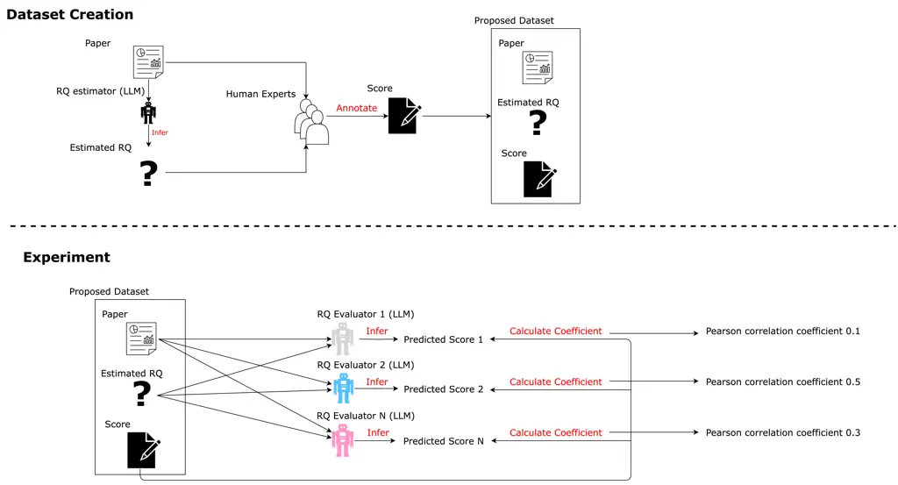

Figure 1: This study has two main processes. First, we constructed a
dataset consisting of papers, RQ extracted by an LLM, and human
evaluation scores of the RQ quality based on the paper abstract and
introduction. Second, using this dataset, we analyzed the correlation
between the output scores of various LLM-based evaluation functions and
human scores, and identified the evaluation function that is closest to
human judgment. Through this series of processes, we confirmed the
effectiveness of automatic evaluation of RQ using LLM.

To understand research papers, it’s crucial to accurately grasp the
Research Question (RQ). The RQ is the specific question set by the
authors to address a particular research problem. It guides the research
direction and narrows the focus of investigations and experiments.
Proper understanding of the RQ is essential for clarifying the research
purpose and scope and comprehending the paper’s main arguments.

However, research papers tend to have a complex structure, use many
technical terms, and have important information scattered throughout the
document, making RQ hard to grasp easily.

Considering these characteristics of research papers, automatic RQ
extraction, which involves identifying the key components of the RQ from
the paper and summarizing them into a specific format, and
appropriateness evaluation by machines are challenging tasks that have
not yet been addressed, to our best knowledge.

RQ extraction and evaluation can be considered subtasks of document
summarization, as they involve selecting and concisely expressing
important information from research papers. Applying document
summarization techniques may help solve these tasks with reasonable
accuracy.

To improve the performance of summarization, it is generally necessary
first to define a performance evaluation function and then optimize the
summarization model to maximize the value of that evaluation function.
For example, Lewis et al. (2020) used perplexity as an evaluation
function to assess the similarity between human-created summaries and
summaries generated by BART. In this way, identifying an appropriate
evaluation function is crucial for improving the performance of RQ
extraction.

An evaluation function’s output must strongly correlate with human
judgment to accurately measure qualitative improvements in summaries.
Assessing the correlation between existing evaluation functions and
human evaluation in the context of RQ is crucial. If existing functions
do not correlate well, developing RQ-specific evaluation functions will
be necessary.

Research on automatic evaluation of document summarization has verified
the correlation between automatic evaluation functions and human
evaluation (Fabbri et al., 2020). However, many of these studies target
specific domains, such as news articles, and there may be biases
specific to those domains (Kryscinski et al., 2020). Compared to news
articles, research papers tend to have a more complex structure, use
more technical terms, and have important information scattered
throughout the document. Therefore, it is unclear how well existing
automatic evaluation functions align with human judgment in RQ
understanding evaluation.

Therefore, in this study, we constructed a new RQ evaluation dataset
specialized for the domain of research papers. This dataset consists of:

1.  1.  Paper abstracts and introductions
2.  2.  RQ extracted by Large LLM from the abstracts and introductions
3.  3.  Human-annotated evaluation scores for the extracted RQ, considering
        the abstracts and introductions

By using this dataset, an automatic evaluation function for RQ can be
established in the future, and the performance of RQ extraction can be
optimized against that evaluation function. This will enable the
achievement of RQ extraction, making a unique contribution that is
distinct from conventional tasks dealing with research papers. While
datasets for summarizing research papers exist, to our best knowledge,
there is no dataset specifically designed for RQ evaluation.

In this study, we used the constructed dataset to compare the alignment
of existing LLM-based evaluation functions with human judgments.
Specifically, we evaluated the quality of RQ in the dataset using
existing LLM-based evaluation functions and compared their evaluations
with the human evaluations provided in the dataset. An overview of this
evaluation procedure is illustrated in Figure 1.

The analysis revealed that LLM-based evaluation functions do not
correlate with human judgment as much as previously suggested. This
suggests the need to design new evaluation functions capable of handling
complex tasks such as RQ understanding evaluation. Furthermore, this
insight may apply to the evaluation of automatic summarization in other
specialized domains, not just RQ.

The contributions of this study are as follows:

- •
  We conducted human evaluations of RQ on papers in the field of machine
  learning and constructed a dataset containing these evaluations.
- •
  Using the constructed dataset, we compared the alignment of existing
  LLM-based evaluation functions with human judgments.

The structure of this paper is as follows. In Section 2, we discuss
related work, and in Section 3, we explain the details of the proposed
dataset. In Section 4, we present the experimental setup, results, and
discussion. In Section 5, we provide a summary and future outlook. In
Section 6, we discuss the potential risks. Finally, in Section 7, we
discuss the limitations of this study.

## 2 Related Work

### 2.1 Evaluation Functions

Evaluation of automatic summarization is important for properly
measuring the performance of summarization systems. Automatic evaluation
functions can be broadly divided into two types: Reference-based and
Reference-free. Assuming Document is the original document, Summary is
the generated summary, and Reference is the human-created summary, in
the Reference-based setting, evaluation is performed using Document,
Summary, and Reference. On the other hand, in the Reference-free
setting, evaluation is performed using only Document and Summary (Sai
et al., 2022).

In recent years, it has become clear that evaluation functions using
LLM, typified by GPT-4, show higher performance than conventional
evaluation functions(Wang et al., 2023; Liu et al., 2023a), attracting
much attention. LLM-based evaluation functions work by having the LLM
return a score based on a prompt that includes the document to be
evaluated and its summary, and in some cases, a reference summary.

LLM evaluation functions exist in both Reference-based settings and
Reference-free settings. In the Reference-based setting, LLMs can more
directly consider alignment with reference summaries, but evaluation
needs to be performed even when reference summaries do not exist. On the
other hand, in the Reference-free setting, the language understanding
ability of LLMs can be utilized to directly evaluate the quality of
summaries (Wang et al., 2023).

There are various types of LLM evaluation functions, differentiated by
the presence or absence of the features described in Table 1.
Specifically, as categorized in Table 2, the differences are mainly
distinguished by whether they include evaluation procedures (Liu et al.,
2023a), output scores in batches (Yuan et al., 2023), or require
explanations for scores (Chiang and Lee, 2023). More details are
provided in Section 4.1.

### 2.2 Datasets Targeting Academic Papers

Building datasets targeting academic papers is one of the important
research challenges in the field of natural language processing. Various
datasets have been proposed, such as QASPER (Dasigi et al., 2021),
SciCite (Cohan et al., 2019), and others, each focusing on different
aspects of academic papers (see Section A.1.1 for more details).

Unlike previous datasets, our proposed dataset manually evaluates the
quality of RQ extracted by language models from paper abstracts and
introductions. It quantitatively measures how closely the extracted RQ
match the true RQ, directly assessing the RQ generation performance of
language models. Creating this dataset involves a challenging and
complex annotation process, requiring annotators to extract key
information from papers, organize it, and evaluate the extracted RQ.

| Term                  | Description                                                       |
| --------------------- | ----------------------------------------------------------------- |
| Document              | Document (ex. paper)                                              |
| Summary               | Summary generated from the Document (ex. RQ)                      |
| Reference             | Ground truth summary created by humans                            |
| Instruction           | Task instructions                                                 |
| Aspect                | Evaluation aspect                                                 |
| Output Space          | Range of evaluation values                                        |
| Criteria              | Evaluation criteria                                               |
| Evaluation Steps      | Evaluation steps                                                  |
| Data Sample           | Data unit for evaluation (ex. sample or batch)                    |
| Multiple Score sample | Number of samples for evaluation scores                           |
| Score-Explanation     | Whether to have LLM explain the reasons for the evaluation scores |
| ICL                   | Whether in-context learning is used                               |

Table 1: Representative terms and their descriptions used to explain
evaluation functions. As described later, each evaluation function is
differentiated by the presence or absence of these elements.

|                        |             |        |              |          |             |                |                |               |     |
| ---------------------- | ----------- | ------ | ------------ | -------- | ----------- | -------------- | -------------- | ------------- | --- |
| Name                   | Instruction | Aspect | Output Space | Criteria | Data Sample | Eval-procedure | Multiple Score | Score-explain | ICL |
| (Liu et al., 2023b)    | ✓           | ✓      | ✓            | †        | Single      | ✗              | ✗              | ✓             | ✗   |
| (Wang et al., 2023)    | ✓           | ✓      | ✓            | ✓        | Single      | ✗              | ✗              | ✗             | ✗   |
| (Liu et al., 2023a)    | ✓           | ✓      | ✓            | ✓        | Single      | ✓              | ✓              | ✗             | ✗   |
| (Chiang and Lee, 2023) | ✓           | ✓      | ✓            | ✓        | Single      | ✓              | ✓              | ✓             | ✗   |
| (Yuan et al., 2023)    | ✓           | ✓      | ✓            | ✓        | Batch       | ✗              | ✓              | ✓             | ✗   |
| (Gong and Mao, 2023)   | ✓           | §      | ✓            | ✓        | Single      | ✗              | ✗              | ✗             | ✗   |
| (Jain et al., 2023)    | ✗           | ✗      | ✗            | ✗        | Single      | ✗              | ✗              | ✗             | ✓   |

Table 2: The ✓in the table indicates that the element is included, while
✗ indicates that it is not included. Additionally, the Aspect in (Gong
and Mao, 2023) indicates estimating sub-aspects as sub-components of the
Aspect, and the Criteria in (Liu et al., 2023b) indicates using criteria
estimated by GPT-4 instead of human-written descriptions.

## 3 Proposed Dataset

### 3.1 Dataset

In this study, we constructed a dataset targeting 104 papers accepted as
long papers at ACL from 2016 to 2023. The papers subject to annotation
were limited to those proposing a solution (method) to a specific
problem, which is a common format for many ACL papers. In these papers,
the RQ is expected to be formulated as “Can a certain ‘problem’ be
solved by a certain ‘method’ ? ”.

For each paper, we used GPT-4 to estimate the RQ and collected human
scores evaluating the quality of the estimated RQ.

### 3.2 RQ Estimation Method

We input the abstracts and introductions of the papers into GPT-4 and
used the following three different prompts to extract three RQ for each
paper. The specific prompts are listed in Section A.2.3.

1.  1.  prompt1: A prompt that simply instructs to estimate the RQ
2.  2.  prompt2: A prompt that specifies the RQ should be in a specific
        format (“Can the PROBLEM be solved by the METHOD?”) and instructs to
        estimate the RQ
3.  3.  prompt3: A prompt that applies a method to generate structured text
        in an XML-like markup language, while specifying that the RQ should
        be in a specific format

We chose to use three different prompts in order to introduce diversity
in the quality of the extracted RQ, ranging from poorly extracted to
well-crafted ones. By including this variety in our dataset, we can
better evaluate the performance of the LLM-based evaluation functions
across a range of RQ qualities:

The third prompt is expected to seamlessly integrate Chain-of-Thought
(CoT) and external tools by generating structured text in an XML-like
markup language, allowing control of undesirable behaviors of language
models (Yamauchi et al., 2023). The characteristics of each prompt are
explained in Table 3, and the actual prompts used are explained in
Table 6. RQ generation was performed using gpt-4-0125-preview, with a
temperature of 1 and topP of 1.

Furthermore, according to Section A.2.5, when taking the average of all
annotators’ annotations, prompt 3 tends to be assigned high scores for
Problem Score, Method Score, and Is Target RQ Type, suggesting that it
is the most effective prompt for extracting RQ.

|         |                  |                    |                 |
| ------- | ---------------- | ------------------ | --------------- |
| prompt  | Explicit RQ Type | Explicit RQ Nature | Elicit Thinking |
| prompt1 | ✗                | ✓                  | ✗               |
| prompt2 | ✓                | ✗                  | ✗               |
| prompt3 | ✗                | ✓                  | ✓               |

Table 3: Categorization of prompts. Explicit RQ Type indicates that the
prompt explicitly instructs the model to extracted RQ following the
format "Can the PROBLEM be solved by the METHOD?". Explicit RQ Nature
indicates that the prompt text itself explicitly describes the desired
characteristics of the RQ to be extracted. Elicit Thinking indicates
whether Chain-of-Thought (CoT) is applied during output.

### 3.3 Annotation Method

#### 3.3.1 Annotators

The annotation was performed by a total of three people: two researchers
who routinely read papers in the field of machine learning and one
graduate student majoring in information science. All annotators were
male and were not compensated for their work. The annotators were
informed about the purpose of the annotation task and how the data would
be used in the research. They provided verbal consent to participate in
the annotation process.

#### 3.3.2 Annotation Perspectives

Each annotator scored the RQ estimated by GPT-4 from the following three
perspectives:

- •
  Problem Score: Does the RQ accurately estimate the true problem? (3
  levels from 0 to 2)
- •
  Method Score: Does the RQ accurately estimate the true method? (3
  levels from 0 to 2)
- •
  Is target rq type: Is the RQ in a specific format (proposing a
  solution to an existing problem)? (2 levels: 0 or 1)

### 3.4 Annotation Results and Analysis

In general, the annotation results for each data point can vary
depending on the annotator. Therefore, by selectively retaining data
with high agreement among annotators, a highly reliable dataset can be
created.

When the difficulty of annotation is relatively low and there is little
variation among annotators, measures such as Krippendorff’s alpha
coefficient (Fabbri et al., 2020) and perfect agreement rate
(Valenzuela-Escarcega et al., 2015) have been used as indicators of
agreement among annotators.

On the other hand, when the difficulty of annotation is relatively high
and there is greater variation among annotations, different agreement
measures may be used. For example, in the construction of the PubmedQA
dataset (Jin et al., 2019), when the labels of Annotator 1 and Annotator
2 do not match, a discussion is held between the two to reach a
consensus, and if a consensus still cannot be reached, that instance is
removed.

The task in this study is a highly difficult one that requires
understanding and judgment of complex text, and falls into a situation
where there is large variation among annotations.

In fact, we could not find sufficient agreement among annotators using
Krippendorff’s alpha coefficient and perfect agreement rate. Therefore,
we decided to use the results of a majority vote as an indicator of
agreement. Specifically, we consider the annotations that two out of
three annotators agree on as the ground truth (GT). Using this method,
69.5% of the data (217 out of 312 RQ) were adopted as GT.

|                                                                                                   |                                                                                                                                                                                                               |               |              |           |
| ------------------------------------------------------------------------------------------------- | ------------------------------------------------------------------------------------------------------------------------------------------------------------------------------------------------------------- | ------------- | ------------ | --------- |
| paper-title                                                                                       | extracted RQ                                                                                                                                                                                                  | problem score | method score | rq-format |
| Are Training Samples Correlated? Learning to Generate Dialogue Responses with Multiple References | Can the generic response problem in open-domain dialogue generation be solved by utilizing a novel two-step generation architecture that models multiple responses jointly by considering their correlations? | 2             | 2            | 1         |

Table 4: Example of human annotations

## 4 Experiment

### 4.1 Evaluation Functions Used in This Experiment

In recent years, evaluation methods using LLM have been actively
researched. The automatic evaluation methods compared in the experiments
are summarized in Table 2.

The details of each method are provided in Section A.3.1. In the
following, we explain the experimental setup and results.

### 4.2 Experimental Setup

In this study, we evaluated the correlation between human-annotated
scores and scores output by various LLM-based evaluation functions using
gpt-4o-2024-05-13 on the dataset we created. The evaluation settings
were based on previous studies. Jain et al. (2023) set the number of
few-shots to 5, while Yuan et al. (2023) set the batch size to 10 and
the number of loops to 3. Additionally, Liu et al. (2023a) and Chiang
and Lee (2023) set the output n to 20. For other setting items such as
temperature and top_p, we used the values reported in each paper.

The model output obtained as a result of the evaluation may contain text
as shown in Table 7. Therefore, it is necessary to extract the actual
values from the output. This extraction process was performed using the
Python code attached in Section A.3.5.

### 4.3 Results

We summarized the correlation coefficients between each evaluation
functions and human evaluation in Table 6. The table shows the Pearson
correlation coefficients between the scores given by LLM-based
evaluation functions and human evaluations for each aspect of RQ
quality.

While a correlation coefficient of around 0.5 was obtained for the
Method Score, the correlation coefficients for other aspects were below
0.2. This suggests that the LLM-based evaluation functions proposed so
far do not correlate well with human evaluations in assessing RQ
quality, particularly in aspects other than identifying the method.

In contrast, previous studies have reported that these LLM-based
evaluation functions correlate to some extent with human evaluations.
For example, in studies such as Liu et al. (2023a), the correlation
coefficients between automatic evaluation functions and human
evaluations were around 0.6 for some aspects, and most exceeded 0.35.

Our results suggest that the correlation between previously proposed
LLM-based evaluation functions and human evaluations may have been
overestimated. While these evaluation functions have been reported to
correlate with human judgments in tasks such as news summarization, our
findings indicate that they may not yet be able to provide evaluations
that correlate with human judgments for tasks beyond news summarization,
such as RQ evaluation. This result implies the need to develop optimal
evaluation functions for each task.

| Name                              | Problem Score |          | Method Score |          | Format Score |          |
| --------------------------------- | ------------- | -------- | ------------ | -------- | ------------ | -------- |
|                                   | $`\rho`$      | $`\tau`$ | $`\rho`$     | $`\tau`$ | $`\rho`$     | $`\tau`$ |
| (Liu et al., 2023b)               | 0.120         | 0.114    | nan          | nan      | -0.031       | -0.031   |
| (Wang et al., 2023)               | 0.076         | 0.071    | 0.0176       | 0.0165   | 0.0248       | 0.0236   |
| (Chiang and Lee, 2023) $`\alpha`$ | 0.121         | 0.091    | 0.493        | 0.405    | 0.067        | 0.055    |
| (Chiang and Lee, 2023) $`\beta`$  | 0.110         | 0.088    | 0.281        | 0.233    | 0.139        | 0.125    |
| (Liu et al., 2023a)               | 0.214         | 0.167    | 0.227        | 0.185    | 0.121        | 0.108    |
| (Yuan et al., 2023)               | 0.041         | 0.039    | 0.149        | 0.143    | 0.006        | 0.005    |
| (Gong and Mao, 2023)              | -0.048        | -0.045   | 0.165        | 0.160    | -0.134       | -0.134   |
| (Jain et al., 2023)               | -0.096        | -0.086   | 0.101        | 0.094    | 0.126        | 0.126    |

Table 5: A list of correlation coefficients. Following Liu et al.
(2023a), we calculated the Spearman and Kendall-Tau correlation
coefficients. $`\rho`$ denotes the Spearman correlation coefficient, and
$`\tau`$ denotes the Kendall-Tau correlation coefficient. Additionally,
$`\alpha`$ refers to analyze-rate from Liu et al. (2023a), and $`\beta`$
refers to rate-explain. In analyze-rate, the LLM first analyzes the
input information, points out the good and bad points, and then outputs
the final evaluation score. On the other hand, in rate-explain, the LLM
outputs the evaluation score based on the input information first, and
then explains the rationale for the evaluation. For the Method Score
from (Liu et al., 2023b), since only the same value was output, the
correlation coefficient is nan.

### 4.4 Discussion

This section investigates common tendencies across evaluation methods,
examines method reproducibility, and analyzes performance improvement
strategies.

We first analyze similarities in incorrectly evaluated RQ sets for each
method and the impact of input/output token count on performance.

Next, we discuss result variability due to sample size and model
differences when assessing method reproducibility.

Finally, we confirm the importance of modeling evaluation procedures and
verify how increasing procedure steps affects performance. We also
fine-tune models to test the hypothesis that directly learning scoring
patterns from data outperforms prompt-based methods.

#### 4.4.1 Investigating Common Tendencies across Evaluation Methods

In this section, we analyze the common tendencies across evaluation
methods from two perspectives: examining the similarity of RQ sets with
incorrect evaluation values and investigating the impact of input and
output token counts on performance. These analyses aim to clarify common
tendencies and provide insights for improving future evaluation methods.

##### How similar are the sets of RQ for which incorrect evaluation values were outputted between methods?

###### Analysis of Common Patterns in Misclassified RQ

We hypothesized that there might be a trend in the RQ with errors, where
errors are defined as estimated scores different from the GT. Figure 2
visualizes the overlap rate between RQ sets with mismatched evaluation
values, categorized by score type. To account for varying output ranges,
we set thresholds using percentiles and converted them into three or two
values. For Problem Score and Method Score, the overlap rate of RQ with
errors was high in Liu et al. (2023a), Wang et al. (2023), Yuan et al.
(2023), and Gong and Mao (2023), suggesting common issues leading to
similar errors. The analysis for Problem Score and Is target rq type is
in the appendix.

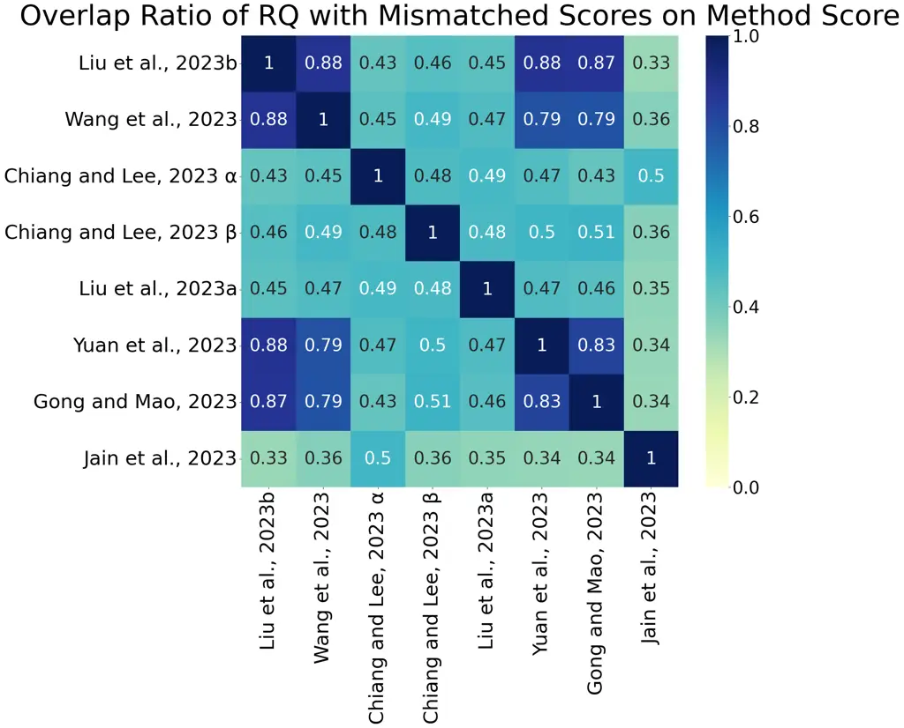

Figure 2: Visualization of the overlap rate of RQ with mismatched
evaluation values between methods, categorized by Method Score, as a
correlation diagram.

###### Correlation Analysis with Paper Acceptance Year and Length

We analyzed the characteristics of commonly misclassified RQ,
hypothesizing that the year of paper acceptance and paper length might
be related. However, the analysis showed no clear trends, indicating
that these factors do not explain the characteristics of RQ with errors.

##### Do more tokens lead to better performance?

The previous analysis did not identify any factors that could adequately
explain the characteristics of frequently misclassified RQ.
Consequently, based on the performance difference between Chiang and Lee
(2023) and Yuan et al. (2023), we hypothesized that input and output
token counts influence model performance. However, visualizing the
relationship between token counts and manual evaluation revealed no
clear correlation. Details are provided in Section A.4.2.

#### 4.4.2 Reproducibility of the Methods

In this study, we define reproducibility as the ability to obtain
consistent results when repeating an experiment under the same
conditions. To the best of our knowledge, reproducibility has not been
sufficiently discussed in the context of LLM-based evaluation functions
for text generation, despite its importance. We investigate the
reproducibility of the methods from two perspectives: the impact of
sample count on result variability and the variability due to model
differences.

##### Impact of sample count on result variability

The number of samples from LLM outputs may differ depending on the
evaluation function (Table 2). We hypothesized that methods with
multiple sampling would have less variability in the results. We
conducted three trials each for Wang et al. (2023) (single sampling) and
Chiang and Lee (2023) (20 samplings) the same temperature of 1 and
visualized the variability of Spearman correlation coefficients using
violin plots. Contrary to our hypothesis, Chiang and Lee (2023)
sometimes showed more variability (Figure 3), suggesting that multiple
sampling may not significantly improve result reliability.

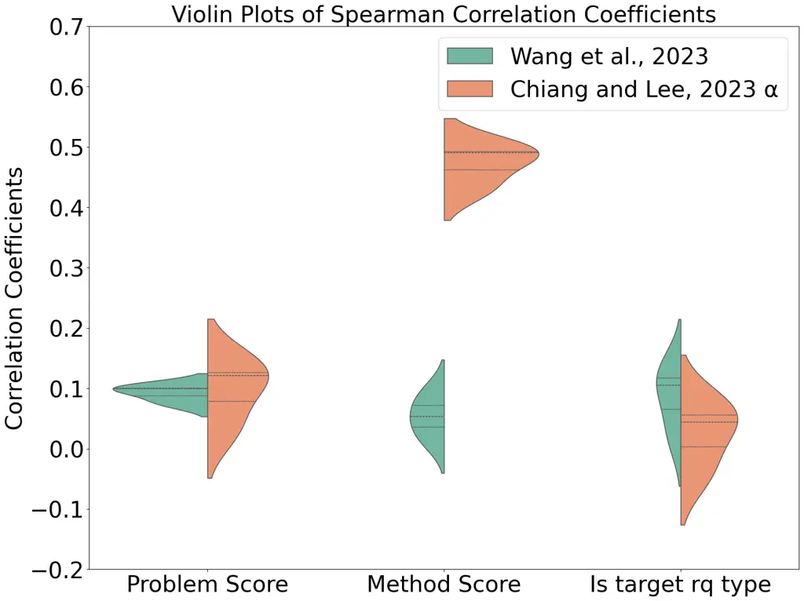

Figure 3: Visualization of Spearman correlation coefficients using
violin plots, comparing Wang et al. (2023) and Chiang and Lee (2023) to
confirm the variability due to differences in sample count when the
temperature is set to 1 for both methods. Visualization of Kendall
correlation coefficients is shown in Section A.4.3.

##### Variability of results due to model differences

We used gpt-4o-2024-05-13 in this study (Section 4.2), but it is
necessary to confirm the extent to which evaluation values change when
using a different model. We hypothesized that the reliability of results
may vary depending on the model, even with the same method. We compared
the variability of Spearman correlation coefficients between
gpt-4-turbo-2024-04-09 and gpt-4o-2024-05-13 for the analyze-rate of
Chiang and Lee (2023) (best-performing method) with a temperature of 1.
While there was no significant difference in performance,
gpt-4-turbo-2024-04-09 showed less variability (Figure 4), suggesting
that output results may fluctuate even if model performance does not
vary significantly.

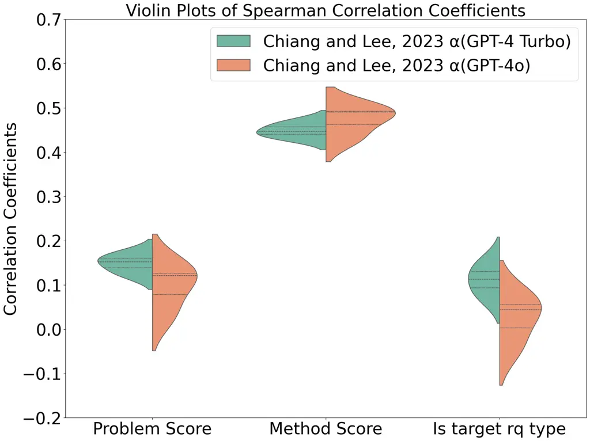

Figure 4: Visualization of Spearman correlation coefficients using
violin plots, comparing the analyze-rate of Chiang and Lee (2023) to
confirm the variability due to differences between
gpt-4-turbo-2024-04-09 and gpt-4o-2024-05-13 when the temperature is set
to 1 for both. Visualization of Kendall correlation coefficients is
shown in Section A.4.3.

#### 4.4.3 Analysis for Performance Improvement

This section describes our attempts to improve performance. We
qualitatively analyzed the best-performing methods, confirming the
importance of modeling the evaluation procedure. To improve the
completeness of the evaluation procedure, we increased the number of
steps and verified the impact on performance. Finally, we attempted
fine-tuning to test the hypothesis that directly learning scoring trends
from data leads to higher performance than prompting-based methods.

##### Importance of modeling the evaluation procedure

The best-performing methods, Chiang and Lee (2023) and Liu et al.
(2023a), estimate the evaluation procedure in a two-step process. First,
they estimate the procedure itself, then calculate the final evaluation
value based on the estimated procedure. Qualitatively, this method
largely reproduces the annotation process (see Section A.3.4),
suggesting that reproducing the annotation process through modeling may
be important for this task.

##### Impact of Increasing the Number of Evaluation Procedure Steps on Performance

While modeling the evaluation procedure positively impacted performance,
some steps were omitted compared to our actual annotation guidelines, as
discussed in Section A.3.4. We hypothesized that increasing the number
of steps in the estimated procedure could capture these omitted
processes, potentially improving performance by more closely mimicking
our evaluation process. We studied the extent to which performance
improves by increasing the number of steps from the original methods
(yielding about 5 steps, see Section A.3.4) to 10 and 30 steps.

However, despite the increased number of steps, the LLM was unable to
fully reproduce the omitted evaluation procedures as shown
inSection A.4.4. This suggests that the LLM lacks the specialized
knowledge of how researchers read and analyze papers, which cannot be
compensated for by arbitrarily increasing the number of steps in the
evaluation procedure.

##### Correcting the Overestimation of RQ Scores

In Section A.4.5, we analyze the difference between the estimated values
and the GT for each method. The results show that the estimated values
of Chiang and Lee (2023) and Liu et al. (2023a) may be overestimated
compared to other methods. In other words, if we can suppress this
overestimation by some method, the correlation may improve. In the
future, we need to explore methods to reduce this overestimation.

##### Learning the scoring patterns from the dataset

While the evaluation functions used in this experiment attempt to
improve performance through prompting using GPT-4, we hypothesized that
directly learning the scoring trends from the dataset would lead to
better results.

To test this, we fine-tuned the open-source LLM Gemma-7b using LoRA, but
the results were not promising (see Section A.4.6 for details). In
future research, we plan to explore this approach using larger models.

## 5 Conclusion

In this study, we constructed a new dataset that pairs RQ extracted by
GPT-4 with their manual evaluations, targeting papers accepted at ACL.
Using this dataset, we studied the correlation of GPT-4-based automatic
evaluation functions with human evaluation.

Our experiments revealed that the automatic evaluation functions, which
were reported to have high correlation with human annotators in existing
studies, showed only low correlation in the RQ evaluation task. This
suggests the possibility that appropriate evaluation functions differ
depending on the task, supporting the significance of creating and
publishing a dataset with human annotations. On the other hand, the
method that estimates the evaluation procedure showed relatively high
performance in evaluating the Method Score of RQ.

The results of this study provide insights for the development of
automatic evaluation functions in the RQ generation task for papers. In
the future, the design of evaluation functions specialized for the paper
domain and the identification of factors contributing to the performance
improvement of evaluation functions are expected.

## 6 Potential risks

Our approach uses LLM, which may disadvantage organizations that can’t
afford them. To address this, we should make these methods widely
accessible and explore non-LLM alternatives. Additionally, Over-reliance
on automatic RQ extraction might weaken researchers’ skills. Therefore,
researchers should use these tools to complement their expertise,
ensuring they continue to develop their own capabilities.

## 7 Limitations

### 7.1 Limitations of the Dataset

The dataset constructed in this study is limited to 104 papers in the
field of machine learning. Including papers from fields other than
machine learning could lead to the development of models that can be
commonly used across various fields, not limited to machine learning.
However, due to resource constraints, we were unable to carry out such
an expansion in this study. In the future, there is a need to construct
datasets targeting a wider range of research fields.

Furthermore, regarding annotation, there is a possibility that it was
difficult to achieve alignment among annotators because there is no firm
definition of RQ and their components in the field of machine learning.
The definition of RQ may vary from paper to paper, and their components
encompass a wide range of aspects, leading to the possibility of
different interpretations among annotators. In addition, understanding
papers requires specialized knowledge, so differences in the background
knowledge of annotators may have influenced the evaluation. In the
future, research is needed to organize RQ and their components,
particularly in the field of machine learning.

### 7.2 Limitations of Evaluation

In this study, we only conducted evaluations using GPT-4 and were unable
to perform evaluations using other LLMs. Conducting evaluations using
LLMs other than GPT-4 may provide deeper insights into the performance
and characteristics of evaluation functions. In the future, evaluations
using a variety of LLMs will be required.

Moreover, this study was limited to testing LLM-based evaluation
functions developed in domains such as news article summarization, and
we were unable to propose new evaluation functions that surpass their
performance. These existing evaluation functions may not be suitable for
evaluating complex targets like RQ in papers. RQ are composed of various
components, and understanding the relationships and context between
these components is required. Additionally, understanding the technical
terms of papers is necessary. Therefore, in the future, it is necessary
to develop evaluation functions specialized for RQ evaluation in papers,
utilizing the insights obtained in this study.

## References

- Chiang and Lee (2023) Cheng-Han Chiang and Hung-yi Lee. 2023. [A
  closer look into using large language models for automatic
  evaluation](https://doi.org/10.18653/v1/2023.findings-emnlp.599). In
  _Findings of the Association for Computational Linguistics: EMNLP
  2023_, pages 8928–8942, Singapore. Association for Computational
  Linguistics.
- Cohan et al. (2019) Arman Cohan, Waleed Ammar, Madeleine van Zuylen,
  and Field Cady. 2019. [Structural scaffolds for citation intent
  classification in scientific
  publications](https://doi.org/10.18653/v1/N19-1361). In _Proceedings
  of the 2019 Conference of the North American Chapter of the
  Association for Computational Linguistics: Human Language
  Technologies, Volume 1 (Long and Short Papers)_, pages 3586–3596,
  Minneapolis, Minnesota. Association for Computational Linguistics.
- Dasigi et al. (2021) Pradeep Dasigi, Kyle Lo, Iz Beltagy, Arman Cohan,
  Noah A. Smith, and Matt Gardner. 2021. [A dataset of
  information-seeking questions and answers anchored in research
  papers](https://doi.org/10.18653/v1/2021.naacl-main.365). In
  _Proceedings of the 2021 Conference of the North American Chapter of
  the Association for Computational Linguistics: Human Language
  Technologies_, pages 4599–4610, Online. Association for Computational
  Linguistics.
- Fabbri et al. (2020) Alexander R Fabbri, Wojciech Kryściński, Bryan
  McCann, Caiming Xiong, Richard Socher, and Dragomir Radev. 2020.
  Summeval: Re-evaluating summarization evaluation. _arXiv preprint
  arXiv:2007.12626_.
- Gong and Mao (2023) Peiyuan Gong and Jiaxin Mao. 2023. [Coascore:
  Chain-of-aspects prompting for nlg
  evaluation](https://api.semanticscholar.org/CorpusID:266348675).
  _ArXiv_, abs/2312.10355.
- Jain et al. (2023) Sameer Jain, Vaishakh Keshava, Swarnashree
  Mysore Sathyendra, Patrick Fernandes, Pengfei Liu, Graham Neubig, and
  Chunting Zhou. 2023. [Multi-dimensional evaluation of text
  summarization with in-context
  learning](https://doi.org/10.18653/v1/2023.findings-acl.537). In
  _Findings of the Association for Computational Linguistics: ACL 2023_,
  pages 8487–8495, Toronto, Canada. Association for Computational
  Linguistics.
- Jin et al. (2019) Qiao Jin, Bhuwan Dhingra, Zhengping Liu, William
  Cohen, and Xinghua Lu. 2019. [PubMedQA: A dataset for biomedical
  research question answering](https://doi.org/10.18653/v1/D19-1259). In
  _Proceedings of the 2019 Conference on Empirical Methods in Natural
  Language Processing and the 9th International Joint Conference on
  Natural Language Processing (EMNLP-IJCNLP)_, pages 2567–2577, Hong
  Kong, China. Association for Computational Linguistics.
- Kang et al. (2018) Dongyeop Kang, Waleed Ammar, Bhavana Dalvi,
  Madeleine van Zuylen, Sebastian Kohlmeier, Eduard Hovy, and Roy
  Schwartz. 2018. [A dataset of peer reviews (PeerRead): Collection,
  insights and NLP applications](https://doi.org/10.18653/v1/N18-1149).
  In _Proceedings of the 2018 Conference of the North American Chapter
  of the Association for Computational Linguistics: Human Language
  Technologies, Volume 1 (Long Papers)_, pages 1647–1661, New Orleans,
  Louisiana. Association for Computational Linguistics.
- Kojima et al. (2024) Takeshi Kojima, Shixiang Shane Gu, Machel Reid,
  Yutaka Matsuo, and Yusuke Iwasawa. 2024. Large language models are
  zero-shot reasoners. In _Proceedings of the 36th International
  Conference on Neural Information Processing Systems_, NIPS ’22, Red
  Hook, NY, USA. Curran Associates Inc.
- Kryscinski et al. (2020) Wojciech Kryscinski, Bryan McCann, Caiming
  Xiong, and Richard Socher. 2020. [Evaluating the factual consistency
  of abstractive text
  summarization](https://doi.org/10.18653/v1/2020.emnlp-main.750). In
  _Proceedings of the 2020 Conference on Empirical Methods in Natural
  Language Processing (EMNLP)_, pages 9332–9346, Online. Association for
  Computational Linguistics.
- Lewis et al. (2020) Mike Lewis, Yinhan Liu, Naman Goyal, Marjan
  Ghazvininejad, Abdelrahman Mohamed, Omer Levy, Veselin Stoyanov, and
  Luke Zettlemoyer. 2020. [BART: Denoising sequence-to-sequence
  pre-training for natural language generation, translation, and
  comprehension](https://doi.org/10.18653/v1/2020.acl-main.703). In
  _Proceedings of the 58th Annual Meeting of the Association for
  Computational Linguistics_, pages 7871–7880, Online. Association for
  Computational Linguistics.
- Liu et al. (2023a) Yang Liu, Dan Iter, Yichong Xu, Shuohang Wang,
  Ruochen Xu, and Chenguang Zhu. 2023a. [G-eval: NLG evaluation using
  gpt-4 with better human
  alignment](https://doi.org/10.18653/v1/2023.emnlp-main.153). In
  _Proceedings of the 2023 Conference on Empirical Methods in Natural
  Language Processing_, pages 2511–2522, Singapore. Association for
  Computational Linguistics.
- Liu et al. (2023b) Yuxuan Liu, Tianchi Yang, Shaohan Huang, Zihan
  Zhang, Haizhen Huang, Furu Wei, Weiwei Deng, Feng Sun, and Qi Zhang.
  2023b. [Calibrating llm-based
  evaluator](https://api.semanticscholar.org/CorpusID:262464745).
  _ArXiv_, abs/2309.13308.
- Sai et al. (2022) Ananya B. Sai, Akash Kumar Mohankumar, and Mitesh M.
  Khapra. 2022. [A survey of evaluation metrics used for nlg
  systems](https://doi.org/10.1145/3485766). _ACM Comput. Surv._, 55(2).
- Valenzuela-Escarcega et al. (2015) Marco Antonio Valenzuela-Escarcega,
  Vu A. Ha, and Oren Etzioni. 2015. [Identifying meaningful
  citations](https://api.semanticscholar.org/CorpusID:2538517). In _AAAI
  Workshop: Scholarly Big Data_.
- Wadden et al. (2020) David Wadden, Shanchuan Lin, Kyle Lo, Lucy Lu
  Wang, Madeleine van Zuylen, Arman Cohan, and Hannaneh
  Hajishirzi. 2020. [Fact or fiction: Verifying scientific
  claims](https://doi.org/10.18653/v1/2020.emnlp-main.609). In
  _Proceedings of the 2020 Conference on Empirical Methods in Natural
  Language Processing (EMNLP)_, pages 7534–7550, Online. Association for
  Computational Linguistics.
- Wang et al. (2023) Jiaan Wang, Yunlong Liang, Fandong Meng, Zengkui
  Sun, Haoxiang Shi, Zhixu Li, Jinan Xu, Jianfeng Qu, and Jie
  Zhou. 2023. [Is ChatGPT a good NLG evaluator? a preliminary
  study](https://doi.org/10.18653/v1/2023.newsum-1.1). In _Proceedings
  of the 4th New Frontiers in Summarization Workshop_, pages 1–11,
  Singapore. Association for Computational Linguistics.
- Yamauchi et al. (2023) Ryutaro Yamauchi, Sho Sonoda, Akiyoshi Sannai,
  and Wataru Kumagai. 2023. [Lpml: Llm-prompting markup language for
  mathematical
  reasoning](https://api.semanticscholar.org/CorpusID:262465094).
  _ArXiv_, abs/2309.13078.
- Yuan et al. (2023) Peiwen Yuan, Shaoxiong Feng, Yiwei Li, Xinglin
  Wang, Boyuan Pan, Heda Wang, and Kan Li. 2023. [Batcheval: Towards
  human-like text
  evaluation](https://api.semanticscholar.org/CorpusID:266693801).
  _ArXiv_, abs/2401.00437.

## Appendix A Appendix

### A.1 Related Work

#### A.1.1 Datasets Targeting Academic Papers

Previously proposed datasets include QASPER (Dasigi et al., 2021),
SciCite (Cohan et al., 2019), Meaningful Citations Data Set
(Valenzuela-Escarcega et al., 2015), PubMedQA (Jin et al., 2019),
PeerRead (Kang et al., 2018), and SciFact (Wadden et al., 2020). QASPER
is a QA dataset targeting papers, consisting of questions created by NLP
experts who read only the titles and summaries of papers, and answers
and supporting evidence provided by other NLP experts who read the
entire papers.

SciCite is a dataset that pairs citation sentences in scientific papers
with labels of their citation intent (background information, use of
methods, comparison of results, etc.) and can be used for tasks such as
classifying citation sentences and predicting citation intent. The
Meaningful Citations Data Set is a dataset with labels identifying
important citations in academic literature.

PubMedQA consists of answers from three values ("yes/no/maybe") to
questions created from the titles and abstracts of medical papers. This
dataset can be used to develop content understanding and
question-answering systems for medical papers.

PeerRead contains 14,700 papers submitted to top conferences (ACL,
NeurIPS, ICLR), their acceptance/rejection results, and peer review
results by 10,700 experts. This dataset is expected to be applied to
tasks such as automatic paper evaluation and peer review automation.

SciFact consists of 1,400 annotated abstracts with scientific claims and
supporting evidence, with each abstract labeled as supporting or
refuting the claim. This dataset can be used for tasks such as
determining the veracity of claims and automatically extracting
evidence.

### A.2 Dataset Creation

#### A.2.1 Data Selection Criteria

In this study, we constructed a dataset consisting of 104 long papers
accepted at ACL from 2016 to 2023. We focused on papers published from
2016 onwards because these papers are licensed under the Creative
Commons Attribution 4.0 International License. This license permits the
modification of published works, which is essential for our annotation
process. By selecting papers from this period, we ensure that our
dataset construction and annotation efforts comply with the legal
permissions granted by the license.

#### A.2.2 Explanation of Dataset Rights

The publicly released dataset includes appropriate citation information
for the research papers. Additionally, this dataset targets papers
published under the Creative Commons Attribution 4.0 license, and have
been modified. Consequently, the dataset we have created is also subject
to the Creative Commons Attribution 4.0 license.

#### A.2.3 List of prompts used to extract the RQ

As shown in Table 6. Prompt 3, which could not fit in this table, is
mentioned in Section A.2.4.

| prompt  | content                                                                                                                                                                                                                                                                                                                                                                                                                                                                                                                                                                                                                                                                                   |
| ------- | ----------------------------------------------------------------------------------------------------------------------------------------------------------------------------------------------------------------------------------------------------------------------------------------------------------------------------------------------------------------------------------------------------------------------------------------------------------------------------------------------------------------------------------------------------------------------------------------------------------------------------------------------------------------------------------------- |
| prompt1 | You are a friendly and helpful research assistant, specifically tasked with analyzing academic papers on machine learning, provided by users. Your sole responsibility is to meticulously read the abstracts and introductions of these papers and, using logical reasoning, deduce exactly four key research questions from each paper. It is crucial that these research questions be precise inquiries, capable of yielding empirical answers and often illuminating novel challenges that may have been previously overlooked in existing research. Your output should consist exclusively of these one research questions per paper, without any additional information or analysis. |
| prompt2 | You are a friendly and helpful research assistant, specifically tasked with analyzing academic papers on machine learning, provided by users. Your sole responsibility is to read the abstracts and introductions of these papers and, deduce exactly one key research questions from each paper. The research question has the following format. "Can the PROBLEM be solved by the METHOD?".                                                                                                                                                                                                                                                                                             |
| prompt3 | Section A.2.4                                                                                                                                                                                                                                                                                                                                                                                                                                                                                                                                                                                                                                                                             |

Table 6: List of prompts used to extract the RQ in this paper.

#### A.2.4 Example of prompt3

Prompt 3, which could not fit in Table 6, is as follows:

1 \<RULE\>

2 The system and the assistant exchange messages.

3 All messages MUST be formatted in XML format. XML element ::= \<tag
attribute="value"\>content\</tag\>

4 Tags determine the meaning and function of the content. The content
must not contradict the definition of the tag.

5 \</RULE\>

6

7 \<TAG name="RULE"\>

8 This tag defines rules. The defined content is absolute.

9 Attributes:

10 - role (optional) : A role that should follow the rules. Roles are
"system" or "assistant".

11 Notes:

12 - The assistant must not use this tag.

13 \</TAG\>

14

15 \<TAG name="TAG"\>

16 This tag defines a tag. The defined content is absolute.

17 Attributes:

18 - name : A tag name.

19 Notes:

20 - The assistant must not use this tag.

21 \</TAG\>

22

23 \<TAG name="SYSTEM"\>

24 This tag represents a system message.

25 Notes:

26 - The assistant MUST NOT use this tag.

27 \</TAG\>

28

29 \<TAG name="EOS"\>

30 Indicates the end of a message.

31 \</TAG\>

32

33 \<TAG name="THINK"\>

34 This tag represents a thought process.

35 If you use this tag, take a drop deep breath and work on the problem
step-by-step.

36 Attributes:

37 - label (optional) : A label summarizing the contents.

38 Notes:

39 - The thought process must be described step by step.

40 - Premises in reasoning must be made as explicit as possible. That
is, there should be no leaps of reasoning.

41 \</TAG\>

42

43 \<TAG name="PROBLEM"\>

44 This tag represents the problem being attempted to be solved in the
paper.

45 \</TAG\>

46

47 \<TAG name="METHOD"\>

48 This tag represents the method or hypothesis used by the authors of
the paper to solve PROBLEM.

49 \</TAG\>

50

51 \<TAG name="RESEARCH_QUESTION"\>

52 This tag represents a resaerch question.

53 A research question is a combination of a problem to be solved and a
hypothesis or method to approach it.

54 The general form of a research question is as follows.

55 - Can the PROBLEM be solved by the METHOD?

56 - Can the PROBLEM be explained by the METHOD?

57 Notes:

58 - This tag must contain one PROBLEM and one METHOD tag inside.

59 - The assistant must then combine the contents of the PROBLEM and
METHOD and present the research question as a concise statement.

60 \</TAG\>

61

62 \<RULE role="assistant"\>

63 The assistant is a friendly and helpful research assistant,
specifically tasked with analyzing academic papers on machine learning,
provided by users.

64 The assistants sole responsibility is to meticulously read the
abstracts and introductions of these papers and, using logical
reasoning, deduce exactly a key research questions from the paper.

65 The assistant first carefully reads the paper using the THINK tag,
and then extracts the research questions in the paper by using the
RESEARCH_QUESTION tag.

66 Note:

67 - The assistant MUST use THINK tags before using RESEARCH_QUESTION
tag.

68 - The assistant MUST analyze the paper from different perspectives
and extract ONE research questions.

69 - It is crucial that these research questions be precise inquiries,
capable of yielding empirical answers and often illuminating novel
challenges that may have been previously overlooked in existing
research.

70 - The assistant should output only the information that can be read
from PAPER; no additional information or analysis is needed.

71 \</RULE\>

#### A.2.5 Annotation Score per prompt

The annotation scores for each prompt used to extract RQ are visualized
by the average values of all annotators for Problem Score, Method Score,
and Is Target RQ Type. According to Figure 5, the values for prompt 3
are relatively better overall, indicating that prompt 3 has the best
performance as a prompt for extracting RQ.

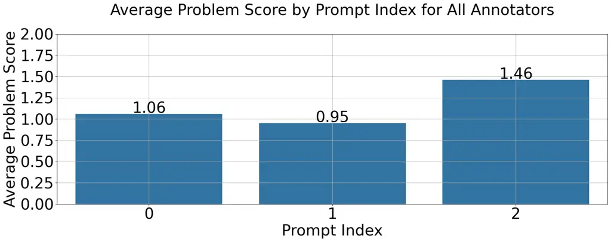

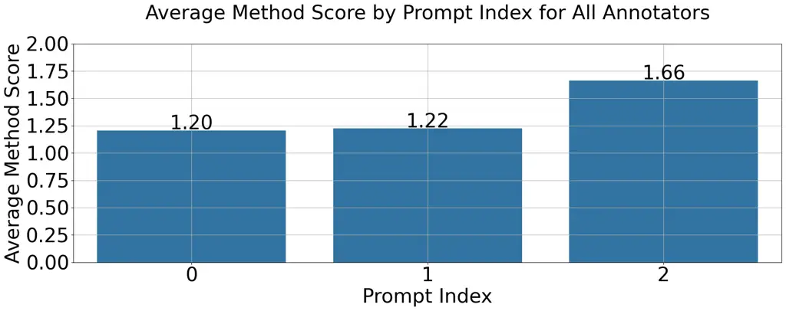

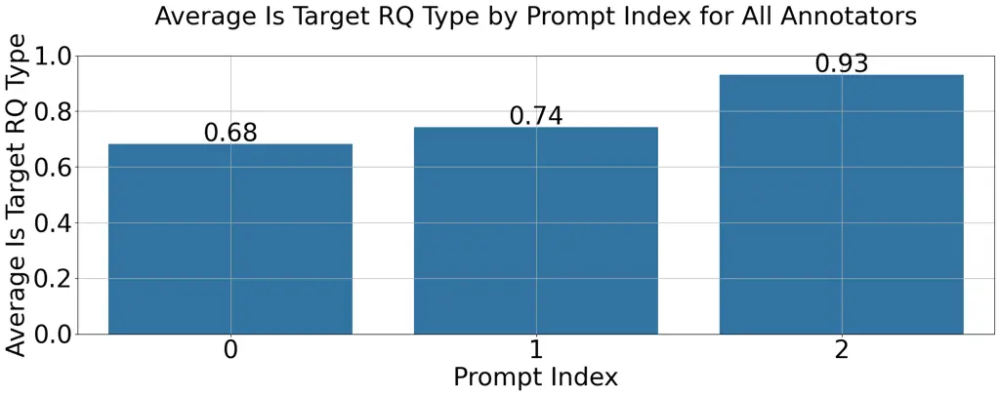

Figure 5: Graph visualizing the average scores of all annotators for
each prompt used to extract RQ, categorized by Problem Score, Method
Score, and Is Target RQ Type.

### A.3 Evaluation

#### A.3.1 Evaluation Functions Used in This Experiment

Liu et al. (2023b) propose a method called AUTOCALIBRATE. In this
method, an arbitrary dataset labeled by human experts is first divided
into training data and evaluation data. Next, the training data is used
to have the LLM create its own scoring criteria. After that, the
criteria are narrowed down and refined to create an evaluator closer to
human judgment.

Wang et al. (2023) propose a method to evaluate based on LLMs using
human-created Aspects and Criteria. They conduct experiments in both
reference-based and reference-free settings.

Liu et al. (2023a) propose a method called G-Eval. This method is
characterized by having LLMs create evaluation procedures based on
human-created Aspects and Criteria, and then evaluate using those
evaluation procedures.

Chiang and Lee (2023), like Liu et al. (2023a), have LLMs create
evaluation procedures based on human-created Aspects and Criteria.
However, this method is characterized by requiring explanations for the
evaluations. They apply two settings: one where the evaluation
explanation is analyzed before outputting the evaluation value, and
another where the evaluation value is output first and then the
evaluation explanation is provided.

Yuan et al. (2023) propose a method called BatchEval. This method is
characterized by evaluating in batch units, taking multiple Document and
Summary pairs as input.

Gong and Mao (2023) propose a method called CoAScore. This method
assumes that Aspects have multiple sub-aspects as lower-level
perspectives, and evaluates aspects based on the evaluation values for
each inferred sub-aspect.

Jain et al. (2023) propose a method that teaches LLMs evaluation
tendencies through few-shot learning. In this case, we performed
few-shot learning using a set of Document, Summary, and human annotation
as one unit. This method is characterized by not using human-created
Aspects or Criteria. As described above, there are various methods to
evaluation methods using LLM. These methods have their own
characteristics, such as aiming for evaluations closer to human
judgment, requiring explanations for evaluations, and evaluating from
multiple perspectives.

#### A.3.2 Example output from evaluation function

The example output when using Wang et al. (2023) is shown in Table 7.
From this output, it is necessary to obtain the actual evaluation values
using Section A.3.5.

|                     |                                                                                                                                                                                                                                                                                                                                                                                                                                                                                                                                                                                                                                                                                                                                                                                                                                                                                                                                                                                                                                                                                                                                                                                                                                                                                                                                                                                                                                                                                                                                                                                                                                                                                                                                                                                                                                           |
| ------------------- | ----------------------------------------------------------------------------------------------------------------------------------------------------------------------------------------------------------------------------------------------------------------------------------------------------------------------------------------------------------------------------------------------------------------------------------------------------------------------------------------------------------------------------------------------------------------------------------------------------------------------------------------------------------------------------------------------------------------------------------------------------------------------------------------------------------------------------------------------------------------------------------------------------------------------------------------------------------------------------------------------------------------------------------------------------------------------------------------------------------------------------------------------------------------------------------------------------------------------------------------------------------------------------------------------------------------------------------------------------------------------------------------------------------------------------------------------------------------------------------------------------------------------------------------------------------------------------------------------------------------------------------------------------------------------------------------------------------------------------------------------------------------------------------------------------------------------------------------- |
| Name                | output                                                                                                                                                                                                                                                                                                                                                                                                                                                                                                                                                                                                                                                                                                                                                                                                                                                                                                                                                                                                                                                                                                                                                                                                                                                                                                                                                                                                                                                                                                                                                                                                                                                                                                                                                                                                                                    |
| (Wang et al., 2023) | Given the Document and the Research Question (RQ), the score for Appropriateness of Problem Description in the Summary (RQ) would be:\*\*95\*\*\*\*Reasoning:\*\*The Research Question (RQ) asks how effectively a data augmentation method involving randomly switching entities can mitigate biases related to gender and sentiment in the translation of sentences containing person names without compromising translation quality. The Document comprehensively describes the following key issues:1. NMT systems exhibit gender and sentiment biases, particularly in the translation of person names.2. Gender bias is highlighted, with a specific focus on the incorrect estimation of the gender of names by NMT systems, especially for female names.3. Sentiment bias is also discussed, noting that the sentiment of translations can be affected by the presence of person names.4. A data augmentation method (switch-entity) is proposed to mitigate these biases.5. The effectiveness of this method is emphasized, along with the fact that it does not compromise translation quality.The RQ succinctly captures these aspects: it specifies the use of a data augmentation method to address gender and sentiment biases in NMT systems, and it mentions the concern about maintaining translation quality. The Document provides detailed context and evidence for these points, making the RQ highly appropriate.The reason for not giving a perfect score (100) is that while the RQ is highly aligned with the Document, it could be slightly more explicit about the specifics of the biases and the exact mechanism of the proposed data augmentation method described in the Document. However, this is a minor point, and overall the appropriateness of the problem description in the summary is excellent. |

Table 7: Example of model output in evaluation. As evaluate values are
embedded within the output sentences, it is necessary to extract them.

#### A.3.3 Criteria manually created for this experiment

As shown in Table 8.

| Name              | output                                                                                                                                                                                                                                                                                                                                                                                           |
| ----------------- | ------------------------------------------------------------------------------------------------------------------------------------------------------------------------------------------------------------------------------------------------------------------------------------------------------------------------------------------------------------------------------------------------ |
| Score Problem     | Evaluates the extent to which the problem being attempted to be solved in the paper is accurately and sufficiently described in the RQ extracted by the LLM.                                                                                                                                                                                                                                     |
| Score Method      | Evaluates the extent to which the method or hypothesis used by the authors of the paper to solve the problem is accurately and sufficiently described in the RQ extracted by the LLM.                                                                                                                                                                                                            |
| Is target rq type | Evaluates whether the RQ extracted by the LLM conveys the same meaning and intent as the format ’Can the PROBLEM be solved/explained by the METHOD?’, without strictly adhering to this exact phrasing. The RQ does not necessarily need to follow this format word-for-word as long as it expresses the same overall idea. The accuracy of the content itself is not considered in this aspect. |

Table 8: Criteria created by humans

#### A.3.4 Estimated Evaluation Procedure

The estimated evaluation procedure used in Chiang and Lee (2023) and Liu
et al. (2023a) is as shown in Table 9.

The estimated evaluation procedure (see Table 9) is similar to our
evaluation procedure (see Section A.5.2) in that it identifies the
problem from the abstract and introduction of the paper, understands the
scope of that problem, and then evaluates whether the RQ in the summary
appropriately reflects that problem. Both approaches focus on the
specific problem addressed in the paper and assess how accurately the RQ
captures that problem.

However, the estimated evaluation procedure does not include an explicit
step to confirm that the targeted problem is correct, as our evaluation
procedure does. By adding this confirmation step, the estimated
evaluation procedure could be made more complete.

|     |                                                                                                                                                                                                                                                                                                                                                                                                                                                                                                                                                                                                                                                                                                                                                                                                                                                                                                                                                                                                                                                                                                                                                                                                                                                                                                                                                                                                                                                                                                                                                                                                                                               |
| --- | --------------------------------------------------------------------------------------------------------------------------------------------------------------------------------------------------------------------------------------------------------------------------------------------------------------------------------------------------------------------------------------------------------------------------------------------------------------------------------------------------------------------------------------------------------------------------------------------------------------------------------------------------------------------------------------------------------------------------------------------------------------------------------------------------------------------------------------------------------------------------------------------------------------------------------------------------------------------------------------------------------------------------------------------------------------------------------------------------------------------------------------------------------------------------------------------------------------------------------------------------------------------------------------------------------------------------------------------------------------------------------------------------------------------------------------------------------------------------------------------------------------------------------------------------------------------------------------------------------------------------------------------- |
|     | inferred evaluation step                                                                                                                                                                                                                                                                                                                                                                                                                                                                                                                                                                                                                                                                                                                                                                                                                                                                                                                                                                                                                                                                                                                                                                                                                                                                                                                                                                                                                                                                                                                                                                                                                      |
|     | To evaluate the Appropriateness of Problem Description in the Summary (RQ), follow these steps: 1. \*\*Identify the Problem in the Document/Source Text:\*\* Carefully read the abstract and introduction to pinpoint the central problem or issue that the paper aims to address. 2. \*\*Understand the Scope of the Problem:\*\* Determine the extent, context, and relevance of the problem as described in the paper. Pay attention to whether the problem is well-defined and specific. 3. \*\*Compare with the RQ:\*\* Examine the RQ to see if it accurately reflects the problem described in the Document/Source Text. Check if the RQ captures the essence and scope of the problem. 4. \*\*Assess Completeness:\*\* Evaluate whether the RQ includes all critical aspects of the problem. Consider if any key elements or details of the problem are missing or misrepresented. 5. \*\*Rate the Appropriateness:\*\* Based on the comparison, rate the RQ on a scale of 1 to 5 for the Appropriateness of Problem Description: - \*\*1:\*\* The RQ poorly describes the problem or is completely inaccurate. - \*\*2:\*\* The RQ describes the problem but misses several key aspects. - \*\*3:\*\* The RQ captures the general essence of the problem but lacks some important details. - \*\*4:\*\* The RQ accurately describes the problem with minor omissions or misinterpretations. - \*\*5:\*\* The RQ perfectly and comprehensively describes the problem as presented in the Document/Source Text. By following these steps, you can systematically evaluate how well the RQ captures the problem described in the paper. |

Table 9: An example of the evaluation procedure used to calculate the
problem score in Liu et al. (2023a) and Chiang and Lee (2023)

#### A.3.5 Python snippet for parsing evaluation values from the output results

1 def get_score(text):

2 patterns = \[

3 r"Score:\s\*(?:.\*?:\s\*)?(\d+)",

4 r"Score \\1-5\\:\s\*(\d+)",

5 r"Rating:\s\*(?:.\*?:\s\*)?(\d+)",

6 r"\b(\d+)\b",

7 r":\s\*(\d+)"

8 \]

9

10 for pattern in patterns:

11 match = re.search(pattern, text)

12 if match:

13 rating = match.group(1)

14 return float(rating)

15

16 return np.nan

### A.4 Discussion

#### A.4.1 Analysis of Common Patterns in Misclassified RQ for Is target rq type

Figure 6 visualizes the overlap rate between the sets of RQ for which
the evaluation values inferred by LLM did not match the human-created GT
for Is target rq type.

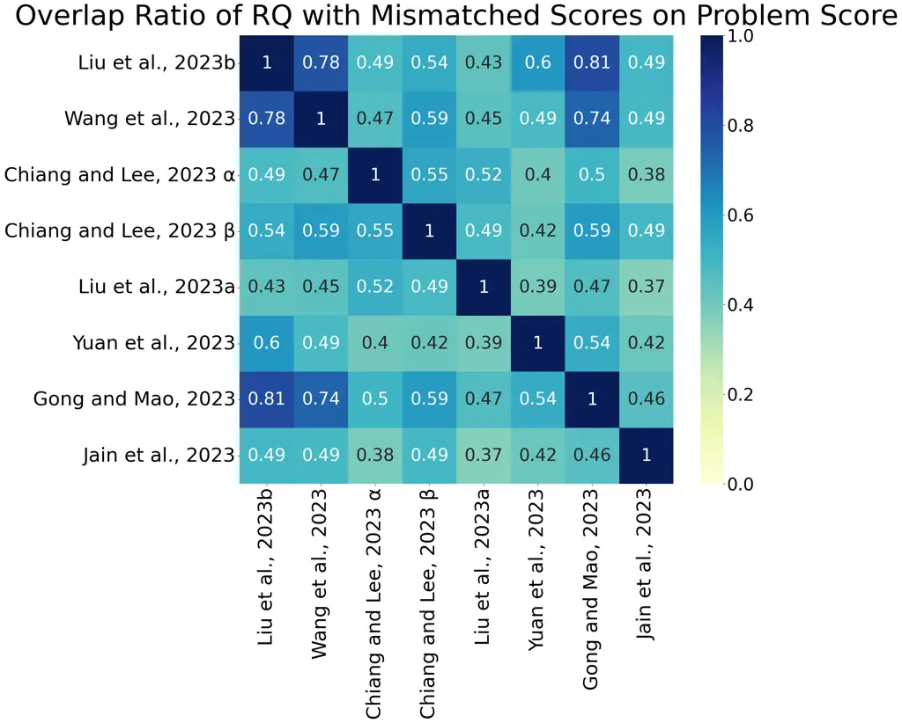

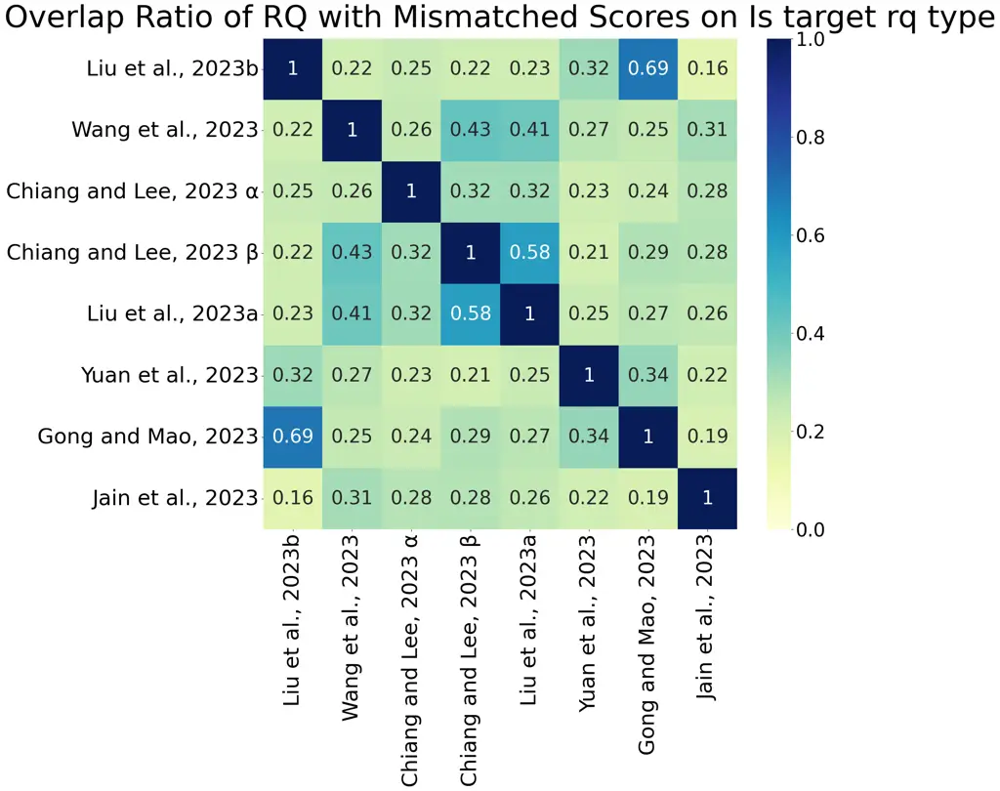

Figure 6: Visualization of the overlap rate of RQ for which the
evaluation values inferred by LLM did not match the GT between methods,
categorized by Problem Score, Method Score, and Is target rq type, as a
correlation.

#### A.4.2 Do more tokens lead to better performance?

As shown in the Section 4.3, the existing methods did not correlate well
with human evaluations, indicating a need for designing better
evaluation functions. To gain insights into what factors should be
considered when designing such functions, we decided to investigate the
properties of the relatively well-performing methods in our study.

Among the methods we employed, those by Chiang and Lee (2023) and others
performed relatively well, while Yuan et al. (2023)’s method performed
poorly. One notable difference between these methods is the length of
the input and output tokens. This observation led us to hypothesize that
the number of input and output tokens might influence the model’s
performance. The basis for this hypothesis is, for example, Kojima
et al. (2024)’s research showing that adding a prompt encouraging
multi-step reasoning to the input and performing multi-step reasoning at
the output improved the model’s performance.

Based on this, we thought that methods that provide explanations for
evaluation values, such as Chiang and Lee (2023), might have higher
evaluation values than methods that simply output scores, such as Yuan
et al. (2023).

To confirm the relationship between the properties of these methods and
the evaluation values, we visualized the performance against the number
of tokens. In Figure 7, we examined the relationship between the
Spearman correlation coefficient of the Method Score, which yielded
relatively good results, and the number of tokens. As a result, no clear
correlation was found between the number of input or output tokens and
the correlation coefficient of the Method Score. In other words, it is
suggested that simply increasing the number of tokens does not yield
automatic evaluation functions that are highly correlated with manual
evaluation. It is highly likely that factors other than the number of
tokens, such as the design of the evaluation function, are important for
improving the performance of evaluation functions.

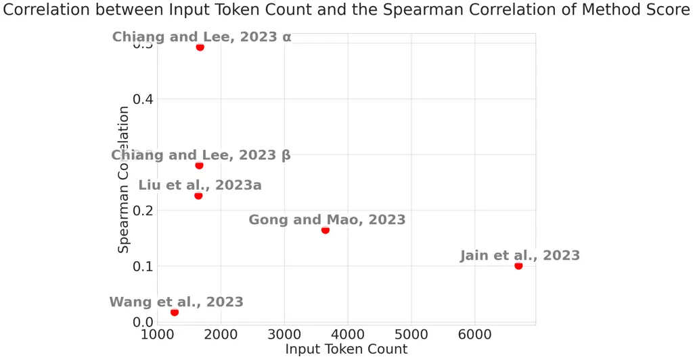

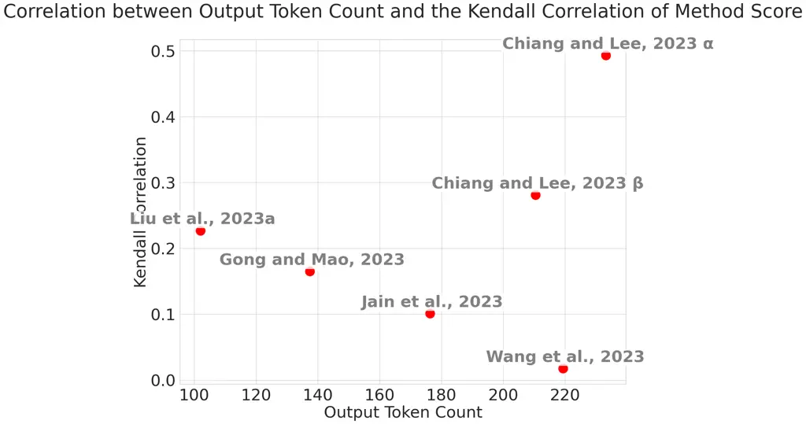

Figure 7: To investigate the relationship between the number of tokens
and performance, we conducted an analysis using scatter plots. We
plotted the number of tokens on the x-axis and the Spearman correlation
coefficient, a performance indicator, on the y-axis, visualizing the
positioning of each research method. The left figure shows the
relationship between the number of input tokens and performance. The
right figure shows the relationship between the number of output tokens
and performance. There was a trend that the more output tokens there
were, the higher the performance. However, since Yuan et al. (2023)’s
method performs sampling in batches, it was difficult to calculate the
number of tokens per sample. Therefore, Yuan et al. (2023)’s data is not
included in this analysis.

#### A.4.3 Reproducibility of the Methods

##### Impact of sample count on result variability

We conducted three trials each for Wang et al. (2023) (single sampling)
and Chiang and Lee (2023) (20 samplings) and visualized the variability
of Kendall correlation coefficients using violin plots.

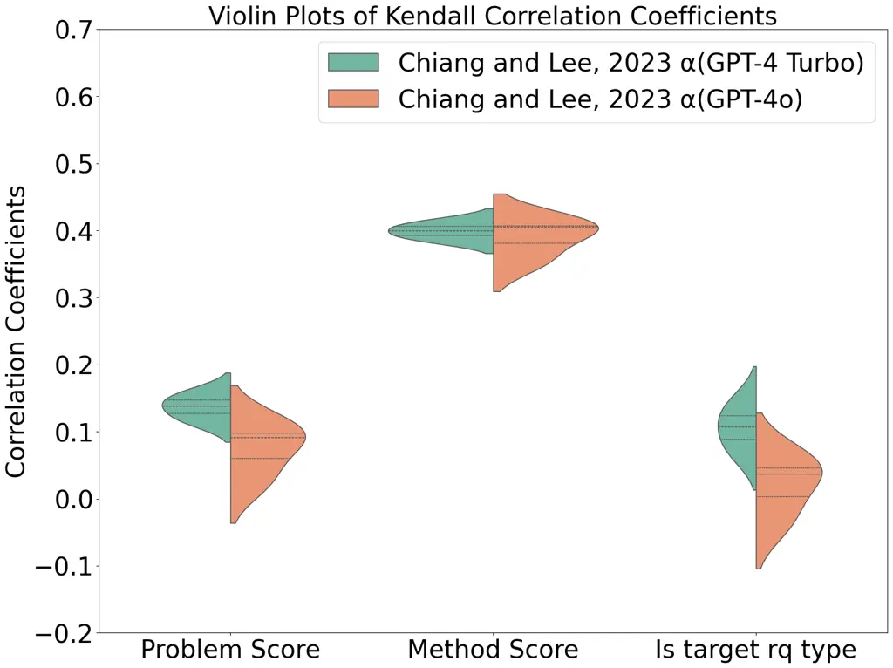

Figure 8: Visualization of Kendall coefficients using violin plots,
comparing Wang et al. (2023) and Chiang and Lee (2023) to confirm the
variability due to differences in sample count.

##### Variability of results due to model differences

We compared the variability of Kendall correlation coefficients between
gpt-4-turbo-2024-04-09 and gpt-4o-2024-05-13 for the analyze-rate of
Chiang and Lee (2023) (best-performing method). While there was no
significant difference in performance, gpt-4-turbo-2024-04-09 showed
less variability (Figure 9), suggesting that output results may
fluctuate even if model performance does not vary significantly.

Figure 9: Visualization of Kendall correlation coefficients using violin
plots, comparing the analyze-rate of Chiang and Lee (2023) to confirm
the variability due to differences between gpt-4-turbo-2024-04-09 and
gpt-4o-2024-05-13.

#### A.4.4 Impact of Increasing the Number of Evaluation Procedure Steps on Performance

The results Table 10 show a slight improvement in performance, but the
difference is small

| evaluation procedure steps | Problem Score |          | Method Score |          | Format Score |          |
| -------------------------- | ------------- | -------- | ------------ | -------- | ------------ | -------- |
|                            | $`\rho`$      | $`\tau`$ | $`\rho`$     | $`\tau`$ | $`\rho`$     | $`\tau`$ |
| default(approximately 5)   | 0.121         | 0.091    | 0.493        | 0.405    | 0.067        | 0.055    |
| 10                         | 0.178         | 0.144    | 0.494        | 0.405    | 0.013        | 0.011    |
| 30                         | 0.153         | 0.124    | 0.485        | 0.410    | -0.058       | -0.055   |

Table 10: Performance confirmation was conducted by increasing the
number of steps in the evaluation procedure. The default in the table
refers to the original output, which is about 5 steps. In line with
Table 5, the results in this table were also obtained using
gpt-4-turbo-2024-04-09.

#### A.4.5 Difference between estimated score and GT

In Figure 10, we visualize the difference between the estimated values
of each method and the GT for each score.

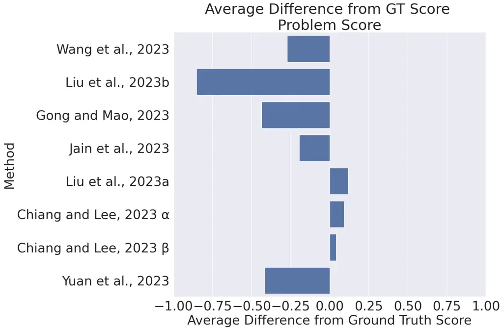

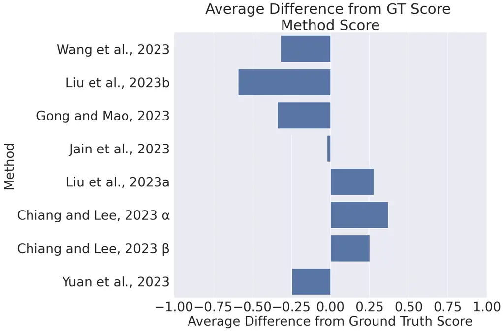

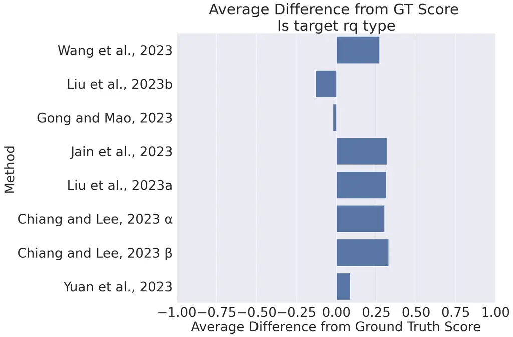

Figure 10: Visualization of the difference between the estimated values
of each method and the GT for each score

#### A.4.6 Learning the scoring patterns from the dataset

As mentioned in Section 4.1, the evaluation function used in this
experiment is a type of evaluation function that involves trial and
error with prompts using GPT-4. However, an alternative approach could
be to fine-tune an LLM and learn the evaluation tendencies. To this end,
we fine-tuned the open-source LLM Gemma-7b by LoRA to see if it could
better align with human ratings (GT). The experimental settings were
LoRA rank of 8, alpha of 16, and 1 epoch. And A100 GPU were used, and
the SFTTrainer from the Transformer Reinforcement Learning library was
utilized. As shown in Table 11, the values are lower than those in
Table 5, suggesting that it might be difficult to learn evaluation
regularities by fine-tuning a model of around 7B parameters using LoRA.
Furthermore, we investigated the impact on performance by varying the
split ratio of the training data.

| Test data ratio | Problem Score |          | Method Score |          | Format Score |          |
| --------------- | ------------- | -------- | ------------ | -------- | ------------ | -------- |
|                 | $`\rho`$      | $`\tau`$ | $`\rho`$     | $`\tau`$ | $`\rho`$     | $`\tau`$ |
| 10% \*          | 0.084         | 0.080    | -0.061       | -0.058   | -0.159       | -0.145   |
| 40%             | nan           | nan      | nan          | nan      | 0.171        | 0.164    |
| 70%             | 0.094         | 0.089    | 0.136        | 0.128    | -0.165       | -0.158   |
| 90%             | 0.125         | 0.120    | -0.184       | -0.177   | nan          | nan      |

Table 11: A list of performance for each test dataset. \* indicates the
same experimental settings as in Table 5, meaning that the results are
comparable. As a result, many trials produced the same output values,
leading to a large number of nan values in the table.

### A.5 Actual Annotation Guidelines Used

#### A.5.1 Introduction

##### Purpose of this Task

In this task, you will evaluate the accuracy of Research Questions (RQ)
extracted by a Language Model (LLM) based on the abstract and
introduction of research papers.

##### Types of RQ Covered in this Task

RQ come in various forms, but for this task we will focus on papers with
the following structure: “Can a certain ’problem’ be solved by a certain
‘method‘ ? “ In other words, you will be assessing the accuracy of the
RQ extracted by the LLM for papers that fit this specific template.

##### Utilization of the Evaluation

The results of this evaluation can potentially be used to develop the
following: A model to classify whether a paper belongs to a particular
RQ type. A model to assess the validity of problems, challenges, or
proposed methods extracted from a paper (by LLM or other means).

#### A.5.2 Evaluation

##### Evaluation Targets

3 RQ extracted by the LLM.

##### Evaluation Procedure

The following is an evaluation procedure for the Problem Score.

- 1.  Carefully read the abstract and introduction of the paper
- 2.  Extract the problem targeted by this research from the abstract and
      introduction of the paper
- 3.  Confirm whether the problem targeted by this research is correct. For
      example, confirm whether the specific problem pointed out in the paper
      is correctly captured, rather than the abstract problem that the field
      is addressing
- 4.  Based on the content confirmed in step 3, evaluate how accurately the
      extracted Research Question (RQ) captures the problem on a 3-point
      scale from 0 to 2. Refer to Table 12

##### Evaluation Items

| Item              | Description                                                                                                                                                                                                                                                                                                                                                                                                                                                                                                                                             | Data Type | Content                                                                |
| ----------------- | ------------------------------------------------------------------------------------------------------------------------------------------------------------------------------------------------------------------------------------------------------------------------------------------------------------------------------------------------------------------------------------------------------------------------------------------------------------------------------------------------------------------------------------------------------- | --------- | ---------------------------------------------------------------------- |
| Problem Score     | Determine how comprehensively the RQ extracted by the LLM captures the problems or challenges discussed in the target paper.                                                                                                                                                                                                                                                                                                                                                                                                                            | int       | 0: Not mentioned, 1: Partially mentioned, 2: Comprehensively mentioned |
| Method Score      | Determine how comprehensively the RQ extracted by the LLM captures the methods discussed in the target paper. If only the method name is mentioned, it is reasonable to consider it partially captured.                                                                                                                                                                                                                                                                                                                                                 | int       | 0: Not mentioned, 1: Partially mentioned, 2: Comprehensively mentioned |
| Is target RQ type | Determine whether the RQ extracted by the LLM matches the following type:How are existing problems or challenges addressed by the proposed method? (= How effective is the proposed method in tackling existing problems or challenges?)Note that this is assessed independently of the Problem Score or Method Score.In other words, it simply determines if the type matches, regardless of the accuracy of the content. Also, general goals or metrics that can always be improved are not considered "currently identified problems or challenges". | int       | 0: Does not match, 1: Matches                                          |

Table 12: Description of Each Evaluation Item

#### A.5.3 Notes

Please evaluate the RQ in the order they appear from the top of the CSV
file.

The "abstract" and "introduction" columns in the CSV file are generated
through PDF parsing. Therefore, equations may not be accurately
captured.

If the inaccuracy of equations makes it difficult to understand the
paper’s content, please skip evaluating that RQ.

### A.6 Utilization of AI Assistants in Research and Writing

In this study, we mainly utilized AI assistants for creating Python
scripts to conduct experiments and for checking spelling and
typographical errors during paper writing.
