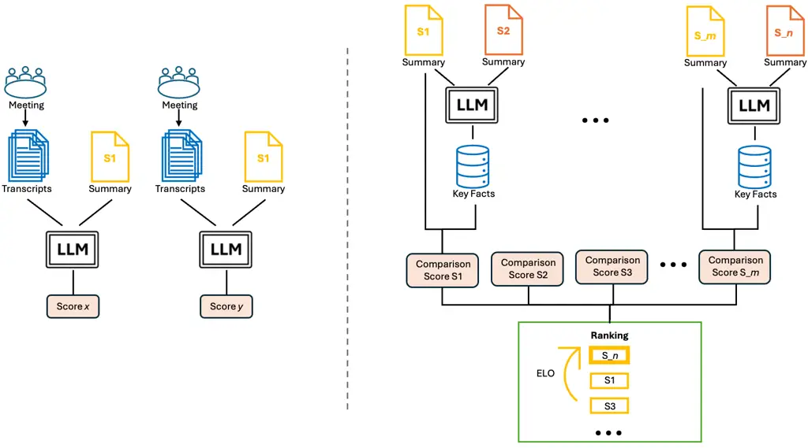
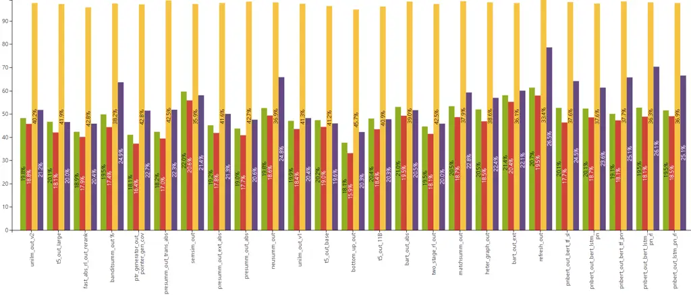

# CREAM ![[Uncaptioned image]](arxiv-2409-10883v1--fac5bc66d8ac.figures/figure-1.webp) : Comparison-Based Reference-Free ELO-Ranked Automatic Evaluation for Meeting Summarization

Ziwei Gong Affiliation: Machine Learning Center of Excellence, JPMorgan
Chase & Co. Affiliation: Department of Computer Science, Columbia
University Email: <lin.ai@cs.columbia.edu>    Lin Ai
Affiliation: Machine Learning Center of Excellence, JPMorgan Chase & Co.
Affiliation: Department of Computer Science, Columbia University
Email: <sara.ziweigong@cs.columbia.edu>    Harshsaiprasad Deshpande
Affiliation: Machine Learning Center of Excellence, JPMorgan Chase & Co.
Email: <julia@cs.columbia.edu>    Alexander Johnson Affiliation: Machine
Learning Center of Excellence, JPMorgan Chase & Co.    Emmy Phung
Affiliation: Machine Learning Center of Excellence, JPMorgan Chase & Co.
   Zehui Wu Affiliation: Department of Computer Science, Columbia
University    Ahmad Emami Affiliation: Machine Learning Center of
Excellence, JPMorgan Chase & Co.    Julia Hirschberg
Affiliation: Department of Computer Science, Columbia University

###### Abstract

Large Language Models (LLMs) have spurred interest in automatic
evaluation methods for summarization, offering a faster, more
cost-effective alternative to human evaluation. However, existing
methods often fall short when applied to complex tasks like long-context
summarizations and dialogue-based meeting summarizations. In this paper,
we introduce CREAM (Comparison-based Reference-free Elo-ranked Automatic
evaluation for Meeting summarization), a novel framework that addresses
the unique challenges of evaluating meeting summaries. CREAM leverages a
combination of chain-of-thought reasoning and key facts alignment to
assess conciseness and completeness of model-generated summaries without
requiring reference. By employing an ELO ranking system, our approach
provides a robust mechanism for comparing the quality of different
models or prompt configurations.

## 1 Introduction

The rapid advancement of Large Language Models (LLMs) has significantly
influenced the field of automatic evaluation for text summarization.
LLMs offer the potential to streamline the evaluation process, making it
faster and more cost-effective compared to traditional human evaluation
Liu et al. (2023); Wang et al. (2023). However, despite the progress in
automatic evaluation techniques, existing methods primarily target
general-purpose summarization tasks, which typically involve shorter,
more straightforward text inputs, which may not be adaptable to
long-context settings Chang et al. (2024). Meeting and dialogue
summarization is crucial in NLP applications, especially in industrial
settings, where accurate summaries of lengthy meetings enhance
decision-making, communication, and knowledge retention. They convert
discussions into actionable insights, supporting project management,
compliance, and strategic planning, ultimately boosting productivity and
efficiency.

Long-context documents and dialogue-based meeting summarizations present
unique challenges that are not adequately addressed by current automatic
evaluation metrics Chang et al. (2024). These tasks require a deeper
understanding of the content, context, and flow of information, which
often leads to limitations in the applicability of general-purpose
metrics. For example, a well-documented issue in current automatic
evaluation methods, known as the "middle curse" Liu et al. (2024);
Ravaut et al. (2024), exacerbates this problem. This phenomenon refers
to the tendency of models to perform well at the beginning and end of a
summary while neglecting or misrepresenting information in the middle
sections. This raises questions about the effectiveness of existing
LLM-based evaluators for meeting summarization, a hypothesis we
thoroughly examine in this work. Our investigation reveals that current
methods do not effectively evaluate meeting summarizations, prompting
the need for a more specialized approach.

In this paper, we address this gap by developing a new evaluation
framework tailored specifically for meeting summarization.We propose
CREAM (Comparison-based Reference-free Elo-ranked Automatic evaluation
for Meeting summarization), a novel system designed to fill the gaps in
specialized and customizable evaluation for meeting summaries as
illustrated in Figure 1. Our research addresses the following key
questions:

1.  1.  Do current LLM-based automatic evaluators work effectively for
        meeting summarization? (Our research shows that they do not.)
2.  2.  How can we design an efficient, reference-free, automatic evaluator
        for meeting summarization? (We propose comparison-based CREAM
        framework.)
3.  3.  How to compare different models using comparison-based metrics? (We
        introduce an ELO ranking system.)

Our results highlight the limitations of current LLM-based evaluators
and demonstrate the effectiveness of our specialized framework, CREAM,
with its novel comparison-based Elo ranking method for summarization
evaluation. We benchmark various GPT models against our framework and
find that GPT-4o excels in completeness, GPT-4 in conciseness, but all
struggle to find a balance between completeness and conciseness.



Figure 1: Illustrations of current evaluation framework (left) and the
CREAM framework (right). On the left, traditional methods independently
summarize and score each meeting transcript against reference texts. On
the right, CREAM distills candidate summary pairs into key facts,
conducts pair wise comparison of summary pairs, and then uses an Elo
rating system to rank summaries based on their relative quality.

## 2 Related Work

### 2.1 Reference-based Evaluation Metrics

Meeting summarization commonly uses reference-based metrics to assess
summary quality. Ngram-based metrics like ROUGE Lin (2004) measure
n-gram overlap between generated and reference summaries, with variants
such as ROUGE-1 (unigram), ROUGE-2 (bigram), ROUGE-L (longest common
subsequence). BLEU Papineni et al. (2002), originally designed to
evaluate machine translation, calculates n-gram precision with a brevity
penalty and is adaptable for summarization. Embedding-based metrics
include BERTScore Zhang\* et al. (2020), which uses BERT embeddings to
assess semantic overlap at the token level, providing more nuanced
comparisons. BARTScore Yuan et al. (2021) evaluates the generation
likelihood of reference text from the source or vice versa using BART.

While widely used, these similarity-based metrics often fail to capture
multidimensional aspects of text quality, such as factuality,
conciseness, and completeness, which are critical in human evaluations.
This highlights the need for more advanced evaluation frameworks for
meeting summarization.

### 2.2 LLM-based Evaluation and Metrics

LLM-based evaluation methods, like G-Eval Liu et al. (2023) and FineSurE
Song et al. (2024), are improving alignment with human judgments in text
summarization. G-Eval uses GPT-4 with a Chain-of-Thought approach,
achieving strong correlations with human evaluations, though it may bias
toward LLM-generated texts. FineSurE offers fine-grained assessments,
enhancing evaluations of faithfulness, completeness, and conciseness.

However, the application of these LLM-based methods to meeting
summarization, which involves long-context dialogue, remains
under-explored. It’s unclear if these generalized methods are fully
applicable, indicating a need for further adaptation.

### 2.3 Elo Rating in NLG Model Evaluation

The Elo rating system, originally introduced by Arpad Elo in 1967 Elo
(1967), is widely used for ranking competitors in games like chess and
has recently been adapted for evaluating natural language generation
(NLG) systems.

Rackauckas et al. (2024) applied an Elo-based framework, RAGElo, to
evaluate Retrieval-Augmented Generation (RAG) systems, finding that it
aligns well with expert annotations and effectively handles
domain-specific challenges. Similarly, Boubdir et al. (2023) examined
the robustness of Elo ratings for LLMs, emphasizing the need for careful
calibration to ensure reliable rankings, particularly in non-transitive
scenarios.

In a different approach, Zhao et al. (2024) introduced Auto-Arena, an
automated Elo-based evaluation system where LLMs engage in peer battles,
which showed high correlation with human preferences, suggesting it as a
viable alternative to human evaluation. Additionally, Zhang et al.
(2023) explored various ranking systems, including Elo, and analyzed
their effectiveness for LLM evaluation.

Our work extends these applications by using Elo to rank models based on
comparison-based evaluations of summarization conciseness and
completeness, offering a nuanced and reliable framework specifically for
meeting summarizations.



Figure 2: Baseline completeness scores on the REALSum dataset. The
$`x`$-axis shows different summarization models, and $`y`$-axis shows
the completeness score under various settings:   represents scores using
human annotations for both key facts and alignment.   shows scores with
human-annotated key facts and machine alignment.   indicates scores with
machine-annotated key facts from the summary and machine alignment.  
shows scores with machine-annotated key facts from the transcript and
machine alignment.

[TABLE]

Table 1: Evaluation of current evaluators on completeness and
conciseness for meeting summarization. All models show weak correlation
with human scores and high self-bias, often assigning near-perfect
scores to their own summaries. Summaries generated by various models are
evaluated using different evaluator models (in brackets) with varying
reference setups. The “Max \# Key Facts” column sets the max number of
key facts extracted from reference text. “Human Summary” column is the
gold standard baseline using key facts from human summaries.

## 3 Challenges and Limitations of Current Approaches

In order to answer the question, "Do current evaluators work effectively
for meeting summarization?", we experiment with the state-of-the-art
frameworks Liu et al. (2023); Song et al. (2024) for automatic summary
evaluation and identify several issues.

The existing LLM-based methods, as illustrated on the left side of
Figure 1, take individual meeting transcripts as input and the a
separate summary for each transcript, and output an absolute score of
the summary against reference texts under different metrics. This
process involves comparing each generated summary to reference documents
to assess their quality through CoT process, and takes human written
summary as gold standards. This method primarily relies on comparing
summaries to reference texts, often has a bias towards self-generated
content. A detailed description of these methods and prompts is provided
in Appendix A.1.

Our experiments with existing methods show that: 1) current LLM-based
evaluators often provide inaccurate completeness and conciseness scores
for long-context documents, showing a high self-bias, due to challenges
in extracting key facts from complex scenarios; 2) models like GPT-4o
frequently produce false positives in real-world complex dialogue,
indicating in industrial applications the focus should prioritize
completeness and conciseness in evaluation frameworks.

### 3.1 Experiment Setup

##### Datasets

We select both public and private datasets which collectively cover a
range of summarization-related tasks: factuality assessment, key-fact
extraction, and summarization.

FRANK Pagnoni et al. (2021), containing 2,246 summaries with
sentence-level faithfulness annotation, and REALSumm Bhandari et al.
(2020), containing 2,500 summaries with key facts level alignment, are
both factuality-focused datasets based on CNNDM Hermann et al. (2015)
and XSUM datasets Narayan et al. (2018). We select both datasets as we
need both types of annotations for key-fact extraction and factuality
evaluation.

QMSum Zhong et al. (2021) is a query-based, long meeting summarization
dataset derived from the AMI Carletta et al. (2006), ICSI Janin et al.
(2003), and Parliamentary committee meeting datasets. It includes 1,808
query-summary pairs from 232 meetings with average number of 556.8 turns
across diverse domains including product, academic, and committee
meetings.

Our Internal Zoom Meeting Summarization (IZMS) data consists of 139
examples from internal Zoom meetings, used to assess factuality and
key-fact extraction. This dataset includes transcripts from 10 product
meetings and an additional 40 meetings, providing real-world data for
evaluation.

##### LLMs used in Evaluation

We conduct experiments using GPT-based models from OpenAI OpenAI et al.
(2024), including GPT-4-omni (gpt-4o-2024-05-13), GPT-4-turbo
(gpt-4-turbo-2024-04-09), and GPT-3.5 (gpt-35-turbo-16k-0613). Each
model is evaluated for performance in generating and summarizing text,
allowing us to assess the strengths and limitations of different
versions in summarization tasks. We clear the history for each
evaluation instance, following precedents Song et al. (2024); Shen
et al. (2023).

##### Metrics

We evaluate LLM reliability on three key metrics: completeness,
conciseness, and faithfulness, using definitions and scoring methods
consistent with recent research Song et al. (2024). Detailed
descriptions and formulas are provided in Appendix A.1.

Completeness assesses the extent to which the summarizer includes all
key facts¹¹ 1 A key fact refers to a concise sentence conveying a single
key information, comprising at most 2-3 entities Bhandari et al. (2020);
Song et al. (2024). from the input text in the output summary.

Conciseness measures the summarizer’s ability to avoid incorporating
information outside the key facts in the output, maintaining focus and
brevity.

Faithfulness evaluates whether the summarizer accurately represents the
information in the input text without manipulating it (intrinsic) or
adding information that is not directly inferable from the input text
(extrinsic).

### 3.2 Experiments

For both completeness and conciseness, LLM evaluators show low
correlation with human preference and high self-bias in long-context
dialogues like meeting summaries, although perform well in evaluating
shorter summaries.

##### Completeness

LLMs evaluators like GPT-4o can accurately extract key facts and compare
summaries with high correlation to human evaluations in shorter
summarization tasks like those in REALSum, which involve news-style
articles with summaries averaging $`3-5`$ sentences. We evaluate LLMs’
ability to measure completeness when given different type of reference
by extract key facts and align them with summaries generated by various
baseline models, comparing their performance against human-annotated
scores. As shown in Figure 2, GPT-4o showed a high correlation with
human scores when using human-annotated key facts as references (rank
correlation of $`0.95`$, Pearson’s r), and also similarly positive
correlation when extracting key facts from entire articles for
comparison with summaries.

However, these evaluators struggle with accurately evaluating
completeness in long-context dialogues, such as meeting summaries from
the QMSum dataset with average of $`556.8`$ turns. As shown in Table 1,
our evaluation revealed that all versions of GPT have a weak correlation
(Pearson’s r $`=0.5`$, ) with gold standard human scores with a strong
self-bias. Both GPT-4 and GPT-3.5 tend to give near-perfect scores for
summaries generated by LLMs, with GPT-4o performing only slightly better
but still showing a bias towards its own generated content.

##### Conciseness

Similar to completeness, these evaluators have a weak correlation with
gold standard human scores with a strong self-bias when evaluating
conciseness. As shown in Table 1, LLMs are far less effective for
long-context dialogues, and performance without gold reference tends to
result in an overestimation of conciseness.

##### Factuality

Current evaluators struggle with accurately identifying factual errors
in meeting summaries. We assessed whether current LLM-based evaluators
(GPT-4o) are effective in evaluating factuality. We reproduce results on
the FRANK dataset, which has fine-grained annotations of sentence-level
factuality error types. We achieve a balanced accuracy of $`61.5\%`$ at
the sentence level. Summary-level correlations with human judgments were
moderate, with Pearson ($`0.38`$) and Spearman ($`0.35`$) correlations.
At system level, the rank correlation is perfect (Spearman’r of
$`1.0`$).

However, when applying the same method to our IZMS data, the results are
less promising. The summary-level correlations were low (Pearson =
$`0.11`$ and Spearman = $`0.14`$), indicating the model’s ability to
find factual error across different contexts is limited. There is no
significant difference in factuality between short and long summaries,
with error ratios of $`16.3\%`$ and $`15.2\%`$, respectively. The
system-level ranking for different summary types also showed no
significant difference.

In conclusion, our research shows that while LLM-based evaluators
perform well in designed factuality datasets, they often generate false
positives and struggle with complex, dialogue-based summaries, making
them less reliable for automatic factuality evaluation in meeting
summarization tasks. Analysis of the IZMS dataset indicates that
factuality errors are rarely observed in human annotation feedback and
mostly stem from ASR errors in transcripts. in human annotations or
out-of-context information from GPT models. Yet GPT models often report
out-of-context error, which are false alarms when compared to
transcripts. These errors highlight that factuality errors are a rare
case in real-world datasets, contrary to the frequency in designed
factuality dataset. Hence, when designing our evaluation framework, we
prioritize on completeness and conciseness.

## 4 CREAM Framework

To address these issues with existing methods in evaluating long-conetxt
summarizations, we propose the CREAM framework, which stands for
Comparison-Based Reference-Free Elo-Ranked Automatic Evaluation for
Meeting Summarization. This framework leverages Chain-of-Thought (CoT)
reasoning and comparison-based methods to enhance the evaluation
process.

The traditional metrics of completeness and conciseness struggle in this
context because they rely heavily on accurate key fact extraction, which
is particularly difficult with lengthy, multi-speaker dialogues. The
CREAM framework mitigates these challenges by evaluating summarization
models through a comparison-based approach that does not require
reference to the original transcripts.

As illustrated in Figure 1, the CREAM framework evaluates two summaries
in a reference-free manner, without requiring either gold summary or the
document being summarized. CREAM uses a structured, two-step process
facilitated by a single CoT-based prompt; details are in Section4.1.2.
First, the model extracts concise key facts from a source paragraph,
which is created by concatenating both summaries. These key facts must
be brief, clear, and non-redundant. In the second step, the model
compares these extracted key facts with each summary, assessing whether
each fact is accurately reflected and reasoning by identifying the
specific sentences in the summary that support it. The results are then
parsed for calculation of the summaries’ completeness and conciseness,
which results in multiple comparison-based scores between models.
Detailed results are in Section 4.2.1.

Then, to determine the best models from the comparison-based scores, we
introduce an Elo ranking system using comparison-based metrics, as
detailed in Section 4.1.1. This approach allows for a systematic and
robust comparison of model performance by assigning ratings based on
pairwise evaluations. The final results are in Section 4.2.2.

### 4.1 Implementation

#### 4.1.1 Comparison-based Ranking Metrics

We use an reference-free, comparison-based system on each metric in the
CREAM framework. The advantage of using comparison-based scores lies in
their ability to better differentiate and rank model performance,
especially when dealing with the subtle nuances of summarizing lengthy
and complex dialogues. This method also enables more effective
comparisons when evaluating the impact of different prompts on summary
generation. We use ELO system to rank pair-wise comparison results from
GPT-4o for both completeness and conciseness.

ELO rating formula can be written as:

```math
R_{new}=R_{old}+K\times(S-E)
```

where $`R_{new}`$ is the new Elo rating after the match; $`R_{old}`$ is
the old Elo rating before the match. $`K`$ is the K-factor, which
determines the maximum possible adjustment per match. $`S`$ is the
actual score (1 for a win, 0.5 for a draw, 0 for a loss). $`E`$ is the
expected score, calculated as:

```math
E=\frac{1}{1+10^{(R_{opponent}-R_{old})/400}}
```

where $`R_{opponent}`$ is the Elo rating of the opponent.

By using Elo rankings instead of raw scores, CREAM focuses on which
model performs better in direct comparisons, allowing a reference-free
evaluation. This method is robust against missing content, as it
evaluates relative performance without relying on comparisons to gold
annotations.

#### 4.1.2 Prompting Instruction

[TABLE]

Table 2: Average number of key facts extracted from transcripts by
different models from one meeting.

We employ CoT zero-shot prompting methods to calculate both conciseness
and completeness. This process involves two key steps: first, extracting
a set of key facts from the concatenated summaries, and second,
comparing these key facts to the summary that is being evaluated.

The prompt instructs the model to perform the following tasks:

1\. Key Fact Extraction: The model reads the provided paragraph and
breaks it down into a list of key facts. These key facts should be
concise, non-repetitive, and should focus on including at most 2-3
entities per fact.

2\. Key Fact Alignment: After extracting the key facts, the model
compares each fact with the sentences in the summary. For each key fact,
the model determines whether it is supported by the summary and, if so,
identifies the relevant summary sentences by their line numbers.

The design of the prompt is enhanced by several key techniques, as
outlined below:

Chain-of-Thought Reasoning The prompt utilizes a chain-of-thought
approach, incorporating a reasoning step to guide the model through the
task. This structured reasoning process helps ensure that the model
evaluates the key facts systematically and accurately.

One-Shot Learning of Key Facts We experiment with using out-of-domain
versus in-domain examples for key fact extraction. Interestingly,
out-of-domain examples generally perform better. However, as more
in-domain examples were crafted, failure cases increase, with the model
occasionally mistaking the example key facts for actual key facts – a
phenomenon observed, though less frequently, with out-of-domain examples
as well.

Maximum Number of Key Facts We test the model’s performance using
different limits on the number of key facts, specifically comparing 16
versus 30 key facts. As shown in Table 2, GPT-4o is highly sensitive to
the number of key facts, while GPT-4 and GPT-3.5 are less sensitive to
such instructions. We observe that GPT-3.5 is less stable in
consistently extracting the same number of key facts, even for the same
summary.

Based on experiments with the IZMS datasets, we decided to use 16 key
facts (following precedent literature) and 30 key facts (the maximum
effective number for GPT-4o), with GPT-4o as evaluator model, in all
subsequent experiments.

|     |        |              |       |       |             |       |       |
| --- | ------ | ------------ | ----- | ----- | ----------- | ----- | ----- |
|     |        | Completeness |       |       | Conciseness |       |       |
| kf  | VS     | GPT3.5       | GPT4  | GPT4o | GPT4        | GPT4  | GPT4o |
| 16  | GPT3.5 | \-           | 78.8% | 84.2% | \-          | 90.0% | 87.5% |
|     | GPT4   | 76.6%        | -     | 86.6% | 93.6%       | -     | 92.1% |
|     | GPT4o  | 92.1%        | 94.0% | \-    | 67.3%       | 68.4% | -     |
| 30  | GPT3.5 | \-           | 80.7% | 82.2% | \-          | 99.1% | 96.4% |
|     | GPT4   | 80.0%        | \-    | 86.3% | 99.4%       | -     | 95.9% |
|     | GPT4o  | 94.9%        | 95.5% | \-    | 89.7%       | 88.6% | \-    |

Table 3: Raw pair-wise score for completeness and conciseness on QMSum,
kf denotes max number of key facts set.

|     |              |       |      |     |             |      |
| --- | ------------ | ----- | ---- | --- | ----------- | ---- |
|     | Completeness |       |      |     | Conciseness |      |
| kf  | VS           | short | long |     | short       | long |
| 16  | short        | \-    | 95.3 |     | \-          | 75.6 |
|     | long         | 98.4  | -    |     | 53.5        | \-   |
| 30  | short        | \-    | 97.7 |     | \-          | 92.7 |
|     | long         | 97.3  | -    |     | 80.7        | \-   |

Table 4: Raw pair-wise score for completeness and conciseness on IZMS.

### 4.2 Experiment Results

We use the same setups as in Section 3.1, focusing on evaluting
completeness and conciseness.

#### 4.2.1 Pair-wise Raw Scores

These raw scores of model comparisons show significant differences that
are often difficult to discern when using absolute values to compare
LLM-generated summaries of long-context dialogues. Table 3 and Table 4
present the raw results of the model comparison scores for completeness
and conciseness, on two meeting summarization dataset QMSum and IZMS
respectively. For instance, row GPT-4o and column GPT-3.5 means that
when GPT-4o and GPT-3.5 are compared pairwise, GPT-3.5 is getting a
completeness score of 92.1%, and GPT-4o is getting a completeness score
of 84.2% (row GPT-3.5 and column GPT-4o).

##### Interpretable Key Facts

The intermediate results – the extracted key facts lists – provide
interpretable insights on the qualitative differences between two
summaries. These lists reveal which key facts are consistently captured
or missed, offering a deeper understanding of how each model processes
and condenses the original content. For instance, in two summaries of a
meeting with casual chit-chat followed by important agenda items,
Summary A includes details of the chit-chat but omits key decisions made
later, while Summary B skips the chit-chat and focuses on the critical
decisions. The comparison-based score highlights that although Summary A
is more complete in capturing all dialogue, Summary B is more concise
and centered on the essential content, making it more valuable for users
who need to quickly grasp the meeting outcomes.

#### 4.2.2 Elo-ranked Results

As shown in 5 Table CREAM outperforms prior baselines in ranking
correlation, especially on meeting summarization data, improving ranking
correlation from $`0.5`$ to $`1.0`$ (Pearson’s r) in both completeness
and conciseness. We demonstrate the effectiveness of CREAM in evaluating
across different models and identifying optimal prompts for meeting
summarization tasks.

We applied the Elo rating system described in Section 4 to our raw
scores from system comparisons above. The results align closely with the
human evaluation results based on gold summaries, as shown in Table 5.
We see a perfect correlation in ranking of model preference (rank
correlation of $`1.0`$, Pearson’s r), even when the gold
human-preference scores are close such as the 2nd and 3rd place for
completeness score. This consistency suggests that the Elo rating system
is an effective method for ranking models in meeting summarization
tasks, offering a reliable way to compare their relative performance.

|                      |                |                |                |
| -------------------- | -------------- | -------------- | -------------- |
| Summary Model        | GPT 4o         | GPT 4          | GPT 3.5        |
| Completeness (Gold)  | 1st\_((77.9%)) | 2nd\_((57.9%)) | 3rd\_((54.8%)) |
| Completeness (CREAM) | 1st            | 2nd            | 3rd            |
| Conciseness (Gold)   | 3rd\_((48.8%)) | 1st\_((69.3%)) | 2nd\_((58.2%)) |
| Conciseness (CREAM)  | 3rd            | 1st            | 2nd            |

Table 5: Completeness and conciseness ranking from gold human ranking
(human scores in brackets) with reference to gold summary, and ranking
from CREAM framework in reference-free setting (16 key fact).

## 5 Discussion

##### The Trade-off Between Metrics

In evaluating meeting summarization models, a significant trade-off
exists between completeness and conciseness. Models that produce more
complete summaries often do so at the expense of conciseness, resulting
in outputs that are detailed but potentially overwhelming or redundant.
Conversely, striving for conciseness can lead to the omission of
important details, making the summary less informative. This trade-off
is inherently subjective, depending on the specific needs or preferences
of the user.

Determining the optimal balance between completeness and conciseness is
challenging and varies by application. In practice, this balance is
often tailored to individual user preferences. Our approach to key fact
extraction can be leveraged to address this trade-off more effectively.
By incorporating additional selection steps, users can customize their
summaries to focus on the most relevant information, ensuring that even
more concise summaries retain all critical facts. Furthermore, this
method can help improve model outputs by refining more complete but
verbose summaries into concise versions that still capture all essential
details.

##### Benefits in Application

Our proposed evaluation framework offers several practical benefits,
including cost efficiency by using fewer tokens and not requiring the
parsing of original transcripts, making the process more affordable. It
also enables faster model comparisons, speeding up iterations and
refinements. Additionally, as a reference-free evaluation, it eliminates
the need for annotations or transcripts, which is especially useful with
confidential data, ensuring data privacy and broad applicability.
Furthermore, the framework’s adaptability makes it suitable for
integration with reinforcement learning (RL) setups.

In future, the prompt used in our framework can be customized to focus
on specific sets of key facts, offering significant flexibility in
production settings. This adaptability allows users to tailor the
evaluation criteria to meet specific needs, such as emphasizing aspects
of a summary that are most relevant to the intended audience or
application. For example, users could apply filters to key facts,
prioritizing main takeaways while ignoring less critical sections like
greetings. This level of customization enhances the framework’s utility
in diverse real-world scenarios, making it a powerful tool for automated
summarization evaluation.

Additionally, we could develop an Elo-based arena based on this work
specifically for evaluating summarization models and prompts, allowing
for more dynamic and competitive assessments.

##### Rare Case of Factuality Error

In our evaluation on real-world meeting data IZMS, we encountered
challenges related to factuality errors, but these errors manifested
differently between human-annotated gold summaries and GPT-based model
outputs. As discussed in Section 3.2, these differences suggests a
potential issue with divergence in designed datasets versus in
application.

Given these observations, we chose not to specifically target factuality
because factuality errors appear to be rare in real-world datasets,
unlike their prevalence in designed factuality datasets. As a result,
models that claim superior factuality detection performance on such
designed datasets may not perform as well in real-world applications,
potentially leading to high rates of false positives. To better assess
the true degree of factuality errors, we recommend exploring future
directions that involve more context-aware evaluation frameworks.

## 6 Conclusions

In conclusion, we have made several significant contributions to the
field of automatically evaluating complex, long-context dialogue
summarization. We are the first to examine the effectiveness of
LLM-based evaluators for meeting summarization, revealing that
general-purpose LLM-based evaluators do not adapt well to the unique
challenges posed by long-context dialogue summarization. To address
these challenges, we introduced a novel automatic evaluation framework,
CREAM, which overcomes the limitations of existing methods by providing
a more accurate and adaptable evaluation process using Elo-based
comparison algorithms (improving rank correlation of $`0.5`$, Pearson’s
r to $`1.0`$). This framework enables faster and cheaper analysis of
models, which can significantly speed up the progress of the field by
allowing new methods to be benchmarked more efficiently.

The broader impact of this work extends beyond immediate improvements in
evaluation techniques. As models become increasingly sophisticated,
human evaluators may struggle to timely assess superhuman AI outputs,
highlighting the need for robust, automated evaluation frameworks like
CREAM. In the long run, this line of research aims to democratize access
to advanced model evaluation, reducing barriers to entry and fostering
innovation across the field. Moreover, by providing a scalable and
reliable evaluation method, our framework could one day be integrated
into reinforcement learning pipelines, offering automatic rewards based
on summarization quality – a critical component given the rising
popularity of RL approaches. Ultimately, the adoption of CREAM in
industrial applications could help shape the future of AI-driven
communication tools, making them more efficient, reliable, and aligned
with human needs.

## Acknowledgments

The authors would like to thank Yanda Chen for valuable feedback and
insight to this paper.

## Limitations

This work adheres to the ACL Code of Ethics, with all user data
appropriately anonymized to protect privacy. However, there are several
limitations to consider. The internal data used in our experiments
cannot be published due to confidentiality agreements and privacy
considerations, which limited our choices in showing some real examples
or case studies. Additionally, our evaluations were conducted
exclusively using GPT-4o within the CREAM framework. While GPT-4o offers
advanced natural language understanding and generation capabilities, it
may not be universally applicable as an evaluator, and its assessments
could be influenced by biases inherent in the model’s training data.
Future work should explore using diverse evaluators, including other
models and human assessments, to validate the robustness and
generalizability of our findings. These limitations underscore the need
for further research and more comprehensive testing to enhance the
reliability and applicability of the conclusions drawn from this work.

## References

- Bhandari et al. (2020) Manik Bhandari, Pranav Narayan Gour, Atabak
  Ashfaq, Pengfei Liu, and Graham Neubig. 2020. [Re-evaluating
  evaluation in text
  summarization](https://doi.org/10.18653/v1/2020.emnlp-main.751). In
  _Proceedings of the 2020 Conference on Empirical Methods in Natural
  Language Processing (EMNLP)_, pages 9347–9359, Online. Association for
  Computational Linguistics.
- Boubdir et al. (2023) Meriem Boubdir, Edward Kim, Beyza Ermis, Sara
  Hooker, and Marzieh Fadaee. 2023. [Elo uncovered: Robustness and best
  practices in language model
  evaluation](https://aclanthology.org/2023.gem-1.28). In _Proceedings
  of the Third Workshop on Natural Language Generation, Evaluation, and
  Metrics (GEM)_, pages 339–352, Singapore. Association for
  Computational Linguistics.
- Carletta et al. (2006) Jean Carletta, Simone Ashby, Sebastien Bourban,
  Mike Flynn, Mael Guillemot, Thomas Hain, Jaroslav Kadlec, Vasilis
  Karaiskos, Wessel Kraaij, Melissa Kronenthal, Guillaume Lathoud, Mike
  Lincoln, Agnes Lisowska, Iain McCowan, Wilfried Post, Dennis Reidsma,
  and Pierre Wellner. 2006. The ami meeting corpus: A pre-announcement.
  In _Machine Learning for Multimodal Interaction_, pages 28–39, Berlin,
  Heidelberg. Springer Berlin Heidelberg.
- Chang et al. (2024) Yapei Chang, Kyle Lo, Tanya Goyal, and Mohit
  Iyyer. 2024. [Booookscore: A systematic exploration of book-length
  summarization in the era of
  LLMs](https://arxiv.org/pdf/2310.00785.pdf). In _The Twelfth
  International Conference on Learning Representations_.
- Elo (1967) Arpad E Elo. 1967. The proposed uscf rating system, its
  development, theory, and applications. In _Chess Life_, volume 22(8),
  page 242–247.
- Hermann et al. (2015) Karl Moritz Hermann, Tomas Kocisky, Edward
  Grefenstette, Lasse Espeholt, Will Kay, Mustafa Suleyman, and Phil
  Blunsom. 2015. Teaching machines to read and comprehend. _Advances in
  neural information processing systems_, 28.
- Janin et al. (2003) A. Janin, D. Baron, J. Edwards, D. Ellis,
  D. Gelbart, N. Morgan, B. Peskin, T. Pfau, E. Shriberg, A. Stolcke,
  and C. Wooters. 2003. [The icsi meeting
  corpus](https://doi.org/10.1109/ICASSP.2003.1198793). In _2003 IEEE
  International Conference on Acoustics, Speech, and Signal
  Processing, 2003. Proceedings. (ICASSP ’03)._, volume 1, pages I–I.
- Lin (2004) Chin-Yew Lin. 2004. [ROUGE: A package for automatic
  evaluation of summaries](https://aclanthology.org/W04-1013). In _Text
  Summarization Branches Out_, pages 74–81, Barcelona, Spain.
  Association for Computational Linguistics.
- Liu et al. (2024) Nelson F. Liu, Kevin Lin, John Hewitt, Ashwin
  Paranjape, Michele Bevilacqua, Fabio Petroni, and Percy Liang. 2024.
  [Lost in the middle: How language models use long
  contexts](https://doi.org/10.1162/tacl_a_00638). _Transactions of the
  Association for Computational Linguistics_, 12:157–173.
- Liu et al. (2023) Yang Liu, Dan Iter, Yichong Xu, Shuohang Wang,
  Ruochen Xu, and Chenguang Zhu. 2023. [G-eval: NLG evaluation using
  gpt-4 with better human
  alignment](https://doi.org/10.18653/v1/2023.emnlp-main.153). In
  _Proceedings of the 2023 Conference on Empirical Methods in Natural
  Language Processing_, pages 2511–2522, Singapore. Association for
  Computational Linguistics.
- Narayan et al. (2018) Shashi Narayan, Shay B. Cohen, and Mirella
  Lapata. 2018. [Don’t give me the details, just the summary!
  topic-aware convolutional neural networks for extreme
  summarization](https://doi.org/10.18653/v1/D18-1206). In _Proceedings
  of the 2018 Conference on Empirical Methods in Natural Language
  Processing_, pages 1797–1807, Brussels, Belgium. Association for
  Computational Linguistics.
- OpenAI et al. (2024) OpenAI, Josh Achiam, Steven Adler, Sandhini
  Agarwal, Lama Ahmad, Ilge Akkaya, Florencia Leoni Aleman, Diogo
  Almeida, Janko Altenschmidt, Sam Altman, Shyamal Anadkat, Red Avila,
  Igor Babuschkin, Suchir Balaji, Valerie Balcom, Paul Baltescu, Haiming
  Bao, Mohammad Bavarian, Jeff Belgum, Irwan Bello, Jake Berdine,
  Gabriel Bernadett-Shapiro, Christopher Berner, Lenny Bogdonoff, Oleg
  Boiko, Madelaine Boyd, Anna-Luisa Brakman, Greg Brockman, Tim Brooks,
  Miles Brundage, Kevin Button, Trevor Cai, Rosie Campbell, Andrew Cann,
  Brittany Carey, Chelsea Carlson, Rory Carmichael, Brooke Chan, Che
  Chang, Fotis Chantzis, Derek Chen, Sully Chen, Ruby Chen, Jason Chen,
  Mark Chen, Ben Chess, Chester Cho, Casey Chu, Hyung Won Chung, Dave
  Cummings, Jeremiah Currier, Yunxing Dai, Cory Decareaux, Thomas Degry,
  Noah Deutsch, Damien Deville, Arka Dhar, David Dohan, Steve Dowling,
  Sheila Dunning, Adrien Ecoffet, Atty Eleti, Tyna Eloundou, David
  Farhi, Liam Fedus, Niko Felix, Simón Posada Fishman, Juston Forte,
  Isabella Fulford, Leo Gao, Elie Georges, Christian Gibson, Vik Goel,
  Tarun Gogineni, Gabriel Goh, Rapha Gontijo-Lopes, Jonathan Gordon,
  Morgan Grafstein, Scott Gray, Ryan Greene, Joshua Gross,
  Shixiang Shane Gu, Yufei Guo, Chris Hallacy, Jesse Han, Jeff Harris,
  Yuchen He, Mike Heaton, Johannes Heidecke, Chris Hesse, Alan Hickey,
  Wade Hickey, Peter Hoeschele, Brandon Houghton, Kenny Hsu, Shengli Hu,
  Xin Hu, Joost Huizinga, Shantanu Jain, Shawn Jain, Joanne Jang, Angela
  Jiang, Roger Jiang, Haozhun Jin, Denny Jin, Shino Jomoto, Billie Jonn,
  Heewoo Jun, Tomer Kaftan, Łukasz Kaiser, Ali Kamali, Ingmar
  Kanitscheider, Nitish Shirish Keskar, Tabarak Khan, Logan Kilpatrick,
  Jong Wook Kim, Christina Kim, Yongjik Kim, Jan Hendrik Kirchner, Jamie
  Kiros, Matt Knight, Daniel Kokotajlo, Łukasz Kondraciuk, Andrew
  Kondrich, Aris Konstantinidis, Kyle Kosic, Gretchen Krueger, Vishal
  Kuo, Michael Lampe, Ikai Lan, Teddy Lee, Jan Leike, Jade Leung, Daniel
  Levy, Chak Ming Li, Rachel Lim, Molly Lin, Stephanie Lin, Mateusz
  Litwin, Theresa Lopez, Ryan Lowe, Patricia Lue, Anna Makanju, Kim
  Malfacini, Sam Manning, Todor Markov, Yaniv Markovski, Bianca Martin,
  Katie Mayer, Andrew Mayne, Bob McGrew, Scott Mayer McKinney, Christine
  McLeavey, Paul McMillan, Jake McNeil, David Medina, Aalok Mehta, Jacob
  Menick, Luke Metz, Andrey Mishchenko, Pamela Mishkin, Vinnie Monaco,
  Evan Morikawa, Daniel Mossing, Tong Mu, Mira Murati, Oleg Murk, David
  Mély, Ashvin Nair, Reiichiro Nakano, Rajeev Nayak, Arvind Neelakantan,
  Richard Ngo, Hyeonwoo Noh, Long Ouyang, Cullen O’Keefe, Jakub
  Pachocki, Alex Paino, Joe Palermo, Ashley Pantuliano, Giambattista
  Parascandolo, Joel Parish, Emy Parparita, Alex Passos, Mikhail Pavlov,
  Andrew Peng, Adam Perelman, Filipe de Avila Belbute Peres, Michael
  Petrov, Henrique Ponde de Oliveira Pinto, Michael, Pokorny, Michelle
  Pokrass, Vitchyr H. Pong, Tolly Powell, Alethea Power, Boris Power,
  Elizabeth Proehl, Raul Puri, Alec Radford, Jack Rae, Aditya Ramesh,
  Cameron Raymond, Francis Real, Kendra Rimbach, Carl Ross, Bob Rotsted,
  Henri Roussez, Nick Ryder, Mario Saltarelli, Ted Sanders, Shibani
  Santurkar, Girish Sastry, Heather Schmidt, David Schnurr, John
  Schulman, Daniel Selsam, Kyla Sheppard, Toki Sherbakov, Jessica Shieh,
  Sarah Shoker, Pranav Shyam, Szymon Sidor, Eric Sigler, Maddie Simens,
  Jordan Sitkin, Katarina Slama, Ian Sohl, Benjamin Sokolowsky, Yang
  Song, Natalie Staudacher, Felipe Petroski Such, Natalie Summers, Ilya
  Sutskever, Jie Tang, Nikolas Tezak, Madeleine B. Thompson, Phil
  Tillet, Amin Tootoonchian, Elizabeth Tseng, Preston Tuggle, Nick
  Turley, Jerry Tworek, Juan Felipe Cerón Uribe, Andrea Vallone, Arun
  Vijayvergiya, Chelsea Voss, Carroll Wainwright, Justin Jay Wang, Alvin
  Wang, Ben Wang, Jonathan Ward, Jason Wei, CJ Weinmann, Akila
  Welihinda, Peter Welinder, Jiayi Weng, Lilian Weng, Matt Wiethoff,
  Dave Willner, Clemens Winter, Samuel Wolrich, Hannah Wong, Lauren
  Workman, Sherwin Wu, Jeff Wu, Michael Wu, Kai Xiao, Tao Xu, Sarah Yoo,
  Kevin Yu, Qiming Yuan, Wojciech Zaremba, Rowan Zellers, Chong Zhang,
  Marvin Zhang, Shengjia Zhao, Tianhao Zheng, Juntang Zhuang, William
  Zhuk, and Barret Zoph. 2024. [Gpt-4 technical
  report](https://arxiv.org/abs/2303.08774). _Preprint_,
  arXiv:2303.08774.
- Pagnoni et al. (2021) Artidoro Pagnoni, Vidhisha Balachandran, and
  Yulia Tsvetkov. 2021. [Understanding factuality in abstractive
  summarization with FRANK: A benchmark for factuality
  metrics](https://doi.org/10.18653/v1/2021.naacl-main.383). In
  _Proceedings of the 2021 Conference of the North American Chapter of
  the Association for Computational Linguistics: Human Language
  Technologies_, pages 4812–4829, Online. Association for Computational
  Linguistics.
- Papineni et al. (2002) Kishore Papineni, Salim Roukos, Todd Ward, and
  Wei-Jing Zhu. 2002. [Bleu: a method for automatic evaluation of
  machine translation](https://doi.org/10.3115/1073083.1073135). In
  _Proceedings of the 40th Annual Meeting on Association for
  Computational Linguistics_, ACL ’02, page 311–318, USA. Association
  for Computational Linguistics.
- Rackauckas et al. (2024) Zackary Rackauckas, Arthur Câmara, and Jakub
  Zavrel. 2024. [Evaluating rag-fusion with ragelo: an automated
  elo-based framework](https://arxiv.org/abs/2406.14783). _Preprint_,
  arXiv:2406.14783.
- Ravaut et al. (2024) Mathieu Ravaut, Aixin Sun, Nancy Chen, and Shafiq
  Joty. 2024. [On context utilization in summarization with large
  language models](https://aclanthology.org/2024.acl-long.153). In
  _Proceedings of the 62nd Annual Meeting of the Association for
  Computational Linguistics (Volume 1: Long Papers)_, pages 2764–2781,
  Bangkok, Thailand. Association for Computational Linguistics.
- Shen et al. (2023) Chenhui Shen, Liying Cheng, Xuan-Phi Nguyen, Yang
  You, and Lidong Bing. 2023. [Large language models are not yet
  human-level evaluators for abstractive
  summarization](https://doi.org/10.18653/v1/2023.findings-emnlp.278).
  In _Findings of the Association for Computational Linguistics: EMNLP
  2023_, pages 4215–4233, Singapore. Association for Computational
  Linguistics.
- Song et al. (2024) Hwanjun Song, Hang Su, Igor Shalyminov, Jason Cai,
  and Saab Mansour. 2024. Finesure: Fine-grained summarization
  evaluation using llms. In _ACL_.
- Wang et al. (2023) Jiaan Wang, Yunlong Liang, Fandong Meng, Zengkui
  Sun, Haoxiang Shi, Zhixu Li, Jinan Xu, Jianfeng Qu, and Jie
  Zhou. 2023. [Is ChatGPT a good NLG evaluator? a preliminary
  study](https://doi.org/10.18653/v1/2023.newsum-1.1). In _Proceedings
  of the 4th New Frontiers in Summarization Workshop_, pages 1–11,
  Singapore. Association for Computational Linguistics.
- Yuan et al. (2021) Weizhe Yuan, Graham Neubig, and Pengfei Liu. 2021.
  [Bartscore: Evaluating generated text as text
  generation](https://proceedings.neurips.cc/paper/2021/file/e4d2b6e6fdeca3e60e0f1a62fee3d9dd-Paper.pdf).
  In _Advances in Neural Information Processing Systems_, volume 34,
  pages 27263–27277. Curran Associates, Inc.
- Zhang\* et al. (2020) Tianyi Zhang\*, Varsha Kishore\*, Felix Wu\*,
  Kilian Q. Weinberger, and Yoav Artzi. 2020. [Bertscore: Evaluating
  text generation with
  bert](https://openreview.net/forum?id=SkeHuCVFDr). In _International
  Conference on Learning Representations_.
- Zhang et al. (2023) Yue Zhang, Ming Zhang, Haipeng Yuan, Shichun Liu,
  Yongyao Shi, Tao Gui, Qi Zhang, and Xuanjing Huang. 2023. [Llmeval: A
  preliminary study on how to evaluate large language
  models](https://arxiv.org/abs/2312.07398). _Preprint_,
  arXiv:2312.07398.
- Zhao et al. (2024) Ruochen Zhao, Wenxuan Zhang, Yew Ken Chia, Deli
  Zhao, and Lidong Bing. 2024. [Auto arena of llms: Automating llm
  evaluations with agent peer-battles and committee
  discussions](https://arxiv.org/abs/2405.20267). _Preprint_,
  arXiv:2405.20267.
- Zhong et al. (2021) Ming Zhong, Da Yin, Tao Yu, Ahmad Zaidi, Mutethia
  Mutuma, Rahul Jha, Ahmed Hassan Awadallah, Asli Celikyilmaz, Yang Liu,
  Xipeng Qiu, and Dragomir Radev. 2021. [QMSum: A new benchmark for
  query-based multi-domain meeting
  summarization](https://doi.org/10.18653/v1/2021.naacl-main.472). In
  _Proceedings of the 2021 Conference of the North American Chapter of
  the Association for Computational Linguistics: Human Language
  Technologies_, pages 5905–5921, Online. Association for Computational
  Linguistics.

## Appendix A Appendix

### A.1 Metrics

In this study, we follow the definitions and calculation methods
outlined by Song et al. (2024), ensuring consistency with recent work in
the field. The key metrics used are:

##### Completeness

We measure completeness by calculating the proportion of key facts ²² 2
A key fact refers to a concise sentence conveying a single key
information, comprising at most 2-3 entities, also referred to as a
semantic content unit Bhandari et al. (2020); Song et al. (2024). from
the original text that are accurately captured in the summary. The
formula:

```math
\text{Completeness}(K,S,E)=\frac{|(k,s)\in E|}{|K|}
```

where $`K`$ represents the set of key facts, $`S`$ represents the
summary, and $`E`$ is the set of aligned key facts and summary
sentences.

##### Conciseness

Conciseness is a crucial metric in summarization as it measures the
ability of the summary to convey the essential information from the
original text without including unnecessary details. A concise summary
ensures that the most important points are communicated effectively and
efficiently, making it easier for readers to grasp the main ideas
without sifting through extraneous content. This is particularly
important in meeting summarizations, where lengthy transcripts need to
be distilled into clear and focused summaries. We calculate conciseness
in a manner similar to completeness, using key facts. The formula is:

```math
\text{Conciseness}(K,S,E)=\frac{|s\mid(k,s)\in E|}{|S|}
```

where $`K`$ represents the set of key facts, $`S`$ represents the
summary, and $`E`$ is the set of aligned key facts and summary
sentences.

##### Factuality

Another critical aspect of evaluating meeting summaries is factuality.
To evaluate factuality, we use a CoT approach and calculated a
factuality score, defined as:

```math
\text{Faithfulness}(D,S)=\frac{|S_{faithful}\in S|}{|S|}
```

where $`D`$ is given documents, $`S`$ is the set of sentences in the
summary, and $`S_{faithful}`$ is the sentences in $`S`$ marked with no
factuality errors.

We follow the prompts proposed by Song et al. (2024) when evaluating
these metrics with baseline methods.

### A.2 Prompt for CREAM

Our prompt design is attached below:

You will be provided with a paragraph and a summary. Your task is to
decompose the paragraph into a set of "key facts". A "key fact" is a
single fact written as briefly and clearly as possible, encompassing at
most 2-3 entities. There should not be any repeated "key fact". Here are
nine examples of key facts to illustrate the desired level of
granularity (please be careful that these are examples, and do NOT use
them as actual key facts): \* Kevin Carr set off on his journey from
Haytor. \* Kevin Carr set off on his journey from Dartmoor. \* Kevin
Carr set off on his journey in July 2013. \* Kevin Carr is less than 24
hours away from completing his trip. \* Kevin Carr ran around the world
unsupported. \* Kevin Carr ran with his tent. \* Kevin Carr is set to
break the previous record. \* Kevin Carr is set to break the record by
24 hours. \* The previous record was held by an Australian. Instruction:
First, read the paragraph carefully. Second, decompose the paragraph
into (at most 30) ket facts.

Paragraph: \[INPUT REFERENCE SUMMARIES\]

You now have a summary and a set of key facts for the same transcript.
Your task is to assess if each key fact is inferred from the summary.

Instruction: First, compare each key fact with the summary. Second,
check if the key fact is inferred from the summary and then response
"Yes" or "No" for each key fact. If "Yes", specify the line number(s) of
the summary sentence(s) relevant to each key fact.

Provide your answer in JSON format. The answer should be a list of
dictionaries whose keys are "key fact", "response", and "line number":
\["key fact": "first key fact", "response": "Yes", "line number": \[1\],
"key fact": "second key fact", "response": "No", "line number": \[\],
"key fact": "third key fact", "response": "Yes", "line number": \[1, 2,
3\]\]

Summary: \[INPUT CANDIDATE SUMMARY\]
