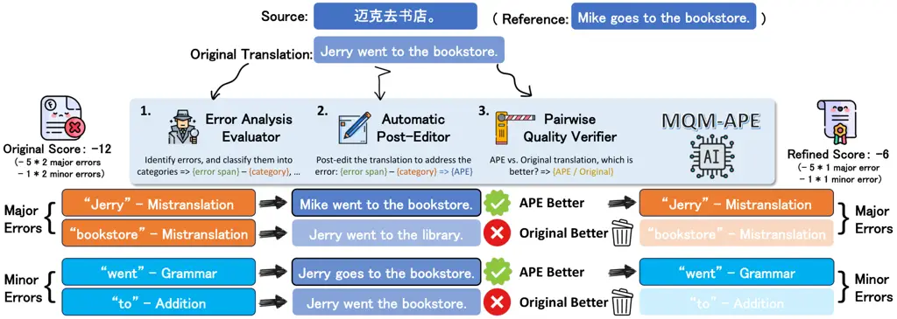

# MQM-APE: Toward High-Quality Error Annotation Predictors with Automatic Post-Editing in LLM Translation Evaluators

Qingyu Lu    Liang Ding    Kanjian Zhang ^(†)^(†)thanks: ˜˜Corresponding
Author.    Jinxia Zhang    Dacheng Tao Affiliation:  College of
Computing and Data Science at Nanyang Technological University,
Singapore 639798![[Uncaptioned
image]](arxiv-2409-14335v2--0cd85747ca08.figures/figure-1.webp)
{luqingyu,jinxiazhang,kjzhang}@seu.edu.cn,{liangding.liam,dacheng.tao}@gmail.com![[Uncaptioned
image]](arxiv-2409-14335v2--0cd85747ca08.figures/figure-2.webp)[https://github.com/Coldmist-Lu/MQM_APE](https://github.com/Coldmist-Lu/MQM_APE)
Affiliation:  Southeast University The University of Sydney Southeast
University Shenzhen Research Institute

###### Abstract

Large Language Models (LLMs) have shown significant potential as judges
for Machine Translation (MT) quality assessment, providing both scores
and fine-grained feedback. Although approaches such as GEMBA-MQM (Kocmi
and Federmann, 2023a) have shown state-of-the-art performance on
reference-free evaluation, the predicted errors do not align well with
those annotated by human, limiting their interpretability as feedback
signals. To enhance the quality of error annotations predicted by LLM
evaluators, we introduce a universal and training-free framework,
MQM-APE, based on the idea of filtering out non-impactful errors by
Automatically Post-Editing (APE) the original translation based on each
error, leaving only those errors that contribute to quality improvement.
Specifically, we prompt the LLM to act as ❶ evaluator to provide error
annotations, ❷ post-editor to determine whether errors impact quality
improvement and ❸ pairwise quality verifier as the error filter.
Experiments show that our approach consistently improves both the
reliability and quality of error spans against GEMBA-MQM, across eight
LLMs in both high- and low-resource languages. Orthogonal to trained
approaches, MQM-APE complements translation-specific evaluators such as
Tower, highlighting its broad applicability. Further analysis confirms
the effectiveness of each module and offers valuable insights into
evaluator design and LLMs selection.

## 1 Introduction

Machine Translation (MT) evaluators assess translation quality and play
a key role in aligning with human judgements (Freitag et al., 2022; Lu
et al., 2023), especially in the era of Large Language Models (LLMs,
Achiam et al., 2023; Touvron et al., 2023; Peng et al., 2023). As the
demand for interpretability grows (Xu et al., 2023; Leiter et al., 2023;
Leiter et al., 2024), these evaluators offer fine-grained, reflective
feedback to enhance translation quality in scenarios such as automatic
post-editing (APE, Ki and Carpuat, 2024) or preference alignment
training (Ramos et al., 2023; He et al., 2024).

|                                                  |                       |                        |                         |
| ------------------------------------------------ | --------------------- | ---------------------- | ----------------------- |
| Error-based MT Evaluation                        | Fine-grained Feedback | Error Span Enhancement | Post-Edited Translation |
| Training-Dependent (Resource-Limited) Approaches |                       |                        |                         |
| InstructScore (Xu et al., 2023)                  | ✓                     | ✓                      | ✗                       |
| xCOMET (Guerreiro et al., 2023)                  | ✓                     | ✓                      | ✗                       |
| LLMRefine (Xu et al., 2024)                      | ✓                     | ✗                      | ✓                       |
| Tower (Alves et al., 2024)                       | ✓                     | ✗                      | ✓                       |
| Training-Free (Model-Agnostic) Approaches        |                       |                        |                         |
| GEMBA (Kocmi and Federmann, 2023b)               | ✗                     | ✗                      | ✗                       |
| EAPrompt (Lu et al., 2024)                       | ✓                     | ✗                      | ✗                       |
| AutoMQM (Fernandes et al., 2023)                 | ✓                     | ✗                      | ✗                       |
| GEMBA-MQM (Kocmi and Federmann, 2023a)           | ✓                     | ✗                      | ✗                       |
| MQM-APE (ours)                                   | ✓                     | ✓                      | ✓                       |

Table 1: Related work on error-based MT evaluation. MQM-APE is a
training-free approach that improves upon GEMBA-MQM (Kocmi and
Federmann, 2023a) and complements training-dependent approaches such as
Tower (Alves et al., 2024). It offers high-quality error annotations and
post-edited translations.

The success of LLMs in reasoning and generation highlights their
potential for MT quality assessment Kocmi and Federmann (2023b). Prompt
strategies take advantage of Multidimensional Quality Metrics (MQM,
Lommel, 2018; Freitag et al., 2021), an error-based human evaluation
framework, to provide both scores and explicit error annotations (Lu
et al., 2024). Although these evaluators, such as GEMBA-MQM, have shown
SOTA performance in reference-free evaluation (Kocmi and Federmann,
2023a), the predicted error spans are not well aligned with human
judgements (Fernandes et al., 2023; Huang et al., 2024).
Training-dependent approaches (Xu et al., 2023; Guerreiro et al., 2023)
face high computational costs, limiting their applicability across
models and languages, as shown in Table 1.

Building upon training-free approaches, we propose a universal
framework, MQM-APE, that significantly enhances evaluator performance
and improves the quality of predicted error spans. Inspired by findings
that APE or self-refinement can enhance translation quality through
fine-grained feedback with error spans (Ki and Carpuat, 2024; Xu et al.,
2024), we integrate APE into the translation evaluation process to
refine the set of errors. As shown in Figure 1, the idea is to filter
out non-impactful errors by post-editing the original translation based
on each error, leaving only those errors that contribute to quality
improvement.

Specifically, we prompt the LLM to act as ❶ evaluator to provide error
annotations (§3.1), ❷ post-editor to determine whether errors impact
quality improvement (§3.2) and ❸ pairwise quality verifier as the error
filter (§3.3). This evaluation pipeline preserves only genuinely
impactful errors that contribute to quality improvements after APE and
influence the final score, as translation quality is assessed based on
error count (§3.4).

Extensive experiments are conducted on eight different instruction-tuned
LLMs using the WMT22 test set (Freitag et al., 2022), which includes
106,758 segments from 54 MT systems, as well as the IndicMT test set
with 1,000 MQM-annotated segments in Indian languages Sai B et al.
(2023). Our findings reveal that:



Figure 1: A comparative overview of our MQM-APE approach. The evaluated
translation passes through three sequential modules, all operated by the
same LLM: 1) the Error Analysis Evaluator, which provides detailed error
demonstrations; 2) APE, which post-edits the translation based on each
error annotation; and 3) the Pairwise Quality Verifier, which verifies
whether quality improves after post-editing.

- •
  MQM-APE surpasses GEMBA-MQM (Kocmi and Federmann, 2023a) at both the
  system and segment levels, offering interpretable error spans that
  closely align with human annotations.
- •
  MQM-APE generalizes across a broad range of LLMs and is effectively
  applicable to both high- and low-resource languages.
- •
  Orthogonal to training-dependent approaches, MQM-APE complements
  translation-specific evaluators such as Tower (Alves et al., 2024).
- •
  APE translations exhibit superior overall quality compared to the
  original translations (§5.2).
- •
  Quality Verifier aligns with modern metrics like
  $`\text{CometKiwi}_{22}^{\text{QE}}`$ (§5.3), which can be replaced by
  these metrics with comparable effects (§6.3).
- •
  MQM-APE introduces acceptable costs against GEMBA-MQM (§6.2), and
  preserves error distribution across severities and categories (§6.4).

Finally, we present a performance ranking of various backbone LLMs as
translation evaluators (§6.5), providing guidance for researchers
navigating the trade-offs between reliability, interpretability, and
inference cost.

## 2 Preliminaries

#### Translation Evaluation

Translation evaluation metrics assess MT quality using test sets,
typically relying on the source, translation, and human references. This
paper focuses on the reference-free scenario, where no human references
are provided. The output is a score reflecting translation quality.

#### Human Evaluation

Human annotation serves as the gold standard for translation evaluation.
Recently, the Multi-dimensional Quality Metric (MQM, Lommel, 2018) has
been adopted by WMT¹¹ 1
[https://www2.statmt.org/](https://www2.statmt.org/) as a high-quality
human evaluation framework (Freitag et al., 2022). MQM requires
categorising translation errors into "Critical", "Major" and "Minor"
based on severity. The final score is calculated by weighting the number
of errors according to their severity.

☞See Appendix A for an introduction of MQM.

#### Error Analysis

Error analysis simulates human evaluations by predicting error
demonstrations for interpretable assessments (Lu et al., 2023). Previous
studies explore prompting strategies to enable LLMs to generate explicit
error demonstrations (Fernandes et al., 2023). For instance, GEMBA-MQM
(Kocmi and Federmann, 2023a), a state-of-the-art error analysis
evaluator that employs 3-shot prompting strategies, serves as our
baseline and main module in MQM-APE (§3.1).

## 3 Methodology

As shown in Figure 1, we employ MQM-APE by prompting the same LLM to
perform multiple roles without fine-tuning for each task. MQM-APE
evaluates a given translation $`y`$ of source $`x`$ through three
sequential modules: ❶ Error Analysis Evaluator identifies errors in
$`y`$, providing error demonstrations $`\mathcal{E}`$ with error and
severity; ❷ Automatic Post Editor post-edits $`y`$ based on each
identified error $`e_{i}\in\mathcal{E}`$, producing a set of corrected
translations $`\mathcal{Y}_{\text{pe}}`$; ❸ Pairwise Quality Verifier
checks whether the post-edited translations improve upon the original
translation $`y`$. Errors for which the APE translation fails to improve
on the original are discarded, leaving a refined set of errors
$`\mathcal{E}^{*}\subseteq\mathcal{E}`$ that contribute to quality
improvement. The translation is finally scored based on the refined set
of errors $`\mathcal{E}^{*}`$.

### 3.1 Module 1: Error Analysis Evaluator

We follow Kocmi and Federmann (2023a); Lu et al. (2024) to prompt the
LLM to perform MQM-like assessment, identifying errors in translation
$`y`$ of source $`x`$. This step can be described as:

```math
\mathcal{E}=\text{Evaluator}(x,y), \tag{1}
```

where $`\mathcal{E}=\{e_{1},e_{2},\cdots,e_{N}\}`$, represents the set
of errors identified by the evaluator, and $`N`$ denotes the number of
errors.

For each error annotation, three types of information are recorded: the
error span, which specifies the location of the error in $`y`$; the
error category, such as mistranslation, omission, or grammatical issues,
aligned with MQM guidelines (Freitag et al., 2021); and the error
severity, classified as "Critical", "Major" or "Minor", reflecting their
impact from highest to lowest. Note that translations without errors
identified will bypass the subsequent steps.

### 3.2 Module 2: Automatic Post-Editor

The purpose of APE is to correct errors in the original translation
$`y`$ based on the given source segment $`x`$. We prompt the LLM to
post-edit the translation for each identified error, using the error
span and category as feedback, for instance, the span "Jerry" with the
category "Mistranslation", as shown in Figure 1, can guide the LLM to
edit the translation from "Jerry went to the bookstore" to "Mike went to
the bookstore". This step can be formalized as:

```math
y_{i}^{(\text{pe})}=\text{APE}(x,y,e_{i}),\ \ i=1,2,\cdots,N \tag{2}
```

where a set of post-edited translations
$`\mathcal{Y}_{\text{pe}}=\{y_{1}^{(\text{pe})},y_{2}^{(\text{pe})},\cdots,y_{N}^{(\text{pe})}\}`$
is produced.

### 3.3 Module 3: Pairwise Quality Verifier

To assess the impact of errors with APE, we prompt the LLM to act as a
verifier, comparing the quality of each post-edited translation
$`y_{i}^{(\text{pe})}`$ with original $`y`$. This step is expressed as:

```math
\displaystyle\mathcal{E}^{*}=\left\{e_{i}\,\middle|\,\text{Verifier}(x,y_{i}^{(\text{pe})})>\text{Verifier}(x,y)\right. \tag{3}
```

```math
\displaystyle\left.e_{i}\in\mathcal{E},\ \ y_{i}^{(\text{pe})}\in\mathcal{Y}_{\text{pe}}\right\}\subseteq\mathcal{E},
```

where a new subset of errors $`\mathcal{E}^{*}`$ that contribute to
quality improvement is identified, while non-impactful errors are
discarded.

### 3.4 Post-process: Error-Based Scoring

We adopt the MQM weighting scheme (Freitag et al., 2021) for human
scoring of LLM-generated errors, consistent with previous works (Lu
et al., 2024; Kocmi and Federmann, 2023a; Fernandes et al., 2023). The
final score is calculated as the weighted sum of different error types:

```math
\begin{split}\text{Score}=\max(-25,&-25N_{\text{critical}}\\
&-5N_{\text{major}}-N_{\text{minor}}),\end{split} \tag{4}
```

where $`N_{\text{critical}}`$, $`N_{\text{major}}`$, and
$`N_{\text{minor}}`$ denote the number of critical, major, and minor
errors, respectively. A lower bound of $`-25`$ is set to prevent the
score from becoming excessively negative if too many errors are
identified by the evaluator.

Finally, our approach offers a comprehensive evaluation, including
scores reflecting translation quality, error spans that contribute to
improvement, and post-edited translations as a byproduct.

## 4 Experimental Setup

### 4.1 Test Dataset

#### WMT22

WMT22²² 2 [https://www.statmt.org/wmt22/](https://www.statmt.org/wmt22/)
metrics shared tasks (Freitag et al., 2022) includes English-German
(En-De), English-Russian (En-Ru), and Chinese-English (Zh-En) across
four domains: conversational, e-commerce, news, and social, with expert
human annotations. This study evaluates 106,758 segments from 54 MT
systems³³ 3 We select WMT22 to align our conclusions with other studies
and exclude datasets from previous years to prevent potential data
contamination..

#### IndicMT

IndicMT (Sai B et al., 2023) is a low-resource translation test set with
MQM annotations, translating from English to four Indian languages:
Assamese, Maithili, Kannada, and Punjabi. We include 1,000 segments,
aligned with Singh et al. (2024), to evaluate the low-resource
generalizability of our approach.

☞See Appendix B for details about test sets.

### 4.2 Large Language Models

To verify the model-agnostic capability of MQM-APE, we adopt 8 LLMs with
various model architectures, scales, and research purposes⁴⁴ 4 As
recommended by Kocmi and Federmann (2023a), we exclude closed-source
LLMs like GPT-series due to their potential performance fluctuations
with updates, and challenges in result reproducibility.. The LLMs used
are open-source and available from Huggingface⁵⁵ 5
[https://huggingface.co/](https://huggingface.co/), ensuring
reproducibility and transparency.

#### General-purpose LLMs

We consider three series of open-source models, Llama 3, Mixture of
Experts, and Qwen1.5. We test two instruction-tuned LLMs from the Llama
3 series (Dubey et al., 2024), developed by Meta: 8b (Llama3-8b-inst)
and 70b (Llama3-70b-inst), which are widely used in research. The
Mixtral models (Jiang et al., 2024) are a sparse mixture of experts,
differing in architecture from Llama. We use 8x7b-Instruct-v0.1
(Mixtral-8x7b-inst) and 8x22b-Instruct-v0.1 (Mixtral-8x22b-inst) for
testing. Qwen1.5 series, an improved version of Qwen (Yang et al., 2024)
from Alibaba Cloud, is pretrained on a larger Chinese corpus. We test
14b (Qwen1.5-14b-chat) and 72b (Qwen1.5-72b-chat) models.

#### Translation-specific LLMs

We evaluate on Tower (Alves et al., 2024), a multilingual LLM by
Unbabel, specifically trained from Llama 2 (Touvron et al., 2023) for
translation-related tasks. This model excels in error detection and
post-editing. We use TowerInstruct-7B-v0.2 (Tower-7b-inst) and
TowerInstruct-13B-v0.1 (Tower-13b-inst).

### 4.3 Prompts

We use consistent prompts for all tested LLMs without additional
optimization techniques.

#### Error Analysis Evaluator

We implement the state-of-the-art GEMBA-MQM (Kocmi and Federmann,
2023a), a three-shot reference-free evaluation strategy originated from
Lu et al. (2024). This language-agnostic prompt requires no revision for
different language pairs.

#### Automatic Post Editor

We use a straightforward prompt to enable LLMs to post-edit target
translations based on error spans.

#### Pairwise Quality Verifier

LLMs are prompted to select the better translation between the
post-edited text and the original. We verify twice to mitigate
positional bias (Shi et al., 2024).

☞See Appendix C for prompt contexts.

### 4.4 Meta Evaluation

#### Reliability

We assess how well evaluator judgments align with human-annotated MQM
score. At the system level, we follow Kocmi et al. (2021) to use
pairwise accuracy (Acc.), which measures the agreement between metric
and human rankings⁶⁶ 6 Since IndicMT does not provide system-level
information, we omit system-level scores for this test set.. At the
segment level, we apply group-by-item pairwise accuracy (Acc\*) with tie
calibration Deutsch et al. (2023), using the $`\text{acc}_{eq}^{*}`$
variant to compare metric with gold scores. For reproductivity, we use
MTME tools⁷⁷ 7
[https://github.com/google-research/mt-metrics-eval](https://github.com/google-research/mt-metrics-eval)
recommended by WMT.

#### Interpretability

Following Fernandes et al. (2023); Huang et al. (2024), we use the span
precision (SP) and the major precision (MP) to evaluate the quality of
the error spans compared to human-annotated spans in MQM. For a set of
error spans $`\mathcal{E}=\{e_{1},\cdots,e_{N}\}`$, where
$`e_{j}=\{w_{i},w_{i+1},\cdots\}`$ represents an error span,
$`\mathcal{P}(e_{j})=\{i|w_{i}\in e_{j}\},\ \ j=1,\cdots,N`$ denotes the
position of errors. We measure overlap using
$`\mathcal{P}(\mathcal{E})=\bigcup_{j=1}^{N}\mathcal{P}(e_{j})`$. SR and
MR are defined as follows:

```math
\text{SP}=\frac{\mathcal{P}(\mathcal{E})\cap\mathcal{P}(\hat{\mathcal{E}})}{P(\hat{\mathcal{E}})}, \tag{5}
```

```math
\text{MP}=\frac{\mathcal{P}(\mathcal{E}_{\text{maj}})\cap\mathcal{P}(\hat{\mathcal{E}}_{\text{maj}})}{P(\hat{\mathcal{E}}_{\text{maj}})}, \tag{6}
```

where $`\mathcal{E}`$ and $`\hat{\mathcal{E}}`$ denote the gold error
spans from MQM and the predicted error spans from LLM, respectively. The
subscript "maj" indicates that the subset includes critical and major
errors, the most severe types of translation errors⁸⁸ 8 Recall-based
metrics are not used because MQM-APE extracts from original error spans
without introducing new ones, making metrics like SR and MR unsuitable
for evaluation..

#### Significance Analysis

At the segment level, we follow WMT22 metrics shared task to utilize
PERM-BOTH hypothesis test (Deutsch et al., 2021) to assess the
significance of metrics. We use 1000 re-sampling runs and set
$`p=0.05`$. The same significance analysis is applied to error span
quality.

☞See in Table 11 and Table 13 in Appendix D, where "†" indicates cases
where MQM-APE significantly outperforms GEMBA-MQM on specific
meta-evaluation metrics.

### 4.5 Alignment with Human Judgments

|                                       |            |
| ------------------------------------- | ---------- |
| Estimated Accuracy $`\geq 95\%`$      | $`\Delta`$ |
| $`\text{CometKiwi}_{22}^{\text{QE}}`$ | 1.18       |
| $`\text{BLEURT}_{20}`$                | 2.44       |

Table 2: Thresholds of metrics used in translation performance
comparison. For instance, to achieve alignment with human judgments at
95% confidence, the score improvement must be $`\geq 1.18`$ for
$`\text{CometKiwi}_{22}^{\text{QE}}`$.

Following Kocmi et al. (2024), we use the metric performance difference
to assess alignment with human judgments. As shown in Table 2, we
present the threshold of metric delta for
$`\text{CometKiwi}_{22}^{\text{QE}}`$ and $`\text{BLEURT}_{20}`$, which
indicates $`\geq`$95% confidence with human judgments. Detailed results
on translations are reported in Table 5.

## 5 Results

### 5.1 Performance of MQM-APE

|                    |          |                   |                     |       |       |             |                    |             |
| ------------------ | -------- | ----------------- | ------------------- | ----- | ----- | ----------- | ------------------ | ----------- |
| Models             | Strategy | System-Level Acc. | Segment-Level Acc\* |       |       |             | Error span Quality |             |
|                    |          | All (3LPs)        | En-De               | En-Ru | Zh-En | Avg.        | SP                 | MP          |
| Llama3-8b-inst     | MQM      | 77.4              | 54.5                | 48.3  | 45.7  | 49.5        | 9.0                | 4.9         |
|                    | MQM-APE  | 83.2 (+5.8)       | 54.4                | 51.0  | 47.5  | 51.0 (+1.5) | 10.4 (+1.4)        | 5.6 (+0.7)  |
| Llama3-70b-inst    | MQM      | 82.5              | 54.3                | 51.7  | 49.4  | 51.8        | 16.2               | 11.1        |
|                    | MQM-APE  | 85.0 (+2.5)       | 55.7                | 53.3  | 50.8  | 53.3 (+1.5) | 17.2 (+1.0)        | 11.7 (+0.6) |
| Mixtral-8x7b-inst  | MQM      | 85.8              | 55.2                | 53.5  | 48.8  | 52.5        | 10.5               | 5.0         |
|                    | MQM-APE  | 85.8 (0.0)        | 55.4                | 53.7  | 50.2  | 53.1 (+0.6) | 10.7 (+0.2)        | 5.1 (+0.1)  |
| Mixtral-8x22b-inst | MQM      | 87.2              | 55.7                | 53.4  | 50.3  | 53.1        | 9.9                | 6.7         |
|                    | MQM-APE  | 88.3 (+1.1)       | 56.9                | 55.1  | 50.6  | 54.2 (+1.1) | 10.3 (+0.4)        | 6.9 (+0.2)  |
| Qwen1.5-14b-chat   | MQM      | 83.9              | 55.6                | 51.0  | 48.2  | 51.6        | 9.8                | 4.6         |
|                    | MQM-APE  | 84.3 (+0.4)       | 55.7                | 51.9  | 49.8  | 52.5 (+0.9) | 10.3 (+0.5)        | 4.8 (+0.2)  |
| Qwen1.5-72b-chat   | MQM      | 84.7              | 56.0                | 54.7  | 50.6  | 53.8        | 9.2                | 3.3         |
|                    | MQM-APE  | 85.8 (+1.1)       | 56.4                | 55.7  | 51.4  | 54.5 (+0.7) | 10.3 (+1.1)        | 3.7 (+0.4)  |
| Tower-7b-inst      | MQM      | 81.8              | 53.6                | 49.6  | 42.1  | 48.4        | 17.2               | 4.1         |
|                    | MQM-APE  | 84.3 (+2.5)       | 53.5                | 50.9  | 44.4  | 49.6 (+1.2) | 17.5 (+0.3)        | 4.3 (+0.2)  |
| Tower-13b-inst     | MQM      | 83.6              | 55.8                | 55.7  | 44.9  | 52.1        | 21.2               | 16.1        |
|                    | MQM-APE  | 85.0 (+1.4)       | 56.3                | 55.7  | 45.0  | 52.3 (+0.2) | 21.4 (+0.2)        | 15.8 (-0.3) |

Table 3: Comparison of performance between GEMBA-MQM ("MQM") and MQM-APE
on WMT22 with human-labeled MQM, evaluated using pairwise accuracy (%)
at the system level, pairwise accuracy with tie calibration (%) at the
segment level, and error span precision of errors (SP) and major errors
(MP), respectively.

|                    |         |              |
| ------------------ | ------- | ------------ |
| Models             | Prompt  | SEG Acc\*    |
| Llama3-8b-inst     | MQM     | 34.1         |
|                    | MQM-APE | 41.5 (+7.4)  |
| Llama3-70b-inst    | MQM     | 38.7         |
|                    | MQM-APE | 44.1 (+5.4)  |
| Mixtral-8x7b-inst  | MQM     | 35.7         |
|                    | MQM-APE | 40.5 (+4.8)  |
| Mixtral-8x22b-inst | MQM     | 44.0         |
|                    | MQM-APE | 45.4 (+1.4)  |
| Qwen1.5-14b-chat   | MQM     | 23.0         |
|                    | MQM-APE | 37.4 (+14.4) |
| Qwen1.5-72b-chat   | MQM     | 43.9         |
|                    | MQM-APE | 44.9 (+1.0)  |
| Tower-7b-inst      | MQM     | 26.0         |
|                    | MQM-APE | 33.2 (+7.2)  |
| Tower-13b-inst     | MQM     | 34.0         |
|                    | MQM-APE | 34.5 (+0.5)  |

Table 4: Segment-level comparison between GEMBA-MQM ("MQM") and MQM-APE
on IndicMT.

We evaluate our proposed MQM-APE against GEMBA-MQM ("MQM") across
different LLMs, with the results presented in Table 3 for WMT22 and
Table 4 for IndicMT. The results indicate that:

☞See detailed results in Appendix D for a comprehensive view of the
performance.

#### (i) Reliability: MQM-APE consistently enhances GEMBA-MQM at both the system and segment levels for all tested LLMs.

Building on prior findings that MQM-based evaluators like GEMBA-MQM
achieve state-of-the-art performance at the system level (Kocmi and
Federmann, 2023a; Lu et al., 2024), we show that our MQM-APE approach
consistently improves performance across all three language pairs. At
the segment level, MQM-APE also surpasses the performance against
GEMBA-MQM, indicating better reliability for LLM-based translation
evaluators.

Notably, this improvement is observed across all LLMs tested, except for
Mixtral-8x22b-inst, which maintains the same performance at the system
level, but improves at the segment level.

#### (ii) Interpretability: MQM-APE obtains better error span quality compared with GEMBA-MQM.

With explainable metrics emerging as a promising direction (Xu et al.,
2023; Leiter et al., 2023), we find that our approach enhances the
quality of predicted error spans compared to human annotations, with SP
increasing across all tested LLMs, and MP improving in 7 out of 8. This
suggests that MQM-APE helps LLMs identify high-quality errors and
provide fine-grained feedback.

#### (iii) Evaluator Applicability: MQM-APE complements LLM-based evaluators specifically trained for translation-related tasks.

For translation-specific LLM-based evaluators like Tower (Alves et al.,
2024), MQM-APE demonstrates broad applicability, enhancing performance
at both system and segment levels, and obtaining better quality of error
spans. This suggests that MQM-APE complements various pretraining or
tuning strategies. However, MQM-APE has less impact on major error span
precision (MP) for Tower-13b-inst, potentially because it sometimes
corrects multiple major errors simultaneously, limiting the
effectiveness of error discrimination. A potential solution is to apply
APE to minor errors only, balancing reliability and interpretability.

#### (iv) Language Generalizability: MQM-APE shows consistent improvements on low-resource test sets.

We evaluated the generalizability of our approach using IndicMT, which
includes human annotations for four low-resource Indian languages.
Consistent with high-resource scenarios in WMT, MQM-APE significantly
improves GEMBA-MQM across all LLMs, demonstrating enhanced reliability
on four low-resource languages.

### 5.2 Automatic Post-Editor

|                    |                                         |       |            |                          |       |            |                                                            |                |
| ------------------ | --------------------------------------- | ----- | ---------- | ------------------------ | ----- | ---------- | ---------------------------------------------------------- | -------------- |
| Models             | $`\textbf{CometKiwi}_{22}^{\text{QE}}`$ |       |            | $`\textbf{BLEURT}_{20}`$ |       |            | Segment Comparison Rates: APE vs. TGT                      |                |
|                    | TGT                                     | APE   | $`\Delta`$ | TGT                      | APE   | $`\Delta`$ | Win/Tie/Lose                                               | Win lose ratio |
| Llama3-8b-inst     | 77.68                                   | 79.14 | +1.46†     | 69.66                    | 71.16 | +1.50      |  | 2.10           |
| Llama3-70b-inst    | 77.06                                   | 79.75 | +2.69†     | 68.49                    | 71.63 | +3.14†     |  | 4.09           |
| Mixtral-8x7b-inst  | 75.46                                   | 77.59 | +2.14†     | 66.34                    | 68.71 | +2.37      |  | 3.64           |
| Mixtral-8x22b-inst | 78.65                                   | 81.60 | +2.96†     | 70.37                    | 74.39 | +4.02†     |  | 6.55           |
| Qwen1.5-14b-chat   | 72.82                                   | 77.41 | +4.60†     | 62.35                    | 67.71 | +5.36†     |  | 5.56           |
| Qwen1.5-72b-chat   | 76.82                                   | 79.87 | +3.05†     | 68.17                    | 71.79 | +3.62†     |  | 3.78           |
| Tower-7b-inst      | 74.43                                   | 75.02 | +0.59      | 64.47                    | 66.19 | +1.72      |  | 1.31           |
| Tower-13b-inst     | 75.32                                   | 78.85 | +3.54†     | 64.90                    | 71.01 | +6.12†     |  | 7.35           |

Table 5: Performance of Automatic Post Editor measured with
$`\text{CometKiwi}_{22}^{\text{QE}}`$ and $`\text{BLEURT}_{20}`$. "†"
indicates that the metrics difference ($`\Delta`$) has \>95% estimated
accuracy with humans (Kocmi et al., 2024). For segment comparison, we
define Win as cases where both $`\text{CometKiwi}_{22}^{\text{QE}}`$ and
$`\text{BLEURT}_{20}`$ rate APE higher than TGT, Lose where they rate
APE lower, and Tie when their evaluations conflict.

We evaluate the effectiveness of APE modules by comparing the overall
quality between the original translation ("TGT") and the post-edited
translation ("APE") using $`\text{CometKiwi}{22}^{\text{QE}}`$ and
$`\text{BLEURT}_{20}`$, as recommended by Kocmi et al. (2024).
$`\text{CometKiwi}_{22}^{\text{QE}}`$, a reference-free metric, is
highly discriminative of system quality, while $`\text{BLEURT}_{20}`$, a
reference-based metric, offers complementary insights, enhancing the
reliability of our findings.

Table 5 shows performance comparisons⁹⁹ 9 Note that only APEs related to
impactful errors are considered in this analysis, as not all errors
contribute to the effectiveness in improving translation quality.. All
tested LLMs show improved APE translation quality over the original
translation ("TGT") on both $`\text{CometKiwi}_{22}^{\text{QE}}`$ and
$`\text{BLEURT}_{20}`$. Additionally, 7 out of 8 LLMs achieve \>95%
estimated accuracy (marked with "$`{\dagger}`$") on metric delta,
reflecting high confidence related to human judgments in the observed
performance improvements. Furthermore, we observe that the “Win lose
ratio” exceeds 1 for all tested LLMs, indicating that APE outperforms
original translation in pairwise segment comparisons. This again
confirms APE’s effectiveness.

### 5.3 Pairwise Quality Verifier

|                    |                                         |     |     |                          |     |     |
| ------------------ | --------------------------------------- | --- | --- | ------------------------ | --- | --- |
| Models             | $`\textbf{CometKiwi}_{22}^{\text{QE}}`$ |     |     | $`\textbf{BLEURT}_{20}`$ |     |     |
|                    | P                                       | R   | F1  | P                        | R   | F1  |
| Llama3-8b-inst     | 64                                      | 84  | 72  | 60                       | 80  | 68  |
| Llama3-70b-inst    | 74                                      | 94  | 83  | 69                       | 93  | 79  |
| Mixtral-8x7b-inst  | 66                                      | 93  | 77  | 61                       | 93  | 73  |
| Mixtral-8x22b-inst | 76                                      | 94  | 84  | 71                       | 95  | 81  |
| Qwen1.5-14b-chat   | 71                                      | 99  | 83  | 69                       | 98  | 81  |
| Qwen1.5-72b-chat   | 70                                      | 95  | 80  | 66                       | 93  | 78  |
| Tower-7b-inst      | 57                                      | 65  | 61  | 54                       | 82  | 65  |
| Tower-13b-inst     | 80                                      | 93  | 86  | 82                       | 92  | 86  |

Table 6: Comparison of the pairwise quality verifier’s consistency with
$`\text{CometKiwi}_{22}^{\text{QE}}`$ and $`\text{BLEURT}_{20}`$, which
serve as ground truth.

Table 6 compares the consistency of pairwise judgments from the verifier
with numerical metrics, $`\text{CometKiwi}_{22}^{\text{QE}}`$ and
$`\text{BLEURT}_{20}`$, which serve as ground truth. Most LLMs achieve
over 90% recall ("R") for $`\text{CometKiwi}_{22}^{\text{QE}}`$ and over
80% for $`\text{BLEURT}_{20}`$, showing that the verifier aligns well
with these metrics. However, the slightly lower precision ("P") suggests
that the verifier is somewhat more lenient. Interestingly, Tower-7b-inst
is less effective as an APE or quality verifier, while Tower-13b-inst
excels in both roles.

## 6 Analysis

### 6.1 MQM-APE Exhibits Superior Performance Compared to Random Error Filter

Figure 2: Comparison between MQM-APE, random error filter ("Random") and
GEMBA-MQM ("MQM") on segment-level performance.

A potential concern with MQM-APE is that performance improvements might
be attributed to the fewer identified errors. Figure 2 compares MQM-APE
with a trivial random error filter—where errors are randomly discarded
rather than based on the quality difference in APE. In contrast to
MQM-APE, which enhances performance against GEMBA-MQM across all tested
LLMs, the random filter consistently degrades performance, highlighting
the importance of APE for error extraction.

### 6.2 MQM-APE Introduces an Acceptable Inference Cost Compared to the Original

|                                      |        |               |           |
| ------------------------------------ | ------ | ------------- | --------- |
| LLM Module                           | Extra? | No. of Tokens |           |
|                                      |        | Input         | Generated |
| Error Analysis Evaluator (GEMBA-MQM) | \-     | 1295.65       | 46.70     |
| Error-based APE                      | +      | 265.88        | 96.29     |
| Pairwise Quality Verifier            | +      | 349.46        | 12.68     |

Table 7: Average number of input and generated tokens per segment for
each module. "+" indicates the additional modules introduced in MQM-APE.

Table 7 presents the input and inference costs for each LLM during
inference, analyzing the additional cost associated with MQM-APE.
Specifically, the extra cost arises from the APE and quality verifier,
which generate approximately twice as many tokens as the evaluator,
while the input tokens are about half as many.

☞See Appendix E for a detailed analysis on MQM-APE, since inference
costs vary depending on translation quality and the LLMs used.

### 6.3 MQM-APE Can Replace the Quality Verifier with Metrics for Comparable Performance

Figure 3: Comparison between MQM-APE with an LLM verifier and with
$`\textbf{CometKiwi}_{\textbf{22}}^{\textbf{QE}}`$ as a replacement on
segment-level performance.

A cost-reducing alternative of MQM-APE is to replace the verifier with
metrics to perform comparisons. Figure 3 compares the performance of
using either an LLM verifier or
$`\text{CometKiwi}_{22}^{\text{QE}}`$¹⁰¹⁰ 10 We adopt
$`\text{CometKiwi}_{22}^{\text{QE}}`$ to maintain compatibility in
reference-free evaluation.. Both approaches achieve comparable effects,
consistently surpassing GEMBA-MQM for most LLMs.

### 6.4 MQM-APE Preserves Error Distribution Across Severities and Categories

Figure 4: Average number of errors retained or discarded for each
severity level with MQM-APE.

Figure 5: Distribution of error categories between GEMBA-MQM and
MQM-APE.

Figure 4 shows the influence on the number of errors for each severity
level. Overall, MQM-APE retains a similar error distribution compared to
GEMBA-MQM. Discarded errors come mainly from minor ones, with minimal
changes to critical or major errors, which aligns with our expectation
that more severe errors have a greater impact on quality improvement.
Next, we compare the error categories between GEMBA-MQM and MQM-APE, as
shown in Figure 5. The categories of errors remain largely consistent
after MQM-APE.

☞See Appendix F for a detailed analysis across error severities and
categories, which further discusses their alignment with human
annotations.

### 6.5 Recommendation on LLM Selection when using LLM-based Evaluators

|                    |          |                                                                   |                                                                   |                                                                    |
| ------------------ | -------- | ----------------------------------------------------------------- | ----------------------------------------------------------------- | ------------------------------------------------------------------ |
| Models             | Scale    | Reliability                                                       | Interpretability                                                  | Inference Cost                                                     |
|                    |          | SYS Acc.                                                          | Span Precision                                                    | \#Token Generated                                                  |
| Llama3-8b-inst     | ✳ Small | 83.2    | 10.4   | 113.4   |
| Llama3-70b-inst    | ❋ Large  | 85.0   | 17.2   | 79.6    |
| Mixtral-8x7b-inst  | ❋ Large  | 85.8   | 10.7   | 339.3   |
| Mixtral-8x22b-inst | ❋ Large  | 88.3   | 10.3   | 211.5   |
| Qwen1.5-14b-chat   | ✳ Small | 84.3   | 10.3   | 56.7    |
| Qwen1.5-72b-chat   | ❋ Large  | 85.8   | 10.3   | 93.3    |
| Tower-7b-inst      | ✳ Small | 84.3   | 17.5   | 150.0   |
| Tower-13b-inst     | ✳ Small | 85.0   | 21.4   | 201.6   |

Table 8: Comparison of different LLMs for MQM-APE, with their
performance rankings across various aspects.

We present a performance ranking of different backbone LLMs as
translation evaluators in Table 8, considering three aspects:
reliability, interpretability, and inference cost. This analysis offers
a comprehensive guide for selecting LLMs when implementing MQM-APE. For
instance, while Mixtral-8x22b-inst may be the most reliable evaluator,
it could produce inaccurate and redundant error spans, along with higher
inference costs. In practice, users can choose the most appropriate LLM
based on available computational resources and the desired trade-offs
between reliability, interpretability, and inference cost for quality
assessment.

## 7 Related Work

#### MT Metrics and Error Annotation

Evaluation metrics are of crucial importance to the development of MT
systems (Freitag et al., 2022). Since traditional metrics such as BLEU
(Papineni et al., 2002) are unreliable for evaluating high-quality MT
systems (Mathur et al., 2020), metrics such as COMET-Kiwi (Rei et al., 2022) and BLEURT (Sellam et al., 2020) have succeeded in aligning with
human. As the demand for interpretability grows (Lu et al., 2023), we
enhance the quality of error annotations by incorporating APE into
evaluators.

#### LLM-based Evaluators

Leveraging LLMs as evaluators has become a prevalent approach (Zheng
et al., 2024; Liu et al., 2023). GEMBA (Kocmi and Federmann, 2023b)
pioneered the LLM translation evaluator via direct prompting. Error
Analysis Prompting (Lu et al., 2024), which integrates Chain-of-Thought
(Wei et al., 2022) to prompt LLMs in detecting explicit errors, is
further enhanced by AutoMQM (Fernandes et al., 2023) and GEMBA-MQM
(Kocmi and Federmann, 2023a). Another line of research (Xu et al., 2023;
Guerreiro et al., 2023; Treviso et al., 2024) fine-tunes LLMs for
accurate error span prediction. We integrate APE into LLM-based
evaluators, propose a training framework with consistent improvements.

#### APE and Self-Correction Techniques

APE has shown quality improvements and reduced translationese before the
LLM era (Freitag et al., 2019; Chatterjee et al., 2020). LLMs,
especially GPT-4, have demonstrated potential for identifying
intentions Zhang et al. (2024), performing multi-step advanced
reasoning Zhong et al. (2024), and correcting errors  (Raunak et al.,
2023). Recently, Ki and Carpuat (2024) observes better translation
quality with fine-grained annotations. Similarly, studies on
self-correction (Madaan et al., 2024) enhance translation through
iterative corrections (Chen et al., 2023; Pan et al., 2024), with Xu
et al. (2024) proposing search techniques for feedback. Orthogonal to
their works, we leverage APE to obtain better evaluation with higher
error span quality.

## 8 Conclusion

In this work, we introduce the MQM-APE framework, which incorporates APE
for filtering out non-impactful errors that do not contribute to quality
improvement. Experiments show consistent performance enhancements and
better quality of error annotations across various LLMs and high- and
low-resource language pairs. Future work will explore whether different
LLMs can collaborate to achieve better results or whether varying
prompting strategies can enhance predicted error quality.

## Limitations

#### Extra Inference Cost.

We acknowledge that MQM-APE incurs additional costs compared to standard
MQM-like error analysis prompting. As discussed in §6.2, MQM-APE
requires approximately twice the number of tokens for inference. To
mitigate this drawback, we propose a cost-reducing alternative by
replacing the pairwise verifier with numerical metrics (§6.3), along
with recommendations for LLM selection under budget constraints (§6.5).
Given MQM-APE’s improved reliability, high-quality error spans, and
superior APE translations, we consider the extra cost both valuable and
acceptable.

#### Error Distribution.

As discussed in §6.4 and in Appendix F, while MQM-APE filters
non-impactful errors and improves reliability and interpretability, it
does not align the error distribution with human evaluation. We
acknowledge that this distribution alignment issue warrants further
investigation, and we leave it for future research.

#### Single LLM considered.

In our experiments, we use the single LLM for error analysis, APE, and
quality verifier to support our main claim that MQM-APE improves
reliability and interpretability for LLM evaluators. To ensure fair
comparison and verification, we apply the same LLM without fine-tuning
across different tasks. However, in real-world evaluations, multiple
LLMs can collaborate for more robust assessments. Future work could
explore these approaches.

#### Possibly Invalid Response.

Invalid or rejected responses introduce noise into the assessment
process. This may result from the LLM’s insufficient
instruction-following capabilities, and models frequently exhibiting
this behavior should be excluded from evaluations. We analyze this
phenomenon in Appendix G. Fortunately, such cases are rare in our
experiments and can be considered negligible. Following Kocmi and
Federmann (2023b), we will regenerate responses by slightly increasing
the temperature if this happens.

## Ethics Statement

We prioritize ethical considerations and strictly comply with the Code
of Ethics. All procedures in this study align with ethical standards.
This paper centers on generating high-quality error spans by integrating
APE into LLM translation evaluation. Our approach, MQM-APE, avoids
inducing the model to generate harmful content. It only extracts error
spans from the model’s responses, reducing potential risks. The datasets
and models employed are publicly available and commonly used in
research. Since our model does not require fine-tuning, it minimizes the
risks associated with learning from user inputs and avoids posing
threats to the NLP community. We ensure that the findings are
reproducible and reported accurately and objectively.

## Acknowledgments

We thank the anonymous reviewers and the area chair for their insightful
comments and suggestions. This research is supported by the National
Natural Science Foundation of China under Grant 61973083, the Shenzhen
Science and Technology Program JCYJ20210324121213036, the RIE2025
Industry Alignment Fund – Industry Collaboration Projects (IAF-ICP)
(Award I2301E0026), administered by A\*STAR, as well as supported by
Alibaba Group and NTU Singapore through Alibaba-NTU Global
e-Sustainability CorpLab (ANGEL).

## References

- Achiam et al. (2023) Josh Achiam, Steven Adler, Sandhini Agarwal, Lama
  Ahmad, Ilge Akkaya, Florencia Leoni Aleman, Diogo Almeida, Janko
  Altenschmidt, Sam Altman, Shyamal Anadkat, et al. 2023. [Gpt-4
  technical report](https://arxiv.org/pdf/2303.08774.pdf). _arXiv
  preprint_.
- Alves et al. (2024) Duarte M Alves, José Pombal, Nuno M Guerreiro,
  Pedro H Martins, João Alves, Amin Farajian, Ben Peters, Ricardo Rei,
  Patrick Fernandes, Sweta Agrawal, et al. 2024. [Tower: An open
  multilingual large language model for translation-related
  tasks](https://arxiv.org/pdf/2402.17733). _arXiv preprint_.
- Chatterjee et al. (2020) Rajen Chatterjee, Markus Freitag, Matteo
  Negri, and Marco Turchi. 2020. [Findings of the WMT 2020 shared task
  on automatic post-editing](https://aclanthology.org/2020.wmt-1.75). In
  _WMT_.
- Chen et al. (2023) Pinzhen Chen, Zhicheng Guo, Barry Haddow, and
  Kenneth Heafield. 2023. [Iterative translation refinement with large
  language models](https://arxiv.org/pdf/2306.03856). _arXiv preprint_.
- Deutsch et al. (2021) Daniel Deutsch, Rotem Dror, and Dan Roth. 2021.
  [A statistical analysis of summarization evaluation metrics using
  resampling methods](https://aclanthology.org/2021.tacl-1.67). _TACL_.
- Deutsch et al. (2023) Daniel Deutsch, George Foster, and Markus
  Freitag. 2023. [Ties matter: Meta-evaluating modern metrics with
  pairwise accuracy and tie
  calibration](https://aclanthology.org/2023.emnlp-main.798). In
  _EMNLP_.
- Dubey et al. (2024) Abhimanyu Dubey, Abhinav Jauhri, Abhinav Pandey,
  Abhishek Kadian, Ahmad Al-Dahle, Aiesha Letman, Akhil Mathur, Alan
  Schelten, Amy Yang, Angela Fan, et al. 2024. [The llama 3 herd of
  models](https://arxiv.org/pdf/2407.21783). _arXiv preprint_.
- Fernandes et al. (2023) Patrick Fernandes, Daniel Deutsch, Mara
  Finkelstein, Parker Riley, André Martins, Graham Neubig, Ankush Garg,
  Jonathan Clark, Markus Freitag, and Orhan Firat. 2023. [The devil is
  in the errors: Leveraging large language models for fine-grained
  machine translation
  evaluation](https://aclanthology.org/2023.wmt-1.100). In _WMT_.
- Freitag et al. (2019) Markus Freitag, Isaac Caswell, and Scott
  Roy. 2019. [APE at scale and its implications on MT evaluation
  biases](https://aclanthology.org/W19-5204). In _WMT_.
- Freitag et al. (2021) Markus Freitag, George Foster, David Grangier,
  Viresh Ratnakar, Qijun Tan, and Wolfgang Macherey. 2021. [Experts,
  errors, and context: A large-scale study of human evaluation for
  machine translation](https://aclanthology.org/2021.tacl-1.87). _TACL_.
- Freitag et al. (2022) Markus Freitag, Ricardo Rei, Nitika Mathur,
  Chi-kiu Lo, Craig Stewart, Eleftherios Avramidis, Tom Kocmi, George
  Foster, Alon Lavie, and André F. T. Martins. 2022. [Results of WMT22
  metrics shared task: Stop using BLEU – neural metrics are better and
  more robust](https://aclanthology.org/2022.wmt-1.2). In _WMT_.
- Goyal et al. (2022) Naman Goyal, Cynthia Gao, Vishrav Chaudhary,
  Peng-Jen Chen, Guillaume Wenzek, Da Ju, Sanjana Krishnan, Marc’Aurelio
  Ranzato, Francisco Guzmán, and Angela Fan. 2022. [The Flores-101
  evaluation benchmark for low-resource and multilingual machine
  translation](https://aclanthology.org/2022.tacl-1.30). _TACL_.
- Guerreiro et al. (2023) Nuno M Guerreiro, Ricardo Rei, Daan van Stigt,
  Luisa Coheur, Pierre Colombo, and André FT Martins. 2023. [xcomet:
  Transparent machine translation evaluation through fine-grained error
  detection](https://arxiv.org/pdf/2310.10482.pdf). _arXiv preprint_.
- He et al. (2024) Zhiwei He, Xing Wang, Wenxiang Jiao, Zhuosheng Zhang,
  Rui Wang, Shuming Shi, and Zhaopeng Tu. 2024. [Improving machine
  translation with human feedback: An exploration of quality estimation
  as a reward model](https://aclanthology.org/2024.naacl-long.451). In
  _NAACL_.
- Huang et al. (2024) Xu Huang, Zhirui Zhang, Xiang Geng, Yichao Du,
  Jiajun Chen, and Shujian Huang. 2024. [Lost in the source language:
  How large language models evaluate the quality of machine
  translation](https://aclanthology.org/2024.findings-acl.211). In
  _ACL_.
- Jiang et al. (2024) Albert Q Jiang, Alexandre Sablayrolles, Antoine
  Roux, Arthur Mensch, Blanche Savary, Chris Bamford, Devendra Singh
  Chaplot, Diego de las Casas, Emma Bou Hanna, Florian Bressand,
  et al. 2024. [Mixtral of experts](https://arxiv.org/pdf/2401.04088).
  _arXiv preprint_.
- Ki and Carpuat (2024) Dayeon Ki and Marine Carpuat. 2024. [Guiding
  large language models to post-edit machine translation with error
  annotations](https://aclanthology.org/2024.findings-naacl.265). In
  _NAACL_.
- Kocmi and Federmann (2023a) Tom Kocmi and Christian Federmann. 2023a.
  [GEMBA-MQM: Detecting translation quality error spans with
  GPT-4](https://aclanthology.org/2023.wmt-1.64). In _WMT_.
- Kocmi and Federmann (2023b) Tom Kocmi and Christian Federmann. 2023b.
  [Large language models are state-of-the-art evaluators of translation
  quality](https://aclanthology.org/2023.eamt-1.19). In _EAMT_.
- Kocmi et al. (2021) Tom Kocmi, Christian Federmann, Roman
  Grundkiewicz, Marcin Junczys-Dowmunt, Hitokazu Matsushita, and Arul
  Menezes. 2021. [To ship or not to ship: An extensive evaluation of
  automatic metrics for machine
  translation](https://aclanthology.org/2021.wmt-1.57). In _WMT_.
- Kocmi et al. (2024) Tom Kocmi, Vilém Zouhar, Christian Federmann, and
  Matt Post. 2024. [Navigating the metrics maze: Reconciling score
  magnitudes and
  accuracies](https://aclanthology.org/2024.acl-long.110). In _ACL_.
- Leiter et al. (2024) Christoph Leiter, Piyawat Lertvittayakumjorn,
  Marina Fomicheva, Wei Zhao, Yang Gao, and Steffen Eger. 2024. [Towards
  explainable evaluation metrics for machine
  translation](https://www.jmlr.org/papers/volume25/22-0416/22-0416.pdf).
  _JMLR_.
- Leiter et al. (2023) Christoph Leiter, Juri Opitz, Daniel Deutsch,
  Yang Gao, Rotem Dror, and Steffen Eger. 2023. [The Eval4NLP 2023
  shared task on prompting large language models as explainable
  metrics](https://aclanthology.org/2023.eval4nlp-1.10). In _Eval4NLP_.
- Liu et al. (2023) Yang Liu, Dan Iter, Yichong Xu, Shuohang Wang,
  Ruochen Xu, and Chenguang Zhu. 2023. [G-eval: NLG evaluation using
  gpt-4 with better human
  alignment](https://aclanthology.org/2023.emnlp-main.153). In _EMNLP_.
- Lommel (2018) Arle Lommel. 2018. [_Metrics for Translation Quality
  Assessment: A Case for Standardising Error
  Typologies_](https://doi.org/10.1007/978-3-319-91241-7_6), pages
  109–127. Springer International Publishing, Cham.
- Lu et al. (2023) Qingyu Lu, Liang Ding, Liping Xie, Kanjian Zhang,
  Derek F. Wong, and Dacheng Tao. 2023. [Toward human-like evaluation
  for natural language generation with error
  analysis](https://aclanthology.org/2023.acl-long.324). In _ACL_.
- Lu et al. (2024) Qingyu Lu, Baopu Qiu, Liang Ding, Kanjian Zhang, Tom
  Kocmi, and Dacheng Tao. 2024. [Error analysis prompting enables
  human-like translation evaluation in large language
  models](https://aclanthology.org/2024.findings-acl.520). In _ACL_.
- Madaan et al. (2024) Aman Madaan, Niket Tandon, Prakhar Gupta, Skyler
  Hallinan, Luyu Gao, Sarah Wiegreffe, Uri Alon, Nouha Dziri, Shrimai
  Prabhumoye, Yiming Yang, et al. 2024. [Self-refine: Iterative
  refinement with
  self-feedback](https://proceedings.neurips.cc/paper_files/paper/2023/file/91edff07232fb1b55a505a9e9f6c0ff3-Paper-Conference.pdf).
  _NeurIPS_.
- Mathur et al. (2020) Nitika Mathur, Timothy Baldwin, and Trevor
  Cohn. 2020. [Tangled up in BLEU: Reevaluating the evaluation of
  automatic machine translation evaluation
  metrics](https://doi.org/10.18653/v1/2020.acl-main.448). In _ACL_.
- Pan et al. (2024) Liangming Pan, Michael Saxon, Wenda Xu, Deepak
  Nathani, Xinyi Wang, and William Yang Wang. 2024. [Automatically
  correcting large language models: Surveying the landscape of diverse
  automated correction
  strategies](https://aclanthology.org/2024.tacl-1.27). _TACL_.
- Papineni et al. (2002) Kishore Papineni, Salim Roukos, Todd Ward, and
  Wei-Jing Zhu. 2002. [Bleu: a method for automatic evaluation of
  machine translation](https://aclanthology.org/P02-1040). In _ACL_.
- Peng et al. (2023) Keqin Peng, Liang Ding, Qihuang Zhong, Li Shen,
  Xuebo Liu, Min Zhang, Yuanxin Ouyang, and Dacheng Tao. 2023. [Towards
  making the most of ChatGPT for machine
  translation](https://aclanthology.org/2023.findings-emnlp.373). In
  _EMNLP_.
- Ramos et al. (2023) Miguel Moura Ramos, Patrick Fernandes, António
  Farinhas, and André FT Martins. 2023. [Aligning neural machine
  translation models: Human feedback in training and
  inference](https://arxiv.org/pdf/2311.09132). _arXiv preprint_.
- Raunak et al. (2023) Vikas Raunak, Amr Sharaf, Yiren Wang, Hany
  Awadalla, and Arul Menezes. 2023. [Leveraging GPT-4 for automatic
  translation
  post-editing](https://aclanthology.org/2023.findings-emnlp.804). In
  _EMNLP_.
- Rei et al. (2022) Ricardo Rei, Marcos Treviso, Nuno M. Guerreiro,
  Chrysoula Zerva, Ana C Farinha, Christine Maroti, José G. C. de Souza,
  Taisiya Glushkova, Duarte Alves, Luisa Coheur, Alon Lavie, and André
  F. T. Martins. 2022. [CometKiwi: IST-unbabel 2022 submission for the
  quality estimation shared
  task](https://aclanthology.org/2022.wmt-1.60). In _WMT_.
- Sai B et al. (2023) Ananya Sai B, Tanay Dixit, Vignesh Nagarajan,
  Anoop Kunchukuttan, Pratyush Kumar, Mitesh M. Khapra, and Raj
  Dabre. 2023. [IndicMT eval: A dataset to meta-evaluate machine
  translation metrics for Indian
  languages](https://aclanthology.org/2023.acl-long.795). In _ACL_.
- Sellam et al. (2020) Thibault Sellam, Dipanjan Das, and Ankur
  Parikh. 2020. [BLEURT: Learning robust metrics for text
  generation](https://aclanthology.org/2020.acl-main.704). In _ACL_.
- Shi et al. (2024) Lin Shi, Weicheng Ma, and Soroush Vosoughi. 2024.
  [Judging the judges: A systematic investigation of position bias in
  pairwise comparative assessments by
  llms](https://arxiv.org/pdf/2406.07791). _arXiv preprint_.
- Singh et al. (2024) Anushka Singh, Ananya Sai, Raj Dabre, Ratish
  Puduppully, Anoop Kunchukuttan, and Mitesh Khapra. 2024. [How good is
  zero-shot MT evaluation for low resource Indian
  languages?](https://aclanthology.org/2024.acl-short.58) In _ACL_.
- Touvron et al. (2023) Hugo Touvron, Louis Martin, Kevin Stone, Peter
  Albert, Amjad Almahairi, Yasmine Babaei, Nikolay Bashlykov, Soumya
  Batra, Prajjwal Bhargava, Shruti Bhosale, et al. 2023. [Llama 2: Open
  foundation and fine-tuned chat
  models](https://arxiv.org/pdf/2307.09288). _arXiv preprint_.
- Treviso et al. (2024) Marcos Treviso, Nuno M Guerreiro, Sweta Agrawal,
  Ricardo Rei, José Pombal, Tania Vaz, Helena Wu, Beatriz Silva, Daan
  van Stigt, and André FT Martins. 2024. [xtower: A multilingual llm for
  explaining and correcting translation
  errors](https://arxiv.org/pdf/2406.19482). _arXiv preprint_.
- Wei et al. (2022) Jason Wei, Xuezhi Wang, Dale Schuurmans, Maarten
  Bosma, Fei Xia, Ed Chi, Quoc V Le, Denny Zhou, et al. 2022.
  [Chain-of-thought prompting elicits reasoning in large language
  models](https://proceedings.neurips.cc/paper_files/paper/2022/file/9d5609613524ecf4f15af0f7b31abca4-Paper-Conference.pdf).
  _NeurIPS_.
- Xu et al. (2024) Wenda Xu, Daniel Deutsch, Mara Finkelstein, Juraj
  Juraska, Biao Zhang, Zhongtao Liu, William Yang Wang, Lei Li, and
  Markus Freitag. 2024. [LLMRefine: Pinpointing and refining large
  language models via fine-grained actionable
  feedback](https://aclanthology.org/2024.findings-naacl.92). In
  _NAACL_.
- Xu et al. (2023) Wenda Xu, Danqing Wang, Liangming Pan, Zhenqiao Song,
  Markus Freitag, William Wang, and Lei Li. 2023. [INSTRUCTSCORE:
  Towards explainable text generation evaluation with automatic
  feedback](https://aclanthology.org/2023.emnlp-main.365). In _EMNLP_.
- Yang et al. (2024) An Yang, Baosong Yang, Binyuan Hui, Bo Zheng, Bowen
  Yu, Chang Zhou, Chengpeng Li, Chengyuan Li, Dayiheng Liu, Fei Huang,
  et al. 2024. [Qwen2 technical
  report](https://arxiv.org/pdf/2407.10671). _arXiv preprint_.
- Zhang et al. (2024) Yuqi Zhang, Liang Ding, Lefei Zhang, and Dacheng
  Tao. 2024. [Intention analysis prompting makes large language models a
  good jailbreak defender](https://arxiv.org/abs/2401.06561). _arXiv
  preprint_.
- Zheng et al. (2024) Lianmin Zheng, Wei-Lin Chiang, Ying Sheng, Siyuan
  Zhuang, Zhanghao Wu, Yonghao Zhuang, Zi Lin, Zhuohan Li, Dacheng Li,
  Eric Xing, et al. 2024. [Judging llm-as-a-judge with mt-bench and
  chatbot
  arena](https://proceedings.neurips.cc/paper_files/paper/2023/file/91f18a1287b398d378ef22505bf41832-Paper-Datasets_and_Benchmarks.pdf).
  _NeurIPS_.
- Zhong et al. (2024) Qihuang Zhong, Kang Wang, Ziyang Xu, Juhua Liu,
  Liang Ding, Bo Du, and Dacheng Tao. 2024. [Achieving\> 97% on gsm8k:
  Deeply understanding the problems makes llms perfect
  reasoners](https://arxiv.org/abs/2404.14963). _arXiv preprint_.

## Appendix A Description of MQM

|                 |                                                |
| --------------- | ---------------------------------------------- |
| System          | Online-A.en                                    |
| Domain          | conversational                                 |
| Doc_id          | 1                                              |
| Seg_id          | 6                                              |
| Source(Zh)      | 请问，订单情况现在是什么样？                   |
| Reference(En)   | May I ask what the status of the order is now? |
| Translation(En) | Please ask, what is the order situation now?   |
| Major Error(s)  | "Please ask" - Accuracy/Mistranslation         |
| Minor Error(s)  | "situation" - Style/Awkward                    |

Table 9: An example of MQM, comprising information of the test sample
along with human-annotated errors.

#### Multidimensional Quality Metric (MQM)

is a human evaluation framework (Lommel, 2018) commonly used in WMT
metrics shared tasks as the golden standard (Freitag et al., 2021). It
is developed to evaluate and categorize errors in translations. The
annotations from human experts are open-sourced and available from WMT22
metrics shared tasks for scientific research (Freitag et al., 2022).
Table 9 shows an example annotated through MQM framework.

#### About annotators quality.

In WMT22, MQM annotations for En-De and Zh-En were sponsored and
executed by Google, using 11 professional translators (7 for En-De, 4
for Zh-En). The annotations for En-Ru were provided by Unbabel who
utilized 4 professional, native language annotators with ample
translation experience. They have access to the full document context.

#### About inter-rater agreement.

In MQM, each segment is annotated by 2 or 3 annotators. The final
segment-level score is an average over scores from all annotators. As
depicted in (Freitag et al., 2021), the pairwise inter-rater agreement
is about 0.584 for En-De, and 0.412 for Zh-En, which is significantly
better than other evaluation protocols such as Scalar Quality Metric and
Direct Assessment.

## Appendix B Description of the Test Sets

|                              |                |          |         |                                          |
| ---------------------------- | -------------- | -------- | ------- | ---------------------------------------- |
| Test Set                     | Language Pairs | Segments | Systems | Domains                                  |
| WMT22 (Freitag et al., 2022) | En-De          | 2037     | 17      | news, conversational, e-commerce, social |
|                              | En-Ru          | 2037     | 17      |                                          |
|                              | Zh-En          | 1875     | 20      |                                          |
| IndicMT (Singh et al., 2024) | En-As          | 250      | \-      | news, education, travel                  |
|                              | En-Mai         | 250      | \-      |                                          |
|                              | En-Kn          | 250      | \-      |                                          |
|                              | En-Pa          | 250      | \-      |                                          |

Table 10: Statistics of testset. Source and translations are from the
WMT22 metrics shared task and low-resource MQM annotations are from
IndicMT dataset.

We utilize the WMT22 shared task test set (Freitag et al., 2022), which
covers English-German (En-De), English-Russian (En-Ru), and
Chinese-English (Zh-En) translations across four distinct domains:
conversational, e-commerce, news, and social media. In total, this study
evaluates 106,758 segments from 54 MT systems.

To assess the low-resource generalization capability of our approach, we
follow (Singh et al., 2024) by using the IndicMT test set for four
Indian languages—Assamese, Maithili, Kannada, and Punjabi—each with 250
segments, amounting to 1,000 segments in total. This test set is sampled
from FLORES-101 dataset (Goyal et al., 2022) and annotated using human
evaluations based on the MQM framework (Sai B et al., 2023).

Table 10 provides detailed statistics about our test set.

## Appendix C Prompt Contexts

We present the three prompt contexts used in this work. These contexts
are consistent across all LLMs and language pairs, as they are both
language-agnostic and model-agnostic. Figure 6 illustrates the prompt
contexts applied in our experiments.

#### Error Analysis Evaluator

We utilize GEMBA-MQM (Kocmi and Federmann, 2023a), a fixed three-shot
prompting technique for marking error quality spans. This approach is
language-agnostic and does not require human references.

#### Automatic Post-Editor

A straightforward zero-shot prompting strategy is employed for
post-editing.

#### Pairwise Quality Verifier

We implement a simple one-pass prompting strategy, where LLMs are
prompted to select the better translation from two options.

Error Analysis Evaluator: (SYSTEM) You are an annotator for the quality
of machine translation. Your task is to identify errors and assess the
quality of the translation. (USER) {source_language} source:\n
\`\`\`{source_segment}\`\`\`\n {target_language} translation:\n
\`\`\`{target_segment}\`\`\`\n \n Based on the source segment and
machine translation surrounded with triple backticks, identify error
types in the translation and classify them. The categories of errors
are: accuracy (addition, mistranslation, omission, untranslated text),
fluency (character encoding, grammar, inconsistency, punctuation,
register, spelling), style (awkward), terminology (inappropriate for
context, inconsistent use), non-translation, other, or no-error.\nEach
error is classified as one of three categories: critical, major, and
minor. Critical errors inhibit comprehension of the text. Major errors
disrupt the flow, but what the text is trying to say is still
understandable. Minor errors are technically errors, but do not disrupt
the flow or hinder comprehension. (ASSISTANT) {observed error classes}

Automatic Post-Editor: (USER) {source_language} source:
"{source_segment}"\n {target_language} translation: "{target_segment}"\n
\n Please post-edit the translation to address the identified error:
"{error_category} - {error_content}". Provide only the corrected
{target_language} translation after "Corrected Translation:" without
adding any additional explanations or translation information.
(ASSISTANT) {post-edited translation}

Pairwise Quality Verifier: (USER) {source_language} source:
"{source_segment}"\n \n Evaluating the following translations:
{target_language} translation A: "{target_segmentA}"\n {target_language}
translation B: "{target_segmentB}"\n \n Which translation is better?
Please output either "A" or "B" only, without any additional
explanation.\n \n Answer: (ASSISTANT) {choice of verifier}

Figure 6: Prompt contexts used in our experiments. the error analysis
evaluator uses three-shot prompting (examples omitted), while both the
automatic post-editor and pairwise quality verifier operate in zero-shot
mode.

## Appendix D Detailed Results

### D.1 Performance of WMT22

To facilitate a clearer comparison between MQM and MQM-APE, we present
detailed results for each language pair on the WMT22 test set, at both
system and segment levels, in Table 11. This table offers a more
comprehensive version of Table 3.

|                    |         |       |       |       |             |       |       |       |             |
| ------------------ | ------- | ----- | ----- | ----- | ----------- | ----- | ----- | ----- | ----------- |
| Model              | Prompt  | En-De | En-Ru | Zh-En | All.        | En-De | En-Ru | Zh-En | Avg.        |
| Llama3-8b-inst     | MQM     | 73.1  | 80.0  | 78.0  | 77.4        | 54.5  | 48.3  | 45.7  | 49.5        |
|                    | MQM-APE | 80.8  | 85.7  | 82.4  | 83.2 (+5.8) | 54.4  | 51.0† | 47.5† | 51.0 (+1.5) |
| Llama3-70b-inst    | MQM     | 80.8  | 83.8  | 82.4  | 82.5        | 54.3  | 51.7  | 49.4  | 51.8        |
|                    | MQM-APE | 84.6  | 83.8  | 86.8  | 85.0 (+2.5) | 55.7† | 53.3† | 50.8† | 53.3 (+1.5) |
| Mixtral-8x7b-inst  | MQM     | 80.8  | 90.5  | 84.6  | 85.8        | 55.2  | 53.5  | 48.8  | 52.5        |
|                    | MQM-APE | 84.6  | 87.6  | 84.6  | 85.8 (0.0)  | 55.4  | 53.7  | 50.2† | 53.1 (+0.6) |
| Mixtral-8x22b-inst | MQM     | 83.3  | 86.7  | 91.2  | 87.2        | 55.7  | 53.4  | 50.3  | 53.1        |
|                    | MQM-APE | 87.2  | 86.7  | 91.2  | 88.3 (+1.1) | 56.9† | 55.1† | 50.6  | 54.2 (+1.1) |
| Qwen1.5-14b-chat   | MQM     | 85.9  | 82.9  | 83.5  | 83.9        | 55.6  | 51.0  | 48.2  | 51.6        |
|                    | MQM-APE | 85.9  | 81.9  | 85.7  | 84.3 (+0.4) | 55.7  | 51.9† | 49.8† | 52.5 (+0.9) |
| Qwen1.5-72b-chat   | MQM     | 80.8  | 86.7  | 85.7  | 84.7        | 56.0  | 54.7  | 50.6  | 53.8        |
|                    | MQM-APE | 83.3  | 85.7  | 87.9  | 85.8 (+1.1) | 56.4  | 55.7  | 51.4† | 54.5 (+0.7) |
| Tower-7b-inst      | MQM     | 73.1  | 90.5  | 79.1  | 81.8        | 53.6  | 49.6  | 42.1  | 48.4        |
|                    | MQM-APE | 83.3  | 88.6  | 80.2  | 84.3 (+2.5) | 53.5  | 50.9† | 44.4† | 49.6 (+1.2) |
| Tower-13b-inst     | MQM     | 75.6  | 95.2  | 76.9  | 83.6        | 55.8  | 55.7  | 44.9  | 52.1        |
|                    | MQM-APE | 75.6  | 96.2  | 80.2  | 85.0 (+1.4) | 56.3  | 55.7  | 45.0  | 52.3 (+0.2) |

Table 11: The WMT22 performance of GEMBA-MQM ("MQM") vs. MQM-APE using
pairwise accuracy (%) at the system level and pairwise accuracy with tie
calibration (%) at the segment level. All results are compared with
human-annotated MQM scores. "†" denotes cases where MQM-APE is
significantly better than GEMBA-MQM.

### D.2 Performance of IndicMT

To offer a more detailed comparison between MQM and MQM-APE, we present
results for each language on the IndicMT test set, in Table 12. This
table offers a more comprehensive version of Table 4.

|                    |         |          |          |         |         |              |
| ------------------ | ------- | -------- | -------- | ------- | ------- | ------------ |
| Model              | Prompt  | Assamese | Maithili | Kannada | Punjabi | Avg.         |
| Llama3-8b-inst     | MQM     | 37.8     | 18.1     | 41.3    | 39.2    | 34.1         |
|                    | MQM-APE | 43.5     | 41.7     | 41.7    | 38.9    | 41.5 (+7.4)  |
| Llama3-70b-inst    | MQM     | 40.1     | 32.1     | 41.3    | 41.3    | 38.7         |
|                    | MQM-APE | 46.4     | 46.1     | 42.6    | 41.4    | 44.1 (+5.4)  |
| Mixtral-8x7b-inst  | MQM     | 35.1     | 22.2     | 43.0    | 42.5    | 35.7         |
|                    | MQM-APE | 42.0     | 35.6     | 43.2    | 41.4    | 40.5 (+4.8)  |
| Mixtral-8x22b-inst | MQM     | 41.8     | 44.8     | 51.5    | 37.8    | 44.0         |
|                    | MQM-APE | 46.2     | 46.2     | 50.2    | 39.1    | 45.4 (+1.4)  |
| Qwen1.5-14b-chat   | MQM     | 21.5     | 8.6      | 24.8    | 37.0    | 23.0         |
|                    | MQM-APE | 39.1     | 20.7     | 50.1    | 39.7    | 37.4 (+14.4) |
| Qwen1.5-72b-chat   | MQM     | 46.0     | 37.7     | 48.9    | 43.1    | 43.9         |
|                    | MQM-APE | 45.4     | 46.9     | 43.7    | 43.6    | 44.9 (+1.0)  |
| Tower-7b-inst      | MQM     | 23.7     | 13.3     | 28.6    | 38.6    | 26.0         |
|                    | MQM-APE | 33.3     | 23.2     | 38.6    | 37.6    | 33.2 (+7.2)  |
| Tower-13b-inst     | MQM     | 36.7     | 17.8     | 43.5    | 38.0    | 34.0         |
|                    | MQM-APE | 40.0     | 16.9     | 42.6    | 38.3    | 34.5 (+0.5)  |

Table 12: Segment-level performance of GEMBA-MQM("MQM") vs. MQM-APE on
IndicMT dataset. All results are compared with human-annotated MQM
scores.

### D.3 Performance of Error Quality

To provide a more detailed comparison of predicted error quality between
MQM and MQM-APE, we present performance measured by SP and MP for each
language pair in Table 13. This table expands upon the error quality
results shown in Table 3.

|                    |         |        |        |        |        |        |        |       |       |
| ------------------ | ------- | ------ | ------ | ------ | ------ | ------ | ------ | ----- | ----- |
| Model              | Prompt  | En-De  |        | En-Ru  |        | Zh-En  |        | Avg.  |       |
|                    |         | SP     | MP     | SP     | MP     | SP     | MP     | SP    | MP    |
| Llama3-8b-inst     | MQM     | 7.61   | 3.28   | 9.72   | 4.93   | 9.75   | 6.44   | 9.03  | 4.88  |
|                    | MQM-APE | 8.87†  | 4.07†  | 11.37† | 5.72†  | 11.02† | 7.06†  | 10.42 | 5.62  |
| Llama3-70b-inst    | MQM     | 14.46  | 6.95   | 16.67  | 10.18  | 17.57  | 16.29  | 16.23 | 11.14 |
|                    | MQM-APE | 15.35† | 7.43†  | 18.29† | 10.99† | 17.93† | 16.64† | 17.19 | 11.69 |
| Mixtral-8x7b-inst  | MQM     | 9.11   | 3.25   | 10.66  | 2.22   | 11.69  | 9.54   | 10.49 | 5.00  |
|                    | MQM-APE | 9.41†  | 3.36†  | 10.87† | 2.25†  | 11.94† | 9.72†  | 10.74 | 5.11  |
| Mixtral-8x22b-inst | MQM     | 8.66   | 5.34   | 9.73   | 4.42   | 11.37  | 10.47  | 9.92  | 6.74  |
|                    | MQM-APE | 9.22†  | 5.48†  | 10.25† | 4.62†  | 11.50† | 10.58† | 10.32 | 6.89  |
| Qwen1.5-14b-chat   | MQM     | 8.03   | 2.47   | 8.36   | 2.68   | 13.12  | 8.56   | 9.84  | 4.57  |
|                    | MQM-APE | 8.44†  | 2.71†  | 8.67†  | 2.67   | 13.82† | 8.93†  | 10.31 | 4.77  |
| Qwen1.5-72b-chat   | MQM     | 7.90   | 2.32   | 9.99   | 3.05   | 9.76   | 4.59   | 9.22  | 3.32  |
|                    | MQM-APE | 8.95†  | 2.56†  | 11.25† | 3.42†  | 10.80† | 5.15†  | 10.33 | 3.71  |
| Tower-7b-inst      | MQM     | 11.31  | 1.54   | 21.44  | 2.91   | 18.83  | 7.96   | 17.19 | 4.14  |
|                    | MQM-APE | 11.49† | 1.60†  | 21.98† | 2.94   | 19.12† | 8.37†  | 17.53 | 4.30  |
| Tower-13b-inst     | MQM     | 15.80  | 9.87   | 27.73  | 24.09  | 19.96  | 14.38  | 21.16 | 16.11 |
|                    | MQM-APE | 15.96† | 10.04† | 28.07† | 23.72  | 20.26† | 13.59  | 21.43 | 15.78 |

Table 13: Comparison between GEMBA-MQM ("MQM") and MQM-APE on error span
quality evaluation for the WMT22 test set, measured using span precision
(SP) and major error span precision (MP). "†" indicates cases where the
error span quality from MQM-APE significantly surpasses that of
GEMBA-MQM.

## Appendix E Detailed Analysis of Inference Cost

Table 14 shows the inference costs for different LLMs using MQM-APE.
Although the input sizes across the various LLMs are similar, there is a
significant variance in the number of tokens generated during inference.
Specifically, the Qwen1.5 series models generate fewer tokens compared
to others, which may result in lower inference costs. In contrast, the
Mixtral model produces significantly more tokens, likely due to this
model’s stricker error detection to identify more errors during the
initial Error Analysis phase.

|                    |                |           |                 |           |                  |           |        |           |
| ------------------ | -------------- | --------- | --------------- | --------- | ---------------- | --------- | ------ | --------- |
| Model              | Error Analysis |           | Error-based APE |           | Quality Verifier |           | Total  |           |
|                    | Input          | Generated | Input           | Generated | Input            | Generated | Input  | Generated |
| Llama3-8b-inst     | 1168.9         | 52.2      | 207.7           | 61.7      | 248.7            | 1.5       | 1378.9 | 113.4     |
| Llama3-70b-inst    | 1168.9         | 34.9      | 136.1           | 43.7      | 166.7            | 1.0       | 1305.0 | 79.6      |
| Mixtral-8x7b-inst  | 1390.0         | 71.6      | 485.7           | 212.2     | 619.8            | 55.5      | 1875.7 | 339.3     |
| Mixtral-8x22b-inst | 1368.0         | 63.6      | 353.7           | 136.9     | 449.4            | 11.0      | 1721.7 | 211.5     |
| Qwen1.5-14b-chat   | 1168.4         | 20.0      | 110.2           | 36.0      | 135.9            | 0.7       | 1278.6 | 56.7      |
| Qwen1.5-72b-chat   | 1168.4         | 38.6      | 188.5           | 53.4      | 222.8            | 1.3       | 1357.0 | 93.3      |
| Tower-13b-inst     | 1466.3         | 32.5      | 312.4           | 98.9      | 396.2            | 18.6      | 1778.7 | 150.0     |
| Tower-7b-inst      | 1466.3         | 60.1      | 332.9           | 127.6     | 403.4            | 13.9      | 1799.2 | 201.6     |
| Average Cost       | 1295.7         | 46.7      | 265.9           | 96.3      | 349.5            | 12.7      | 1736.2 | 144.4     |

Table 14: Analysis of inference cost averaged for each segment across
different LLMs for each module, presenting input and generated tokens
separately.

## Appendix F Detailed Analysis of Severity and Category Distribution of Errors

### F.1 Error Severity Distribution

Table 15 shows the number of errors identified. The results are also
presented in Figure 4. Apart from the main findings that MQM-APE
preserves a similar distribution compared with original evaluator, we
also observe that Mixtral outputs more errors than other models. An
interesting insight for Tower-7b-inst is that most of the generated
errors are considered as unimpactful and discarded, showing that
Tower-7b-inst identified errors that are not that reliable from the
original evaluator.

### F.2 Error Category Distribution

Figure 7 shows the distribution of error categories from the MQM
evaluator, MQM-APE, discarded errors, and human annotations. Apart from
the main finding that MQM-APE preserves the distribution of error
categories, there is a notable misalignment between the LLM evaluator
and human annotations. Specifically, 27% of errors identified by the LLM
evaluator fall into the "style/awkward" category, whereas human MQM
annotations focus more on "accuracy/mistranslation". We recommend that
future evaluators emphasize mistranslation detection and exercise
caution with style-related errors.

Table 16 and Table 17 compare the top 3 generated or discarded errors
for each LLM. One key finding is that discarded errors are predominantly
categorized as ’style/awkward,’ suggesting that many of these errors may
be less reliable in GEMBA-MQM. Another observation is that many
terminology errors are discarded by MQM-APE for the Mixtral-8x22b-inst
models, suggesting that MQM-APE reduces the bias in generating style and
terminology errors in the original error distribution.

Table 18 presents the top 7 error categories generated by evaluators and
human annotations. Notably, certain human-annotated errors, such as
fluency/spelling and inconsistency, are rarely identified by LLM-based
evaluators. Future work should focus on adjusting the error distribution
to better capture these long-tailed errors.

|                    |          |        |        |        |        |        |        |        |
| ------------------ | -------- | ------ | ------ | ------ | ------ | ------ | ------ | ------ |
| Model              | Critical |        | Major  |        | Minor  |        | Total  |        |
|                    | Origin   | Remain | Origin | Remain | Origin | Remain | Origin | Remain |
| Llama3-8b-inst     | 0.20     | 0.14   | 0.52   | 0.26   | 0.76   | 0.36   | 1.49   | 0.75   |
| Llama3-70b-inst    | 0.06     | 0.05   | 0.46   | 0.36   | 0.50   | 0.34   | 1.02   | 0.75   |
| Mixtral-8x7b-inst  | 0.15     | 0.11   | 0.25   | 0.17   | 2.43   | 1.59   | 2.83   | 1.87   |
| Mixtral-8x22b-inst | 0.09     | 0.07   | 0.40   | 0.34   | 1.72   | 1.27   | 2.20   | 1.68   |
| Qwen1.5-14b-chat   | 0.15     | 0.13   | 0.18   | 0.14   | 0.33   | 0.23   | 0.67   | 0.50   |
| Qwen1.5-72b-chat   | 0.14     | 0.13   | 0.35   | 0.26   | 0.81   | 0.52   | 1.30   | 0.91   |
| Tower-7b-inst      | 0.85     | 0.35   | 0.81   | 0.33   | 0.34   | 0.15   | 2.00   | 0.83   |
| Tower-13b-inst     | 0.13     | 0.07   | 0.09   | 0.05   | 1.53   | 0.76   | 1.75   | 0.88   |
| MQM (Human)        | 0.00     | -      | 0.26   | -      | 0.41   | -      | 0.67   | -      |

Table 15: Comparison of the average number of errors per segment before
and after applying MQM-APE, categorized by severity as "Critical",
"Major", and "Minor".

Figure 7: Distribution of error categories generated from GEMBA-MQM
("MQM") evaluator, MQM-APE, discarded errors, and human-annotated MQM,
respectively.

|                    |                               |                         |                                             |            |
| ------------------ | ----------------------------- | ----------------------- | ------------------------------------------- | ---------- |
| Model              | Top1 Category (%)             | Top2 Category (%)       | Top3 Category (%)                           | Others (%) |
| Llama3-8b-inst     | accuracy/mistranslation (43%) | fluency/grammar (40%)   | style/awkward (6%)                          | 10%        |
| Llama3-70b-inst    | accuracy/mistranslation (46%) | fluency/register (21%)  | style/awkward (10%)                         | 23%        |
| Mixtral-8x7b-inst  | style/awkward (24%)           | fluency/register (24%)  | terminology/inappropriate for context (15%) | 37%        |
| Mixtral-8x22b-inst | style/awkward (29%)           | fluency/register (18%)  | accuracy/mistranslation (15%)               | 38%        |
| Qwen1.5-14b-chat   | style/awkward (31%)           | accuracy/omission (24%) | accuracy/mistranslation (20%)               | 25%        |
| Qwen1.5-72b-chat   | style/awkward (37%)           | accuracy/omission (26%) | accuracy/mistranslation (12%)               | 25%        |
| Tower-7b-inst      | style/awkward (30%)           | accuracy/omission (24%) | accuracy/mistranslation (13%)               | 33%        |
| Tower-13b-inst     | style/awkward (52%)           | fluency/grammar (21%)   | style/inconsistent use (15%)                | 12%        |
| MQM (Human)        | accuracy/mistranslation(39%)  | style/awkward(12%)      | fluency/grammar(9%)                         | 40%        |

Table 16: Top 3 error categories generated by MQM-prompted evaluators
from different LLMs, compared to human-annotated MQM.

|                    |                                             |                               |                                             |            |
| ------------------ | ------------------------------------------- | ----------------------------- | ------------------------------------------- | ---------- |
| Model              | Top1 Category (%)                           | Top2 Category (%)             | Top3 Category (%)                           | Others (%) |
| Llama3-8b-inst     | fluency/grammar (47%)                       | accuracy/mistranslation (40%) | style/awkward (6%)                          | 7%         |
| Llama3-70b-inst    | accuracy/mistranslation (41%)               | fluency/register (35%)        | style/awkward (7%)                          | 17%        |
| Mixtral-8x7b-inst  | fluency/register (25%)                      | style/awkward (25%)           | terminology/inappropriate for context (17%) | 33%        |
| Mixtral-8x22b-inst | terminology/inappropriate for context (27%) | style/awkward (27%)           | fluency/register (22%)                      | 23%        |
| Qwen15-14b-chat    | style/awkward (45%)                         | accuracy/omission (17%)       | accuracy/mistranslation (14%)               | 24%        |
| Qwen15-72b-chat    | style/awkward (50%)                         | accuracy/omission (23%)       | fluency/register (8%)                       | 19%        |
| Tower-7b-inst      | style/awkward (33%)                         | accuracy/omission (26%)       | accuracy/mistranslation (17%)               | 24%        |
| Tower-13b-inst     | style/awkward (66%)                         | fluency/grammar (16%)         | style/inconsistent use (7%)                 | 11%        |

Table 17: Top 3 error categories discarded by MQM-APE from different
LLMs.

|      |                                            |                                            |                                            |                               |
| ---- | ------------------------------------------ | ------------------------------------------ | ------------------------------------------ | ----------------------------- |
| Top. | MQM (Evaluator) (%)                        | MQM-APE (%)                                | Discarded Errors (%)                       | MQM (Human) (%)               |
| 1    | style/awkward (27%)                        | style/awkward (27%)                        | style/awkward (32%)                        | accuracy/mistranslation (44%) |
| 2    | accuracy/mistranslation (20%)              | accuracy/mistranslation (21%)              | accuracy/mistranslation (17%)              | style/awkward (12%)           |
| 3    | accuracy/omission (12%)                    | accuracy/omission (13%)                    | fluency/register (12%)                     | fluency/grammar (11%)         |
| 4    | fluency/grammar (12%)                      | fluency/grammar (11%)                      | fluency/grammar (10%)                      | fluency/punctuation (11%)     |
| 5    | fluency/register (9%)                      | fluency/register (9%)                      | accuracy/omission (10%)                    | accuracy/omission (4\$)       |
| 6    | terminology/inappropriate for context (5%) | terminology/inappropriate for context (5%) | terminology/inappropriate for context (6%) | fluency/spelling (3%)         |
| 7    | fluency/punctuation (4%)                   | fluency/punctuation (4%)                   | fluency/punctuation (3%)                   | fluency/inconsistency (3%)    |

Table 18: Top 7 error categories generated from GEMBA-MQM ("MQM
Evaluator"), MQM-APE, discarded errors, and human-annotated MQM,
respectively.

## Appendix G Positional Bias and Invalid Answers

Previous studies have shown that pairwise evaluation may be influenced
by positional bias (Shi et al., 2024). To reduce this effect in our
approach, we run the pairwise quality verifier twice, swapping the
translations each time. We apply a simple ’smoothing’ technique when
calculating the final scores, assigning half-weight to contrastive
results.

Since our approach involves three types of LLM-based inferences, there
is still a chance that the LLMs’ responses may not be formatted as
expected. To address this issue, we follow Kocmi and Federmann (2023b)
and regenerate the answer by slightly increasing the temperature.
Fortunately, we encountered no significant instances of invalid
responses across the LLMs tested. As instruction-tuning capabilities
continue to improve in future models, we expect this issue to become
even less relevant.
