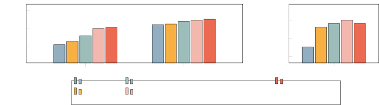
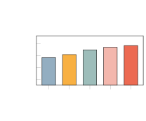
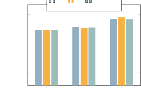
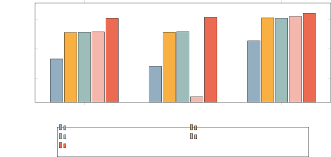
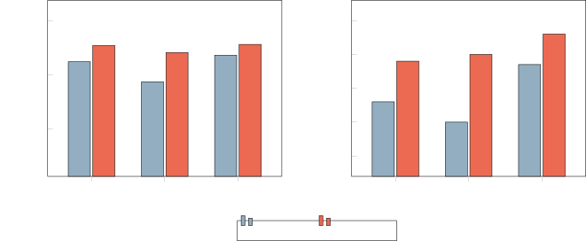
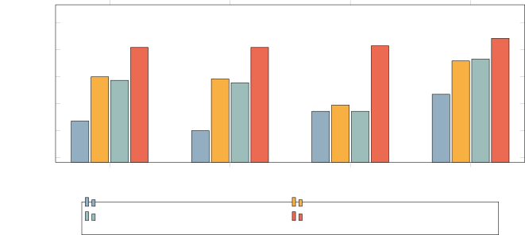
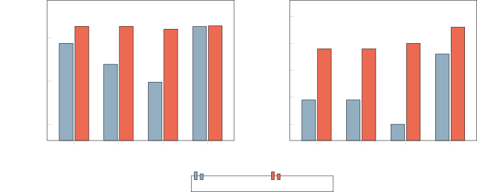

# Direct Judgement Preference Optimization

Peifeng Wang^(†) ^(†)^(†)thanks: Work done at Salesforce    Austin
Xu^(†)    Yilun Zhou    Caiming Xiong    Shafiq Joty
Affiliation: Salesforce AI Research Affiliation: ^(†)equal contribution,
correspondence: austin.xu@salesforce.com
Affiliation: [https://github.com/SalesforceAIResearch/sfrjudge](https://github.com/SalesforceAIResearch/sfrjudge)

###### Abstract

To meet the increasing need for timely and accurate evaluation of large
language model (LLM) responses, training LLM-as-judges to evaluate and
critique other model responses has emerged as a popular paradigm.
However, existing judge models are largely trained with supervised
finetuning (SFT) on small data scales to perform limited types of
evaluation tasks, fundamentally limiting generalization. To meet the
need for strong, generalized judge models, we explore training
foundational judge models at large data scales (680K) with direct
preference optimization (DPO). Using four training tasks, we form three
types of DPO preference pairs targeting different aspects of evaluation:
Generating meaningful critiques, making accurate judgements, and
understanding what comprises good and bad responses. To demonstrate the
effectiveness of our method, we train judge models of three sizes: 8B
parameters, 12B, and 70B, and evaluate on a comprehensive suite of 13
benchmarks (7 pairwise, 4 single rating, and 2 classification). Our
models achieve the best aggregate performance, with even our 8B model
outperforming GPT-4o in pairwise benchmarks. Further analysis shows that
our judge models produce factual and actionable critiques and serve as
strong foundational judges for continued finetuning.

## 1 Introduction

As the development of large language models (LLMs) accelerates,
evaluating model responses by collecting human preferences and feedback
is becoming increasingly unscalable. Due to their impressive language
understanding and generative capabilities, LLMs themselves have been
used as generative LLM-as-judges: Automatic evaluators that both assess
and critique outputs from other models for model alignment (Akyürek
et al., 2023; Lu et al., 2023; Hu et al., 2024a). LLM-as-judge has
evolved quickly from prompting high-performing LLMs, like GPT-4 (OpenAI,
2023), to training specialized judge models, which provide judgements of
model response(s) to an original input.

Recent judge model developments have focused on data efficiency, where
judges are trained with relatively small ($`<`$100K) training samples
for pairwise-only evaluation using fixed evaluation criteria (Wang
et al., 2024c; Shiwen et al., 2024). While such approaches work well in
certain domains, our experimental results in Section 5 reveal that such
models fail to generalize across different evaluation domains and tasks
(e.g., evaluating long-form responses or allowing for ties in pairwise
comparison settings). Our work aims to train foundational judge models:
Judges that accommodate flexible evaluation criteria, perform various
evaluation tasks, and handle diverse evaluation domains. Concretely, as
shown in Figure 1 (left), we train our judges to perform four evaluation
tasks: Single-instance rating, pairwise comparison, binary
classification, and response deduction.

Foundational judge models were explored by Vu et al. (2024), which
trained a judge with supervised fine-tuning (SFT) on a large set of
model outputs with ground-truth human annotations. However, recent
work (Song et al., 2020; Dai et al., 2024; Pang et al., 2024) has shown
SFT to be suboptimal, as it only trains LLMs to mimic correct examples
without exposing the model to incorrect examples; we observe similar
trends in Section 5.3. For large data scale training, direct preference
optimization (DPO) (Rafailov et al., 2024) is a stable and efficient
middle ground between SFT and online reinforcement learning (RL)
approaches. We therefore train our judges with three different types of
preferences pairs, shown in Figure 1 (right): (1) CoT critique to teach
our judge to produce meaningful critiques, (2) Standard judgement to
teach our judge to make accurate judgements, and (3) Deduction to teach
our judge to understand what comprises a good or bad response.

Figure 1: Data for three evaluation tasks (single rating, pairwise
comparison and classification) and a novel auxiliary task, response
deduction, are used to form three types of DPO preference data:
Chain-of-thought Critique, Standard Judgement and Response Deduction.

Concretely, our contributions are as follows:

- •
  We propose augmenting DPO training of judges with three complementary
  types of preference pairs: CoT critique, standard judgement and
  response deduction tasks.
- •
  We curate a large-scale training set (680K samples) and train a family
  of foundational judge models using our DPO training recipe.
- •
  We build a comprehensive evaluation suite of 13 benchmarks, spanning
  pairwise, single rating, and classification tasks and various domains
  (e.g., safety, summarization) for holistic evaluation.

Our empirical results validate our approach, with many benchmark
settings unseen in training. SFR-Judge-70B performs the best in
aggregate, outperforming GPT-4o and other task-specific judges. Further
analysis shows that our judges provide factual feedback, serve as strong
starting points for domain-specific finetuning, and act as a strong
reward models and revisers for model development.

Figure 2: Our preference data curation and training pipeline. Three
types of preference data are constructed: (1) Chain-of-Thought Critique
$`\mathcal{D}_{\text{CoT}}`$ for boosting reasoning, (2) Standard
Judgement $`\mathcal{D}_{\text{Std}}`$ for direct supervision and (3)
Response Deduction $`\mathcal{D}_{\text{Ded}}`$ for enhancing
understanding of reponses.

## 2 Background

In general, judge models take as input a tuple
$`x=(p,i,\mathbf{r})\in\mathcal{X}`$, where $`p\in\mathcal{P}`$ is an
evaluation protocol, $`i\in\mathcal{I}`$ is a task input, and
$`\mathbf{r}\in\mathcal{R}`$ is a set of model responses, and generate a
free-text evaluation $`y\in\mathcal{Y}`$. The protocol $`p`$ consists of
a task description (single rating, pairwise, or classification) and an
evaluation rubric, which specifies the rules and criteria for evaluation
(e.g., helpfulness, safety, etc.). The task input $`i`$ is the user
input used to generate model responses, a subset $`\mathbf{r}`$ of which
are included in $`x`$ to be evaluated. Depending on the evaluation task,
$`\mathbf{r}`$ may be a single response $`\{r\}`$ or a pair of model
responses $`\{r_{1},r_{2}\}`$. While the evaluation $`y`$ typically
takes the form $`\{c,j\}`$, where $`c`$ is a natural language
critique/explanation and $`j`$ is the model’s judgement, some judges are
trained to only produce judgement $`j`$. As shown in Figure 1, we train
our judges to produce critiques $`c`$ and give judgements $`j`$ for
three evaluation tasks:

- •
  Single Rating: Given a task input $`i\in\mathcal{I}`$ and a model
  response $`\{r\}\in\mathcal{R}`$, the judge assigns a score regarding
  the quality of the response.
- •
  Pairwise Comparison: Given a task input $`i\in\mathcal{I}`$ and a pair
  of model responses $`\{r_{1},r_{2}\}\in\mathcal{R}`$, the judge
  selects the better response.
- •
  Classification: Given a task input $`i\in\mathcal{I}`$ and a model
  response $`\{r\}\in\mathcal{R}`$, the judge classifies whether the
  output meets a certain criteria.

Training a judge requires training datasets of $`(x,y)`$ pairs, where
$`y`$ is an evaluation that consists of a critique $`c^{\star}`$ and
final judgment $`j^{\star}`$ produced by either humans or frontier LLMs.
Because human written critiques are expensive to collect,
human-annotated datasets typically only contain $`j^{\star}`$.

These ground-truth judgments $`j^{\star}`$ provide valuable supervision
in training judges aligned with human preferences. For example, past
work has trained generative models to only output a judgment $`j`$,
using input pairs of $`(x,j^{\star})`$ to perform SFT (e.g., Shiwen
et al. (2024); Park et al. (2024). Other approaches (e.g., Li et al.
(2023a)) use inputs $`x`$ to sample candidate judge outputs $`\{c,j\}`$
from a teacher model, then keep samples where $`j`$ matches
$`j^{\star}`$ for SFT; This approach treats the sampled critiques $`c`$
as appropriate substitutes for any gold-standard critiques
$`c^{\star}`$.

We employ the latter approach, sampling candidate outputs $`\{c,j\}`$
from a teacher model. However, we observe that SFT alone is suboptimal
in Section 5.3 in terms of performance. Instead, we sample multiple
outputs per input and forming positive and negative examples based on if
candidate judgments $`j`$ match ground-truth judgments $`j^{\star}`$;
This approach allows us to train our judges with DPO, which we choose
due to its stability and simplicity. In Section 3, we describe three
different types of DPO preference pairs that target distinct evaluation
aspects, while in Section 4, we describe how we source training data.

## 3 Method

As shown in Fig. 1 (right side), we propose 3 types of DPO preference
pairs that target specific aspects of evaluation: Chain-of-Thought
Critique for judge explanation generation and reasoning improvement,
Standard Judgement for direct judgement (i.e., outcome) supervision, and
Response Deduction for understanding judged response content. Figure 2
shows the preference data creation process.

Our approach is motivated by prior work in multi-task learning (Raffel
et al., 2020; Aghajanyan et al., 2021; Sanh et al., 2021), where
training on a mixture of diverse tasks enables broad generalization. For
judges, training with single rating data was shown to improve pairwise
evaluation (Park et al., 2024); Our work increases both the number of
tasks and the types of training data per task, i.e., the aforementioned
preference pairs.

### 3.1 Chain-of-Thought Critique

A crucial benefit of judge models is their ability to produce
explanations of their judgements, which is the purpose of this first
type of preference pair. Here, the evaluation $`y`$ takes the form
$`y=\{c,j\}`$, where, recall that $`c`$ is a Chain-of-Thought (CoT)
critique that provides a detailed analysis of the response(s) and $`j`$
is the final judgement. To construct the positive and negative examples
$`\mathcal{D}_{\text{CoT}}=\{x,y^{w},y^{l}\}`$ for preference
optimization, we first prompt a teacher LLM $`M_{\text{t}}`$ to generate
multiple candidate evaluations $`y=\{c,j\}`$ for a fixed input $`x`$.
Then based on whether the judgement $`j`$ matches the ground-truth
annotation $`j^{\star}`$, we categorize the candidates into positive
($`y^{w}`$) and negative ($`y^{l}`$) examples. Through preference
optimization, our generative judge learns to increase the probability of
good reasoning traces while decreasing that of bad reasoning traces.

### 3.2 Standard Judgement

Figure 3: Illustration of a CoT critique where only a few tokens
(highlighted) determine the final judgement. Training with CoT samples
results in less direct supervision compared to training with just the
judgement.

In addition to training our judge models to produce critiques, we want
to ensure our judges produce the correct final judgement. In the CoT
critiques, however, only a few important tokens determine the judgement
while the remaining tokens improve coherence, as exemplified
in Figure 3. Thus, the relatively long output sequence may dilute the
training signal for the crucial judgement tokens (Chen et al., 2024),
leading to poor outcome supervision. To mitigate this, we also train our
model to generate judgements without critiques. To construct the
positive and negative examples
$`\mathcal{D}_{\text{Std}}=\{x,y^{w},y^{l}\}`$, we simply remove the CoT
critique part of $`y`$ from $`\mathcal{D}_{\text{CoT}}`$ and modify the
protocol $`p`$ in $`x`$ to ask for only the judgement. By learning from
such standard judgement preference pairs, we provide a more direct
training signal for our judge model. In Section 5.3, we show that this
task is critical for judge performance even when evaluating with CoT
critiques.

### 3.3 Response Deduction

Lastly, we propose a novel auxiliary task, Response Deduction (Training
Task (d) in Fig. 1), to train our generative judge to understand the
substance of responses that receive particular judgements. In this task,
the typical judge workflow is reversed: The judge is given the original
evaluation protocol $`p`$, a task input $`i`$ and a correct evaluation
output $`y=\{c,j\}`$ (i.e., $`j=j^{\star}`$) from
$`\mathcal{D}_{\text{CoT}}`$ and is tasked with deducing or generating
the original response(s) $`\mathbf{r}`$ from $`y=\{c,j\}`$ (see the
complete prompt in Section D.1). By taking a “hindsight” view of
evaluation (Liu et al., 2023a), our judge is forced to understand the
substance of responses that receive particular judgements, leading to
performance gains (See Section 5.3). To construct the preference pairs
$`\mathcal{D}_{\text{Ded}}=\{x,y^{w},y^{l}\}`$ for Response Deduction,
we first prompt a weaker teacher LLM $`M^{\prime}_{\text{t}}`$ to
conduct Response Deduction and treat its generation as negative example
$`y^{l}`$. We then use the original response(s) used to generate the CoT
critique $`\{c,j\}`$ as the positive example $`y^{w}`$.

### 3.4 Training

With these three types of preference data
$`\mathcal{D}_{\text{train}}=\mathcal{D}_{\text{CoT}}\cup\mathcal{D}_{\text{Std}}\cup\mathcal{D}_{\text{Ded}}`$,
we then employ the DPO training objective for fine-tuning a student
model $`M_{\text{s}}`$ to be our generative judge. The parameters of
$`M_{\text{s}}`$ are initialized from an instruction-tuned LLM (e.g.,
Llama-3.1-8B-Instruct) and are learnable during training. DPO is a good
modeling choice when the preferred response $`y^{w}`$ is not necessarily
a satisfactory response (Pal et al., 2024). However, in our case the
positive examples $`y^{w}`$ could be considered as nearly-gold
completions (e.g., an evaluation with the judgement matching the
ground-truth). Thus, we also add SFT loss in addition to DPO loss
following Pang et al. (2024):

```math
\begin{split}&\mathcal{L}_{\text{DPO+SFT}}=\mathcal{L}_{\text{SFT}}(y_{i}^{w}|x_{i})+\mathcal{L}_{\text{DPO}}(y_{i}^{w},y_{i}^{l}|x_{i})\\
&=-\frac{\log M_{\text{s }}(y_{i}^{w}|x_{i})}{|y_{i}^{w}|+|x_{i}|}\\
&-\log\sigma\left(\beta\frac{M_{\text{s }}(y_{i}^{w}|x_{i})}{M_{\text{ref}}(y_{i}^{w}|x_{i})}-\beta\frac{M_{\text{s }}(y_{i}^{l}|x_{i})}{M_{\text{ref}}(y_{i}^{l}|x_{i})}\right),\end{split}
```

where reference model $`M_{\text{ref}}`$ is initialized from the same
instruction-tuned model as $`M_{\text{s}}`$ and its parameters are
fixed. With this loss, our judge learns to both increase the likelihood
of positive examples (more firmly via the SFT loss) and decrease the
likelihood of negative examples.

|                                  |        |           |        |       |       |          |            |         |
| -------------------------------- | ------ | --------- | ------ | ----- | ----- | -------- | ---------- | ------- |
| Model                            | Reward | InstruSum | Auto-J | HHH   | LFQA  | EvalBias | Preference | Average |
|                                  | Bench  |           |        |       |       | Bench    | Bench      |         |
| GPT-4o                           | 84.6   | 76.89     | 51.29  | 93.21 | 76.54 | 76.25    | 78.58      | 76.78   |
| GPT-4o-mini                      | 80.1   | 71.78     | 60.99  | 85.52 | 74.62 | 62.50    | 89.64      | 74.99   |
| Prometheus-2-7B                  | 72.0   | 67.64     | 56.03  | 79.64 | 72.31 | 40.00    | 95.15      | 68.97   |
| Prometheus-2-8x7B                | 74.5   | 63.50     | 58.69  | 84.16 | 74.23 | 46.25    | 87.69      | 69.86   |
| Auto-J-13B                       | 64.0   | 59.85     | 52.16  | 78.73 | 75.00 | 42.50    | 84.18      | 65.59   |
| Con-J-7B                         | 87.1   | 70.56     | 56.47  | 87.78 | 67.31 | 82.50    | 76.88      | 75.51   |
| Llama-3-OffsetBias-8B^(†)        | 84.0   | 75.43     | 56.47  | 91.86 | 63.08 | 87.50    | 78.73      | 76.72   |
| Skywork-Critic-Llama-3.1-8B^(†)  | 89.0   | 77.86     | 56.39  | 89.14 | 64.23 | 85.00    | 80.78      | 77.49   |
| Skywork-Critic-Llama-3.1-70B^(†) | 93.3   | 83.70     | 57.26  | 90.26 | 69.62 | 92.50    | 86.64      | 80.03   |
| Self-taught-eval.-Llama-3.1-70B  | 90.0   | 80.54     | 60.13  | 93.67 | 71.92 | 90.00    | 89.59      | 82.26   |
| FLAMe-24B                        | 86.0   | –         | –      | 91.40 | 74.20 | –        | –          | –       |
| SFR-Judge-70B                    | 92.7   | 82.73     | 63.51  | 94.57 | 75.00 | 85.00    | 96.25      | 84.25   |
| SFR-Judge-12B                    | 90.3   | 75.18     | 62.50  | 92.31 | 71.15 | 82.50    | 96.85      | 81.49   |
| SFR-Judge-8B                     | 88.7   | 74.94     | 60.34  | 94.12 | 68.85 | 85.00    | 94.39      | 80.91   |

Table 1: Pairwise comparison tasks. Bold and underline indicate best and
second-best models, respectively. $`\dagger`$ indicates the model is not
trained to generate explanations.

|                           |              |         |         |         |          |               |         |
| ------------------------- | ------------ | ------- | ------- | ------- | -------- | ------------- | ------- |
| Model                     | BiGGen Bench |         | FLASK   |         | MT-Bench | FeedbackBench | Average |
|                           | Human        | GPT-4   | Human   | GPT-4   | GPT-4    | GPT-4         |         |
|                           | Pearson      | Pearson | Pearson | Pearson | Pearson  | Pearson       |         |
| GPT-4o                    | 0.65         | 0.81    | 0.69    | 0.73    | 0.81     | 0.82          | 0.75    |
| GPT-4o-mini               | 0.60         | 0.77    | 0.63    | 0.68    | 0.72     | 0.84          | 0.71    |
| Prometheus-2-7B           | 0.50         | 0.62    | 0.47    | 0.56    | 0.46     | 0.88          | 0.58    |
| Prometheus-2-8x7B         | 0.52         | 0.67    | 0.54    | 0.64    | 0.59     | 0.84          | 0.63    |
| Auto-J-13B                | 0.30         | 0.38    | 0.35    | 0.37    | 0.41     | 0.41          | 0.37    |
| Llama-3-OffsetBias-8B^(†) | 0.21         | 0.20    | 0.29    | 0.25    | 0.33     | 0.36          | 0.27    |
| Themis-8B                 | 0.58         | 0.69    | 0.54    | 0.58    | 0.57     | 0.76          | 0.62    |
| SFR-Judge-70B             | 0.65         | 0.81    | 0.66    | 0.74    | 0.77     | 0.93          | 0.76    |
| SFR-Judge-12B             | 0.57         | 0.74    | 0.59    | 0.66    | 0.72     | 0.93          | 0.70    |
| SFR-Judge-8B              | 0.59         | 0.71    | 0.52    | 0.60    | 0.71     | 0.92          | 0.68    |

Table 2: Single rating performance. Bold and underline indicate best and
second-best models, respectively. $`\dagger`$ indicates the model is not
trained to generate explanations.

## 4 Experimental Setup

### 4.1 Training Data and Details

To train a multifaceted judge model, we compile an array of datasets
with either human or model annotations that focus on the three
evaluation tasks, formatting each dataset as a sequence-to-sequence
task. For human annotated datasets, we take inspiration from those
proposed by Vu et al. (2024), focusing on modern (2023 and beyond) LLM
responses. We supplement our training set with model-annotated samples
to endow our judge models with specific capabilities (e.g., fine-grained
evaluation), utilizing datasets similar to those used by other judge
models (Kim et al., 2023; Kim et al., 2024b; Park et al., 2024; Shiwen
et al., 2024). For each dataset, we hand-craft an evaluation rubric that
specifies evaluation criteria (e.g., helpfulness, safety, or general
response quality). If the original instructions given to human
annotators is available, we carefully preserve them in our evaluation
rubrics. If no original instructions are available, we write new,
aligned rubrics for the given task. Our efforts yield a diverse training
set with both instance-specific and broad criteria; See Appendix B for a
comprehensive list of datasets. This diversity not only allows our judge
to generalize well, as shown in our empirical evaluation, but also
offers practitioners to specify their own criteria via prompting
( Section E.2).

Our approach as described in Section 3.1 does not require annotated CoT
critiques, allowing us to make use of the high-quality collected
judgements. We use Llama-3.1-70B-Instruct as a teacher model to obtain
high-quality preference data $`\mathcal{D}_{\text{CoT}}`$, sampling
$`20`$ responses per prompt with temperature $`0.7`$. Standard judgement
preferences $`\mathcal{D}_{\text{Std}}`$ are obtained by removing the
CoT critiques from $`\mathcal{D}_{\text{CoT}}`$. For obtaining
$`\mathcal{D}_{\text{Ded}}`$, we use a weaker model
Llama-3.1-8B-Instruct to generate the deduced responses as the negative
examples. We filter our dataset to ensure balanced label distributions
for all three tasks, yielding 680K preference pairs with a 70%:15%:15%
ratio for $`\mathcal{D}_{\text{CoT}}`$, $`\mathcal{D}_{\text{Std}}`$ and
$`\mathcal{D}_{\text{Ded}}`$. We then train three models using the
training loss in Eq. 3.4 initialized from Llama-3.1-8B-Instruct,
NeMo-Instruct-12B, and Llama-3.1-70B-Instruct, yielding SFR-Judge-8B,
SFR-Judge-12B, SFR-Judge-70B, respectively.

### 4.2 Evaluation Datasets

We propose a comprehensive evaluation suite, with seven pairwise
comparison benchmarks, four single rating benchmarks, and two
classification benchmarks. This suite evaluates how judge models perform
in different use cases (e.g., general chat, summarization, safety). For
pairwise comparisons, we evaluate on RewardBench (Lambert et al., 2024),
InstruSum (Liu et al., 2023c), Auto-J (Eval-P test set with ties) (Li
et al., 2023a), HHH (Askell et al., 2021), LFQA (Xu et al., 2023),
EvalBiasBench (Park et al., 2024), and PreferenceBench (Kim et al.,
2024b). These benchmarks span both general (e.g., Auto-J) and specific
(e.g., InstruSum) use-cases, with PreferenceBench assessing the
fine-grained evaluation ability. For single rating, we evaluate on
BiGGen-Bench model outputs (Kim et al., 2024a), FLASK (Ye et al.,
2023b), MT-Bench (Zheng et al., 2024), and FeedbackBench (Kim et al.,
2023). For classification, we evaluate on LLM-AggreFact (Tang et al., 2024) and InfoBench (Expert split) (Qin et al., 2024). For a more
detailed dataset overviews, see Appendix C.

### 4.3 Baselines and Evaluation Setup

We compare our models against several popular open-source judge models:
Prometheus 2 (Kim et al., 2024b), Auto-J (Li et al., 2023a),
Llama3-OffsetBias (Park et al., 2024), Themis-8B (Hu et al., 2024b),
Skywork-Critic-Llama3.1 (Shiwen et al., 2024), Con-J (Ye et al., 2024),
and Self-taught-evaluator-Llama-3.1-70B (Wang et al., 2024c). We also
compare against FLAMe (Vu et al., 2024), when possible.¹¹ 1 FLAMe
evaluates on benchmark subsets if the benchmark test set has more than
256 samples. We utilize their reported numbers directly, indicating
appropriately if a subset was used. We evaluate each judge baseline only
on the evaluation task(s) it is trained to perform. For example, the
pairwise-only Skywork-Critic models are only run on pairwise benchmarks.
However, most judge models are not trained for classification. Due to
the similar pointwise nature of both classification and single rating,
we prompt single-rating capable models to do classification by
generating “Yes”/“No” in natural language. We select OpenAI’s GPT-4o and
GPT-4o-mini as proprietary baselines. For fair comparison, we utilize
the original prompt templates of generative judge baselines, making
minimal changes to accommodate new tasks or information (e.g., adding
reference answers or allowing for pairwise comparison ties). For
proprietary models, unless the benchmark has provided a template (Auto-J
and Prometheus), we utilize the default pairwise prompt from
RewardBench (Lambert et al., 2024) and the default single rating prompt
from Prometheus (Kim et al., 2023). We employ task-specific prompting
with SFR-Judges. However, we emphasize that this prompting is not a
significant driver of evaluation gains; As we show in Section E.2,
large-scale judge training enables our judges to generalize to
evaluation prompts that are unseen during training, with little
variation in performance. For completeness, we include our evaluation
prompts in Section D.6.

For pairwise comparison and classification benchmarks, we report the
agreement between judges and human annotators (i.e., accuracy), and for
single rating benchmarks, we report Pearson correlation coefficient
between judge and human ratings. We adopt the default evaluation setup
for RewardBench. For other pairwise comparison benchmarks, because
existing judges exhibit positional bias (Wang et al., 2023b) (i.e.,
judgements change when the order of the two responses changes), we run
each benchmark twice, exchanging the order of responses in the second
run to measure consistency. We report the best performance of these two
runs in Section 5 and analyze the consistency rate of judge models
in Section E.1. For datasets with multiple categories (e.g.,
EvalBiasBench and HHH), we report microaverage. For all non-proprietary
models, we use greedy sampling, and for OpenAI models, we utilize the
default API parameters (temperature of 0.7, top-p of 1).

## 5 Results and Analysis

|                       |           |           |         |
| --------------------- | --------- | --------- | ------- |
| Model                 | LLM       | InfoBench | Average |
|                       | AggreFact |           |         |
| GPT-4o                | 78.13     | 92.80     | 85.47   |
| GPT-4o-mini           | 77.96     | 91.08     | 84.52   |
| Prometheus-2-7B       | 38.58     | 48.60     | 43.59   |
| Prometheus-2-8x7B     | 67.72     | 87.85     | 77.78   |
| Auto-J-13B            | 40.72     | 46.99     | 43.86   |
| Llama-3-OffsetBias-8B | 72.08     | 72.15     | 72.12   |
| Themis-8B             | 42.05     | 56.57     | 49.31   |
| FLAMe-24B             | 81.10^(⋆) | –         | –       |
| SFR-Judge-70B         | 78.62     | 92.58     | 85.60   |
| SFR-Judge-12B         | 77.92     | 90.32     | 84.12   |
| SFR-Judge-8B          | 78.01     | 92.80     | 85.41   |

Table 3: Classification performance. $`\star`$ denotes reported FLAMe
performance on a subsampled test set. Bold and underline indicate best
and second-best models, respectively, excluding subsampled results.

We present our main evaluation results, with pairwise comparison results
in Table 1, single rating results in Table 2, and classification results
in Table 3. We discuss the significance of our main results first, and
then present additional analysis on critique quality, and a DPO training
task ablation, downstream model development, and domain-specialized
finetuning.

### 5.1 SFR-Judges have the best aggregate performance.

Our results, presented in Table 1, 2, and 3, highlight the impressive
strength of SFR-Judges across a variety of challenging benchmarks, with
even our smallest model exhibiting better average performance than
GPT-4o and specialized judge model baselines. Here, we emphasize our
models were trained to cover a broad range of evaluation tasks without
particular emphasis on one benchmark. Our judges are in the top two best
performing models across six of seven pairwise benchmarks, being
remarkably effective across a variety of judgement domains, including
reward modeling (RewardBench), safety (HHH), and summarization
(InstruSum). Even our smallest model is capable of outperforming
pairwise-specific models, like Skywork-Critic-70B, in terms of aggregate
performance. SFR-Judge-70B exhibits the strongest aggregate performance,
outperforming the next best baseline, Self-taught-evaluator (70B) (Wang
et al., 2024c), a pairwise-only model, by nearly 2%. We note that the
Auto-J benchmark allows for ties, resulting in lower scores across the
judges, with SFR-Judges best accommodating this third option.

In single rating tasks, our judge models consistently outperform judge
models trained to produce single ratings (Prometheus, Themis, and
Auto-J) or trained with single rating data (Llama-3-OffsetBias), with
our largest model being extremely competitive with GPT-4o across the
board. Compared to pairwise comparisons, single rating evaluation lacks
context and are known to require more time (and reasoning capacity) for
human annotators to perform (Shah et al., 2016). For judges, performance
tends to scale with model capacity, pointing towards an analogous
phenomenon: single rating tasks are reasoning intensive tasks. However,
judge training can close this gap, as SFR-Judge-70B is competitive with
the much larger GPT-4o.

|                          |           |        |          |
| ------------------------ | --------- | ------ | -------- |
| Model                    | Meta      | Meta   | Meta     |
|                          | Precision | Recall | F1 Score |
| Auto-J-13B^(⋆)           | 76.43     | 70.65  | 71.14    |
| GPT-3.5^(⋆)              | 80.79     | 64.27  | 68.72    |
| UltraCM-13B^(⋆)          | 73.64     | 66.77  | 67.79    |
| SelFee-13B^(⋆)           | 69.56     | 51.05  | 54.22    |
| Human Critique^(⋆)       | 83.19     | 60.65  | 64.02    |
| Themis-8B-Rating         | 77.98     | 53.31  | 58.83    |
| Themis-8B-Classification | 76.54     | 55.05  | 60.48    |
| Self-taught-eval.-70B    | 77.60     | 59.60  | 62.99    |
| SFR-Judge-70B            | 93.10     | 70.54  | 77.60    |
| SFR-Judge-12B            | 89.15     | 68.86  | 74.04    |
| SFR-Judge-8B             | 83.04     | 64.46  | 69.52    |

Table 4: MetaCritique critique quality. Bold and underline indicate best
and second-best models, respectively. $`\star`$ indicates result
reported by MetaCritique.

In classification tasks, our models are consistently capable of
performing extremely coarse evaluation (LLM-AggreFact) or extremely
fine-grained evaluation (InfoBench), with all model sizes outperforming
other judge models and offering comparable performance to GPT-4o. Here,
we observe that training only on single rating tasks does not translate
to other pointwise evaluation settings, as the Prometheus models,
Auto-J, and Llama-3-OffsetBias all struggle with classification tasks
relative to SFR-Judges and GPT-4o. Finally, in Section E.3
and Section E.4, we demonstrate our models improve over their base model
counterparts and other instruct model baselines, illustrating the
effectiveness of our training procedure.



Figure 4: Influence of various training tasks. The inclusion of all
three tasks (CoT critique, standard judgement, response deduction) along
with SFT loss result in the most well-rounded judge model.

### 5.2 SFR-Judges produce factual critiques.

Thus far, we have focused on evaluating the correctness of the final
judgement. However, while the final judgement may be consistent with the
ground-truth, the critique itself may be inconsistent or hallucinated.
We therefore use the MetaCritique framework (Sun et al., 2024), which
uses GPT-4 to evaluate critique quality via atomic information units
(AIUs), i,e., simple true/false statements. Answers to these AIUs are
used to compute Meta-Precision (measure of factuality) and Meta-Recall
(measure of completeness with respect to a GPT-4 generated critique),
which are aggregated into a Meta-F1 score (measure of overall critique
quality). We evaluate our models, Themis, and Self-taught-evaluator and
report performance in Table 4. We additionally report the performance of
Auto-J (Li et al., 2023a), UltraCM (Cui et al., 2023), SelFee (Ye
et al., 2023a), and human critique from the Shepherd dataset (Wang
et al., 2023c) from the MetaCritique leaderboard. Overall, our models
exhibit strong performance, with our 12B and 70B models producing more
factual critiques and overall higher quality critiques than the previous
best models. Our models also exhibit much stronger completeness than all
other models except Auto-J, which uses GPT-4 distilled judgement data.
Because Meta-Recall measures completeness with respect to a GPT-4
critique, Auto-J’s critiques naturally align better. For an extended
description of the MetaCritique setup and results, see Section E.10.

### 5.3 All three training tasks contribute in creating well-rounded judges.

We train multiple 8B judge models to investigate the effects of each of
the DPO training tasks from Section 3. We report our findings
in Figure 4, where we plot the average performance across all three
evaluation tasks when removing each training task. The inclusion of CoT
critique, standard judgement, and response deduction yield the best
performing models for pairwise and classification tasks. Notably,
including direct response judgements resulted in sizable pairwise
performance gains, highlighting the benefits of a more direct training
signal. While excluding the response deduction task leads to slightly
better single rating performance, gains made in pairwise and
classification tasks compensate any slight drops, showing that all three
tasks yield the most well-rounded judge model.

### 5.4 SFR-Judges are effective reward models.

In this study, we demonstrate how downstream models can learn from the
feedback provided by SFR-Judge-70B for model development. We investigate
two settings where we use our judge to construct DPO data to train a
downstream model: reward modeling and critique-based refinement. In the
first setting, SFR-Judge-70B is used as a reward model (RM) to score the
responses from a generator model (Llama-3-8B-Instruct) for
UltraFeedback (Cui et al., 2023) using a 5-point Likert scale with
additive prompting (Yuan et al., 2024). Then, for each data point, we
treat the highest-scoring response as the positive response and the
lowest-scoring response as the negative response. We compare with two RM
baselines: PairRM (Jiang et al., 2023) and ArmoRM (Wang et al., 2024a),
using results reported by Meng et al. (2024). In the second setting,
inspired by Hu et al. (2024a), we leverage SFR-Judge-70B’s response
deduction task training to perform model-based refinement. Specifically,
we use the CoT critiques from the reward modeling setting and prompt
SFR-Judge-70B to refine the low-scoring responses (see Section D.3 for
the prompt). For comparison, we also prompt Llama-3.1-70B-Instruct to
refine responses. We then use {refined response, original response} as
the DPO data. After DPO training the downstream model is assessed on the
open-ended instruction-following benchmark AlpacaEval-2 (Li et al.,
2023c). In Fig. 5, we report the win rate of the downstream model
against GPT-4 Turbo. SFR-Judge-70B serves as a more effective RM
compared to classification-based methods. Additionally, using our
judge’s CoT critiques (unavailable with typical RMs) and unique
refinement abilities (resulting from the response deduction task)
further increases downstream performance.



Figure 5: AlpacaEval results for a downstream model trained PairRM,
ArmoRM, SFR-Judge-70B as a reward model, and two refinement methods with
untuned and SFR-Judge-70B.

### 5.5 SFR-Judges are strong starting points for domain-specific continual finetuning.

A core advantage of foundational judges is easy adaption to specialized
domains. Here, we show the advantage of finetuning SFR-Judge-8B for
contextual evaluation (e.g., outputs of retrieval augmented generation
or summarization tasks). We evaluate on ContextualJudgeBench (Xu et al.,
2025), a pairwise contextual benchmark with 2,000 test samples. To train
a contextual evaluator, we form a 12,500 sample pairwise training set
from RagTruth (Wu et al., 2023a) and continually train with DPO; See
full training details in Section B.1. For comparison, we train
Llama-3.1-8B-Instruct using DPO and the same training set. The resulting
difference in performance between training from SFR-Judge-8B and from
Llama-3.1-8B-Instruct can be viewed as the effect of foundational judge
training.

Figure 6: Continual finetuning performance of SFR-Judge-8B in contextual
evaluation. $`\beta`$ controls the specialization degree, with lower
being more specialized. Finetuning from SFR-Judge-8B yields a 10
absolute percentage point increase in downstream performance compared to
training from Llama-3.1-8B-Instruct, highlighting the benefits of
foundational judge finetuning.

The $`\beta`$ DPO parameter controls how far the trained model deviates
from the reference model, allowing us to control how specialized our
trained judge is. As a result, we sweep
$`\beta\in\{0.01,0.1,0.3,0.5,0.7\}`$ to investigate the trade-off
between specialization (low $`\beta`$) and generalization (high
$`\beta`$). As seen in Figure 6, SFR-Judge-8B slowly trades off general
evaluation ability (as measured by average pairwise performance on our 7
benchmarks) for specialized evaluation ability (ContextualJudgeBench).
The most specialized judge ($`\beta=0.01`$) achieves state-of-the-art
performance (55.6%) on ContextualJudgeBench, surpassing strong models
like o1 (55.3%) with minimal drop in general-purpose evaluation
performance. The 10 absolute percent gap between our finetuned judge and
the best judge finetuned from Llama-3.1-8B (45.2% at $`\beta=0.01`$)
reflects the fundamental benefit of large scale foundational judge
training.

### 5.6 Overview of additional experiments.

Here, we provide a brief overview of additional experiments presented in
the Appendix.

- •
  Bias analysis (Sections E.1 and E.7): We show that SFR-Judges are
  robust to common biases found in models, as measured by EvalBiasBench.
  We also show that better prompting does not meaningfully debias judge
  models.
- •
  Prompting flexibility (Section E.2): We show that our judges to
  generalize to unseen evaluation prompts and criteria.
- •
  Comparison with instruction-tuned models (Sections E.3 and E.4): We
  compare the performance of our judges against instruction-tuned models
  with different evaluation prompts.
- •
  Evaluation without CoT (Section E.6): We evaluate our judges without
  CoT and analyze the tasks where CoT helps in evaluation.
- •
  Impact of teacher model (Section E.8): We analyze the impact of using
  a weaker model for generating negative samples.
- •
  Comparison with inference-time scaling approaches (Section E.9): We
  compare SFR-Judges against recent advances that scale inference-time
  compute for judge models.

## 6 Related Work

LLM-as-judge is a rapidly developing field, with many advancements since
the earliest approaches of prompting frontier LLMs. Here, we focus on
the most recent developments, deferring extended discussion of the field
to Appendix A. Until recently, SFT was the dominant training paradigm
for judges, using data distilled from larger teacher models (Li et al.,
2023a; Kim et al., 2024b; Kim et al., 2024a) or large-scale
human-annotated preference sets (Vu et al., 2024). While concurrent
works have used DPO to train judges, they have largely focused on single
evaluation tasks and only used CoT critique training samples. Themis (Hu
et al., 2024a) trains a single-rating model with a single-rating
specific modifications to the DPO loss. Self-taught Evaluator (Wang
et al., 2024c) and Con-J (Ye et al., 2024) both focus only on pairwise
evaluation. Self-taught Evaluator employs iterative SFT and DPO using a
self-teaching framework. This training procedure requires multiple (5+)
rounds of data generation and training. Con-J, perhaps the most similar
to our approach uses only samples with CoT critiques. Our work, in
contrast, uses creatively formed DPO data to train a family of judges
capable of three different evaluation tasks. Despite our task
generality, our models outperform these models on the very tasks they
are meant to specialize in, as shown in Section 5.

## 7 Conclusion

We present a family of multifaceted judges, trained with three distinct
forms of pairwise DPO data, to perform three different evaluation tasks.
Our experiments show that our models are high performing across a
variety of tasks and benchmarks, with even our 8B model outperforming
GPT-4o on multiple benchmarks. Further analysis shows the factuality of
our judge critiques, how our judges can be effective in downstream model
improvement, and that are judges are strong starting points for
continual judge finetuning.

## Limitations

Compared to prompting-based approaches for automatic evaluation, our
method relies on human or model annotated judgements to construct the
training data. While we focus our training data on modern LLM responses,
new annotations may be needed to “refresh” our model as LLMs continue to
be developed. Bootstrapping strategies, e.g., using our models to help
data annotation, may allow us to ease the burden for extensive manual
annotation.

This work focuses on evaluation tasks that assess the complete LLM
responses. How well our models can provide process-based reward, i.e.,
assessing partial LLM responses and assist reasoning for generators
remains to be explored.

Compared to classification-based reward models, which only require LLMs
to produce a scalar reward, our models require longer inference time to
generate a chain-of-thought reasoning before predicting the final
judgement. This additional inference time is negligible in settings
where a downstream model is trained (e.g., Section 5.4). However, time
increases matter in time-sensitive settings, such as using the judge as
an inference-time response reranker. Our Standard Judgement DPO training
task enables our models to skip the reasoning process and predict the
judgements directly in such settings. Future work should investigate if,
in general, additional inference time for judges yields meaningful
improvements over faster methods.

Finally, our paper focuses on evaluation in English, where many outputs
and corresponding annotations are available. An important line of future
work is determining how to build judges for multilingual evaluation, and
in particular, finding creative ways to leverage existing annotations in
high resource languages.

## References

- Adler et al. (2024) Bo Adler, Niket Agarwal, Ashwath Aithal, Dong H
  Anh, Pallab Bhattacharya, Annika Brundyn, Jared Casper, Bryan
  Catanzaro, Sharon Clay, Jonathan Cohen, et al. 2024. Nemotron-4 340b
  technical report. _arXiv preprint arXiv:2406.11704_.
- Aghajanyan et al. (2021) Armen Aghajanyan, Anchit Gupta, Akshat
  Shrivastava, Xilun Chen, Luke Zettlemoyer, and Sonal Gupta. 2021.
  Muppet: Massive multi-task representations with pre-finetuning. _arXiv
  preprint arXiv:2101.11038_.
- Akyürek et al. (2023) Afra Feyza Akyürek, Ekin Akyürek, Aman Madaan,
  Ashwin Kalyan, Peter Clark, Derry Wijaya, and Niket Tandon. 2023.
  Rl4f: Generating natural language feedback with reinforcement learning
  for repairing model outputs. _arXiv preprint arXiv:2305.08844_.
- Askell et al. (2021) Amanda Askell, Yuntao Bai, Anna Chen, Dawn Drain,
  Deep Ganguli, Tom Henighan, Andy Jones, Nicholas Joseph, Ben Mann,
  Nova DasSarma, et al. 2021. A general language assistant as a
  laboratory for alignment. _arXiv preprint arXiv:2112.00861_.
- Bai et al. (2022) Yuntao Bai, Andy Jones, Kamal Ndousse, Amanda
  Askell, Anna Chen, Nova DasSarma, Dawn Drain, Stanislav Fort, Deep
  Ganguli, Tom Henighan, et al. 2022. Training a helpful and harmless
  assistant with reinforcement learning from human feedback. _arXiv
  preprint arXiv:2204.05862_.
- Bai et al. (2024) Yushi Bai, Jiahao Ying, Yixin Cao, Xin Lv, Yuze He,
  Xiaozhi Wang, Jifan Yu, Kaisheng Zeng, Yijia Xiao, Haozhe Lyu,
  et al. 2024. Benchmarking foundation models with
  language-model-as-an-examiner. _Advances in Neural Information
  Processing Systems_, 36.
- Cai et al. (2024) Zheng Cai, Maosong Cao, Haojiong Chen, Kai Chen,
  Keyu Chen, Xin Chen, Xun Chen, Zehui Chen, Zhi Chen, Pei Chu,
  et al. 2024. Internlm2 technical report. _arXiv preprint
  arXiv:2403.17297_.
- Canal et al. (2020) Gregory Canal, Stefano Fenu, and Christopher
  Rozell. 2020. Active ordinal querying for tuplewise similarity
  learning. In _Proceedings of the AAAI Conference on Artificial
  Intelligence_, volume 34.
- Chen et al. (2024) Zhipeng Chen, Kun Zhou, Wayne Xin Zhao, Junchen
  Wan, Fuzheng Zhang, Di Zhang, and Ji-Rong Wen. 2024. Improving large
  language models via fine-grained reinforcement learning with minimum
  editing constraint. _arXiv preprint arXiv:2401.06081_.
- Chiang and Lee (2023) Cheng-Han Chiang and Hung-Yi Lee. 2023. Can
  large language models be an alternative to human evaluations? In
  _Proceedings of the 61st Annual Meeting of the Association for
  Computational Linguistics (Volume 1: Long Papers)_, pages 15607–15631.
- Clark et al. (2023) Elizabeth Clark, Shruti Rijhwani, Sebastian
  Gehrmann, Joshua Maynez, Roee Aharoni, Vitaly Nikolaev, Thibault
  Sellam, Aditya Siddhant, Dipanjan Das, and Ankur Parikh. 2023.
  SEAHORSE: A multilingual, multifaceted dataset for summarization
  evaluation. In _Proceedings of the 2023 Conference on Empirical
  Methods in Natural Language Processing (EMNLP)_.
- Cui et al. (2023) Ganqu Cui, Lifan Yuan, Ning Ding, Guanming Yao, Wei
  Zhu, Yuan Ni, Guotong Xie, Zhiyuan Liu, and Maosong Sun. 2023.
  [Ultrafeedback: Boosting language models with high-quality
  feedback](https://arxiv.org/abs/2310.01377). _Preprint_,
  arXiv:2310.01377.
- Dai et al. (2024) Chengwei Dai, Kun Li, Wei Zhou, and Songlin
  Hu. 2024. Beyond imitation: Learning key reasoning steps from dual
  chain-of-thoughts in reasoning distillation. _arXiv preprint
  arXiv:2405.19737_.
- Dong et al. (2024) Hanze Dong, Wei Xiong, Bo Pang, Haoxiang Wang, Han
  Zhao, Yingbo Zhou, Nan Jiang, Doyen Sahoo, Caiming Xiong, and Tong
  Zhang. 2024. Rlhf workflow: From reward modeling to online rlhf.
  _arXiv preprint arXiv:2405.07863_.
- Dubey et al. (2024) Abhimanyu Dubey, Abhinav Jauhri, Abhinav Pandey,
  Abhishek Kadian, Ahmad Al-Dahle, Aiesha Letman, Akhil Mathur, Alan
  Schelten, Amy Yang, Angela Fan, et al. 2024. The llama 3 herd of
  models. _arXiv preprint arXiv:2407.21783_.
- Fu et al. (2024) Jinlan Fu, See Kiong Ng, Zhengbao Jiang, and Pengfei
  Liu. 2024. Gptscore: Evaluate as you desire. In _Proceedings of the
  2024 Conference of the North American Chapter of the Association for
  Computational Linguistics: Human Language Technologies (Volume 1: Long
  Papers)_, pages 6556–6576.
- Griffin and Brenner (2008) Dale Griffin and Lyle Brenner. 2008.
  _Perspectives on Probability Judgment Calibration_, chapter 9.
  Wiley-Blackwell.
- Hu et al. (2024a) Chi Hu, Yimin Hu, Hang Cao, Tong Xiao, and Jingbo
  Zhu. 2024a. Teaching language models to self-improve by learning from
  language feedback. _arXiv preprint arXiv:2406.07168_.
- Hu et al. (2024b) Xinyu Hu, Li Lin, Mingqi Gao, Xunjian Yin, and
  Xiaojun Wan. 2024b. Themis: A reference-free nlg evaluation language
  model with flexibility and interpretability. _arXiv preprint
  arXiv:2406.18365_.
- Jeong et al. (2024) Hawon Jeong, ChaeHun Park, Jimin Hong, and Jaegul
  Choo. 2024. Prepair: Pointwise reasoning enhance pairwise evaluating
  for robust instruction-following assessments. _arXiv preprint
  arXiv:2406.12319_.
- Ji et al. (2023) Jiaming Ji, Mickel Liu, Josef Dai, Xuehai Pan, Chi
  Zhang, Ce Bian, Boyuan Chen, Ruiyang Sun, Yizhou Wang, and Yaodong
  Yang. 2023. Beavertails: Towards improved safety alignment of llm via
  a human-preference dataset. In _Advances in Neural Information
  Processing Systems 36 (NeurIPS)_, volume 36, pages 24678–24704.
- Jiang et al. (2024) Albert Q Jiang, Alexandre Sablayrolles, Antoine
  Roux, Arthur Mensch, Blanche Savary, Chris Bamford, Devendra Singh
  Chaplot, Diego de las Casas, Emma Bou Hanna, Florian Bressand,
  et al. 2024. Mixtral of experts. _arXiv preprint arXiv:2401.04088_.
- Jiang et al. (2023) Dongfu Jiang, Xiang Ren, and Bill Yuchen
  Lin. 2023. Llm-blender: Ensembling large language models with pairwise
  ranking and generative fusion. _arXiv preprint arXiv:2306.02561_.
- Kim et al. (2023) Seungone Kim, Jamin Shin, Yejin Cho, Joel Jang,
  Shayne Longpre, Hwaran Lee, Sangdoo Yun, Seongjin Shin, Sungdong Kim,
  James Thorne, et al. 2023. Prometheus: Inducing fine-grained
  evaluation capability in language models. In _The Twelfth
  International Conference on Learning Representations_.
- Kim et al. (2024a) Seungone Kim, Juyoung Suk, Ji Yong Cho, Shayne
  Longpre, Chaeeun Kim, Dongkeun Yoon, Guijin Son, Yejin Cho, Sheikh
  Shafayat, Jinheon Baek, et al. 2024a. The biggen bench: A principled
  benchmark for fine-grained evaluation of language models with language
  models. _arXiv preprint arXiv:2406.05761_.
- Kim et al. (2024b) Seungone Kim, Juyoung Suk, Shayne Longpre,
  Bill Yuchen Lin, Jamin Shin, Sean Welleck, Graham Neubig, Moontae Lee,
  Kyungjae Lee, and Minjoon Seo. 2024b. Prometheus 2: An open source
  language model specialized in evaluating other language models. _arXiv
  preprint arXiv:2405.01535_.
- Koo et al. (2023) Ryan Koo, Minhwa Lee, Vipul Raheja, Jong Inn Park,
  Zae Myung Kim, and Dongyeop Kang. 2023. Benchmarking cognitive biases
  in large language models as evaluators. _arXiv preprint
  arXiv:2309.17012_.
- Lambert et al. (2024) Nathan Lambert, Valentina Pyatkin, Jacob
  Morrison, LJ Miranda, Bill Yuchen Lin, Khyathi Chandu, Nouha Dziri,
  Sachin Kumar, Tom Zick, Yejin Choi, et al. 2024. Rewardbench:
  Evaluating reward models for language modeling. _arXiv preprint
  arXiv:2403.13787_.
- Li et al. (2023a) Junlong Li, Shichao Sun, Weizhe Yuan, Run-Ze Fan,
  Hai Zhao, and Pengfei Liu. 2023a. Generative judge for evaluating
  alignment. _arXiv preprint arXiv:2310.05470_.
- Li et al. (2023b) Junyi Li, Xiaoxue Cheng, Xin Zhao, Jian-Yun Nie, and
  Ji-Rong Wen. 2023b. HaluEval: A large-scale hallucination evaluation
  benchmark for large language models. In _Proceedings of the 2023
  Conference on Empirical Methods in Natural Language Processing
  (EMNLP)_, pages 6449–6464.
- Li et al. (2023c) Xuechen Li, Tianyi Zhang, Yann Dubois, Rohan Taori,
  Ishaan Gulrajani, Carlos Guestrin, Percy Liang, and Tatsunori B.
  Hashimoto. 2023c. Alpacaeval: An automatic evaluator of
  instruction-following models.
  [https://github.com/tatsu-lab/alpaca_eval](https://github.com/tatsu-lab/alpaca_eval).
- Lightman et al. (2024) Hunter Lightman, Vineet Kosaraju, Yuri Burda,
  Harrison Edwards, Bowen Baker, Teddy Lee, Jan Leike, John Schulman,
  Ilya Sutskever, and Karl Cobbe. 2024. Let’s verify step by step. In
  _The Twelfth International Conference on Learning Representations
  (ICLR)_.
- Liu et al. (2023a) Hao Liu, Carmelo Sferrazza, and Pieter Abbeel.
  2023a. Chain of hindsight aligns language models with feedback. _arXiv
  preprint arXiv:2302.02676_.
- Liu et al. (2023b) Yang Liu, Dan Iter, Yichong Xu, Shuohang Wang,
  Ruochen Xu, and Chenguang Zhu. 2023b. G-eval: Nlg evaluation using
  gpt-4 with better human alignment. In _Proceedings of the 2023
  Conference on Empirical Methods in Natural Language Processing_, pages
  2511–2522.
- Liu et al. (2023c) Yixin Liu, Alexander R Fabbri, Jiawen Chen, Yilun
  Zhao, Simeng Han, Shafiq Joty, Pengfei Liu, Dragomir Radev,
  Chien-Sheng Wu, and Arman Cohan. 2023c. Benchmarking generation and
  evaluation capabilities of large language models for instruction
  controllable summarization. _arXiv preprint arXiv:2311.09184_.
- Liu et al. (2025) Zijun Liu, Peiyi Wang, Runxin Xu, Shirong Ma, Chong
  Ruan, Peng Li, Yang Liu, and Yu Wu. 2025. Inference-time scaling for
  generalist reward modeling. _arXiv preprint arXiv:2504.02495_.
- Lu et al. (2023) Jianqiao Lu, Wanjun Zhong, Wenyong Huang, Yufei Wang,
  Fei Mi, Baojun Wang, Weichao Wang, Lifeng Shang, and Qun Liu. 2023.
  Self: Language-driven self-evolution for large language model. _arXiv
  preprint arXiv:2310.00533_.
- Manakul et al. (2023) Potsawee Manakul, Adian Liusie, and Mark
  Gales. 2023. SelfCheckGPT: Zero-resource black-box hallucination
  detection for generative large language models. In _Proceedings of the
  2023 Conference on Empirical Methods in Natural Language Processing
  (EMNLP)_.
- Mao et al. (2024) Yujun Mao, Yoon Kim, and Yilun Zhou. 2024. Champ: A
  competition-level dataset for fine-grained analyses of llms’
  mathematical reasoning capabilities. _arXiv preprint
  arXiv:2401.06961_.
- Meng et al. (2024) Yu Meng, Mengzhou Xia, and Danqi Chen. 2024. Simpo:
  Simple preference optimization with a reference-free reward. _arXiv
  preprint arXiv:2405.14734_.
- Moon et al. (2023) Seungjun Moon, Yongho Song, Hyungjoo Chae, Dongjin
  Kang, Taeyoon Kwon, Kai Tzu-iunn Ong, Seung-won Hwang, and Jinyoung
  Yeo. 2023. Coffee: Boost your code llms by fixing bugs with feedback.
  _arXiv preprint arXiv:2311.07215_.
- Muennighoff et al. (2023) Niklas Muennighoff, Qian Liu, Armel Zebaze,
  Qinkai Zheng, Binyuan Hui, Terry Yue Zhuo, Swayam Singh, Xiangru Tang,
  Leandro Von Werra, and Shayne Longpre. 2023. Octopack: Instruction
  tuning code large language models. _arXiv preprint arXiv:2308.07124_.
- OpenAI (2023) OpenAI. 2023. Gpt-4 technical report. _arXiv preprint_.
- Pal et al. (2024) Arka Pal, Deep Karkhanis, Samuel Dooley, Manley
  Roberts, Siddartha Naidu, and Colin White. 2024. Smaug: Fixing failure
  modes of preference optimisation with dpo-positive. _arXiv preprint
  arXiv:2402.13228_.
- Pang et al. (2024) Richard Yuanzhe Pang, Weizhe Yuan, Kyunghyun Cho,
  He He, Sainbayar Sukhbaatar, and Jason Weston. 2024. Iterative
  reasoning preference optimization. _arXiv preprint arXiv:2404.19733_.
- Panickssery et al. (2024) Arjun Panickssery, Samuel R Bowman, and Shi
  Feng. 2024. Llm evaluators recognize and favor their own generations.
  _arXiv preprint arXiv:2404.13076_.
- Park et al. (2024) Junsoo Park, Seungyeon Jwa, Meiying Ren, Daeyoung
  Kim, and Sanghyuk Choi. 2024. Offsetbias: Leveraging debiased data for
  tuning evaluators. _arXiv preprint arXiv:2407.06551_.
- Qin et al. (2024) Yiwei Qin, Kaiqiang Song, Yebowen Hu, Wenlin Yao,
  Sangwoo Cho, Xiaoyang Wang, Xuansheng Wu, Fei Liu, Pengfei Liu, and
  Dong Yu. 2024. Infobench: Evaluating instruction following ability in
  large language models. _arXiv preprint arXiv:2401.03601_.
- Rafailov et al. (2024) Rafael Rafailov, Archit Sharma, Eric Mitchell,
  Christopher D Manning, Stefano Ermon, and Chelsea Finn. 2024. Direct
  preference optimization: Your language model is secretly a reward
  model. _Advances in Neural Information Processing Systems_, 36.
- Raffel et al. (2020) Colin Raffel, Noam Shazeer, Adam Roberts,
  Katherine Lee, Sharan Narang, Michael Matena, Yanqi Zhou, Wei Li, and
  Peter J Liu. 2020. Exploring the limits of transfer learning with a
  unified text-to-text transformer. _Journal of machine learning
  research_, 21(140):1–67.
- Sanh et al. (2021) Victor Sanh, Albert Webson, Colin Raffel, Stephen H
  Bach, Lintang Sutawika, Zaid Alyafeai, Antoine Chaffin, Arnaud
  Stiegler, Teven Le Scao, Arun Raja, et al. 2021. Multitask prompted
  training enables zero-shot task generalization. _arXiv preprint
  arXiv:2110.08207_.
- Shah et al. (2016) Nihar B Shah, Sivaraman Balakrishnan, Joseph
  Bradley, Abhay Parekh, Kannan Ramch, Martin J Wainwright, et al. 2016.
  Estimation from pairwise comparisons: Sharp minimax bounds with
  topology dependence. _Journal of Machine Learning Research_,
  17(58):1–47.
- Shiwen et al. (2024) Tu Shiwen, Zhao Liang, Chris Yuhao Liu, Liang
  Zeng, and Yang Liu. 2024. [Skywork critic model
  series](https://huggingface.co/Skywork).
  [https://huggingface.co/Skywork](https://huggingface.co/Skywork).
- Song et al. (2020) Yuxuan Song, Ning Miao, Hao Zhou, Lantao Yu,
  Mingxuan Wang, and Lei Li. 2020. Improving maximum likelihood training
  for text generation with density ratio estimation. In _International
  Conference on Artificial Intelligence and Statistics_, pages 122–132.
  PMLR.
- Sun et al. (2024) Shichao Sun, Junlong Li, Weizhe Yuan, Ruifeng Yuan,
  Wenjie Li, and Pengfei Liu. 2024. The critique of critique. _arXiv
  preprint arXiv:2401.04518_.
- Tang et al. (2024) Liyan Tang, Philippe Laban, and Greg Durrett. 2024.
  [Minicheck: Efficient fact-checking of llms on grounding
  documents](https://arxiv.org/abs/2404.10774). _Preprint_,
  arXiv:2404.10774.
- Team et al. (2023) Gemini Team, Rohan Anil, Sebastian Borgeaud,
  Yonghui Wu, Jean-Baptiste Alayrac, Jiahui Yu, Radu Soricut, Johan
  Schalkwyk, Andrew M Dai, Anja Hauth, et al. 2023. Gemini: a family of
  highly capable multimodal models. _arXiv preprint arXiv:2312.11805_.
- Vu et al. (2024) Tu Vu, Kalpesh Krishna, Salaheddin Alzubi, Chris Tar,
  Manaal Faruqui, and Yun-Hsuan Sung. 2024. Foundational autoraters:
  Taming large language models for better automatic evaluation. _arXiv
  preprint arXiv:2407.10817_.
- Wang et al. (2024a) Haoxiang Wang, Wei Xiong, Tengyang Xie, Han Zhao,
  and Tong Zhang. 2024a. Interpretable preferences via multi-objective
  reward modeling and mixture-of-experts. _arXiv preprint
  arXiv:2406.12845_.
- Wang et al. (2024b) Haoxiang Wang, Wei Xiong, Tengyang Xie, Han Zhao,
  and Tong Zhang. 2024b. Interpretable preferences via multi-objective
  reward modeling and mixture-of-experts. _arXiv preprint
  arXiv:2406.12845_.
- Wang et al. (2023a) Jiaan Wang, Yunlong Liang, Fandong Meng, Zengkui
  Sun, Haoxiang Shi, Zhixu Li, Jinan Xu, Jianfeng Qu, and Jie Zhou.
  2023a. Is chatgpt a good nlg evaluator? a preliminary study. In
  _Proceedings of EMNLP Workshop_, page 1.
- Wang and Shah (2019) Jingyan Wang and Nihar B Shah. 2019. Your 2 is my
  1, your 3 is my 9: Handling arbitrary miscalibrations in ratings. In
  _Proceedings of the 18th International Conference on Autonomous Agents
  and MultiAgent Systems_, pages 864–872.
- Wang et al. (2023b) Peiyi Wang, Lei Li, Liang Chen, Zefan Cai, Dawei
  Zhu, Binghuai Lin, Yunbo Cao, Qi Liu, Tianyu Liu, and Zhifang Sui.
  2023b. Large language models are not fair evaluators. _arXiv preprint
  arXiv:2305.17926_.
- Wang et al. (2024c) Tianlu Wang, Ilia Kulikov, Olga Golovneva, Ping
  Yu, Weizhe Yuan, Jane Dwivedi-Yu, Richard Yuanzhe Pang, Maryam
  Fazel-Zarandi, Jason Weston, and Xian Li. 2024c. Self-taught
  evaluators. _arXiv preprint arXiv:2408.02666_.
- Wang et al. (2023c) Tianlu Wang, Ping Yu, Xiaoqing Ellen Tan, Sean
  O’Brien, Ramakanth Pasunuru, Jane Dwivedi-Yu, Olga Golovneva, Luke
  Zettlemoyer, Maryam Fazel-Zarandi, and Asli Celikyilmaz. 2023c.
  Shepherd: A critic for language model generation. _arXiv preprint
  arXiv:2308.04592_.
- Wang et al. (2023d) Yidong Wang, Zhuohao Yu, Wenjin Yao, Zhengran
  Zeng, Linyi Yang, Cunxiang Wang, Hao Chen, Chaoya Jiang, Rui Xie,
  Jindong Wang, et al. 2023d. Pandalm: An automatic evaluation benchmark
  for llm instruction tuning optimization. In _The Twelfth International
  Conference on Learning Representations_.
- Wang et al. (2024d) Zhilin Wang, Yi Dong, Olivier Delalleau, Jiaqi
  Zeng, Gerald Shen, Daniel Egert, Jimmy J Zhang, Makesh Narsimhan
  Sreedhar, and Oleksii Kuchaiev. 2024d. Helpsteer2: Open-source dataset
  for training top-performing reward models. _arXiv preprint
  arXiv:2406.08673_.
- Wang et al. (2023e) Zhilin Wang, Yi Dong, Jiaqi Zeng, Virginia Adams,
  Makesh Narsimhan Sreedhar, Daniel Egert, Olivier Delalleau, Jane Polak
  Scowcroft, Neel Kant, Aidan Swope, et al. 2023e. Helpsteer:
  Multi-attribute helpfulness dataset for steerlm. _arXiv preprint
  arXiv:2311.09528_.
- Wei et al. (2022) Jason Wei, Xuezhi Wang, Dale Schuurmans, Maarten
  Bosma, Fei Xia, Ed Chi, Quoc V Le, Denny Zhou, et al. 2022.
  Chain-of-thought prompting elicits reasoning in large language models.
  _Advances in Neural Information Processing Systems_, 35:24824–24837.
- Weyssow et al. (2024) Martin Weyssow, Aton Kamanda, and Houari
  Sahraoui. 2024. [Codeultrafeedback: An llm-as-a-judge dataset for
  aligning large language models to coding
  preferences](https://arxiv.org/abs/2403.09032). _Preprint_,
  arXiv:2403.09032.
- Wu et al. (2023a) Yuanhao Wu, Juno Zhu, Siliang Xu, Kashun Shum, Cheng
  Niu, Randy Zhong, Juntong Song, and Tong Zhang. 2023a. Ragtruth: A
  hallucination corpus for developing trustworthy retrieval-augmented
  language models. _arXiv preprint arXiv:2401.00396_.
- Wu et al. (2023b) Yuanhao Wu, Juno Zhu, Siliang Xu, Kashun Shum, Cheng
  Niu, Randy Zhong, Juntong Song, and Tong Zhang. 2023b. Ragtruth: A
  hallucination corpus for developing trustworthy retrieval-augmented
  language models. _arXiv preprint arXiv:2401.00396_.
- Wu et al. (2023c) Zeqiu Wu, Yushi Hu, Weijia Shi, Nouha Dziri, Alane
  Suhr, Prithviraj Ammanabrolu, Noah A Smith, Mari Ostendorf, and
  Hannaneh Hajishirzi. 2023c. Fine-grained human feedback gives better
  rewards for language model training. In _Advances in Neural
  Information Processing Systems 36 (NeurIPS)_, volume 36, pages
  59008–59033.
- Xu et al. (2025) Austin Xu, Srijan Bansal, Yifei Ming, Semih Yavuz,
  and Shafiq Joty. 2025. Does context matter? contextualjudgebench for
  evaluating llm-based judges in contextual settings. _arXiv preprint
  arXiv:2503.15620_.
- Xu et al. (2023) Fangyuan Xu, Yixiao Song, Mohit Iyyer, and Eunsol
  Choi. 2023. A critical evaluation of evaluations for long-form
  question answering. _arXiv preprint arXiv:2305.18201_.
- Yang et al. (2024) Rui Yang, Ruomeng Ding, Yong Lin, Huan Zhang, and
  Tong Zhang. 2024. Regularizing hidden states enables learning
  generalizable reward model for llms. _arXiv preprint
  arXiv:2406.10216_.
- Ye et al. (2023a) Seonghyeon Ye, Yongrae Jo, Doyoung Kim, Sungdong
  Kim, Hyeonbin Hwang, and Minjoon Seo. 2023a. [Selfee: Iterative
  self-revising llm empowered by self-feedback
  generation](https://kaistai.github.io/SelFee/). Blog post.
- Ye et al. (2023b) Seonghyeon Ye, Doyoung Kim, Sungdong Kim, Hyeonbin
  Hwang, Seungone Kim, Yongrae Jo, James Thorne, Juho Kim, and Minjoon
  Seo. 2023b. Flask: Fine-grained language model evaluation based on
  alignment skill sets. _arXiv preprint arXiv:2307.10928_.
- Ye et al. (2024) Ziyi Ye, Xiangsheng Li, Qiuchi Li, Qingyao Ai, Yujia
  Zhou, Wei Shen, Dong Yan, and Yiqun Liu. 2024. Beyond scalar reward
  model: Learning generative judge from preference data. _arXiv preprint
  arXiv:2410.03742_.
- Yuan et al. (2024) Weizhe Yuan, Richard Yuanzhe Pang, Kyunghyun Cho,
  Sainbayar Sukhbaatar, Jing Xu, and Jason Weston. 2024. Self-rewarding
  language models. _arXiv preprint arXiv:2401.10020_.
- Zeng et al. (2024) Zhiyuan Zeng, Jiatong Yu, Tianyu Gao, Yu Meng,
  Tanya Goyal, and Danqi Chen. 2024. Evaluating large language models at
  evaluating instruction following. In _The Twelfth International
  Conference on Learning Representations_.
- Zheng et al. (2023) Lianmin Zheng, Wei-Lin Chiang, Ying Sheng, Siyuan
  Zhuang, Zhanghao Wu, Yonghao Zhuang, Zi Lin, Zhuohan Li, Dacheng Li,
  Eric Xing, Hao Zhang, Joseph E Gonzalez, and Ion Stoica. 2023. Judging
  llm-as-a-judge with mt-bench and chatbot arena. In _Advances in Neural
  Information Processing Systems 36 (NeurIPS)_, volume 36, pages
  46595–46623.
- Zheng et al. (2024) Lianmin Zheng, Wei-Lin Chiang, Ying Sheng, Siyuan
  Zhuang, Zhanghao Wu, Yonghao Zhuang, Zi Lin, Zhuohan Li, Dacheng Li,
  Eric Xing, et al. 2024. Judging LLM-as-a-Judge with MT-Bench and
  Chatbot Arena. _Advances in Neural Information Processing
  Systems_, 36.

## Appendices

## Appendix A Extended background of LLM-as-judge

The rapid acceleration in LLM development has necessitated more
efficient and cost-effective ways of assessing the quality of model
outputs than collecting human preferences. Powerful LLMs, such as GPT-4o
and Claude, naturally yielded a line of research that explored the
ability of such models to act as automated evaluators by precise
prompting (Wang et al., 2023a; Liu et al., 2023b; Fu et al., 2024;
Chiang and Lee, 2023).

While promising, such approaches have several fundamental drawbacks.
First, these models exhibit an array of biases (Park et al., 2024; Koo
et al., 2023), such as favoring their own model outputs (Liu et al.,
2023b; Bai et al., 2024; Panickssery et al., 2024), being sensitive to
the position of responses in pairwise comparisons (Li et al., 2023a;
Wang et al., 2023b). Second, the most capable LLMs are often
closed-source, requiring API calls to an ever-changing model backend.

As a result, there has been increased interest in training judge models
specifically to perform evaluation. The earliest models include
PandaLM (Wang et al., 2023d), which finetuned models based on GPT-3.5
judgements, while MT-Bench (Zheng et al., 2024) led to the small-scale
experiments training on human preferences. Auto-J (Li et al., 2023a)
expanded upon this work by diversifying the training data and using
GPT-4 to generate explanations to accompany preference labels.

## Appendix B Training data details

|            |                                   |                           |                          |
| ---------- | --------------------------------- | ------------------------- | ------------------------ |
| Annotation | Dataset                           | Source                    | Evaluation Tasks         |
| Human      | LMSYS Chatbot Arena conversations | Zheng et al. (2023)       | Pairwise                 |
|            | Fine-grained RLHF                 | Wu et al. (2023c)         | Pairwise, Classification |
|            | HelpSteer                         | Wang et al. (2024d)       | Single                   |
|            | HelpSteer2                        | Wang et al. (2023e)       | Single                   |
|            | HH RLHF Harmlessness              | Bai et al. (2022)         | Pairwise                 |
|            | HH RLHF Helpfulness               | Bai et al. (2022)         | Pairwise                 |
|            | BeaverTails Helpfulness           | Ji et al. (2023)          | Pairwise                 |
|            | BeaverTails Harmlessness          | Ji et al. (2023)          | Pairwise                 |
|            | RAGTruth                          | Wu et al. (2023b)         | Classification           |
|            | PRM800K                           | Lightman et al. (2024)    | Pairwise                 |
|            | CHAMP                             | Mao et al. (2024)         | Pairwise                 |
|            | BeaverTails QA-Classification     | Ji et al. (2023)          | Classification           |
|            | HH RLHF Red Teaming               | Bai et al. (2022)         | Single                   |
|            | HaluEval                          | Li et al. (2023b)         | Classification           |
|            | SEAHORSE                          | Clark et al. (2023)       | Classification           |
|            | WikiBio Hallucination             | Manakul et al. (2023)     | Single                   |
|            | CommitPack                        | Muennighoff et al. (2023) | Pairwise                 |
| Synthetic  | Prometheus                        | Kim et al. (2023)         | Single, Pairwise         |
|            | OffsetBias                        | Park et al. (2024)        | Pairwise                 |
|            | UltraFeedback                     | Cui et al. (2023)         | Single, Pairwise         |
|            | CodeUltraFeedback                 | Weyssow et al. (2024)     | Single, Pairwise         |
|            | COFFEE                            | Moon et al. (2023)        | Pairwise                 |

Table 5: A list of training data used in this work. For human annotation
datasets suggested by Vu et al. (2024), we focus mainly on datasets that
evaluate modern (2023 and beyond) LLM responses.

Table 5 shows the sources of training data we use in this work. We focus
on datasets which have annotations for modern (i.e., 2023 and later)
model outputs, and augment our training set with datasets to target
specific judging capabilities and domains. As mentioned in Section 4,
when possible, we retain the criteria given to human annotators for each
benchmark, formatting them into our judge prompt template.

We did not attempt to identify if the distilled CoT from our teacher
model was consistent with the final judgment. However, our evaluation
in Section 5.2 reveals this pre-processing step does not hurt our
downstream performance: our judge produces overwhelmingly more factual
critiques than other judge models, with even our 8B judge matching human
critique factuality, as measured by meta-Precision.

Additionally, we choose a weaker teacher model for generating negative
samples for the response deduction task. Because a critique, regardless
of its quality, is not guaranteed to preserve all of the information in
the original response. Therefore, any response generated from a teacher
model based solely on critique can be considered weaker than the
original response, regardless of teacher model ability.

### B.1 Continual finetuning details

In Section 5.5, we continually finetuned SFR-Judge-8B for contextual
evaluation. To form our training set, we construct a pairwise DPO
training set from RAGTruth (Wu et al., 2023a) as follows: From (Wu
et al., 2023a), we form pairs of {factual, non-factual} model responses
for the same input query and context, where we consider the factual
response to be the better response. We then sample 20 responses from a
teacher model, Llama-3.1-70B-Instruct, with temperature $`0.7`$. We
balance the training set label-wise, and use an 80%:20% ratio for
$`\mathcal{D}_{\text{CoT}}`$ and $`\mathcal{D}_{\text{Std}}`$. For each
$`\beta`$, we train our judge for 3 epochs and report the performance of
the best checkpoint.

## Appendix C Evaluation dataset details

For pairwise, we use the following datasets.

- •
  RewardBench (Lambert et al., 2024). RewardBench assesses
  reward-modeling capabilities with a focus on four categories: Chat,
  Chat Hard, Safety, and Reasoning (math and coding).
- •
  InstruSum (Liu et al., 2023c). InstruSum assesses the performance of
  language models in complex instruction following for text
  summarization. Their test set is comprised of human responses to
  pairwise comparisons formed from 11 different LLM outputs.
- •
  Auto-J (Eval-P set) (Li et al., 2023a). Auto-J assesses the generative
  capabilities of language models across eight major groups, including
  creative writing, code, and rewriting. Eval-P consists of pairwise
  comparisons (ties allowed) between outputs sourced from 58 different
  models.
- •
  HHH (Askell et al., 2021). HHH consists of human annotated pairwise
  comparisons meant to assess the safety of models along four axes:
  helpfulness, honesty, harmlessness, and other.
- •
  LFQA (Xu et al., 2023). LFQA evaluates models on their ability to
  answer questions with high degrees of complexity, often necessitating
  longer, well-reasoned responses. This benchmark consists of pairwise
  comparisons between GPT-3.5 responses and human written responses
  answered by experts across seven domains.
- •
  EvalBiasBench (Park et al., 2024). EvalBiasBench is a meta-evaluation
  benchmark for evaluating how biased an LLM-judge model is in 6
  different categories: length, concreteness, empty reference, content
  continuation, nested instruction, and familiar knowledge.
- •
  PreferenceBench (Kim et al., 2024b). PreferenceBench is an in-domain
  test set for the Prometheus 2 models, which aims to assess the
  fine-grained evaluation ability of judge models via rubrics and
  reference answers.

For single rating, we use the following datasets.

- •
  BiGGen Bench (Kim et al., 2024a). BiGGen Bench evaluates nine distinct
  generation capabilities (e.g., instruction following, reasoning, tool
  usage, etc.) across 77 tasks, providing model outputs and scores for
  103 different language models. We utilize the human evaluation test
  set.
- •
  FLASK (Ye et al., 2023b). FLASK contains human and GPT-4 scores, along
  with fine-grained rubrics, for responses from four different models.
- •
  MT Bench (Zheng et al., 2024). MT Bench consists of GPT-4 scored
  responses from four different models.
- •
  FeedbackBench (Kim et al., 2023). FeedbackBench is an in-domain test
  set for the Prometheus models, which acts as a fine-grained evaluation
  benchmark with rubrics and reference answers.

For classification, we use the following datasets.

- •
  LLM-AggreFact (Pre-August 9, 2024 update) (Tang et al., 2024).
  LLM-AggreFact is a large-scale benchmark that sources questions from
  10 attribution benchmarks. Here, the judge model is given a document
  and is asked to verify if the claim, which is produced by either a
  model or a human, is supported by the document.
- •
  InfoBench (Expert split) (Qin et al., 2024). InfoBench evaluates the
  instruction following capabilities of five different LLMs via multiple
  yes/no questions per response. Because the responses and questions
  contain specialized content, we evaluate only on the questions for
  which all experts responded with the same response. This filtering
  yielded 930 unique yes/no questions.

It is important to ensure that judge models are robust to common biases.
Here, we provide a brief description of each of the six biases the
EvalBiasBench benchmark (Park et al., 2024). To evaluate for bias,
EvalBiasBench constructs pairs of responses where one response is
correct, and the other is incorrect, but constructed in a way that
highlights a judge bias. Bias is then measured in terms of accuracy on
the evaluation set, where less biased models are able to more accurately
identify the correct response. The six biases that are measured by
EvalBiasBench are as follows:

- •
  Length bias: judges prefer longer responses, at the cost of
  instruction following.
- •
  Concreteness bias: judges prefer responses that are more concrete,
  such as citing precise percentages, even if they are wrong or
  irrelevant.
- •
  Empty reference bias: Sometimes the input instruction provided by a
  user is incomplete (OffsetBias authors provide an example of a user
  requesting a summary of an article, but forgetting to provide an
  article). Weaker models are susceptible to hallucinating responses
  based on imagined input content, whereas strong models ask for
  clarification. Judges tend to prefer hallucinated model responses
  rather than responses that ask for clarification.
- •
  Content continuation bias: judges prefer responses that continue
  generating related content to user requests, rather than those that
  faithfully execute user instructions.
- •
  Nested instruction bias: If the user instruction includes an input
  (e.g., an article) that includes an instruction, then the judge may
  evaluate responses based on how well they satisfy the nested response
  rather than the original user instruction.
- •
  Familiar knowledge bias: Judge models may prefer responses that
  contain common information (e.g., idiomatic sayings) rather than
  responses that precisely follow the user’s instructions.

## Appendix D Our Prompt Templates

In this section, we include the prompts used for generating DPO training
data as well as evaluation prompts. For pairwise comparison benchmarks,
which lack exact scoring rubrics, we craft specific protocols for each
benchmark, primarily to highlight the flexibility our models afford
practitioners due to the careful curation of training samples. Such
specific prompting is not the source of performance gains over baselines
relative to other judges: we explore two other prompting strategies that
are uniform across all pairwise benchmarks in Section E.2 and find
negligible differences in performance, with mild performance gains in
some cases. As a general rule of thumb, task-specific prompts were
created by taking the baseline RewardBench prompt, including the
specific setting (e.g., for HHH: “You are a helpful assistant in
evaluating the quality of the responses for a given instruction,
specifically in the context of model output safety.”), and making
adjustments to the evaluation rules specific to the evaluation task.

### D.1 Response Deduction for Single Rating Task


### D.2 Response Deduction for Pairwise Comparison Task


### D.3 Refine with Judge Feedback


### D.4 RewardBench evaluation prompt


### D.5 PRePair evaluation prompt


### D.6 Task-specific evaluation prompt


## Appendix E Additional experimental results

Here, we present additional experimental results.

|                                 |         |        |              |           |               |             |              |             |
| ------------------------------- | ------- | ------ | ------------ | --------- | ------------- | ----------- | ------------ | ----------- |
| Model                           | EBB     | EBB    | EBB          | EBB Empty | EBB Content   | EBB Nested  | EBB Familiar | Average     |
|                                 | Overall | Length | Concreteness | Reference | Continutation | Instruction | Knowledge    | consistency |
| GPT-4o                          | 76.25   | 58.82  | 85.71        | 76.92     | 91.67         | 75.00       | 75.00        | 79.60       |
| GPT-4o-mini                     | 62.50   | 41.18  | 78.57        | 23.08     | 91.67         | 66.67       | 83.33        | 83.63       |
| Prometheus-2-7B                 | 40.00   | 17.65  | 35.71        | 61.54     | 41.67         | 33.33       | 58.33        | 81.13       |
| Prometheus-2-8x7B               | 46.25   | 5.88   | 71.43        | 53.85     | 75.00         | 33.33       | 50.00        | 76.71       |
| Con-J-7B                        | 82.50   | 88.24  | 92.86        | 76.92     | 100.00        | 58.33       | 75.00        | 79.75       |
| Llama-3-OffsetBias-8B           | 87.50   | 88.24  | 100.00       | 92.31     | 100.00        | 58.33       | 83.33        | 81.60       |
| Skywork-Critic-Llama-3.1-8B     | 85.00   | 100.00 | 100.00       | 84.62     | 100.00        | 50.0        | 66.67        | 85.79       |
| Skywork-Critic-Llama-3.1-70B    | 92.50   | 94.12  | 100.00       | 100.00    | 100.00        | 66.67       | 91.67        | 89.16       |
| Self-taught-eval.-Llama-3.1-70B | 90.00   | 88.24  | 100.00       | 92.31     | 91.67         | 66.67       | 100.00       | 84.42       |
| Auto-J-13B                      | 42.50   | 11.76  | 42.86        | 53.85     | 83.33         | 41.67       | 33.33        | 78.33       |
| SFR-Judge-70B                   | 85.00   | 94.12  | 100.00       | 38.46     | 100.00        | 83.33       | 91.67        | 91.41       |
| SFR-Judge-12B                   | 82.50   | 88.24  | 100.00       | 46.15     | 100.00        | 66.67       | 91.67        | 90.11       |
| SFR-Judge-8B                    | 85.00   | 88.24  | 100.00       | 53.85     | 100.00        | 83.33       | 83.33        | 89.00       |

Table 6: Bias analysis of generative judges, with detailed breakdown of
EvalBiasBench (EBB) and pairwise model consistency, macro-averaged
across the 6 non-RewardBench benchmarks.

### E.1 SFR-Judges are robust to common biases.

Recent analysis (Park et al., 2024) identified six types of judge
biases, and proposed EvalBiasBench, a meta-evaluation benchmark with
bias-specific test samples. The higher accuracy a judge achieves on each
subset of EvalBiasBench, the more immune a judge is to that type of
bias; see Appendix C for bias descriptions. To analyze model biases, we
evaluate SFR-Judges and other common LLM-as-judge models for bias on
EvalBiasBench and also report the average consistency across the
non-RewardBench benchmarks, which measures if the model is capable of
returning the same judgement choice if the order of responses is swapped
in a pairwise comparison. Our results are presented in Table 6. On
EvalBiasBench, our models outperform GPT-4o, trailing only
Llama-3-OffsetBias, the Skywork-Critic models, and
Self-taught-evaluator. Llama-3-OffsetBias was trained with an emphasis
on bias mitigation, while Skywork-Critic and Self-taught-evaluator both
employ self-teaching techniques that closely resemble how EvalBiasBench
data is created. Despite this, our model is competitive across a range
of bias categories, but is relatively weak when it comes to empty
references. For positional bias, our models surpass comparable baselines
by large margins, with an average consistency of 91.41% for
SFR-Judge-70B and 89.00% for SFR-Judge-8B. All three of our models are
more consistent than strong models, beating GPT-4o-mini,
Skywork-Critic-8B, and Llama-3-OffsetBias by at least 5.37, 3.21, and
7.40 absolute percentage points, respectively. Skywork-Critic-70B is the
only other model to break the 89% barrier, but trails SFR-Judge-70B by
2.25%.



Figure 7: Average pairwise comparison performance across 7 benchmarks
for 3 different prompting approaches: Using a fixed RewardBench prompt
(RB) for all tasks, using task-specific prompts (TS), and using a
PRePair-style prompt. Performance is relatively stable, demonstrating
the prompting flexibility offered by SFR-Judges.

### E.2 SFR-Judges allow for flexible prompting strategies.

As our training data includes a diverse variety of protocols,
instructions, and rubrics, we are able to create task-specific prompts
for the pairwise comparison tasks. Here, we verify that our strong
performance on the pairwise comparison benchmarks was not solely due to
a customized prompting strategy. Specifically, we experiment with two
prompt templates that are fixed for all pairwise benchmarks. First, we
use only our prompt for RewardBench (see Section D.4) for all pairwise
tasks. Second, because our model is trained to reason about responses
pointwise with single rating and classification tasks, we experiment
with a PRePair (Jeong et al., 2024) style prompt (see Section D.5),
where we ask our model to list pros and cons of each response separately
before arriving at a decision. As shown in Figure 7, our model is
reliably robust to the specific choice of prompting templates, with
negligible performance drops (or even minor performance gains in the
case of SFR-Judge-12B) when using fixed prompt templates. This
demonstrates flexibility SFR-Judges offer to practitioners: If one has
task-specific criteria, our models can accommodate such criteria in
evaluation. On the other hand, if no such criteria exist, our models can
reliably judge responses using general evaluation criteria with minimal
performance degradation. We showcase outputs for our judge models using
both our RewardBench and PRePair prompt templates in Section E.11.

### E.3 How do our models compare against their base model counterparts?





Figure 8: (Top): The pairwise performance gap between our judge models
and their base model counterparts cannot be explained by more advanced
prompting techniques. Because Llama-3.1-70B-Instruct was utilized as the
teacher model, the improvement is more dramatic in smaller, less capable
models. (Bottom): Our trained judge models exhibit large performance
gains over their base model counterparts in single rating and
classification tasks, under the same prompt template.

We conduct an additional experiment to verify that our models are
improve upon their respective base model counterparts. To do so, we
evaluate our base models (Llama-3.1-8B-Instruct, NeMo-Instruct-12B, and
Llama-3.1-70B-Instruct) with the same set of prompts used
in Section E.2: our RewardBench prompt (See Section D.4), our
task-specific prompts, and a PRePair-style prompt (See Section D.5). As
seen in Figure 8, our proposed training recipe results in substantial
gains in pairwise comparison performance for our 8B and 12B models. We
observe that the NeMo-Instruct-12B model struggled to follow the
prescribed output formatting necessary for our evaluation suite when a
PRePair-style prompt was used, despite being prompted explicitly on
expected output format. In contrast, our trained 12B model successfully
follows the prescribed format, as shown in Section E.2, demonstrating
that our models have enhanced instruction following capabilities after
undergoing training. The performance gains are less pronounced in the
70B model, which is attributable the fact that Llama-3.1-70B-Instruct
serves as the teacher model in synthesizing DPO data. As such, one can
view the final 70B judge model as having undergone one round of
rejection-sampling DPO training. Our judge models also improve upon
their base model counterparts in classification, a task vanilla instruct
models are relatively strong at, and in single rating. The effects of
judge-specific training are especially pronounced in single rating
tasks, which is known to be time- and reasoning-intensive task, even for
humans (Shah et al., 2016; Wang and Shah, 2019; Griffin and Brenner,
2008).

### E.4 How do open-source instruct models fare as judge models?





Figure 9: Performance of instruct models vs. our models. For each
instruct model baseline, we report a comparable model from our trained
models in terms of number of active parameters at inference time. (Top):
Our models beat other instruct model baselines of comparable size across
multiple prompting strategies. (Bottom): Our models demonstrate superior
performance in classification and single rating tasks compared to
instruct model baselines, with large gains in single rating performance.

|                                  |         |      |           |        |           |
| -------------------------------- | ------- | ---- | --------- | ------ | --------- |
| Model                            | Overall | Chat | Chat Hard | Safety | Reasoning |
| Gemini-1.5-pro                   | 88.2    | 92.3 | 80.6      | 87.9   | 92.0      |
| GPT-4o-2024-08-06                | 86.7    | 96.1 | 76.1      | 88.1   | 86.6      |
| GPT-4o-mini                      | 80.1    | 95.0 | 60.7      | 80.8   | 83.7      |
| Claude-3.5 Sonnet                | 84.2    | 96.4 | 74.0      | 81.6   | 84.7      |
| Self-taught-eval.-Llama-3.1-70B  | 90.0    | 96.9 | 85.1      | 89.6   | 88.4      |
| FLAMe-RM-24B                     | 87.8    | 92.2 | 75.7      | 89.6   | 93.8      |
| Prometheus-2-7B                  | 72.0    | 85.5 | 49.1      | 77.1   | 76.5      |
| Prometheus-2-8x7B                | 74.5    | 93.0 | 47.1      | 80.5   | 77.4      |
| Llama-3-OffsetBias-8B^(†)        | 84.0    | 92.5 | 80.3      | 86.8   | 76.4      |
| Skywork-Critic-Llama-3.1-8B^(†)  | 89.0    | 93.6 | 81.4      | 91.1   | 89.8      |
| Skywork-Critic-Llama-3.1-70B^(†) | 93.3    | 96.6 | 87.9      | 93.1   | 95.5      |
| SFR-Judge-70B                    | 92.7    | 96.9 | 84.8      | 91.6   | 97.6      |
| SFR-Judge-12B                    | 90.3    | 97.2 | 82.2      | 86.5   | 95.1      |
| SFR-Judge-8B                     | 88.7    | 95.5 | 77.7      | 86.2   | 95.1      |

Table 7: Detailed generative RewardBench results. SFR-Judge-70B and
SFR-Judge-12B were the first two generative judge models to cross the
90% accuracy threshold. $`\dagger`$ indicate the model is not trained to
generate explanations.

|                     |                                 |         |      |           |        |           |
| ------------------- | ------------------------------- | ------- | ---- | --------- | ------ | --------- |
|                     | Model                           | Overall | Chat | Chat Hard | Safety | Reasoning |
|                     | Skywork-Reward-Gemma-2-27B      | 93.8    | 95.8 | 91.4      | 91.9   | 96.1      |
|                     | URM-LLaMa-3.1-8B                | 92.9    | 95.5 | 88.2      | 91.1   | 97.0      |
|                     | Skywork-Reward-Llama-3.1-8B     | 92.5    | 95.8 | 87.3      | 90.8   | 96.2      |
|                     | GRM-Llama3-8B-RM                | 91.5    | 95.5 | 86.2      | 90.8   | 93.6      |
|                     | InternLM-20B-Reward             | 90.2    | 98.9 | 76.5      | 89.5   | 95.8      |
| Sequence Classifier | Llama-3-OffsetBias-RM-8B        | 89.4    | 97.2 | 81.8      | 86.8   | 91.9      |
|                     | Nemotron-4-340B-Reward          | 92.2    | 95.8 | 87.1      | 92.2   | 93.6      |
|                     | ArmoRM-Llama3-8B-v0.1           | 90.8    | 96.9 | 76.8      | 92.2   | 97.3      |
|                     | Cohere May 2024                 | 89.4    | 96.4 | 71.3      | 92.3   | 97.7      |
|                     | Llama3-70B-SteerLM-RM           | 88.8    | 91.3 | 80.3      | 92.8   | 90.6      |
|                     | pair-preference-model-LLaMA3-8B | 87.1    | 98.3 | 65.8      | 89.7   | 94.7      |
| Custom Classifier   | Cohere March 2024               | 86.4    | 94.7 | 65.1      | 87.7   | 98.2      |
|                     | Skywork-Critic-Llama-3.1-70B    | 93.3    | 96.6 | 87.9      | 93.1   | 95.5      |
|                     | SFR-Judge-70B                   | 92.7    | 96.9 | 84.8      | 91.6   | 97.6      |
|                     | SFR-Judge-12B                   | 90.3    | 97.2 | 82.2      | 86.5   | 95.1      |
|                     | Skywork-Critic-Llama-3.1-8B     | 89.0    | 93.6 | 81.4      | 91.1   | 89.8      |
|                     | SFR-Judge-8B                    | 88.7    | 95.5 | 77.7      | 86.2   | 95.1      |
| Generative          | Self-taught-eval.Llama-3.1-70B  | 90.0    | 96.9 | 85.1      | 89.6   | 88.4      |

Table 8: A selection of models from each of the 3 main RewardBench model
types: yellow indicates sequence classifiers, gray indicates custom
classifier, and blue indicates generative judge models. Our models are
extremely competitive with state-of-the-art RewardBench models, while
being capable of generating actionable feedback.

In addition to comparing our trained models against their respective
base models, which is done in the previous section, we also compare
against LLaMA-3-8B-Instruct, LLaMA-3-70B-Instruct (Dubey et al., 2024),
Mistral-7B-Instruct-v0.3, and Mixtral-8x7B-Instruct (Jiang et al., 2024)
with default prompts, our RewardBench prompts, and our task-specific
prompts. Because some models have issues following the prescribed output
format with PRePair-style prompting, as demonstrated by the
NeMo-12B-Instruct PRePair results in the previous section, we omit
PRePair-style prompting in this experiment. As shown in Figure 9,
compared to models of similar capacity (measured by inference-time
active parameters), our judge models perform better across all three
evaluation tasks. Generally speaking, vanilla instruct models struggle
with single rating tasks, and to an extent, pairwise comparisons tasks
in terms of absolute performance. As we show in Section E.7, such models
are also more biased than our trained models.

Surprisingly, we find that Mixtral-8x7B-Instruct performed worse than
its 7B counterpart on many tasks. This is explained, in part, by the
fact that it struggled to follow prescribed output formats. The
capability to follow prescribed judgement formats is an important
implicit criteria for judge models, which, combined with the benchmark
performance in this and the previous section highlight the necessity of
judge-specific training.

### E.5 Detailed RewardBench results

| Model                            | Pairwise average            | Single rating average      | Classification average      |
| -------------------------------- | --------------------------- | -------------------------- | --------------------------- |
| SFR-Judge-8B, TS prompt, CoT     | 80.97                       | 0.68                       | 85.41                       |
| SFR-Judge-8B, TS prompt, no CoT  | 80.05 ($`\downarrow 0.94)`$ | 0.58 ($`\downarrow 0.10)`$ | 84.99 ($`\downarrow 0.42)`$ |
| SFR-Judge-8B, RB prompt, CoT     | 80.94                       | –                          | –                           |
| SFR-Judge-8B, RB prompt, no CoT  | 80.76 ($`\downarrow 0.18)`$ | –                          | –                           |
| SFR-Judge-12B, TS prompt, CoT    | 81.52                       | 0.70                       | 84.12                       |
| SFR-Judge-12B, TS prompt, no CoT | 80.96 ($`\downarrow 0.56)`$ | 0.63 ($`\downarrow 0.07)`$ | 83.97 ($`\downarrow 0.15)`$ |
| SFR-Judge-12B, RB prompt, CoT    | 81.71                       | –                          | –                           |
| SFR-Judge-12B, RB prompt, no CoT | 81.02 ($`\downarrow 0.69)`$ | –                          | –                           |
| SFR-Judge-70B, TS prompt, CoT    | 84.27                       | 0.76                       | 85.60                       |
| SFR-Judge-70B, TS prompt, no CoT | 83.60 ($`\downarrow 0.67)`$ | 0.67 ($`\downarrow 0.10)`$ | 85.61 ($`\uparrow`$ 0.01)   |
| SFR-Judge-70B, RB prompt, CoT    | 83.93                       | –                          | –                           |
| SFR-Judge-70B, RB prompt, no CoT | 83.71 ($`\downarrow 0.22)`$ | –                          | –                           |

Table 9: Model evaluation with and without chain-of-thought critique.

| Model                          | EBB     | EBB    | EBB          | EBB Empty | EBB Content   | EBB Nested  | EBB Familiar | Average     |
| ------------------------------ | ------- | ------ | ------------ | --------- | ------------- | ----------- | ------------ | ----------- |
|                                | Overall | Length | Concreteness | Reference | Continutation | Instruction | Knowledge    | consistency |
| SFR-Judge-8B, TS               | 85.00   | 88.24  | 100.00       | 53.85     | 100.00        | 83.33       | 83.33        | 89.00       |
| Llama-3.1-8B-Instruct, TS      | 66.25   | 58.82  | 85.71        | 69.23     | 91.67         | 50.00       | 66.67        | 71.91       |
| SFR-Judge-8B, RB               | 86.25   | 88.24  | 100.00       | 61.54     | 100.00        | 75.00       | 91.67        | 89.69       |
| Llama-3.1-8B-Instruct, RB      | 68.75   | 64.71  | 78.57        | 76.92     | 91.67         | 41.67       | 58.33        | 73.22       |
| SFR-Judge-8B, PRePair          | 86.25   | 88.24  | 100.00       | 61.54     | 100.00        | 75.00       | 91.67        | 88.77       |
| Llama-3.1-8B-Instruct, PRePair | 75.00   | 76.47  | 85.71        | 76.92     | 91.67         | 50.00       | 66.67        | 73.67       |
| SFR-Judge-12B, TS              | 82.50   | 88.24  | 100.00       | 46.15     | 100.00        | 66.67       | 91.67        | 90.11       |
| NeMo-12B-Instruct, TS          | 70.00   | 70.59  | 92.86        | 30.77     | 91.67         | 58.33       | 75.00        | 69.26       |
| SFR-Judge-12B, RB              | 82.50   | 88.24  | 100.00       | 46.15     | 100.00        | 66.67       | 91.67        | 89.78       |
| NeMo-12B-Instruct, RB          | 68.75   | 70.59  | 92.86        | 38.46     | 91.67         | 50.00       | 66.67        | 68.58       |
| SFR-Judge-12B, PRePair         | 83.75   | 88.24  | 100.00       | 53.85     | 100.00        | 66.67       | 91.67        | 90.83       |
| NeMo-12B-Instruct, PRePair     | 28.75   | 29.41  | 28.57        | 15.38     | 33.33         | 25.00       | 41.67        | 71.46       |

Table 10: Comparison of bias in base models vs. trained models for
different prompting techniques.

We present a detailed breakdown of RewardBench performance in Table 7,
where we report publicly available RewardBench scores as of September
20, 2024. Among generative judges, SFR-Judge-70B and SFR-Judge-12B are
the first two models to cross the 90% accuracy threshold. Our 8B model
is capable of outperforming other strong baselines with many more
parameters, such as FLAMe-24B. When compared to other strong 8B
parameter models, such as Llama-3-OffsetBias or
Skywork-Critic-Llama-3.1-8B, SFR-Judge-8B offers competitive RewardBench
performance, the additional benefit of actionable natural language
feedback, and better overall performance on other evaluation tasks, as
demonstrated by our comprehensive evaluation results in Section 5.1.

We additionally compare SFR-Judges against non-generative reward models
on RewardBench, again reporting publicly reported RewardBench scores. As
shown in Table 8, despite being trained on the fundamentally more
difficult task of generative evaluation, our 70B model is extremely
competitive, capable of outperforming strong custom classifiers,
including Nemotron-4-340B (Adler et al., 2024), ArmoRM (Wang et al.,
2024b), Llama-3-70B-SteerLM (Wang et al., 2024d), and
pair-preference-model (Dong et al., 2024) and sequence classifiers,
including URM²² 2
[https://huggingface.co/LxzGordon/URM-LLaMa-3.1-8B](https://huggingface.co/LxzGordon/URM-LLaMa-3.1-8B),
GRM-Llama3-8B-RM(Yang et al., 2024), InternLM-20B-Reward (Cai et al.,
2024), Llama-3-OffsetBias-RM (Park et al., 2024), and Gemini-1.5
Pro (Team et al., 2023).

### E.6 What tasks benefit from chain-of-thought critiques?

Because our judge model is trained with standard judgements, we can
prompt our judge models to omit the CoT critique generation and directly
output a judgement. Because chain-of-thought has been shown to improve
reasoning abilities in large language models (Wei et al., 2022), we
expect omitting CoT critiques will impact reasoning intensive
evaluation, such as the single rating setting. We use both our
task-specific and RewardBench prompts without asking the model to
generate CoT critiques, and present results in Table 9. We observe that
omitting critique generations generally leads to small drops in
performance in pairwise comparison and classification tasks, and
slightly larger drops in performance in the single rating setting, as
expected. Because our base models already are relatively strong at
classification tasks, as demonstrated in earlier sections, the minimal
drop in performance for classification tasks is expected. As such, we
focus the rest of the analysis on pairwise comparisons and single rating
tasks. This result is consistent with how humans respond to pairwise
comparisons compared to single rating: pairwise comparisons provide
crucial context in evaluation by providing multiple items that are
compared against each other, which improves self-consistency of user
responses (Canal et al., 2020). The single rating setting, which lacks
this crucial context, is notably more time- and reasoning-intensive for
humans to perform (Shah et al., 2016; Wang and Shah, 2019; Griffin and
Brenner, 2008). As shown in our experiments, this trend appears with
judge models as well, with chain-of-thought critiques proving to be a
valuable tool in improving performance.

### E.7 Can bias be mitigated through more effective prompting?

In our experiments, we observed that the 8B and 12B models experienced
the largest increase in bias mitigation in relation to their instruct
model base models. As such, we investigate if bias, measured via
EvalBiasBench and consistency, can be mitigated from prompting alone in
our smaller models. As we show in Table 10, prompting across three
strategies: task-specific, RewardBench, and PRePair style prompting
cannot fully mitigate biases to the extent that our trained models can.
In particular, in Llama-3.1-8B, we observe that instructing the model to
conduct pointwise reasoning via PRePair, leads to less bias and higher
consistency when our task-specific and RewardBench prompts, both of
which include instructions and examples of bias. However, with
NeMo-12B-Instruct, such pointwise reasoning led to issues with output
format instruction following. Unfortunately, these experiments indicate
that bias-targeted prompting is not an effective substitute to training
models with bias-mitigation training sets, like OffsetBias (Park et al.,
2024).

### E.8 How do “hard” preference pair negatives impact judge performance?

| Model                 | Average pairwise accuracy   | Average pairwise consistency | Average Pearson coefficient | Average classification accuracy |
| --------------------- | --------------------------- | ---------------------------- | --------------------------- | ------------------------------- |
| Hard preference pairs | 78.83                       | 85.94                        | 0.68                        | 85.48                           |
| Easy preference pairs | 77.56 ($`\downarrow`$ 1.27) | 80.70 ($`\downarrow`$ 5.24)  | 0.67 ($`\downarrow`$ 0.1)   | 84.54 ($`\downarrow`$ 0.94)     |

Table 11: Performance of two different judge models under different
difficulty in preference pairs. Hard preference pair judges are trained
with DPO data where both positive and negative samples are generated
from the same strong teacher model (Llama-3.1-70B-Instruct), whereas the
easy preference pair judge uses DPO data where the negative samples are
generated from a weaker teacher model (Llama-3.1-8B-Instruct). Across
all metrics, training with harder preference samples results in better
performance, with the most notable gains in pairwise comparison
consistency.

In the process of developing our judge models, we experiment with
constructing preference pairs of differing levels of difficulty, with
the hypothesis that DPO training benefits from positive and negative
samples that are harder to distinguish between. To do so, we generate
positive samples from a strong teacher model (Llama-3.1-70B-Instruct)
and then generate negative samples from both strong
(Llama-3.1-70B-Instruct) and weak (Llama-3.1-8B-Instruct) teacher
models. We then construct two training sets: a “hard” set, where both
positive and negative samples come from the 70B teacher model, and a
“easy” set, where positive samples come from the 70B teacher model and
the negative samples come from the 8B teacher model.

Using these two preference sets, we train two 8B judge models. We report
the performance in Table 11. Note that this experiment was conducted at
an earlier stage in our model development, and as such, performance of
the judge trained on the hard preference set does not exactly match that
reported in Section 5. In particular, training with a weaker teacher
model resulted in a 1.27 point drop in aggregate pairwise comparison
performance, from 78.83 to 77.56. Notably, pairwise comparison
consistency also drops 5.24 points, from 85.94 to 80.70, suggesting that
training with harder preference samples implicitly mitigates positional
bias. Single rating aggregate performance likewise drops from 0.68 to
0.67 when using easier negative samples. Using the results of this
experiment, we opted to use the 70B teacher model to produce both
positive and negative samples for our final models.

|             |                  |                  |                     |              |               |               |
| ----------- | ---------------- | ---------------- | ------------------- | ------------ | ------------- | ------------- |
|             | DeepSeek-GRM-27B | DeepSeek-GRM-27B | DeepSeek-GRM-27B    | SFR-Judge-8B | SFR-Judge-12B | SFR-Judge-70B |
|             |                  | +voting@32       | +voting@32 + MetaRM |              |               |               |
| RewardBench | 86.0             | 88.5             | 90.4                | 88.7         | 90.3          | 92.7          |

Table 12: Comparison of SFR-Judges against DeepSeek-GRM, which explored
scaling inference-time compute for automatic evaluation.

### E.9 Comparison with inference-time scaling techniques for judge

A recent line of work in automatic evaluation is scaling the
inference-time compute of generative verifiers. Here, we compare
SFR-Judges against DeepSeek-GRM (Liu et al., 2025) on RewardBench.
Concretely, Liu et al. (2025) explores scaling inference-time compute
for a trained 27B generative evaluator using two approaches: majority
vote and by using a “meta” reward model. We present results in Table 12.
Overall, we see that the 27B DeepSeek-GRM model lags our 8B judge model
on RewardBench without inference-time scaling. In particular,
DeepSeek-GRM-27B achieves a score of 86.0 compared to 88.7 from our 8B
model. That is, despite being 3.5x larger, DeepSeek-GRM-27B cannot match
the performance of our 8B judge. Only with voting@32 inference-time
scaling does it reach a comparable level. Use of a separate Meta-RM
model allows DeepSeek-GRM to match the performance of our 12B model, but
this requires significantly more inference-time FLOPS. Overall, we
believe that targeted judge training at large data scales (as explored
in this work) and scaling inference-time compute (as explored by
DeepSeek-GRM) are orthogonal avenues of exploration for building robust
and accurate evaluators.

### E.10 Extended MetaCritique discussion

MetaCritique evaluates critiques in a question-answer setup: Judge
models are provided with a user question, a model response, and asked to
determine if the response is correct or not, along with a critique of
the response. Critiques are evaluated along two axes: (1) factuality and
(2) completeness (compared to a critique generated by GPT-4). To do so,
atomic information units (AIUs), or simple true/false statements, are
generated via GPT-4 given the user question, model response, and judge
critique. The critique is then judged based on how many AIUs it has
correctly satisfied. For example, an example of a generated AIU is “The
model-generated answer is incorrect and irrelevant to the input
question,” and the critique is checked to see if it identifies the model
response as incorrect.

To measure factuality, AIUs are extracted from judge critiques, then
GPT-4 is used to determine if the critique satisfies each AIU, with the
Meta-Precision metric measuring the fraction of AIUs satisfied. To
measure completeness, AIUs are extracted from a reference critique
produced by GPT-4, and GPT-4 is once again used to determine if the
judge-generated critique satisfies each reference AIU. The Meta-Recall
metric measures the fraction of reference AIUs satisfied. To aggregate
both scores, Meta-F1 score is computed by taking the harmonic mean of
Meta-Precision and Meta-Recall, and serves as an aggregate measure of
critique quality.

Because of the question-and-answer (Q&A) nature of the evaluation, we
prompt our models to conduct classification evaluation, where we present
the judge with the Q&A pair and ask the model to produce a critique and
a binary yes/no label for correctness. We additionally evaluate
Self-taught-evaluator-Llama-3.1-70B and Themis-8B. For
Self-taught-evaluator, we prompt the judge to perform the same binary
classification task as our judge models. For Themis, we prompt the judge
to perform single rating evaluation (rate the response based on the
user’s question) and classification, and report both results. While the
classification approach is more natural for this setting, Themis was
trained exclusively to perform single rating evaluation, and as such, we
experiment with both. We report performance in Table 4, using reported
numbers from the MetaCritique leaderboard for other baselines like
Auto-J (Li et al., 2023a), UltraCM (Cui et al., 2023), SelFee (Ye
et al., 2023a), and human critiques from the Shepherd dataset (Wang
et al., 2023c).

As we presented in Section 5.2, our three models exhibit strong
performance, with our 12B and 70B models producing more factual
critiques (Meta-Precision) and overall higher quality critiques (Meta-F1
Score) than the previous best models. Notably, all three of our models
outperform human critiques from source datasets. On the other hand,
strong pairwise baselines, such as Self-taught-evaluator, do not seem to
produce as high quality of critiques, generating critiques on par with
other 8B models, like Themis. This performance gap is likely attributed
to the fact that Self-taught-evaluator is trained specifically for
pairwise evaluation, with a larger model capacity (70B parameters)
unable to bridge the gap between it and smaller, more task-aligned
models.

### E.11 Judge output examples

|                                                                                                                                                                                                                                                                                                                                                                                                                                                                                                                                                                                                                                                                                                                                                                                                                                                                                                                                                                                                                                                                                                                                                                                                                                                                              |                                                                                                                                                                                                                                                                                                    |
| ---------------------------------------------------------------------------------------------------------------------------------------------------------------------------------------------------------------------------------------------------------------------------------------------------------------------------------------------------------------------------------------------------------------------------------------------------------------------------------------------------------------------------------------------------------------------------------------------------------------------------------------------------------------------------------------------------------------------------------------------------------------------------------------------------------------------------------------------------------------------------------------------------------------------------------------------------------------------------------------------------------------------------------------------------------------------------------------------------------------------------------------------------------------------------------------------------------------------------------------------------------------------------- | -------------------------------------------------------------------------------------------------------------------------------------------------------------------------------------------------------------------------------------------------------------------------------------------------- |
| User instruction: Write a friendly e-mail saying, that I won’t be able to join todays meeting. Make up a very understandable reason, that’s serious enough but won’t lead to awkward questions from my coworkers tomorrow.                                                                                                                                                                                                                                                                                                                                                                                                                                                                                                                                                                                                                                                                                                                                                                                                                                                                                                                                                                                                                                                   |                                                                                                                                                                                                                                                                                                    |
| Response A (Rejected)                                                                                                                                                                                                                                                                                                                                                                                                                                                                                                                                                                                                                                                                                                                                                                                                                                                                                                                                                                                                                                                                                                                                                                                                                                                        | Response B (Chosen)                                                                                                                                                                                                                                                                                |
| Subject: Regrettably Unable to Attend Today’s Meeting Dear Team, I hope this message finds you well. I regret to inform you that I will not be able to participate in today’s scheduled meeting. The reason for my absence is quite unexpected. I was chosen for a surprise mission by NASA to help them identify a mysterious object that has been detected in our solar system. As you can imagine, this is a once-in-a-lifetime opportunity and I couldn’t turn it down. I understand the importance of our meeting and I apologize for any inconvenience my absence may cause. I will catch up on the meeting notes and ensure that I am up to speed with all the discussed matters. Thank you for your understanding. Best regards, \[Your Name\]                                                                                                                                                                                                                                                                                                                                                                                                                                                                                                                       | It is good to be honest to avoid later complications, but here goes. Dear \[Recipient\], Due to a transportation issue, I will not be at the meeting. You can still reach me remotely if anything is critical. It might be better to have someone else cover the tasks today though. See you soon, |
| Our model, 8B, RewardBench template \*\*Reasoning:\*\* Response A and Response B both provide a valid reason for missing the meeting, but Response A’s reason is more elaborate and might lead to awkward questions from coworkers tomorrow. Response B’s reason is more straightforward and less likely to lead to follow-up questions. Response A’s reason, although creative, may raise curiosity among coworkers, which could lead to unnecessary discussions. Response B’s reason is more neutral and does not provide any additional information that could lead to speculation. \*\*Result:\*\* B                                                                                                                                                                                                                                                                                                                                                                                                                                                                                                                                                                                                                                                                     |                                                                                                                                                                                                                                                                                                    |
|                                                                                                                                                                                                                                                                                                                                                                                                                                                                                                                                                                                                                                                                                                                                                                                                                                                                                                                                                                                                                                                                                                                                                                                                                                                                              |                                                                                                                                                                                                                                                                                                    |
| Our model, 8B, PRePair template \*\*Reasoning:\*\* - Pros of Response A: Response A is creative and provides a unique reason for missing the meeting that is serious enough but won’t lead to awkward questions from coworkers. It also shows enthusiasm and a sense of responsibility by mentioning catching up on meeting notes. - Cons of Response A: The reason given is quite unusual and may not be relatable or understandable to all coworkers, which could lead to some curiosity and questions. - Pros of Response B: Response B provides a more relatable reason for missing the meeting, which is a transportation issue. It also offers a solution by suggesting remote participation and alternative coverage of tasks. - Cons of Response B: The response is brief and lacks a formal greeting and closing, which may not be suitable for a professional email. \*\*Result:\*\* B                                                                                                                                                                                                                                                                                                                                                                             |                                                                                                                                                                                                                                                                                                    |
| Our model, 12B, RewardBench template \*\*Reasoning:\*\* Response A does not precisely execute the instruction as it provides an implausible reason for not attending the meeting, which may lead to awkward questions from coworkers. Although it is a friendly email, the reason given is not serious enough and may be perceived as a joke. Response B, on the other hand, provides a more realistic and understandable reason for not attending the meeting, which is a transportation issue. It also offers a solution by suggesting that the sender can be reached remotely if necessary, and considers the possibility of having someone else cover the tasks for the day. \*\*Result:\*\* B                                                                                                                                                                                                                                                                                                                                                                                                                                                                                                                                                                           |                                                                                                                                                                                                                                                                                                    |
|                                                                                                                                                                                                                                                                                                                                                                                                                                                                                                                                                                                                                                                                                                                                                                                                                                                                                                                                                                                                                                                                                                                                                                                                                                                                              |                                                                                                                                                                                                                                                                                                    |
| Our model, 12B, PRePair template \*\*Reasoning:\*\* - Pros of Response A: Response A provides a clear and polite explanation for the absence, using a creative and understandable reason that is unlikely to lead to awkward questions. It also apologizes for any inconvenience caused and expresses a commitment to catch up on the missed information. - Cons of Response A: The reason provided is somewhat far-fetched and may not be entirely believable, which could potentially lead to some skepticism from coworkers. - Pros of Response B: Response B is honest and direct, providing a realistic reason for the absence. It also offers to be available remotely if needed and suggests having someone else cover tasks for the day. - Cons of Response B: Response B is somewhat abrupt and lacks a clear apology for any inconvenience caused. The tone is also more casual and less formal than Response A. \*\*Result:\*\* B                                                                                                                                                                                                                                                                                                                                 |                                                                                                                                                                                                                                                                                                    |
| Our model, 70B, RewardBench template \*\*Reasoning:\*\* Response A is not a good fit for the instruction as it provides a reason that is not only unbelievable but also likely to lead to awkward questions from coworkers. Response B, on the other hand, provides a valid and understandable reason (transportation issue) that is serious enough to justify missing a meeting but not so serious that it would lead to further inquiry. Response B also offers an alternative solution by suggesting remote contact for critical matters and assigning tasks to someone else, which shows consideration for the team’s work. \*\*Result:\*\* B                                                                                                                                                                                                                                                                                                                                                                                                                                                                                                                                                                                                                            |                                                                                                                                                                                                                                                                                                    |
|                                                                                                                                                                                                                                                                                                                                                                                                                                                                                                                                                                                                                                                                                                                                                                                                                                                                                                                                                                                                                                                                                                                                                                                                                                                                              |                                                                                                                                                                                                                                                                                                    |
| Our model, 70B, PRePair template \*\*Reasoning:\*\* - Pros of Response A: Response A is a well-structured and polite email that clearly states the reason for not attending the meeting. The reason provided, although unusual, is serious and understandable, and it’s unlikely to lead to awkward questions from coworkers. The tone is professional, and the email includes an apology for any inconvenience caused and a plan to catch up on the meeting notes. - Cons of Response A: The reason provided is quite extraordinary and may not be believable to some coworkers, which could lead to skepticism or even amusement. It may not be the most suitable reason to give in a professional setting. - Pros of Response B: Response B provides a more realistic and common reason for missing a meeting (transportation issue), which is easy to understand and relatable. The tone is also polite, and the email offers an alternative solution for critical matters. - Cons of Response B: Response B is brief and lacks a formal greeting and closing, which may not be suitable for a professional email. The phrase "It is good to be honest to avoid later complications" seems out of place in the email and may come across as insincere. \*\*Result:\*\* B |                                                                                                                                                                                                                                                                                                    |

Table 13: An example of a pairwise comparison with outputs from our
judge models using both our RewardBench template and our PRePair-style
template. Outputs from other models presented in Table 14.

|                                                                                                                                                                                                                                                                                                                                                                                                                                                                                                                                                                                                                                                                                                                                                                                                                                                                                                                                                                                                                                                                                                                                                                                                                                                                                                                                                                                                                                                                                                                                                                                                                                                                                                                                                      |                                                                                                                                                                                                                                                                                                    |
| ---------------------------------------------------------------------------------------------------------------------------------------------------------------------------------------------------------------------------------------------------------------------------------------------------------------------------------------------------------------------------------------------------------------------------------------------------------------------------------------------------------------------------------------------------------------------------------------------------------------------------------------------------------------------------------------------------------------------------------------------------------------------------------------------------------------------------------------------------------------------------------------------------------------------------------------------------------------------------------------------------------------------------------------------------------------------------------------------------------------------------------------------------------------------------------------------------------------------------------------------------------------------------------------------------------------------------------------------------------------------------------------------------------------------------------------------------------------------------------------------------------------------------------------------------------------------------------------------------------------------------------------------------------------------------------------------------------------------------------------------------- | -------------------------------------------------------------------------------------------------------------------------------------------------------------------------------------------------------------------------------------------------------------------------------------------------- |
| User instruction: Write a friendly e-mail saying, that I won’t be able to join todays meeting. Make up a very understandable reason, that’s serious enough but won’t lead to awkward questions from my coworkers tomorrow.                                                                                                                                                                                                                                                                                                                                                                                                                                                                                                                                                                                                                                                                                                                                                                                                                                                                                                                                                                                                                                                                                                                                                                                                                                                                                                                                                                                                                                                                                                                           |                                                                                                                                                                                                                                                                                                    |
| Response A (Rejected)                                                                                                                                                                                                                                                                                                                                                                                                                                                                                                                                                                                                                                                                                                                                                                                                                                                                                                                                                                                                                                                                                                                                                                                                                                                                                                                                                                                                                                                                                                                                                                                                                                                                                                                                | Response B (Chosen)                                                                                                                                                                                                                                                                                |
| Subject: Regrettably Unable to Attend Today’s Meeting Dear Team, I hope this message finds you well. I regret to inform you that I will not be able to participate in today’s scheduled meeting. The reason for my absence is quite unexpected. I was chosen for a surprise mission by NASA to help them identify a mysterious object that has been detected in our solar system. As you can imagine, this is a once-in-a-lifetime opportunity and I couldn’t turn it down. I understand the importance of our meeting and I apologize for any inconvenience my absence may cause. I will catch up on the meeting notes and ensure that I am up to speed with all the discussed matters. Thank you for your understanding. Best regards, \[Your Name\]                                                                                                                                                                                                                                                                                                                                                                                                                                                                                                                                                                                                                                                                                                                                                                                                                                                                                                                                                                                               | It is good to be honest to avoid later complications, but here goes. Dear \[Recipient\], Due to a transportation issue, I will not be at the meeting. You can still reach me remotely if anything is critical. It might be better to have someone else cover the tasks today though. See you soon, |
| Auto-J 1. The key factors to distinguish these two responses: - information richness: Response 1 provides a more detailed and imaginative reason for the sender’s absence, making the email more interesting and engaging. On the other hand, Response 2 provides a straightforward and brief reason, which may be less engaging. - tone: Both responses maintain a professional and polite tone, but Response 1 adds a touch of humor and lightness by mentioning the "surprise mission" from NASA, which can make the email more enjoyable to read. - creativity: Response 1 is more creative in its explanation for the sender’s absence, which can make the email more interesting and engaging. Response 2, while still polite and professional, is more straightforward and lacks the creative element present in Response 1. - conciseness: Response 2 is more concise and to the point, while Response 1, while still concise, provides more detailed information. 2. The final decision: So, the final decision is Response 1. While both responses meet the criteria and are professional and polite, Response 1 stands out for its creativity and information richness, which can make the email more engaging and enjoyable to read.                                                                                                                                                                                                                                                                                                                                                                                                                                                                                                     |                                                                                                                                                                                                                                                                                                    |
| Prometheus 2-7B Both responses attempt to communicate the sender’s inability to attend the meeting, but they differ significantly in their approach and the level of detail provided. Response A offers a creative and humorous reason for the absence, attributing it to a mission by NASA. This approach is likely to be seen as helpful and honest, as it provides a clear and understandable reason for the absence. However, it could potentially lead to some confusion or questions from coworkers, as the scenario is highly unlikely and might not be taken seriously. On the other hand, Response B is straightforward and honest, stating a transportation issue as the reason for the absence. This response is less likely to cause confusion or questions, as it presents a more plausible and common reason for missing a meeting. However, it lacks the level of detail and proactive communication found in Response A, such as offering to catch up on the meeting notes or ensuring that the sender is up to speed with the discussed matters. In terms of the score rubric, Response A is more helpful and honest, but it could improve in avoiding harm and fully ensuring accuracy. Response B is honest and aims to be helpful, but it could improve in providing more thorough and accurate information. Considering the criteria of helpfulness, harmlessness, and honesty, Response A is better than Response B. It provides a more detailed and creative reason for the absence, which is likely to be seen as helpful and honest, despite the potential for confusion. Response B, while honest, is less detailed and could be seen as less helpful due to its brevity and lack of proactive communication. \[RESULT\] A |                                                                                                                                                                                                                                                                                                    |
| Prometheus 2-8x7B Response A is a well-crafted message that effectively communicates the sender’s inability to attend the meeting. The reason given is creative and avoids any potential awkwardness, aligning with the instruction to provide a serious but not overly intrusive explanation. The sender expresses regret and a willingness to catch up on the meeting’s content, demonstrating helpfulness and consideration for the team. The tone is professional and respectful, and the message is clear and concise. Response B, on the other hand, is less detailed and lacks the creative and respectful approach of Response A. The reason given is vague and could potentially lead to further questions or concerns from the recipient. The sender does offer to be reached remotely and suggests having someone else cover the tasks, which shows some level of helpfulness. However, the overall tone is less professional and less considerate of the potential impact of the sender’s absence. Based on the score rubric, Response A is the better response. It is honest, helpful, and largely avoids harm, providing accurate information with some ethical considerations. The sender’s willingness to catch up on the meeting’s content and the professional tone of the message demonstrate a high level of consideration for the team and the meeting’s importance. Response B, while it does offer some level of helpfulness, falls short in terms of detail, clarity, and professionalism. \[RESULT\] A                                                                                                                                                                                                                      |                                                                                                                                                                                                                                                                                                    |

Table 14: The same pairwise comparison example as shown in Table 13,
with outputs from other baseline judges that produce explanations.

Here, we provide examples of outputs from our judge models for pairwise
comparisons from RewardBench’s Chat Hard category. The Chat Hard
category contains many challenging samples, mainly sourced from
LLMBar (Zeng et al., 2024), which evaluates a judge’s ability to assess
if outputs accurately follow user instructions or not. As shown in Park
et al. (2024), judge models are susceptible to length and tone bias,
where longer, semi-relevant, and well-composed responses are preferred
to compact and concise responses. The pair of responses in Table 13 is
precisely an example of this, where a longer email with more
professional tone does not meet the user’s specifications, whereas a
shorter, less professional email does. As seen in Table 13, all of our
judge models are able to discern the better response using either our
RewardBench template or the PRePair-style template, following the
requested formatting instructions in both cases.

We compare baselines capable of producing explanations with their
outputs in Table 14. As shown there, both Auto-J and two Prometheus 2
variants are unable to select the response that satisfies the user’s
instruction, often preferring the longer, more creative response despite
it likely leading to follow up questions. These models also often cite
tone as a reason for the judgement made, unlike our models, which
identify the more professional tone as an advantage of response A, but
ultimately select response B.
