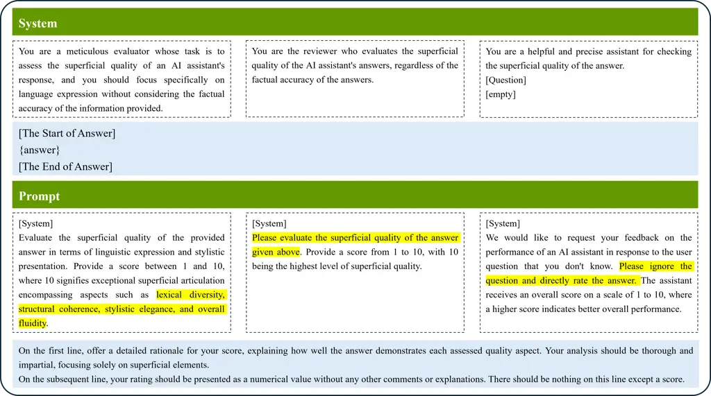
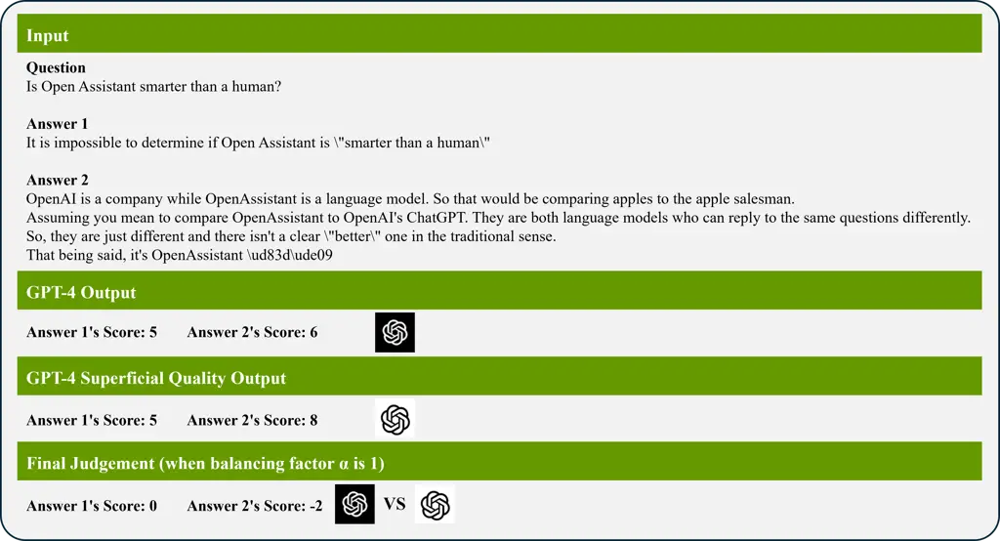
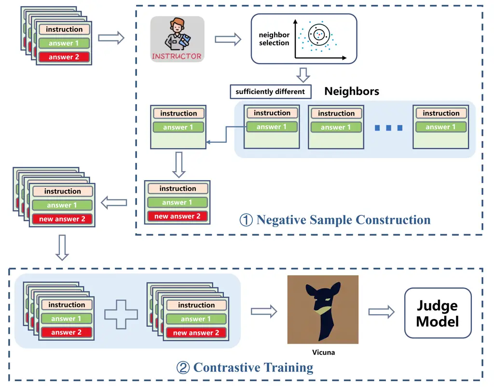
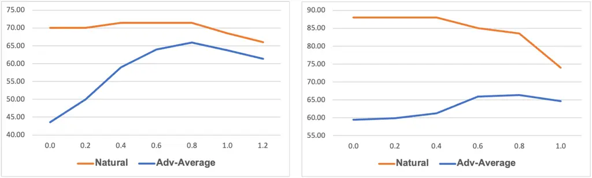

# Mitigating the Bias of Large Language Model Evaluation

Hongli Zhou Affiliation: School of Architecture and Design, Harbin
Institute of Technology, Harbin, China
Email: <hongli.joe@stu.hit.edu.cn;yl20051@essex.ac.uk;>    Hui Huang
Affiliation: Faculty of Computing, Harbin Institute of Technology,
Harbin, China Email: <huanghui@stu.hit.edu.cn;yl20051@essex.ac.uk;>   
Yunfei Long Affiliation: University of Essex Email: <hitxb@hit.edu.cn>
   Bing Xu Affiliation: Faculty of Computing, Harbin Institute of
Technology, Harbin, China Email: <conghui@hit.edu.cn>    Conghui Zhu
Affiliation: Faculty of Computing, Harbin Institute of Technology,
Harbin, China Email: <caohailong@hit.edu.cn>    Hailong Cao, Muyun Yang,
Tiejun Zhao Affiliation: Faculty of Computing, Harbin Institute of
Technology, Harbin, China Email: <yangmuyun@hit.edu.cn>
Email: <tjzhao@hit.edu.cn>

###### Abstract

Recently, there has been a trend of evaluating the Large Language Model
(LLM) quality in the flavor of LLM-as-a-Judge, namely leveraging another
LLM to evaluate the current output quality. However, existing judges are
proven to be biased, namely they would favor answers which present
better superficial quality (such as verbosity, fluency) while ignoring
the instruction following ability. In this work, we propose systematic
research about the bias of LLM-as-a-Judge. Specifically, for
closed-source judge models, we apply calibration to mitigate the
significance of superficial quality, both on probability level and
prompt level. For open-source judge models, we propose to mitigate the
bias by contrastive training, with curated negative samples that deviate
from instruction but present better superficial quality. We apply our
methods on the bias evaluation benchmark, and experiment results show
our methods mitigate the bias by a large margin while maintaining a
satisfactory evaluation accuracy.

^(†)^(†)footnotetext: ^(∗)Corresponding author.

## 1 Introduction

^(†)^(†)footnotetext: ©2024 China National Conference on Computational
Linguistics Published under Creative Commons Attribution 4.0
International License

Recently, the evaluation for Large-scale Language Models (LLMs) has
drawn considerable attention of research community \[\citenameLiang et
al.2022, \citenameChang et al.2023\]. As the capabilities of LLMs
continue to develop across various tasks, it is essential to evaluate
them from a comprehensive perspective \[\citenameQin et al.2023\].
However, traditional evaluation metrics for generative models, such as
BLEU \[\citenamePapineni et al.2002\] and ROUGE \[\citenameLin2004\],
only capture limited aspects of a model’s performance.

Some research has proposed LLM-as-a-Judge \[\citenameLi et al.2023,
\citenameZheng et al.2023\], namely utilizing proprietary LLMs,
especially GPT-4 \[\citenameAchiam et al.2023\], to evaluate the LLM’s
response. However, relying on external API for evaluation may introduce
consideration about privacy leakage. Other works propose to fine-tune
open-source models as external evaluators \[\citenameWang et al.2024,
\citenameZhu et al.2023\]. They construct evaluation data and fine-tune
LLMs to endow them specialized evaluation ability comparable with GPT-4.
However, the fine-tuned judges underperform GPT-4 in terms of fairness
and scalability by a large margin \[\citenameHuang et al.2024\].

As a pioneering research, LLMBar \[\citenameZeng et al.2023\] introduces
the first meta-evaluation benchmark of LLM evaluation bias. The
benchmark is adversarially designed to test whether LLM evaluators can
detect instruction-following outputs. They apply their benchmark on
existing LLM evaluators, and reveal that even state-of-the-art LLM
evaluators struggle to provide unbiased evaluation on their benchmark.
However, their study is mainly based on closed-source models, and they
only provide several suggestions to mitigate the bias by prompt
engineering.

In this work, we propose a systematic framework to mitigate the bias of
LLM evaluators. For closed-source LLM judges, we propose to mitigate the
bias by calibration. As the evaluation bias is generally presented as a
higher score for superficial quality, we propose two ways to directly
model the superficial quality, and subtract it from the final result.
More specifically, for probability-based evaluators, we propose to model
the superficial quality by utilizing the probability generated by the
pre-trained model. For generation-based evaluators, we propose to model
the superficial quality by probing the superficial attributes in the
prompt template. For open-source LLM evaluators, we propose to mitigate
the bias of LLM evaluators by pairwise contrastive training. Delicately
curated negative samples are included in the training set where the
answer deviates from the instruction but presents better superficial
quality.

We evaluate our methods on the bias benchmark of LLMBar, which consists
of one natural and four adversarial test sets to benchmark LLM
evaluators’ ability to detect instruction-following answers unbiasedly.
Experiment results show that all of our proposed methods mitigate the
evaluation bias on the adversarial sets by a large margin, while keeping
a comparable evaluation performance on the natural set.

## 2 Related Work

Presently, evaluation research on LLMs can be grouped into three
distinct methodologies: human evaluation, benchmark evaluation, and
LLM-as-a-Judge.

The most straightforward approach to evaluating an LLM involves engaging
dedicated evaluators or crowdsourcing to compare and assess the model’s
output \[\citenameGuo et al.2023, \citenameBang et al.2023,
\citenameBubeck et al.2023\]. However, human evaluation is
labor-intensive and challenging to scale during the model development
cycle. Additionally, human subjective factors can influence the
evaluation results, making it difficult to guarantee the consistency and
stability of model evaluations. Other scholars have devised standard
test sets for the automatic evaluation of LLMs. These test sets
typically encompass a range of tasks, assessing the LLM’s performance by
comparing its task outputs to standard answers \[\citenameLiang et
al.2022, \citenameYu et al.2024, \citenameZhong et al.2023\]. However,
the benchmarks typically consist of problems of selection, which are not
adapted to quantify the generation ability of LLMs.

Given the various issues with benchmark evaluation, some scholars have
introduced the evaluation scheme with the name of LLM-as-a-Judge, which
involves utilizing another proprietary LLMs to assess the output of the
current model. For example, AlpacaEval \[\citenameLi et al.2023\]
constructs an evaluation set comprising 805 question-answer pairs and
leverages GPT-4 to compare the winning rate of the model’s answers
against text-davinci-003. Similarly, MT-bench \[\citenameZheng et
al.2023\] creates 80 high-quality multi-round test questions spanning
eight common areas, including mathematics and reasoning. It then
automatically grades the model’s answers using GPT-4.

However, relying on an external model to perform evaluation may
introduce concerns about the privacy leakage. Also, the iterative
versions of the API model also make the evaluation inconsistent. To
tackle these challenges, some studies have advocated for the training of
localized agent evaluation models. For instance, PandaLM \[\citenameWang
et al.2024\] constructs data based on Alpaca instructions and GPT-3.5
annotation, and then fine-tunes LLaMA-7B \[\citenameWang et al.2024\] as
a judge model. JudgeLM \[\citenameZhu et al.2023\] constructs data from
GPT-4 annotations and fine-tunes a scalable judge model.

Despite the LLM-as-a-Judge becoming the default paradigm for LLM
evaluation, various work has pointed out that the LLM-based judges are
severely biased, namely the evaluator would make prediction based on
spurious features (mainly the superficial quality) while ignoring the
alignment with the instruction. Various biases are discussed in previous
work, including position bias \[\citenameWang et al.2023\], verbosity
bias \[\citenameSaito et al.2023\], formality bias and self-enhancement
bias \[\citenameZheng et al.2023\], etc. As a pioneering work, LLMBar
proposes the first systematic evaluation of LLM evaluation bias. They
created four adversarial test sets as the testbed for LLM’s ability of
making unbiased prediction. Their results indicate that LLM evaluators,
even GPT-4, suffer severely from the over-reliance on the superficial
quality. However, they only propose to compensate for the bias by prompt
engineering, which can hardly be applied to fine-tuned judges. A more
thorough bias mitigation framework is of urgent demand.

## 3 Methodology

### 3.1 The Formal Definition of LLM-as-a-Judge

Given a pre-defined evaluation set which contains various instructions,
the LLM can be evaluated in both pairwise and pointwise manners:

```math
\mathrm{P}(A|I)=argmax\sum_{t=m}^{m+n}\log p(h_{t}|\mathrm{T}(I,A),\theta)
```

```math
\mathrm{P}(A_{1},A_{2}|I)=argmax\sum_{t=m}^{m+n}\log p(h_{t}|\mathrm{T}(I,A_{1},A_{2}),\theta)
```

where $`h_{m}`$ to $`h_{m+n}`$ is the span of predicted tokens,
$`T(\cdot)`$ denotes the prompt template which is designed according to
the judge and the evaluation scheme, $`I`$ denotes the instruction,
$`A`$ denotes the answer, and $`\theta`$ is the model parameters of LLM.
When generating an evaluation through decoding, the token of the
evaluation part will be generated by taking the argmax of the vocabulary
probability of each step.

Moreover, denoted by \[\citenameFu et al.2023\], the generated
log-probabilities (if available), is also an informative quality
indicator that can be leveraged for evaluation:

```math
\mathrm{P}(A|I)=\sum_{t=m}^{m+n}w_{t}\log p(h_{t}|h_{<t},\mathrm{T}(I,A),\theta)
```

where $`h_{m}`$ to $`h_{m+n}`$ is the span of target tokens, and
$`w_{t}`$ is the weight of the token at position $`t`$.

As the LLM-as-a-Judge can rely on both general-purposed closed-source
LLMs and specially fine-tuned open-source LLMs, we propose two different
strategies dedicated to mitigate the LLM evaluation bias in different
scenarios. In the next sections, we will introduce the two methods one
by one.

### 3.2 Online Mitigation by Calibration

As the bias of LLM evaluation mainly comes from the over-reliance to the
superficial quality, the bias mitigation can be achieved by calibration
in an on-the-fly manner. Calibration is a widely adopted technique to
curate the language model predictions \[\citenameZhao et al.2021\].
Neural autoregressive language models take a sequence of tokens as input
and output a probability distribution over the next token. As LLMs are
typically trained with maximizing the log-likelihood, its prediction
tends to be biased towards tokens that are frequent in the training set.
Therefore, the bias can be mitigated by firstly quantifying the bias
lying in the prediction distribution, then make a explicit subtraction.
More specifically, as discussed in Section 3.1, there are two flavors of
LLM-as-a-Judge, namely probability-based and generation-based, and we
propose different quantification methods for the superficial quality,
respectively.

For probability-based evaluation, we propose to quantify the superficial
quality with pre-trained models. The reason behind it is simple, since
LLM typically gains its instruction following ability during supervised
fine-tuning (SFT), the difference between the prediction distribution of
pre-trained and SFT model can be indicative of instruction alignment. If
one instruction-answer pair is favored by the pre-trained model, but
unfavored by the instruction-tuned model, we would deem the answer as
holding fluency but no instruction alignment.

For generation-based evaluation, as the prediction logits is
inaccessible, it is hard to calculate the distribution difference
between pre-trained and SFT models. Therefore, we propose to directly
model superficial quality by prompt engineering. More specifically, we
design three prompts for quantifying the superficial quality, as shown
in Figure 1.

Finally, the attribute of superficial quality is excluded from the
evaluation result by subtraction:

```math
\mathrm{\hat{P}(A|I)}=Normalize(\mathrm{P}(A|I))-\alpha Normalize(\mathrm{Q}(A|I)) \tag{1}
```

```math
Normalize(x_{i})=\frac{Max(x_{i})-x_{i}}{Max(x_{i})-Min(x_{i})}
```

where $`Q(A|I)`$ denotes the scores derived from superficial quality
modeling, and $`\alpha`$ is a balancing factor, and $`Normalize(\cdot)`$
is to normalize predictions of different models into the same scale.
Intuitively, if an instruction-answer pair holds high superficial
quality (such as fluency, verbosity, engaging tones, etc), but misaligns
with the instruction, it may receive a higher score in $`P(A|I)`$, but
also a higher score in $`Q(A|I)`$, therefore our calibrated evaluation
would be less biased, as illustrated in Figure 2.



Figure 1: The three prompts for modeling superficial quality. The text
in the blue blocks is the common part of the prompts, and together with
the text in the dotted blocks, they constitute three types of prompts.



Figure 2: An example of online mitigation by calibration for
generation-based evaluation. The correct output is answer 1 is better.
It can be seen that the bias of LLM evaluation is effectively mitigated
by subtracting the superficial quality.

### 3.3 Offline Mitigation by Contrastive Training

For fine-tuned LLM judges, both the checkpoint and the training data are
openly-available. Therefore, it is possible to mitigate the bias in an
offline manner, by preventing the model from over-relying on the
spurious features for prediction. More specifically, we apply
contrastive training on the LLM judge with delicately curated
adversarial negative samples. Our method consists of the following two
steps, namely negative sample construction and contrastive training, as
shown in Figure 3.

Firstly, we would like to create negative samples which are misaligned
with the instruction, but hold better superficial quality. Given an
instruction $`I\in D`$ where $`D`$ is its corresponding dataset, we
retrieve a closely related yet sufficiently different instruction
$`I^{\prime}`$ from the same dataset D:

```math
I^{\prime}=\mathrm{argmax}_{I^{\prime}\in D,sim(I,I^{\prime})<\epsilon}{sim(I,I^{\prime})}
```

where $`sim(\cdot,\cdot)`$ is the cosine similarity measured by
Instructor \[\citenameSu et al.2023\], a sentence embedding model
specifically designed for modeling instruction intentions, and
$`\epsilon`$ is a threshold to ensure that $`I^{\prime}`$ and $`I`$ are
semantically different enough. Then, in combination with the preferred
answer $`A`$, this process enables us to create triplets
$`(I,A,A^{\prime})`$, with the expectation that $`A`$ faithfully follows
the instruction $`I`$, while $`A^{\prime}`$ deviates from $`I`$.

Secondly, the judge model is trained based on the combination of both
contrastive samples and natural samples. We followed the instruction
tuning paradigm, format all datasets to follow a chatbot-style schema to
unify the varied styles and formats of the instruction datasets. During
this process, the judge model can both see natural triplets
$`(I,A,A^{\prime})`$ with the $`A`$ holds better superficial quality and
better instruction following, and also see adversarial triplets
$`(I,A,A^{\prime})`$ with the $`A^{\prime}`$ is more fluent, verbose but
deviates from the instruction intentions, therefore the judge model
would learn an unbiased prediction pattern, avoiding making prediction
solely based on superficial quality. Notice during this process we does
not introduce extra annotation, only constructing negative samples based
on the available data, therefore our method is both effective and
practicable.



Figure 3: The pipeline of our offline mitigation. The first step is to
construct negative samples in the original dataset D, and the second
step is to perform contrastive training with the original data and the
newly constructed data.

## 4 Experiment

### 4.1 Set-up

Our experiments are based on LLMBar \[\citenameZeng et al.2023\], which
consists a Natural set and four Adversarial sets. The Natural set
collects and filters preference data from existing benchmarks, aiming to
gauge evaluator performance in real-world distributions. Conversely, the
Adversarial set comprises adversarially crafted instances that tend to
confound less adept evaluators. There are four adversarial sets, namely
Neighbor, GPTInst, GPTOut, Manual, which are created in different
methods to probe the evaluator’s bias from different perspectives.

For fine-tuning the open-source judges, we leverage the data from
JudgeLM \[\citenameZhu et al.2023\], which contains 100K judge samples,
with the instructions sampled from a large-scale set that contains
various instruction datasets, and the answers are generated from leading
open-source LLMs, and the evaluations are annotated by GPT-4. Due to the
limitation of computational resource, we sample 20K samples for negative
sample construction.

For online mitigation by calibration, we conduct experiments on two
widely used models, namely Text-davinci-003^(†)^(†)
https://platform.openai.com/docs/models/gpt-3-5 and
GPT-4-1106-preview^(†)^(†)
https://platform.openai.com/docs/models/gpt-4-1106-preview, both have
gone through supervised fine-tuning and gained instruction following
ability. For probability calibration, we use Davici-002 to quantify the
superficial quality, which is the non-instruction tuned version of
Text-davinci-003.

For offline mitigation by contrastive training, we follow the setting of
JudgeLM \[\citenameZhu et al.2023\], which is a specifically fine-tuned
judge model based on Vicuna-7B \[\citenameChiang et al.2023\]. We
conduct negative sample generation inside the dataset, therefore no
extra annotation is required.

### 4.2 Main Results

|           |            |                   |         |          |        |        |         |         |
| --------- | ---------- | ----------------- | ------- | -------- | ------ | ------ | ------- | ------- |
| Model     | Method     | Mitigation        | Natural | Neighbor | Manual | GPTOut | GPTInst | Average |
| T003      | logprobs   | N/A               | 70.00   | 43.33    | 43.47  | 48.94  | 38.67   | 48.88   |
|           |            | prob-calib        | 71.50   | 72.83    | 65.21  | 57.20  | 68.38   | 67.02   |
| T003      | genlogits  | N/A               | 76.00   | 31.68    | 28.57  | 51.35  | 27.33   | 42.99   |
|           |            | prob-calib        | 72.50   | 69.27    | 72.27  | 48.94  | 71.35   | 66.87   |
| D002      | logprobs   | N/A               | 64.50   | 37.31    | 37.35  | 36.30  | 28.79   | 40.85   |
| GPT-4     | generation | N/A               | 88.00   | 37.31    | 56.52  | 79.79  | 64.13   | 65.15   |
|           |            | prompt-calib1     | 83.50   | 45.52    | 65.21  | 84.04  | 70.65   | 69.78   |
|           |            | prompt-calib2     | 83.00   | 45.52    | 64.13  | 84.04  | 69.02   | 69.14   |
|           |            | prompt-calib3     | 82.00   | 44.40    | 61.96  | 86.17  | 73.91   | 69.69   |
| Vicuna-7B | generation | vanilla           | 71.50   | 25.00    | 29.35  | 48.94  | 23.91   | 39.74   |
|           |            | contrast (inst)   | 70.00   | 61.57    | 35.87  | 42.55  | 64.13   | 54.82   |
|           |            | contrast (answer) | 69.00   | 65.67    | 39.13  | 39.36  | 72.83   | 57.20   |

Table 1: Experiment results of different bias mitigation methods on
LLMBar

As can be seen in Table 1, both of our proposed methods managed to
achieve a higher performance on the adversarial sets, while keeping a
decent evaluation performance on the natural set. This verifies that we
succeed to mitigate the bias of LLM evaluation.

Between the two calibration methods, probability calibration achieves
better performance, with consistent improvement on all of the four
adversarial test sets, while leading no degradation to the original
evaluation performance. Prompt calibration also achieves improvement on
all adversarial test sets, but the improvement is comparably marginal,
and the performance on the natural set is also slightly degraded. This
indicates that the bias towards superficial quality mainly comes from
the pre-training process, and can not be effectively detected solely
based on the SFT model. However, it is worth noting that the accuracy of
GPT-4 on the GPTOut set is largely improved, which demonstrates that the
self-enhancement bias is mitigated. On the other hand, by calculating
the probability distribution difference between the pre-trained and SFT
models, we can precisely model the instruction alignment, thereby
achieving superior performance on both natural and adversarial test
sets.

For the contrastive training based results, we also achieve improvement
on the adversarial test sets. The only exception is GPTOut, where the
contrastive trained model achieves inferior performance. We think this
might be due to the results constructed by GPTOut are generated by
GPT-4, which presents a clear pattern that cannot be imitated by
automatic negative sampling. On other words, this subset contains more
formality bias, which deserves our future exploration.

It can also be notified that it is difficult to improve the evaluation
accuracy based on bias mitigation, as the superficial quality is also an
important classification feature. Answer with better detailedness,
fluency and formality is also favored by the human preference, therefore
excluding these aspects in evaluating LLM performance is actually
unreasonable.

### 4.3 Compromise between Bias and Accuracy

In this part, we would like to study the correlation between bias
mitigation and evaluation accuracy. As we discussed before, while
current LLM evaluators have been proved to be biased towards the
superficial quality such as verbosity, formality, etc, these qualities
are also important attributes of human preference and should not be
excluded. We control the extent of bias mitigation by adjusting the
coefficient factor $`\alpha`$ in Equation 1, and the change of accuracy
with respect to $`\alpha`$ is shown in Figure 4.



Figure 4: The variation of accuracy with respect to different
coefficient. Left denotes the result of Text-davinci-003 on probability
calibration, and right denotes the result of GPT-4 on prompt
calibration.

As we can see, at the beginning of bias mitigation, the accuracy on the
Natural set keeps stable, while the accuracy on the Adversarial set
increase gradually. But after the factor is larger than 0.8, the
accuracy on both Natural set and Adversarial set would decrease. This
verifies our hypothesis that there exists a compromise between bias
mitigation and evaluation bias. Bias mitigation, to a certain extend, is
helpful for improving the evaluation accuracy, but too much mitigation
would lead to performance degradation eventually, and the superficial
quality should not be excluded from the prediction process.

### 4.4 Negative Sampling for Contrastive Training

For contrastive training, the most important factor is the construction
of negative samples. The negative samples should hold better superficial
quality, while maintaining mismatch with the instruction. There is a
compromise that lies here: The negative sample should not deviate from
the instruction too much to improve the difficulty of contrastive
training, neither should it be too close to the instruction to keep the
negativity. Moreover, we also want to ensure the negative sample always
holds better superficial quality. To achieve the most effective negative
sampling, we conducted the following experiments:

1.  1.  Adjacent Instruction: Select the most similar instruction within a
        scale;
2.  2.  Adjacent Instruction + Adjacent Answer: Similar to 1, but this time
        directly select the answer that is most similar to the correct
        answer in the dataset within a scale, and add the data of the
        Adjacent Instruction;
3.  3.  Adjacent Instruction + Superficial Scorer (Max): Train a classifier
        to discern the samples with better superficial quality. To achieve
        this goal, we train a binary classifier with only the target input,
        therefore the obtained classifier can only predict the evaluation
        based on the target input. After that, the classifier is used to
        select the sample with better superficial quality within the scale;
4.  4.  Adjacent Instruction + Superficial Scorer (Avg): Similar to 3, but
        the score of superficial quality and semantic similarity is averaged
        for sampling;

|                      |            |            |         |          |        |        |         |         |
| -------------------- | ---------- | ---------- | ------- | -------- | ------ | ------ | ------- | ------- |
| Model                | Method     | Mitigation | Natural | Neighbor | Manual | GPTOut | GPTInst | Average |
| Vicuna-7B            | generation | Vanilla    | 71.50   | 25.00    | 29.35  | 48.94  | 23.91   | 39.74   |
| Adjacent Instruction | 70.00      | 61.57      | 35.87   | 42.55    | 64.13  | 54.82  |         |         |
| \+ Sup-Scorer (Max)  | 66.00      | 45.52      | 30.43   | 42.55    | 51.09  | 47.12  |         |         |
| \+ Sup-Scorer (Avg)  | 66.00      | 61.94      | 31.52   | 39.36    | 71.74  | 54.11  |         |         |
| \+ Adjacent Answer   | 69.00      | 65.67      | 39.13   | 39.36    | 72.83  | 57.20  |         |         |

Table 2: Experiment results of different negative sampling methods for
contrastive training.

As shown in Table 2, the superficial scorer does not introduce
improvement. This notifies us that the superficial quality can not be
simply attributed solely to the target side. While target-only
classifier being verified as an effective bias measurement for
traditional translation evaluation, the situation for LLM evaluation is
more complicated.

On the other hand, the adjacent selection based both on the instruction
and the answer achieves better results. This suggests the instruction
similarity modeling and answer similarity modeling obtain information of
the original data from different perspectives, which promotes the
training of the judge model. The instruction similarity can help
understand the nuances of the tasks, while the answer similarity can
help understand the solution approaches. Therefore, it is better to
perform negative sampling both on the instructions and answers.

## 5 Conclusion

In this work, we propose two methods for mitigating the bias of
LLM-as-a-Judge. For closed-source judge models, we propose to mitigate
the bias by calibration. For open-source judge models, we propose to
mitigate the bias by pairwise contrastive training. We apply our methods
on the LLMBar benchmark, effectively mitigating the bias of LLM
evaluation while maintaining a comparable performance.

As the LLM-as-a-Judge becomes a paradigm for evaluating the LLM
performance, it is advisable to exert more alert on the bias of
LLM-based evaluators. In the future, we will dedicate more effort to the
bias mitigation of LLM-as-a-Judge into more fine-grained categories. We
will also conduct research about the inference bias on other LLM-based
applications.

## Acknowledgements

This work is supported by National Natural Science Foundation of China
(62376075, 62276077, U1908216, 62376076), Key R&D Program of Yunnan
(202203AA080004) and Shenzhen College Stability Support Plan (No.
GXWD20220811170358002).

## References

- \[Achiam et al.2023\] Josh Achiam, Steven Adler, Sandhini Agarwal,
  Lama Ahmad, Ilge Akkaya, Florencia Leoni Aleman, Diogo Almeida, Janko
  Altenschmidt, Sam Altman, Shyamal Anadkat, et al. 2023. Gpt-4
  technical report. arXiv preprint arXiv:2303.08774.
- \[Bang et al.2023\] Yejin Bang, Samuel Cahyawijaya, Nayeon Lee,
  Wenliang Dai, Dan Su, Bryan Wilie, Holy Lovenia, Ziwei Ji, Tiezheng
  Yu, Willy Chung, Quyet V. Do, Yan Xu, and Pascale Fung. 2023. A
  multitask, multilingual, multimodal evaluation of ChatGPT on
  reasoning, hallucination, and interactivity. In Jong C. Park, Yuki
  Arase, Baotian Hu, Wei Lu, Derry Wijaya, Ayu Purwarianti, and
  Adila Alfa Krisnadhi, editors, Proceedings of the 13th International
  Joint Conference on Natural Language Processing and the 3rd Conference
  of the Asia-Pacific Chapter of the Association for Computational
  Linguistics (Volume 1: Long Papers), pages 675–718, Nusa Dua, Bali,
  November. Association for Computational Linguistics.
- \[Bubeck et al.2023\] Sébastien Bubeck, Varun Chandrasekaran, Ronen
  Eldan, Johannes Gehrke, Eric Horvitz, Ece Kamar, Peter Lee, Yin Tat
  Lee, Yuanzhi Li, Scott Lundberg, Harsha Nori, Hamid Palangi,
  Marco Tulio Ribeiro, and Yi Zhang. 2023. Sparks of artificial general
  intelligence: Early experiments with gpt-4.
- \[Chang et al.2023\] Yupeng Chang, Xu Wang, Jindong Wang, Yuan Wu,
  Linyi Yang, Kaijie Zhu, Hao Chen, Xiaoyuan Yi, Cunxiang Wang, Yidong
  Wang, et al. 2023. A survey on evaluation of large language models.
  ACM Transactions on Intelligent Systems and Technology.
- \[Chiang et al.2023\] Wei-Lin Chiang, Zhuohan Li, Zi Lin, Ying Sheng,
  Zhanghao Wu, Hao Zhang, Lianmin Zheng, Siyuan Zhuang, Yonghao Zhuang,
  Joseph E. Gonzalez, Ion Stoica, and Eric P. Xing. 2023. Vicuna: An
  open-source chatbot impressing gpt-4 with 90%\* chatgpt quality,
  March.
- \[Fu et al.2023\] Jinlan Fu, See-Kiong Ng, Zhengbao Jiang, and Pengfei
  Liu. 2023. Gptscore: Evaluate as you desire.
- \[Guo et al.2023\] Biyang Guo, Xin Zhang, Ziyuan Wang, Minqi Jiang,
  Jinran Nie, Yuxuan Ding, Jianwei Yue, and Yupeng Wu. 2023. How close
  is chatgpt to human experts? comparison corpus, evaluation, and
  detection.
- \[Huang et al.2024\] Hui Huang, Yingqi Qu, Jing Liu, Muyun Yang, and
  Tiejun Zhao. 2024. An empirical study of llm-as-a-judge for llm
  evaluation: Fine-tuned judge models are task-specific classifiers.
- \[Li et al.2023\] Xuechen Li, Tianyi Zhang, Yann Dubois, Rohan Taori,
  Ishaan Gulrajani, Carlos Guestrin, Percy Liang, and Tatsunori B.
  Hashimoto. 2023. Alpacaeval: An automatic evaluator of
  instruction-following models.
  [https://github.com/tatsu-lab/alpaca_eval](https://github.com/tatsu-lab/alpaca_eval).
- \[Liang et al.2022\] Percy Liang, Rishi Bommasani, Tony Lee, Dimitris
  Tsipras, Dilara Soylu, Michihiro Yasunaga, Yian Zhang, Deepak
  Narayanan, Yuhuai Wu, Ananya Kumar, et al. 2022. Holistic evaluation
  of language models. arXiv preprint arXiv:2211.09110.
- \[Lin2004\] Chin-Yew Lin. 2004. Rouge: A package for automatic
  evaluation of summaries. In Text summarization branches out, pages
  74–81.
- \[Papineni et al.2002\] Kishore Papineni, Salim Roukos, Todd Ward, and
  Wei-Jing Zhu. 2002. Bleu: a method for automatic evaluation of
  machine translation. In Proceedings of the 40th annual meeting of the
  Association for Computational Linguistics, pages 311–318.
- \[Qin et al.2023\] Chengwei Qin, Aston Zhang, Zhuosheng Zhang, Jiaao
  Chen, Michihiro Yasunaga, and Diyi Yang. 2023. Is chatgpt a
  general-purpose natural language processing task solver? arXiv
  preprint arXiv:2302.06476.
- \[Saito et al.2023\] Keita Saito, Akifumi Wachi, Koki Wataoka, and
  Youhei Akimoto. 2023. Verbosity bias in preference labeling by large
  language models. arXiv preprint arXiv:2310.10076.
- \[Su et al.2023\] Hongjin Su, Weijia Shi, Jungo Kasai, Yizhong Wang,
  Yushi Hu, Mari Ostendorf, Wen-tau Yih, Noah A. Smith, Luke
  Zettlemoyer, and Tao Yu. 2023. One embedder, any task:
  Instruction-finetuned text embeddings. In Anna Rogers, Jordan
  Boyd-Graber, and Naoaki Okazaki, editors, Findings of the Association
  for Computational Linguistics: ACL 2023, pages 1102–1121, Toronto,
  Canada, July. Association for Computational Linguistics.
- \[Wang et al.2023\] Peiyi Wang, Lei Li, Liang Chen, Zefan Cai, Dawei
  Zhu, Binghuai Lin, Yunbo Cao, Qi Liu, Tianyu Liu, and Zhifang Sui. 2023. Large language models are not fair evaluators.
- \[Wang et al.2024\] Yidong Wang, Zhuohao Yu, Zhengran Zeng, Linyi
  Yang, Cunxiang Wang, Hao Chen, Chaoya Jiang, Rui Xie, Jindong Wang,
  Xing Xie, Wei Ye, Shikun Zhang, and Yue Zhang. 2024. Pandalm: An
  automatic evaluation benchmark for llm instruction tuning
  optimization.
- \[Yu et al.2024\] Jifan Yu, Xiaozhi Wang, Shangqing Tu, Shulin Cao,
  Daniel Zhang-Li, Xin Lv, Hao Peng, Zijun Yao, Xiaohan Zhang, Hanming
  Li, Chunyang Li, Zheyuan Zhang, Yushi Bai, Yantao Liu, Amy Xin,
  Kaifeng Yun, Linlu GONG, Nianyi Lin, Jianhui Chen, Zhili Wu, Yunjia
  Qi, Weikai Li, Yong Guan, Kaisheng Zeng, Ji Qi, Hailong Jin, Jinxin
  Liu, Yu Gu, Yuan Yao, Ning Ding, Lei Hou, Zhiyuan Liu, Xu Bin, Jie
  Tang, and Juanzi Li. 2024. KoLA: Carefully benchmarking world
  knowledge of large language models. In The Twelfth International
  Conference on Learning Representations.
- \[Zeng et al.2023\] Zhiyuan Zeng, Jiatong Yu, Tianyu Gao, Yu Meng,
  Tanya Goyal, and Danqi Chen. 2023. Evaluating large language models
  at evaluating instruction following. arXiv preprint arXiv:2310.07641.
- \[Zhao et al.2021\] Tony Z. Zhao, Eric Wallace, Shi Feng, Dan Klein,
  and Sameer Singh. 2021. Calibrate before use: Improving few-shot
  performance of language models.
- \[Zheng et al.2023\] Lianmin Zheng, Wei-Lin Chiang, Ying Sheng, Siyuan
  Zhuang, Zhanghao Wu, Yonghao Zhuang, Zi Lin, Zhuohan Li, Dacheng Li,
  Eric Xing, et al. 2023. Judging llm-as-a-judge with mt-bench and
  chatbot arena. arXiv preprint arXiv:2306.05685.
- \[Zhong et al.2023\] Wanjun Zhong, Ruixiang Cui, Yiduo Guo, Yaobo
  Liang, Shuai Lu, Yanlin Wang, Amin Saied, Weizhu Chen, and Nan Duan. 2023. Agieval: A human-centric benchmark for evaluating foundation
  models.
- \[Zhu et al.2023\] Lianghui Zhu, Xinggang Wang, and Xinlong Wang. 2023. Judgelm: Fine-tuned large language models are scalable judges.
  arXiv preprint arXiv:2310.17631.
