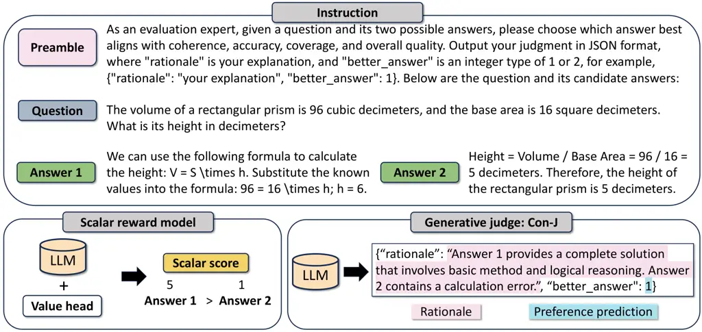
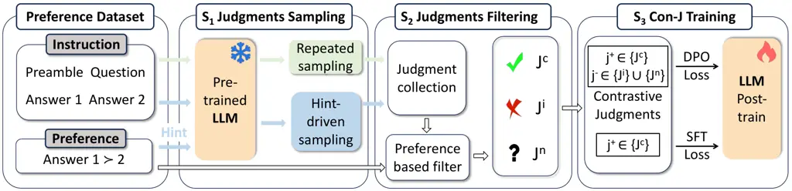
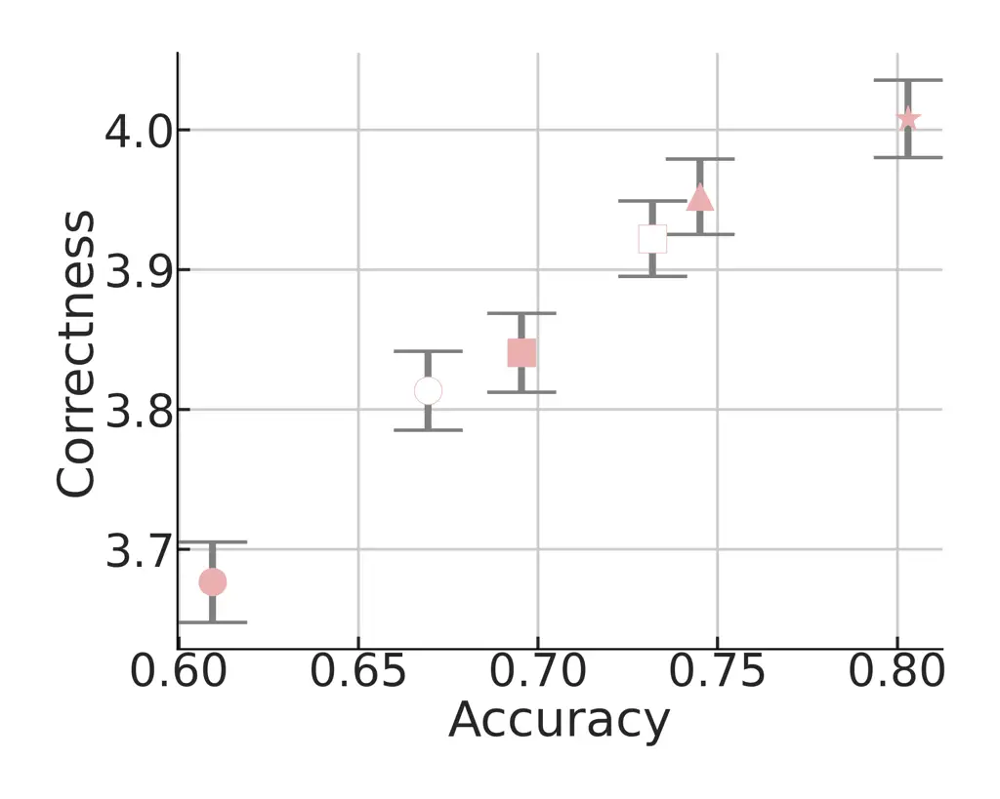
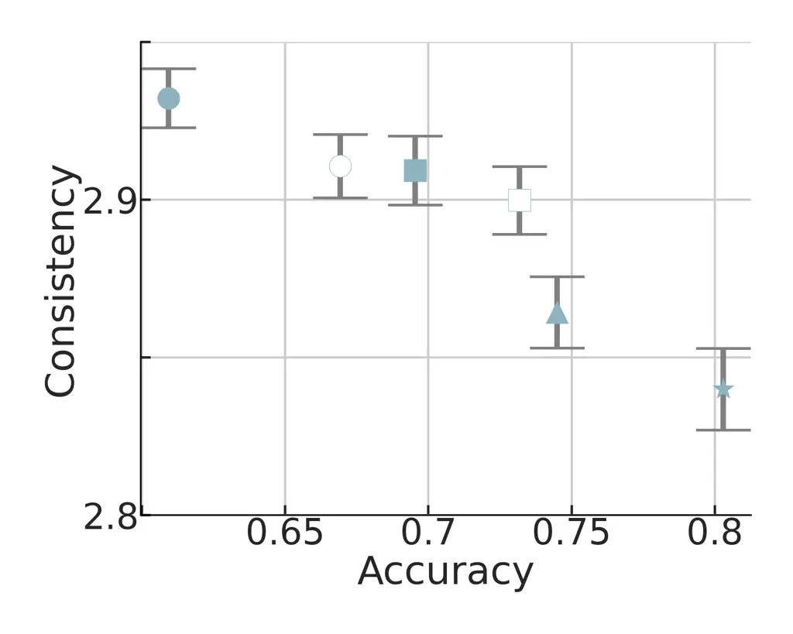
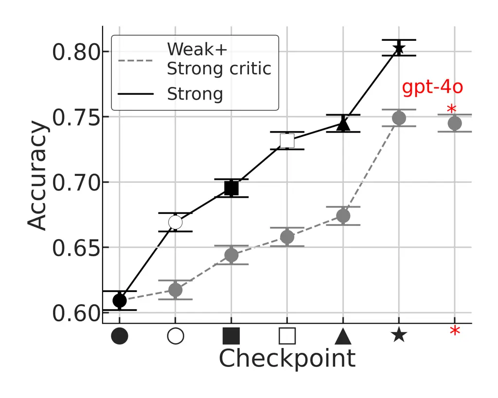
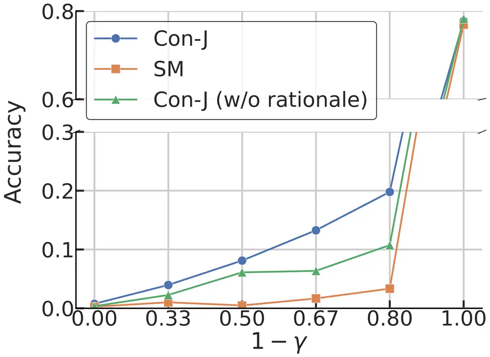
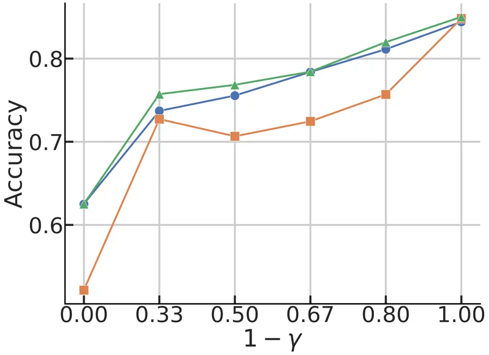
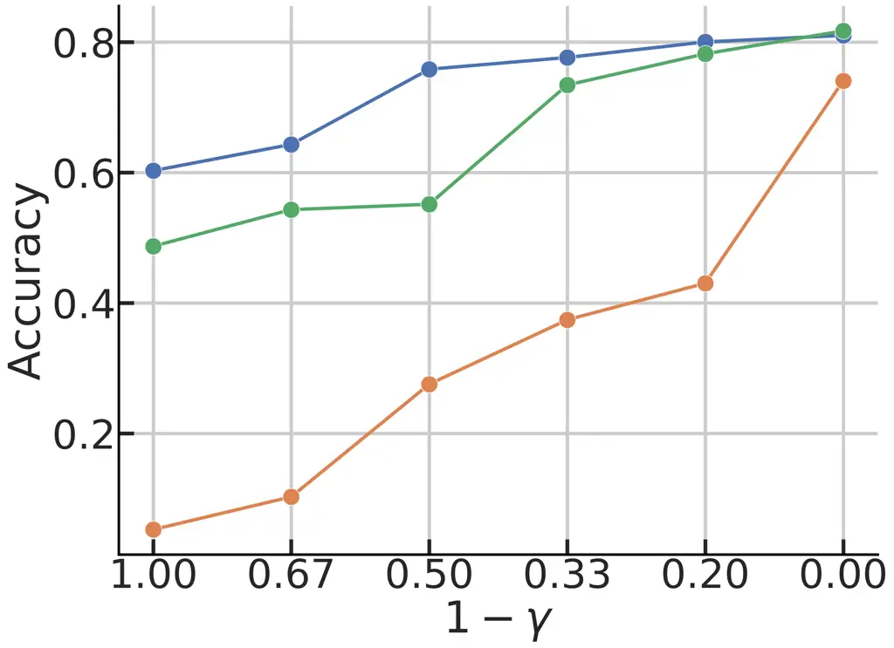
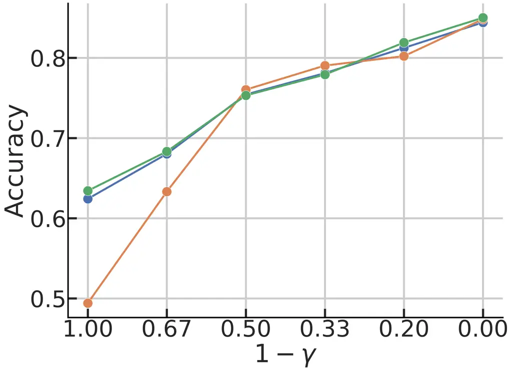

# Beyond Scalar Reward Model: Learning Generative Judge from Preference Data

Ziyi Ye Affiliation: Department of Computer Science and Technology,
Tsinghua University Email: <ye-zy20@mails.tsinghua.edu.cn>    Xiangsheng
Li Affiliation: Baichuan AI   Email: <lixsh6@gmail.com>    Qiuchi Li
Affiliation: University of Copenhagen Email: <qiuchi.li@di.ku.dk>   
Qingyao Ai Affiliation: Department of Computer Science and Technology,
Tsinghua University Email: <aiqy@tsinghua.edu.cn>    Yujia Zhou
Affiliation: Department of Computer Science and Technology, Tsinghua
University Email: <zhouyujia@mail.tsinghua.edu.cn>    Wei Shen
Affiliation: Baichuan AI   Email: <weyshioncn@gmail.com>    Dong Yan
Affiliation: Baichuan AI   Email: <sproblvem@gmail.com>    Yiqun Liu
Affiliation: Department of Computer Science and Technology, Tsinghua
University Email: <yiqunliu@tsinghua.edu.cn>

###### Abstract

Learning from preference feedback is a common practice for aligning
large language models (LLMs) with human value. Conventionally,
preference data is learned and encoded into a scalar reward model that
connects a value head with an LLM to produce a scalar score as
preference or reward. However, scalar models lack interpretability and
are known to be susceptible to biases in datasets. This paper
investigates leveraging the generation capability of LLMs to address
both limitations in one shot. Specifically, we prompt the pre-trained
LLM to generate positive and negative judgments, both supported with
rationales in natural language form. The self-generated contrastive
judgment pairs are used to train the generative judge with Direct
Preference Optimization (DPO). This proposal of training the generative
Judge using self-generated Contrastive judgments (Con-J) ensures natural
interpretability due to the generated rationales together with the
judgments, as well as high robustness against bias without the need for
an additional reward head. Experimental results show that the
performance of Con-J is comparable to the scalar reward model trained on
the same collection of preference data, and demonstrate its superior
interpretability and robustness in encoding human preferences.

|     |
| --- |
|     |

## 1 Introduction

As AI (AI) systems advance with the emergence of LLM, it is crucial to
ensure they align with human instructions, values, and ethics. LLM
alignment is generally achieved by learning from preference data that
compares pairs of responses to a question (Rafailov et al., 2024;
Christiano et al., 2017; Liu et al., 2020). However, collecting
high-quality human preference data is both time-consuming and costly. In
practice, the construction of preference datasets often involves scaling
with a combination of human and AI-generated feedback Lee et al. (2023);
Hou et al. (2024). An additional advantage of AI feedback is its ability
to be incorporated in real-time, which facilitates online algorithms
such as iterative-DPO Xiong et al. (2024); Xu et al. (2023) and
online-DPO Guo et al. (2024). Therefore, it is crucial to develop an
efficient and accurate AI-based preference model that aligns with human
values.



Figure 1: Top: Examples of a preamble, a question, a pair of answers,
and the corresponding judgment (see the detailed version in Table 5).
Bottom: Illustrations of a scalar reward model and the proposed Con-J
for preference judgment.

To obtain such preferences, industrial practices have used scalar models
Hou et al. (2024) that concatenate the pre-trained LLM with a value head
to generate scalar scores for the responses. However, the scalar model
suffers from limitations, particularly in the following aspects: (i)
Lack of interpretability: Beyond scalar scores, additional rationales
are crucial to enhance the reliability of judgments and facilitate human
involvement in the evaluation loop. (ii) Susceptibility to bias: It is
prone to capturing the biases present in the preference dataset rather
than human values. For example, when the majority of positive answers in
preference datasets are longer sentences, the learned LLM will likely
favor more verbose answers (Huang et al., 2024).

To address the above limitations, we propose Con-J, which trains a
generative Judge using its self-generated Contrastive judgments (see
Figure 1). Con-J leverages the LLM’s pre-existing judgment
abilities Zelikman et al. (2022) and bootstraps its capacity to generate
more accurate judgments. As shown in Figure 2, Con-J consists of three
steps: (Judgment Sampling) Sample several judgments from a pre-trained
LLM by prompting it with a query and a pair of candidate answers.
(Judgment Filtering) Leverage the true preference annotations to
construct contrastive judgment pairs, i.e., judgments with correct or
incorrect preference. (Training) Train Con-J from the pre-trained LLM
based on these contrastive judgments using Direct Preference
Optimization (DPO).

The design of Con-J differs from existing methods for enhancing the
capabilities of generative judges (or LLM-as-a-judge) (Li et al., 2023;
Kim et al., 2024; Park et al., 2024). These methods typically depend on
external models (particularly GPT-4) or algorithmic schemes to produce
high-quality instruction-tuning datasets. In contrast, Con-J directly
learns from preference data using a self-bootstrapping approach similar
to that of scalar reward models. As LLMs become more powerful, aligning
them with high-quality judgments becomes more difficult since humans may
not always be able to write superior judgments. Instead, Con-J offers a
new way by eliciting what the LLM already knows, supervised by human
preferences, which are much easier to obtain than high-quality
judgments.

We train and evaluate Con-J on self-built commercial datasets across
three domains: Text Creation, Math, and Code and a series of publicly
available datasets and benchmarks. Our findings indicate that Con-J not
only significantly outperforms the scalar model in the Text Creation
task and achieves comparable performance in Math and Code but also that
its performance, when trained on domain-specific data, will
significantly surpass that of GPT-4o. Additionally, Con-J trained on
publicly available datasets achieves comparable performance with GPT-4o
and surpasses a series of existing open-source models. As a generative
judge, Con-J can generate rationales to support its preference
prediction. We evaluate the correctness of these rationales and find
that as the accuracy of preference predictions improves, the correctness
of the rationales also increases. Additionally, in a synthetic
experiment, we found that Con-J is less susceptible to dataset biases,
which we attribute to its generative training target and its feature to
generate rationales simultaneously. To facilitate further research and
development within the community, We release the training process and
model weights of Con-J trained on publicly available datasets at
[https://huggingface.co/ZiyiYe/Con-J-Qwen2-7B](https://huggingface.co/ZiyiYe/Con-J-Qwen2-7B).

To summarize, our contributions are:

1.  1.  We propose Con-J, an approach that trains a generative judge using a
        self-bootstrapped technology to learn from preference data.
2.  2.  We show that Con-J can offer more accurate rationales during
        preference learning. We also provide theoretical motivation and
        empirical evidence showing that Con-J can be more robust to dataset
        biases by training with rationales.
3.  3.  We test the performance of Con-J in commercial datasets and publicly
        available benchmarks. Con-J outperforms the scalar models and a
        series of existing generative judges.

## 2 Preliminary

### 2.1 Task definition

Given a question or prompt $`q`$ and a pair of assistant responses
$`a^{1}`$ and $`a^{2}`$, the task is to judge the preference between
$`a^{1}`$ and $`a^{2}`$. To accomplish this, we train the model using an
existing preference dataset $`D=\{(q,a^{-},a^{+})_{i}\}_{i=1}^{N}`$,
where $`a^{+}`$ is a preferred answer compared to $`a^{-}`$. The model’s
performance is subsequently evaluated on a separate, non-overlapping
preference dataset by measuring the accuracy of its preference
judgments.

### 2.2 Scalar Model

The most common practice for getting the preference judgment is to use a
scalar model (SM) similar to the reward model in the RLHF stage (Hou
et al. (2024)). The SM predicts numerical scores $`r(q,a)`$ for
$`a\in\{a^{1},a^{2}\}`$ and judges the preference by comparing
$`r(q,a^{1})`$ and $`r(q,a^{2})`$. It is typically initialized by
concatenating a pre-trained LLM with a randomly initialized shallow MLP
head. The most widely used training objective for the SM follows the
Bradley-Terry model, which maximizes the probability of $`a^{+}`$ being
preferred:

```math
P(a^{+}\succ a^{-}|q)=\frac{\exp(r(q,a^{+}))}{\exp(r(q,a^{+}))+\exp(r(q,a^{-}))}=\sigma\big(r(q,a^{+})-r(q,a^{-})\big) \tag{1}
```

where $`\sigma`$ is the sigmoid function.

The above-mentioned SM utilizes the prompt $`q`$ and a single answer
$`a`$ as input, which we denote as a pointwise SM. In addition, existing
research has investigated a pairwise variant that uses a pair of
candidates as input, i.e., $`r(q,a^{1},a^{2})`$ (Jiang et al., 2023).
The pairwise vanilla reward formalizes the preference probability of
$`a^{+}`$ as:

```math
P(a^{+}\succ a^{-}|q)=\sigma(r(q,a^{+},a^{-})). \tag{2}
```

To train the above-mentioned pointwise and pairwise SM $`r`$, we
maximize the log-likelihood of the preferences by minimizing the
following loss function:

```math
\ell_{R}(r)=-\sum_{(x,a^{+},a^{-})}\log p_{r}(a^{+}\succ a^{-}\mid x)=\begin{cases}-\sum_{(x,a^{+},a^{-})}\log\sigma(r(x,a^{+})-r(x,a^{-}))&\text{(pointwise)}\\
-\sum_{(x,a^{+},a^{-})}\log\sigma(r(x,a^{+},a^{-}))&\text{(pairwise)}\end{cases} \tag{3}
```

## 3 Improving Generative Judge by Training on Contrastive Judgments



Figure 2: The steps for constructing Con-J with a preference dataset
that includes preference annotations for a pair of answers to a
question. $`S_{1}`$: Prompt Con-J to generate multiple judgments for a
pair of answers by repeated sampling and hint-driven sampling.
$`S_{2}`$: Bootstrap contrastive judgment pairs by filtering with true
preference labels. A contrastive judgment pair consists of one judgment
with the correct preference and the other either with an incorrect
preference or does not explicitly indicate a preference. $`S_{3}`$:
Train Con-J using the DPO loss on contrastive judgments and the SFT loss
on positive judgments.

Instead of using a scalar model for preference judgment, we propose to
leverage the LLM itself to make preference judgments (Guo et al. (2024);
Lee et al. (2023)). Given the question $`q`$ and a pair of answers
$`a^{1}`$ and $`a^{2}`$, we construct a prompt $`p`$ by concatenating a
preamble with $`q`$, $`a^{1}`$, and $`a^{2}`$. The preamble is an
instruction that describes the task and asks an LLM $`\pi`$ to act as a
judge (see examples in Fig. 2 and Appendix 5). Then the LLM generates
natural language judgments $`j=\pi(p)`$, which contains the judgment as
well as the rationale in a JSON style: a key named "rationale" includes
a step-by-step explanation and verification of the answers, and another
key named "better_answer" indicates the LLM’s binary judgment.

As shown in Figure 2, the construction of Con-J consists of three steps:
judgment sampling, judgment filtering, and Con-J training.

Judgment sampling: We construct contrastive judgment pairs by prompting
the LLM to generate multiple judgments. As shown in Figure 2, this is
achieved by (1) repeated sampling and (2) hint-driven sampling.

Repeated sampling prompts the LLM to generate multiple outputs from the
same prompt, each utilizing a different random seed during the
generation process. However, the LLM may produce only one-sided
judgments (i.e., all judgments preferred $`a^{1}`$ or $`a^{2}`$) across
all repeated samples. In such cases, we cannot construct contrastive
judgment pairs with repeated sampling. Therefore, we propose hint-driven
sampling to compel the LLM to generate judgments that favor specific
answers. Essentially, the LLM is provided with an explicit indication of
which answer is better, and is instructed to generate the judgment
accordingly in the same JSON format as above. The prompt template for
hint-driven sampling is provided in Table 6. By manipulating the hint,
we can get a contrastive judgment pair for any prompt input.

Judgment filtering: We denote the outputs from repeating sampling as
$`M(p)`$. $`M(p)`$ can potentially include both “positive” and
“negative” judgments. A positive judgment indicates the judgment
corresponding to the keyword "better_answer" is correct ($`j^{+}`$),
while a negative judgment ($`j^{-}`$) indicates the judgment is
incorrect ($`j^{i}`$) or the model doesn’t explicitly indicate its
preference ($`j^{n}`$). Contrastive judgment pairs $`\{(j^{+},j^{-})\}`$
are hence constructed as the direct product of the positive judgment set
$`M(p)^{+}`$ and negative judgment set $`M(p)^{-}`$. We set the number
of repeated samplings to 8, allowing for the construction of up to 4
pairs (in the optimal case, there exist 4 positive and 4 negative
judgments among the 8). For hint-driven sampling, we prompt the LLM with
one correct and one incorrect hint and construct one pair from them. The
detailed sampling and filtering process is outlined in Algorithm 1.

Con-J training: Based on the constructed judgment pairs
$`D^{J}=\{(q,a^{+},a^{-},j^{+},j^{-})_{i}\}_{i=1}^{K}`$, we train the
LLM $`\pi`$ with a DPO (DPO) loss function:

```math
\ell^{\text{DPO}}=-\sum_{(p,j^{+},j^{-})}\log\sigma\left[\eta\log\frac{\pi({j}^{+}|p)}{\pi_{0}({j}^{+}|p)}-\eta\log\frac{\pi({j}^{-}|p)}{\pi_{0}({j}^{-}|p)}\right] \tag{4}
```

where $`\pi_{0}`$ is the reference model initialized as the base LLM and
remains untrained. Following existing practice Liu et al. (2024); Hong
et al. (2024); Pal et al. (2024), the DPO also fuses a small weight of
SFT (SFT) loss to help mitigate the overoptimization issue, which can be
formulated as:

```math
\ell^{\text{SFT}}=-\sum_{(p,j^{+})}\log\pi({j}^{+}|p) \tag{5}
```

Then we linearly combine the DPO loss and the SFT loss with a small
weight $`\alpha`$:

```math
\ell^{\text{final}}=\ell^{\text{DPO}}+\alpha*\ell^{\text{SFT}} \tag{6}
```

DPO training promotes distinguishing between answers. Existing
open-source generative judges are generally trained using supervised
fine-tuning (SFT) (Kim et al., 2024; Zhang et al., 2024; Li et al., 2023) to imitate correct judgments. However, we empirically find that
only SFT is insufficient (see Setion 4). The intuition is that LLMs
should identify the more important aspects of a judgment, rather than
patterns that may appear in both positive and negative judgments (Park
et al., 2024). For example, both ‘‘answer 1 has logical errors, so the
better answer is 2’’ and ‘‘answer 2 has logical errors, so the better
answer is 1’’ could be positive judgments for different prompt inputs,
even though they are opposite in meanings. When LLM is trained with SFT
loss, it may primarily imitate the common pattern that appears in both
answers rather than developing the ability to make judgments based on
the prompt. Similar studies ¹¹ 1
https://github.com/LLaMafia/SFT_function_learning indicate that the
likelihood of generating negative output might even surpass that of
positive output during SFT training.

Rationales bring robustness against bias. The proposed Con-J can
generate rationales in addition to the binary preference prediction. We
suggest that training the model to generate rationales can impart a
regularization effect and help avoid potential biases in the datasets.
Here we provide a theoretical motivation for this effect. We decompose a
judgment $`j`$ into $`j_{r}`$ and $`j_{y}`$, representing the rationale
and the binary preference prediction, respectively. Adding the
rationales as training targets can be formalized by introducing an
intermediate variable $`j_{r}`$ influencing the conditional probability
$`P_{\theta}(j_{y}\mid p)`$:

```math
P_{\theta}(j_{y}\mid p)=\sum_{j}P_{\theta}(y\mid j_{r},p)\,P_{\theta}(j_{r}\mid p) \tag{7}
```

By including rationales, the bias in preference data is distributed
between $`j_{y}`$ and $`j_{r}`$, reducing its direct impact on
$`j_{y}`$. We can formalize the loss function as:

```math
\ell(\theta)=-\sum_{(p,j)\in D}\log P_{\theta}(j_{y}\mid p)-\sum_{(p,j)\in D}\log P_{\theta}(j_{r}\mid p) \tag{8}
```

The loss $`P_{\theta}(j_{r}\mid p)`$ encourages the model to find
representations that are also effective for predicting $`j_{r}`$, as it
is less influenced by the bias compared $`P_{\theta}(j_{y}\mid p)`$,
which solely depends on the dataset’s preference annotation.

Generative judge resists bias with a better prior. SM modifies the LLM’s
architecture with a classification head and uses a discriminative
training target. On the contrary, Con-J uses an architecture consistent
with the pertaining process and generative training objectives (Zhang
et al. (2024)). We refer to Erhan et al. (2009) and assume the parameter
inherited from the pre-trained LLM as adding an infinite penalty:

```math
\ell(\theta)=\ell_{data}(\theta)+\frac{\lambda}{2}||\theta-\theta_{0}||^{2} \tag{9}
```

where $`\lambda`$ is the regularization strength. We make an ideal
hypothesis that there exists an optimal $`\theta^{*}`$ which fully
encodes human values and consistently makes true judgments. Such an
$`\theta^{*}`$ must have sufficient world knowledge beyond what
preference datasets can provide during LLM post-training. Hence we
assume that the parameters obtained during the pre-training phase are
closer to $`\theta^{*}`$ than a random distribution. This analysis
suggests Con-J gets a smaller penalty term for optimization towards
$`\theta^{*}`$. In contrast, SM adopts a different training objective
and introduces a randomly initialized head, making the regularization
effect less significant. Hence, SM can be good at encoding the knowledge
reflected in the preference dataset but is also more sensitive to its
bias than Con-J.

## 4 Experiments

### 4.1 Experimental Setup

Datasets. We train scalar models and Con-J on three datasets within
different vertical domains: Creation, and Math, then evaluate their
performance in terms of the accuracy of preference predictions. The
datasets are self-built commercial datasets consisting of approximately
120,000, 50,000, and 50,000 preference samples for Creation, Math, and
Code, respectively. The Creative dataset involves tasks on text creation
such as writing poetry or crafting headlines, whereas Math and Code
datasets concentrate on math problem-solving and code writing,
respectively. The datasets cover diverse sources, ranging from data
generated by a commercial ChatBot, data generated by ChatGPT, and data
from open-source datasets like HH-rlhf Bai et al. (2022) and
Infinity-Instruct²² 2
https://huggingface.co/datasets/BAAI/Infinity-Instruct. The preference
annotation for these datasets is gathered from human annotators, with
each annotation being performed by one annotator and subsequently
verified by another. In addition to the self-built datasets, we train
Con-J on a publicly available dataset
Skywork-Reward-Preference-80K-v0.1³³ 3
https://huggingface.co/datasets/Skywork/Skywork-Reward-Preference-80K-v0.1
and test its performance on public benchmarks including
Infinity-Preference⁴⁴ 4
https://huggingface.co/datasets/BAAI/Infinity-Preference,
UltraFeedback Cui et al. (2023), PKU-SafeRLHF Ji et al. (2024), and
Reward-Bench Lambert et al. (2024). We ensure that no identical prompts
appear in both the training and test sets by filtering them out of the
training set. This version of Con-J is publicly released in anonymized
link.

Model. We select Qwen2-7B-Instruct Yang et al. (2024) as the base model
to train both the scalar model (named SM) and the proposed generative
judge (named Con-J). SM includes both pairwise and pointwise variants.
Additionally, we included the original pre-trained Qwen2-7B-Instruct as
an untrained variant of Con-J. In addition, we compare Con-J with a
range of generative judges, including GPT-4o⁵⁵ 5
https://openai.com/index/hello-gpt-4o/ and two generative
models (Auto-J Li et al. (2023) and Prometheus 2 Kim et al. (2024))
trained by SFT, Llama series (Llama3.1-8B, and Llama3.1-70B), and Qwen
series (Qwen2-7B, Qwen2.5-72B).

Hyper parameters. We train SM and Con-J from with the DeepSpeed
library Rasley et al. (2020), Zero Redundancy Optimizer (ZeRO) Stage
3 Rajbhandari et al. (2020), gradient-checkpointing Chen et al. (2016)
and FlashAttention Dao et al. (2022). We use bfloat16 (BF16) and
tfloat32 (TF32) mix computation precision. We set a peak learning rate
of $`9e-6`$ with 3% warmup steps and cosine scheduler, and a maximum
sequence length of 4,096. The batch sizes of SM and Con-J are set to 128
and 24, respectively. For Con-J, we linearly combine the SFT loss and
the DPO loss with $`\alpha=1e^{-6}`$.

Sampling and inference strategy for Con-J. We use VLLM Kwon et al.
(2023) for the inference for Con-J. During repeated sampling and
hint-driven sampling, we employ greedy sampling with top-p set at 0.9
and top-k at 20, with a maximum output length set as 512, a temperature
of 1.0, and a repetition penalty of 1.2. During the evaluation, we set
top-p at 1.0 and a temperature of 0.0.

### 4.2 Main Results

|                 |              |              |              |
| --------------- | ------------ | ------------ | ------------ |
| Model           | Creation     | Math         | Code         |
| GPT-4o          | $`55.6^{*}`$ | $`74.8^{*}`$ | $`68.1^{*}`$ |
| SM (point-wise) | $`69.4^{*}`$ | 84.8         | 69.4         |
| SM (pair-wise)  | $`69.2^{*}`$ | 84.6         | 69.6         |
| Con-J           | 72.4         | 85.0         | 70.1         |

Table 1: Judgment accuracy of GPT-4o, SM, and Con-J. $`*`$ indicates the
performance difference between Con-J is significant at $`p<0.05`$ using
a pair-wise t-test.

Table 1 presents the results of SM and Con-J on the self-built
commercial datasets across three vertical domains. It can be observed
that (i) there is no significant difference between the pointwise and
pairwise variants of SM. Although existing research suggests that
concatenating the list of responses improves performance for scoring the
responses Jiang et al. (2023), we do not observe this effect on our
datasets. (ii) Both Con-J and SM outperform off-the-shelf GPT-4o,
indicating that small models trained on domain-specific data can
effectively reflect domain-related preferences. (iii) On the same
preference datasets, Con-J consistently outperforms SM across all tasks
with a significant gap on the Text Creation task. This indicates that
Con-J is more effective at acquiring accurate judgment abilities than
SM.

We carry out an ablation study to investigate the variants of Con-J.
Given that current methodologies often employ Supervised Fine-Tuning
(SFT) to train generative judges Li et al. (2023); Kim et al. (2024), we
developed an SFT variant of Con-J, trained exclusively on positive
judgments using SFT loss. As illustrated in Table 3, Con-J trained with
our proposed framework outperforms its variant without DPO loss across
all datasets. This observation demonstrates the effectiveness of
training from contrastive judgments. In addition, Con-J outperforms its
variant without hint-driven sampling, which relies solely on repeated
sampling and may be infeasible to construct contrastive judgment pairs
for some prompts. Similar findings have been observed when using
self-taught techniques to improve LLMs Zelikman et al. (2022).
Additional variants of Con-J were also tested, which are detailed in the
Appendix.

|              |                      |                 |               |              |        |        |           |
| ------------ | -------------------- | --------------- | ------------- | ------------ | ------ | ------ | --------- |
|              | Infinity- Preference | Ultra- Feedback | PKU- SafeRLHF | Reward-Bench |        |        |           |
|              |                      |                 |               | Chat         | Chat-H | Safety | Reasoning |
| Llama3.1-8B  | 59.0                 | 62.9            | 66.4          | 80.7         | 49.8   | 64.0   | 68.1      |
| Llama3.1-70B | 64.0                 | 71.4            | 67.6          | 97.2         | 70.2   | 82.8   | 86.0      |
| Qwen2-7B     | 59.0                 | 64.5            | 67.2          | 91.3         | 44.8   | 73.6   | 69.0      |
| Qwen2.5-72B  | 70.0                 | 66.0            | 58.7          | 86.6         | 61.4   | 74.5   | 90.7      |
| Auto-J       | 69.0                 | 63.9            | 66.9          | 93.0         | 40.0   | 65.5   | 50.5      |
| Prometheus 2 | 68.0                 | 63.3            | 63.0          | 85.5         | 49.1   | 77.1   | 76.5      |
| GPT-4o       | 75.0                 | 72.2            | 69.6          | 95.3         | 74.3   | 87.6   | 86.9      |
| Con-J (ours) | 81.0                 | 73.0            | 68.4          | 91.3         | 79.6   | 88.0   | 87.1      |

Table 2: Accuracy of generative judges on the test sets of four
benchmarks: Infinity-Preference, UltraFeedback, PKU-SafeRLHF, and
Reward-Bench. Results in bold are the best among all models and results
with underline are the second-best.

|                 |              |              |              |
| --------------- | ------------ | ------------ | ------------ |
| Model           | Creation     | Math         | Code         |
| Con-J untrained | $`53.6^{*}`$ | $`63.4^{*}`$ | $`61.7^{*}`$ |
| Con-J w/o Hint  | $`61.3^{*}`$ | $`77.4^{*}`$ | 68.2         |
| Con-J w/o DPO   | $`54.6^{*}`$ | $`64.2^{*}`$ | $`63.5^{*}`$ |
| Con-J           | 72.4         | 85.0         | 70.1         |

Table 3: Judgment accuracy of Con-J and its variants. $`*`$ indicates
the performance difference between Con-J is significant at $`p<0.05`$
using a pair-wise t-test.

For a fair comparison with other generative judge models, we trained an
open-source version of Con-J using the publicly available dataset
Skywork-Reward-Preference-80K-v0.1, and evaluated its performance on
public benchmarks, as shown in Table 2. Con-J outperforms existing
publicly available large language models (LLMs) in the vast majority of
benchmarks, including commercial instruction-tuned models such as Llama
series, Qwen series, and a series of LLMs trained specially for
preference judgments such as Auto-J and Prometheus 2, except in the Chat
and Reasoning sub-task of Reward-Bench. Additionally, Con-J achieves
comparable performance with the closed-source model GPT-4o in all
benchmarks. As of September 18, 2024, Con-J ranks first on the
reward-bench leaderboard among all models within 7B parameters, as well
as second among open-source generative models.

### 4.3 Preference learning yields meaningful and useful rationales.

We select 5 checkpoints trained on different numbers of contrastive
judgment pairs, i.e., 2k, 4k, 8k, 16k, and 50k. Then we prompt GPT-4o
with the question, corresponding pair of answers, and the judgment
generated by Con-J (see the prompt in Table 9). GPT-4o is instructed to
score the judgment ranging from 1 to 5 for the rationale’s correctness
and from 1 to 3 for the rationale’s consistency with its predicted
preference. Additionally, GPT-4o is tasked as a meta-judge to evaluate
whether Con-J makes correct preference predictions. In this process, if
the judgments of GPT-4o conflict with the dataset’s true preference
annotations, we exclude these questions for further analysis, as these
questions may exceed GPT-4o’s capabilities.

Experimental results are presented in Figure 3. From Figure 3(a), we
observe that the correctness of the rationales improves when Con-J is
trained with more data and achieves increased judgment accuracy.
However, we find that the consistency between Con-J’s preference
prediction and its rationales decreases with the increase in judgment
accuracy, as shown in Figure 3(b). These observations indicate that
Con-J’s abilities to make binary preference predictions and generate
correct rationales both improve with training. However, the increase in
inconsistency indicates that these improvements may not be balanced. We
suspect that because the supervision from preference datasets focuses
solely on predicted binary preferences, the enhancement in Con-J’s
binary prediction ability is more pronounced, leading to inconsistency.



(a)



(b)



(c)

Figure 3: We investigated 5 checkpoints (⚫, ⃝, ◼, $`\Box`$ , ◆, ▲, ▼)
trained with different number of contrastive judgment pairs
(2k,4k,8k,16k,50k). (a-b) We prompt GPT-4o to evaluate the correctness
of the rationales and their consistency with the predicted preferences.
(c) We tested the use of a strong model’s rationale as input provided to
a weak model, which can enhance the accuracy of its preference
prediction.

We further test whether the improved rationales can be used to help a
weak judge make better judgments. We use the untrained Con-J as the weak
judge and prompt it with the rationales generated by the stronger model.
As shown in Figure 3(c), the weak judge yields more accurate preference
prediction with the rationales provided by a stronger model.
Additionally, we find that rationales generated by GPT-4o can also
improve the weak judge, with performance comparable to the rationales
from the strongest checkpoint of Con-J. This indicates that Con-J not
only surpasses GPT-4o in preference prediction performance but also
generates rationales with similar effectiveness.

### 4.4 Rationales help Con-J become less susceptible to biases in the dataset.

Scalar models are known to be susceptible to biases in datasets,
resulting in preference judgments that reflect biases in the pattern of
data rather than true human values. To investigate the susceptibility of
Con-J, we conduct a synthetic experiment that injects artificial bias
into the data. We define the degree of bias in training set
$`\mathcal{D}_{\text{train}}`$ as $`\gamma`$. This indicates that the
$`\gamma`$ proportion of the data contains unexpected biases that don’t
necessarily reflect human value, while the rest $`1-\gamma`$ of the data
are randomly sampled from the original training set.



(a) Format (Adversarial)



(b) Format (General)



(c) Verbosity (Adversarial)



(d) Verbosity (General)

Figure 4: The performance comparison of Con-J, Scalar model, and Con-J
(without rationale), trained with varying degrees of dataset
bias ($`\gamma`$) in format and verbosity, and evaluated on Adversarial
and General test sets.

We consider two widely studied biases: format bias and verbosity
bias Park et al. (2024); Singhal et al. (2023); Shen et al. (2023). For
format bias, we use two different prompts to rewrite the pair of
answers (see prompt instructions in Table 8). Specifically, we rewrite
the good answer with a more verbal format and the bad answer with a more
formal format with GPT-4o. For verbosity bias, we follow existing
practice Zheng et al. (2023) by asking GPT-4o to rephrase the good
answer without adding any new information and insert the rephrased text
at the end of the original answer.

All experiments are conducted on a filtered Math dataset, where the
filtering ensures that the solution in the preferred answer is correct,
while incorrect in the less preferred answer. In this scenario, the
format and verbosity of the answers should not be considered in the
preference judgments as the correctness of the solution is prioritized.
We investigate the performance of Con-J, SM, and Con-J trained and
evaluated without generating the rationales (see the prompt examples in
Table 7) under the injections of the addressed bias. We trained them on
a biased dataset and tested their performance on an original, test set
$`\mathcal{D}_{\text{test}}^{\text{general}}`$ without any modification,
and a test set constructed by injecting a contrary bias
$`\mathcal{D}_{\text{test}}^{\text{adversarial}}`$. The contrary bias
involves applying the bias for preferred answers from the training set
to less preferred answers in the testing phase, and vice versa. The
training used the same learning rate as mentioned earlier. All models
achieved an accuracy of over 99% on the biased training dataset when
$`\gamma=1`$, indicating the models are thoroughly trained on the data
and are strongly influenced by the bias.

We present the experimental results in Figure 4(a-d). From
Figure 4(a-d), we have the following observations: (i) Con-J outperforms
SM when trained with biased data. Intuitively, Con-J does not train a
value head from scratch; instead, it leverages the text generation
capabilities of pre-trained LLMs. This approach helps retain global
knowledge about the task from pretraining and allows it to extract
useful judgment standards even from biased data. (ii) When tested on the
adversarial datasets, Con-J without rationales significantly
underperforms Con-J when $`\gamma>0.2`$ and $`\gamma>0.33`$ for the
format bias and the verbosity bias, respectively. The above observations
indicate that Con-J becomes more robust at learning from biased data
through training with rationales. (iii) When tested on general test
sets, Con-J without rationales demonstrates comparable performance to
Con-J with rationales. Some existing research suggests that rationales
or critics generated ahead of preference judgments can facilitate
Chain-of-Thought (CoT) reasoning and help the LLM make better judgments
Lee et al. (2024); Ankner et al. (2024); Ye et al. (2024); Zhang et al.
(2024). A possible explanation for the lack of a similar CoT effect in
our data is that the CoT process is often already embedded in the
responses, making the CoT procedure for judgment potentially
unnecessary.

### 4.5 Case Analysis of Con-J

[TABLE]

Table 4: Example of rationales and binary preference generated by Con-J.
We prompt GPT-4o to annotate the correctness (ranging from 1 to 5) of
the rationales and consistency between the predicted preference and the
rationale (ranging from 1 to 3).

We present example judgments generated by Con-J in Table 4, covering
three domains and illustrating both correct and incorrect preference
predictions. For that cases of Creation (1) and Math (1), there is high
consistency between the rationale and the binary preference (the
consistency scores are 3). We observe that both the rationale and the
preference prediction are correct in Creation (1) while incorrect
Math (1). Conversely, the consistency in the cases of Math (2) and
Code (1) is relatively low. In these cases, we find that the rationale
does not reflect the most direct support for preference prediction. For
example, in the third example, the answers are compared based on their
format, while the key difference is that one of the answers involves an
incorrect calculation and is not involved in the rationales. This
indicates that even if the model can make a correct judgment, it may not
necessarily be based on the correct rationale.

## 5 related work

LLM alignment. The initial approach developed for aligning LLMs with
human values was reinforcement learning from human
feedback (RLHF) (Christiano et al., 2017; Liu et al., 2020). This
technique involves training a scalar reward model (RM) and then using
reinforcement learning (RL) to optimize a policy according to the RM. In
recent years, a series of DAP (DAP) works, such as DPO (Rafailov et al.,
2024), SiLC (Zhao et al., 2023), and IPO Azar et al. (2024), have gained
popularity. Unlike RLHF, DAP methods directly update the LLM using
pairwise preference data, making the alignment simpler, and more stable.
To scale the preference datasets, it is common to train an external
machine model from existing preference datasets (Hou et al. (2024); Wu
et al. (2024)). This online and scalable construction process enables
DPO to be deployed in an iterative setting (Xiong et al. (2024); Xu
et al. (2023)) or online setting (Guo et al. (2024)). Therefore, how to
build an accurate external model for preference judgment is an important
problem.

LLM-as-a-judge. Instead of training a scalar model for preference
judgment, employing LLMs as a generative judge has been a promising
alternative (Zheng et al., 2023; Ye et al., 2023). Efforts have been
made to train language models specialized in evaluations. For example,
Li et al. (2023); Kim et al. (2024) proposes constructing an
instruction-tuning dataset by prompting GPT-4 and using supervised
fine-tuning (SFT) to train a pre-trained LLM as a generative judge.
Zhang et al. (2024) propose training the LLM by minimizing the SFT loss
with a single “Yes” or “No”, along with a rationale generated either by
prompting Gemini 1.0 Pro or through algorithmic construction. Our
contribution to the existing research is that Con-J uses self-sampled
contrastive judgments under the supervision of preference data, allowing
for more efficient data construction while achieving better performance.

## 6 Discussions and Conclusions

We introduced Con-J, a novel approach that trains a generative judge by
self-bootstrapped learning from preference data. Con-J addresses the
limitations of scalar reward models, including lack of interpretability
and susceptibility to dataset bias. Our experiments on commercial
datasets across Text Creation, Math, and Code domains, as well as
publicly available benchmarks, demonstrate the effectiveness of Con-J.
Moreover, we show that the correctness of the rationales generated by
Con-J improves during learning from preference data. This enables Con-J
not only to make accurate judgments but also to provide reasonable
explanations, potentially facilitating human-in-the-loop supervision of
LLM alignment. Finally, we found that Con-J is less susceptible to
biases in datasets compared to its variants without rationales and the
scalar models.

As AI systems become more powerful, many suggest that they will reach
the point at which human are unable to easily and reliably assess the
quality of their outputs (Casper et al., 2023). To address this issue,
using another AI to supervise itself is a viable solution; however,
researchers suggest that these methods may fail without human
involvement (Shumailov et al., 2024). This paper contributes to
addressing this issue in two ways. On the one hand, Con-J can be used to
supervise LLMs by acting as a judge. At the same time, Con-J produces an
explanation of its output that is legible to humans or another trusted
system. This indicates that we can spot any possible errors made by
Con-J. On the other hand, the training and construction of Con-J rely
solely on preference data, which is easier to acquire from human
annotators than high-quality instruction tunning data. Furthermore, in
many cases humans often find it difficult to provide verbal reasons for
their preference, the training of Con-J could be integrated with human
preference annotations, thereby enhancing the transparency of the entire
annotation process.

Several limitations of this work guide future directions including:
(i) We demonstrate that preference learning can enhance the model’s
ability to generate correct rationales. Another unresolved and
intriguing question is whether enhancing the quality of rationales
during the sampling process could also improve the model’s preference
prediction abilities. It is an important problem to enhance the model’s
ability not only to make accurate preference predictions but also to
base those judgments on correct reasoning. (ii) We demonstrated that
Con-J can more effectively resist bias than SM in an adversarial
experiment. However, further analysis is needed to understand why Con-J
outperforms SM on complex, realistic datasets, and whether this is also
related to bias. (iii) We suggest that Con-j can potentially facilitate
human collaboration through interpretable preference judgments for LLM
training. The design of such a pipeline is another interesting and
valuable direction.

## References

- Ankner et al. (2024) Zachary Ankner, Mansheej Paul, Brandon Cui,
  Jonathan D Chang, and Prithviraj Ammanabrolu. Critique-out-loud reward
  models. _arXiv preprint arXiv:2408.11791_, 2024.
- Azar et al. (2024) Mohammad Gheshlaghi Azar, Zhaohan Daniel Guo, Bilal
  Piot, Remi Munos, Mark Rowland, Michal Valko, and Daniele
  Calandriello. A general theoretical paradigm to understand learning
  from human preferences. In _International Conference on Artificial
  Intelligence and Statistics_, pp. 4447–4455. PMLR, 2024.
- Bai et al. (2022) Yuntao Bai, Andy Jones, Kamal Ndousse, Amanda
  Askell, Anna Chen, Nova DasSarma, Dawn Drain, Stanislav Fort, Deep
  Ganguli, Tom Henighan, et al. Training a helpful and harmless
  assistant with reinforcement learning from human feedback. _arXiv
  preprint arXiv:2204.05862_, 2022.
- Casper et al. (2023) Stephen Casper, Xander Davies, Claudia Shi,
  Thomas Krendl Gilbert, Jérémy Scheurer, Javier Rando, Rachel Freedman,
  Tomasz Korbak, David Lindner, Pedro Freire, et al. Open problems and
  fundamental limitations of reinforcement learning from human feedback.
  _arXiv preprint arXiv:2307.15217_, 2023.
- Chen et al. (2016) Tianqi Chen, Bing Xu, Chiyuan Zhang, and Carlos
  Guestrin. Training deep nets with sublinear memory cost. _arXiv
  preprint arXiv:1604.06174_, 2016.
- Christiano et al. (2017) Paul F Christiano, Jan Leike, Tom Brown,
  Miljan Martic, Shane Legg, and Dario Amodei. Deep reinforcement
  learning from human preferences. _Advances in neural information
  processing systems_, 30, 2017.
- Cui et al. (2023) Ganqu Cui, Lifan Yuan, Ning Ding, Guanming Yao, Wei
  Zhu, Yuan Ni, Guotong Xie, Zhiyuan Liu, and Maosong Sun.
  Ultrafeedback: Boosting language models with high-quality feedback.
  _arXiv preprint arXiv:2310.01377_, 2023.
- Dao et al. (2022) Tri Dao, Dan Fu, Stefano Ermon, Atri Rudra, and
  Christopher Ré. Flashattention: Fast and memory-efficient exact
  attention with io-awareness. _Advances in Neural Information
  Processing Systems_, 35:16344–16359, 2022.
- Erhan et al. (2009) Dumitru Erhan, Pierre-Antoine Manzagol, Yoshua
  Bengio, Samy Bengio, and Pascal Vincent. The difficulty of training
  deep architectures and the effect of unsupervised pre-training. In
  _Artificial intelligence and statistics_, pp. 153–160. PMLR, 2009.
- Guo et al. (2024) Shangmin Guo, Biao Zhang, Tianlin Liu, Tianqi Liu,
  Misha Khalman, Felipe Llinares, Alexandre Rame, Thomas Mesnard, Yao
  Zhao, Bilal Piot, Johan Ferret, and Mathieu Blondel. Direct language
  model alignment from online ai feedback, 2024. URL
  [https://arxiv.org/abs/2402.04792](https://arxiv.org/abs/2402.04792).
- Hong et al. (2024) Jiwoo Hong, Noah Lee, and James Thorne. Orpo:
  Monolithic preference optimization without reference model. _arXiv
  preprint arXiv:2403.07691_, 2(4):5, 2024.
- Hou et al. (2024) Zhenyu Hou, Yiin Niu, Zhengxiao Du, Xiaohan Zhang,
  Xiao Liu, Aohan Zeng, Qinkai Zheng, Minlie Huang, Hongning Wang, Jie
  Tang, et al. Chatglm-rlhf: Practices of aligning large language models
  with human feedback. _arXiv preprint arXiv:2404.00934_, 2024.
- Huang et al. (2024) Hui Huang, Yingqi Qu, Jing Liu, Muyun Yang, and
  Tiejun Zhao. An empirical study of llm-as-a-judge for llm evaluation:
  Fine-tuned judge models are task-specific classifiers. _arXiv preprint
  arXiv:2403.02839_, 2024.
- Ji et al. (2024) Jiaming Ji, Donghai Hong, Borong Zhang, Boyuan Chen,
  Josef Dai, Boren Zheng, Tianyi Qiu, Boxun Li, and Yaodong Yang.
  Pku-saferlhf: A safety alignment preference dataset for llama family
  models. _arXiv preprint arXiv:2406.15513_, 2024.
- Jiang et al. (2023) Dongfu Jiang, Xiang Ren, and Bill Yuchen Lin.
  Llm-blender: Ensembling large language models with pairwise ranking
  and generative fusion. _arXiv preprint arXiv:2306.02561_, 2023.
- Kim et al. (2024) Seungone Kim, Juyoung Suk, Shayne Longpre,
  Bill Yuchen Lin, Jamin Shin, Sean Welleck, Graham Neubig, Moontae Lee,
  Kyungjae Lee, and Minjoon Seo. Prometheus 2: An open source language
  model specialized in evaluating other language models. _arXiv preprint
  arXiv:2405.01535_, 2024.
- Kwon et al. (2023) Woosuk Kwon, Zhuohan Li, Siyuan Zhuang, Ying Sheng,
  Lianmin Zheng, Cody Hao Yu, Joseph E. Gonzalez, Hao Zhang, and Ion
  Stoica. Efficient memory management for large language model serving
  with pagedattention. In _Proceedings of the ACM SIGOPS 29th Symposium
  on Operating Systems Principles_, 2023.
- Lambert et al. (2024) Nathan Lambert, Valentina Pyatkin, Jacob
  Morrison, LJ Miranda, Bill Yuchen Lin, Khyathi Chandu, Nouha Dziri,
  Sachin Kumar, Tom Zick, Yejin Choi, et al. Rewardbench: Evaluating
  reward models for language modeling. _arXiv preprint
  arXiv:2403.13787_, 2024.
- Lee et al. (2024) Gyeong-Geon Lee, Ehsan Latif, Xuansheng Wu, Ninghao
  Liu, and Xiaoming Zhai. Applying large language models and
  chain-of-thought for automatic scoring. _Computers and Education:
  Artificial Intelligence_, 6:100213, 2024.
- Lee et al. (2023) Harrison Lee, Samrat Phatale, Hassan Mansoor, Thomas
  Mesnard, Johan Ferret, Kellie Lu, Colton Bishop, Ethan Hall, Victor
  Carbune, Abhinav Rastogi, et al. Rlaif: Scaling reinforcement learning
  from human feedback with ai feedback. _arXiv preprint
  arXiv:2309.00267_, 2023.
- Li et al. (2023) Junlong Li, Shichao Sun, Weizhe Yuan, Run-Ze Fan, Hai
  Zhao, and Pengfei Liu. Generative judge for evaluating alignment.
  _arXiv preprint arXiv:2310.05470_, 2023.
- Liu et al. (2020) Fei Liu et al. Learning to summarize from human
  feedback. In _Proceedings of the 58th Annual Meeting of the
  Association for Computational Linguistics_, 2020.
- Liu et al. (2024) Zhihan Liu, Miao Lu, Shenao Zhang, Boyi Liu, Hongyi
  Guo, Yingxiang Yang, Jose Blanchet, and Zhaoran Wang. Provably
  mitigating overoptimization in rlhf: Your sft loss is implicitly an
  adversarial regularizer. _arXiv preprint arXiv:2405.16436_, 2024.
- Pal et al. (2024) Arka Pal, Deep Karkhanis, Samuel Dooley, Manley
  Roberts, Siddartha Naidu, and Colin White. Smaug: Fixing failure modes
  of preference optimisation with dpo-positive. _arXiv preprint
  arXiv:2402.13228_, 2024.
- Park et al. (2024) Junsoo Park, Seungyeon Jwa, Meiying Ren, Daeyoung
  Kim, and Sanghyuk Choi. Offsetbias: Leveraging debiased data for
  tuning evaluators. _arXiv preprint arXiv:2407.06551_, 2024.
- Rafailov et al. (2024) Rafael Rafailov, Archit Sharma, Eric Mitchell,
  Christopher D Manning, Stefano Ermon, and Chelsea Finn. Direct
  preference optimization: Your language model is secretly a reward
  model. _Advances in Neural Information Processing Systems_, 36, 2024.
- Rajbhandari et al. (2020) Samyam Rajbhandari, Jeff Rasley, Olatunji
  Ruwase, and Yuxiong He. Zero: Memory optimizations toward training
  trillion parameter models. In _SC20: International Conference for High
  Performance Computing, Networking, Storage and Analysis_, pp. 1–16.
  IEEE, 2020.
- Rasley et al. (2020) Jeff Rasley, Samyam Rajbhandari, Olatunji Ruwase,
  and Yuxiong He. Deepspeed: System optimizations enable training deep
  learning models with over 100 billion parameters. In _Proceedings of
  the 26th ACM SIGKDD International Conference on Knowledge Discovery &
  Data Mining_, pp. 3505–3506, 2020.
- Shen et al. (2023) Wei Shen, Rui Zheng, Wenyu Zhan, Jun Zhao, Shihan
  Dou, Tao Gui, Qi Zhang, and Xuanjing Huang. Loose lips sink ships:
  Mitigating length bias in reinforcement learning from human feedback.
  _arXiv preprint arXiv:2310.05199_, 2023.
- Shumailov et al. (2024) Ilia Shumailov, Zakhar Shumaylov, Yiren Zhao,
  Nicolas Papernot, Ross Anderson, and Yarin Gal. Ai models collapse
  when trained on recursively generated data. _Nature_,
  631(8022):755–759, 2024.
- Singhal et al. (2023) Prasann Singhal, Tanya Goyal, Jiacheng Xu, and
  Greg Durrett. A long way to go: Investigating length correlations in
  rlhf. _arXiv preprint arXiv:2310.03716_, 2023.
- Wu et al. (2024) Tianhao Wu, Weizhe Yuan, Olga Golovneva, Jing Xu,
  Yuandong Tian, Jiantao Jiao, Jason Weston, and Sainbayar Sukhbaatar.
  Meta-rewarding language models: Self-improving alignment with
  llm-as-a-meta-judge. _arXiv preprint arXiv:2407.19594_, 2024.
- Xiong et al. (2024) Wei Xiong, Hanze Dong, Chenlu Ye, Ziqi Wang, Han
  Zhong, Heng Ji, Nan Jiang, and Tong Zhang. Iterative preference
  learning from human feedback: Bridging theory and practice for rlhf
  under kl-constraint. In _Forty-first International Conference on
  Machine Learning_, 2024.
- Xu et al. (2023) Jing Xu, Andrew Lee, Sainbayar Sukhbaatar, and Jason
  Weston. Some things are more cringe than others: Preference
  optimization with the pairwise cringe loss. _arXiv preprint
  arXiv:2312.16682_, 2023.
- Yang et al. (2024) An Yang, Baosong Yang, Binyuan Hui, Bo Zheng, Bowen
  Yu, Chang Zhou, Chengpeng Li, Chengyuan Li, Dayiheng Liu, Fei Huang,
  et al. Qwen2 technical report. _arXiv preprint
  arXiv:2407.10671_, 2024.
- Ye et al. (2023) Seonghyeon Ye, Doyoung Kim, Sungdong Kim, Hyeonbin
  Hwang, Seungone Kim, Yongrae Jo, James Thorne, Juho Kim, and Minjoon
  Seo. Flask: Fine-grained language model evaluation based on alignment
  skill sets. _arXiv preprint arXiv:2307.10928_, 2023.
- Ye et al. (2024) Zihuiwen Ye, Fraser Greenlee-Scott, Max Bartolo, Phil
  Blunsom, Jon Ander Campos, and Matthias Gallé. Improving reward models
  with synthetic critiques. _arXiv preprint arXiv:2405.20850_, 2024.
- Zelikman et al. (2022) Eric Zelikman, Yuhuai Wu, and Noah D Goodman.
  Star: Self-taught reasoner. _arXiv preprint arXiv:2203.14465_, 2022.
- Zhang et al. (2024) Lunjun Zhang, Arian Hosseini, Hritik Bansal,
  Mehran Kazemi, Aviral Kumar, and Rishabh Agarwal. Generative
  verifiers: Reward modeling as next-token prediction. _arXiv preprint
  arXiv:2408.15240_, 2024.
- Zhao et al. (2023) Yao Zhao, Rishabh Joshi, Tianqi Liu, Misha Khalman,
  Mohammad Saleh, and Peter J Liu. Slic-hf: Sequence likelihood
  calibration with human feedback. _arXiv preprint
  arXiv:2305.10425_, 2023.
- Zheng et al. (2023) Lianmin Zheng, Wei-Lin Chiang, Ying Sheng, Siyuan
  Zhuang, Zhanghao Wu, Yonghao Zhuang, Zi Lin, Zhuohan Li, Dacheng Li,
  Eric Xing, et al. Judging llm-as-a-judge with mt-bench and chatbot
  arena. _Advances in Neural Information Processing Systems_,
  36:46595–46623, 2023.

## Appendix A Appendix

[TABLE]

Table 5: An example of a prompt fed to the LLM to generate preference
reward judgments, consisting of a preamble (introduction and
instructions describing the task), a question, and a pair of candidate
answers. The preamble is neutral and does not indicate which answer is
better.

[TABLE]

Table 6: Prompt template with preamble using correct or incorrect hints,
where $`\alpha,\beta`$ are the ID of correct and incorrect answers,
respectively, $`\{\alpha,\beta\}=\{1,2\}`$, {{Question}}, {{Answer 1}},
{{Answer 2}} are the text content of the question, answer 1, and answer
2, respectively. When the LLM does not output a valid JSON format as
expected (e.g., “rationale”: “your explanation”, “better_answer”:
$`\alpha`$), we use an alternative prompt (rows 3-4) to prompt it again
and insert its output as the rationale into the template.

[TABLE]

Table 7: Prompt template for forcing the generative LLM outputs only the
binary judgment without any rationales. {{Question}}, {{Answer 1}},
{{Answer 2}} are the text content of the question, answer 1, and answer
2, respectively.

|                                                           |                                                                                                                                                                                                                                                                      |
| --------------------------------------------------------- | -------------------------------------------------------------------------------------------------------------------------------------------------------------------------------------------------------------------------------------------------------------------- |
| Prompt for rewriting the answer into a more verbal format | You are someone who works on popularizing mathematical knowledge. Please restate the following content in simpler, more accessible language without changing the original meaning, affecting its length, or adding extra information. Below is the input: {{Answer}} |
| Prompt for rewriting the answer into a more formal format | You are a researcher in the field of mathematics. Please restate the following content using precise mathematical language without changing the original meaning, affecting its length, or adding extra information. Below is the input: {{Answer}}                  |
| Prompt for rewriting the answer to be more verbose        | Please summarize the input by listing the key points in a numbered format. Below is the input: {{Answer}}                                                                                                                                                            |

Table 8: Prompt template for transforming the answers into different
formats.

|                                                                                                                                                                                                                                                                                                                                                                                                                                                                                                                                                                                                                                                                                                                                                                                                                                                                                                                                                                                                                                                                                                                                                       |
| ----------------------------------------------------------------------------------------------------------------------------------------------------------------------------------------------------------------------------------------------------------------------------------------------------------------------------------------------------------------------------------------------------------------------------------------------------------------------------------------------------------------------------------------------------------------------------------------------------------------------------------------------------------------------------------------------------------------------------------------------------------------------------------------------------------------------------------------------------------------------------------------------------------------------------------------------------------------------------------------------------------------------------------------------------------------------------------------------------------------------------------------------------- |
| \##Background Given below is a question and two corresponding answers: Question: {{Question}} Answer 1: {{Answer 1}} Answer 2: {{Answer 2}} A judge has assessed these two answers and judged which one is better. Here are its judgment and the corresponding rationales: {{Judgment}} \##Workflow and Scoring Please analyze whether the judgment is correct and evaluate the rationale by scoring them on (i) correctness and (ii) consistency with the binary judgment: Correctness: 1: Completely incorrect, with obvious erroneous arguments. 2: Mostly incorrect, with some correct arguments. 3: Partially correct, with almost no errors. 4: Mostly correct. 5: Completely correct. Consistency: 1: The emotional tone of the reasons is inconsistent with the final judgment. 2: The reasons have no clear emotional tone. 3: The emotional tone of the reasons is consistent with the final judgment. \##Formatting Please return the results in JSON format, for example: “Judgment Correctness”: “Correct”, “Rationale Correctness”: 4, ”Rationale Consistency”: 3, where “Judgment Correctness” can be either “Correct” or “Incorrect”. |

Table 9: Prompt template for scoring the rationales and judgments of
Con-J.

1: Input: $`\pi`$: a pre-trained LLM; a preference dataset
$`D=\{(q,a^{-},a^{+})_{i}\}_{i=1}^{N}`$.

2: Output: $`E`$: a set of constrastive judgment pairs.

3: $`E=\emptyset`$

4: for $`(q,a^{-},a^{+})_{i}\in D`$ do

5:   $`p=\text{format}(\text{preamble},(q,a^{-},a^{+})_{i})`$
$`\triangleright`$ Prompt construction with preamble

6:   Get $`M(p)`$ with repeated sampling $`\triangleright`$ Judgment
generation with repeated sampling

7:
  $`M(p)^{+},M(p)^{-}\leftarrow\text{filter\_correct}(M(p)),\text{filter\_incorrect}(M(p))`$
$`\triangleright`$ Selection with ground truth preference

8:   $`E=E\cup\{(j_{p},j_{n})|j_{p}\in M(p)^{+},j_{n}\in M(p)^{-}\}`$

9:
  $`p_{p},p_{n}=\text{format}(\text{preamble\_correct},(x,a^{-},a^{+})_{i}),\text{format}(\text{preamble\_incorrect},(x,a^{-},a^{+})_{i})`$
$`\triangleright`$ Using preamble with correct or incorrect hint to
construct prompt

10:   Get $`{M(p_{p})}`$,$`{M(p_{n})}`$ with hint-driven sampling

11:   $`E=E\cup\{(j_{p},j_{n})|j_{p}\in M(p_{p}),j_{n}\in M(p_{n})\}`$

12: end for

13: Return $`E`$

Algorithm 1 Constructing contrastive judgment pairs for Con-J
