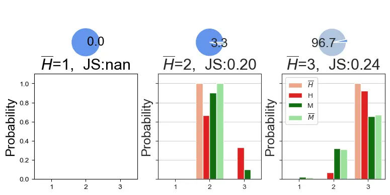
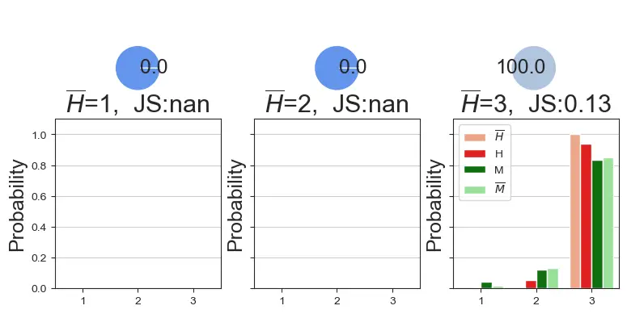
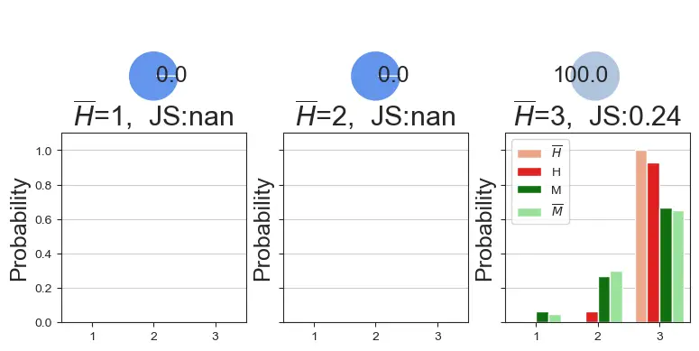
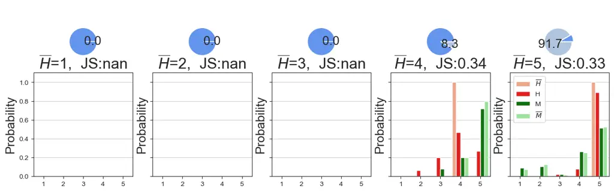

# Beyond Correlation: The Impact of Human Uncertainty in Measuring the Effectiveness of Automatic Evaluation and LLM-as-a-Judge

Aparna Elangovan Affiliation: Amazon    Lei Xu    Jongwoo Ko    Mahsa
Elyasi    Ling Liu    Sravan Bodapati    Dan Roth Affiliation: Amazon
Affiliation: KAIST AI^(†)Equal contributions

###### Abstract

The effectiveness of automatic evaluation of generative models is
typically measured by comparing the labels generated via automation with
labels by humans using correlation metrics. However, metrics like
Krippendorff’s $`\alpha`$ and Randolph’s $`\kappa`$ were originally
designed to measure the reliability of human labeling, thus make
assumptions about typical human labeling behavior, and these assumptions
may not be applicable to machine generated labels. In this paper, we
show how relying on a single aggregate correlation score can obscure
fundamental differences between human labels and those from automatic
evaluation, including LLM-as-a-Judge. Specifically, we demonstrate that
when the proportion of samples with variation or uncertainty in human
assigned labels is relatively high, machine labels (generated by
automatic evaluation methods) may superficially appear to have similar
or better correlation with the human majority label compared to the
human-to-human (HH) correlation. This can create the illusion that
labels from automatic evaluation approximates the human majority label.
However, as the proportion of samples with consistent human labels
increases, the correlation between machine and human labels fall well
below HH correlation. Based on these findings, we first propose
stratifying data by human label uncertainty to provide a more robust
analysis of automatic evaluation performance. Second, recognizing that
uncertainty and variation are inherent in perception-based human
evaluations, such as those involving attitudes or preferences, we
introduce a new metric - binned Jensen-Shannon Divergence for perception
for such scenarios to better measure the effectiveness of automatic
evaluations. Third, we present visualization techniques – perception
charts, to contextualize correlation measures appropriately and to show
the strengths and limitations of automatic evaluation. We have
open-sourced our analysis and visualization tools at
[https://github.com/amazon-science/BeyondCorrelation](https://github.com/amazon-science/BeyondCorrelation).

|     |
| --- |
|     |

## 1 Introduction

Despite the increasing importance of automatic evaluation for generative
large language models (LLMs), measuring and interpreting the
effectiveness of these methods remains a challenge. Automatic evaluation
methods include $`N`$-gram-based methods such as Rouge (Lin, 2004) and
BERTScore (Zhang\* et al., 2020), task-specific model-based methods such
as AlignScore (Zha et al., 2023) and Prometheus (Kim et al., 2024), and
LLM-as-a-Judge-based methods (LJ) where a general purpose LLM, using
prompts, is instructed to perform evaluation. The use of automatic
evaluation is tied to the key question – How can the efficacy of
automatic evaluation methods be measured in comparison to human
evaluation? A widely accepted practice is to use agreement or rank
correlation metrics such as Krippendorff’s-$`\alpha`$ (Krippendorff,
2011), Cohen’s-$`\kappa`$ (Cohen, 1960; McHugh, 2012), Spearman’s
$`\rho`$, and Kendall’s $`\tau`$-b (Fabbri et al., 2021; Deutsch et al.,
2022; Chiang & Lee, 2023; Liu et al., 2023b), where a higher correlation
between machine labels (generated by automatic evaluation methods) and
human labels (gathered during human evaluation) implies a more effective
automatic evaluation. Variation or uncertainty in human labels (Tversky
& Kahneman, 1974) is almost impossible to avoid when humans are involved
(Kahneman et al., 2021). In this paper, we highlight how comparing the
overall correlation score between human labels and machine labels can
obscure key discrepancies in machine labels. Therefore, we propose that
measurements be stratified by label uncertainty.

The impact of human label uncertainty on automatic evaluation,
therefore, leads to a follow-on question – how then to effectively
account for human uncertainty in automatic evaluation. Not all types of
uncertainties are equal (Kahneman & Tversky, 1982), as they can range
from random human errors, ambiguity in tasks, and a by-product of
perception-based evaluation (Elangovan et al., 2024). Some human
evaluation tasks naturally have higher variance than others. For
instance, when evaluating aspects such as “How readable is the given
content?”, the answer relies on human perception and is likely to vary
from person to person. In contrast, evaluating a natural language
inference (NLI) task, such as “Can you infer the given sentence from a
given text?”, is less likely to show variations. Acceptable variation in
labels, therefore, depends on the task, as variations or uncertainties
in human labels can sometimes be a feature rather than a bug in human
evaluation. Thus, we explore how to effectively measure and interpret
reliability of automatic evaluation while taking human uncertainty in to
consideration. We ask the following research questions:

- •
  RQ1: How does uncertainty in human labels impact correlation metrics
  when we measure the efficacy of automatic evaluation methods? (See
  detailed analysis on stratifying data by human uncertainty in Sec. 3.1
  )
- •
  RQ2: How can we measure human-machine agreement that accounts for
  human uncertainty as a result of variation in human perception? (See
  Binned Jensen-Shannon divergence in Sec. 3.1 )
- •
  RQ3: How can we visualize the underlying data to draw meaningful
  insights when we compare the results from automatic and human
  evaluations? (See Perception charts in Sec. 3.3 )

## 2 Background on correlation measures

### 2.1 Correlation measurements and assumptions

Correlation measures have traditionally been used to measure the
inter-rater agreement (IRA) of human-generated labels, where there is no
ground truth available, to measure human-to-human (HH) correlation.
There are 2 broad categories of correlation measures, (a)
non-chance-adjusted indices and (b) chance-adjusted metrics (Xinshu Zhao
& Deng, 2013). Chance-adjusted measures take into account a scenario
where raters can choose the same label by chance even when they do not
know the correct answer. Chance-adjusted measures, such as
Krippendorff’s-$`\alpha`$ are generally more popular IRA measures than
non-chance-adjusted metrics such as percentage agreement. The key
difference between various chance-adjusted IRA measures is how chance
agreement is computed (Meyer et al., 2014; Xinshu Zhao & Deng, 2013).
For instance, Randolph’s-$`\kappa`$ (Randolph, 2005) assumes that all
labels are equally likely and assigns a probability of
$`\nicefrac{{1}}{{k}}`$ for chance agreement, where $`k`$ is the number
of possible label choices. On the other hand, Fleiss’s $`\kappa`$
(Fleiss, 1971) and Krippendorff’s $`\alpha`$ calculate chance agreement
empirically, based on the actual human labels of the study. These
measurements can be useful in cases where certain labels (e.g., 3 on a
Likert scale of 1-5) are more likely to be chosen when humans are
uncertain. A high proportion of such labels, even if consistent, may
indicate unreliability in the labeling process, particularly when the
minority labels show lower agreement. Therefore, chance-adjusted
correlation measures rely on key assumptions about the types of errors
humans are likely to make. Furthermore, Krippendorff’s-$`\alpha`$,
specifies that the agreement coefficient is an indicator of reliability
if and only if (1) the raters duplicate the process of rating, i.e.,
when two independent raters use the same guidelines or instructions and
use the same units, (2) raters must be treated as interchangeable, and
(3) correct answers are not known (Krippendorff, 2004). Human labels and
machine labels are clearly not interchangeable even with current
state-of-the-art LLMs to generate machine labels, as humans provide the
ground truth labels.

### 2.2 Differences between correlation measures and raw accuracy

The assumptions above, especially the assumption that raters must be
treated as interchangeable, raise a fundamental question as to why even
use correlation measures to compare machine and human performance,
instead of measures such as accuracy and F1 using human labels as ground
truth? Firstly, one of the main challenges with using scores like
accuracy or F1 is that human labels tend to be noisy regardless of the
task or the dataset, where some label choices are more acceptable than
others, and measures such as F1 or accuracy do not account for
variations in human labels and hence correlation measures appear to be a
better measure. However, as mentioned previously, many of the common
chance-adjusted correlation measures aim to account for random chance
agreement in HH agreement, whereas the errors machines make tend to be
more systematic. A key characteristic of random errors is that they are
non-reproducible. When repeating the labeling process, the result
varies, resulting in low IRA, which in-turn may point to potential
problems in the labeling process or complexities in the task. In
contrast, systematic errors are consistent, and IRA measures are not
designed to detect them. Secondly, as a direct consequence, IRA metrics
assume that agreement is good and variance is bad, which implies that
there is a single correct answer – a situation that may not hold for
ambiguous items or those that gauge user perception.

### 2.3 Types of raw data collected during evaluation

The type of the data collected, such as nominal, ordinal, interval,
ratio, discrete or continuous data, dictate how such data can be
aggregated and interpreted. The most common types of values collected
during automatic or human evaluation are:  
Nominal values: Nominal data, such as gender, have no natural ranking or
ordering. Such data are primarily used in human evaluation tasks such as
fact checking, where the aim is to verify whether a given text can be
inferred from reference content (Liu et al., 2023c) and usually is
modeled as a binary classification task. Preference judgments such as
“Is the output of model-A or Model-B better?” are also common examples
of nominal values collected during human evaluation. IRA measures for
nominal values include percentage agreement (McHugh, 2012),
Randolph’s-$`\kappa`$, Fleiss’s-$`\kappa`$, Krippendorff’s-$`\alpha`$
and Cohen’s-$`\kappa`$.  
Ordinal values: Ordinal values have an implicit order, e.g., ratings of
quality (very good, good, fair, poor, very poor) (Mishra et al., 2018).
The most common use of ordinal values in human evaluation are through
Likert scales. Likert scales are rating systems of attitude scale to
measure the degree to which a person agrees/disagrees with a given
statement (Taherdoost, 2019) and commonly used to gauge user perception
on qualitative aspects such as readability, coherence, and fluency (van
der Lee et al., 2021). IRA measures for ordinal values should ideally
account for the fact that ratings that are closer to one another (1 vs. 2) for a given item indicate a higher agreement than ratings that are
further apart (1 vs. 4). Such IRA measures include
Krippendorff’s-$`\alpha`$ for ordinal values, where disagreements are
weighted by distance between the ratings. Rank correlations such as
Kendall’s-$`\tau`$ and Spearman’s-$`\rho`$ are also widely used to
measure item-level correlation between machines and humans for ordinal
values. However, there’s a caveat on using these measures: their ability
to handle a relatively large proportion of ties is widely debated, even
when measuring system correlations that involve a much smaller
proportion of ties (Deutsch et al., 2023). When the number of items to
rank is $`n`$, the number of ordinal values to assign is $`r`$, and when
$`r<<n`$, it results in many ties or rank collision. For instance, when
assigning a Likert scale of 1-5 to 100 items, at least 20% of the items
will have the same rank. While ordinal values preserve order, the
objective of using ordinal values is not to rank the item in relation to
other items, therefore the proportion of ties affects the
interpretability and reliability of the rank correlation scores.  
Continuous values: Continuous values are typically obtained when using
automatic evaluation methods such as Rouge (Lin, 2004) and BERTScore
(Zhang\* et al., 2020).

## 3 Analysis Settings and Results

Datasets and human labels: We analyze typical evaluation tasks for
LLM-generated text, including (a) Likert-based qualitative evaluation
(ordinal), (b) NLI-style fact or consistency checking (nominal), and (c)
human preferences of several LLMs (nominal). We select datasets with
multiple human annotations: 1. SummEval (Fabbri et al., 2021) is human
evaluation of summary quality using four criteria – fluency, coherence,
consistency, and relevance, with Likert scores assigned from 1 to 5.
This dataset has 1600 samples, where each item is labeled 3 times by
expert annotators. 2. SNLI (Bowman et al., 2015) is an NLI inference
task dataset with 10K samples and 3 labels – entailment, neutral and
contradiction. Each item is labeled 5 times by human annotators. 3. MNLI
(Williams et al., 2018) is also an NLI inference task dataset with 10K
samples and 3 labels – entailment, neutral and contradiction. Each item
is assigned 5 labels by human annotators. It contains two splits –
matched and mismatched. 4. MT-Bench (Zheng et al., 2023) is a preference
dataset which compares human preferences of several model outputs on
open-ended questions using multi-turn conversations. From this dataset,
we only use samples that have at least 3 human ratings. 5. We also
include JudgeBench (Bavaresco et al., 2024) in Appendix A.12.  
Machine labels: For SummEval, we reuse the original G-Eval results (Liu
et al., 2023b) which rates the quality of summaries on a scale of 1-5.
In addition, we use Claude Sonnet 3 and Mistral Large v2 on SummEval,
where prompts are detailed in Appendix A.2. For SNLI and MNLI, we use
Llama 3.1 8B, Mistral Large v2 and Sonnet 3, reusing the prompts from
Liu et al. (2023a) as detailed in Appendix A.1. For MT-Bench, we rely on
the existing GPT-4 labels in the dataset (Zheng et al., 2023). We also
adapt the same prompts (see Appendix A.3) for Sonnet 3 as LJ. In order
to compute MM correlation, we set the sampling temperature to 1.0 to
maximize the variation across runs, and set top_p = 0.8. We sample 20
machine labels per example. NOTE: We have predominately reused the
prompts from existing works of using GPT-4 as LJ, we have NOT attempted
to optimize the prompts per LLM except for minor format changes. Since
models are known to be highly sensitive to prompts, our experiments are
not meant to rank the underlying LJ, but to study the impact of human
uncertainty regardless of the LJ.  
Correlation measures: For nominal data, we report scores on
Krippendorff’s-$`\alpha`$, Fleiss-$`\kappa`$, Randolph’s-$`\kappa`$ and
percentage agreement (McHugh, 2012) also detailed in Appendix A.4. For
MT-Bench preference data, since the number of human raters vary per
tuple $`\langle`$conversation, turn, model pair$`\rangle`$ we use
Krippendorff-$`\alpha`$ and percentage agreement to compute HH
correlation as it can handle varying number of raters per item unlike
Fleiss-$`\kappa`$ or Randolph’s-$`\kappa`$. For ordinal data, we report
Krippendorff-$`\alpha`$ for ordinal data. We also report commonly used
rank correlation measures such as Spearman’s-$`\rho`$ and
Kendall’s-$`\tau`$, as many papers have used them to measure for
item-level correlation (despite the caveat highlighted previously).

### 3.1 RQ1: How does uncertainty in human labels impact correlation metrics when we measure the efficacy of automatic evaluation methods?

To study the impact of human uncertainty, we stratify samples and then
compare HH and Human-to-machine (HM) correlation measurements for each
group. We primarily stratify by percentage agreement, which is the
proportion of labels that matches the majority (for nominal data) or the
median label (for ordinal data) among all human labels assigned to an
item. For example, if 3 out of 5 people assign the same label, the
percentage agreement is 60%. We also stratify samples by the number of
unique human labels to ensure that our findings are consistent
regardless of the stratification method.

In Table 1, column $`\text{H}^{w}\text{M}^{w}`$ compares Human majority
($`\text{H}^{w}`$) with machine majority ($`\text{M}^{w}`$).
Superficially, HM correlation seems to improve with increasing human
certainty. On closer inspection, another trend emerges where in any
stratified group, when uncertain samples increases (as measured by low
HH correlation), the HM correlation seems to outperform HH correlation
as highlighted. However, as the proportion of samples with noisy labels
decreases and HH correlation approaches near-perfect agreement, HH
correlation is much higher than HM as highlighted. Thus, the illusion
that machines (specifically LJs) approximate majority human behavior is
largely due to the presence of noisy labels in the data. If LJs were
truly approximating the human majority, the $`\Delta`$ would approach 0
under perfect HH correlation – which is clearly not the case. We also
replicated this behavior on SummEval dataset which relies on ordinal
labels in Table 2, using correlation metrics such as
Krippendorff’s-$`\alpha`$ for ordinal data, Kendall’s-$`\tau`$ and
Spearman’s-$`\rho`$. The same patterns are observed on preference data
in Table 3. We further randomly sample subsets from NLI datasets
(sampling detailed in Appendix A.5) and compare correlation scores
across subsets with varying levels of human label uncertainty. We repeat
this for three different LLMs, and consistently observe the same
findings, performance gaps become more apparent as human label
consistency increases, as shown in Fig. 1. Similar findings for the
SummEval dataset are shown in Appendix Fig. 5.

We explore the phenomenon using a random labeler on synthetically
labeled datasets (code provided in Appendix A.11). This dataset
simulates both binary classification and ordinal classification with
labels {1, 2, 3}. We first sample 2 synthetic human labels to each item.
Then another random labeler assigns labels randomly. We examine the
correlation between the random labels and the synthetic human labels
across varying levels of certainty. Notably, the random labeler may
appear to have higher correlation when the proportion of uncertain
samples is higher. However, as the proportion of consistently labeled
samples increases, the random labels’ poor performance becomes evident,
as shown in Fig. 2. Intuitively, if 2 human labels disagree, a 3rd
random label cannot perform worse in terms of agreement – they can
either disagree with both human labels (in which case it is no better
than the 2 humans) or agree with one of the human label. This example
further illustrates why stratification by proportion of uncertainty is
crucial to show weaknesses in any automatic labeler.

[TABLE]

Table 1: Compare HM and HH correlation measurements on NLI datasets
using Sonnet to generate machine labels. The overall correlation scores
(All) indicate that the HM correlation is similar to HH. However, when
stratifying by percentage agreement (PA) or human unique labels, the
difference ($`\Delta=\text{HH}-\text{H}^{w}\text{M}^{w}`$) is highest
when the all human labels are the same (PA=1), and
$`\text{H}^{w}\text{M}^{w}`$ outperforms HH when certainty is the
lowest. $`\text{H}^{w}`$ and $`\text{M}^{w}`$ are human and machine
majority label.

Sonnet

Mistral

Llama

Figure 1: Krippendorff’s $`\alpha`$ (K-$`\alpha`$) on subsets of
MNLI-mismatched with varying uncertainty, using 3 LLMs – Sonnet,
Mistral, and Llama. As proportion of samples with consistent human
labels increases (towards the right of X-axis), HH correlations are
significantly higher than $`\text{H}^{w}\text{M}^{w}`$.
$`\text{H}^{w}\text{H}^{\prime}`$ represents the correlation between the
human majority and another human annotator ($`\text{H}^{\prime}`$).
$`\text{H}^{w}\text{R}^{w}`$ compares the human majority with a random
machine evaluator, serving as baseline performance.

Figure 2: Simulating the impact of uncertainty by comparing with an
automatic random labeler (R). When the proportion of samples with
uncertainty is higher, even a random labeler can appear to have better
correlation with a majority ($`\text{H}^{w}`$) or median
($`\overline{\text{H}}`$) human label. As the proportion of samples with
consistency increases, the weakness of the random labeler become
evident.

|     |                       | Rouge1   |          | Model   | Krippendorff’s-$`\alpha`$ |      |                                            |            |                                          | $`JS_{b}`$ | Spearman’s-$`\rho`$                        |                                          |                                  | Kendall’s-$`\tau`$                         |                                          |
| --- | --------------------- | -------- | -------- | ------- | ------------------------- | ---- | ------------------------------------------ | ---------- | ---------------------------------------- | ---------- | ------------------------------------------ | ---------------------------------------- | -------------------------------- | ------------------------------------------ | ---------------------------------------- |
| C   | Partition (% samples) | $`\rho`$ | $`\tau`$ |         | HH                        | MM   | $`\overline{\text{H}}\overline{\text{M}}`$ | $`\Delta`$ | $`\text{H}^{\prime}\overline{\text{M}}`$ | HM         | $`\overline{\text{H}}\overline{\text{M}}`$ | $`\text{H}^{\prime}\overline{\text{M}}`$ | $`\text{H}^{\mu}\text{M}^{\mu}`$ | $`\overline{\text{H}}\overline{\text{M}}`$ | $`\text{H}^{\prime}\overline{\text{M}}`$ |
| Coh | 1. All (100%)         | 0.18     | 0.14     | G-Eval  | 0.55                      | 0.74 | 0.31                                       | 0.25       | 0.27                                     | 0.39       | 0.53                                       | 0.43                                     | 0.57                             | 0.47                                       | 0.38                                     |
|     |                       |          |          | Mistral | 0.55                      | 0.78 | 0.49                                       | 0.07       | 0.42                                     | 0.36       | 0.56                                       | 0.48                                     | 0.62                             | 0.49                                       | 0.42                                     |
|     |                       |          |          | Sonnet  | 0.55                      | 0.83 | 0.24                                       | 0.32       | 0.21                                     | 0.51       | 0.34                                       | 0.31                                     | 0.41                             | 0.30                                       | 0.28                                     |
|     | 2. PA = 1 (12%)       | 0.36     | 0.28     | G-Eval  | 1.00                      | 0.78 | 0.25                                       | 0.75       | 0.25                                     | 0.70       | 0.61                                       | 0.61                                     | 0.64                             | 0.55                                       | 0.55                                     |
|     |                       |          |          | Mistral | 1.00                      | 0.79 | 0.35                                       | 0.65       | 0.35                                     | 0.69       | 0.62                                       | 0.62                                     | 0.68                             | 0.56                                       | 0.56                                     |
|     |                       |          |          | Sonnet  | 1.00                      | 0.86 | 0.24                                       | 0.76       | 0.24                                     | 0.71       | 0.43                                       | 0.43                                     | 0.48                             | 0.39                                       | 0.39                                     |
|     | 3. PA $`<`$ 60% (21%) | 0.17     | 0.13     | G-Eval  | 0.19                      | 0.70 | 0.32                                       | -0.13      | 0.16                                     | 0.35       | 0.56                                       | 0.31                                     | 0.58                             | 0.52                                       | 0.27                                     |
|     |                       |          |          | Mistral | 0.19                      | 0.78 | 0.55                                       | -0.37      | 0.36                                     | 0.30       | 0.57                                       | 0.39                                     | 0.64                             | 0.52                                       | 0.34                                     |
|     |                       |          |          | Sonnet  | 0.19                      | 0.85 | 0.17                                       | 0.02       | 0.14                                     | 0.50       | 0.40                                       | 0.31                                     | 0.45                             | 0.37                                       | 0.28                                     |
| Rel | 1. All (100%)         | 0.33     | 0.26     | G-Eval  | 0.40                      | 0.74 | 0.25                                       | 0.15       | 0.22                                     | 0.37       | 0.53                                       | 0.42                                     | 0.59                             | 0.47                                       | 0.37                                     |
|     |                       |          |          | Mistral | 0.40                      | 0.79 | 0.38                                       | 0.02       | 0.30                                     | 0.31       | 0.54                                       | 0.42                                     | 0.61                             | 0.49                                       | 0.38                                     |
|     |                       |          |          | Sonnet  | 0.40                      | 0.79 | 0.35                                       | 0.05       | 0.29                                     | 0.38       | 0.39                                       | 0.34                                     | 0.48                             | 0.36                                       | 0.31                                     |
|     | 2. PA = 1 (14%)       | 0.38     | 0.30     | G-Eval  | 1.00                      | 0.76 | 0.30                                       | 0.70       | 0.30                                     | 0.63       | 0.69                                       | 0.69                                     | 0.73                             | 0.63                                       | 0.63                                     |
|     |                       |          |          | Mistral | 1.00                      | 0.80 | 0.43                                       | 0.57       | 0.43                                     | 0.59       | 0.71                                       | 0.71                                     | 0.72                             | 0.65                                       | 0.65                                     |
|     |                       |          |          | Sonnet  | 1.00                      | 0.77 | 0.36                                       | 0.64       | 0.36                                     | 0.51       | 0.49                                       | 0.49                                     | 0.60                             | 0.45                                       | 0.45                                     |
|     | 3. PA $`<`$ 60% (19%) | 0.28     | 0.22     | G-Eval  | -0.09                     | 0.69 | 0.18                                       | -0.27      | 0.09                                     | 0.33       | 0.40                                       | 0.17                                     | 0.42                             | 0.38                                       | 0.15                                     |
|     |                       |          |          | Mistral | -0.09                     | 0.74 | 0.32                                       | -0.41      | 0.16                                     | 0.28       | 0.42                                       | 0.19                                     | 0.46                             | 0.40                                       | 0.17                                     |
|     |                       |          |          | Sonnet  | -0.09                     | 0.75 | 0.29                                       | -0.38      | 0.16                                     | 0.43       | 0.36                                       | 0.22                                     | 0.40                             | 0.35                                       | 0.20                                     |

Table 2: Results on SummEval dataset for criteria – Coherence and
Relevance, $`\overline{\text{H}}`$ is the human median rating and
$`\overline{\text{M}}`$ is machine median.
$`\Delta=(\text{HH}-\overline{\text{H}}\overline{\text{M}}`$). Impact of
human uncertainty: When the human label uncertainty is high,
$`\overline{\text{H}}\overline{\text{M}}`$ can seem better than HH
correlation and vice versa under low uncertainty. Does the correlation
score ($`\rho`$ of 0.56 , $`\alpha`$ 0.49) imply the LJ is good enough
to replace human evaluation? Spearman’s-$`\rho`$ median
$`(\overline{\text{H}}\overline{\text{M}}`$) vs. mean
($`\text{H}^{\mu}\text{M}^{\mu}`$): Median vs. mean results in an 11
points boost 0.49 $`\rightarrow`$ 0.60. Differences in correlation
metrics: Krippendorff’s-$`\alpha`$ of 0.25 (reject results), while
Spearman’s-$`\rho`$ shows 0.53 (moderate correlation). LJ ranking and
absolute correlation numbers change depending on reference human under
high uncertainty, Mistral best performance 0.42 replaced by Sonnet 0.22
when reference human is $`\text{H}^{\prime}`$ (another human annotator).
Full table in Appendix Table 7.

|                                |        |                       |       |      | Krippendorff’s-$`\alpha`$ |      |                              |            |                                   | % Agreement |                              |                                   | $`JS_{b}`$ | Fleiss-$`\kappa`$            |                                   | Randolph-$`\kappa`$          |                                   | LJ Winrate |      |            |
| ------------------------------ | ------ | --------------------- | ----- | ---- | ------------------------- | ---- | ---------------------------- | ---------- | --------------------------------- | ----------- | ---------------------------- | --------------------------------- | ---------- | ---------------------------- | --------------------------------- | ---------------------------- | --------------------------------- | ---------- | ---- | ---------- |
| MP (A vs B)                    | LJ     | Partition (# samples) | Human |      | HH                        | MM   | $`\text{H}^{w}\text{M}^{w}`$ | $`\Delta`$ | $`\text{H}^{\prime}\text{M}^{w}`$ | HH          | $`\text{H}^{w}\text{M}^{w}`$ | $`\text{H}^{\prime}\text{M}^{w}`$ | HM         | $`\text{H}^{w}\text{M}^{w}`$ | $`\text{H}^{\prime}\text{M}^{w}`$ | $`\text{H}^{w}\text{M}^{w}`$ | $`\text{H}^{\prime}\text{M}^{w}`$ | W          | WR   | $`\Delta`$ |
| $`\langle`$Alp, Gp3$`\rangle`$ | GPT    | 1\. All (52)          | B     | 0.79 | 0.24                      | \-   | 0.32                         | -0.08      | 0.29                              | 0.81        | 0.77                         | 0.75                              | 0.11       | 0.31                         | 0.28                              | 0.65                         | 0.62                              | B          | 0.81 | 0.02       |
|                                |        | 2\. PA = 1 (26)       | B     | 0.92 | 1.00                      | \-   | -0.05                        | 1.05       | -0.05                             | 1.00        | 0.85                         | 0.85                              | 0.13       | -0.07                        | -0.07                             | 0.77                         | 0.77                              | B          | 0.92 | 0.00       |
|                                |        | 3\. PA: \[60,80) (18) | B     | 0.61 | -0.04                     | \-   | 0.36                         | -0.40      | 0.28                              | 0.68        | 0.67                         | 0.61                              | 0.22       | 0.34                         | 0.26                              | 0.50                         | 0.42                              | B          | 0.67 | 0.06       |
|                                | Sonnet | 1\. All (52)          | B     | 0.79 | 0.24                      | 0.90 | 0.01                         | 0.23       | 0.11                              | 0.81        | 0.73                         | 0.73                              | 0.18       | 0.00                         | 0.10                              | 0.60                         | 0.60                              | B          | 0.90 | 0.12       |
|                                |        | 2\. PA = 1 (26)       | B     | 0.92 | 1.00                      | 1.00 | -0.02                        | 1.02       | -0.02                             | 1.00        | 0.92                         | 0.92                              | 0.17       | -0.04                        | -0.04                             | 0.85                         | 0.85                              | B          | 1.00 | 0.08       |
|                                |        | 3\. PA: \[60,80) (18) | B     | 0.61 | -0.04                     | 0.93 | -0.04                        | 0.00       | 0.18                              | 0.68        | 0.50                         | 0.61                              | 0.17       | -0.07                        | 0.16                              | 0.25                         | 0.42                              | B          | 0.78 | 0.17       |
| $`\langle`$Cld, Gp3$`\rangle`$ | GPT    | 1\. All (36)          | A     | 0.39 | 0.40                      | \-   | 0.54                         | -0.14      | 0.34                              | 0.79        | 0.69                         | 0.56                              | 0.11       | 0.54                         | 0.33                              | 0.54                         | 0.33                              | A          | 0.39 | 0.00       |
|                                |        | 2\. PA = 1 (14)       | B     | 0.64 | 1.00                      | \-   | 0.25                         | 0.75       | 0.25                              | 1.00        | 0.57                         | 0.57                              | 0.10       | 0.22                         | 0.22                              | 0.36                         | 0.36                              | B          | 0.57 | 0.07       |
|                                |        | 3\. PA: \[60,80) (21) | A     | 0.52 | -0.02                     | \-   | 0.58                         | -0.60      | 0.35                              | 0.67        | 0.76                         | 0.57                              | 0.12       | 0.57                         | 0.34                              | 0.64                         | 0.36                              | A          | 0.52 | 0.00       |
|                                | Sonnet | 1\. All (36)          | A     | 0.39 | 0.40                      | 0.78 | 0.36                         | 0.05       | 0.18                              | 0.79        | 0.58                         | 0.47                              | 0.17       | 0.35                         | 0.17                              | 0.38                         | 0.21                              | A          | 0.56 | 0.17       |
|                                |        | 2\. PA = 1 (14)       | B     | 0.64 | 1.00                      | 0.56 | -0.07                        | 1.07       | -0.07                             | 1.00        | 0.43                         | 0.43                              | 0.24       | -0.11                        | -0.11                             | 0.14                         | 0.14                              | B          | 0.64 | 0.00       |
|                                |        | 3\. PA: \[60,80) (21) | A     | 0.52 | -0.02                     | 0.86 | 0.37                         | -0.39      | 0.09                              | 0.67        | 0.67                         | 0.48                              | 0.19       | 0.35                         | 0.07                              | 0.50                         | 0.21                              | A          | 0.67 | 0.14       |
| $`\langle`$Gp3, Gp4$`\rangle`$ | GPT    | 1\. All (38)          | B     | 0.53 | 0.26                      | \-   | 0.27                         | -0.01      | 0.22                              | 0.74        | 0.61                         | 0.61                              | 0.18       | 0.26                         | 0.21                              | 0.41                         | 0.41                              | B          | 0.74 | 0.21       |
|                                |        | 2\. PA = 1 (11)       | B     | 0.82 | 1.00                      | \-   | 0.64                         | 0.36       | 0.64                              | 1.00        | 0.91                         | 0.91                              | 0.16       | 0.63                         | 0.63                              | 0.86                         | 0.86                              | B          | 0.91 | 0.09       |
|                                |        | 3\. PA: \[60,80) (20) | B     | 0.50 | 0.08                      | \-   | 0.24                         | -0.17      | 0.12                              | 0.68        | 0.55                         | 0.50                              | 0.21       | 0.22                         | 0.10                              | 0.33                         | 0.25                              | B          | 0.65 | 0.15       |
|                                | Sonnet | 1\. All (38)          | B     | 0.53 | 0.26                      | 0.76 | 0.20                         | 0.06       | 0.15                              | 0.74        | 0.50                         | 0.50                              | 0.13       | 0.19                         | 0.14                              | 0.25                         | 0.25                              | B          | 0.45 | 0.08       |
|                                |        | 2\. PA = 1 (11)       | B     | 0.82 | 1.00                      | 0.66 | 0.19                         | 0.81       | 0.19                              | 1.00        | 0.64                         | 0.64                              | 0.28       | 0.15                         | 0.15                              | 0.45                         | 0.45                              | B          | 0.64 | 0.18       |
|                                |        | 3\. PA: \[60,80) (20) | B     | 0.50 | 0.08                      | 0.81 | 0.22                         | -0.15      | 0.19                              | 0.68        | 0.50                         | 0.50                              | 0.06       | 0.20                         | 0.17                              | 0.25                         | 0.25                              | B          | 0.45 | 0.05       |

Table 3: Stratified performance on preference data with at least 3 human
ratings from MT-Bench for model pairs (MP). Impact of human label
uncertainty: When the HH label uncertainty is high,
$`\text{H}^{w}\text{M}^{w}`$ can seem better than HH correlation and
vice versa. IRA vs. Win-rate: While the difference in win-rate between
model and human ($`\Delta`$) can be smaller in one evaluator model
(e.g., Sonnet 0.08) compared to another (e.g., GPT 0.21), the
$`\text{H}^{w}\text{M}^{w}`$ IRA can tell an opposite story, as in the
example above, GPT has better correlation with human majority across all
correlation metrics except $`JS_{b}`$. LJ ranking and absolute
correlation numbers change depending on reference human
$`\text{H}^{\prime}`$, mimicking single annotator, under high
uncertainty compared to using consensus human majority
($`\text{H}^{w}`$).

### 3.2 RQ2: How can we measure human-machine agreement that accounts for human uncertainty as a result of variation in human perception?

Evaluating the quality of a free-form model generated output, such as a
summary, largely depends on human perception. As a result, the human
ratings can vary depending on a wide range of factors including what one
likes to their emotional state (Elangovan et al., 2024).
Perception-based ordinal-value evaluation schemes, such as Likert
scores, pose 2 main challenges. (1) It is an attitude-based scale, and
since human attitudes vary, metrics like Krippendorff’s $`\alpha`$,
which penalize variation, can produce scores lower than the minimum
acceptable value (Amidei et al., 2019). (2) Rank correlation measures
such as Kendall-$`\tau`$ or Spearman’s-$`\rho`$ are not entirely
appropriate given the large number of ties when comparing median scores,
as previously discussed in Sec. 2.3 and in the works by Deutsch et al.
(2023). Furthermore, whether to treat Likert-data as ordinal or interval
data dictates the aggregation method – median or mean, is also debated
(Joshi et al., 2015). The argument against using Likert-data as interval
data is that the points on the scale may not be equidistant, e.g., the
distance between pair $`\langle`$neutral, agree$`\rangle`$ may not be
the same as the distance between $`\langle`$agree, strongly
agree$`\rangle`$. We report Spearman’s-$`\rho`$ for both to illustrate
the difference in Table 2. While in most cases the two sets of scores
look largely the same, there are instances where the numbers are vastly
different. For instance, Table 2 Spearman’s-$`\rho`$ median vs. mean,
median comparison yields a correlation of 0.49 (low correlation), while
comparing the mean results in 0.60 (indicating moderate correlation)
(Mukaka, 2012), provoking the question which number is more
representative of the underlying data? Regardless of whether we choose
to use Krippendorff-$`\alpha`$ or a rank correlation metric, one aspect
that both assume is that there is a single rating (e.g., median value)
that appropriately represents the underlying choice a human rater makes.
This assumption may not be correct, especially when the task is
inherently subjective, especially when the number of judgments collected
per item is relatively low, e.g., 3 ratings per item. This shows a clear
gap in existing metrics to compare human and machine performance, where
intra-human ratings naturally vary as a a result of subjectivity
inherent to the task.

Hence, we propose an additional metric to supplement existing measures,
the use of binned Jensen-Shannon divergence (JSD) for perception (Lin, 1991) to quantify how closely automatic methods mimic human judgment. To
the best of our knowledge, our approach of using JSD has not been used
as a correlation measure to account for human perception, without
relying on a single gold label. The closest work to ours is the use of
cumulative JSD to predict the aesthetic score distribution, instead of
just the average rating, to represent image quality (Jin et al., 2018).

Formally (source code in Appendix A.7), let $`H_{i}`$ and $`M_{i}`$
represent the set of human and machine ratings respectively assigned to
the item $`x_{i}`$, and $`n`$ be the total number of the items and $`R`$
be the set of possible ratings (e.g., $`1`$ to $`5`$ for ordinal
ratings, or {$`A`$, $`B`$, $`Tie`$} for nominal model preferences). To
compute the distance between human and machine predictions, we can
define the probability mass function (PMF) for a given rating $`c`$ as
follows:

```math
P^{h}_{r}(c)=\frac{\sum_{i\in B_{r}}\sum_{l\in H_{i}}\mathbbm{1}_{\{l=c\}}}{\sum_{i\in B_{r}}|H_{i}|}\;\text{(Human),}\qquad P^{m}_{r}(c)=\frac{\sum_{i\in B_{r}}\sum_{l\in M_{i}}\mathbbm{1}_{\{l=c\}}}{\sum_{i\in B_{r}}|M_{i}|}\;\text{(Machine)}\vskip-2.0pt \tag{1}
```

where for ordinal values, bin
$`\mathbf{B}_{r}\coloneqq\{i\in\{1,..n\}|\text{median}(H_{i})=r\}`$
contains the set of samples with a median human rating $`r`$. For
nominal perception-based preference labels, bin
$`\mathbf{B}_{r}\coloneqq\{i\in\{1,..n\}|\text{mostfrequent}(H_{i})=r\}`$
contains the set of samples with the most frequent human rating $`r`$.

From Equation 1, we can define the binned JSD ($`JS_{b}`$) as follows:

```math
JS_{b}=\sum_{r\in R}\frac{|B_{r}|}{n}JS(P^{h}_{r}||P^{m}_{r})\coloneqq\sum_{r\in R}\frac{|B_{r}|}{n}\left(\frac{1}{2}KL(P^{h}_{r}||Q_{r})+\frac{1}{2}KL(P^{m}_{r}||Q_{r})\right),\vskip-2.0pt \tag{2}
```

where
$`KL(P^{h}_{r}||Q_{r})=\sum_{c\in R}P^{h}_{r}(c)\log_{2}(\frac{P^{h}_{r}(c)}{Q_{r}(c)})`$
is the Kullback-Leibler divergence (Kullback & Leibler, 1951) and
$`Q_{r}(c)=\left(P^{h}_{r}(c)+P^{m}_{r}(c)\right)/2`$ for
$`\forall c\in R`$ is the average between human and machine PMFs, based
on the definition of Jensen-Shannon distance ($`JS`$). Since JSD is a
distance-based measure, lower scores are better because they indicate
that the human and machine judgments are similar. We also illustrate the
benefits of binned-JSD using a toy example in Appendix A.8.

The binned JSD for ordinal perception data has 2 main advantages, (1) it
measures how closely machine labels mimic human perception without the
need for a single gold label (2) human and machine labels are not
treated interchangeably, as the items in a given bin are selected by the
human median or majority value. For HM correlation, the proposed
approach can be applied at item-level when the number of labels
collected per item is high enough to form a distribution, however, for
judging model generated output even obtaining 3 human labels per item
can be expensive. Hence, we suggest computing the distribution distance
per bin. The main shortcoming of this approach is that some key item
level discrepancies between machines and humans ratings might not be
clearly surfaced. For instance, for a given item, if all the humans
assign a rating of 1 and machines assign say 4, at an aggregate level
this pattern may not be obvious if this pattern is not frequent. Hence,
we also recommend reporting correlations stratified by uncertainty in
human labels, e.g., for items that have high agreement labels, such as
perfect human agreement as shown in Table 2.

### 3.3 RQ3: How can we visualize the underlying data to draw meaningful insights when we compare automatic labels and human labels?

#### 3.3.1 Perception-based ordinal rating visualization

We propose the “Ordinal HM perception comparison chart” as shown in Fig.
3 to compare humans’ perception of the content vs. how machines rate
them. Here, we bin the samples by the human median rating and plot the
corresponding distribution of human and machine ratings. For instance,
say for a grading task using label values between 1-5, each item is
rated 3 times by humans. For a sample set of 10 items, the total number
of judgments would be 30 (10 items \* 3 ratings per item). Let’s say 7
items get a median rating of 4, these 7 items would fall in bin
$`\overline{H}=4`$. We then plot the human label distribution for that
bin to include all the 21 judgments (7 items \* 3 ratings per item =
21), we also plot all the machine labels for the corresponding bin. We
repeat this for each of the label from 1-5 as shown in Fig. 3. This
allows us to visualize the variation in human perception, thus including
all the ratings rather than a single gold rating, and compare how the
corresponding machine labels vary.

Figure 3: Ordinal HM perception comparison chart: Visualization of human
perception vs. machine labels binned by human median rating (LJ Mistral
on Coherence): Dial at the top shows the percentage of samples that fall
into the bin. Middle scores (median 2-4) have higher human uncertainty,
where only 60% (less than 2 out of 3) of the human labels follow the
median. The extremes scores (1, 5) have less uncertainty. While Mistral
seems to mimic human perception when the human median is 3, it is also
biased towards the rating 3 when the human ratings are between 2-4.

Correlation numbers are challenging to interpret, and do not provide
sufficient insights to the meaning behind the numbers unless supported
by visualization. When does a correlation score imply the model is good
enough to replace human evaluation as indicated in Table 2? And what are
the gaps in the LJ? In Table 2, LJ Mistral achieves a
Krippendorff’s-$`\alpha`$ $`\overline{H}\overline{M}`$ of 0.49.
Visualization in Fig. 3 shows that the LJ does not rate any item as 1
and negligible amount of items are rated 5, while humans have assigned
over 24% of the items a median rating of 5. This shows the key
difference between LJ Mistral’s judgments and humans. This type of
insight can potentially be useful in optimizing the prompts used by the
LJ to minimize the gap with humans judgments, demonstrating the
importance of effective visualization techniques.

Another key aspect to note is how human uncertainty varies across
different median labels. Human labels tend to be more certain when they
assign extreme ratings (1, 5) compared to the middle ratings (2-4),
demonstrated by the distribution difference between the median
$`\overline{H}`$ and all $`H`$ ratings, as shown in Fig. 3. Relatively
higher consistency in extreme ratings is a common pattern observed when
humans are asked to rate using star-rating schemes and Likert scales, an
observation typically reported in recommendation systems (Amatriain et
al., 2009). This type of differences in the extent of human uncertainty
depending on the rating further demonstrates the deficiencies in
assuming a single gold rating for tasks that rely on human perception,
clearly illustrating the need for a HM correlation metric that does not
assume a single gold label, such as the $`JS_{b}`$ we proposed in Sec.
3.2 in RQ2.

#### 3.3.2 Perception-based preference visualization

For visualizing pairwise model preferences to compare human and machine
judgments, we propose the “Pairwise preference HM perception chart”. The
concept behind this visualization is similar to the Ordinal HM
perception comparison chart, the main difference is that is bins are
separated by the most frequent human label for a given item. This
visualization also helps understand, for a given model pair, how
reliable the human majority is. For instance, in Fig. 4, in the case of
$`\langle`$claude-v1, gpt-3.5-turbo$`\rangle`$, even though the
preferred model is Claude ( 38.9% preference), when human majority
prefers GPT-3.5 there is almost no contention. We also visualize the
preference of LJ Claude Sonnet shown in Appendix Fig. 7.

Figure 4: Pairwise preference HM perception chart: Human preference
distribution vs. LJ GPT-4 for a given majority label per model pair. T
is tie. Compares model pair (Left) Claude-v1 (A) vs. GPT3.5-turbo (B)
(Right) Alpaca-13B (A) vs. GPT-3.5-turbo (B). Note: Using GPT-4 LJ has
only one judgment per item in the results from Zheng et al. (2023),
hence $`\text{M}^{w}`$ and M are the same.

## 4 Discussion and conclusion

### 4.1 Humans are uncertain and their labels are noisy, so machines are better?!

Evaluation procedures have predominantly circumvented dealing with human
uncertainty, except for recent limited works (Chen et al., 2020; Wang et
al., 2023; Chen et al., 2024), and have thus relied on the simplified
assumption that a single gold label is sufficient. A single gold label
is only sufficient when there is little or no ambiguity, while being
able to quantify human uncertainty is crucial in measuring the
effectiveness of automatic evaluation. The ubiquitous nature of
uncertainty is studied in human psychology (Kahneman et al., 2021) and
is also illustrated in a widely used MNLI dataset, which was carefully
curated with 5 human labels per item. Over 40% of the samples have some
degree of uncertainty, as shown in Table 1. In addition, given the
challenges in human evaluation, including obtaining consistent labels
(Elangovan et al., 2024), recent datasets have started to rely on
collecting one human label per item (Bai et al., 2022; Ganguli et al.,
2022; Stiennon et al., 2020). This further demonstrates the urgent need
to acknowledge that quantifying human uncertainty is essential to
measure the effectiveness of automated evaluation.

The machine learning community cannot afford to dismiss uncertainty as
simply “poor quality labels from humans”, key systematic errors and
performance gaps in models become apparent under high human certainty as
shown in Sec. 3.1. As a corollary, under high uncertainty even a random
labeler can appear to have similar or better correlation with humans, as
shown in Fig. 2. More importantly, for safety critical applications such
as medicine, when humans labels are highly robust and certain, but the
corresponding machine assigned labels differ, it can point to serious
deficiencies in the automated system. Furthermore, the implications of
uncertainty include changes to ranking of the automatic evaluator as
well as the corresponding absolute correlation scores as shown in Table
2 and Table 3 depending on the reference human label. We acknowledge
that collecting high quality labels from humans is expensive, and that
in some cases gathering just one label per item might be adequate, such
as when attempting to understand if one LLM is better than the other,
provided the humans end up overwhelmingly preferring the output of one
LLM over the other. In the case where the performance of two LLMs are
close to one another, uncertainty in human judgments may be a signal
that says the model outputs are quite similar. Thus, in some cases
uncertainty can be a potential indicator of lower quality of labels
requiring improvements to the underlying label collection process
(Elangovan et al., 2024), in other cases uncertainty might be inevitable
and therefore a valuable signal. Under uncertainty, comparison of
automatic evaluation to human evaluation is challenging, and traditional
correlation measures also fail to adequately account for this. The
proposed binned JSD for perception is an effort in that direction so
that metrics do not penalize human uncertainty, whilst comparing machine
perception or attitudes with humans.

### 4.2 Challenges in metrics and interpretability

Deciding which statistic is appropriate depends on the data and how well
it fits the assumptions made by the statistical measure (Eubanks, 2017).
IRA metrics were never designed for systematic errors, and any
accommodation for errors were based on assumptions about typical human
behavior. Errors made by LLMs are rarely predictable, yet they are not
random; rather, they are reproducible, making them systematic errors.
The unpredictable nature of LLMs makes it difficult to design an
effective metric that compares them with humans, given the uncertainty
associated with human labels.

Despite the deficiencies in metrics, some metrics may be a better fit,
depending on the aim and the results of the study. For instance, in the
case of perception-based preference experiments, where the goal is to
understand which among a given pair of models is better, and when the
result is almost unanimous with one model overwhelmingly preferred over
the other, then the agreement in rarer (minority) labels may not matter.
Hence, measures such as Krippendorff’s-$`\alpha`$ and Fleiss-$`\kappa`$
which estimate chance agreement based on the observed label distribution
can result in substantially lower IRA scores even when there is high
agreement on the majority label (winning model), whereas
Randolph’s-$`\kappa`$ assumes that the labels are equally distributed
and hence is a better fit. For perception-based ordinal values, the
extreme labels (such as 1 or 5 in the case of Likert 1-5) are usually
strong indicators of human preferences, especially when supported by
visualization as shown in Fig. 3. These extreme labels, might form the
minority case, but might be crucial to interpreting the results. Hence,
measures such as Krippendorff’s-$`\alpha`$ and Fleiss-$`\kappa`$
estimate chance agreement based on the observed label distribution are a
better fit compared to measures such as Randolph’s-$`\kappa`$ that
assumes uniform distribution of all labels. For tasks where a single
majority label is not sufficient to represent human preferences,
measures that do not assume a single gold label such as the proposed
approach – binned JSD for perception, can be a better choice to compare
human and machine performance.

In addition, statistical analysis, such as null-hypothesis and
significance testing, is essential for determining whether one model
outperforms another by random chance. Here, the chance component
includes 2 obvious aspects, (1) chance due to the nature of samples in
the evaluation set (2) uncertainty in human labels. A third aspect, even
harder, is estimating the error rate as a result of systematically
unpredictable erroneous labels from any automated evaluator. Future
studies should explore these problems, including approaches like
resampling (Deutsch et al., 2021). Incorporation of chance in rank
correlation is also an important aspect to account for when two models
differ in rank, but the corresponding difference in absolute scores is
negligible, then the difference in the rank may not be meaningful.

IRA metrics are challenging to interpret, and hence visualization is key
to understanding gaps and strengths of any given metric. Effective
visualization is a trade-off between plotting every single data point
(too much information that is hard to synthesize) and an aggregate view
(summarized view where key information might be obscured). The proposed
perception charts are a step towards emphasizing how an aggregate number
may not be sufficient in capturing the underlying data, depicting how
human uncertainty varies across different labels, which in turn affects
how machine performance can be interpreted across labels as shown in
Fig. 3 and 4.

### 4.3 Recommendations for reporting effectiveness of automatic methods

To conclude, comprehensive analysis of performance involves
investigation beyond a single aggregate number, also demonstrated in an
additional case study in Appendix A.12. To that effect, in the case of
comparing automatic evaluation with human evaluation, we recommend the
following steps:

1. Stratification by uncertainty levels: As discussed in Sec. 3.1,
   uncertainty in human labels can obfuscate performance gaps between
   machines and human evaluators. Hence, we strongly recommend stratifying
   results by uncertainty proportions.
2. Multi-metric reporting: If there was no uncertainty, measures such as
   F1 would have worked. However, as a result of uncertainty, no single
   metric can capture important insights about every type of data as
   demonstrated in Sections 3.1, 3.2 and 3.3. Thus, we recommend reporting
   on multiple metrics belonging to different families, such as chance and
   non-chance-adjusted measures, so each metric in its own way can assist
   in bringing the less obvious but critical aspects about the underlying
   data to the forefront.
3. Visualization of results: A single non-parametric aggregate metric
   can rarely capture the entirety of underlying raw data, and hence
   visualization is key to understanding performance gaps, as discussed in
   Section 3.3. The proposed perception charts are a step towards making
   aggregate correlation more interpretable, as well as highlighting the
   strengths and gaps of the automatic labeler.

#### Acknowledgments

We would like to thank Saab Mansour for reviewing our paper and
providing valuable feedback.

## References

- Amatriain et al. (2009) Xavier Amatriain, Josep M. Pujol, and Nuria
  Oliver. I like it… i like it not: Evaluating user ratings noise in
  recommender systems. In Geert-Jan Houben, Gord McCalla, Fabio Pianesi,
  and Massimo Zancanaro (eds.), _User Modeling, Adaptation, and
  Personalization_, pp. 247–258, Berlin, Heidelberg, 2009. Springer
  Berlin Heidelberg. ISBN 978-3-642-02247-0.
- Amidei et al. (2019) Jacopo Amidei, Paul Piwek, and Alistair Willis.
  Agreement is overrated: A plea for correlation to assess human
  evaluation reliability. In Kees van Deemter, Chenghua Lin, and Hiroya
  Takamura (eds.), _Proceedings of the 12th International Conference on
  Natural Language Generation_, pp. 344–354, Tokyo, Japan,
  October–November 2019. Association for Computational Linguistics. doi:
  10.18653/v1/W19-8642. URL
  [https://aclanthology.org/W19-8642](https://aclanthology.org/W19-8642).
- Aroyo et al. (2023) Lora Aroyo, Alex Taylor, Mark Diaz, Christopher M
  Homan, Alicia Parrish, Greg Serapio-Garcia, Vinodkumar Prabhakaran,
  and Ding Wang. DICES dataset: Diversity in conversational AI
  evaluation for safety. In _Thirty-seventh Conference on Neural
  Information Processing Systems Datasets and Benchmarks Track_, 2023.
  URL
  [https://openreview.net/forum?id=GjNvvswoUL](https://openreview.net/forum?id=GjNvvswoUL).
- Bai et al. (2022) Yuntao Bai, Andy Jones, Kamal Ndousse, Amanda
  Askell, Anna Chen, Nova DasSarma, Dawn Drain, Stanislav Fort, Deep
  Ganguli, Tom Henighan, et al. Training a helpful and harmless
  assistant with reinforcement learning from human feedback. _arXiv
  preprint arXiv:2204.05862_, 2022.
- Bavaresco et al. (2024) Anna Bavaresco, Raffaella Bernardi, Leonardo
  Bertolazzi, Desmond Elliott, Raquel Fernández, Albert Gatt, E. Ghaleb,
  Mario Giulianelli, Michael Hanna, Alexander Koller, André F. T.
  Martins, Philipp Mondorf, Vera Neplenbroek, Sandro Pezzelle, Barbara
  Plank, David Schlangen, Alessandro Suglia, Aditya K Surikuchi, Ece
  Takmaz, and Alberto Testoni. Llms instead of human judges? a large
  scale empirical study across 20 nlp evaluation tasks. 2024. URL
  [https://arxiv.org/abs/2406.18403](https://arxiv.org/abs/2406.18403).
- Bowman et al. (2015) Samuel R. Bowman, Gabor Angeli, Christopher
  Potts, and Christopher D. Manning. A large annotated corpus for
  learning natural language inference. In _Proceedings of the 2015
  Conference on Empirical Methods in Natural Language Processing
  (EMNLP)_. Association for Computational Linguistics, 2015.
- Chen et al. (2024) Beiduo Chen, Xinpeng Wang, Siyao Peng, Robert
  Litschko, Anna Korhonen, and Barbara Plank. ”seeing the big through
  the small”: Can llms approximate human judgment distributions on nli
  from a few explanations?, 2024. URL
  [https://arxiv.org/abs/2406.17600](https://arxiv.org/abs/2406.17600).
- Chen et al. (2020) Tongfei Chen, Zhengping Jiang, Adam Poliak, Keisuke
  Sakaguchi, and Benjamin Van Durme. Uncertain natural language
  inference. In Dan Jurafsky, Joyce Chai, Natalie Schluter, and Joel
  Tetreault (eds.), _Proceedings of the 58th Annual Meeting of the
  Association for Computational Linguistics_, pp. 8772–8779, Online,
  July 2020. Association for Computational Linguistics. doi:
  10.18653/v1/2020.acl-main.774. URL
  [https://aclanthology.org/2020.acl-main.774](https://aclanthology.org/2020.acl-main.774).
- Chiang & Lee (2023) Cheng-Han Chiang and Hung-yi Lee. A closer look
  into using large language models for automatic evaluation. In Houda
  Bouamor, Juan Pino, and Kalika Bali (eds.), _Findings of the
  Association for Computational Linguistics: EMNLP 2023_, pp. 8928–8942,
  Singapore, December 2023. Association for Computational Linguistics.
  doi: 10.18653/v1/2023.findings-emnlp.599. URL
  [https://aclanthology.org/2023.findings-emnlp.599](https://aclanthology.org/2023.findings-emnlp.599).
- Cohen (1960) Jacob Cohen. A coefficient of agreement for nominal
  scales. _Educational and Psychological Measurement_,
  20(1):37–46, 1960. doi: 10.1177/001316446002000104. URL
  [https://doi.org/10.1177/001316446002000104](https://doi.org/10.1177/001316446002000104).
- Deutsch et al. (2021) Daniel Deutsch, Rotem Dror, and Dan Roth. A
  Statistical Analysis of Summarization Evaluation Metrics Using
  Resampling Methods. _Transactions of the Association for Computational
  Linguistics_, 9:1132–1146, 10 2021. ISSN 2307-387X. doi:
  10.1162/tacl_a_00417. URL
  [https://doi.org/10.1162/tacl_a_00417](https://doi.org/10.1162/tacl_a_00417).
- Deutsch et al. (2022) Daniel Deutsch, Rotem Dror, and Dan Roth.
  Re-examining system-level correlations of automatic summarization
  evaluation metrics. In Marine Carpuat, Marie-Catherine de Marneffe,
  and Ivan Vladimir Meza Ruiz (eds.), _Proceedings of the 2022
  Conference of the North American Chapter of the Association for
  Computational Linguistics: Human Language Technologies_, pp.
  6038–6052, Seattle, United States, July 2022. Association for
  Computational Linguistics. doi: 10.18653/v1/2022.naacl-main.442. URL
  [https://aclanthology.org/2022.naacl-main.442](https://aclanthology.org/2022.naacl-main.442).
- Deutsch et al. (2023) Daniel Deutsch, George Foster, and Markus
  Freitag. Ties matter: Meta-evaluating modern metrics with pairwise
  accuracy and tie calibration, 2023. URL
  [https://arxiv.org/abs/2305.14324](https://arxiv.org/abs/2305.14324).
- Elangovan et al. (2024) Aparna Elangovan, Ling Liu, Lei Xu, Sravan
  Babu Bodapati, and Dan Roth. ConSiDERS-the-human evaluation framework:
  Rethinking human evaluation for generative large language models. In
  Lun-Wei Ku, Andre Martins, and Vivek Srikumar (eds.), _Proceedings of
  the 62nd Annual Meeting of the Association for Computational
  Linguistics (Volume 1: Long Papers)_, pp. 1137–1160, Bangkok,
  Thailand, August 2024. Association for Computational Linguistics. URL
  [https://aclanthology.org/2024.acl-long.63](https://aclanthology.org/2024.acl-long.63).
- Eubanks (2017) David Eubanks. (re) visualizing rater agreement: Beyond
  single-parameter measures. _Journal of Writing Analytics_, 1, 2017.
- Fabbri et al. (2021) Alexander R. Fabbri, Wojciech Kryściński, Bryan
  McCann, Caiming Xiong, Richard Socher, and Dragomir Radev. SummEval:
  Re-evaluating Summarization Evaluation. _Transactions of the
  Association for Computational Linguistics_, 9:391–409, 04 2021. ISSN
  2307-387X. doi: 10.1162/tacl_a_00373. URL
  [https://doi.org/10.1162/tacl_a_00373](https://doi.org/10.1162/tacl_a_00373).
- Fleiss (1971) Joseph L. Fleiss. Measuring nominal scale agreement
  among many raters. _Psychological Bulletin_, 76(5):378–382, 1971. doi:
  10.1037/h0031619. URL
  [https://doi.org/10.1037/h0031619](https://doi.org/10.1037/h0031619).
- Ganguli et al. (2022) Deep Ganguli, Liane Lovitt, Jackson Kernion,
  Amanda Askell, Yuntao Bai, Saurav Kadavath, Ben Mann, Ethan Perez,
  Nicholas Schiefer, Kamal Ndousse, et al. Red teaming language models
  to reduce harms: Methods, scaling behaviors, and lessons learned.
  _arXiv preprint arXiv:2209.07858_, 2022.
- Jin et al. (2018) Xin Jin, Le Wu, Xiaodong Li, Siyu Chen, Siwei Peng,
  Jingying Chi, Shiming Ge, Chenggen Song, and Geng Zhao. Predicting
  aesthetic score distribution through cumulative jensen-shannon
  divergence. In _Proceedings of the Thirty-Second AAAI Conference on
  Artificial Intelligence and Thirtieth Innovative Applications of
  Artificial Intelligence Conference and Eighth AAAI Symposium on
  Educational Advances in Artificial Intelligence_,
  AAAI’18/IAAI’18/EAAI’18. AAAI Press, 2018. ISBN 978-1-57735-800-8.
- Joshi et al. (2015) Ankur Joshi, Saket Kale, Satish Chandel, and
  Dinesh Pal. Likert scale: Explored and explained. _British Journal of
  Applied Science & Technology_, 7:396–403, 01 2015. doi:
  10.9734/BJAST/2015/14975.
- Kahneman & Tversky (1982) Daniel Kahneman and Amos Tversky. Variants
  of uncertainty. _Cognition_, 11(2):143–157, 1982.
- Kahneman et al. (2021) Daniel Kahneman, Olivier Sibony, and Cass R.
  Sunstein. _Noise: a flaw in human judgment_. Little, Brown Spark, New
  York, first edition edition, 2021. ISBN 978-0-316-45140-6
  978-0-316-26665-9. OCLC: on1249942231.
- Kim et al. (2024) Seungone Kim, Jamin Shin, Yejin Cho, Joel Jang,
  Shayne Longpre, Hwaran Lee, Sangdoo Yun, Seongjin Shin, Sungdong Kim,
  James Thorne, and Minjoon Seo. Prometheus: Inducing fine-grained
  evaluation capability in language models. In _The Twelfth
  International Conference on Learning Representations_, 2024. URL
  [https://openreview.net/forum?id=8euJaTveKw](https://openreview.net/forum?id=8euJaTveKw).
- Krippendorff (2004) Klaus Krippendorff. Reliability in content
  analysis: Some common misconceptions and recommendations. _Human
  communication research_, 30(3):411–433, 2004.
- Krippendorff (2011) Klaus Krippendorff. Computing krippendorff’s
  alpha-reliability. 2011. URL
  [https://api.semanticscholar.org/CorpusID:59901023](https://api.semanticscholar.org/CorpusID:59901023).
- Kullback & Leibler (1951) Solomon Kullback and Richard A Leibler. On
  information and sufficiency. _The annals of mathematical statistics_,
  22(1):79–86, 1951.
- Lin (2004) Chin-Yew Lin. ROUGE: A package for automatic evaluation of
  summaries. In _Text Summarization Branches Out_, pp. 74–81, Barcelona,
  Spain, July 2004. Association for Computational Linguistics. URL
  [https://aclanthology.org/W04-1013](https://aclanthology.org/W04-1013).
- Lin (1991) J. Lin. Divergence measures based on the shannon entropy.
  _IEEE Transactions on Information Theory_, 37(1):145–151, 1991. doi:
  10.1109/18.61115.
- Liu et al. (2023a) Hanmeng Liu, Ruoxi Ning, Zhiyang Teng, Jian Liu,
  Qiji Zhou, and Yue Zhang. Evaluating the logical reasoning ability of
  chatgpt and gpt-4. _arXiv preprint arXiv:2304.03439_, 2023a.
- Liu et al. (2023b) Yang Liu, Dan Iter, Yichong Xu, Shuohang Wang,
  Ruochen Xu, and Chenguang Zhu. G-eval: NLG evaluation using gpt-4 with
  better human alignment. In Houda Bouamor, Juan Pino, and Kalika Bali
  (eds.), _Proceedings of the 2023 Conference on Empirical Methods in
  Natural Language Processing_, pp. 2511–2522, Singapore, December
  2023b. Association for Computational Linguistics. doi:
  10.18653/v1/2023.emnlp-main.153. URL
  [https://aclanthology.org/2023.emnlp-main.153](https://aclanthology.org/2023.emnlp-main.153).
- Liu et al. (2023c) Yixin Liu, Alex Fabbri, Pengfei Liu, Yilun Zhao,
  Linyong Nan, Ruilin Han, Simeng Han, Shafiq Joty, Chien-Sheng Wu,
  Caiming Xiong, and Dragomir Radev. Revisiting the gold standard:
  Grounding summarization evaluation with robust human evaluation. In
  Anna Rogers, Jordan Boyd-Graber, and Naoaki Okazaki (eds.),
  _Proceedings of the 61st Annual Meeting of the Association for
  Computational Linguistics (Volume 1: Long Papers)_, pp. 4140–4170,
  Toronto, Canada, July 2023c. Association for Computational
  Linguistics. doi: 10.18653/v1/2023.acl-long.228. URL
  [https://aclanthology.org/2023.acl-long.228](https://aclanthology.org/2023.acl-long.228).
- McHugh (2012) Mary L McHugh. Interrater reliability: the kappa
  statistic. _Biochem. Med. (Zagreb)_, 22(3):276–282, 2012.
- Mehri & Eskenazi (2020) Shikib Mehri and Maxine Eskenazi. USR: An
  unsupervised and reference free evaluation metric for dialog
  generation. In Dan Jurafsky, Joyce Chai, Natalie Schluter, and Joel
  Tetreault (eds.), _Proceedings of the 58th Annual Meeting of the
  Association for Computational Linguistics_, pp. 681–707, Online,
  July 2020. Association for Computational Linguistics. doi:
  10.18653/v1/2020.acl-main.64. URL
  [https://aclanthology.org/2020.acl-main.64](https://aclanthology.org/2020.acl-main.64).
- Meyer et al. (2014) Christian M. Meyer, Margot Mieskes, Christian
  Stab, and Iryna Gurevych. DKPro agreement: An open-source Java library
  for measuring inter-rater agreement. In Lamia Tounsi and Rafal Rak
  (eds.), _Proceedings of COLING 2014, the 25th International Conference
  on Computational Linguistics: System Demonstrations_, pp. 105–109,
  Dublin, Ireland, August 2014. Dublin City University and Association
  for Computational Linguistics. URL
  [https://aclanthology.org/C14-2023](https://aclanthology.org/C14-2023).
- Mishra et al. (2018) Prabhaker Mishra, C M Pandey, Uttam Singh, and
  Anshul Gupta. Scales of measurement and presentation of statistical
  data. _Ann. Card. Anaesth._, 21(4):419–422, October 2018.
- Mukaka (2012) M M Mukaka. Statistics corner: A guide to appropriate
  use of correlation coefficient in medical research. _Malawi Med. J._,
  24(3):69–71, September 2012.
- Randolph (2005) Justus J Randolph. Free-marginal multirater kappa
  (multirater k \[free\]): An alternative to fleiss’ fixed-marginal
  multirater kappa. _Online submission_, 2005.
- Stiennon et al. (2020) Nisan Stiennon, Long Ouyang, Jeffrey Wu, Daniel
  Ziegler, Ryan Lowe, Chelsea Voss, Alec Radford, Dario Amodei, and Paul
  F Christiano. Learning to summarize with human feedback. _Advances in
  Neural Information Processing Systems_, 33:3008–3021, 2020.
- Taherdoost (2019) Hamed Taherdoost. What Is the Best Response Scale
  for Survey and Questionnaire Design; Review of Different Lengths of
  Rating Scale / Attitude Scale / Likert Scale. Post-Print hal-02557308,
  HAL, 2019. URL
  [https://ideas.repec.org/p/hal/journl/hal-02557308.html](https://ideas.repec.org/p/hal/journl/hal-02557308.html).
- ten Hove et al. (2018) Debby ten Hove, Terrence D. Jorgensen, and L.
  Andries van der Ark. On the usefulness of interrater reliability
  coefficients. In Marie Wiberg, Steven Culpepper, Rianne Janssen, Jorge
  González, and Dylan Molenaar (eds.), _Quantitative Psychology_, pp.
  67–75, Cham, 2018. Springer International Publishing. ISBN
  978-3-319-77249-3.
- Tversky & Kahneman (1974) Amos Tversky and Daniel Kahneman. Judgment
  under uncertainty: Heuristics and biases. _Science_,
  185(4157):1124–1131, 1974. doi: 10.1126/science.185.4157.1124. URL
  [https://www.science.org/doi/abs/10.1126/science.185.4157.1124](https://www.science.org/doi/abs/10.1126/science.185.4157.1124).
- van der Lee et al. (2021) Chris van der Lee, Albert Gatt, Emiel van
  Miltenburg, and Emiel Krahmer. Human evaluation of automatically
  generated text: Current trends and best practice guidelines. _Computer
  Speech & Language_, 67:101151, 2021. ISSN 0885-2308. doi:
  https://doi.org/10.1016/j.csl.2020.101151. URL
  [https://www.sciencedirect.com/science/article/pii/S088523082030084X](https://www.sciencedirect.com/science/article/pii/S088523082030084X).
- Wang et al. (2020) Alex Wang, Kyunghyun Cho, and Mike Lewis. Asking
  and answering questions to evaluate the factual consistency of
  summaries. In Dan Jurafsky, Joyce Chai, Natalie Schluter, and Joel
  Tetreault (eds.), _Proceedings of the 58th Annual Meeting of the
  Association for Computational Linguistics_, pp. 5008–5020, Online,
  July 2020. Association for Computational Linguistics. doi:
  10.18653/v1/2020.acl-main.450. URL
  [https://aclanthology.org/2020.acl-main.450](https://aclanthology.org/2020.acl-main.450).
- Wang et al. (2023) Yuxia Wang, Shimin Tao, Ning Xie, Hao Yang, Timothy
  Baldwin, and Karin Verspoor. Collective Human Opinions in Semantic
  Textual Similarity. _Transactions of the Association for Computational
  Linguistics_, 11:997–1013, 08 2023. ISSN 2307-387X. doi:
  10.1162/tacl_a_00584. URL
  [https://doi.org/10.1162/tacl_a_00584](https://doi.org/10.1162/tacl_a_00584).
- Williams et al. (2018) Adina Williams, Nikita Nangia, and Samuel
  Bowman. A broad-coverage challenge corpus for sentence understanding
  through inference. In Marilyn Walker, Heng Ji, and Amanda Stent
  (eds.), _Proceedings of the 2018 Conference of the North American
  Chapter of the Association for Computational Linguistics: Human
  Language Technologies, Volume 1 (Long Papers)_, pp. 1112–1122, New
  Orleans, Louisiana, June 2018. Association for Computational
  Linguistics. doi: 10.18653/v1/N18-1101. URL
  [https://aclanthology.org/N18-1101](https://aclanthology.org/N18-1101).
- Xinshu Zhao & Deng (2013) Jun S. Liu Xinshu Zhao and Ke Deng.
  Assumptions behind intercoder reliability indices. _Annals of the
  International Communication Association_, 36(1):419–480, 2013. doi:
  10.1080/23808985.2013.11679142. URL
  [https://doi.org/10.1080/23808985.2013.11679142](https://doi.org/10.1080/23808985.2013.11679142).
- Zha et al. (2023) Yuheng Zha, Yichi Yang, Ruichen Li, and Zhiting Hu.
  AlignScore: Evaluating factual consistency with a unified alignment
  function. In Anna Rogers, Jordan Boyd-Graber, and Naoaki Okazaki
  (eds.), _Proceedings of the 61st Annual Meeting of the Association for
  Computational Linguistics (Volume 1: Long Papers)_, pp. 11328–11348,
  Toronto, Canada, July 2023. Association for Computational Linguistics.
  doi: 10.18653/v1/2023.acl-long.634. URL
  [https://aclanthology.org/2023.acl-long.634](https://aclanthology.org/2023.acl-long.634).
- Zhang\* et al. (2020) Tianyi Zhang\*, Varsha Kishore\*, Felix Wu\*,
  Kilian Q. Weinberger, and Yoav Artzi. Bertscore: Evaluating text
  generation with bert. In _International Conference on Learning
  Representations_, 2020. URL
  [https://openreview.net/forum?id=SkeHuCVFDr](https://openreview.net/forum?id=SkeHuCVFDr).
- Zheng et al. (2023) Lianmin Zheng, Wei-Lin Chiang, Ying Sheng, Siyuan
  Zhuang, Zhanghao Wu, Yonghao Zhuang, Zi Lin, Zhuohan Li, Dacheng Li,
  Eric Xing, Hao Zhang, Joseph E. Gonzalez, and Ion Stoica. Judging
  LLM-as-a-judge with MT-bench and chatbot arena. In _Thirty-seventh
  Conference on Neural Information Processing Systems Datasets and
  Benchmarks Track_, 2023. URL
  [https://openreview.net/forum?id=uccHPGDlao](https://openreview.net/forum?id=uccHPGDlao).

## Appendix A Appendix

### A.1 Prompts used for NLI

These prompts are reused from Liu et al. (2023a)

You will be presented with a premise and a hypothesis about that
premise. You need to decide whether the hypothesis is entailed by the
premise by choosing one of the following answers:

\[\[e\]\]: The hypothesis follows logically from the information
contained in the premise.

\[\[n\]\]: It is not possible to determine whether the hypothesis is
true or false without further information.

\[\[c\]\]: The hypothesis is logically false from the information
contained in the premise.

Read the following premise and hypothesis thoroughly and select the
correct answer from the three answer labels.

Premise:

{premise}

Hypothesis:

{hypothesis}

Make a selection from "\[\[e\]\]", "\[\[n\]\]", "\[\[c\]\]". Only write
the answer, do not write reasons.

### A.2 Prompts used for SummEval

Note: These prompts are reused from Liu et al. (2023b) used in G-Eval.

#### Coherence

You will be given one summary written for a news article.

Your task is to rate the summary on one metric.

Please make sure you read and understand these instructions carefully.
Please keep this document open while reviewing, and refer to it as
needed.

Evaluation Criteria:

Coherence (1-5) - the collective quality of all sentences. We align this
dimension with the DUC quality question of structure and coherence
whereby "the summary should be well-structured and well-organized. The
summary should not just be a heap of related information, but should
build from sentence to a coherent body of information about a topic."

Evaluation Steps:

1. Read the news article carefully and identify the main topic and key
   points.

2. Read the summary and compare it to the news article. Check if the
   summary covers the main topic and key points of the news article, and if
   it presents them in a clear and logical order.

3. Assign a score for coherence on a scale of 1 to 5, where 1 is the
   lowest and 5 is the highest based on the Evaluation Criteria.

Example:

Source Text:

{document}

Summary:

{summary}

Evaluation Form output the score only:

#### Consistency

You will be given a news article. You will then be given one summary
written for this article.

Your task is to rate the summary on one metric.

Please make sure you read and understand these instructions carefully.
Please keep this document open while reviewing, and refer to it as
needed.

Evaluation Criteria:

Consistency (1-5) - the factual alignment between the summary and the
summarized source. A factually consistent summary contains only
statements that are entailed by the source document. Annotators were
also asked to penalize summaries that contained hallucinated facts.

Evaluation Steps:

1. Read the news article carefully and identify the main facts and
   details it presents.

2. Read the summary and compare it to the article. Check if the summary
   contains any factual errors that are not supported by the article.

3. Assign a score for consistency based on the Evaluation Criteria.

Example:

Source Text:

{document}

Summary:

{summary}

Evaluation Form output the score only:

#### fluency

You will be given one summary written for a news article.

Your task is to rate the summary on one metric.

Please make sure you read and understand these instructions carefully.
Please keep this document open while reviewing, and refer to it as
needed.

Evaluation Criteria:

Fluency (1-3): the quality of the summary in terms of grammar, spelling,
punctuation, word choice, and sentence structure.

1: Poor. The summary has many errors that make it hard to understand or
sound unnatural.

2: Fair. The summary has some errors that affect the clarity or
smoothness of the text, but the main points are still comprehensible.

3: Good. The summary has few or no errors and is easy to read and
follow.

Example:

Summary:

{summary}

Evaluation Form output the score only:

#### Relevance

You will be given one summary written for a news article.

Your task is to rate the summary on one metric.

Please make sure you read and understand these instructions carefully.
Please keep this document open while reviewing, and refer to it as
needed.

Evaluation Criteria:

Relevance (1-5) - selection of important content from the source. The
summary should include only important information from the source
document. Annotators were instructed to penalize summaries which
contained redundancies and excess information.

Evaluation Steps:

1. Read the summary and the source document carefully.

2. Compare the summary to the source document and identify the main
   points of the article.

3. Assess how well the summary covers the main points of the article,
   and how much irrelevant or redundant information it contains.

4. Assign a relevance score from 1 to 5.

Example:

Source Text:

{document}

Summary:

{summary}

Evaluation Form output the score only:

### A.3 Prompts used for MTBench Preference data for Sonnet

Human: For this task, you will be shown two conversations between a user
and an AI assistant, labeled A and B. Your goal is to evaluate which
response (A or B) better follows the user’s instructions and more
helpfully answers their question.

\<PrefJudgment\>

\<Conversation A\>

{conversation_a}

\</Conversation A\>

\<Conversation B\>

{conversation_b}

\</Conversation B\>

\<Instructions\>

Evaluate the two conversations and choose one of the following:

\[\[A\]\] if Conversation A’s AI assistant better follows the user’s
instructions and answers their question

\[\[B\]\] if Conversation B’s AI assistant better follows the user’s
instructions and answers their question

\[\[C\]\] if both AI assistants are equally good/poor in following
instructions and answering the user’s question

Consider factors like helpfulness, relevance, accuracy, depth,
creativity, and appropriate level of detail when making your evaluation.
Do not show positional bias towards A or B. Response length should not
unduly influence your decision.

Make a selection from "\[\[A\]\]", "\[\[B\]\]", "\[\[C\]\]". Only write
the answer, do not write reasons.

\</Instructions\>

\</PrefJudgment\>

Assistant:

### A.4 Percentage agreement

Percentage agreement: The percentage agreement, as defined by McHugh
(2012), for $`n`$ items – where $`{x_{1},x_{2},\ldots,x_{n}}`$ represent
each item – that is labeled, with $`R`$ raters and $`C`$ categories, as
the maximum percentage of votes the most frequent item gets as long as
it is greater than 1. Formally:

```math
\frac{1}{n}\sum_{i=1}^{n}\left(\max_{c\in\{1,\ldots,C\}}\left(\frac{1}{R}\sum_{r=1}^{R}\mathbbm{1}_{\{x_{i}^{r}=c\}}\right)\cdot\mathbbm{1}_{\left(\sum_{r=1}^{R}\mathbbm{1}_{\{x_{i}^{r}=c\}}>1\right)}\right) \tag{3}
```

where $`x_{i}^{r}`$ is an annotation for $`x_{i}`$ by the $`r`$th rater.
Note that the $`\mathbbm{1}_{\mathbf{A}}`$ is the indicator function
that returns 1 if condition $`\mathbf{A}`$ is true and 0 otherwise.

### A.5 Impact of label uncertainty on ordinal SummEval dataset

We create multiple subsets of 100 samples, with each subset having a
predefined portion of samples with perfect agreement in human labels. We
then randomly select samples from the dataset based on this portion.
This simulation helps us understand how correlation measurements change
with varying levels of human label uncertainty.

Figure 5: Impact of noise on ordinal dataset Summeval

### A.6 Visualization of rouge-score correlation

Figure 6: Visualizing correlation with human median rating for
relevance: (Left) Rouge-1 (Right) LJ (Mistral). Note: Rouge scores are
continuous values \[0,1\], humans and LJ use integer values 1-5.

### A.7 Code for Binned-JSD-perception

Here we first show a working sample, followed by the code below.

In the sample dataset in Table 4, we have 2 bins, Bin 2 and Bin 3, where
H represents humans and M represents model values

Values compared in Bin 2

= H(item A + item B), M (item A + item B)

= H(\[2, 2, 3\] + \[1,2,2\]), M(\[3,2\] + \[1,1\])

= H(\[2,2,3,1,2,2\]), M(\[3,2,1,1\])

Values compared in Bin 3

= H(item C), M( item C)

= H(\[2,3,3), M(\[2, 2\])

Now we compute JSD for each bin to compare the similarity in each bin.
Comparing the probability distribution of values between H and M, assume
Likert scale 1- 3, where the index represents the Likert value and the
index value corresponds to the probability of that value:

Bin 2 JSD(H, M) = JSD(H\[1/6, 4/6, 1/6\], M\[2/4, 1/4, 1/4\])

Bin 3 JSD(H, M) = JSD(H\[0, 1/3, 2/3\], M\[0, 2/2, 0\])

Translating the above to python call

from scipy.spatial import distance

bin2_jsd = distance.jensenshannon(\[1/6, 4/6, 1/6\], \[2/4, 1/4, 1/4\]))

bin3_jsd = distance.jensenshannon(\[0, 1/3, 2/3\], \[0, 2/2, 0\])

Total binned JSD is the weighted sum of number of samples in each bin,
where contains 2 samples A and B, contains 1 sample C

Binned JSD = 2/3 \* $`bin2_{jsd}`$ + 1/3 \* $`bin3_{jsd}`$ = 2/3 \*
0.31 + 1/3 \* 0.56 = 0.39

| Id  | Human labels | Human median (Bin) | Model predictions |
| --- | ------------ | ------------------ | ----------------- |
| A   | 2, 2, 3      | 2                  | 3, 2              |
| B   | 1, 2, 2      | 2                  | 1, 1              |
| C   | 2, 3, 3      | 3                  | 2, 2              |

Table 4: Sample dataset

import itertools

import statistics

from collections import Counter

from statistics import mode

from scipy.spatial import distance

def compute_binned_js(df, human_labels_column, machine_labels_column,
bin_type=’median’):

"""

Compute JS

@param df: DataFrame containing the columns human_labels_column,
machine_labels_column

@param human_labels_column: This is the name of the column containing
human labels. Each row value in this column is a list of labels

@param machine_labels_column: This is the name of the column containing
machine labels. Each row value in this column is a list of multiple
labels assigned by the machine

@param bin_type: The type of binning, either median or majority
depending on the type of data

"""

result_weighted_js = 0

result_bin_details = {}

\# Bin function can be median or mode ( most frequent value)

bin_func = statistics.median if bin_type == ’median’ else mode

\# Get unique labels

labels =
sorted(set(itertools.chain(\*(df\[human_labels_column\].tolist()

- df\[machine_labels_column\].tolist()))))

\# Assign bin number

df_bin_number = df\[human_labels_column\].apply(lambda x: bin_func(x))

for l in labels:

\# Get bin items

df_bin_items = df\[df_bin_number == l\]

bin_weight = len(df_bin_items) / len(df)

result_bin_details\[l\] = {

"bin_items": df_bin_items,

"bin_number": l,

"jsd": None,

"bin_weight": bin_weight,

"dist_human":\[\],

"dist_machine":\[\]

}

\# Skip if no items in bin

if len(df_bin_items) == 0: continue

\# Compute js

human_labels_frequencies_in_bin = Counter(

list(itertools.chain(\*df_bin_items\[human_labels_column\])))

machine_labels_frequencies_in_bin = Counter(

list(itertools.chain(\*df_bin_items\[machine_labels_column\])))

dist_human = \[human_labels_frequencies_in_bin\[i\] /
sum(Counter(human_labels_frequencies_in_bin).values())

for i in labels\]

dist_machine = \[machine_labels_frequencies_in_bin\[i\] /
sum(Counter(machine_labels_frequencies_in_bin).values())

for i in labels\]

result_bin_details\[l\]\["dist_machine"\]=dist_machine

result_bin_details\[l\]\["dist_human"\]=dist_human

jsd = distance.jensenshannon(dist_human, dist_machine)

result_bin_details\[l\]\["jsd"\] = jsd

result_weighted_js += bin_weight \* jsd

return result_weighted_js, result_bin_details

### A.8 Toy example: Application of binned-JSD and where it can a better metric

The use of binned-JSD solves a specific problem, where a single majority
label is not sufficient to represent the human preference, as mentioned
in section 4.2.

The advantage of binned-JSD can be demonstrated using a toy example as
follows. If we only used a single gold human label (human median in this
case, could also be human majority) to compute correlation, the
acceptable values that humans have chosen is lost. As a result, metrics
such as Krippendorff will see treat any value that is equidistant from
the human single “gold” label as acceptably similar. For instance,
assume that humans choose “disagree” or “neutral” (median/ majority
value) (selections $`\langle`$2,3,3$`\rangle`$). A good model chooses
“disagree” and a bad model chooses “agree” (completely different to
human choice), because both “disagree” (Likert 2) and “agree” (Likert 4)
are equidistant from the median/majority value (Likert 3- Median value),
K-alpha has assigned very similar scores for the model that has assigned
“disagree” (Likert 2) and the model that has assigned “agree” (Likert
4). Rank correlation metrics, in addition to their misfit in comparing
item level Likert scores already discussed in the paper in section RQ2,
also have a similar problem and deems the model that is poor as the
better model as shown below. Our proposed approach, on the other hand,
assigned lower (better for JSD) scores to the better model as the “good”
model assigns values that the humans have chosen, compared to the poor
model that has predicted a different score altogether.

|              |                                 |            |            |
| ------------ | ------------------------------- | ---------- | ---------- |
| Human labels | Human median ($`\overline{H}`$) | Good model | Poor model |
| 2, 2, 3      | 2                               | 3          | 1          |
| 1, 2, 2      | 2                               | 1          | 3          |
| 2, 3, 3      | 3                               | 2          | 4          |

Table 5: A toy dataset to illustrate the use of binned-jsd

| Metric                  | Good Model | Poor Model | Does better model score better |
| ----------------------- | ---------- | ---------- | ------------------------------ |
| Kendall-$`\tau`$        | 0.00       | 0.82       | False                          |
| Spearman-$`\rho`$       | 0.00       | 0.87       | False                          |
| Krippendorff-$`\alpha`$ | -0.06      | -0.06      | False                          |
| $`JS_{b}`$              | 0.56       | 0.65       | True                           |

Table 6: Demonstration how metrics can rank a poor model better as a
consequence of ignoring valid labels that humans have assigned. The
proposed Binned-JSD on the other hand uses all the human labels, and
assigns lower JSD (better) to the better model.

The example above also exemplifies how unless we know apriori which is a
better model, it is difficult to identify advantages as well as
shortcomings with correlation measurements including the proposed
binned-jsd. Effectiveness of metrics depend on the data. We don’t know
for certain if a model appears to be better/worse because of gaps in
metrics, creating a chicken-and-egg problem in measuring the
effectiveness of a metric itself. Not knowing which metric is
appropriate is a common problem when it comes to correlation metrics
(ten Hove et al., 2018), including problems with Cohen’s Kappa
(Krippendorff, 2004) despite it being commonly used, including many LLM
as judge papers.

Hence, our recommendation in Section 4.3 for stratification,
visualization and multi-metric reporting so we can interpret the
strengths and gaps in the metrics.

### A.9 Visualization of preference data

Figure 7: Pairwise preference HM perception chart: Human preference
distribution vs. (Top) LJ GPT-4 (Bottom) LJ Claude Sonnet 3 for a given
majority label per model pair. T is tie. Compares model pair (Left)
Claude-v1 (A) vs. GPT3.5-turbo (B) (Right) Alpaca-13B (A) vs.
GPT-3.5-turbo (B).

### A.10 Extended table results

|           |                                    | Rouge1   |          | Model   | Krippendorff’s-$`\alpha`$ |      |                                            |            |                                          | $`JS_{b}`$ | Spearman’s-$`\rho`$                        |                                          |                                  | Kendall’s-$`\tau`$                         |                                          |
| --------- | ---------------------------------- | -------- | -------- | ------- | ------------------------- | ---- | ------------------------------------------ | ---------- | ---------------------------------------- | ---------- | ------------------------------------------ | ---------------------------------------- | -------------------------------- | ------------------------------------------ | ---------------------------------------- |
| C         | Partition (% samples)              | $`\rho`$ | $`\tau`$ |         | HH                        | MM   | $`\overline{\text{H}}\overline{\text{M}}`$ | $`\Delta`$ | $`\text{H}^{\prime}\overline{\text{M}}`$ | HM         | $`\overline{\text{H}}\overline{\text{M}}`$ | $`\text{H}^{\prime}\overline{\text{M}}`$ | $`\text{H}^{\mu}\text{M}^{\mu}`$ | $`\overline{\text{H}}\overline{\text{M}}`$ | $`\text{H}^{\prime}\overline{\text{M}}`$ |
| coherence | 1. All (100%)                      | 0.18     | 0.14     | G-Eval  | 0.55                      | 0.74 | 0.31                                       | 0.25       | 0.29                                     | 0.39       | 0.53                                       | 0.47                                     | 0.57                             | 0.47                                       | 0.41                                     |
|           |                                    |          |          | Mistral | 0.55                      | 0.78 | 0.49                                       | 0.07       | 0.43                                     | 0.36       | 0.56                                       | 0.49                                     | 0.62                             | 0.49                                       | 0.43                                     |
|           |                                    |          |          | Sonnet  | 0.55                      | 0.83 | 0.24                                       | 0.32       | 0.22                                     | 0.51       | 0.34                                       | 0.33                                     | 0.41                             | 0.30                                       | 0.29                                     |
|           | 2. PA=1 (12%)                      | 0.36     | 0.28     | G-Eval  | 1.00                      | 0.78 | 0.25                                       | 0.75       | 0.25                                     | 0.70       | 0.61                                       | 0.61                                     | 0.64                             | 0.55                                       | 0.55                                     |
|           |                                    |          |          | Mistral | 1.00                      | 0.79 | 0.35                                       | 0.65       | 0.35                                     | 0.69       | 0.62                                       | 0.62                                     | 0.68                             | 0.56                                       | 0.56                                     |
|           |                                    |          |          | Sonnet  | 1.00                      | 0.86 | 0.24                                       | 0.76       | 0.24                                     | 0.71       | 0.43                                       | 0.43                                     | 0.48                             | 0.39                                       | 0.39                                     |
|           | 3. 60 $`\leq`$ PA $`<`$ 100% (66%) | 0.16     | 0.12     | G-Eval  | 0.53                      | 0.75 | 0.30                                       | 0.23       | 0.29                                     | 0.40       | 0.51                                       | 0.45                                     | 0.55                             | 0.45                                       | 0.39                                     |
|           |                                    |          |          | Mistral | 0.53                      | 0.78 | 0.48                                       | 0.05       | 0.44                                     | 0.38       | 0.56                                       | 0.50                                     | 0.62                             | 0.49                                       | 0.44                                     |
|           |                                    |          |          | Sonnet  | 0.53                      | 0.81 | 0.22                                       | 0.31       | 0.20                                     | 0.51       | 0.32                                       | 0.31                                     | 0.40                             | 0.28                                       | 0.28                                     |
|           | 4. PA $`<`$ 60% (21%)              | 0.17     | 0.13     | G-Eval  | 0.19                      | 0.70 | 0.32                                       | -0.13      | 0.26                                     | 0.35       | 0.56                                       | 0.42                                     | 0.58                             | 0.52                                       | 0.38                                     |
|           |                                    |          |          | Mistral | 0.19                      | 0.78 | 0.55                                       | -0.37      | 0.39                                     | 0.30       | 0.57                                       | 0.41                                     | 0.64                             | 0.52                                       | 0.36                                     |
|           |                                    |          |          | Sonnet  | 0.19                      | 0.85 | 0.17                                       | 0.02       | 0.17                                     | 0.50       | 0.40                                       | 0.31                                     | 0.45                             | 0.37                                       | 0.28                                     |
| relevance | 1. All (100%)                      | 0.33     | 0.26     | G-Eval  | 0.40                      | 0.74 | 0.25                                       | 0.15       | 0.25                                     | 0.37       | 0.53                                       | 0.47                                     | 0.59                             | 0.47                                       | 0.41                                     |
|           |                                    |          |          | Mistral | 0.40                      | 0.79 | 0.38                                       | 0.02       | 0.33                                     | 0.31       | 0.54                                       | 0.44                                     | 0.61                             | 0.49                                       | 0.39                                     |
|           |                                    |          |          | Sonnet  | 0.40                      | 0.79 | 0.35                                       | 0.05       | 0.31                                     | 0.38       | 0.39                                       | 0.37                                     | 0.48                             | 0.36                                       | 0.33                                     |
|           | 2. PA (14%)                        | 0.38     | 0.30     | G-Eval  | 1.00                      | 0.76 | 0.30                                       | 0.70       | 0.30                                     | 0.63       | 0.69                                       | 0.69                                     | 0.73                             | 0.63                                       | 0.63                                     |
|           |                                    |          |          | Mistral | 1.00                      | 0.80 | 0.43                                       | 0.57       | 0.43                                     | 0.59       | 0.71                                       | 0.71                                     | 0.72                             | 0.65                                       | 0.65                                     |
|           |                                    |          |          | Sonnet  | 1.00                      | 0.77 | 0.36                                       | 0.64       | 0.36                                     | 0.51       | 0.49                                       | 0.49                                     | 0.60                             | 0.45                                       | 0.45                                     |
|           | 3. 60 $`\leq`$ PA $`<`$ 100% (66%) | 0.34     | 0.26     | G-Eval  | 0.40                      | 0.74 | 0.25                                       | 0.16       | 0.25                                     | 0.38       | 0.53                                       | 0.47                                     | 0.60                             | 0.47                                       | 0.41                                     |
|           |                                    |          |          | Mistral | 0.40                      | 0.80 | 0.37                                       | 0.03       | 0.34                                     | 0.33       | 0.54                                       | 0.44                                     | 0.62                             | 0.49                                       | 0.39                                     |
|           |                                    |          |          | Sonnet  | 0.40                      | 0.80 | 0.34                                       | 0.07       | 0.32                                     | 0.37       | 0.39                                       | 0.37                                     | 0.49                             | 0.36                                       | 0.34                                     |
|           | 4. PA $`<`$ 60% (19%)              | 0.28     | 0.22     | G-Eval  | -0.09                     | 0.69 | 0.18                                       | -0.27      | 0.22                                     | 0.33       | 0.40                                       | 0.31                                     | 0.42                             | 0.38                                       | 0.27                                     |
|           |                                    |          |          | Mistral | -0.09                     | 0.74 | 0.32                                       | -0.41      | 0.20                                     | 0.28       | 0.42                                       | 0.25                                     | 0.46                             | 0.40                                       | 0.22                                     |
|           |                                    |          |          | Sonnet  | -0.09                     | 0.75 | 0.29                                       | -0.38      | 0.19                                     | 0.43       | 0.36                                       | 0.29                                     | 0.40                             | 0.35                                       | 0.27                                     |

Table 7: All stratification results for SummEval. Summeval has 3 expert
human annotations to select Likert values from 1-5, hence possible
values for stratification by percentage agreement (PA) on the median
label are 3/3=100 %, 2/3=66.67% and 1/3=33.3%. Hence, we stratify by
100% agreement, \[60-100) and $`<`$60%.

|                                |        |                       |       |      | Krippendorff’s-$`\alpha`$ |      |                              |            |                                   | % Agreement |                              |                                   | $`JS_{b}`$ | Fleiss-$`\kappa`$            |                                   | Randolph-$`\kappa`$          |                                   | LJ Winrate |      |            |
| ------------------------------ | ------ | --------------------- | ----- | ---- | ------------------------- | ---- | ---------------------------- | ---------- | --------------------------------- | ----------- | ---------------------------- | --------------------------------- | ---------- | ---------------------------- | --------------------------------- | ---------------------------- | --------------------------------- | ---------- | ---- | ---------- |
| MP (A vs B)                    | LJ     | Partition (# samples) | Human |      | HH                        | MM   | $`\text{H}^{w}\text{M}^{w}`$ | $`\Delta`$ | $`\text{H}^{\prime}\text{M}^{w}`$ | HH          | $`\text{H}^{w}\text{M}^{w}`$ | $`\text{H}^{\prime}\text{M}^{w}`$ | HM         | $`\text{H}^{w}\text{M}^{w}`$ | $`\text{H}^{\prime}\text{M}^{w}`$ | $`\text{H}^{w}\text{M}^{w}`$ | $`\text{H}^{\prime}\text{M}^{w}`$ | W          | WR   | $`\Delta`$ |
| $`\langle`$Alp, Gp3$`\rangle`$ | GPT    | 1\. All (52)          | B     | 0.79 | 0.24                      | \-   | 0.32                         | -0.08      | 0.20                              | 0.81        | 0.77                         | 0.67                              | 0.11       | 0.31                         | 0.19                              | 0.65                         | 0.51                              | B          | 0.81 | 0.02       |
|                                |        | 2\. P-HH (26)         | B     | 0.92 | 1.00                      | \-   | -0.05                        | 1.05       | -0.05                             | 1.00        | 0.85                         | 0.85                              | 0.13       | -0.07                        | -0.07                             | 0.77                         | 0.77                              | B          | 0.92 | 0.00       |
|                                |        | 3\. HH: \[80,100) (1) | B     | 1.00 | 0.00                      | \-   | \-                           | \-         | 0.00                              | 0.83        | 1.00                         | 0.00                              | 0.25       | \-                           | -1.00                             | \-                           | -1.00                             | B          | 1.00 | 0.00       |
|                                |        | 4\. HH: \[60,80) (18) | B     | 0.61 | -0.04                     | \-   | 0.36                         | -0.40      | 0.21                              | 0.68        | 0.67                         | 0.56                              | 0.22       | 0.34                         | 0.18                              | 0.50                         | 0.33                              | B          | 0.67 | 0.06       |
|                                |        | 5\. HH: \[0,60) (7)   | B     | 0.71 | -0.18                     | \-   | 0.35                         | -0.53      | -0.02                             | 0.46        | 0.71                         | 0.43                              | 0.32       | 0.30                         | -0.10                             | 0.43                         | 0.14                              | B          | 0.71 | 0.00       |
|                                | Sonnet | 1\. All (52)          | B     | 0.79 | 0.24                      | 0.90 | 0.01                         | 0.23       | 0.09                              | 0.81        | 0.73                         | 0.71                              | 0.18       | 0.00                         | 0.08                              | 0.60                         | 0.57                              | B          | 0.90 | 0.12       |
|                                |        | 2\. P-HH (26)         | B     | 0.92 | 1.00                      | 1.00 | -0.02                        | 1.02       | -0.02                             | 1.00        | 0.92                         | 0.92                              | 0.17       | -0.04                        | -0.04                             | 0.85                         | 0.85                              | B          | 1.00 | 0.08       |
|                                |        | 3\. HH: \[80,100) (1) | B     | 1.00 | 0.00                      | 0.00 | 0.00                         | 0.00       | 0.00                              | 0.83        | 0.00                         | 0.00                              | 0.36       | -1.00                        | -1.00                             | -1.00                        | -1.00                             | T          | 1.00 | 0.00       |
|                                |        | 4\. HH: \[60,80) (18) | B     | 0.61 | -0.04                     | 0.93 | -0.04                        | 0.00       | 0.13                              | 0.68        | 0.50                         | 0.56                              | 0.17       | -0.07                        | 0.11                              | 0.25                         | 0.33                              | B          | 0.78 | 0.17       |
|                                |        | 5\. HH: \[0,60) (7)   | B     | 0.71 | -0.18                     | 1.00 | -0.08                        | -0.10      | -0.18                             | 0.46        | 0.71                         | 0.43                              | 0.51       | -0.17                        | -0.27                             | 0.43                         | 0.14                              | B          | 1.00 | 0.29       |
| $`\langle`$Cld, Gp3$`\rangle`$ | GPT    | 1\. All (36)          | A     | 0.39 | 0.40                      | \-   | 0.54                         | -0.14      | 0.30                              | 0.79        | 0.69                         | 0.53                              | 0.11       | 0.54                         | 0.29                              | 0.54                         | 0.29                              | A          | 0.39 | 0.00       |
|                                |        | 2\. P-HH (14)         | B     | 0.64 | 1.00                      | \-   | 0.25                         | 0.75       | 0.25                              | 1.00        | 0.57                         | 0.57                              | 0.10       | 0.22                         | 0.22                              | 0.36                         | 0.36                              | B          | 0.57 | 0.07       |
|                                |        | 3\. HH: \[80,100) (0) | \-    | \-   | \-                        | \-   | \-                           | \-         | \-                                | \-          | \-                           | \-                                | 0.00       | \-                           | \-                                | \-                           | \-                                | \-         | \-   | \-         |
|                                |        | 4\. HH: \[60,80) (21) | A     | 0.52 | -0.02                     | \-   | 0.58                         | -0.60      | 0.28                              | 0.67        | 0.76                         | 0.52                              | 0.12       | 0.57                         | 0.26                              | 0.64                         | 0.29                              | A          | 0.52 | 0.00       |
|                                |        | 5\. HH: \[0,60) (1)   | A     | 1.00 | 0.00                      | \-   | \-                           | \-         | 0.00                              | 0.40        | 1.00                         | 0.00                              | 0.52       | \-                           | -1.00                             | \-                           | -1.00                             | A          | 1.00 | 0.00       |
|                                | Sonnet | 1\. All (36)          | A     | 0.39 | 0.40                      | 0.78 | 0.36                         | 0.05       | 0.18                              | 0.79        | 0.58                         | 0.47                              | 0.17       | 0.35                         | 0.16                              | 0.38                         | 0.21                              | A          | 0.56 | 0.17       |
|                                |        | 2\. P-HH (14)         | B     | 0.64 | 1.00                      | 0.56 | -0.07                        | 1.07       | -0.07                             | 1.00        | 0.43                         | 0.43                              | 0.24       | -0.11                        | -0.11                             | 0.14                         | 0.14                              | B          | 0.64 | 0.00       |
|                                |        | 3\. HH: \[80,100) (0) | \-    | \-   | \-                        | \-   | \-                           | \-         | \-                                | \-          | \-                           | \-                                | 0.00       | \-                           | \-                                | \-                           | \-                                | \-         | \-   | \-         |
|                                |        | 4\. HH: \[60,80) (21) | A     | 0.52 | -0.02                     | 0.86 | 0.37                         | -0.39      | 0.18                              | 0.67        | 0.67                         | 0.48                              | 0.19       | 0.35                         | 0.16                              | 0.50                         | 0.21                              | A          | 0.67 | 0.14       |
|                                |        | 5\. HH: \[0,60) (1)   | A     | 1.00 | 0.00                      | 1.00 | \-                           | \-         | \-                                | 0.40        | 1.00                         | 1.00                              | 0.52       | \-                           | \-                                | \-                           | \-                                | A          | 1.00 | 0.00       |
| $`\langle`$Gp3, Gp4$`\rangle`$ | GPT    | 1\. All (38)          | B     | 0.53 | 0.26                      | \-   | 0.27                         | -0.01      | 0.11                              | 0.74        | 0.61                         | 0.50                              | 0.18       | 0.26                         | 0.10                              | 0.41                         | 0.25                              | B          | 0.74 | 0.21       |
|                                |        | 2\. P-HH (11)         | B     | 0.82 | 1.00                      | \-   | 0.64                         | 0.36       | 0.64                              | 1.00        | 0.91                         | 0.91                              | 0.16       | 0.63                         | 0.63                              | 0.86                         | 0.86                              | B          | 0.91 | 0.09       |
|                                |        | 3\. HH: \[80,100) (2) | T     | 1.00 | -0.12                     | \-   | 0.00                         | -0.12      | 0.00                              | 0.80        | 0.50                         | 0.50                              | 0.23       | -0.33                        | -0.33                             | 0.00                         | 0.00                              | B          | 0.50 | 0.50       |
|                                |        | 4\. HH: \[60,80) (20) | B     | 0.50 | 0.08                      | \-   | 0.24                         | -0.17      | -0.12                             | 0.68        | 0.55                         | 0.30                              | 0.21       | 0.22                         | -0.15                             | 0.33                         | -0.05                             | B          | 0.65 | 0.15       |
|                                |        | 5\. HH: \[0,60) (5)   | A     | 0.60 | -0.27                     | \-   | -0.24                        | -0.02      | -0.08                             | 0.40        | 0.20                         | 0.40                              | 0.38       | -0.38                        | -0.20                             | -0.20                        | -0.20                             | B          | 0.80 | 0.20       |
|                                | Sonnet | 1\. All (38)          | B     | 0.53 | 0.26                      | 0.76 | 0.20                         | 0.06       | 0.32                              | 0.74        | 0.50                         | 0.58                              | 0.13       | 0.19                         | 0.31                              | 0.25                         | 0.37                              | B          | 0.45 | 0.08       |
|                                |        | 2\. P-HH (11)         | B     | 0.82 | 1.00                      | 0.66 | 0.19                         | 0.81       | 0.19                              | 1.00        | 0.64                         | 0.64                              | 0.28       | 0.15                         | 0.15                              | 0.45                         | 0.45                              | B          | 0.64 | 0.18       |
|                                |        | 3\. HH: \[80,100) (2) | T     | 1.00 | -0.12                     | 0.12 | \-                           | \-         | \-                                | 0.80        | 1.00                         | 1.00                              | 0.07       | \-                           | \-                                | \-                           | \-                                | T          | 1.00 | 0.00       |
|                                |        | 4\. HH: \[60,80) (20) | B     | 0.50 | 0.08                      | 0.81 | 0.22                         | -0.15      | 0.46                              | 0.68        | 0.50                         | 0.65                              | 0.06       | 0.20                         | 0.44                              | 0.25                         | 0.48                              | B          | 0.45 | 0.05       |
|                                |        | 5\. HH: \[0,60) (5)   | A     | 0.60 | -0.27                     | 0.64 | -0.45                        | 0.19       | -0.41                             | 0.40        | 0.00                         | 0.00                              | 0.49       | -0.61                        | -0.56                             | -0.50                        | -0.50                             | T          | 0.80 | 0.20       |

Table 8: All stratification results for MTBench. MTBench has varying
number of 3 to 5 human annotations per item to select preferences A, B
or tie. Hence, possible values for stratification by percentage
agreement (PA), so if an item contains 5 annotations (human labels),
then possible stratification groups that the item can belong to by PA on
the majority label are 5/5=100%, 4/5=80%, 3/5=60% or lesser. Please note
that many of these partitions have 0 or less than 5 samples. With higher
proportion of noisy or uncertain samples the HM correlation seems to
outperform HH correlation. The exceptions to this finding are
highlighted, and for these the sample size is quite small ($`\leq 5`$).

### A.11 Random Simulation Code

#### A.11.1 Random Simulation Code - Binary classification (Nominal data)

In this code, we create a simulated synthetic dataset, where we mimic
the case of 2 human annotators labelling a binary classification
problem. We also create a random labeller, where the random labeller
assigns random labels.

import random

import numpy as np

import random

import pandas as pd

def synthetic_random_nominal_dataset():

"""

Simulates a random binary dataset with 2 human labellers.

The 2 humans can either (a) both pick 0 (b)both pick 1 (c) one picks 0
and the other picks 1 or vice versa

:return:

"""

dataset_size = 200

humans_2_one_pick_0_other_picks_1 = \[random.sample(\[0, 1\], 2) for \_
in range(dataset_size // 2)\]

humans_2_both_pick_1 = \[\[1, 1\] for \_ in range(dataset_size // 4)\]

humans_2_both_pick_0 = \[\[0, 0\] for \_ in range(dataset_size // 4)\]

human_2_annotators_binary_simulated =
humans_2_one_pick_0_other_picks_1 + humans_2_both_pick_1 +
humans_2_both_pick_0

random_labeller_choice = \[np.random.choice(\[1, 0\]) for \_ in
range(dataset_size)\]

\# Final df

df = pd.DataFrame(data={"human_labels":
human_2_annotators_binary_simulated,

"random_labeller": random_labeller_choice

})

return df

#### A.11.2 Random Simulation Code - 3 way classification (Ordinal data)

In this code, we create a simulated synthetic dataset, where we mimic
the case of 2 human annotators labelling a 3 way classification problem
to assign labels \[1,2 or 3\]. We also create a random labeller, where
the random labeller assigns random labels.

import numpy as np

import random

import pandas as pd

def synthetic_random_ordinal_dataset():

"""

Simulates a random 3 way classification 1-2-3, with 2 human labellers.

The 2 humans can either (a) both pick 1 (b)both pick 2. and so on (c)
disagree

:return:

"""

dataset_size = 600

humans_disagree = \[random.sample(\[1, 2, 3\], 2) for \_ in
range(dataset_size // 2)\]

humans_agree_1 = \[\[1, 1\] for \_ in range(dataset_size // 6)\]

humans_agree_2 = \[\[2, 2\] for \_ in range(dataset_size // 6)\]

humans_agree_3 = \[\[3, 3\] for \_ in range(dataset_size // 6)\]

human_2_annotators_ordinal_simulated = humans_disagree +
humans_agree_1 + humans_agree_2 + humans_agree_3

random_labeller_choice = \[np.random.choice(\[1, 2, 3\]) for \_ in
range(dataset_size)\]

df = pd.DataFrame(data={"human_labels":
human_2_annotators_ordinal_simulated,

"random_labeller": random_labeller_choice

})

return df

### A.12 Case study

Here, we include a case study on a subset of the datasets (see details
in Table 9) used in the LLM benchmark study by Bavaresco et al. (2024).
We use the preprocessed datasets available in github¹¹ 1
https://github.com/dmg-illc/JUDGE-BENCH provided by Bavaresco et al.
(2024) These datasets were evaluated on LLM Llama-3-70B.

| Dataset                               | Size | Criteria            | \# Annotations | Choices           |
| ------------------------------------- | ---- | ------------------- | -------------- | ----------------- |
| Topical chat (Mehri & Eskenazi, 2020) | 60   | Understandable      | 3              | (0, 1)            |
|                                       | 60   | Uses Knowledge      | 3              | (0, 1)            |
| QAGS (Wang et al., 2020)              | 953  | Factual consistency | 3              | (yes, no)         |
| Dices 350 (Aroyo et al., 2023)        | 350  | Safety              | 100-150        | (yes, no, unsure) |

Table 9: Categorical datasets summary

|     |     |                  |          |                         |      |                              |            |             |      |                              |            |                     |      |                              |            |
| --- | --- | ---------------- | -------- | ----------------------- | ---- | ---------------------------- | ---------- | ----------- | ---- | ---------------------------- | ---------- | ------------------- | ---- | ---------------------------- | ---------- |
|     |     |                  |          | Krippendorff-$`\alpha`$ |      |                              |            | % Agreement |      |                              |            | Randolph-$`\kappa`$ |      |                              |            |
| D   | C   | Partition        | Size (%) | HH                      | MM   | $`\text{H}^{w}\text{M}^{w}`$ | $`\Delta`$ | HH          | MM   | $`\text{H}^{w}\text{M}^{w}`$ | $`\Delta`$ | HH                  | MM   | $`\text{H}^{w}\text{M}^{w}`$ | $`\Delta`$ |
| TC  | UND | All              | 100.0    | -0.01                   | 0.58 | -0.01                        | 0.00       | 0.99        | 0.98 | 0.97                         | 0.02       | 0.96                | 0.94 | 0.93                         | 0.02       |
|     |     | PA=1             | 96.7     | 1.00                    | 0.58 | -0.01                        | 1.01       | 1.00        | 0.98 | 0.97                         | 0.03       | \-                  | 0.94 | 0.93                         | \-         |
|     |     | PA=66.67%        | 3.3      | -0.25                   | 1.00 | \-                           | \-         | 0.67        | 1.00 | 1.00                         | -0.33      | -0.33               | \-   | \-                           | \-         |
|     | UK  | All              | 100.0    | 0.48                    | 0.81 | -0.03                        | 0.51       | 0.98        | 0.99 | 0.93                         | 0.04       | 0.91                | 0.98 | 0.87                         | 0.04       |
|     |     | PA=1             | 93.3     | 1.00                    | 1.00 | -0.01                        | 1.01       | 1.00        | 1.00 | 0.96                         | 0.04       | 1.00                | 1.00 | 0.93                         | 0.07       |
|     |     | PA=66.67%        | 6.7      | -0.26                   | 0.44 | -0.17                        | -0.09      | 0.67        | 0.90 | 0.50                         | 0.17       | -0.33               | 0.70 | 0.00                         | -0.33      |
| QG  | FC  | All              | 100.0    | 0.49                    | 0.93 | 0.70                         | -0.21      | 0.89        | 0.98 | 0.87                         | 0.02       | 0.54                | 0.94 | 0.74                         | -0.20      |
|     |     | PA=1             | 65.6     | 1.00                    | 0.94 | 0.84                         | 0.16       | 1.00        | 0.99 | 0.94                         | 0.06       | 1.00                | 0.95 | 0.87                         | 0.13       |
|     |     | PA=66.67%        | 34.4     | -0.34                   | 0.91 | 0.48                         | -0.81      | 0.67        | 0.98 | 0.74                         | -0.08      | -0.33               | 0.91 | 0.49                         | -0.82      |
| DC  | SAF | All              | 100.00   | 0.16                    | 0.79 | -0.25                        | 0.41       | 0.69        | 0.93 | 0.39                         | 0.30       | 0.35                | 0.82 | 0.09                         | 0.26       |
|     |     | PA = 1           | 0.00     | \-                      | \-   | \-                           | \-         | \-          | \-   | \-                           | \-         | \-                  | \-   | \-                           | \-         |
|     |     | 80% \<= PA\<100% | 22.6     | 0.31                    | 0.81 | -0.41                        | 0.72       | 0.86        | 0.94 | 0.34                         | 0.52       | 0.63                | 0.85 | 0.01                         | 0.62       |
|     |     | 60% \<= PA \<80% | 48.6     | 0.15                    | 0.80 | -0.27                        | 0.42       | 0.71        | 0.93 | 0.39                         | 0.32       | 0.34                | 0.83 | 0.08                         | 0.26       |
|     |     | 40% \<= PA\<60%  | 28.9     | 0.02                    | 0.76 | -0.11                        | 0.12       | 0.53        | 0.92 | 0.43                         | 0.10       | 0.15                | 0.79 | 0.14                         | 0.01       |

Table 10: Categorical datasets evaluation: Results on Topical chat (TC)
on criteria $`\langle`$Understandable (UND), Uses Knowledge
(UK)$`\rangle`$, QAGS (QA) on criteria factual consistency (FC) and
DICES (DC) dataset on safety (SAF). With higher proportion of noisy or
uncertain samples the HM correlation seems to outperform HH correlation.
The only one exception is highlighted, where the sample size is quite
small ($`\approx`$ 4 samples as TC dataset has a total of 60 samples) in
partition PA=66.67% (2/3 votes for majority label).

#### A.12.1 Analysis of results

1.  1.  Effects of Multi-metric reporting: On the Topical Chat (TC) dataset,
        for understandable criteria the aggregate number
        (Krippendorff-$`\alpha`$ -0.01) of $`\text{H}^{w}\text{M}^{w}`$
        score of -0.01 superficially seems to imply that HM correlation is
        low as shown in Table 10. However, percentage agreement (score 0.97)
        and Randolph-$`\kappa`$ (score 0.93) score quite highly, indicating
        that class imbalance has substantially lowered
        Krippendorff-$`\alpha`$ pretty close to 0.0. Also note that over 96%
        of the samples have perfect human agreement, however the overall HH
        Krippendorff-$`\alpha`$ is quite low scoring -0.01. This effect of
        how various chance adjusted metrics impact correlation scores is
        also discussed in detail in section 4.2.
2.  2.  Impact of stratification: When we compare the overall performance
        (column All in Table 10) on dataset TC (criteria understandable)
        with dataset QAGS, Randolph-$`\kappa`$ drops substantially by 19
        points (0.93 $`\rightarrow`$ 0.74). However, QAGS dataset has around
        66% of the samples that have perfect human agreement, while TC has
        96% of the sample with human agreement. When we compare the samples
        with perfect human agreement between the 2 datasets, the model
        performance gap reduces to just 6 points (0.93 $`\rightarrow`$
        0.87), pointing to how comparing datasets with different proportion
        of uncertain samples can affect our conclusion (in this case
        incorrectly that the model performance is substantially lower in
        QAGS compared to TC). With DICES dataset (crowdsourced with over 100
        annotations per item, with no perfect agreement items), on the other
        hand, the model seems to struggle across all metrics and
        stratification groups, indicating much deeper investigation is
        required. The general trend of where in a stratified group with
        relatively higher proportion of uncertain samples (as measured by
        low HH correlation), the $`\text{H}^{w}\text{M}^{w}`$ correlation
        seems to outperform HH correlation as highlighted, as shown in Table
        10 also applies, indicating to how models can superficially appear
        to approximate human majority when proportion samples of uncertainty
        is relatively higher, demonstrating the impact of RQ1 discussed in
        section 3.1.

#### A.12.2 Analysis of ordinal data

Firstly, looking at Table 11, superficially looking at the aggregate
scores ( Row marked “All” across all 4 criteria) it might appear as
though (a) absolute human to machine correlation is low (columns
$`\overline{\text{H}}\overline{\text{M}}`$) (b) when we compare HM
correlation to HH, $`\overline{\text{H}}\overline{\text{M}}`$ is similar
to HH correlation.

| Dataset                               | Size | Criteria          | \# Annotations | Choices   |
| ------------------------------------- | ---- | ----------------- | -------------- | --------- |
| Topical chat (Mehri & Eskenazi, 2020) | 60   | engaging          | 3              | 1,2,3     |
|                                       | 60   | maintains context | 3              | 1,2,3     |
|                                       | 60   | natural           | 3              | 1,2,3     |
|                                       | 60   | overall           | 3              | 1,2,3,4,5 |

|     |                           |          |                           |      |                                            |            |            |                                            |                                            |
| --- | ------------------------- | -------- | ------------------------- | ---- | ------------------------------------------ | ---------- | ---------- | ------------------------------------------ | ------------------------------------------ |
|     |                           |          | Krippendorff’s-$`\alpha`$ |      |                                            |            | $`JS_{b}`$ | $`\rho`$                                   | $`\tau`$                                   |
| C   | Partition                 | Size (%) | HH                        | MM   | $`\overline{\text{H}}\overline{\text{M}}`$ | $`\Delta`$ | HM         | $`\overline{\text{H}}\overline{\text{M}}`$ | $`\overline{\text{H}}\overline{\text{M}}`$ |
| ENG | All                       | 100.00   | 0.03                      | 0.72 | -0.02                                      | 0.05       | 0.24       | 0.25                                       | 0.24                                       |
|     | PA=1                      | 75.00    | 1.00                      | 0.66 | -0.14                                      | 1.14       | 0.34       | \-                                         | \-                                         |
|     | 60% $`\leq`$ PA $`<`$ 80% | 25.00    | -0.39                     | 0.82 | -0.01                                      | -0.38      | 0.15       | 0.26                                       | 0.25                                       |
| MC  | All                       | 100.00   | -0.06                     | 0.74 | -0.07                                      | 0.01       | 0.13       | \-                                         | \-                                         |
|     | PA=1                      | 81.67    | 1.00                      | 0.65 | -0.04                                      | 1.04       | 0.20       | \-                                         | \-                                         |
|     | 60% $`\leq`$ PA $`<`$ 80% | 18.33    | -0.45                     | 0.78 | -0.17                                      | -0.28      | 0.07       | \-                                         | \-                                         |
| NAT | All                       | 100.00   | -0.07                     | 0.71 | -0.20                                      | 0.13       | 0.24       | \-                                         | \-                                         |
|     | PA=1                      | 78.33    | 1.00                      | 0.75 | -0.18                                      | 1.18       | 0.35       | \-                                         | \-                                         |
|     | 60% $`\leq`$ PA $`<`$ 80% | 21.67    | -0.46                     | 0.59 | -0.25                                      | -0.21      | 0.14       | \-                                         | \-                                         |
| OV  | All                       | 100.00   | 0.10                      | 0.75 | -0.28                                      | 0.38       | 0.33       | -0.17                                      | -0.16                                      |
|     | PA=1                      | 61.67    | 1.00                      | 0.76 | -0.21                                      | 1.21       | 0.41       | \-                                         | \-                                         |
|     | 60% $`\leq`$ PA $`<`$ 80% | 33.33    | -0.31                     | 0.72 | -0.48                                      | 0.17       | 0.35       | -0.37                                      | -0.35                                      |
|     | 0 $`\leq`$ PA $`<`$ 40%   | 5.00     | -0.32                     | 0.66 | -0.25                                      | -0.07      | 0.24       | \-                                         | \-                                         |

Table 11: Analysis of performance on the Topical chat dataset on
criteria Engaging (ENG), Maintains context (MC), Naturalness (NAT) and
Overall (OV). Overall, all the metrics that measure human – to machine
correlation, across all metrics, seem quite low. At this point, it is
quite difficult to comprehend what is causing this, until we visualize
them as shown in Figures 8 – Figures11

In order to investigate the poor
$`\overline{\text{H}}\overline{\text{M}}`$, we perform the following
analysis.

1.  1.  Is the $`\overline{\text{H}}\overline{\text{M}}`$ low because the
        model predictions are indeed quite different to humans?
        Investigating the criteria Engaging, as shown in Table 11, the
        $`\overline{\text{H}}\overline{\text{M}}`$ correlation is low
        (Krippendorff-$`\alpha`$ -0.02, $`\rho`$ 0.25, and $`\tau`$ 0.24).
        When we visualize this data, we find that over 96% of the human
        labels have a median of 3, and only 3.3% (2 out of 60) have a
        different median value ($`\overline{\text{H}}=2`$), as shown in
        Figure 8. Obviously, there is a considerable class imbalance, that
        is likely to lower Krippendorff-$`\alpha`$. In the case of rank
        correlation, over 96% of $`\overline{\text{H}}=3`$, and of these
        roughly 30% have been assigned a score of 3
        $`\overline{\text{M}}=3`$, lowering rank correlation metrics.

    Given this imbalance, there are 2 scenarios – (a) human annotation
    is reliable and the LLM prompts need to be optimized to improve the
    performance (b) Human annotation guidelines need to be revised. If
    we assume that the human annotation is reliable, then the actionable
    step here is to ensure that the LLM prompt is optimized such that
    the items are incorrectly labelled as 2, are correct to 3.

    We can see a similar pattern in criteria MC (see Figure 9), NAT (see
    Figure 10). For criteria OV, in LJ labels are quite different to
    machine labels (see Figure 11).



Figure 8: Topical chat criteria – Engaging: Over 96% of the samples are
assigned a median score of 3 by humans fairly consistently, where around
90% of the human label bin $`\overline{H}=3`$ have the same value as the
median. Only 2 (3.3% of 60) items are in bin $`\overline{H}=2`$. There
are no human labels for ordinal value 1, as seen in bins 1, 2 and 3.
This shows how unbalanced the human labels are.



Figure 9: Topical chat criteria – Maintains context. The human median is
3 for 100% of the samples. Hence, rank correlation is not applicable .
While in majority of the case (80% of the samples), human median seems
to match the machine median, k-$`\alpha`$ correlation
$`\overline{\text{H}}\overline{\text{M}}`$ is quite low at -0.07 as
shown Table 11, pointing to class imbalance as less than $`<`$ 10%
samples are assigned 2 as the median LJ rating.



Figure 10: Topical chat criteria – Natural. The human median is 3 for
100% of the samples. While here approximately 60% of the samples are
also labelled 3 by LJ, the k-$`\alpha`$ correlation
$`\overline{\text{H}}\overline{\text{M}}`$ is substantially low at -0.20
as shown Table 11.



Figure 11: Topical chat criteria – Overall. Here the human labels for
bin $`\overline{\text{H}}`$=4 vary, where only 40% of the labels match
the median of 4, hence humans are uncertain about this label assignment.
Also note, this bin $`\overline{\text{H}}`$=4 applies to 8.3% (5/60) of
the samples. For the rest of 91% of the samples, human uncertainty is
low, but LJ median labels $`\overline{\text{M}}`$ vary are quite
different to human median $`\overline{\text{H}}=5`$.

### A.13 Examples comparing humans and machine labels

Here are some examples from SNLI datasets, where humans have perfect
agreement (5/5 votes for the majority label), but LLM (LLama3.1 8B)
predicts a different label as shown in Table 12. In Table 13, we show
examples of where humans disagree on the labels, and where the majority
label differs between human and machine.

|                                                                                                                                                                            |
| -------------------------------------------------------------------------------------------------------------------------------------------------------------------------- |
| Premise: Two women are embracing while holding to go packages.                                                                                                             |
| Hypothesis: The men are fighting outside a deli.                                                                                                                           |
| Human Labels: contradiction; contradiction; contradiction; contradiction; contradiction                                                                                    |
| Machine Labels: neutral; neutral; neutral; neutral; neutral                                                                                                                |
| Premise: Two young children in blue jerseys, one with the number 9 and one with the number 2 are standing on wooden steps in a bathroom and washing their hands in a sink. |
| Hypothesis: Two kids in jackets walk to school.                                                                                                                            |
| Human Labels: contradiction; contradiction; contradiction; contradiction; contradiction                                                                                    |
| Machine Labels: neutral; neutral; neutral; neutral; neutral                                                                                                                |
| Premise: A brown a dog and a black dog in the edge of the ocean with a wave under them boats are on the water in the background.                                           |
| Hypothesis: The dogs are swimming among the boats.                                                                                                                         |
| Human Labels: entailment; entailment; entailment; entailment; entailment                                                                                                   |
| Machine Labels: neutral; neutral; neutral; neutral; neutral                                                                                                                |
| Premise: A group of people prepare hot air balloons for takeoff.                                                                                                           |
| Hypothesis: There are hot air balloons on the ground and air.                                                                                                              |
| Human Labels: neutral; neutral; neutral; neutral; neutral                                                                                                                  |
| Machine Labels: entailment; entailment; entailment; entailment; entailment                                                                                                 |
| Premise: A young child is jumping into the arms of a woman wearing a black swimming suit while in a pool.                                                                  |
| Hypothesis: Mother catching her son in a pool.                                                                                                                             |
| Human Labels: neutral; neutral; neutral; neutral; neutral                                                                                                                  |
| Machine Labels: entailment; entailment; entailment; entailment; entailment                                                                                                 |
| Premise: Three women in dress suits walk by a building.                                                                                                                    |
| Hypothesis: Three women are traveling by foot.                                                                                                                             |
| Human Labels: entailment; entailment; entailment; entailment; entailment                                                                                                   |
| Machine Labels: neutral; neutral; neutral; neutral; neutral                                                                                                                |

Table 12: Examples in SNLI dataset where humans have perfect agreement,
but the model produces a different answer.

|                                                                                                                                 |
| ------------------------------------------------------------------------------------------------------------------------------- |
| Premise: Families waiting in line at an amusement park for their turn to ride.                                                  |
| Hypothesis: People are waiting in line at a restaurant.                                                                         |
| Human Labels: entailment; contradiction; entailment; contradiction; contradiction                                               |
| Machine Labels: neutral; neutral; neutral; neutral; neutral                                                                     |
| Premise: A woman is writing something on a post-it note which is hanging on a bulletin board with a lot of other post-it notes. |
| Hypothesis: The woman is talking on the phone.                                                                                  |
| Human Labels: contradiction; contradiction; contradiction; entailment; contradiction                                            |
| Machine Labels: neutral; neutral; neutral; neutral; neutral                                                                     |
| Premise: A young dark-haired woman crouches on the banks of a river while washing dishes.                                       |
| Hypothesis: A woman washes dishes in the river while camping.                                                                   |
| Human Labels: neutral; contradiction; neutral; neutral; neutral                                                                 |
| Machine Labels: entailment; entailment; entailment; entailment; entailment                                                      |
| Premise: A youth is kicking a soccer ball in an empty brick area.                                                               |
| Hypothesis: A funny human kicking.                                                                                              |
| Human Labels: neutral; neutral; neutral; contradiction; neutral                                                                 |
| Machine Labels: entailment; entailment; entailment; entailment; entailment                                                      |
| Premise: A golfer has just finished swinging his club.                                                                          |
| Hypothesis: a human outside                                                                                                     |
| Human Labels: entailment; entailment; entailment; entailment; contradiction                                                     |
| Machine Labels: neutral; neutral; neutral; neutral; neutral                                                                     |
| Premise: A woman in black, seen from behind, sits next to a body of water.                                                      |
| Hypothesis: A woman sits outside.                                                                                               |
| Human Labels: entailment; contradiction; entailment; entailment; entailment                                                     |
| Machine Labels: neutral; neutral; neutral; neutral; neutral                                                                     |

Table 13: Examples of humans annotations in SNLI datasets where humans
disagree, and the majority machine label is a different answer.
