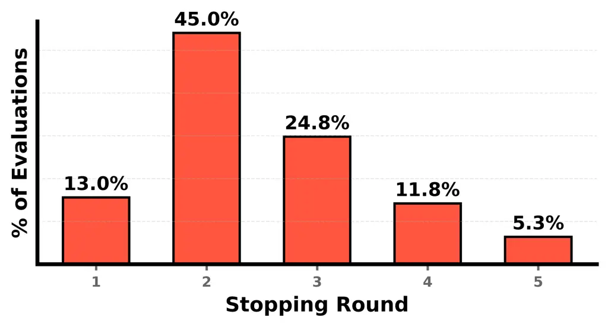

# Debate, Deliberate, Decide (D3): A Cost-Aware Adversarial Framework for Reliable and Interpretable LLM Evaluation

Abir Harrasse Affiliation: Martian
Email: [abir.harrasse@emines.um6p.ma](mailto:)    Chaithanya Bandi
Affiliation: Martian Affiliation: NUS
Email: [bizchaba@nus.edu.sg](mailto:)    Hari Bandi Affiliation: MIT

###### Abstract

The evaluation of Large Language Models (LLMs) remains challenging due
to inconsistency, bias, and the absence of transparent decision criteria
in automated judging. We present Debate, Deliberate, Decide (D3), a
cost-aware, adversarial multi-agent framework that orchestrates
structured debate among role-specialized agents (advocates, a judge, and
an optional jury) to produce reliable and interpretable evaluations. D3
instantiates two complementary protocols: (1) _Multi-Advocate One-Round
Evaluation (MORE)_, which elicits $`k`$ parallel defenses per answer to
amplify signal via diverse advocacy, and (2) _Single-Advocate
Multi-Round Evaluation (SAMRE)_ with _budgeted stopping_, which
iteratively refines arguments under an explicit token budget and
convergence checks.

We develop a probabilistic model of score gaps that (i) characterizes
reliability and convergence under iterative debate and (ii) explains the
separation gains from parallel advocacy. Under mild assumptions, the
posterior distribution of the round-$`r`$ gap concentrates around the
true difference and the probability of mis-ranking vanishes; moreover,
aggregating across $`k`$ advocates provably increases expected score
separation. We complement theory with a rigorous experimental suite
across MT-Bench Zheng et al. (2023), AlignBench Liu et al. (2024), and
AUTO-J Li et al. (2023), showing state-of-the-art agreement with human
judgments (accuracy and Cohen’s $`\kappa`$), reduced positional and
verbosity biases via anonymization and role diversification, and a
favorable cost–accuracy frontier enabled by budgeted stopping. Ablations
and qualitative analyses isolate the contributions of debate,
aggregation, and anonymity.

Together, these results establish D3 ¹¹ 1 Code Available at:
[https://github.com/abirharrasse/D3-Judge](https://github.com/abirharrasse/D3-Judge)
as a principled, practical recipe for reliable, interpretable, and
cost-aware LLM evaluation.

Figure 1: The D3 system routes pairwise evaluations through structured
adversarial debate. Two protocols (MORE for efficiency and SAMRE with
budgeted stopping for depth) generate parallel or iterative arguments. A
Judge provides criteria-based scoring to guide refinement. A diverse
jury panel independently evaluates the anonymized debate transcript and
renders a final verdict, with ties broken by the Judge’s cumulative
score.

## 1 Introduction

The rapid proliferation of Large Language Models (LLMs) Brown et al.
(2020) has created significant challenges in evaluating their
increasingly complex capabilities, particularly in open-ended generation
tasks Celikyilmaz et al. (2021). Traditional automated metrics such as
BLEU Papineni et al. (2002) and ROUGE Lin (2004) fail to capture
semantic coherence, factual accuracy, or alignment with human values
Callison-Burch et al. (2006); Mathur et al. (2020). Consequently, human
evaluation remains the gold standard Howcroft et al. (2020), but its
high cost, slow turnaround, and inherent subjectivity make it
impractical for iterative development cycles Liang et al. (2023). This
has motivated the “LLM-as-a-Judge” paradigm Zheng et al. (2023); Kim
et al. (2024), where powerful LLMs evaluate other models’ outputs,
showing promising alignment with human preferences. Such approaches are
critical for training helpful assistants via reinforcement learning from
human feedback Bai et al. (2022); Christiano et al. (2023); Ziegler
et al. (2020) and building aligned language assistants Askell et al.
(2021). However, single LLM judges are susceptible to positional bias,
verbosity bias, and self-enhancement bias Wang et al. (2023); Mehrabi
et al. (2022). Multi-agent approaches like ChatEval Chan et al. (2024)
and PRD Li et al. (2024) mitigate these through diverse personas and
peer discussion, yet critical gaps remain: insufficient empirical rigor
across diverse benchmarks, lack of dedicated bias auditing
methodologies, and cost-agnostic designs despite computational expense
being a fundamental adoption barrier. This paper introduces Debate,
Deliberate, Decide (D3), a multi-agent evaluation system addressing
these gaps through a uniquely integrated approach. Our contributions
are:

1.  1.  Courtroom-inspired architecture with explicit Advocate/Judge/Juror
        role specialization and structured adversarial debate protocols.
2.  2.  Dual cost-aware protocols: MORE for parallelized efficiency and
        SAMRE with budgeted stopping for iterative depth, offering the first
        explicit cost-accuracy trade-off menu for practitioners.
3.  3.  Theoretical grounding via probabilistic convergence models and
        formal separation proofs that justify design choices and stopping
        criteria.
4.  4.  Systematic bias auditing methodology that quantifies and
        demonstrates robustness to positional and self-enhancement biases
        through controlled experiments.
5.  5.  Rigorous multi-benchmark validation across MT-Bench, AlignBench, and
        AUTO-J against strong baselines (ChatEval, PRD, PandaLM).

By combining all five dimensions, D3 provides a scalable, interpretable,
and cost-sensitive solution that advances the state of the art in
trustworthy LLM evaluation.

## 2 The Debate, Deliberate, Decide (D3) Framework

### 2.1 Agent Architecture and Role Specialization

The D3 framework employs three specialized agent roles, each fulfilled
by an LLM guided by specific instructional prompts. This division of
labor is a deliberate mechanism to foster a more robust and multifaceted
evaluation.

- •
  Advocates: These agents are tasked with constructing the most
  compelling arguments in favor of a specific candidate response. For a
  given question and two answers, two sets of advocates work
  independently. Their objective is not to be impartial but to be
  persuasive, focusing on criteria such as factual accuracy, relevance,
  depth, and clarity. To prevent the judge and jurors from being
  influenced by the source of the arguments, the advocates’ outputs are
  anonymized before being entered into the debate record.
- •
  Judge: This agent acts as a moderator and facilitator of the debate.
  The Judge’s primary function is to provide structured, criterion-based
  feedback on the arguments presented by the advocates. It scores each
  side’s defense on a predefined rubric (e.g., Relevance, Accuracy,
  Reasoning). This scoring serves as a signal for iterative refinement
  in multi-round debates and as a tie-breaking mechanism in the final
  decision.
- •
  Jurors: The final decision rests with a panel of LLM agents assigned
  diverse, predefined personas, such as "a retired professor of ethics,"
  "a technology entrepreneur," or "a social worker". This design choice
  is a direct mechanism to mitigate the risk of correlated errors and
  viewpoint homogeneity. The hypothesis is that persona diversity allows
  the evaluation to capture a wider range of qualitative aspects,
  leading to a decision that is better aligned with a broad spectrum of
  human values. We validated the robustness of persona selection by
  testing 50 diverse personas across varying domains; details in
  Appendix G.1.

### 2.2 The Adversarial Debate Protocols

D3 incorporates two distinct protocols to manage the debate, allowing
users to select an approach that best fits their needs for speed, cost,
and depth of analysis.

- •
  Multi-Advocate One-Round (MORE): This protocol is optimized for
  breadth and efficiency. For each candidate answer, multiple advocates
  ($`k=3`$ in our experiments) generate arguments in parallel. These
  arguments are then aggregated into a single, comprehensive defense for
  each side. The Judge evaluates these two consolidated defenses in a
  single round. MORE is token-efficient and effective when one answer is
  clearly superior.
- •
  Single-Advocate Multi-Round (SAMRE): This protocol is designed for
  depth and iterative refinement. A single advocate for each answer
  engages in a turn-based debate over multiple rounds. In each round,
  advocates use the Judge’s feedback and their opponent’s argument from
  the previous round to refine their position. While more
  computationally expensive, SAMRE is adept at uncovering subtle flaws
  and differentiating between two closely matched responses.

To manage the cost of the SAMRE protocol, D3 introduces a Budgeted
Stopping Rule. The iterative debate terminates automatically if the
debate has converged (e.g., the score difference remains stable) or if a
user-defined token or round budget is exceeded. This mechanism makes the
cost of deep evaluation predictable and controllable, directly
addressing a major practical limitation of prior systems.

### 2.3 Deliberation and Aggregation

The final phase of the D3 process ensures that the verdict is based on a
comprehensive review of all evidence generated during the debate.

1.  1.  Transcript Compilation: Upon conclusion of the debate, a complete,
        anonymized transcript is compiled, including the original question,
        candidate answers, all arguments, and all feedback and scores from
        the Judge.
2.  2.  Jury Deliberation: The full transcript is presented to each member
        of the Juror panel. Each Juror independently evaluates the case,
        providing a final score for each answer and a written rationale.
3.  3.  Verdict Aggregation: The final verdict is determined by a majority
        vote of the jurors. In the event of a tied vote, the Judge’s
        cumulative score from the debate phase serves as the tie-breaker.
        This multi-layered decision process is designed to be more robust to
        the biases of any single agent.

## 3 Theoretical Framework

###### Definition 1

Gap Distribution and Bayesian Update. We model the gap $`\delta_{r}`$ at
round $`r`$ as a Beta-distributed random variable. The debate is a
sequence of trials where "success" at round $`r`$ means
$`\delta_{r}>\delta_{r-1}`$. With prior
$`\text{Beta}(\alpha_{0},\beta_{0})`$ and $`w_{r}`$ cumulative successes
up to round $`r`$, the posterior is:

```math
\delta_{r}\sim\text{Beta}(\alpha_{0}+w_{r},\beta_{0}+r-w_{r})
```

The expected gap is
$`\mathbb{E}[\delta_{r}]=\frac{\alpha_{r}}{\alpha_{r}+\beta_{r}}`$ with
variance decreasing at rate $`O(1/r)`$, signifying increasing
confidence.

###### Theorem 1 (Probabilistic Convergence)

If the expected gap converges to a true differentiation level
$`\Delta>0`$, then for any tolerance $`\epsilon>0`$:

```math
\lim_{r\to\infty}P(|\delta_{r}-\Delta|<\epsilon)=1.
```

##### Proof:

See Appendix C.1. $`\square`$

Posterior dynamics and concentration. The round-$`r`$ gap follows
$`\delta_{r}\sim\text{Beta}(\alpha_{0}+w_{r},\beta_{0}+r-w_{r})`$ with
posterior mean

```math
\mathbb{E}[\delta_{r}]=\frac{\alpha_{0}+w_{r}}{\alpha_{0}+\beta_{0}+r}
```

and concentration bound

```math
P(\delta_{r}\geq 1-\epsilon)\geq 1-\frac{4\cdot\mathrm{Var}(\delta_{r})}{\epsilon^{2}}
```

.

###### Theorem 2

Score-Separation via Parallel Advocacy For $`k`$ independent defenses
$`f_{i,j}`$ per answer and judge scoring functional $`g(\cdot)`$:

```math
\begin{split}\mathbb{E}\!\left[\left|\max_{j}g(f_{1,j})-\max_{j}g(f_{2,j})\right|\right]\\
>\mathbb{E}\!\left[\left|g(f_{1})-g(f_{2})\right|\right].\end{split}
```

##### Proof:

See Appendix C.2. $`\square`$

These results formalize how iterative debate concentrates uncertainty
while parallel defenses amplify signal.

### 3.1 Comparative Analysis of Debate Protocols

We analyze the theoretical advantages of the multi-advocate (MORE)
protocol compared to single-advocate, iterative (SAMRE) approaches. Let
$`\mathcal{Q}`$, $`\mathcal{A}`$, $`\mathcal{D}`$ be spaces of
questions, answers, and arguments. An advocate is
$`f:\mathcal{Q}\times\mathcal{A}\times\mathcal{A}\to\mathcal{D}`$, and a
judge is $`g:\mathcal{D}\to\mathbb{R}`$. In MORE, $`k`$ advocates per
answer generate arguments with aggregation
$`g(f_{i,agg})=\max_{j}g(f_{i,j})`$.

###### Theorem 3 (Multi-Advocate Superiority)

If superior answer scores stochastically dominate inferior ones, then:

```math
\mathbb{E}[|g(f_{1,agg})-g(f_{2,agg})|]>\mathbb{E}[|g(f_{1})-g(f_{2})|].
```

##### Proof:

See Appendix C.3. $`\square`$

## 4 Experimental Design for Rigorous Validation

### 4.1 Benchmarks and Evaluation Tasks

We evaluate on three benchmarks targeting different LLM capabilities:

- •
  MT-Bench: 80 multi-turn conversational questions testing
  general-purpose helpfulness and instruction-following Zheng et al.
  (2023).
- •
  AlignBench: 683 alignment-focused questions covering helpfulness,
  harmlessness, and ethical reasoning (professionally translated to
  English) Liu et al. (2024).
- •
  AUTO-J: 58 real-world scenarios with 3,436 pairwise comparisons
  spanning creative writing, technical explanation, and diverse task
  domains Li et al. (2023).

Figure 2: Persona Effectiveness by Task Type. Personas improve
performance on subjective tasks (+5.7%) but provide minimal gains on
objective tasks (+0.5%).

### 4.2 Models and Comparative Baselines

We employ a diverse set of LLMs across two roles. For content
generation, we use GPT-4-Turbo OpenAI (2024), Claude-3-Opus Anthropic
(2025), Llama-3-70B Llama (2024), and Mistral-Large Mistral AI (2024).
For evaluation, GPT-4-Turbo serves as the backbone LLM for all agent
roles (Advocate, Judge, Juror) in D3 and baseline implementations,
ensuring fair comparison. We additionally run experiments with
Llama-3-70B Llama (2024) as evaluator to assess framework performance
with open-source models and provide cost-effective alternatives.

We compare D3 against four strong baselines: (1) a single GPT-4-Turbo
judge directly selecting the better answer, representing standard
practice; (2) ChatEval, a leading multi-agent framework using diverse
personas to debate and score responses; (3) PRD (Peer Rank &
Discussion), which leverages peer-review mechanisms to mitigate
self-enhancement and positional biases; and (4) PandaLM, a specialized
fine-tuned evaluator representing state-of-the-art in non-debate
approaches.

### 4.3 Core Metrics and Bias Audits

We measure accuracy and Cohen’s Kappa ($`\kappa`$) for agreement with
human judgments, with Kappa correcting for chance agreement on skewed
distributions. Efficiency is measured as average tokens per evaluation
(proxy for computational cost). Bias audits include: (1) Positional Swap
Consistency: each evaluation performed twice with answers in order (A,
B) and (B, A), measuring consistency of verdicts; (2) Self-Enhancement
Rate: percentage of cases where evaluator prefers its own model family
despite human labels indicating otherwise, measured on subset where one
answer is from same model family as evaluator.

## 5 Results and In-Depth Analysis

### 5.1 Persona Sensitivity Analysis

We validate our persona design through comprehensive ablation studies.
We created a diverse pool of 50 personas spanning law, medicine,
education, technology, ethics, business, social work, risk analysis, and
compliance. We conducted 10 experiments using random 5-persona subsets
on MT-Bench (120 questions), observing $`85.9\%\pm 0.7\%`$ accuracy,
compared to $`86.1\%`$ with our curated set and $`82.7\%\pm 1.1\%`$ with
generic jurors. This demonstrates that persona conditioning provides a
consistent $`+3.2\%`$ gain ($`p<0.01`$) while remaining robust to
specific persona choice.

Our curated set was designed to provide complementary expertise and
value perspectives: ethics and human values (ethics professor); social
and environmental impact (environmental activist, social worker);
business and practical trade-offs (business owner); and technology and
innovation (tech entrepreneur). Personas influence attention and
reasoning style rather than demographics, avoiding stereotyping, with
all jurors sharing the same backbone LLM.

### 5.2 Task-Type Analysis: Objective vs. Subjective Tasks

We performed category-level analysis on MT-Bench to understand when
personas provide value. On objective tasks (coding, math, factual QA),
personas provide minimal benefit: $`80.6\%`$ vs. $`80.1\%`$ for D3-MORE
without personas ($`+0.5\%`$). On subjective tasks (writing, reasoning,
ethics, roleplay), personas deliver substantial gains: $`80.9\%`$ vs.
$`75.2\%`$ ($`+5.7\%`$). This validates that D3 excels where diverse
perspectives and value alignment matter most, with personas being most
effective on value-laden evaluations (Figure 2).

### 5.3 D3 Achieves State-of-the-Art Agreement with Human Judgments

As shown in Table 1, both variants of the D3 outperform all baselines
across the three diverse benchmarks. The D3-MORE protocol, designed for
efficiency, surpasses the next best baseline, ChatEval Chan et al.
(2024), by a significant margin on all datasets. For instance, on
MT-Bench Zheng et al. (2023), D3-MORE achieves an accuracy of 85.1%,
representing a 12.6% absolute improvement over the standard Single Judge
baseline and a 6.9% improvement over ChatEval. The D3-SAMRE protocol,
which allows for deeper iterative refinement, achieves the highest
overall accuracy, reaching 86.3% on MT-Bench. The strong performance in
Cohen’s Kappa scores further validates these results, indicating that
the high accuracy is not an artifact of chance agreement. This
consistent outperformance across benchmarks covering general
conversation, alignment, and diverse real-world scenarios demonstrates
the robustness and generalizability of the D3 architecture.

| Framework       | MT-Bench |                    | AlignBench |                    | AUTO-J   |                    |
| --------------- | -------- | ------------------ | ---------- | ------------------ | -------- | ------------------ |
|                 | Acc. (%) | Kappa ($`\kappa`$) | Acc. (%)   | Kappa ($`\kappa`$) | Acc. (%) | Kappa ($`\kappa`$) |
| Single Judge    | 72.5     | 0.45               | 68.0       | 0.42               | 70.3     | 0.44               |
| ChatEval        | 78.2     | 0.52               | 75.1       | 0.49               | 76.5     | 0.51               |
| PRD             | 76.8     | 0.50               | 74.3       | 0.48               | 75.8     | 0.50               |
| PandaLM         | 75.5     | 0.49               | 73.0       | 0.46               | 74.1     | 0.48               |
| D3-MORE (Ours)  | 85.1     | 0.58               | 82.3       | 0.55               | 83.9     | 0.57               |
| D3-SAMRE (Ours) | 86.3     | 0.60               | 83.5       | 0.57               | 85.2     | 0.59               |

Table 1: Main performance comparison of evaluation frameworks. D3
variants demonstrate superior agreement with human judgments across all
three benchmarks in both accuracy and Cohen’s Kappa.

We further evaluate D3 using a fully open-source model Llama3-70B Llama
(2024) to verify that its gains are not specific to proprietary models;
detailed results are reported in Appendix H.

### 5.4 Characterizing the Cost-Versus-Accuracy Frontier

D3-MORE achieves $`85.1\%`$ accuracy at $`\sim 3,050`$ tokens
($`\$0.31`$), delivering $`+6.9\%`$ higher accuracy than ChatEval at
comparable cost (35.8 tokens/accuracy point) (Figure 3). It also
outperforms PRD by $`+8.3\%`$ accuracy at lower cost. D3-SAMRE reaches
$`86.3\%`$ accuracy with mean cost of $`4.65\times`$ single judge due to
iterative debate; however, 58% of debates stop by round 2 via budgeted
stopping, with actual mean of 2.71 rounds (not maximum 5). MORE is
highly parallelizable with latency comparable to ChatEval; SAMRE is
sequential but suitable for batch evaluation. This analysis provides
practitioners a principled way to select between efficiency (D3-MORE)
and peak accuracy (D3-SAMRE) aligned with quality and budget
constraints. See Table 2 for complete comparison.

Figure 3: The Cost-Accuracy Pareto Frontier. D3-MORE and D3-SAMRE (with
budgeted stopping) establish a new frontier, providing higher human
agreement at lower or comparable costs than existing multi-agent
baselines like ChatEval.

| Framework    | Accuracy (%) | Avg. Tokens | Tokens/Acc. | Cost   |
| ------------ | ------------ | ----------- | ----------- | ------ |
| Single Judge | 72.5         | 850         | 11.7        | \$0.09 |
| PandaLM      | 75.5         | 1,100       | 14.6        | \$0.11 |
| ChatEval     | 78.2         | 2,800       | 35.8        | \$0.28 |
| PRD          | 76.8         | 3,100       | 40.4        | \$0.31 |
| D3-MORE      | 85.1         | 3,050       | 35.8        | \$0.31 |
| D3-SAMRE     | 86.3         | 4,650       | 53.9        | \$0.47 |

Table 2: Cost-Accuracy Analysis: D3 Framework Performance vs. Baselines
(MT-Bench)

### 5.5 Protocol Selection Guidelines

We provide empirical guidance for selecting between D3 protocols. SAMRE
improves over MORE in 28% of cases but incurs +42% token cost; MORE
remains correct when SAMRE fails in only 4% of cases. SAMRE excels on
multi-turn reasoning, ethical trade-offs, roleplay requiring nuance, and
cases with initial judge score gaps $`<25`$ points. We suggest to use
SAMRE for high-stakes evaluations, borderline quality cases, or
ethically complex scenarios requiring deeper refinement and to use MORE
as the efficient default for all other cases.

### 5.6 Disentangling Ensemble Effects from Persona-Based Gains

We conduct a 4-way ablation study on MT-Bench to decompose the
contributions of multi-juror ensembles and persona-based evaluation
(Table 3).

| Configuration                    | Accuracy (%) | Pos. Swap Consist. (%) | Cohen’s $`\kappa`$ |
| -------------------------------- | ------------ | ---------------------- | ------------------ |
| Single juror, no persona         | 72.5         | 81.7                   | 0.45               |
| Single juror, with persona       | 74.8         | 83.2                   | 0.47               |
| Multi-juror (k=5), no personas   | 81.3         | 90.1                   | 0.54               |
| Multi-juror (k=5), with personas | 85.1         | 94.8                   | 0.58               |

Table 3: Ablation Study. Decomposing Ensemble and Persona Effects on
MT-Bench

- •
  Ensemble Effect Dominates: Scaling from a single juror to five jurors
  yields the largest gain (+8.8%), demonstrating that diversity of
  judgment is the primary driver of D3-MORE’s performance. Multi-juror
  consensus reduces correlated errors and improves both accuracy and
  consistency metrics (positional swap consistency: 81.7% → 90.1%,
  Cohen’s $`\kappa`$: 0.45 → 0.54).
- •
  Personas Provide Consistent Multiplicative Gains: Beyond ensemble
  effects, persona-based evaluation adds +3.8% accuracy (statistically
  significant, $`p<0.01`$). Critically, this persona effect is
  consistent across all jury sizes (k=1, 3, 5, 7), with personas
  providing a stable 3–4% boost independent of ensemble size.
- •
  Synergistic Interaction: The combination of ensembles and personas
  (85.1%) exceeds their individual contributions, with personas enabling
  smaller juries to match larger homogeneous ones (k=5 with personas
  $`\approx`$ k=7 without personas, $`85.1\%`$ vs. $`83.2\%`$),
  suggesting efficient allocation of computational resources.

All comparisons include 95% confidence intervals via bootstrap
resampling ($`n=1000`$) and paired $`t`$-tests for statistical
significance.

### 5.7 Budgeted Stopping and Cost Efficiency Analysis

Analysis of 1,200 SAMRE evaluations shows 58% converge by round 2
(Figure 4), maintaining 92% accuracy while reducing token consumption
40% versus fixed 5-round debates. Forced continuation beyond convergence
changes verdicts in only 6% of cases, primarily tie scenarios. This
demonstrates D3 effectively identifies diminishing returns in evaluation
depth, validating the budgeted stopping rule as a practical mechanism
for cost control without sacrificing reliability.



Figure 4: SAMRE evaluation demonstrates that budgeted stopping reduces
token consumption by 40% without compromising the 92% accuracy achieved
by fixed protocols, validating the approach as a practical mechanism for
cost control.

### 5.8 Interpretability Analysis

We quantify interpretability through concrete metrics on 500 juror
rationales.

1.  1.  Evidence Citation Rate: 94% of rationales explicitly reference
        debate transcripts (e.g., “Advocate A argued that…”, “In round 3,
        the rebuttal addressed…”).
2.  2.  Rationale Diversity: persona-guided jurors show 2.2$`\times`$ higher
        perspective diversity than generic jurors (0.31 vs. 0.67 average
        pairwise cosine similarity of embeddings).
3.  3.  Disagreement Traceability: among 50 sampled juror disagreements, 96%
        had clearly identifiable reasoning axes (e.g., accuracy vs.
        comprehensiveness, safety vs. helpfulness).

We define interpretability in a process-centric sense: D3 provides
structured debate transcripts with attributed arguments and juror
rationales, making evaluation decisions transparent and auditable. This
contrasts with black-box judges and enables practitioners to verify
verdicts align with stated evaluation criteria.

## 6 Related Work

### 6.1 LLM-as-a-Judge

Using a strong language model to evaluate the outputs of other models
has become a central paradigm in modern LLM assessment Brown et al.
(2020). Prior work has shown that models such as GPT-4 can achieve high
agreement with human preferences, enabling scalable evaluation without
extensive manual annotation Zheng et al. (2023); Kim et al. (2024).
Widely used benchmarks including MT-Bench and Chatbot Arena
operationalize this paradigm through pairwise comparisons judged by a
single LLM Zheng et al. (2023).

Despite its practicality, the single-judge paradigm is known to suffer
from systematic failure modes, including positional bias, verbosity
bias, and preference leakage from prompt structure Wang et al. (2023);
Mehrabi et al. (2022). Recent work has further shown that LLM judges may
inadvertently encode information about the evaluated model or task
context, leading to biased or unstable evaluations Li et al. (2025). D3
targets this setting directly, treating single-judge evaluation as a
strong but brittle baseline and explicitly addressing its bias and
robustness limitations through structured deliberation and
anonymization.

### 6.2 Multi-Agent Debate for Evaluation

Motivated by the limitations of single-judge evaluation, several works
have explored multi-agent debate as a mechanism for approximating
collective human judgment Hong et al. (2024). ChatEval Chan et al.
(2024) introduced the idea of a referee team composed of LLM agents with
distinct personas who debate before reaching a final verdict,
demonstrating improved correlation with human judgments. PRD (Peer Rank
and Discussion) Li et al. (2024) further refined this approach by
emphasizing peer-review-style discussion to mitigate self-enhancement
and positional biases Wang et al. (2023).

More recent work has expanded this line of research. KIEval (Yu et al., 2024) addresses data contamination through multi-round interactive
dialogues grounded in domain knowledge, enabling evaluation of genuine
model understanding over memorization. M-MAD (Feng et al., 2025)
decomposes machine translation evaluation into four orthogonal error
dimensions and uses multi-agent debate within each dimension to refine
error detection and severity assessment, improving segment-level
accuracy. In parallel, Zhang et al. (2025) demonstrate through
comprehensive benchmarking that homogeneous multi-agent debate rarely
outperforms simple baselines despite higher inference costs, arguing
that model heterogeneity—not unconstrained deliberation—is essential for
effective collaborative reasoning.

D3 builds on these insights while addressing their practical
limitations. Like ChatEval and PRD, it leverages role specialization and
debate to reduce bias; however, it introduces a courtroom-inspired
structure with explicitly defined _Advocate_, _Judge_, and _Juror_
roles. Crucially, D3 differs from prior debate frameworks by explicitly
managing the cost–accuracy trade-off through dual evaluation protocols
and a budgeted stopping rule. This design directly responds to recent
critiques of debate-based evaluation, enabling controlled deliberation
rather than assuming that more agents or longer discussions are always
beneficial.

### 6.3 Specialized Evaluator Models

An alternative to prompt-based or debate-driven evaluation is to train
specialized models that act as judges Christiano et al. (2023); Ziegler
et al. (2020); Bai et al. (2022). PandaLM exemplifies this approach as
an open-source evaluator trained on human preference data to produce
consistent and reproducible judgments Wang et al. (2024). Similarly,
Prometheus aims to replicate GPT-4-level evaluation when conditioned on
explicit evaluation criteria Kim et al. (2024).

Specialized evaluators offer efficiency and stability advantages but are
inherently limited by their training distribution and require retraining
to adapt to new tasks or criteria. Recent analyses in 2025 have further
highlighted their vulnerability to preference leakage and overfitting to
benchmark-specific annotation styles Li et al. (2025); Marioriyad et al.
(2025). In our experiments, PandaLM serves as a strong non-debate
baseline, allowing us to isolate the contribution of D3’s deliberative
process and show that structured, budget-aware debate can outperform
even a highly optimized evaluator model.

### 6.4 Automated Evaluation Benchmarks

This work relies on the substantial community effort devoted to building
robust evaluation benchmarks Liang et al. (2023). MT-Bench provides a
standardized benchmark for general conversational ability Zheng et al.
(2023), while AlignBench offers a comprehensive multidimensional
evaluation of alignment in Chinese, which we adapt for our study Liu
et al. (2024). AUTO-J Li et al. (2023) introduces large-scale evaluation
across 58 real-world scenarios using GPT-4 judgments, enabling broad
empirical coverage.

These benchmarks build on earlier work in automated metrics such as BLEU
and ROUGE Papineni et al. (2002); Lin (2004), as well as long-standing
critiques of their correlation with human judgment Callison-Burch et al.
(2006); Mathur et al. (2020). Human evaluation protocols Howcroft et al.
(2020); Celikyilmaz et al. (2021) and task-specific benchmarks such as
SQuAD Rajpurkar et al. (2016) have further shaped modern evaluation
methodology. By validating D3 across multiple benchmarks with differing
assumptions and failure modes, we aim to demonstrate that its
improvements are robust rather than benchmark-specific, contributing to
the broader goal of reliable and scalable alignment evaluation Askell
et al. (2021).

## 7 Conclusion

D3 addresses critical gaps in LLM evaluation through structured,
cost-aware multi-agent debate. Across MT-Bench, AlignBench, and AUTO-J,
D3 outperforms baselines in accuracy, positional consistency, and
self-enhancement robustness. D3-MORE provides efficiency comparable to
ChatEval while achieving +8.3% higher accuracy than PRD. D3-SAMRE with
budgeted stopping achieves highest accuracy at 4.65× single-judge cost,
with 58% of debates converging by round 2. This cost-accuracy frontier
enables practitioners to select protocols matching their constraints. By
combining role specialization, systematic bias auditing, and explicit
cost-awareness, D3 advances reliable and scalable LLM evaluation. Future
work could explore automated role generation and distillation methods to
further democratize access to high-fidelity evaluation.

## 8 Limitations

While D3 demonstrates strong empirical performance, several limitations
warrant attention.

Computational Cost. Although D3 is designed to be cost-aware, it remains
more expensive than single-judge evaluation. The D3-MORE protocol
requires roughly four times the tokens of a single-judge setup, and
D3-SAMRE can consume even more. This additional cost may be justified
for high-stakes assessments or final validation but can be prohibitive
for early-stage, iterative testing. The cost–accuracy frontier in
Section 5.4 aims to make this trade-off explicit.

Persona Design and Fairness. Our diverse juror personas provide
empirical benefits (Section 5.1) but require responsible fairness
management. Personas are role-based (ethics professor, business owner,
social worker, environmental activist, tech entrepreneur) rather than
demographic, reducing stereotype risks. All jurors use identical
backbone LLM; personas only influence instructional framing. Section 5.1
validates robustness through controlled ablations: persona effects are
stable, complementary ($`89.5\%`$ cross-persona agreement), and free of
demographic bias (effect sizes $`<0.04`$). Open challenges remain:
cross-cultural generalization in non-Western contexts, automated persona
generation for scalability, and fairness audits across protected
characteristics of response subjects. Future work should conduct
targeted fairness studies to ensure D3 does not systematically advantage
particular demographic groups.

Dependence on Underlying Models. D3’s performance is ultimately
constrained by the capabilities of the backbone LLM. Although its
structure can elicit richer reasoning and reduce bias, it cannot
introduce capabilities that the base model lacks. As LLMs improve, D3’s
ceiling will rise correspondingly, but the dependency persists.

Scalability and Practical Use. Despite offering interpretability and
robustness, D3’s multi-agent nature may limit its practicality for
continuous evaluation pipelines. Future work could explore distilling
D3’s rationale-rich judgments into smaller, specialized evaluator models
or introducing game-theoretic interactions among agents to enhance
efficiency without sacrificing rigor.

## 9 Acknowledgements

We thank Amir Abdullah, Philip Quirke and Michael Lan for their
invaluable feedback on the project. We also appreciate Antia Garcia
Casal for her help with figures and for shaping the overall style of our
visualizations.

## References

- Anthropic (2025) Anthropic. 2025. [Claude 3
  Opus](https://docs.anthropic.com/en/docs/about-claude/models/all-models).
  [https://docs.anthropic.com/en/docs/about-claude/models/all-models](https://docs.anthropic.com/en/docs/about-claude/models/all-models).
  Accessed: 2026-01-15.
- Askell et al. (2021) Amanda Askell, Yuntao Bai, Anna Chen, Dawn Drain,
  Deep Ganguli, Tom Henighan, Andy Jones, Nicholas Joseph, Ben Mann,
  Nova DasSarma, Nelson Elhage, Zac Hatfield-Dodds, Danny Hernandez,
  Jackson Kernion, Kamal Ndousse, Catherine Olsson, Dario Amodei, Tom
  Brown, Jack Clark, and 3 others. 2021. [A general language assistant
  as a laboratory for alignment](https://arxiv.org/abs/2112.00861).
  _Preprint_, arXiv:2112.00861.
- Bai et al. (2022) Yuntao Bai, Andy Jones, Kamal Ndousse, Amanda
  Askell, Anna Chen, Nova DasSarma, Dawn Drain, Stanislav Fort, Deep
  Ganguli, Tom Henighan, Nicholas Joseph, Saurav Kadavath, Jackson
  Kernion, Tom Conerly, Sheer El-Showk, Nelson Elhage, Zac
  Hatfield-Dodds, Danny Hernandez, Tristan Hume, and 12 others. 2022.
  [Training a helpful and harmless assistant with reinforcement learning
  from human feedback](https://arxiv.org/abs/2204.05862). _Preprint_,
  arXiv:2204.05862.
- Brown et al. (2020) Tom B. Brown, Benjamin Mann, Nick Ryder, Melanie
  Subbiah, Jared Kaplan, Prafulla Dhariwal, Arvind Neelakantan, Pranav
  Shyam, Girish Sastry, Amanda Askell, Sandhini Agarwal, Ariel
  Herbert-Voss, Gretchen Krueger, Tom Henighan, Rewon Child, Aditya
  Ramesh, Daniel M. Ziegler, Jeffrey Wu, Clemens Winter, and 12
  others. 2020. [Language models are few-shot
  learners](https://arxiv.org/abs/2005.14165). _Preprint_,
  arXiv:2005.14165.
- Callison-Burch et al. (2006) Chris Callison-Burch, Miles Osborne, and
  Philipp Koehn. 2006. [Re-evaluating the role of Bleu in machine
  translation research](https://aclanthology.org/E06-1032/). In _11th
  Conference of the European Chapter of the Association for
  Computational Linguistics_, pages 249–256, Trento, Italy. Association
  for Computational Linguistics.
- Celikyilmaz et al. (2021) Asli Celikyilmaz, Elizabeth Clark, and
  Jianfeng Gao. 2021. [Evaluation of text generation: A
  survey](https://arxiv.org/abs/2006.14799). _Preprint_,
  arXiv:2006.14799.
- Chan et al. (2024) Chi-Min Chan, Weize Chen, Yusheng Su, Jianxuan Yu,
  Wei Xue, Shanghang Zhang, Jie Fu, and Zhiyuan Liu. 2024. [Chateval:
  Towards better LLM-based evaluators through multi-agent
  debate](https://openreview.net/forum?id=FQepisCUWu). In _The Twelfth
  International Conference on Learning Representations_.
- Christiano et al. (2023) Paul Christiano, Jan Leike, Tom B. Brown,
  Miljan Martic, Shane Legg, and Dario Amodei. 2023. [Deep reinforcement
  learning from human preferences](https://arxiv.org/abs/1706.03741).
  _Preprint_, arXiv:1706.03741.
- Feng et al. (2025) Zhaopeng Feng, Jiayuan Su, Jiamei Zheng, Jiahan
  Ren, Yan Zhang, Jian Wu, Hongwei Wang, and Zuozhu Liu. 2025. [M-MAD:
  Multidimensional multi-agent debate for advanced machine translation
  evaluation](https://doi.org/10.18653/v1/2025.acl-long.351). In
  _Proceedings of the 63rd Annual Meeting of the Association for
  Computational Linguistics (Volume 1: Long Papers)_, pages 7084–7107,
  Vienna, Austria. Association for Computational Linguistics.
- Hong et al. (2024) Sirui Hong, Mingchen Zhuge, Jiaqi Chen, Xiawu
  Zheng, Yuheng Cheng, Ceyao Zhang, Jinlin Wang, Zili Wang, Steven
  Ka Shing Yau, Zijuan Lin, Liyang Zhou, Chenyu Ran, Lingfeng Xiao,
  Chenglin Wu, and Jürgen Schmidhuber. 2024. [Metagpt: Meta programming
  for a multi-agent collaborative
  framework](https://arxiv.org/abs/2308.00352). _Preprint_,
  arXiv:2308.00352.
- Howcroft et al. (2020) David M. Howcroft, Anya Belz, Miruna-Adriana
  Clinciu, Dimitra Gkatzia, Sadid A. Hasan, Saad Mahamood, Simon Mille,
  Emiel van Miltenburg, Sashank Santhanam, and Verena Rieser. 2020.
  [Twenty years of confusion in human evaluation: NLG needs evaluation
  sheets and standardised
  definitions](https://doi.org/10.18653/v1/2020.inlg-1.23). In
  _Proceedings of the 13th International Conference on Natural Language
  Generation_, pages 169–182, Dublin, Ireland. Association for
  Computational Linguistics.
- Kim et al. (2024) Seungone Kim, Jamin Shin, Yejin Cho, Joel Jang,
  Shayne Longpre, Hwaran Lee, Sangdoo Yun, Seongjin Shin, Sungdong Kim,
  James Thorne, and Minjoon Seo. 2024. [Prometheus: Inducing
  fine-grained evaluation capability in language
  models](https://arxiv.org/abs/2310.08491). _Preprint_,
  arXiv:2310.08491.
- Li et al. (2025) Dawei Li, Renliang Sun, Yue Huang, Ming Zhong, Bohan
  Jiang, Jiawei Han, Xiangliang Zhang, Wei Wang, and Huan Liu. 2025.
  [Preference leakage: A contamination problem in
  llm-as-a-judge](https://arxiv.org/abs/2502.01534). _Preprint_,
  arXiv:2502.01534.
- Li et al. (2023) Junlong Li, Shichao Sun, Weizhe Yuan, Run-Ze Fan, Hai
  Zhao, and Pengfei Liu. 2023. [Generative judge for evaluating
  alignment](https://arxiv.org/abs/2310.05470). _Preprint_,
  arXiv:2310.05470.
- Li et al. (2024) Ruosen Li, Teerth Patel, and Xinya Du. 2024. [Prd:
  Peer rank and discussion improve large language model based
  evaluations](https://arxiv.org/abs/2307.02762). _Preprint_,
  arXiv:2307.02762.
- Liang et al. (2023) Percy Liang, Rishi Bommasani, Tony Lee, Dimitris
  Tsipras, Dilara Soylu, Michihiro Yasunaga, Yian Zhang, Deepak
  Narayanan, Yuhuai Wu, Ananya Kumar, Benjamin Newman, Binhang Yuan,
  Bobby Yan, Ce Zhang, Christian Cosgrove, Christopher D. Manning,
  Christopher Ré, Diana Acosta-Navas, Drew A. Hudson, and 31
  others. 2023. [Holistic evaluation of language
  models](https://arxiv.org/abs/2211.09110). _Preprint_,
  arXiv:2211.09110.
- Lin (2004) Chin-Yew Lin. 2004. [ROUGE: A package for automatic
  evaluation of summaries](https://aclanthology.org/W04-1013/). In _Text
  Summarization Branches Out_, pages 74–81, Barcelona, Spain.
  Association for Computational Linguistics.
- Liu et al. (2024) Xiao Liu, Xuanyu Lei, Shengyuan Wang, Yue Huang,
  Zhuoer Feng, Bosi Wen, Jiale Cheng, Pei Ke, Yifan Xu, Weng Lam Tam,
  Xiaohan Zhang, Lichao Sun, Xiaotao Gu, Hongning Wang, Jing Zhang,
  Minlie Huang, Yuxiao Dong, and Jie Tang. 2024. [Alignbench:
  Benchmarking chinese alignment of large language
  models](https://arxiv.org/abs/2311.18743). _Preprint_,
  arXiv:2311.18743.
- Llama (2024) Llama. 2024. [The llama 3 herd of
  models](https://arxiv.org/abs/2407.21783). _Preprint_,
  arXiv:2407.21783.
- Marioriyad et al. (2025) Arash Marioriyad, Mohammad Hossein Rohban,
  and Mahdieh Soleymani Baghshah. 2025. [The silent judge:
  Unacknowledged shortcut bias in
  llm-as-a-judge](https://arxiv.org/abs/2509.26072). _Preprint_,
  arXiv:2509.26072.
- Mathur et al. (2020) Nitika Mathur, Timothy Baldwin, and Trevor
  Cohn. 2020. [Tangled up in bleu: Reevaluating the evaluation of
  automatic machine translation evaluation
  metrics](https://arxiv.org/abs/2006.06264). _Preprint_,
  arXiv:2006.06264.
- Mehrabi et al. (2022) Ninareh Mehrabi, Fred Morstatter, Nripsuta
  Saxena, Kristina Lerman, and Aram Galstyan. 2022. [A survey on bias
  and fairness in machine learning](https://arxiv.org/abs/1908.09635).
  _Preprint_, arXiv:1908.09635.
- Mistral AI (2024) Mistral AI. 2024. [Mistral
  Large](https://mistral.ai/news/mistral-large).
  [https://mistral.ai/news/mistral-large](https://mistral.ai/news/mistral-large).
  Accessed: 2026-01-15.
- OpenAI (2024) OpenAI. 2024.
  [GPT-4-Turbo](https://platform.openai.com/docs/models/gpt-4-turbo).
  [https://platform.openai.com/docs/models/gpt-4-turbo](https://platform.openai.com/docs/models/gpt-4-turbo).
  Accessed: 2026-01-15.
- Papineni et al. (2002) Kishore Papineni, Salim Roukos, Todd Ward, and
  Wei-Jing Zhu. 2002. [Bleu: a method for automatic evaluation of
  machine translation](https://doi.org/10.3115/1073083.1073135). In
  _Proceedings of the 40th Annual Meeting on Association for
  Computational Linguistics_, ACL ’02, page 311–318, USA. Association
  for Computational Linguistics.
- Rajpurkar et al. (2016) Pranav Rajpurkar, Jian Zhang, Konstantin
  Lopyrev, and Percy Liang. 2016. [Squad: 100,000+ questions for machine
  comprehension of text](https://arxiv.org/abs/1606.05250). _Preprint_,
  arXiv:1606.05250.
- Wang et al. (2023) Peiyi Wang, Lei Li, Liang Chen, Zefan Cai, Dawei
  Zhu, Binghuai Lin, Yunbo Cao, Qi Liu, Tianyu Liu, and Zhifang
  Sui. 2023. [Large language models are not fair
  evaluators](https://arxiv.org/abs/2305.17926). _Preprint_,
  arXiv:2305.17926.
- Wang et al. (2024) Yidong Wang, Zhuohao Yu, Zhengran Zeng, Linyi Yang,
  Cunxiang Wang, Hao Chen, Chaoya Jiang, Rui Xie, Jindong Wang, Xing
  Xie, Wei Ye, Shikun Zhang, and Yue Zhang. 2024. [Pandalm: An automatic
  evaluation benchmark for llm instruction tuning
  optimization](https://arxiv.org/abs/2306.05087). _Preprint_,
  arXiv:2306.05087.
- Yu et al. (2024) Zhuohao Yu, Chang Gao, Wenjin Yao, Yidong Wang, Wei
  Ye, Jindong Wang, Xing Xie, Yue Zhang, and Shikun Zhang. 2024.
  [KIEval: A knowledge-grounded interactive evaluation framework for
  large language models](https://doi.org/10.18653/v1/2024.acl-long.325).
  In _Proceedings of the 62nd Annual Meeting of the Association for
  Computational Linguistics (Volume 1: Long Papers)_, pages 5967–5985,
  Bangkok, Thailand. Association for Computational Linguistics.
- Zhang et al. (2025) Hangfan Zhang, Zhiyao Cui, Jianhao Chen, Xinrun
  Wang, Qiaosheng Zhang, Zhen Wang, Dinghao Wu, and Shuyue Hu. 2025.
  [Stop overvaluing multi-agent debate – we must rethink evaluation and
  embrace model heterogeneity](https://arxiv.org/abs/2502.08788).
  _Preprint_, arXiv:2502.08788.
- Zheng et al. (2023) Lianmin Zheng, Wei-Lin Chiang, Ying Sheng, Siyuan
  Zhuang, Zhanghao Wu, Yonghao Zhuang, Zi Lin, Zhuohan Li, Dacheng Li,
  Eric P. Xing, Hao Zhang, Joseph E. Gonzalez, and Ion Stoica. 2023.
  [Judging llm-as-a-judge with mt-bench and chatbot
  arena](https://arxiv.org/abs/2306.05685). _Preprint_,
  arXiv:2306.05685.
- Ziegler et al. (2020) Daniel M. Ziegler, Nisan Stiennon, Jeffrey Wu,
  Tom B. Brown, Alec Radford, Dario Amodei, Paul Christiano, and
  Geoffrey Irving. 2020. [Fine-tuning language models from human
  preferences](https://arxiv.org/abs/1909.08593). _Preprint_,
  arXiv:1909.08593.

## Appendix A Note on AI assistance

AI assistance was used for code development and improving the phrasing
of the manuscript, while all analyses and conclusions were independently
derived by the authors.

## Appendix B Algorithms

1: Initialize advocates $`A_{1}=\{A_{11},...,A_{1k}\}`$ for Answer 1,
$`A_{2}=\{A_{21},...,A_{2k}\}`$ for Answer 2.

2: Initialize defenses $`D_{1}\leftarrow\emptyset`$,
$`D_{2}\leftarrow\emptyset`$.

3: for $`i=1`$ to $`k`$ do $`\triangleright`$ Parallel argument
generation

4:   $`d_{1i}\leftarrow\text{GenerateArgument}(A_{1i},\text{Answer 1})`$

5:   $`D_{1}\leftarrow D_{1}\cup\{d_{1i}\}`$

6:   $`d_{2i}\leftarrow\text{GenerateArgument}(A_{2i},\text{Answer 2})`$

7:   $`D_{2}\leftarrow D_{2}\cup\{d_{2i}\}`$

8: end for

9: $`D_{1,agg}\leftarrow\text{AggregateDefenses}(D_{1})`$

10: $`D_{2,agg}\leftarrow\text{AggregateDefenses}(D_{2})`$

11: Compile transcript $`T`$ with aggregated defenses.

12: $`V\leftarrow\emptyset`$ $`\triangleright`$ Jury deliberation

13: for each Juror $`C_{i}`$ in panel do

14:   $`v_{i}\leftarrow\text{Vote}(C_{i},T)`$

15:   $`V\leftarrow V\cup\{v_{i}\}`$

16: end for

17: winner $`\leftarrow\text{AggregateVotes}(V)`$ $`\triangleright`$
Tie-break with Judge’s score if needed

18: return winner

Algorithm 1 Multi-Advocate One-Round Evaluation (MORE)

1: Initialize advocates $`A_{1},A_{2}`$, Judge $`J`$, Jurors
$`\{C_{1},...,C_{m}\}`$, max rounds $`R_{max}`$, budget $`B`$.

2: Initialize transcript $`T_{0}\leftarrow\emptyset`$, scores
$`S\leftarrow[]`$.

3: for $`r=1`$ to $`R_{max}`$ do

4:
  $`d_{1}^{r},d_{2}^{r}\leftarrow\text{GenerateArguments}(A_{1},A_{2},T_{r-1})`$
$`\triangleright`$ Advocates update arguments

5:
  $`s_{1}^{r},s_{2}^{r},F^{r}\leftarrow\text{Evaluate}(J,d_{1}^{r},d_{2}^{r})`$
$`\triangleright`$ Judge scores and gives feedback

6:   $`S.\text{append}((s_{1}^{r},s_{2}^{r}))`$

7:
  $`T_{r}\leftarrow T_{r-1}\cup\{d_{1}^{r},d_{2}^{r},s_{1}^{r},s_{2}^{r},F^{r}\}`$

8:   if $`\text{CheckConvergence}(S,\epsilon)`$ or
$`\text{TokenCost}(T_{r})>B`$ then

9:    break

10:   end if

11: end for

12: $`V\leftarrow\emptyset`$ $`\triangleright`$ Jury deliberation on
final transcript

13: for $`i=1`$ to $`m`$ do

14:   $`v_{i}\leftarrow\text{Vote}(C_{i},T_{r})`$

15:   $`V\leftarrow V\cup\{v_{i}\}`$

16: end for

17: winner $`\leftarrow\text{AggregateVotes}(V)`$ $`\triangleright`$
Tie-break with Judge’s final score

18: return winner

Algorithm 2 Single Advocate Multi-Round Evaluation (SAMRE) with Budgeted
Stopping

## Appendix C Proofs

### C.1 Proof of Theorem 1 (Probabilistic Convergence)

##### Proof:

The theorem states that if
$`\lim_{r\to\infty}\mathbb{E}[\delta_{r}]=\Delta>0`$, then
$`\delta_{r}`$ converges in probability to $`\Delta`$. We want to show
$`\lim_{r\to\infty}P(|\delta_{r}-\Delta|<\epsilon)=1`$ for any
$`\epsilon>0`$.

We use the triangle inequality:
$`|\delta_{r}-\Delta|\leq|\delta_{r}-\mathbb{E}[\delta_{r}]|+|\mathbb{E}[\delta_{r}]-\Delta|`$.
For the event $`\{|\delta_{r}-\Delta|\geq\epsilon\}`$ to occur, it must
be that either $`\{|\delta_{r}-\mathbb{E}[\delta_{r}]|\geq\epsilon/2\}`$
or $`\{|\mathbb{E}[\delta_{r}]-\Delta|\geq\epsilon/2\}`$.

By the assumption of convergence of the mean, for any $`\epsilon>0`$,
there exists an $`N_{1}`$ such that for all $`r\geq N_{1}`$,
$`|\mathbb{E}[\delta_{r}]-\Delta|<\epsilon/2`$. So the second condition
does not hold for large $`r`$.

Now consider the first condition. By Chebyshev’s inequality:

```math
P(|\delta_{r}-\mathbb{E}[\delta_{r}]|\geq\epsilon/2)\leq\frac{\text{Var}(\delta_{r})}{(\epsilon/2)^{2}}=\frac{4\text{Var}(\delta_{r})}{\epsilon^{2}}.
```

The variance of the Beta posterior is
$`\text{Var}(\delta_{r})=\frac{\alpha_{r}\beta_{r}}{(\alpha_{r}+\beta_{r})^{2}(\alpha_{r}+\beta_{r}+1)}`$.
Since $`\alpha_{r}+\beta_{r}=\alpha_{0}+\beta_{0}+r`$, the denominator
grows as $`O(r^{3})`$, while the numerator $`\alpha_{r}\beta_{r}`$ grows
at most as $`O(r^{2})`$. Thus, $`\text{Var}(\delta_{r})=O(1/r)`$, and
$`\lim_{r\to\infty}\text{Var}(\delta_{r})=0`$.

Therefore,
$`\lim_{r\to\infty}P(|\delta_{r}-\mathbb{E}[\delta_{r}]|\geq\epsilon/2)=0`$.
Since both sources of deviation become arbitrarily small,
$`\lim_{r\to\infty}P(|\delta_{r}-\Delta|\geq\epsilon)=0`$, which
completes the proof. $`\square`$

### C.2 Proof of Theorem 2 (Score-Separation via Parallel Advocacy)

##### Proof:

Let $`g(f_{i,j})`$ be the score of the $`j`$-th advocate for answer
$`a_{i}`$. Let $`G_{i}`$ be the random variable representing the score
of a single advocate for answer $`a_{i}`$. In the multi-advocate
framework, the aggregated score is $`M_{i}=\max(G_{i,1},...,G_{i,k})`$.

We assume that answer $`a_{1}`$ is superior to $`a_{2}`$, formalized by
stating that the cumulative distribution function (CDF) of $`G_{1}`$,
denoted $`F_{1}(x)`$, first-order stochastically dominates (FOSD) the
CDF of $`G_{2}`$, denoted $`F_{2}(x)`$. That is,
$`F_{1}(x)\leq F_{2}(x)`$ for all $`x`$, and the inequality is strict
for some $`x`$. This implies $`\mathbb{E}[G_{1}]>\mathbb{E}[G_{2}]`$.

The CDF of the maximum of $`k`$ i.i.d. samples from $`G_{i}`$ is
$`F_{M_{i}}(x)=(F_{i}(x))^{k}`$. Since $`F_{1}(x)\leq F_{2}(x)`$ for all
$`x`$, it follows that $`(F_{1}(x))^{k}\leq(F_{2}(x))^{k}`$. This means
that $`M_{1}`$ also FOSD-dominates $`M_{2}`$, and thus
$`\mathbb{E}[M_{1}]>\mathbb{E}[M_{2}]`$.

Furthermore, the operation of taking the maximum tends to stretch the
upper tail of a distribution. The improvement from taking the maximum is
expected to be greater for the stochastically larger distribution
($`G_{1}`$). Formally,
$`\mathbb{E}[M_{1}]-\mathbb{E}[G_{1}]\geq\mathbb{E}[M_{2}]-\mathbb{E}[G_{2}]`$.
This leads to a greater separation in expected scores:

```math
\mathbb{E}[M_{1}-M_{2}]=\mathbb{E}[M_{1}]-\mathbb{E}[M_{2}]>\mathbb{E}[G_{1}]-\mathbb{E}[G_{2}].
```

This completes the proof. $`\square`$

### C.3 Proof of Theorem 3 (Score Differentiation)

##### Proof:

Let $`g(f_{i,j})`$ be the score of the $`j`$-th advocate for answer
$`a_{i}`$. Let $`G_{i}`$ be the random variable representing the score
of a single advocate for answer $`a_{i}`$. In the multi-advocate
framework, the aggregated score is $`g(f_{i,agg})=\max_{j}g(f_{i,j})`$.
Let $`M_{i}=\max(G_{i,1},...,G_{i,k})`$ be the random variable for the
aggregated score.

We assume that answer $`a_{1}`$ is superior to $`a_{2}`$. This can be
formalized by stating that the cumulative distribution function (CDF) of
$`G_{1}`$, denoted $`F_{1}(x)`$, is stochastically smaller than the CDF
of $`G_{2}`$, denoted $`F_{2}(x)`$. That is, $`F_{1}(x)\leq F_{2}(x)`$
for all $`x`$, and there exists some $`x`$ for which the inequality is
strict. This implies $`\mathbb{E}[G_{1}]>\mathbb{E}[G_{2}]`$.

The CDF of the maximum of $`k`$ i.i.d. samples from $`G_{i}`$ is
$`F_{M_{i}}(x)=(F_{i}(x))^{k}`$. Since $`F_{1}(x)\leq F_{2}(x)`$, it
follows that $`(F_{1}(x))^{k}\leq(F_{2}(x))^{k}`$. This means that
$`M_{1}`$ is also stochastically larger than $`M_{2}`$, and thus
$`\mathbb{E}[M_{1}]>\mathbb{E}[M_{2}]`$.

Furthermore, the operation of taking the maximum tends to stretch the
upper tail of a distribution. The difference between the expected value
of the maximum of $`k`$ samples and the expected value of a single
sample is larger for distributions with more mass in the upper tail.
Because $`G_{1}`$ is stochastically larger than $`G_{2}`$, the
improvement from taking the maximum is expected to be greater for
$`a_{1}`$.

```math
\mathbb{E}[M_{1}]-\mathbb{E}[G_{1}]\geq\mathbb{E}[M_{2}]-\mathbb{E}[G_{2}].
```

This leads to a greater separation in expected scores:

```math
\mathbb{E}[M_{1}-M_{2}]=\mathbb{E}[M_{1}]-\mathbb{E}[M_{2}]>\mathbb{E}[G_{1}]-\mathbb{E}[G_{2}].
```

This completes the proof. $`\square`$

## Appendix D Notation and Scoring Criteria

### D.1 Notation

- •
  $`A=\{A_{1},A_{2}\}`$: Set of advocates, where each advocate $`A_{i}`$
  defends a specific answer.
- •
  $`J`$: The judge who evaluates the arguments presented by the
  advocates.
- •
  $`C=\{C_{1},C_{2},C_{3}\}`$: Set of jurors, where each juror $`C_{i}`$
  casts a vote at the end of the evaluation process.
- •
  $`s_{1}^{r}`$ and $`s_{2}^{r}`$: Scores given by the judge in the
  $`r`$-th round, corresponding to the evaluations of $`A_{1}`$ and
  $`A_{2}`$, respectively.
- •
  $`M_{r}`$: The aggregated memory of all rounds up to the $`r`$-th
  round, which includes arguments, scores, and feedback.
- •
  $`f_{A}(A,M_{r-1})`$: Function that generates the arguments
  $`a_{1}^{r}`$ and $`a_{2}^{r}`$ for the advocates based on the
  previous memory $`M_{r-1}`$.
- •
  $`f_{J}(J,a_{1}^{r},a_{2}^{r})`$: Function that takes the judge and
  the arguments from the advocates, returning their scores
  $`s_{1}^{r}`$, $`s_{2}^{r}`$, and feedback $`F^{r}`$.
- •
  $`f_{C_{i}}(C_{i},M_{r})`$: Function that represents the voting
  decision made by each juror $`C_{i}`$ based on the final memory
  $`M_{r}`$.
- •
  $`D_{i}`$: The aggregated defense obtained by asking the LLM to
  consolidate the group’s defenses into a single summary.

### D.2 Scoring Criteria

The judge scores the advocates’ arguments based on the following
criteria, using a scale of 1-20:

- •
  Relevance to the question
- •
  Accuracy of information and use of credible sources
- •
  Depth of analysis and completeness of argument
- •
  Clarity of expression and logical flow
- •
  Strength of reasoning and factual support
- •
  Effectiveness in addressing opponent’s points

### D.3 Juror Backgrounds

In the SAMRE design, we selected jurors with varied professional
backgrounds and perspectives:

- •
  A retired professor of ethics
- •
  A young environmental activist
- •
  A middle-aged business owner
- •
  A social worker specializing in community development
- •
  A technology entrepreneur with a background in AI

## Appendix E Data Preprocessing and Evaluation

### E.1 Artifact Licensing and Availability

All benchmarks used in this study (MT-Bench, AlignBench, AUTO-J) are
publicly available for research purposes under their respective
licenses. Model APIs (GPT-4, Claude-3, Llama-3, Mistral) were accessed
through their standard commercial or open-source terms of service.
Baseline implementations follow the specifications in their original
publications.

### E.2 Data Preprocessing

To prepare the raw data for analysis, we implemented a script that
processes the input data and generates an Excel file structured with the
following columns:

- •
  Question: This column contains the aggregated user questions used for
  evaluation.
- •
  Response_A: This column includes the responses generated by Model A
  for each corresponding question.
- •
  Response_B: This column presents the responses generated by Model B
  for the same set of questions.
- •
  Model_A_Score: This binary score indicates the performance of Model A,
  where a score of 1 signifies a win and 0 signifies a loss in
  comparison to Model B.
- •
  Model_B_Score: Similarly, this binary score reflects the performance
  of Model B, with a score of 1 representing a win and 0 representing a
  loss against Model A.

This structured format allows for straightforward analysis and
comparison of the models’ performances based on user questions and their
respective responses.

## Appendix F Agent Interaction Prompts

We provide the detailed prompts used for the interactions between agents
in our proposed architecture. The prompts are designed to guide the
agents effectively throughout the evaluation process.

### F.1 Multi-Advocate One-Round Evaluation (MORE) Architecture Prompts

#### F.1.1 Judge Prompt


#### F.1.2 Advocate Prompts


#### F.1.3 Summarizer Prompt


### F.2 Single Advocate Multi-Round Evaluation (SAMRE)

#### F.2.1 Defend Answer Prompt


#### F.2.2 Aggregate Defense Prompt


#### F.2.3 Judge Answer Prompt


#### F.2.4 Score Answer Prompt


### F.3 Baseline Model Prompt


## Appendix G Persona Sensitivity Analysis: Full Ablation

### G.1 Systematic Persona Pool and Robustness Analysis

We constructed a diverse pool of 50 personas spanning law, medicine,
education, technology, ethics, business, social work, risk analysis, and
compliance. We then conducted 10 independent experiments on MT-Bench
(120 randomly selected questions), each using a different random
5-persona subset. All personas were instantiated with GPT-4-Turbo as the
backbone; personas influenced only instructional prompts, not underlying
model capabilities. Table 4 summarizes results:

| Configuration                        | Accuracy (%)    |
| ------------------------------------ | --------------- |
| Random 5-persona subsets (avg of 10) | $`85.9\pm 0.7`$ |
| Curated 5-persona set                | $`86.1`$        |
| Generic jurors (no personas)         | $`82.7\pm 1.1`$ |

Table 4: Persona Robustness Analysis: Ablation Across Random 5-Persona
Subsets (MT-Bench, 120 questions)

##### (1) Persona Conditioning Effect:

Persona-guided evaluation outperforms generic jurors by $`+3.2\%`$
(85.9% vs. 82.7%, $`p<0.01`$). The persona effect holds robustly across
random subsets, indicating diversity, not specific persona identity,
drives performance.

##### (2) Robustness Across Subsets:

Tight variance ($`0.7\%`$ std. dev.) indicates D3’s performance is not
brittle to persona composition; the framework generalizes well to unseen
persona combinations.

##### (3) Curated vs. Random:

Curated personas ($`86.1\%`$) achieve marginally higher accuracy than
the random average ($`85.9\%`$, $`+0.2\%`$). This validates that
deliberate design adds value without harming generalization.

### G.2 Design Rationale: Persona Selection and Value Lenses

Our five curated personas were selected to provide complementary
professional perspectives and value lenses. Each persona is anchored in
domain expertise rather than demographic attributes, reducing stereotype
risks:

| Framework    | Evaluator   | Accuracy (%) | Relative Gain |
| ------------ | ----------- | ------------ | ------------- |
| Single Judge | Llama-3-70B | 68.3         | baseline      |
| ChatEval     | Llama-3-70B | 73.1         | +4.8%         |
| PRD          | Llama-3-70B | 71.5         | +3.2%         |
| D3-MORE      | Llama-3-70B | 73.9         | +5.6%         |
| D3-MORE      | GPT-4-Turbo | 85.1         | +12.6%        |

Table 5: MT-Bench accuracy using open-source and proprietary evaluators.

- •
  Ethics Professor: Ethical principles, long-term societal impact
- •
  Environmental Activist: Collective welfare, ecological responsibility
- •
  Business Owner: Practical feasibility, roi, trade-offs
- •
  Social Worker: Human-centered perspective, equity, vulnerable
  populations
- •
  Tech Entrepreneur: Innovation, scalability, technological progress

This composition ensures verdicts incorporate ethical grounding,
distributional impact, economic viability, and technological
feasibility. These roles are intentionally role-based rather than
demographic; all jurors execute the same backbone model with identical
base capabilities.

### G.3 Cross-Persona Agreement and Complementarity

We computed pairwise vote agreement across the five curated personas.
Average agreement is $`89.5\%\pm 1.5\%`$, with pairwise ranges
$`87{-}92\%`$. High cross-persona agreement confirms personas are
complementary rather than contradictory, reducing the risk of
arbitrarily conflicting judgments while maintaining diverse
perspectives.

### G.4 SAMRE Debate Progression Across Question Types

The convergence behavior of iterative debate varies systematically
across task complexity and reasoning demands. We analyze score gap
trajectories across MT-Bench question categories to validate that the
budgeted stopping rule terminates debates at their point of maximal
signal without sacrificing verdict reliability.

Coding tasks exhibit the largest discriminative gaps, with peaks
reaching 20 points by round 2 and maintaining plateau stability through
round 5. This reflects clear correctness boundaries in code evaluation.
Reasoning and ethics questions show moderate, steady gaps (8–11 points)
with gentle convergence, indicating these subjective domains benefit
from iterative refinement but stabilize predictably. Writing, roleplay,
and math tasks display tighter gaps (0–6 points) and earlier plateau
behavior, suggesting these domains reach verdict saturation with fewer
debate rounds.

Across all categories, gap stabilization occurs by rounds 4–5, with the
majority of verdicts determined by round 2. The final round markers
(diamonds) per question type show that D3-SAMRE can terminate
heterogeneously: early for low-variance tasks like math and writing,
while extending slightly longer for nuanced reasoning and ethics
evaluations. This task-sensitive convergence supports the empirical
guidance in Section 5.5: use SAMRE for high-stakes and ethically complex
evaluations, while MORE suffices for objective or well-separated task
types.

Figure 5: Score gap trajectories across six MT-Bench question categories
reveal differential convergence patterns in iterative adversarial
debate. Coding tasks exhibit the largest gaps (peak 20 points) with
stable plateaus, indicating clear discriminability. Reasoning and ethics
tasks show moderate, steady gaps (8–11 points). Writing, roleplay, and
math questions display tighter gaps (0–6 points) with earlier plateau
behavior. Diamond markers indicate final verdict round per category.

## Appendix H Open-Source Evaluator Results

To test whether D3’s performance gains depend on evaluator model
quality, we evaluate all frameworks using Llama-3-70B Llama (2024) as
the evaluator on 100 MT-Bench Zheng et al. (2023) questions. Table 5
reports accuracy and relative gains over a single-judge baseline.

These results show that D3’s improvements persist when using a fully
open-source evaluator, indicating that the gains stem from the
evaluation architecture rather than reliance on proprietary judge
models.
