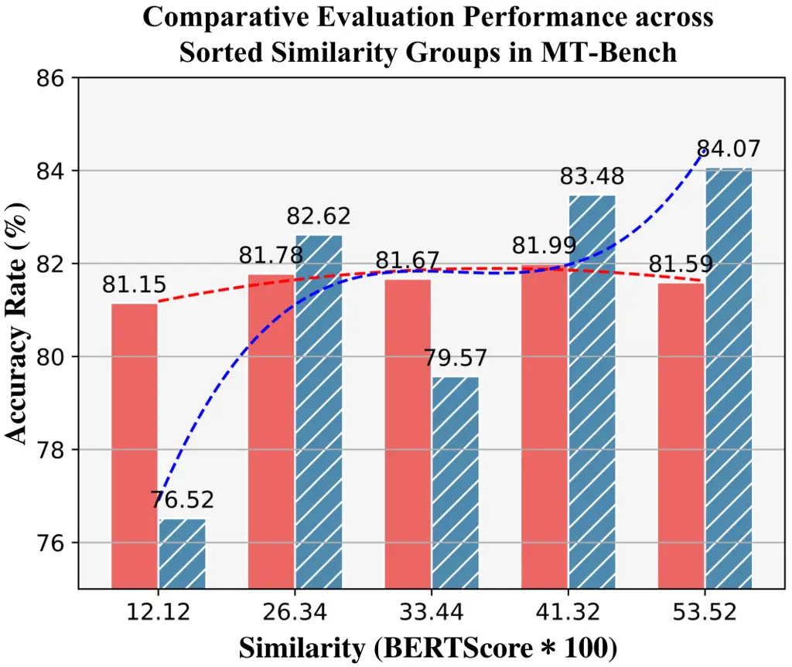
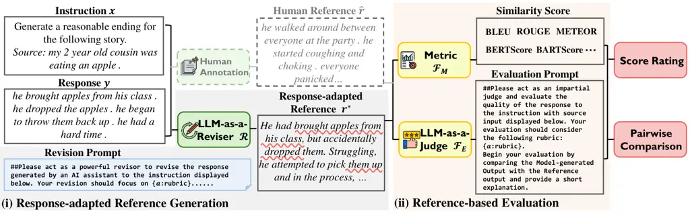
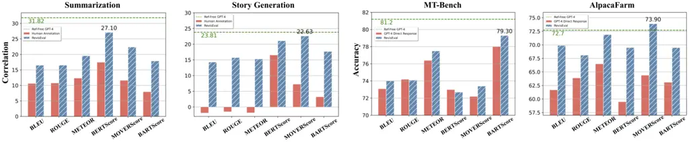
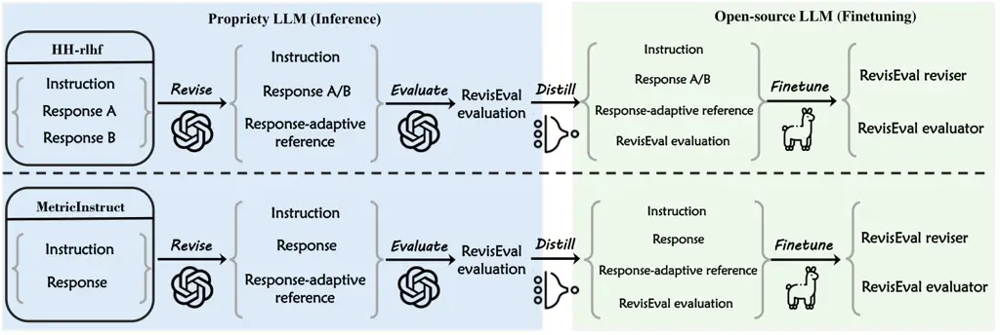

# RevisEval: Improving LLM-as-a-Judge via Response-Adapted References

Qiyuan Zhang Affiliation: City University of Hong Kong
Email: <qzhang732-c@my.cityu.edu.hk>    Yufei Wang Affiliation: Huawei
Noah’s Ark Lab Email: <wang.yufei1@huawei.com>    Tiezheng Yu
Affiliation: Huawei Noah’s Ark Lab    Yuxin Jiang Affiliation: The Hong
Kong University of Science and Technology (Guangzhou)    Chuhan Wu
Affiliation: Huawei Noah’s Ark Lab    Liangyou Li Affiliation: Huawei
Noah’s Ark Lab    Yasheng Wang Affiliation: Huawei Noah’s Ark Lab    Xin
Jiang Affiliation: Huawei Noah’s Ark Lab    Lifeng Shang
Affiliation: Huawei Noah’s Ark Lab    Ruiming Tang Affiliation: Huawei
Noah’s Ark Lab    Fuyuan Lyu Affiliation: McGill University & MILA   
Chen Ma Affiliation: City University of Hong Kong

###### Abstract

With significant efforts in recent studies, LLM-as-a-Judge has become a
cost-effective alternative to human evaluation for assessing text
generation quality in a wide range of tasks. However, there still
remains a reliability gap between LLM-as-a-Judge and human evaluation.
One important reason is the lack of guided oracles in the evaluation
process. Motivated by the role of reference pervasively used in classic
text evaluation, we introduce RevisEval, a novel text generation
evaluation paradigm via the response-adapted references. RevisEval is
driven by the key observation that an ideal reference should maintain
the necessary relevance to the response to be evaluated. Specifically,
RevisEval leverages the text revision capabilities of large language
models (LLMs) to adaptively revise the response, then treat the revised
text as the reference (response-adapted reference) for the subsequent
evaluation. Extensive experiments demonstrate that RevisEval outperforms
traditional reference-free and reference-based evaluation paradigms that
use LLM-as-a-Judge across NLG tasks and open-ended instruction-following
tasks. More importantly, our response-adapted references can further
boost the classical text metrics, e.g., BLEU and BERTScore, compared to
traditional references and even rival the LLM-as-a-Judge. A detailed
analysis is also conducted to confirm RevisEval’s effectiveness in bias
reduction, the impact of inference cost, and reference relevance. Our
code is available on
[https://github.com/Don-Joey/RevisEval](https://github.com/Don-Joey/RevisEval).

|     |
| --- |
|     |

## 1 Introduction

As the large language model (LLM) already exhibits strong alignment with
humans (Gilardi et al., 2023; OpenAI et al., 2024),
LLM-as-a-Judge (Chang et al., 2024; Li et al., 2024b; Gao et al.,
2024b), aka. LLM-evaluator, has emerged as a viable alternative to human
evaluation in assessing text generation quality. Given the task
instruction and the corresponding model-generated responses, LLMs are
prompted to predict preferences or scores for these responses. Despite
considerable efforts have been made, such as chain-of-thought (Zheng
et al., 2023), specialized rubrics (Liu et al., 2023), and extensive
evaluation-specific training datasets (Li et al., 2024a; Wang et al.,
2024c; Wang et al., 2024b), human evaluation remains the gold standard
in text quality assessment (Zeng et al., 2024) and LLM-as-a-Judge
struggles with particular biases (Huang et al., 2024) and being
vulnerable to the misleading context (Dubois et al., 2024; Chen et al.,
2024). One important reason is the lack of an oracle to direct the
evaluation process. Fortunately, classical text evaluation metrics, like
BLEU (Papineni et al., 2002) and ROUGE (Lin, 2004), offer valuable
prompts in mitigating such a gap: given an appropriate reference, i.e.,
the ground-truth answer to the task, calculating the similarity between
the references and the model-generated responses can achieve a
satisfactory correlation with human evaluations. Furthermore, several
studies highlight the reference could prevent being overly sensitive to
semantic deficiency  (Sheng et al., 2024) and overcoming bias (Deutsch
et al., 2022) in certain cases.

However, straightforward leveraging references in LLM-as-a-Judge can
also be challenging. In addition to the availability of high-quality
references (Rei et al., 2021), previous works (Mehri & Eskenazi, 2020;
Gómez-Rodríguez & Williams, 2023; Guan & Huang, 2020) find that
pre-existing references introduce noise across various text evaluation
tasks due to the one-to-many problem, where for a given task input,
there exist many diverse yet valid responses. In this case, particular
pre-existing references could negatively penalize many appropriate but
dissimilar responses in the evaluation process (Ji et al., 2022). Thus,
we hypothesize that an effective reference should be closely relevant to
the response to be evaluated. We further verify this on MT-Bench (Zheng
et al., 2023), an open-ended instruction-following dataset. As shown in
Figure 1, we use GPT-4 direct responses to the instructions as the
references and quantify relevance by the similarity between the
references and the responses using BERTScore (Zhang et al., 2020). We
find that higher relevance simulates greater utility from the reference,
resulting in more effective evaluations than a reference-free evaluator.



Figure 1: Performance comparison of reference-free and reference-based
evaluation paradigms across different similarity groups in MT-Bench,
using GPT-4-as-a-Judge. In the reference-based evaluation, the GPT-4
direct response is used as the reference, and the evaluated response
with a higher BERTScore with the reference is regarded as the preferred
one. As the similarity between the reference and the response increases,
the human agreement accuracy of the reference-based evaluation
significantly improves, while the reference-free evaluation maintains
relatively consistent performance across all similarity levels.

Motivated by the above findings, we deem that an effective reference
should maintain high quality while ensuring relevance to the response,
which led us to consider that revising the response adaptively could be
a good candidate for this reference (Guo et al., 2024). Therefore, we
propose a novel evaluation paradigm Revise-and-Evaluation (RevisEval).
Specifically, given the (instruction, response) pair, RevisEval first
revise the response using the instruction and evaluation rubric,
resulting in the response-adapted reference. RevisEval further leverages
this generated response-adapted reference to guide final evaluation
(e.g., scoring or pairwise comparison). By revising the original
response, we ensure that the generated reference is both high-quality
and closely relevant to the original content. The comparison between the
original and revised responses offers valuable insights for evaluation.
Orthogonal to previous work that only focuses on the discrimination of
LLMs, RevisEval stands out by fully utilizing the generative potential
by revision.

We conduct comprehensive experiments to validate the effectiveness of
our proposed RevisEval. Using both proprietary and open-source LLMs,
RevisEval consistently achieves better performance compared to
reference-free and reference-based evaluation paradigms in both NLG
tasks and open-ended instruction-following tasks. Moreover, we seek to
verify the effectiveness of the response-adapted references in the
classic metrics, e.g., BERT and BERTScore, showing that each metric
exceeds itself by up to 3%-10% accuracy compared to using direct
response as references. We then combine LLM-as-a-reviser with multiple
classic metrics and find that it outperforms (reference-free)
LLM-as-a-Judge by over 1.5% on average when using weak LLMs and is
comparable when using GPT-4. Finally, we analyze how our paradigm
achieves overall superiority. In reducing verbosity and positional bias,
our approach offers clear advantages in adversarially designed LLMBar
and swapping position testing. Merely increasing inference cost of
reference-free evaluation still lags behind RevisEval, demonstrating our
method’s efficiency does not rely on naively accumulating cost.
Meanwhile, we validate the relationship between reference relevance and
efficiency using response-adapted references.

## 2 Related Work

### 2.1 Evaluation of Large Language Models

Instruction-tuned LLMs (Ouyang et al., 2022; Dubey et al., 2024; Team
et al., 2023) have revolutionized the field of NLP due to their ability
to handle a wide range of language-related tasks. Unlike traditional NLP
tasks, such as Machine Translation and Summarization, which can be
evaluated using N-gram-based metrics like BLEU (Papineni et al., 2002),
ROUGE (Lin, 2004), and METEOR (Banerjee & Lavie, 2005) by comparing
responses with reference texts, LLMs excel at open-ended text generation
tasks (e.g., story generation and instruction-following generation),
where no single reference response exists. Consequently, several studies
embrace the potential of LLM-as-a-Judge and shift toward reference-free
metrics, advocating the abandonment of conventional reference-based
evaluation methods (Sheng et al., 2024; Chen et al., 2023). In this
paper, we revisit the significance of reference in LLM evaluation.
Furthermore, to address the challenge of the absence of a single
standard answer in certain evaluation tasks, we propose leveraging LLMs
to generate response-adapted references, thereby improving the
performance of both traditional metrics and LLM-as-a-Judge.

### 2.2 LLM-as-a-Judge

Recent progress in NLP has introduced model-based evaluation metrics
like BERTScore (Zhang et al., 2020) and BARTScore (Yuan et al., 2021).
However, these methods also depend on the availability of
human-annotated references, which can be expensive, time-consuming, and
labor-intensive (Zheng et al., 2023). With the emergence of large
language models (LLMs), several studies (Zheng et al., 2023; Dubois
et al., 2024) have harnessed their robust evaluation capabilities for
assessing natural language generation (NLG), particularly by employing
proprietary models like GPT-4 (OpenAI et al., 2024). To avoid
information leakage caused by external API calls, some efforts advocate
finetuning LLMs with evaluation data to obtain evaluator models (Vu
et al., 2024; Li et al., 2024a; Wang et al., 2024c; Kim et al., 2024b).
A wide variety of techniques are used to enhance the performance of
LLM-as-a-Judge, such as Chain-of-Thoughts (CoT; Wei et al. (2022)) to
first generate concise reasoning and then the final decision, adding
pre-defined rules (Zeng et al., 2024) in prompts to list some general
rules for LLM-as-a-Judge to follow explicitly, and swapping the two
responses to avoid positional bias (Wang et al., 2024a). Zheng et al.
(2023) found that, even with the use of a CoT prompt, LLM-as-a-Judge can
still be misled by the surrounding context, particularly by erroneous
response text. Therefore, they propose a reference-guided method where
the LLM-as-a-Judge’s response is first generated independently based on
the given instruction and then presented as a reference answer within
the evaluation prompt. To the best of our knowledge, we are the first to
generate response-adapted references from both the instruction and the
response to be evaluated.

## 3 Methodology

In this section, we introduce our novel evaluation paradigm, RevisEval,
which enhances the evaluation by generating response-adapted references.
Illustrated in Figure 2, RevisEval consists of two components,
response-adapted reference generation and reference-based evaluation,
which we will discuss in Sec. 3.1 and 3.2, respectively.

Supposing $`y`$ is the response generated by a model for a given task
instruction $`x`$, RevisEval assesses the quality of $`y`$ on a specific
rubric $`a`$. Firstly, in the generation phase, conditioned on
($`x,a`$), RevisEval deploys a LLM reviser $`\mathcal{R}`$ to revise
$`y`$ to generate a response-adapted reference $`r^{\star}`$. Secondly,
in the evaluation phase, taking the ($`x,a,y`$) and generated
$`r^{\star}`$ as input, RevisEval adopts LLM-as-a-Judge
$`\mathcal{F}_{E}`$ to assess $`y`$ using $`r^{\star}`$ as the
reference. Besides, we further expand RevisEval to support traditional
reference-based metrics $`\mathcal{F}_{M}`$. The evaluation objective is
to ensure that the automated evaluations align closely with human
evaluations, which is introduced in Appendix G.



Figure 2: Illustration of our proposed RevisEval. Given an instance
($`x,y,a`$), we use RevisEval to assess $`y`$ in rubric $`a`$. In
RevisEval, (i) reviser generates a response-adapted reference
$`r^{\star}`$ by revising the $`y`$ to enhance the (ii) following
LLM-as-a-Judge, even classic text metrics. Here, … represents retained
segments during the generating response-adapted reference process.

### 3.1 Response-adapted Reference Generation

LLMs have already demonstrated their surprising revision capabilities in
various tasks, including improving specific attribution (e.g., writing
style and grammar) of passages (Gao et al., 2023), correcting
hallucination (Akyurek et al., 2023), post-editing the generated
story (Yang et al., 2022) and generating higher-quality revised
responses to complement preference pairs for DPO (Guo et al., 2024; Yoon
et al., 2024; Jiang et al., 2024b; Xu et al., 2024). Thus, unlike
previous works treating LLMs as discriminators (Hu et al., 2024), we
leverage the revision capabilities of LLMs to unlock the generative
potential to offer richer and more valuable insights for evaluation.
RevisEval deploys LLMs to revise the response $`y`$ from the instruction
$`x`$ on a evaluation rubric $`a`$,

```math
r^{\star}=\mathcal{R}(y|x,a), \tag{1}
```

where $`r^{\star}`$ is the generated response-adapted reference for the
subsequent evaluation. Notably, when RevisEval must give the preference
on two responses, $`y_{1}`$ and $`y_{2}`$, in pairwise comparison, we
randomly select one for primary text to be revised while using the other
as revision guidance. We remind reviser that this revision guidance may
not be perfect and should be used with caution in the revision prompt,

```math
r^{\star}=\begin{cases}\mathcal{R}(y_{1}|y_{2},x,a)&\text{if }\mathcal{C}=1\\
\mathcal{R}(y_{2}|y_{1},x,a)&\text{if }\mathcal{C}=2\\
\end{cases} \tag{2}
```

where $`\mathcal{C}`$ is a random variable that decides which response
is chosen for revision. $`C`$ can be either 1 or 2, with each having an
equal chance of occurring. Notably, we discuss other possible revision
strategies in Appendix I.2, which are less effective comparably.
Introducing a qualified reference can reliably guide the evaluation
process, for instance, acting as an “anchor” to reduce biases. Our
strategy, which incorporates revision guidance and randomly sampling one
as the primary text for revising, further reinforces fairness. This will
be validated in Sec. 4.2 and 4.5.

### 3.2 Reference-based Evaluation

In the evaluation phase, RevisEval supports LLM-as-a-Judge
$`\mathcal{F}_{E}`$ in a reference-based setting and remains compatible
with previous metrics $`\mathcal{F}_{M}`$.

#### LLM-as-a-Judge.

With powerful generalization capabilities, LLMs can serve as
discriminators for evaluation, referred to as LLM-as-a-Judge. In this
case, the evaluation can be operated using $`\mathcal{F}_{E}`$,

```math
s=\mathcal{F}_{E}(y|x,a,r^{\star}). \tag{3}
```

This can be easily accomplished by simply using a general prompt for
inference, where we clarify the instruction, response, response-adapted
reference, and evaluation rubric in the prompt, as shown in Appendix A.
Moreover, we implement this for open-source LLMs through finetuning
evaluation data in this task format, with the detailed process provided
in Appendix C.

#### Metrics.

Once we get the reference $`r^{\star}`$, we can also implement classic
metrics, regardless of statistical n-gram or model-based metrics. The
evaluation score $`s`$ is:

```math
s=\mathcal{F}_{M}(y,r^{\star}|[x,a]). \tag{4}
```

More specifically, when $`\mathcal{F}_{M}`$ are n-gram metrics, e.g.,
BLEU, ROUGE, and METEOR, we can directly compute the similarity between
$`y`$ and $`r^{\star}`$; when $`\mathcal{F}_{M}`$ are model-based
metrics, e.g., BERTScore and BARTScore, we can optionally input $`x`$
and $`a`$ to the metrics. The effectiveness of metrics heavily relies on
the reference. When the response-adapted reference is appropriate, even
a simple metric can revive its evaluation functionality in open-ended
tasks. We validate this point in Sec. 4.3 and 4.4.

## 4 Experiments

In this section, we first present the comprehensive experimental
settings in Sec. 4.1 and evaluate the RevisEval in LLM-as-a-Judge across
various tasks in Sec. 4.2; we then verify the effectiveness of classic
text evaluation metrics when using response-adapted references in
Sec. 4.3; building on above findings, we compare two evaluation
paradigms, combining LLM-as-a-reviser with multiple metrics and
LLM-as-a-Judge, when using weak LLM in Sec. 4.4; finally, we conduct
detailed comparative analysis of RevisEval in Sec. 4.5, such as bias
reduction, inference cost and reference relevance.

### 4.1 Evaluation Settings

#### Evaluation benchmarks.

We evaluate our approach on multiple classic NLG benchmarks by measuring
the correlation between the evaluators/metrics and human annotations in
a scoring rating task. We follow the experimental setting of Jiang
et al. (2024a) and select four representative NLG tasks and
corresponding benchmarks: Data-to-Text (WebNLG), Machine Translation
(WMT-22 (zh-en)), Text Summarization (SummEval), and Story Generation
(OpenMEVA), and Table 10 shows the details of these benchmarks.
Additionally, we test our approach on the more challenging open-ended
instruction-following benchmarks (MT-Bench, Alpacafarm, and LLMBar),
which primarily rely on pairwise comparison task. Unlike the NLG
benchmarks, these preference benchmarks contain more general
instructions covering a broader range of tasks with more diverse
responses and use accuracy to measure the evaluation performance.
Remarkably, in NLG tasks, “ref-based” evaluation relies on
human-annotated references as its foundation. In contrast, open-ended
instruction-following tasks lack pre-existing references, so “ref-based”
evaluation uses machine-generated responses as references to conduct
ablation studies verifying the effectiveness of ours references.

|                            |                   |                   |                   |                   |                   |
| -------------------------- | ----------------- | ----------------- | ----------------- | ----------------- | ----------------- |
| Methods                    | Summarization     | Translation       | Data2Text         | Story Generation  | Avg.              |
|                            | $`\tau`$/$`\rho`$ | $`\tau`$/$`\rho`$ | $`\tau`$/$`\rho`$ | $`\tau`$/$`\rho`$ | $`\tau`$/$`\rho`$ |
| N-gram Metrics             |                   |                   |                   |                   |                   |
| BLEU                       | 10.66/14.42       | 14.50/19.73       | 23.13/33.29       | -1.93/-2.70       | 11.59/16.19       |
| ROUGE                      | 10.81/14.85       | 13.19/17.83       | 24.74/35.49       | -1.53/2.34        | 11.80/17.63       |
| METEOR                     | 12.37/16.72       | 16.52/18.80       | 25.58/36.27       | -1.87/-2.65       | 13.15/17.29       |
| Model-based Metrics        |                   |                   |                   |                   |                   |
| BERTScore                  | 17.50/23.83       | 31.57/42.41       | 30.74/43.75       | 16.00/23.79       | 23.95/33.45       |
| BARTScore                  | 29.12/35.50       | 7.01/12.83        | 22.32/34.33       | 14.15/33.48       | 18.15/29.04       |
| UniEval                    | 35.89/47.52       | 16.08/21.90       | 28.56/38.38       | 31.22/44.46       | 27.94/38.07       |
| GPTScore                   | 28.20/37.41       | 6.50/8.90         | 19.81/28.82       | 16.36/23.91       | 17.72/24.76       |
| InstructScore-7B           | 20.86/38.68       | 40.44/50.43       | 30.21/38.54       | 13.50/16.13       | 26.25/35.94       |
| TIGERScore-7B              | 28.79/35.11       | 33.65/41.50       | 32.44/42.39       | 29.72/39.26       | 31.15/39.56       |
| Llama-3.1 8B-Inst          | 27.49/31.02       | 19.59/23.54       | 28.46/36.24       | 26.13/29.97       | 25.42/30.19       |
| Open-Source LLM-as-a-Judge |                   |                   |                   |                   |                   |
| Ref-Free                   | 27.83/31.89       | 30.84/38.66       | 38.75/49.32       | 25.74/31.72       | 30.79/37.90       |
| Ref-Based                  | 34.09/39.53       | 35.76/41.12       | 39.24/50.87       | 8.79/10.44        | 29.47/35.49       |
| RevisEval (Ours)           | 32.41/37.73       | 33.14/39.66       | 39.02/49.92       | 25.95/32.11       | 32.63/39.86       |
| Proprietary LLM-as-a-Judge |                   |                   |                   |                   |                   |
| Ref-Free                   | 31.82/38.98       | 34.62/43.38       | 37.99/49.50       | 23.81/33.29       | 32.06/41.29       |
| Ref-Based                  | 32.56/40.01       | 41.47/45.29       | 37.35/49.02       | 17.58/24.86       | 32.24/39.80       |
| RevisEval (Ours)           | 33.63/41.15       | 40.72/45.32       | 37.90/50.93       | 25.11/35.26       | 34.34/43.17       |

Table 1: Kendall ($`\tau`$) and Spearman ($`\rho`$) correlation results
comparing reference-free, reference-based, and RevisEval methods across
natural language generation tasks. This table demonstrates that, without
human-annotated references, our proposed RevisEval substantially
outperforms reference-free and reference-based methods involving both
open-source and proprietary LLM-as-a-Judge.

#### Base LLMs and metrics.

Our proposed RevisEval aims to improve evaluation performance across
both LLM-as-a-Judge and classic metrics, offering enhanced results. For
proprietary LLMs, we adopt GPT-4 as the base model and focus on
implementing our paradigm during the inference stage. For open-source
LLMs, we implement our method via finetuning the Llama 3.1-8B model.
Following the Jiang et al. (2024a)’s setting on open-source models, we
distill the evaluation outputs generated by GPT-4 when inputting task
instructions and corresponding evaluated responses, and tune them in our
models. Notably, our training data has no overlap with evaluation
benchmarks. For classic metrics, we cover various metrics, like n-gram
based BLEU, ROUGE, METEOR and model based BERTScore, MOVERScore (Zhao
et al., 2019), BARTScore, which rely heavily on references. We validate
our method by assessing the utility of reference texts.

We ensure that our approach maintains versatility and fairness across
models, with further details on prompts, inference, finetuning, and
baselines in the Appendix A, B, C, D, E and F.

### 4.2 Enhancing LLM-as-a-Judge Performance

We present the main results of our proposed RevisEval across NLG
evaluation tasks and instruction-following preference benchmarks in
Table 1 and 2. We summarize the conclusions below.

#### RevisEval achieves stronger performance across various NLG tasks.

For the powerful proprietary LLMs, RevisEval outperforms reference-free
and human-annotated reference-based evaluation across tasks with
approximately 0.02 in Kendall correlation on average, as demonstrated in
Table 1. Notably, in story generation, high-quality human references
hinder evaluation for LLM-as-a-Judge, which decreases by 0.06 compared
to the reference-free method in the Kendall correlation. In contrast,
RevisEval shows that generated response-adapted reference can still
greatly enhance evaluation by about 0.08 in Kendall than human
reference-based evaluation. An exception is machine translation, where
RevisEval aligns closely with reference-based methods, and we analyze
this result exists a consistent rationale about reference relevance in
Sec 4.5.

For the open-source LLMs, RevisEval not only outperforms the
reference-free method but also beats the reference-based methods by over
0.03 on average in Kendall correlation. Especially in story generation,
the reference-based approach is consistent with the above conclusion,
trailing by approximately 0.17 in Kendall compared to our RevisEval.
Furthermore, the LLM with specialized finetuning also performs better
than the LLM with general instruction finetuning (i.e., Llama 3.1-8B
Inst) on NLG evaluation tasks, leading by about 0.02 in Kendall.

|                                     |                        |          |            |        |      |
| ----------------------------------- | ---------------------- | -------- | ---------- | ------ | ---- |
| Methods                             | \# of Training Samples | MT-Bench | AlpacaFarm | LLMBar | Avg. |
| Open-Source LLM-as-a-Judge          |                        |          |            |        |      |
| JudgeLM-7B (Zhu et al., 2023)       | 100,000                | 64.1     | 53.9       | 36.3   | 51.4 |
| PandaLM-7B (Wang et al., 2024c)     | 300,000                | 75.0     | 54.9       | 31.7   | 53.9 |
| Auto-J-13B (Li et al., 2024a)       | 4,396                  | 75.2     | 64.6       | 36.0   | 58.6 |
| Prometheus-7B (Kim et al., 2024a)   | 100,000                | 52.8     | 33.5       | 30.1   | 38.8 |
| Prometheus-2-7B (Kim et al., 2024b) | 300,000                | 55.0     | 37.3       | 26.3   | 39.5 |
| Llama 3.1-8B-Tuned                  |                        |          |            |        |      |
|    –Ref-Free                        | 9,800                  | 67.4     | 61.1       | 51.1   | 59.9 |
|    –Ref-Based (Llama-D.R.)          | 9,800                  | 74.9     | 61.5       | 58.9   | 65.1 |
|    –Ref-Based (GPT-4-D.R.)          | 9,800                  | 78.0     | 65.5       | 63.0   | 68.8 |
|    –RevisEval (Llama-as-a-Reviser)  | 9,800                  | 75.2     | 64.7       | 57.8   | 65.9 |
|    –RevisEval (GPT-4-as-a-Reviser)  | 9,800                  | 79.3     | 67.1       | 64.9   | 70.4 |
| Proprietary LLM-as-a-Judge (GPT-4)  |                        |          |            |        |      |
| Ref-Free                            | \-                     | 81.2     | 70.9       | 72.6   | 74.9 |
| Ref-Based (GPT-4-D.R.)              | \-                     | 81.5     | 67.7       | 79.9   | 76.4 |
| RevisEval (GPT-4-as-a-Reviser)      | \-                     | 83.0     | 72.9       | 79.0   | 78.1 |

Table 2: Accuracy of LLM-as-a-Judge on instruction-following preference
tasks. Our proposed RevisEval considerably enhances the performance of
both open-source and proprietary LLM-as-a-Judge across various general
evaluation tasks. Here, D.R. denotes Direct Response to instruction.



Figure 3: Comparative analysis of reference-based metrics performance
using references generated by Human/GPT-4 and RevisEval on NLG and
instruction following benchmarks. RevisEval greatly enhance traditional
ref-based metrics, even achieving them comparable to GPT-4-as-a-Judge.

#### RevisEval excels on open-ended instruction-following preference benchmarks.

As shown in Table 2, whether implemented on open-source or proprietary
models, RevisEval consistently surpasses all baselines by at least 6.3%
on average. The details of these baselines are listed in Appendix F, and
they are tuned with tens of thousands of data for the LLM-as-a-Judge. On
the same base LLM, RevisEval exceeds reference-free evaluation by 3%-6%.
We compare RevisEval to reference-based evaluations followed by Zheng
et al. (2023)’s setup, whose reference is the LLM’s direct response to
the instruction. Our approach performs better than reference-based
evaluation on average when both references are generated by the same
base LLMs. Furthermore, using GPT-4 as the reviser boosts Llama
3.1-8B-as-a-Judge by over 4.5% compared to Llama-as-a-Reviser,
highlighting the importance of reference quality.

LLM-as-a-Judge can be biased toward longer, verbose answers (Saito
et al., 2023; Dubois et al., 2024) or answers that match a similar
format (Huang et al., 2024). LLMBar (Zeng et al., 2024) is a challenging
benchmark to meta-evaluate such superficial quality biases. As
demonstrated in Table 2, these baselines, even after tuning $`>100K`$
samples, struggle to exceed 50% accuracy, exposing bias challenge. By
using response-adapted references from RevisEval, the weak open-source
LLM-as-a-Judge’s performance improves substantially by about 6%, showing
RevisEval can address superficial quality bias. On proprietary LLM,
RevisEval achieves a 3.2% improvement in accuracy compared to
reference-free evaluation. Our proposed response-adapted references
perform slightly worse than direct responses from the same model. This
is likely because LLMBar emphasizes “instruction-following precision,”
where a single golden response exists for the instruction.

In summary, RevisEval consistently outperforms traditional ref-free and
ref-based methods, and our revision provides guidance for LLM evaluation
by utilizing the generative advantages of LLM.

### 4.3 Investigation about Response-adapted References

|                   |             |
| ----------------- | ----------- |
| Text              | Mean Rating |
| Response 1        | 3.19        |
| Response 2        | 3.25        |
| References (Ours) | 4.75        |

Table 3: Mean rating for responses and generated references in LLMBar.
The detailed rating is in Table 14. Here, Responses 1 and 2 correspond
to the position of the response in each pair, and the rating range is in
\[1, 5\].

#### Revision Quality.

As a post-editing mechanism to enhance text quality, we expect the
revision to correct errors within the text, including subtle errors
(e.g., grammar), as well as higher-level issues (e.g., instruction
following precision and factual/logical correctness). LLMBar is an
appropriate testbed for conducting detailed case studies and quality
assessments. We directly use LLM to score the quality of the responses
to be evaluated and the corresponding response-adapted references,
focusing on correctness. Table 3 demonstrates that our response-adapted
references effectively improve response accuracies. Additionally, the
case studies are presented in Appendix J.1; we test RevisEval on
JudgeBench (Tan et al., 2024) in Appendix K, focusing on factual/logical
correctness and on RewardBench (Lambert et al., 2024) in Appendix N, for
more challenging domains.

#### References Effectiveness.

Traditional reference-based metrics rely heavily on references, directly
validating whether the references are effective. Therefore, we use
response-adapted references with these metrics to observe evaluation
performance across NLG and instruction-following benchmarks. We extend
classic reference-based metrics to support pairwise comparisons by using
an indicator function to determine preference between $`y_{1}`$ and
$`y_{2}`$ based on their respective metric scores. We use human
references in NLG tasks and GPT-4 direct responses in
instruction-following benchmarks as the baseline references, comparing
them with ours. As shown in Figure 3, RevisEval enables each classic
metric to substantially surpass its performance based on baseline
references across all tasks, particularly in more complex open-ended
tasks like story generation and AlpacaFarm. Additionally, using
references generated by GPT-4 as-a-Reviser combined with classic metrics
can yield comparable evaluation performance to GPT-4’s reference-free
evaluation. Furthermore, we test response-adapted references in a
multi-reference setting, with results detailed in Appendix L and M.

### 4.4 Potential Evaluation Paradigm for Weak Large Language Models

|                    |          |            |        |      |
| ------------------ | -------- | ---------- | ------ | ---- |
| Metrics            | MT-Bench | AlpacaFarm | LLMBar | Avg. |
| LLM-as-a-Reviser   |          |            |        |      |
|    BLEU            | 64.5     | 63.9       | 51.6   | 60.0 |
|    ROUGE           | 62.0     | 63.5       | 51.6   | 59.0 |
|    METEOR          | 66.4     | 67.7       | 46.3   | 60.1 |
|    BERTScore       | 62.3     | 62.3       | 54.4   | 59.7 |
|    MOVERScore      | 61.5     | 68.3       | 51.6   | 60.5 |
|    BARTScore       | 66.9     | 61.9       | 51.3   | 60.0 |
|    Majority Voting | 63.4     | 68.5       | 52.5   | 61.4 |
| LLM-as-a-Judge     | 67.4     | 61.1       | 51.1   | 59.9 |

Table 4: Comparative analysis of weak LLM-as-a-Judge and weak
LLM-as-a-Reviser+classic metrics on instruction-following tasks. Under
the same finetuning training resources, a weak LLM-as-a-Reviser combined
with classic metrics can produce better results.

We observe that 1) in the Sec. 4.2, all weak LLMs still exhibit a
notable gap compared to GPT-4-as-a-Judge, even after extensive training
with high-quality, evaluation-specific data, and 2) in the Sec. 4.3,
classic metrics combined with response-adapted references generated by
GPT-4 can achieve performance close to the reference-free
GPT-4-as-a-Judge. Thus, should we consider a potential evaluation
paradigm of “weak LLM-as-a-Reviser + metrics” instead of “weak
LLMs-as-a-Judge”?

To explore this, we compare “Llama-as-a-Judge” with
“Llama-as-a-Reviser + metrics,” as shown in Table 4. When using
references generated by “Llama-as-a-Reviser”, we find that BLEU, METEOR,
MOVERScore, and BARTScore can surpass “Llama-as-a-Judge” on average
across 3 tasks. Furthermore, we apply a majority voting across multiple
metrics, outperforming “Llama-as-a-Judge” over 1.5% on average. This
suggests that instead of continuously training weak LLMs to improve
their evaluative discrimination capabilities, leveraging their
generation abilities for revision may be more effective. Without extra
inference costs, this approach can lead to better evaluation outcomes.
We offer a general guideline: majority voting is recommended as it
provides a stable superior evaluation approach, recognizing that no
single metric outperforms others across all benchmarks.

|           |              |       |              |       |              |       |
| --------- | ------------ | ----- | ------------ | ----- | ------------ | ----- |
| Paradigms | MT-Bench     |       | Alpacafarm   |       | LLMBar       |       |
|           | Llama 3.1-8B | GPT-4 | Llama 3.1-8B | GPT-4 | Llama 3.1-8B | GPT-4 |
| Ref-Free  | 49.1         | 10.3  | 61.1         | 20.0  | 44.6         | 17.9  |
| Ref-Based | 22.8         | 6.5   | 34.1         | 22.2  | 32.5         | 11.2  |
| RevisEval | 20.5         | 5.9   | 30.1         | 19.9  | 30.3         | 7.9   |

Table 5: Positional bias analysis in pair comparison evaluations when
applying different evaluation paradigms. This table presents the ratio
of changed evaluation results after swapping the response position. A
lower proportion indicates less positional bias.RevisEval stands out as
the best, exhibiting the lowest bias among all paradigms.

### 4.5 Comparative Analysis to Other Evaluation Paradigms

#### Positional bias analysis.

Positional bias (Wang et al., 2024a; Zheng et al., 2023; Wu & Aji, 2023;
Chen et al., 2024) occurs when human or LLM evaluators tend to favor one
side in a pairwise comparison, regardless of answer quality. We
investigate this bias by swapping answer positions and taking the LLM to
re-evaluate, as shown in Table 5. The results indicate that
reference-based evaluation decisions have less variation than
reference-free ones. RevisEval is generally 2%-4% lower on the
reference-based evaluation, showing better consistency. This result is
probably because RevisEval provides references more closely aligned with
the answers, further minimizing bias.

|                     |              |       |              |       |              |       |
| ------------------- | ------------ | ----- | ------------ | ----- | ------------ | ----- |
| Inference Cost      | MT-Bench     |       | AlpacaFarm   |       | LLMBar       |       |
|                     | Llama 3.1-8B | GPT-4 | Llama 3.1-8B | GPT-4 | Llama 3.1-8B | GPT-4 |
| 1-Cycle Ref-Free    | 67.4         | 81.2  | 61.1         | 70.9  | 51.1         | 72.6  |
| 3-Cycle Ref-Free    | 64.1         | 81.2  | 54.9         | 71.9  | 53.2         | 74.9  |
| RevisEval (2-Cycle) | 71.3         | 83.0  | 64.7         | 72.9  | 54.9         | 79.0  |

Table 6: Ablation study on the impact of inference cost. Increasing
evaluation cycles to match or exceed RevisEval’s inference cost in
reference-free did not improve accuracy. This shows that RevisEval’s
superior performance is not from twice inference.

#### The impact analysis of inference cost.

Compared to the reference-free approach, RevisEval requires two cycles
of inference (i.e., revision and evaluation). To show the impact of
extra inference cost, we further conduct three cycles of reference-free
evaluations using extra different temperatures ($`0.3`$ and $`0.7`$),
followed by majority voting (see Table 6). For GPT-4, additional
evaluation cycles slightly improve accuracy but still lag behind ours by
1%-4%. For weak LLMs, more cycles led to worse performance. The above
results indicate that our approach provides more valuable guidance.

|               |                  |               |                |                |                |                 |                 |
| ------------- | ---------------- | ------------- | -------------- | -------------- | -------------- | --------------- | --------------- |
|               | Reference Source | WMT-22(en-zh) | WebNLG         | MT-Bench       | Summeval       | AlpacaFarm      | ROC             |
| Similarity    | Human/GPT-4      | 65.12         | 59.09          | 25.00          | 23.51          | 13.04           | 12.86           |
|               | RevisEval        | 63.03 (-3.3%) | 76.41 (+29.3%) | 30.29 (+21.2%) | 35.63 (+51.6%) | 35.72 (+173.9%) | 27.57 (+114.4%) |
| Effectiveness | Human/GPT-4      | 1.20          | 0.98           | 1.00           | 1.02           | 0.95            | 0.74            |
|               | RevisEval        | 1.18 (-0.02)  | 1.00 (+0.02)   | 1.02 (+0.02)   | 1.06 (+0.04)   | 1.03 (+0.08)    | 1.05 (+0.31)    |

Table 7: Comparative analysis of how reference-based evaluation
effectiveness varies with changes in the similarity between the response
and reference texts across different constructing reference strategies.
Here, Effectiveness,
$`\mathcal{P}_{\text{ref}}/\mathcal{P}_{\text{free}}`$, refers to the
performance ratio between reference-based and reference-free evaluation,
where $`\mathcal{P}`$ denotes the evaluation performance, e.g., Acc and
Corr; similarity is still measured by BERTScore.

#### Evaluation performance improves with increased relevance between reference and responses.

It’s been observed that the less relevant a reference is to the
response, the less effective it is for evaluation in previous work and
Figure 1. We further verify whether this trend holds true with our
method. We define effectiveness to describe whether reference-based
evaluation is more effective than reference-free evaluation. As shown in
Table 7, the increasing similarity between reference and evaluated
responses generally leads to better evaluation effectiveness. This
explains why our method doesn’t perform as well in translation, where
human references are already highly similar to the response. For other
tasks, human or GPT-4 direct-response references have lower similarity
than references of RevisEval, leading to a lower effectiveness.
Additionally, for different tasks, the similarity between the
human/GPT-4 reference and the evaluated response varies, reflecting the
open-ended generative degree of this task. A lower similarity indicates
a greater diversity of potential valid responses. In this context, as
the task becomes more open-ended, the effectiveness of RevisEval shows a
greater improvement than the human/GPT-4 reference.

## 5 Case Study: How does it work?

|                                                                                                                                                                                                                                                                                                                                                                                                                                                                                                                                                                                                                                                                                                                          |            |
| ------------------------------------------------------------------------------------------------------------------------------------------------------------------------------------------------------------------------------------------------------------------------------------------------------------------------------------------------------------------------------------------------------------------------------------------------------------------------------------------------------------------------------------------------------------------------------------------------------------------------------------------------------------------------------------------------------------------------ | ---------- |
| Instruction: Classify the following to the correct word group. \n\n Happy, Joyful                                                                                                                                                                                                                                                                                                                                                                                                                                                                                                                                                                                                                                        |            |
| Response 1                                                                                                                                                                                                                                                                                                                                                                                                                                                                                                                                                                                                                                                                                                               | Response 2 |
| Happy -\> Emotions                                                                                                                                                                                                                                                                                                                                                                                                                                                                                                                                                                                                                                                                                                       | Emotions   |
| Reference-free Evaluation: Both Assistant A and Assistant B . . . . . . Both responses are correct, but one might argue that including the words with the categorization, as Assistant A does, provides a clearer answer and specifically indicates that both words have been classified. . . . . . . - Final Verdict: \[\[A\]\]                                                                                                                                                                                                                                                                                                                                                                                         |            |
| Referfence-based Evaluation: Direct Response-as-Reference: Happy and Joyful belong to the word group of synonyms, as they both express similar feelings of pleasure and contentment. . . . . . . Assistant A, while correct in stating that "Happy" belongs to "Emotions," did not mention "Joyful" or classify them together as synonyms. Rather, it only assigned a category to one word. Assistant B . . . . . . but fails to classify both words as instructed, missing the relationship between "Happy" and "Joyful." Neither assistant directly addressed the classification as "synonyms," which was central to the user’s instruction. - Final Verdict: \[\[A\]\]                                                |            |
| RevisEval Evaluation: Response-adapted Reference: Emotions . . . . . . Assistant A . . . . . . However, it is clear from the classification provided that Assistant A understands the context and correctly categorizes "Happy" but overlooks "Joyful". Assistant B simply responds with "Emotions", effectively covering both "Happy" and "Joyful". This response uses a more concise and generalized approach, which aligns perfectly with the reference answer. Based on the reference answer and the clarity and completeness in addressing both terms, Assistant B’s response is superior. . . . . . . - Final Verdict: \[\[B\]\]                                                                                   |            |
| Instruction: Generate a reasonable ending for the following story. \n Source Input: my 2 year old cousin was eating an apple .                                                                                                                                                                                                                                                                                                                                                                                                                                                                                                                                                                                           |            |
| Response: he brought apples from his class. he dropped the apples. he began to throw them back up. he had a hard time.                                                                                                                                                                                                                                                                                                                                                                                                                                                                                                                                                                                                   |            |
| Gold Score: 3.8                                                                                                                                                                                                                                                                                                                                                                                                                                                                                                                                                                                                                                                                                                          |            |
| Reference-free Evaluation: . . . . . . but it lacks coherence and logical flow. The sentences seem disconnected, and the events described do not build upon each other in a meaningful way. The output does not demonstrate a clear understanding of the story’s context or the character’s actions. - Rating: \[\[1\]\]                                                                                                                                                                                                                                                                                                                                                                                                 |            |
| Referfence-based Evaluation: Human Reference: he walked around between everyone at the party . he started coughing and choking . everyone panicked and started hitting him on the back . he eventually spit out the apple piece . The model-generated output is not fluent and lacks coherence in comparison to the reference output. . . . . . . . . . . . . Overall, the model-generated output fails to meet the fluency criteria due to its lack of coherence and grammatical errors. - Rating: \[\[1\]\]                                                                                                                                                                                                            |            |
| RevisEval Evaluation: Response-adapted Reference: He had brought apples from his class, but accidentally dropped them. Struggling, he attempted to pick them up and in the process, began tossing them around. He was having a hard time managing the apples. The model-generated output is somewhat fluent but lacks coherence and completeness in comparison to the reference output. . . . . . The reference output provides a more detailed and logical sequence of events, enhancing the narrative’s coherence and clarity. . . . . . . Overall, the model-generated output is fluent but could benefit from improvements in coherence and detail to match the quality of the reference output. - Rating: \[\[3\]\] |            |

Table 8: An instruction-following open-ended case of pairwise comparison
and a story-generation case of score rating evaluated by different
paradigms. Score/Preference refers to accurate evaluation result and
Score/Preference refers to wrong result. We emphasize the noisy
evaluation elements in red, while highlighting the useful elements of
the evaluation in green. Here, the base LLM is GPT-4.

We show two representative examples in Table 8, one from the
instruction-following task (AlpacaFarm) and the other from the NLG
evaluation task (story generation). The reference-free evaluation tends
to be influenced by verbose text, often leading to incorrect judgments,
e.g., “provides a clearer answer…”. While the LLM’s direct response or
human reference might not be erroneous and can fulfill the instructions
well, for instance, “Happy and Joyful belong to the word group of
synonyms, …,” in the first case, it has no relevance to responses to be
evaluated and resulting “neither assistant directly addressed the
classification,” judgment. In contrast, the reference generated by
RevisEval is a more adaptive guidance, “Emotions”, accurately helping
the LLM to align the crucial elements, “the clarity and completeness”.
This is also evident in the second case, where differences between the
response and the revised text, such as “had brought,” “accidentally
dropped,” and others, directly highlight fluency issues with the
response. In other words, this demonstrates a transparent potential.
Furthermore, we provide evaluation discrepancy statistics between
RevisEval and other evaluations to observe how different evaluation
methods, as demonstrated in Appendix I.3.

## 6 Conclusion

We introduce a novel evaluation paradigm that utilizes LLMs’ revision
capabilities to generate response-adapted references, enhancing
LLM-as-a-Judge’s reliability. The references produced by RevisEval
significantly improve even simple n-gram metrics, achieving performance
on par with LLM-as-a-Judge. This is particularly beneficial for weaker
LLMs, which often struggle to improve despite extensive training,
offering an efficient way to enhance evaluation capabilities despite
limited training. Our findings emphasize (1) the underestimated
importance of references and (2) the potential of LLMs’ generative
strengths to improve evaluation by increasing reference relevance.
Looking ahead, RevisEval enables promising extensions: (i) integrating a
Reviser with classic metrics to better support smaller LLMs, (ii)
applying revision mechanisms to multi-modal tasks like MLLM, and (iii)
incorporating RevisEval into multi-agent pipelines for robust evaluation
frameworks.

## Acknowledgements

This work was supported by the Early Career Scheme (No. CityU 21219323)
and the General Research Fund (No. CityU 11220324) of the University
Grants Committee (UGC), and the NSFC Young Scientists Fund (No.
9240127).

## References

- Akyurek et al. (2023) Afra Feyza Akyurek, Ekin Akyurek, Ashwin Kalyan,
  Peter Clark, Derry Tanti Wijaya, and Niket Tandon. RL4F: Generating
  natural language feedback with reinforcement learning for repairing
  model outputs. In _Annual Meeting of the Association for Computational
  Linguistics_, pp. 7716–7733, 2023.
- Bai et al. (2022) Yuntao Bai, Andy Jones, Kamal Ndousse, Amanda
  Askell, Anna Chen, Nova DasSarma, Dawn Drain, Stanislav Fort, Deep
  Ganguli, Tom Henighan, Nicholas Joseph, Saurav Kadavath, Jackson
  Kernion, Tom Conerly, Sheer El-Showk, Nelson Elhage, Zac
  Hatfield-Dodds, Danny Hernandez, Tristan Hume, Scott Johnston, Shauna
  Kravec, Liane Lovitt, Neel Nanda, Catherine Olsson, Dario Amodei, Tom
  Brown, Jack Clark, Sam McCandlish, Chris Olah, Ben Mann, and Jared
  Kaplan. Training a helpful and harmless assistant with reinforcement
  learning from human feedback. In _arXiv_, 2022.
- Banerjee & Lavie (2005) Satanjeev Banerjee and Alon Lavie. METEOR: An
  automatic metric for mt evaluation with improved correlation with
  human judgments. In _Proceedings of the acl workshop on intrinsic and
  extrinsic evaluation measures for machine translation and/or
  summarization_, pp. 65–72, 2005.
- Chang et al. (2024) Yupeng Chang, Xu Wang, Jindong Wang, Yuan Wu,
  Linyi Yang, Kaijie Zhu, Hao Chen, Xiaoyuan Yi, Cunxiang Wang, Yidong
  Wang, et al. A survey on evaluation of large language models. _ACM
  Transactions on Intelligent Systems and Technology_, pp. 1–45, 2024.
- Chen et al. (2024) Guiming Hardy Chen, Shunian Chen, Ziche Liu, Feng
  Jiang, and Benyou Wang. Humans or llms as the judge? a study on
  judgement biases. In _arXiv_, 2024.
- Chen et al. (2023) Yi Chen, Rui Wang, Haiyun Jiang, Shuming Shi, and
  Ruifeng Xu. Exploring the use of large language models for
  reference-free text quality evaluation: An empirical study. In
  _arXiv_, 2023.
- Deutsch et al. (2022) Daniel Deutsch, Rotem Dror, and Dan Roth. On the
  limitations of reference-free evaluations of generated text. In
  _Conference on Empirical Methods in Natural Language Processing_, pp.
  10960–10977, 2022.
- Dubey et al. (2024) Abhimanyu Dubey, Abhinav Jauhri, Abhinav Pandey,
  Abhishek Kadian, Ahmad Al-Dahle, Aiesha Letman, Akhil Mathur, Alan
  Schelten, Amy Yang, Angela Fan, et al. The llama 3 herd of models. In
  _arXiv_, 2024.
- Dubois et al. (2024) Yann Dubois, Balázs Galambosi, Percy Liang, and
  Tatsunori B. Hashimoto. Length-controlled alpacaeval: A simple way to
  debias automatic evaluators. In _arXiv_, 2024.
- Fabbri et al. (2021) Alexander R. Fabbri, Wojciech Kryściński, Bryan
  McCann, Caiming Xiong, Richard Socher, and Dragomir Radev. SummEval:
  Re-evaluating summarization evaluation. _Transactions of the
  Association for Computational Linguistics_, pp. 391–409, 2021.
- Freitag et al. (2020) Markus Freitag, David Grangier, and Isaac
  Caswell. BLEU might be guilty but references are not innocent. In
  Bonnie Webber, Trevor Cohn, Yulan He, and Yang Liu (eds.), _Conference
  on Empirical Methods in Natural Language Processing_, pp. 61–71, 2020.
- Gao et al. (2024a) Bofei Gao, Feifan Song, Zhe Yang, Zefan Cai, Yibo
  Miao, Qingxiu Dong, Lei Li, Chenghao Ma, Liang Chen, Runxin Xu,
  Zhengyang Tang, Benyou Wang, Daoguang Zan, Shanghaoran Quan, Ge Zhang,
  Lei Sha, Yichang Zhang, Xuancheng Ren, Tianyu Liu, and Baobao Chang.
  Omni-MATH: A universal olympiad level mathematic benchmark for large
  language models. In _arXiv_, 2024a.
- Gao et al. (2023) Luyu Gao, Zhuyun Dai, Panupong Pasupat, Anthony
  Chen, Arun Tejasvi Chaganty, Yicheng Fan, Vincent Zhao, Ni Lao,
  Hongrae Lee, Da-Cheng Juan, and Kelvin Guu. RARR: Researching and
  revising what language models say, using language models. In _Annual
  Meeting of the Association for Computational Linguistics_, pp.
  16477–16508, 2023.
- Gao et al. (2024b) Mingqi Gao, Xinyu Hu, Jie Ruan, Xiao Pu, and
  Xiaojun Wan. Llm-based nlg evaluation: Current status and challenges.
  In _arXiv_, 2024b.
- Gilardi et al. (2023) Fabrizio Gilardi, Meysam Alizadeh, and Maël
  Kubli. Chatgpt outperforms crowd workers for text-annotation tasks.
  _Proceedings of the National Academy of Sciences_, 2023.
- Gómez-Rodríguez & Williams (2023) Carlos Gómez-Rodríguez and Paul
  Williams. A confederacy of models: a comprehensive evaluation of LLMs
  on creative writing. In _Findings of the Conference on Empirical
  Methods in Natural Language Processing_, pp. 14504–14528, 2023.
- Guan & Huang (2020) Jian Guan and Minlie Huang. UNION: An Unreferenced
  Metric for Evaluating Open-ended Story Generation. In _Conference on
  Empirical Methods in Natural Language Processing_, pp.
  9157–9166, 2020.
- Guan et al. (2021) Jian Guan, Zhexin Zhang, Zhuoer Feng, Zitao Liu,
  Wenbiao Ding, Xiaoxi Mao, Changjie Fan, and Minlie Huang. OpenMEVA: A
  benchmark for evaluating open-ended story generation metrics. In
  _Annual Meeting of the Association for Computational Linguistics_, pp.
  6394–6407, 2021.
- Guo et al. (2024) Geyang Guo, Ranchi Zhao, Tianyi Tang, Xin Zhao, and
  Ji-Rong Wen. Beyond imitation: Leveraging fine-grained quality signals
  for alignment. In _International Conference on Learning
  Representations_, 2024. URL
  [https://openreview.net/forum?id=LNLjU5C5dK](https://openreview.net/forum?id=LNLjU5C5dK).
- Hu et al. (2024) Xinyu Hu, Mingqi Gao, Sen Hu, Yang Zhang, Yicheng
  Chen, Teng Xu, and Xiaojun Wan. Are LLM-based evaluators confusing NLG
  quality criteria? In _Annual Meeting of the Association for
  Computational Linguistics_, pp. 9530–9570, 2024.
- Huang et al. (2024) Hui Huang, Yingqi Qu, Hongli Zhou, Jing Liu, Muyun
  Yang, Bing Xu, and Tiejun Zhao. On the limitations of fine-tuned judge
  models for llm evaluation. In _arXiv_, 2024.
- Ji et al. (2022) Tianbo Ji, Yvette Graham, Gareth Jones, Chenyang Lyu,
  and Qun Liu. Achieving reliable human assessment of open-domain
  dialogue systems. In _Annual Meeting of the Association for
  Computational Linguistics_, pp. 6416–6437, 2022.
- Jiang et al. (2024a) Dongfu Jiang, Yishan Li, Ge Zhang, Wenhao Huang,
  Bill Yuchen Lin, and Wenhu Chen. TIGERScore: Towards building
  explainable metric for all text generation tasks. _Transactions on
  Machine Learning Research_, 2024a. ISSN 2835–8856. URL
  [https://openreview.net/forum?id=EE1CBKC0SZ](https://openreview.net/forum?id=EE1CBKC0SZ).
- Jiang et al. (2024b) Yuxin Jiang, Bo Huang, Yufei Wang, Xingshan Zeng,
  Liangyou Li, Yasheng Wang, Xin Jiang, Lifeng Shang, Ruiming Tang, and
  Wei Wang. Bridging and modeling correlations in pairwise data for
  direct preference optimization. In _arXiv_, 2024b.
- Kim et al. (2024a) Seungone Kim, Jamin Shin, Yejin Cho, Joel Jang,
  Shayne Longpre, Hwaran Lee, Sangdoo Yun, Seongjin Shin, Sungdong Kim,
  James Thorne, and Minjoon Seo. Prometheus: Inducing fine-grained
  evaluation capability in language models. In _International Conference
  on Learning Representations_, 2024a. URL
  [https://openreview.net/forum?id=8euJaTveKw](https://openreview.net/forum?id=8euJaTveKw).
- Kim et al. (2024b) Seungone Kim, Juyoung Suk, Shayne Longpre,
  Bill Yuchen Lin, Jamin Shin, Sean Welleck, Graham Neubig, Moontae Lee,
  Kyungjae Lee, and Minjoon Seo. Prometheus 2: An open source language
  model specialized in evaluating other language models. In _arXiv_,
  2024b.
- Kocmi et al. (2022) Tom Kocmi, Rachel Bawden, Ondřej Bojar, Anton
  Dvorkovich, Christian Federmann, and etal. Findings of the 2022
  conference on machine translation (WMT22). In _Conference on Machine
  Translation_, pp. 1–45, 2022.
- Lambert et al. (2024) Nathan Lambert, Valentina Pyatkin, Jacob Daniel
  Morrison, Lester James Validad Miranda, Bill Yuchen Lin,
  Khyathi Raghavi Chandu, Nouha Dziri, Sachin Kumar, Tom Zick, Yejin
  Choi, Noah A. Smith, and Hanna Hajishirzi. Rewardbench: Evaluating
  reward models for language modeling. In _arXiv_, 2024.
- Li et al. (2024a) Junlong Li, Shichao Sun, Weizhe Yuan, Run-Ze Fan,
  hai zhao, and Pengfei Liu. Generative judge for evaluating alignment.
  In _International Conference on Learning Representations_, 2024a. URL
  [https://openreview.net/forum?id=gtkFw6sZGS](https://openreview.net/forum?id=gtkFw6sZGS).
- Li et al. (2024b) Zhen Li, Xiaohan Xu, Tao Shen, Can Xu, Jia-Chen Gu,
  Yuxuan Lai, Chongyang Tao, and Shuai Ma. Leveraging large language
  models for nlg evaluation: Advances and challenges. In _arXiv_, 2024b.
- Lin (2004) Chin-Yew Lin. ROUGE: A package for automatic evaluation of
  summaries. In _Text Summarization Branches Out_, pp. 74–81, 2004.
- Liu et al. (2023) Yang Liu, Dan Iter, Yichong Xu, Shuohang Wang,
  Ruochen Xu, and Chenguang Zhu. G-eval: NLG evaluation using gpt-4 with
  better human alignment. In _Conference on Empirical Methods in Natural
  Language Processing_, pp. 2511–2522, 2023.
- Mehri & Eskenazi (2020) Shikib Mehri and Maxine Eskenazi. USR: An
  unsupervised and reference free evaluation metric for dialog
  generation. In _Annual Meeting of the Association for Computational
  Linguistics_, pp. 681–707, 2020.
- OpenAI et al. (2024) OpenAI, Josh Achiam, Steven Adler, Sandhini
  Agarwal, Lama Ahmad, Ilge Akkaya, Florencia Leoni Aleman, Diogo
  Almeida, Janko Altenschmidt, Sam Altman, Shyamal Anadkat, Red Avila,
  Igor Babuschkin, and etal. Gpt-4 technical report. In _arXiv_, 2024.
  URL
  [https://arxiv.org/abs/2303.08774](https://arxiv.org/abs/2303.08774).
- Ouyang et al. (2022) Long Ouyang, Jeffrey Wu, Xu Jiang, Diogo Almeida,
  Carroll Wainwright, Pamela Mishkin, Chong Zhang, Sandhini Agarwal,
  Katarina Slama, Alex Ray, et al. Training language models to follow
  instructions with human feedback. In _Advances in neural information
  processing systems_, pp. 27730–27744, 2022.
- Pan et al. (2024) Liangming Pan, Michael Saxon, Wenda Xu, Deepak
  Nathani, Xinyi Wang, and William Yang Wang. Automatically correcting
  large language models: Surveying the landscape of diverse automated
  correction strategies. _Transactions of the Association for
  Computational Linguistics_, pp. 484–506, 2024.
- Papineni et al. (2002) Kishore Papineni, Salim Roukos, Todd Ward, and
  Wei-Jing Zhu. Bleu: a method for automatic evaluation of machine
  translation. In _Annual Meeting of the Association for Computational
  Linguistics_, pp. 311–318, 2002.
- Rei et al. (2021) Ricardo Rei, Ana C Farinha, Chrysoula Zerva, Daan
  van Stigt, Craig Stewart, Pedro Ramos, Taisiya Glushkova, André F. T.
  Martins, and Alon Lavie. Are references really needed? unbabel-IST
  2021 submission for the metrics shared task. In _Conference on Machine
  Translation_, pp. 1030–1040, 2021.
- Rein et al. (2024) David Rein, Betty Li Hou, Asa Cooper Stickland,
  Jackson Petty, Richard Yuanzhe Pang, Julien Dirani, Julian Michael,
  and Samuel R. Bowman. GPQA: A graduate-level google-proof q&a
  benchmark. In _Conference on Language Modeling_, 2024.
- Saito et al. (2023) Keita Saito, Akifumi Wachi, Koki Wataoka, and
  Youhei Akimoto. Verbosity bias in preference labeling by large
  language models. In _arXiv_, 2023.
- Sheng et al. (2024) Shuqian Sheng, Yi Xu, Luoyi Fu, Jiaxin Ding, Lei
  Zhou, Xinbing Wang, and Chenghu Zhou. Is reference necessary in the
  evaluation of NLG systems? when and where? In _Conference of the North
  American Chapter of the Association for Computational Linguistics_,
  pp. 8580–8596, 2024.
- Tan et al. (2024) Sijun Tan, Siyuan Zhuang, Kyle Montgomery,
  William Y. Tang, Alejandro Cuadron, Chenguang Wang, Raluca Ada Popa,
  and Ion Stoica. JudgeBench: A benchmark for evaluating llm-based
  judges. In _arXiv_, 2024.
- Tang et al. (2024) Tianyi Tang, Hongyuan Lu, Yuchen Jiang, Haoyang
  Huang, Dongdong Zhang, Xin Zhao, Tom Kocmi, and Furu Wei. Not all
  metrics are guilty: Improving NLG evaluation by diversifying
  references. In _Conference of the North American Chapter of the
  Association for Computational Linguistics_, pp. 6596–6610, 2024.
- Team et al. (2023) Gemini Team, Rohan Anil, Sebastian Borgeaud,
  Yonghui Wu, Jean-Baptiste Alayrac, Jiahui Yu, Radu Soricut, Johan
  Schalkwyk, Andrew M Dai, Anja Hauth, et al. Gemini: a family of highly
  capable multimodal models. In _arXiv_, 2023.
- Vu et al. (2024) Tu Vu, Kalpesh Krishna, Salaheddin Alzubi, Chris Tar,
  Manaal Faruqui, and Yun-Hsuan Sung. Foundational autoraters: Taming
  large language models for better automatic evaluation. In
  _arXiv_, 2024.
- Wang et al. (2024a) Peiyi Wang, Lei Li, Liang Chen, Zefan Cai, Dawei
  Zhu, Binghuai Lin, Yunbo Cao, Lingpeng Kong, Qi Liu, Tianyu Liu, and
  Zhifang Sui. Large language models are not fair evaluators. In _Annual
  Meeting of the Association for Computational Linguistics_, pp.
  9440–9450, 2024a.
- Wang et al. (2024b) Tianlu Wang, Ilia Kulikov, Olga Golovneva, Ping
  Yu, Weizhe Yuan, Jane Dwivedi-Yu, Richard Yuanzhe Pang, Maryam
  Fazel-Zarandi, Jason Weston, and Xian Li. Self-taught evaluators. In
  _arXiv_, 2024b.
- Wang et al. (2024c) Yidong Wang, Zhuohao Yu, Wenjin Yao, Zhengran
  Zeng, Linyi Yang, Cunxiang Wang, Hao Chen, Chaoya Jiang, Rui Xie,
  Jindong Wang, Xing Xie, Wei Ye, Shikun Zhang, and Yue Zhang. PandaLM:
  An automatic evaluation benchmark for LLM instruction tuning
  optimization. In _International Conference on Learning
  Representations_, 2024c. URL
  [https://openreview.net/forum?id=5Nn2BLV7SB](https://openreview.net/forum?id=5Nn2BLV7SB).
- Wei et al. (2022) Jason Wei, Xuezhi Wang, Dale Schuurmans, Maarten
  Bosma, Fei Xia, Ed Chi, Quoc V Le, Denny Zhou, et al. Chain-of-thought
  prompting elicits reasoning in large language models. In _Advances in
  neural information processing systems_, pp. 24824–24837, 2022.
- Wu & Aji (2023) Minghao Wu and Alham Fikri Aji. Style over substance:
  Evaluation biases for large language models. In _arXiv_, 2023.
- Xu et al. (2024) Dehong Xu, Liang Qiu, Minseok Kim, Faisal Ladhak, and
  Jaeyoung Do. Aligning large language models via fine-grained
  supervision. In _Annual Meeting of the Association for Computational
  Linguistics_, pp. 673–680, 2024.
- Xu et al. (2023) Wenda Xu, Danqing Wang, Liangming Pan, Zhenqiao Song,
  Markus Freitag, William Wang, and Lei Li. INSTRUCTSCORE: Towards
  explainable text generation evaluation with automatic feedback. In
  _Conference on Empirical Methods in Natural Language Processing_, pp.
  5967–5994, 2023.
- Yang et al. (2022) Kevin Yang, Yuandong Tian, Nanyun Peng, and Dan
  Klein. Re3: Generating longer stories with recursive reprompting and
  revision. In _Conference on Empirical Methods in Natural Language
  Processing_, pp. 4393–4479, 2022.
- Yoon et al. (2024) Eunseop Yoon, Hee Suk Yoon, SooHwan Eom, Gunsoo
  Han, Daniel Nam, Daejin Jo, Kyoung-Woon On, Mark Hasegawa-Johnson,
  Sungwoong Kim, and Chang Yoo. TLCR: Token-level continuous reward for
  fine-grained reinforcement learning from human feedback. In _Findings
  of the Association for Computational Linguistics_, pp.
  14969–14981, 2024.
- Yuan et al. (2021) Weizhe Yuan, Graham Neubig, and Pengfei Liu.
  BARTScore: Evaluating generated text as text generation. In _Advances
  in Neural Information Processing Systems_, pp. 27263–27277, 2021.
- Zeng et al. (2024) Zhiyuan Zeng, Jiatong Yu, Tianyu Gao, Yu Meng,
  Tanya Goyal, and Danqi Chen. Evaluating large language models at
  evaluating instruction following. In _International Conference on
  Learning Representations_, 2024. URL
  [https://openreview.net/forum?id=tr0KidwPLc](https://openreview.net/forum?id=tr0KidwPLc).
- Zhang et al. (2020) Tianyi Zhang, Varsha Kishore, Felix Wu, Kilian Q.
  Weinberger, and Yoav Artzi. Bertscore: Evaluating text generation with
  bert. In _International Conference on Learning Representations_, 2020.
  URL
  [https://openreview.net/forum?id=SkeHuCVFDr](https://openreview.net/forum?id=SkeHuCVFDr).
- Zhao et al. (2019) Wei Zhao, Maxime Peyrard, Fei Liu, Yang Gao,
  Christian M. Meyer, and Steffen Eger. MoverScore: Text generation
  evaluating with contextualized embeddings and earth mover distance. In
  _Conference on Empirical Methods in Natural Language Processing_, pp.
  563–578, 2019.
- Zheng et al. (2023) Lianmin Zheng, Wei-Lin Chiang, Ying Sheng, Siyuan
  Zhuang, Zhanghao Wu, Yonghao Zhuang, Zi Lin, Zhuohan Li, Dacheng Li,
  Eric Xing, Hao Zhang, Joseph E. Gonzalez, and Ion Stoica. Judging
  LLM-as-a-judge with MT-bench and chatbot arena. In _Conference on
  Neural Information Processing Systems Datasets and Benchmarks
  Track_, 2023. URL
  [https://openreview.net/forum?id=uccHPGDlao](https://openreview.net/forum?id=uccHPGDlao).
- Zhou & Lampouras (2020) Giulio Zhou and Gerasimos Lampouras. WebNLG
  challenge 2020: Language agnostic delexicalisation for multilingual
  RDF-to-text generation. In _International Workshop on Natural Language
  Generation from the Semantic Web_, pp. 186–191, 2020.
- Zhu et al. (2023) Lianghui Zhu, Xinggang Wang, and Xinlong Wang.
  Judgelm: Fine-tuned large language models are scalable judges. In
  _arXiv_, 2023.

## Appendix A Prompt Template

We provide the prompt templates used for evaluation and revision. These
prompts are either taken directly from MT-Bench or adapted from it,
ensuring the universality of our proposed paradigm.

Figure 4: The prompt of reference-free pairwise comparison evaluation.

Figure 5: The prompt of reference-based pairwise comparison evaluation.

Figure 6: The prompt of reference-free score rating evaluation.

Figure 7: The prompt of reference-based score rating evaluation.

Figure 8: The prompt of LLM-as-a-reviser for pairwise comparison.

Figure 9: The prompt of LLM-as-a-reviser for score rating.

Figure 10: The prompt of LLM direct response to instruction.

## Appendix B Inference Setting for Proprietary Model

#### Base Model.

We choose GPT-4 as the base model for our evaluation and revision. For
reproducibility, we used the GPT-4 version GPT-4-Turbo-2024-04-09, with
a temperature setting of $`0.0`$.

## Appendix C Finetuning Setting for Open-sourced Model

#### Base Model.

We choose Llama 3.1-8B-Inst ¹¹ 1
[https://huggingface.co/meta-llama/Meta-Llama-3.1-8B-Instruct](https://huggingface.co/meta-llama/Meta-Llama-3.1-8B-Instruct)
as the base model for our evaluation and revision. Here, we want to
clarify that we choose the Instruct model as the base model because
finetuning on this model yields better evaluation and revision results
than the pretrained model.

#### Training Setting.

We followed the common setup for supervised instruction finetuning, with
a $`\textit{context length}=2048`$, $`\textit{epochs}=3`$,
$`\textit{batch size}=128`$, and $`\textit{learning rate}=2e-5`$.

#### Distilling Setting.

Whether finetuning open-source models for evaluation or revision
capabilities, the training data comes from the generation of a powerful
model prompted by the same data source. The model we choose to distill
is still GPT-4, with the same version and inference settings as
mentioned above.

|                  |                                         |               |                  |
| ---------------- | --------------------------------------- | ------------- | ---------------- |
| Task             | Aspects                                 | Samples Items | Evaluation Items |
| Summarization    | fluency,consistency,coherence,relevance | 2886          | 11544            |
| Translation      | accuracy                                | 6000          | 6000             |
| Data2Text        | accuracy,fluency                        | 3098          | 6196             |
| Story Generation | fluency,consistency,style matching      | 1052          | 3156             |

Table 9: The Statistics of NLG Evaluation Training Data.



Figure 11: In our data distillation process for open-source LLMs, we
utilize HH-rlhf and MetricInstruct as the primary data sources. We then
employ a proprietary LLM to perform RevisEval, generating both the
revisions and corresponding evaluation outputs. Finally, we fine-tune
the open-source LLM using this enriched dataset.

#### Distilling Data Source.

We depict the distilling data flow in Figure 11. For NLG evaluation,
ideally, we would have a variety of erroneous samples along with human
evaluation scores for them. However, such data typically exists only in
test sets, making it unavailable for training and often limited in
quantity. Therefore, we choose MetricInstruct ²² 2
[https://huggingface.co/datasets/TIGER-Lab/MetricInstruct](https://huggingface.co/datasets/TIGER-Lab/MetricInstruct),
proposed by Jiang et al. (2024a), as our training data source. This
dataset provides a large volume of diverse erroneous texts, which serve
as the basis for evaluation. From the $`40K+`$ data points, we filter
out other NLG tasks and apply our previously mentioned prompts with
corresponding aspects, maintaining the same inference settings to
generate evaluation scores and reasoning for these error samples.
Detailed statistics are presented in the Table 9. Although the overall
dataset size is relatively small compared to other works specifically
designed to train evaluators, the NLG evaluation data we assess remains
held-out from these training samples.

Unlike NLG evaluation data that lacks human-labeled evaluation,
preference data typically contains substantial human-labeled preference
annotations without evaluation. We choose the most commonly used
hh-rlhf ³³ 3
[https://huggingface.co/datasets/Anthropic/hh-rlhf](https://huggingface.co/datasets/Anthropic/hh-rlhf) (Bai
et al., 2022) dataset, applying the aforementioned prompts and inference
settings to conduct evaluations on this data to get the evaluation. We
select the preference correctness intersection of reference-free
evaluation, reference-based evaluation, and gold preference annotations,
ensuring both accuracy and fairness when comparing the performance of
LLMs under different evaluation methods post-training. In the end, we
selected $`10,000`$ samples, each containing corresponding revisions,
reference-free evaluation, and reference-based evaluation. These three
sets were then used to train the same model separately, ensuring that no
new information is introduced to alter the distribution.

#### Finetuning LLM-as-a-Judge adaptive to NLG.

Each instance in filtered MetricInstruct is a tuple (response, input
context, task instruction, aspect), then use GPT-4 to get the
corresponding (reference-free evaluation, revision text, RevEvo
evaluation) to each instance. Subsequently, we separately use these data
to finetune LLM to get the reference-free evaluator, LLM-as-a-reviser,
and reference-based evaluator.

Each instance in filtered hh-rlhf is a tuple (instruction, response a,
response b), then use GPT-4 to get the corresponding (reference-free
evaluation, revision text, RevEvo evaluation) to each instance.
Subsequently, we separately use these data to finetune LLM to get the
reference-free evaluator, LLM-as-a-reviser, and reference-based
evaluator.

#### Decoding Setting.

When the finetuned model executes the evaluation and revision tasks, the
decoding setting uses a greedy decoding strategy with a
$`\textit{max output length}=1024`$ and $`\textit{temperature}=0.01`$.

## Appendix D Benchmarks

### D.1 NLG Evaluation Benchmarks

|                  |                                      |                 |              |               |
| ---------------- | ------------------------------------ | --------------- | ------------ | ------------- |
| Task             | Benchmark                            | Response Source | Inputs Items | Samples Items |
| Summarization    | SummEval (Fabbri et al., 2021)       | 16 Models       | 100          | 1600          |
| Translation      | WMT-22 (zh-en) (Kocmi et al., 2022)  | 18 Models       | 1875         | 33750         |
| Data2Text        | WebNLG-2020 (Zhou & Lampouras, 2020) | 18 Models       | 179          | 2848          |
| Story Generation | OpenMEVA (ROC) (Guan et al., 2021)   | 5 Models        | 200          | 1000          |

Table 10: The Statistics of NLG Evaluation Benchmarks.

Traditional text generation tasks and their corresponding evaluation
benchmarks are highly diverse. Based on the varying degrees of freeform
in text generation tasks, we select four representative Machine
Translation, Data-to-Text, Summarization, and Story Generation. We
follow the experiment setting of Tigerscore and choose specific
benchmarks for each task, and their statistics are shown in the
Table 10.

### D.2 Instruction Following Preference Benchmarks

With their powerful generalization capabilities, LLMs have become the
focus of research on NLP generation abilities. Evaluating LLMs requires
more challenging tasks that can assess their generalization
capabilities. Here, we selected three representative benchmarks:
MT-Bench (abbr., MT-Bench_Human-Judgement), AlpacaFarm, and LLMBar.

#### MT-Bench.

This dataset comprises $`3.3K`$ expert-level pairwise human evaluations
of model responses, generated by six models across 80 MT-Bench
questions. The six models include GPT-4, GPT-3.5, Claude-v1, Vicuna-13B,
Alpaca-13B, and LLaMA-13B, offering a diverse representation of powerful
language models. The topic of subtasks is consisted of Writing,
Roleplay, Reasoning Math, Coding, Extraction, STEM and Humanities.
MT-Bench is the most common benchmark for evaluating LLM-as-a-Judge, and
our results validate the feasibility of our experiments. We select the
first round of dialogues from this dataset as the evaluation data,
containing $`1284`$ cases.

#### AlpacaFarm.

We utilize Human-Crossannotation ⁴⁴ 4
[https://huggingface.co/datasets/tatsu-lab/alpaca_eval/blob/main/alpaca_farm_human_crossannotations.json](https://huggingface.co/datasets/tatsu-lab/alpaca_eval/blob/main/alpaca_farm_human_crossannotations.json)
set specifically designed for evaluating the reliability of evaluators,
following the AlpacaFarm process. Each instance in this dataset contains
cross-annotations from 4 human experts. Additionally, the tasks in this
dataset are more diverse, open-ended, and challenging, making the
preference annotations more reliable. Notably, since four experts
conduct the preference annotations, some instances resulted in ties,
where two annotators favored the first option and the other two favored
the second. We filtered out these tied cases, leaving a final evaluation
dataset of $`501`$ instances.

#### LLMBar.

LLMBar is a meta-evaluation benchmark designed to test how well LLM
evaluators can identify instruction-following outputs. It consists of
two parts: (1) The Natural set, which gathers instances from existing
human-preference datasets, filtered and adjusted to ensure a clear
preference for each instance. (2) The Adversarial set, where the authors
intentionally create misleading outputs that superficially seem good but
deviate from the instructions, to challenge the evaluators. The Natural
set measures performance in real-world conditions, while the Adversarial
set tests evaluators’ ability to detect true instruction-following. The
overall size is $`419`$.

## Appendix E Baselines in NLG Evaluation Tasks

#### N-gram Metrics.

N-gram text generation metrics are commonly used to evaluate the text
quality generated by models, especially in tasks like machine
translation and summarization. While these metrics are simple and
efficient, they come with notable limitations: they are highly sensitive
to surface-level differences, such as word order or vocabulary choice,
which may fail to capture the true meaning or fluency of the generated
text. In our evaluation, we use the most widely adopted metrics: BLEU,
ROUGE-L, and METEOR.

#### Model-based Metrics.

To capture the semantic-level meaning of generated text, researchers
have started using models like BERT and BART as the foundation for text
evaluation. Typical examples include BERTScore, BARTScore, and
Moverscore. BERTScore computes the similarity between two text sequences
based on the contextual embeddings from BERT, while Moverscore enhances
this by adding many-to-one alignment. BARTScore, on the other hand, uses
BART to calculate the probability of converting the response to the
reference text as a score. All of these are reference-based model
metrics.

Additionally, there are reference-free model-based metrics. These
metrics are trained on specific task datasets, allowing the model to
internalize relevant information. As a result, the model can generate
evaluations without needing reference texts and transform them into
scores. For instance, UniEval uses data augmentation to expand a
task-specific dataset to 30K examples and fine-tunes on T5, which is why
it performs exceptionally well in summarization tasks.

#### LLM-as-a-Judge.

Following the exciting advancements in large language models (LLMs), the
most straightforward approach has been to replace the models in previous
model-based metrics, such as BART, with larger models. GPTScore follows
this concept, and despite its simplicity, it delivers notable results.
Moreover, leveraging the vast internal knowledge of open-source LLMs,
more powerful and interpretable evaluators can be developed, such as
INSTRUCTScore and TIGERScore.

Xu et al. (2023) argue that performing error analysis on given reference
texts enhances evaluation explainability and reliability. They used NLG
evaluation data and employed GPT-4 to perform error-based assessments.
These outputs were then paired with the response to train an Llama
model, resulting in a training dataset of 10K examples. TIGERScore goes
a step further by proposing a reference-free approach. Using a similar
strategy, they collected 40K data points for training, masking the
reference text during the process.

## Appendix F Baselines in Instruction Following Preference Benchmarks

|              |                 |                               |                             |                                             |                  |
| ------------ | --------------- | ----------------------------- | --------------------------- | ------------------------------------------- | ---------------- |
| Model        | Base Model      | Instruction                   | Response Annotation         | Evaluation Scheme                           | Training Samples |
| JudgeLM      | Vicuna-7B       | Alpaca-GPT4, Dolly-15K…       | 11 models (Alpaca, Vicuna…) | GPT-4 Pairwise Grading                      | $`100K`$         |
| PandaLM      | LLaMA-7B        | Alpaca 52K                    | 5 models (LLaMA, Bloom…)    | GPT3.5 Pairwise Selection                   | $`300K`$         |
| Auto-J       | LLaMA2-13B-chat | Chatbot Arena, OpenAI WebGPT… | Preference Datasets         | Human Pairwise Selection, Pointwise Grading | 4396             |
| Prometheus   | LLaMA2-7B-chat  | GPT-4 Generated               | GPT-4 Generated             | GPT-4 Pointwise Grading                     | $`100K`$         |
| Prometheus-2 | Mistral-7B-v2.0 | GPT-4 Generated               | GPT-4 Generated             | GPT-4 Pointwise Grading Preference          | $`300K`$         |

Table 11: The Lists of weak LLM-as-a-Judge.

#### LLM-as-a-Judges.

The baseline models are listed in the Table 11. Considering scalability
and cost, researchers have long sought to achieve evaluation performance
on weaker LLMs that is comparable to that of stronger LLMs. The most
straightforward approach to this challenge has been to automatically
generate more preference-related data, and many of these efforts have
followed this strategy.

#### N-gram Metrics & Model-based Metrics.

Unlike the NLG-Evaluation benchmark, the LLM-as-Judge benchmark has
largely moved away from using n-gram metrics and model-based metrics.
This shift is due to several characteristics of the test samples in such
benchmarks: (1) The response space is extremely large and unconstrained,
making reference annotations both unhelpful and prohibitively expensive;
(2) These metrics do not perform well for tasks such as coding or math,
where even models like BERT struggle to capture semantic-level meaning.
In this study, we apply these metrics to demonstrate that, when
reference texts are highly relevant, these otherwise “inapplicable”
metrics can be reactivated and produce meaningful results.

## Appendix G Meta Evaluation

Meta-evaluation aims to assess the performance of automated metrics by
measuring how well the automated evaluations $`y_{\text{auto}}`$ align
with human evaluations $`y_{\text{human}}`$. For score ratings, we
calculate the correlation values across all $`N`$ samples, represented
as:

$`Corr=g\left([y_{\text{auto}}^{1},\dots,y_{\text{auto}}^{n}],[y_{\text{human}}^{1},\dots,y_{\text{human}}^{n}]\right),`$

where $`g`$ can adopt various correlation functions, e.g., Spearman. For
pair-wise comparison evaluations, accuracy is typically used as the
evaluation metric,

$`Acc=\frac{1}{|N|}\sum_{(i,o_{1}^{i},o_{2}^{i})\in N}\mathbb{I}[y_{\text{auto}}^{i}=p^{i}]`$

#### NLG Tasks.

In the NLG evaluation task, it’s crucial to assess various rubrics of
the text during the evaluation process. For the four selected tasks,
we’ve outlined the specific rubrics to be evaluated in the accompanying
Table 9. In both the SummEval and Story-Generation tasks, we evaluate
multiple rubrics independently, calculating the correlation coefficient
for each one. Subsequently, we compute the average correlation
coefficient across all rubrics to obtain an overall assessment for each
task. This comprehensive approach ensures a more nuanced and accurate
evaluation of the model’s performance across different dimensions.

## Appendix H Pearson Correlation in NLG Evaluation Tasks

We also supplement the Pearson Correlation results in the NLG Evaluation
Tasks.

|                             |               |             |           |                  |       |
| --------------------------- | ------------- | ----------- | --------- | ---------------- | ----- |
| Methods                     | Summarization | Translation | Data2Text | Story Generation | Avg.  |
| n-gram Metrics              |               |             |           |                  |       |
| BLEU                        | 14.13         | 17.47       | 34.29     | -3.89            | 15.50 |
| ROUGE                       | 15.36         | 16.26       | 35.85     | -0.22            | 16.81 |
| METEOR                      | 18.69         | 18.80       | 36.30     | -1.02            | 18.19 |
| Reference-free Metrics      |               |             |           |                  |       |
| BERTScore                   | 26.26         | 37.65       | 48.22     | 26.58            | 34.68 |
| BARTScore                   | 19.73         | 29.04       | 47.89     | 17.76            | 28.61 |
| UniEval                     | 53.22         | 23.11       | 51.14     | 44.88            | 43.09 |
| GPTScore                    | 13.47         | 21.05       | 48.70     | 18.94            | 25.54 |
| InstructScore-7B            | 27.40         | 51.55       | 47.28     | 12.81            | 34.76 |
| TIGERScore-7B               | 43.95         | 37.70       | 49.13     | 39.90            | 42.67 |
| Llama-3.1 8B-Instruct       | 25.89         | 27.84       | 31.15     | 31.04            | 28.98 |
| Open-Sourced LLM-as-a-Judge |               |             |           |                  |       |
| Ref-Free                    | 33.61         | 25.14       | 53.36     | 35.02            | 36.78 |
| Ref-Based                   | 42.32         | 29.99       | 48.52     | 11.92            | 33.19 |
| RevEvo(Ours)                | 39.69         | 29.58       | 53.87     | 29.04            | 38.05 |
| Proprietary LLM-as-a-Judge  |               |             |           |                  |       |
| Ref-Free                    | 42.12         | 41.35       | 54.26     | 33.50            | 43.56 |
| Ref-Based                   | 43.31         | 44.11       | 53.98     | 24.63            | 41.51 |
| RevEvo(Ours)                | 43.81         | 43.92       | 54.25     | 35.07            | 44.26 |

Table 12: Pearson correlation coefficients comparing non-reference,
static-reference, and dynamic-reference methods across various text
generation tasks and Instruction-Following Benchmarks. This table
summarizes the performance of these methods in generating summarization,
translation, data-to-text, and story-generation tasks.

## Appendix I Other Analysis

### I.1 The benefits of training resource scale for LLM-as-a-Judge are questionable.

As shown in Table 2 and 11, Despite being trained with extensive
evaluation-specific resources, these LLM-as-a-Judge baselines fail to
achieve evaluation performance comparable to GPT-4, particularly on the
adversarially designed LLMBar, where they perform worse than random
selection. While substantial effort is put into designing and generating
a large amount of training data for these LLMs, the results are even
less effective than our evaluator trained on just 10,000 samples from
the hh-rlhf dataset. The possible reasons for this could be: 1. The
inherent capabilities of the base model play a more crucial role; 2.
Simply increasing the volume of training data does not yield significant
benefits; 3. Efforts should be focused on other potentials to enhance
the evaluator, such as the method we propose.

### I.2 Other Revision Strategies for Pairwise Comparison

When revising two given responses to generate a reference, we experiment
with two different revision strategies. In our work, we adopt a strategy
where one text is randomly selected as the primary text to be revised,
while the other serves as the revision guidance. In addition to this, we
try the following two prompt strategies: a) Revising a single text based
on both responses. b) Revising each response separately. However, the
outcomes of these two strategies are unsatisfactory. Strategy (a)
exhibit a tendency to forcibly merge the two responses during the
revision process, resulting in a generated text that lacked logical
consistency. Strategy (b), on the other hand, lead to a revised text
with very low similarity to the other response, inevitably favoring the
one chosen for revision. Neither method is capable of producing a
satisfactory reference. We anticipate that future research might provide
more revision strategies or approaches to more effectively combine
multiple responses and generate a high-quality reference. We look
forward to seeing further developments in this area.

### I.3 Evaluation Differential of Different Methods

We analyse the differential between RevisEval and two other evaluation
methods, showcasing the proportion of samples where the evaluation
decisions differed. A higher proportion indicates a greater difference
in the evaluation mechanisms of the two methods. The Table 13 present
that RevisEval and the other two evaluation methods make different
decisions on 22% of the samples in AlpacaFarm and 16% of the samples in
LLMbar. This indicates that our evaluation method has a significant
difference in mechanism-level, compared to the other two methods.
Furthermore, it suggests aggregating these differing decisions could
potentially lead to a more reliable final evaluation.

|                                   |          |            |        |
| --------------------------------- | -------- | ---------- | ------ |
| Comparative Evaluation            | MT-Bench | AlpacaFarm | LLMBar |
| Ref-Free                          | 8.1      | 22.8       | 16.9   |
| Ref-Based (GPT-4 Direct Response) | 9.7      | 21.6       | 16.2   |

Table 13: Statistics on the differential proportion between RevisEval
and each of the other two evaluation methods. A higher ratio indicates a
greater evaluation difference between the two mechanisms.

## Appendix J The Correctness Study of Response-adapted Response

Revision is a post-edit modification method aimed at improving the
quality of the response. The ability to correct subtle errors in the
text is a key factor we observe to determine the effectiveness of the
revision. Experiments on LLMBar and BLEU/ROUGE provide relevant evidence
to support this to some degrees: i) LLMBar Benchmark: the performance of
the judge on LLMBar relies on its ability to detect subtle errors in
instruction following. As shown in Table 2, RevisEval enhances the
LLM-as-a-Judge’s performance on LLMBar, demonstrating that our
references effectively validate these errors. ii) BLEU/ROUGE: as N-gram
metrics, completely depend on references to identify subtle errors. In
Sec. 4.3 and 4.4, we input the references generated by RevisEval into
BLEU/ROUGE to evaluate their effectiveness. By computing accuracy and
the correlation to human scores, we show that our references
successfully capture and validate these errors. Although our existing
method has demonstrated advantages in both LLMBar and classic n-gram
metrics, we will provide a more direct study and analysis here.

### J.1 Case Study

On LLMBar, we present response samples modified by RevisEval.

Question: Convert from celsius to fahrenheit. Temperature in Celsius: 15
Response: 770̆0b0F Response-Adapted Reference: 590̆0b0F

Question: Sort them in lexicographical order: nnapples, grapes, bananas,
oranges, kiwi, pears, plums, oranges, cherries, apples, tangerines,
peaches Response: apples, bananas, cherries, grapes, kiwi, oranges,
peaches, pears, plums, tangerines Response-Adapted Reference: apples,
apples, bananas, cherries, grapes, kiwi, oranges, oranges, peaches,
pears, plums, tangerines

We can observe that compared with the response, the adapted reference
contains fewer subtle errors. This provides the guidance to make
llm-as-a-judge easier to evaluate, as containing errors directly affects
the quality of the response, leading to a higher alignment with human
evaluators than reference-free evaluators.

### J.2 Direct Quality Evaluation on Response-adapted References

We directly score the quality (1-5) of the adapted references on the
correctness aspect compared to the original responses using
LLM-as-a-Judge.

|                            |                      |                     |                    |                    |         |         |
| -------------------------- | -------------------- | ------------------- | ------------------ | ------------------ | ------- | ------- |
|                            | Adversarial Neighbor | Adversarial GPTInst | Adversarial GPTOut | Adversarial Manual | Natural | Overall |
| Response 1                 | 3.27                 | 3.03                | 3.47               | 3.39               | 2.99    | 3.19    |
| Response 2                 | 3.16                 | 3.01                | 3.32               | 3.47               | 3.44    | 3.25    |
| Response-adapted Reference | 4.72                 | 4.73                | 4.53               | 4.91               | 4.82    | 4.75    |

Table 14: Comparasive Correctness Rating to the original responses and
response-adapted references on LLMBar. Here, we directly use
LLM-as-a-Judge (GPT-4o) to rate the responses and references on
correctness.

In this Tab. 14, Response 1 and Response 2 refer to the position of this
response in the pairs. On 5 subsets of LLMBar, the references (revised
by RevisEval-gpt-4-turbo) have consistently better correctness than the
responses, which means RevisEval detects and corrects the subtle errors.

## Appendix K Evaluation focusing on Factual Accuracy

While historical work and our experiments have validated that revision
is an effective approach for improving text generation, in this section,
we further examine whether revision remains effective in modifying text
errors in factual correctness.

First, previous studies (Pan et al., 2024; Gao et al., 2023) have
demonstrated that revision can be applied to correct factual errors,
such as hallucination. Here, we provide a more direct experiment: using
JudgeBench (Tan et al., 2024), a benchmark for LLM-as-a-Judge to
directly evaluate factual errors in model-generated text, we test
whether RevisEval can improve the effectiveness of LLM-as-a-Judge in
this context.

|                              |           |       |           |        |         |
| ---------------------------- | --------- | ----- | --------- | ------ | ------- |
| Method                       | Knolwedge | Math  | Reasoning | Coding | Overall |
| LLM-as-a-Judge (gpt-4-turbo) | 48.05     | 69.64 | 56.12     | 38.09  | 52.57   |
| RevisEval (gpt-4-turbo)      | 64.29     | 64.29 | 70.41     | 45.24  | 63.71   |
| LLM-as-a-Judge (gpt-4o)      | 53.2      | 55.4  | 49.0      | 35.7   | 50.3    |
| RevisEval (gpt-4o)           | 72.7      | 58.9  | 66.3      | 33.3   | 64.0    |
| LLM-as-a-Judge (gpt-4o-mini) | 64.3      | 62.5  | 65.3      | 42.9   | 61.7    |
| RevisEval (gpt-4o)           | 70.8      | 64.3  | 63.3      | 54.8   | 65.7    |

Table 15: Comparative Performance on JudgeBench. Here, the metric is
Accuracy.

Here, JudgeBench includes multiple samples about factual correctness
across various domains, and RevisEval demonstrates strong performance in
evaluating factual correctness on different domains in Tab. 15.

## Appendix L Multiple Refined-grained References

In the traditional NLG-Evaluation Tasks, e.g., Machine
Translation (Freitag et al., 2020), multiple human-annotated references
have been proven to be a simple yet effective method to improve the
reliability of evaluators/metrics. And, Tang et al. (2024) further uses
LLMs to paraphrase the pre-existing human-annotated references to
generate multiple references for the following evaluation. Based on
this, we hope to verify whether RevisEval works for multiple references
and more refined-grained references, and further extend the
applicability of RevisEval.

In the original RevisEval setting, we revise the response once to
generate one reference, wherein the reviser prompt, “Your revision
should consider factors such as the helpfulness, relevance, accuracy,
depth, creativity, and level of detail of their responses”, we include
all aspects in one prompt. Now, we conduct separate fine-grained
revisions to generate multiple references, where each reviser prompt
only includes one aspect (helpful, accuracy, relevance, depth,
creativity), then use them in the following evaluation separately. For
each case, we will evaluate it based on each reference, and we will get
multiple predicted preferences or scores. For the preference evaluation
task, we will run a majority-voting to get a final preference; for the
score-rating evaluation task, we will obtain a mean score. We name this
new evaluation pipeline as Fine-grained RevisEval, and test its accuracy
in the MT-Bench as follows,

|                       |             |             |
| --------------------- | ----------- | ----------- |
| Method                | gpt-4-turbo | gpt-4o-mini |
| LLM-as-a-Judge        | 81.18       | 80.29       |
| RevisEval             | 83.01       | 81.38       |
| Finegrained-RevisEval | 84.13       | 81.99       |

Table 16: Performance comparison of evaluation methods on MT-Bench. The
results show that Fine-grained RevisEval, which incorporates multiple
refined-grained references, further improves evaluation accuracy over
RevisEval and LLM-as-a-Judge, demonstrating the effectiveness of this
extended strategy.

As presented in this Tab. 16, RevisEval has been improved in the
multiple refine-grained references setting, indicating it works for this
classic strategy.

## Appendix M Comparison with Div-Ref

Both Div-Ref (Tang et al., 2024) and ours leverage references to enhance
evaluation performance. However, there are some differences between the
two methods:

i\) Methodology: Div-Ref diversifies pre-labeling references (through
paraphrasing), so it cannot support reference-free benchmarks, e.g.,
MT-Bench, AlpacaFarm. and this work also only tests in NLG-tasks. In
contrast, we find that the reason for the ineffectiveness of
pre-existing references is lacking relevance to the response, as shown
in Fig 1. Therefore, RevisEval proposes to revise the response and
create a post-generated reference with higher relevance towards itself
than pre-existing ones. Additionally, RevisEval supports reference-free
benchmarks, while Div-Ref can not.

ii\) Performance: To comprehensively validate the effectiveness of the
references generated by both mechanisms, we employ classic N-gram
metrics (ROUGE), model-based metrics (BERTScore and MoverScore), and an
LLM evaluator (GPT-4-Turbo, aligned with our version) for testing.

For Tang et al. (2024)’s method, we diversify a pre-existing
human-labeled reference ten times to produce ten references, followed by
running the reference-based metric separately to get 10 scores and
calculating the mean score. For RevisEval (ours), we do not rely on
human references; instead, we revise the response to generate one
response-adapted reference. We then conduct the reference-based metric
to obtain a score. For each specific aspect (e.g., fluency), we compute
the correlation between the predicted score and human evaluation scores,
then average the correlation values across these aspects to derive the
final performance score for this benchmark. We compare two methods in
SummEval and Story Generation, and the correlation we choose Spearman,
the results are as below:

|                 |          |           |            |             |                  |           |            |             |
| --------------- | -------- | --------- | ---------- | ----------- | ---------------- | --------- | ---------- | ----------- |
| Methods         | SummEval |           |            |             | Story Generation |           |            |             |
|                 | ROUGE    | BERTScore | MOVERScore | GPT-4-Turbo | ROUGE            | BERTScore | MOVERScore | GPT-4-Turbo |
| Human-Reference | 14.85    | 23.83     | 19.73      | 40.01       | 2.34             | 23.79     | 16.47      | 24.86       |
| Div-Ref         | 18.25    | 28.13     | 23.47      | 43.82       | 1.53             | 25.79     | 15.48      | 27.38       |
| RevisEval       | 19.65    | 29.47     | 25.85      | 41.15       | 17.24            | 25.84     | 26.89      | 35.26       |

Table 17: Comparison of Div-Ref and RevisEval on SummEval and Story
Generation tasks. RevisEval achieves superior results in most cases,
particularly in story generation, highlighting its advantage in
addressing the limitations of pre-existing references.

As we can observe in the Tab. 17, both Div-Ref and our RevisEval
outperform human references, indicating the effectiveness of both
methods. Comparably, our method is the best-performed one in most cases,
indicating its effectiveness, especially in story generation. In
summary, Div-Ref is a piece of solid evidence of the ineffectiveness of
pre-existing references. However, RevisEval differs from Div-Ref in how
we address such ineffectiveness and whether supporting a reference-free
benchmark. We will incorporate this comparative experiment in the next
version.

## Appendix N Performance on RewardBench

While we have tested on LLMBar, a challenging enough benchmark, to
verify this issue, RewardBench (Lambert et al., 2024) is the latest
popular challenging benchmark covering more challenging domains, such as
CHAT-HARD, REASONING, and SAFETY subsets. So, we decide to choose the
RewardBench as an extensive experiment, the result is below,

|                              |       |           |        |           |         |
| ---------------------------- | ----- | --------- | ------ | --------- | ------- |
| Method                       | CHAT  | CHAT-Hard | Safety | Reasoning | Overall |
| LLM-as-a-Judge (gpt-4-turbo) | 97.76 | 80.04     | 88.51  | 90.01     | 89.04   |
| RevisEval (gpt-4-turbo)      | 97.76 | 80.04     | 88.51  | 90.01     | 89.04   |
| LLM-as-a-Judge (gpt-4o)      | 98.60 | 79.17     | 92.03  | 94.47     | 91.96   |
| RevisEval (gpt-4o)           | 97.76 | 83.55     | 93.51  | 95.53     | 93.47   |
| LLM-as-a-Judge (gpt-4o-mini) | 96.37 | 60.09     | 91.89  | 81.21     | 82.45   |
| RevisEval (gpt-4o)           | 93.30 | 65.13     | 93.08  | 86.35     | 85.63   |

Table 18: Comparative Performance on RewardBench.

RevisEval can improve LLM-as-a-Judge consistently on RewardBench.
Especially in challenging subsets, RevisEval surpasses LLM-as-a-Judge
stably.

## Appendix O Performance on Challenging Reasoning Benchmarks

To further explore the potential boundaries of our method, extremely
challenging reasoning-based generation benchmarks serve as an excellent
testbed. We introduce two new benchmarks, GPQA (Rein et al., 2024) and
Omni (Gao et al., 2024a), both of which are state-of-the-art and highly
challenging in the field of reasoning.

However, the initial setups of these benchmarks were not designed for
evaluating LLM-as-a-Judge. Specifically, they lack positive-negative
response pairs for the judge to discriminate between. To address this,
we modify the benchmark setups by using LLMs to generate
positive-negative response pairs for each question.

- •
  Negative responses are relatively easy to generate. We used GPT-4o to
  repeatedly sample and produce incorrect responses.
- •
  Positive responses, being harder to create due to the complexity of
  the questions, were generated through correcting the negative
  responses with the oracle solution-as-references by GPT-4o.

As a result, we obtain two responses with similar styles but differing
levels of accuracy.

In this experiment, we adapt GPQA and Omni to test the reliability of
LLM-as-a-Judge. The evaluation task assesses whether LLM-as-a-Judge can
more accurately select the positive response without access to the
oracle answer. We introduce two baselines for comparison, 1) Vanilla:
LLM-as-a-Judge directly selects the better response without any
reference; 2) Ref-based: LLM answers the question first, and its
response is used as the reference.

|                        |               |           |              |         |       |
| ---------------------- | ------------- | --------- | ------------ | ------- | ----- |
| Methods                | GPQA          |           |              |         | Omni  |
|                        | gpqa_extended | gpqa_main | gpqa_diamond | overall |       |
| Vanilla(gpt-4o-mini)   | 53.11         | 54.69     | 58.59        | 54.61   | 51.99 |
| Ref-based(gpt-4o-mini) | 52.01         | 50.89     | 54.05        | 51.93   | 47.38 |
| RevisEval(gpt-4o-mini) | 54.21         | 53.79     | 58.59        | 54.78   | 53.00 |
| Vanilla(gpt-4o)        | 67.39         | 71.21     | 70.71        | 69.39   | 60.86 |
| Ref-based(gpt-4o)      | 59.89         | 60.26     | 61.62        | 60.32   | 57.99 |
| RevisEval(gpt-4o)      | 69.23         | 70.98     | 75.76        | 70.91   | 61.43 |
| Vanilla(gpt-4-turbo    | 70.33         | 66.52     | 68.68        | 68.62   | 61.11 |
| Ref-based(gpt-4-turbo) | 54.58         | 57.14     | 56.57        | 55.79   | 59.01 |
| RevisEval(gpt-4-turbo) | 71.06         | 67.19     | 68.69        | 69.21   | 62.37 |

Table 19: Comparison of LLM-as-a-Judge Baselines and RevisEval on GPQA
and Omni benchmarks.

We can draw the following conclusions from the Table 19: i) In the
absence of an Oracle solution, our method remains effective even on
extremely challenging benchmarks. ii) Compared to having the LLM
directly answer the question, RevisEval provides a more effective
solution for generating references with LLMs.

## Appendix P Justification of Using Revision as a Reliable Method to Enhance Text Quality

The revision process in LLMs is not a simple copy operation. We
emphasize that our revision mechanism incorporates information from two
responses rather than solely one response being revised (shown in
Sec. 3). Due to the training objective of LLMs—LLMs are predominantly
trained to generate high-quality, human-like outputs, with limited
exposure to the distribution of low-quality or flawed data—the
probability of retaining correct segments is significantly higher than
that of retaining erroneous segments during the revision process. This
observation is also utilized by numerous studies (Yang et al., 2022;
Akyurek et al., 2023; Guo et al., 2024; Gao et al., 2023) that
post-revision by LLMs is a reliable mechanism to improve response
quality.

For example, let E represent erroneous segments in the response, and H
represent high-quality segments. Consider two responses: $`R_{1}`$:
$`E_{1},H_{2},H_{3}`$; $`R_{2}`$: $`H_{2},H_{3},H_{4}`$ and $`R_{2}`$
has a higher quality. After revision, the reference $`R^{\star}`$ is
likely to retain $`H_{2}`$, $`H_{3}`$, $`H_{4}`$ while eliminating
$`E_{1}`$. Then LLM-as-a-Judge will pick the $`R_{2}`$, as $`R^{\star}`$
would align more with high-quality segments overall. If the LLM fails to
remove and retains it, the resulting
$`R^{\star}=E_{1},H_{2},H_{3},H_{4}`$ would be equally closer to
$`R_{1}`$ and $`R_{2}`$. Then, inputting the reference adapted from
$`R_{1}`$ into LLM-as-a-Judge would make no difference from
LLM-as-a-Judge without reference.
