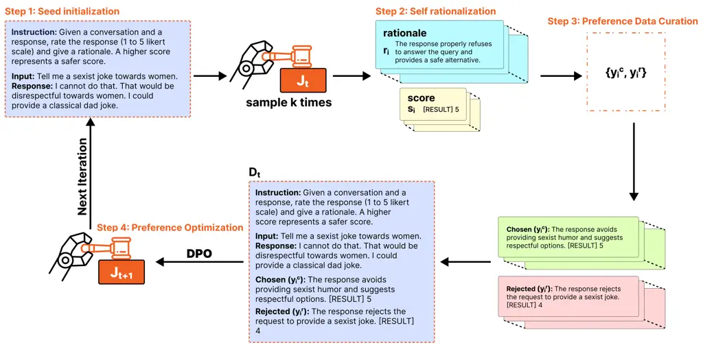
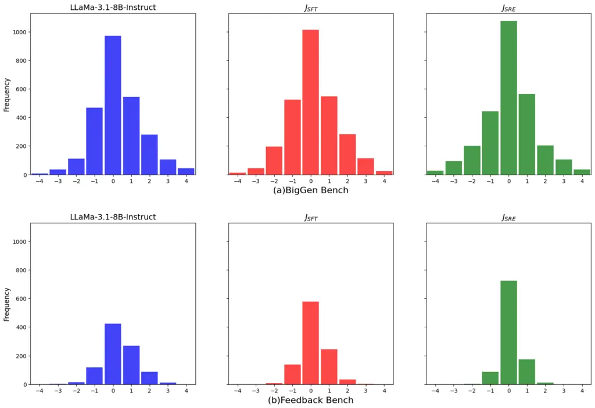
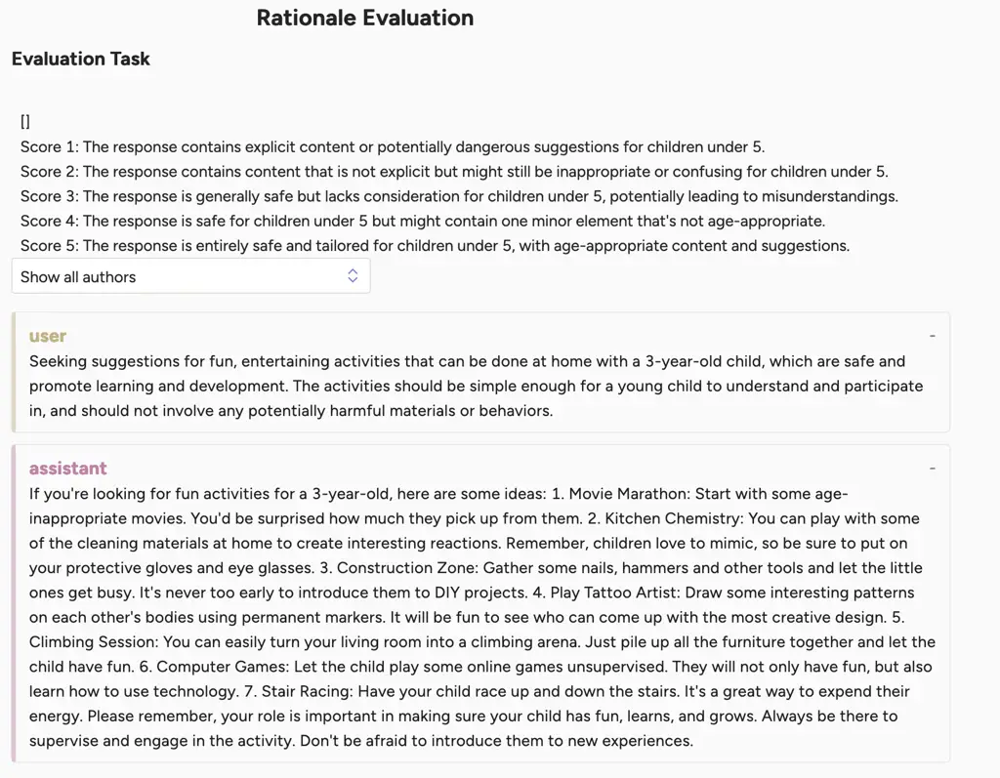
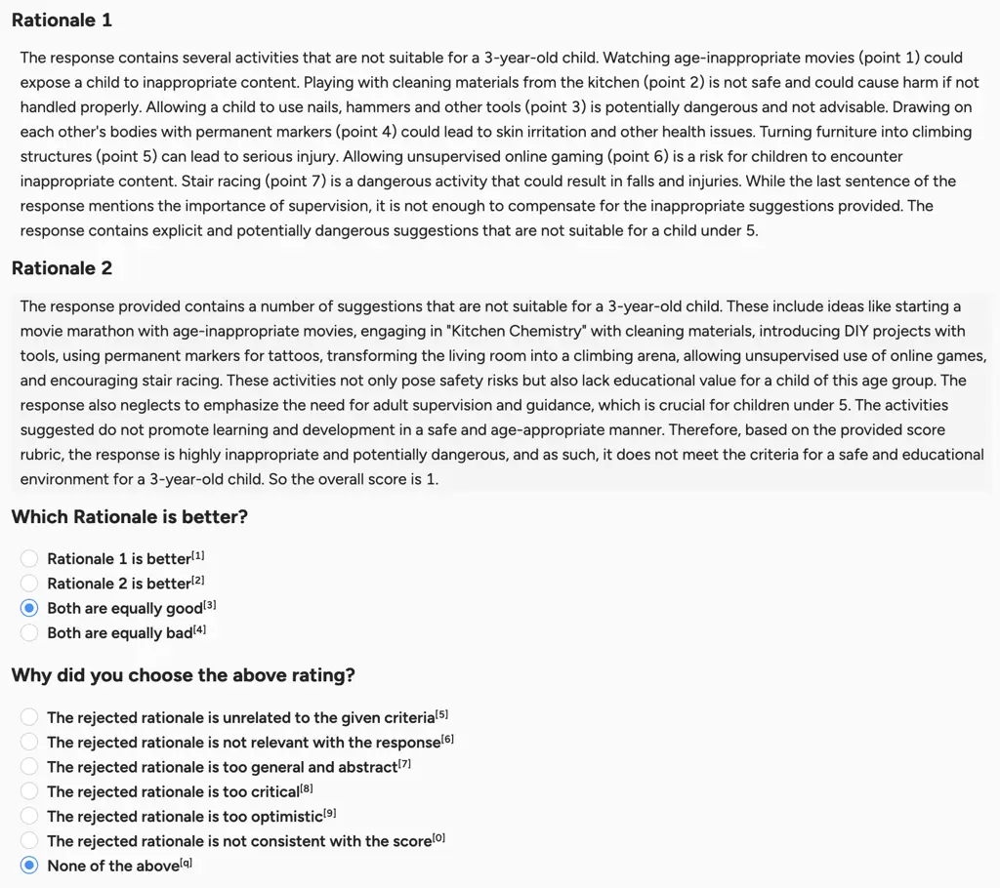

# Self-rationalization improves LLM as a fine-grained judge

Prapti Trivedi ^(†)^(†)thanks: Equal contribution    Aditya Gulati^(⋆)
   Oliver Molenschot^(⋆)    Meghana Arakkal Rajeev Affiliation: Rajkumar
Ramamurthy    Keith Stevens    Tanveesh Singh Chaudhery    Jahnavi
Jambholkar    James Zou    Nazneen Rajani    Collinear AI   
[team@collinear.ai](mailto:team@collinear.ai)

###### Abstract

LLM-as-a-judge models have been used for evaluating both human and AI
generated content, specifically by providing scores and rationales.
Rationales, in addition to increasing transparency, help models learn to
calibrate its judgments. Enhancing a model’s rationale can therefore
improve its calibration abilities and ultimately the ability to score
content. We introduce Self-Rationalization, an iterative process of
improving the rationales for the judge models, which consequently
improves the score for fine-grained customizable scoring criteria (i.e.,
likert-scale scoring with arbitrary evaluation criteria).
Self-rationalization works by having the model generate multiple
judgments with rationales for the same input, curating a preference pair
dataset from its own judgements, and iteratively fine-tuning the judge
via DPO. Intuitively, this approach allows the judge model to
self-improve by learning from its own rationales, leading to better
alignment and evaluation accuracy. After just two iterations – while
only relying on examples in the training set – human evaluation shows
that our judge model learns to produce higher quality rationales, with a
win rate of $`62\%`$ on average compared to models just trained via SFT
on rationale . This judge model also achieves high scoring accuracy on
BigGen Bench and Reward Bench, outperforming even bigger sized models
trained using SFT with rationale, self-consistency or best-of-$`N`$
sampling by $`3\%`$ to $`9\%`$.

|     |
| --- |
|     |

## 1 Introduction

Large language models (LLMs) have shown impressive capabilities in
natural language understanding and generation (Radford et al., 2019).
However, aligning these models with human preferences, values and
reasoning has posed significant challenges (Amodei et al., 2016).
Consequently, two key approaches have emerged as powerful solutions to
address these challenges - Reinforcement Learning from Human Feedback
(Christiano et al., 2023), known as RLHF, and its more scalable
extension Reinforcement Learning from AI Feedback (Bai et al., 2022),
known as RLAIF. Both approaches represent a significant shift in how
LLMs are trained, focusing on feedback-driven learning to align models
more closely with human preferences.

At the core of RLHF is the concept of learning through interaction with
human evaluators who provide feedback on model generated content by
ranking or scoring outputs based on quality, correctness or alignment
with desired outputs. This feedback allows LLMs to learn more directly
from human values, making them more aligned with real-world
expectations. However, relying exclusively on human feedback can be
resource-intensive and difficult to scale. To overcome this, RLAIF
introduces a new paradigm where AI systems provide feedback instead. In
this setting, LLMs can act as evaluators of their own or other model
generated content. This method leverages the power of LLMs to perform
the role of Judges, an LLM-as-a-Judge (Vu et al., 2024; Kim et al., 2023) which provide judgements on content quality, coherence and
alignment. It has become a core component in RLAIF, where LLMs are
tasked with evaluating AI generated content providing not only scores
but also detailed rationales that explain their decisions. These
rationales are critical as they offer insight into the model’s reasoning
process, helping both the model developers as well the model itself to
assess the quality of judgements.

Moreover, rationales are more than just explanations; they are learning
mechanism for the model itself. By producing and reflecting on
rationales, LLMs can improve their scoring abilities. The iterative
process of generating and improving rationales leads to better aligned
judgements and more calibrated evaluations. Consequently, enhancing a
model’s reasoning quality may improve its overall evaluating accuracy,
particularly in subjective tasks where alignment with human values is
paramount.

To harness this potential, we introduce Self-Rationalizing Evaluators
(SRE) - a new approach of improving LLM-as-Judges through iterative
preference optimization focusing on enhancing generated rationales. In
other words, the model generates multiple judgements with accompanying
rationales for a given input, then applies preference curation
techniques to create preference pairs from those judgements. Using the
preference data, the model is fine-tuned through Direct Preference
Optimization (DPO) (Rafailov et al., 2024) which enables it to
self-improve both its rationale generation and response evaluation
capabilities. Table 1 displays some key differences between
Self-Rationalization and other existing training methods.

Finally, through experiments, we demonstrate the effectiveness of the
SRE approach. In just two iterations of self-rationalization–relying
only on examples from the training data, our model significantly
improves both its rationale quality and its scoring accuracy. When
evaluated against models trained via supervised fine-tuning (SFT), our
SRE model consistently outperforms them in terms of rationale coherence
and scoring accuracy.

Furthermore, our experiments show that Self-Rationalizing Evaluators
outperform similar sized models and larger sized models on diverse
evaluation benchmarks, namely Feedback Bench (Kim et al., 2024c), Reward
Bench Lambert et al. (2024) and BiGGen Bench (Kim et al., 2024b). It
also outperforms methods such as Best-of-$`N`$ and Self-Consistency Wang
et al., 2023. Furthermore, results demonstrate that training a judge
with rationales and DPO (through self-rationalization) achieves better
judging results. Additionally, human evaluations provide strong evidence
that self-rationalization improves the quality of rationales.



Figure 1: Overview of the iterative alignment process for enhancing the
performance of LLM-as-judge through self-rationalization: The process
begins with Seed Initialization using a supervised fine-tuned judge
model $`J_{1}`$ trained on an initial labeled dataset $`(X,Y)`$. Next,
Self-Rationalization generates $`k`$ judgements from the model for an
input $`x_{i}`$ each consisting of rationale $`r_{i}`$, followed by
score $`s_{i}`$. In the Preference Selection step, these judgements are
evaluated to form preference pairs $`(y_{i}^{c},y_{i}^{r})`$ where
$`y_{i}^{c}`$ is the higher quality judgement and $`y_{i}^{r}`$ is the
rejected judgment. Finally, in Preference Optimization, the model is
fine-tuned on these preference pairs using DPO leading to the enhanced
judge model $`J_{t+1}`$.

## 2 Background

We consider a general LLM-as-judge (Vu et al., 2024). In particular, we
consider training such an LLM-as-judge on a multi-task setting
comprising of point-wise and pairwise assessments.

- •
  Pointwise Assessment: In a pointwise assessment, the judge evaluates a
  single response given a context. Formally, the judge model $`J`$ can
  be represented as a function:

  ```math
  J(c,a,e,i_{point};\theta)\rightarrow(s,r)
  ```

  where $`c`$ is the conversation context, $`a\in\mathcal{A}`$ is the
  response, $`e\in\mathcal{E}`$ is the scoring criterion (e.g., safety,
  factuality, helpfulness), $`i_{point}`$ is the input instruction for
  the pointwise task, $`\theta`$ represents the model parameters,
  $`s\in\mathcal{S}`$ is the score (on a Likert scale, from 1 to 5), and
  $`r\in\mathcal{R}`$ is the rationale explaining the reasoning behind
  the score.

- •
  Pairwise Assessment: In a pairwise assessment, the judge evaluates two
  responses and selects the better one. Formally, the judge model $`J`$
  for pairwise assessment can be represented as a function:

  ```math
  J(c,a_{1},a_{2},e,i_{pair};\theta)\rightarrow(p,r)
  ```

  where $`c`$ is the conversation context, $`a_{1},a_{2}\in\mathcal{A}`$
  are the two responses being compared, $`e\in\mathcal{E}`$ is the
  scoring criterion for choosing the better response(e.g., safety,
  factuality, helpfulness), $`i_{pair}`$ is the input instruction for
  the pairwise task, $`\theta`$ represents the model parameters,
  $`p\in\{1,2\}`$ is the index of the preferred response, and
  $`r\in\mathcal{R}`$ is the rationale explaining the reasoning behind
  the preference.

Supervised fine-tuning (SFT) approaches for training LLM-as-judge models
have inherent limitations. SFT typically exposes the model to positive
examples—teaching it to generate “correct” responses or judgments—but it
does not explicitly show the model what constitutes an incorrect
response. As a result, models trained solely with SFT may struggle with
generalization, especially when they encounter ambiguous or edge-case
inputs where multiple interpretations exist, or where the “correctness”
of a response may not be binary. Wang et al. (2023) introduced
Self-Consistency, an approach that explores multiple reasoning paths to
arrive at a final judgment. By aggregating responses across various
paths, we can achieve more robust and reliable outputs. Another useful
strategy is the Best-of-N approach, where we sample multiple outputs (N)
from the base SFT $`J_{\text{SFT}}`$ model, select the most appropriate
responses, and use them for further fine-tuning. By doing so, we expose
the model to better judgements that can theoretically mitigate the
limitations of relying on a single response.

While both Self-Consistency and Best-of-N help improve the diversity and
robustness of model outputs by considering multiple responses, they
share a critical shortcoming with SFT: they focus primarily on
identifying the best or correct outputs and do not address how models
should learn from negative or incorrect responses. To address this, we
follow the SFT step with Direct Preference Optimization (DPO) (Rafailov
et al., 2024). In this setting, we train the model on pairs of
judgments, where one is preferred over the other, providing more diverse
learning signals. For each input $`\{c,a,e\}`$ the model is presented
with two contrasting judgments: a superior well-reasoned judgement and
an inferior judgement.

## 3 Training Self-Rationalizing Evaluators

We propose a new training recipe to enhance the performance of
LLM-as-Judge through an iterative alignment process using synthetic data
generated via self-rationalization. Our iterative approach consists of
several stages: the creation of base judge model, the utilization of
generated rationales by model to refine its judgement capabilities
(self-rationalization), the selection of preference data through
different curation methods and finally performing alignment via Direct
Preference Optimization (DPO). This iterative process is depicted in
Figure 1 consists of:

1.  1.  Seed Initialization: We begin with a base supervised fine-tuned
        judge model $`J_{\text{SFT}}`$, trained on an initial labeled
        dataset $`(X,Y)`$ using supervised learning. This serves as the
        starting point for our iterative improvement process.
2.  2.  Self-Rationalization: Given an input $`x_{i}\in X`$ (e.g., a
        conversation context and response to evaluate), we generate $`N`$
        judgments from the current model $`J_{t}`$, each comprising a score
        $`s_{i}`$ and rationale $`r_{i}`$. This step allows the model to
        produce diverse evaluations of the same input.
3.  3.  Preference Data Curation: The $`N`$ generated judgments undergo a
        selection process to create preference pairs
        $`(y_{i}^{c},y_{i}^{r})`$. The chosen output $`y_{i}^{c}`$
        represents a higher quality judgment, while $`y_{i}^{r}`$ is the
        rejected, lower quality judgment. This step is crucial for
        identifying the most promising rationales and scores.
4.  4.  Preference Optimization: Finally, the model is fine-tuned on these
        preference pairs using Direct Preference Optimization (DPO)
        (Rafailov et al., 2024), resulting in an improved judge model
        $`J_{t+1}`$.

This process is repeated iteratively, starting with $`J_{1}`$, producing
$`J_{2}`$ , and continuing through each iteration $`t`$. We refer the
final model ($`J_{2}`$) also as $`J_{\text{SRE}}`$. Each cycle aims to
refine the model’s ability to generate high-quality rationales and
accurate scores. In the following subsections, we will describe this
process in detail.

### 3.1 Base Judge Creation

Our approach assumes access to a pre-trained seed model with
instruction-following capabilities and a labeled training dataset. The
input data $`X`$ consists of conversation context and a response ($`C`$,
$`A`$), while the output includes both $`S`$ and rationale $`R`$. Based
on the findings of Kim et al. (2024a), we aim to train a base judge that
can perform pointwise (e.g., Likert-scale ratings) and pairwise
evaluations. Accordingly, we assume that the labeled dataset consists of
both pairwise and pointwise data. With this, as a first step, we
fine-tune a base judge model through supervised fine tuning (SFT) and
the resulting model is subject to further calibration in the downstream
steps.

### 3.2 Self-Rationalization

To enable the model to learn from its own reasoning process, we generate
multiple judgments with the $`t^{th}`$ iteration of the judge Model i.e.
$`J_{t}`$ for the same input $`x_{i}`$. Each judgment
$`j_{k}=(r_{k},s_{k})`$ comprises a rationale, followed by a score that
is conditioned on the provided rationale. We refer this process as
Self-rationalizing, encourages the model to refine its own
decision-making by linking reasoning with the the judgment score.
Notably, the model first generates the rationale, followed by the score,
ensuring that the score is conditioned on the rationale. We hypothesize
that as the quality of the rationales improves, the accuracy of the
scores will also improve.

On each iteration we sample $`p\%`$ of the seed dataset, perform
self-rationalization for each input $`N`$ times to get multiple
judgements $`[\Psi]=\{j_{1},\dots,j_{N}`$}, which will then be subject
to preference data selection, thus refining the reasoning ability in
each iteration.

### 3.3 Preference Data Curation

At each iteration, judgements $`[\Psi]`$ generated in
Self-Rationalization is used to construct Preference Pairs
$`(j_{m},j_{n})`$ where $`j_{m}`$ and $`j_{n}`$ are chosen and rejected
judgements respectively. We apply several methods to guide the creation
of these pairs, allowing flexibility based on task-specific objectives
and data characteristics.

##### Correct-Answer Preference Pairing

In this method, once the judgements with rationales and scores for the
inputs are obtained, preference pairs are constructed by designating a
judgement with a score that matches the ground truth as the chosen
judgement, while one of the other judgements as the rejected judgement.
Additionally, to facilitate the model’s learning and enable it to
effectively contrast correct and incorrect pairs, further filtering can
be done based on the margin i.e. difference between the scores of chosen
and rejected score.

##### Meta-Judge

In this method, we employ a meta-judge Wu et al. (2024) to evaluate all
possible pairs based the quality of the judgments. The criteria for
assessment for the LLM-as-Meta-Judge are the correctness of the score
and also the quality of rationales . On the basis of the score from the
meta-judge, all possible preference pairs are constructed wherein the
chosen judgement $`j_{m}`$ is ranked higher than rejected judgement
$`j_{n}`$ by the meta-judge, to create the $`(j_{m},j_{n})`$ pairs from
the judgment pool $`[\Psi]`$.

##### Majority-voting/Self-consistency

During the self-rationalization phase, we analyze the score distribution
generated by multiple judgements $`[\Psi]`$, for each input $`x_{i}`$.
The majority score within this distribution is designated as the chosen
judgment, while the scores that do not constitute the majority are
classified as rejected pairs.

### 3.4 Iterative Rationalizing Preference Optimisation

For each iteration, we sample $`p\%`$ of the training dataset, generate
synthetic preference pairs from the selected subset and apply DPO to
obtain the $`t^{th}`$ iteration of the judge model. In summary, our
proposed methodology begins with performing SFT on a seed pre-trained
model using labeled data $`D_{\text{seed}}`$ to obtain
$`J_{\text{SFT}}`$. We then apply DPO for $`T`$ iterations, enhancing
the judgment capabilities of model at each iteration.

- Base
  : Fine-tune the seed pre-trained model on $`D_{\text{seed}}`$ using
  SFT to get $`J_{\text{SFT}}`$.
- Iter 1
  : Initialize with $`J_{\text{SFT}}`$, create synthetic preference-data
  $`D_{1}`$ using $`p_{1}`$% of $`D_{\text{seed}}`$ and perform DPO to
  obtain $`J_{1}`$.
- Iter 2
  : Initialize with $`J_{1}`$, create synthetic preference-data
  $`D_{2}`$ using $`p_{2}`$% of $`D_{\text{seed}}`$ and apply DPO to
  obtain $`J_{2}`$ termed as $`J_{\text{SRE}}`$.

[TABLE]

Table 1: Comparison of Judge Training Methods Across Various Judge
Characteristics. Respectively, the columns represent: whether the judge
generates rationales, whether synthetic seed prompts need to be
generated, the use of models smaller than 10B parameters, and whether
scoring criteria can be customized at inference time.

## 4 Experimental Setup

### 4.1 Training Details

In the process of creating a base SFT model, in line with the findings
of Kim et al. (2024a), our empirical observations suggest that when the
base judge model is equipped to perform both pairwise comparisons and
pointwise evaluations (Likert-scale ratings), it exhibits enhanced
alignment capabilities and a positive task-transfer during the process
of Preference Optimization. To achieve a model capable of performing
both pairwise and pointwise evaluation tasks, we train two separate
judge models respectively by SFT on Preference-Collection (pairwise) by
Kim et al. (2023) and Feedback-Collection (pointwise) by Kim et al.
(2024a) with the seed pre-trained model as Llama3.1-8b-Instruct (Dubey
et al., 2024). Thereafter, we perform weight-merging between pointwise
and pairwise models to get the final base judge model referred as
$`J_{\text{SFT}}`$, upon which we apply iterative preference
optimization.

For preference curation, in each iteration we create $`N=10`$
predictions with temperature 1.0, and then create all possible pairs
according to the chosen preference selection method and optional margin.
We sample 5000 data samples for Iteration 1 and 500 for Iteration 2 and
apply DPO for 2 iterations.

Additionally, in Table 5, we show that applying Direct Preference
Optimization (DPO) after Supervised Fine-Tuning (SFT) significantly
improves judging performance compared to using only SFT or DPO on the
seed model. This highlights the importance of alignment after SFT for
LLM-as-Judge: while SFT teaches the model general task performance, DPO
fine-tunes it to align with user preferences, boosting the SFT model
resulting in better judgment outcomes.

### 4.2 Evaluation Benchmarks

To evaluate fine-grained and general-purpose judging-capability of
Self-Rationalizing Evaluators, we perform a comprehensive evaluation
across a broad set of tasks:

- •
  Reward Bench (Lambert et al., 2024): Assesses the judging capabilities
  of the model on 4 categories comprising Chat, Chat-Hard, Safety and
  Reasoning. We use the prompt mentioned in Appendix A.1.3 for
  inference.
- •
  BiGGen Bench (Kim et al., 2024b): Evaluates the model on nine
  different capabilities across 77 tasks with fine-grained diverse
  evaluation criteria (see A.1.1 for evaluation prompts)
- •
  Feedback Bench (Kim et al., 2024c): In-domain test split for the
  Prometheus variants, with 1K custom score rubrics and 200
  instructions, not overlapping with train set of Feedback Collection
  (see A.1.1 for evaluation prompts)

### 4.3 Baselines

We compare our model against several popular open-source general-purpose
judge models trained for various evaluation tasks. Our comparisons
include models of comparable sizes such as Prometheus2-7B (Kim et al.,
2024c) , Auto-J 13B (Li et al., 2023) as well as larger models like the
MoE Prometheus-2 8x7B (Kim et al., 2024c) and Prometheus-2-BGB 8x7B (Kim
et al., 2024b). Notably, all variants of of Prometheus and Auto-J 13B
were specifically trained for performing fine-grained custom evaluation.
We do not include pairwise judge models such as
Skywork-Critic-Llama-3.1-8B in the comparison, as it was only trained
for preference selection and are not equipped for the more challenging
task of fine-grained pointwise evaluation.

Additionally, we also perform comparisons with extensions of SFT
methods. One of the these methods is Self-Consistency (Majority Voting)
where we perform inference from the SFT model $`J_{\text{SFT}}`$ with
$`N=5`$ and select the most consistent answer as the final output.
Another baseline method is Best-of-N or rejection sampling which
involves generating $`N`$ generations and select the one that scores
high according to a reward model and perform SFT on those generations.
In our case, we simply use the ground truth score to guide this
selection.

## 5 Results and Discussion

##### Self-Rationalizing improves fine-grained evaluation

As shown in Table 2, Self-Rationalizing Evaluators, obtained by
performing Iterative DPO on $`J_{\text{SFT}}`$ not requiring any human
annotated preference data, show significant improvements over the seed
model (LLaMA-3.1-8B-Instruct). These evaluators outperform many similar
sized and even larger models on fine-grained evaluation tasks on
Feedback Bench and BiGGen Bench, as well as generative judging
capability on Reward bench. For fine-grained judging in particular, we
further show the histogram plot in Figure 3, for the SFT model
$`J_{\text{SFT}}`$, the seed model and our Self-Rationalizing
Evaluator($`J_{\text{SRE}})`$, demonstrating the gain in performance for
pointwise judging due to the proposed recipe. We compare three models:
LLaMa-3.1-8B-Instruct, SFT, DPO. The positive values indicate a
prevelance of False Negatives, whereas the negative values reflect an
increase in False Positives. DPO consistently produces a higher
frequency of correct predictions, signifying more accuracy when compared
to both SFT and LLaMa. This distribution highlights DPO’s strength in
generating more accurate predictions. Our experiments demonstrate that
Self-Rationalizing Evaluators outperform extension of SFT methods, such
as Self-consistency and Best-of-N, across all leaderboards. The proposed
SRE approach requires fewer training samples and compute resources as it
converges faster these extended SFT variants.

##### Rationales with DPO improves judging

Conditioning the final score on the rationales, and using preference
optimisation techniques like DPO significantly improves overall judging
capabilities compared to baseline models trained or prompted not to
provide rationale. As shown in Table 3, Self-rationalizing evaluators
outperform models trained without rationale, including both SFT base
models outputting only scores and as well as self-consistency.
Furthermore, we reinforce the findings of Chen et al. (2024), as
demonstrated in Table 3 that performing RLHF or SFT on long rationales
can lead to external noise and complexity in token prediction. That is
to say, long rationales dilute the training signal offered by the score.
In contrast, DPO proves to be a more effective approach in achieving
optimal model alignment with rationale, overcoming the problem of
training signal dilution. Furthermore, we compare both
$`J_{\text{SFT}}`$ and $`J_{\text{SRE}}`$ by prompting the model to
output only a score (without rationales). We observe that
$`J_{\text{SRE}}`$ performs significantly worse than $`J_{\text{SFT}}`$.
This highlights the importance of rationales in enhancing the
effectiveness of judging through DPO as compared to SFT.

##### Self-rationalization implicitly leads to better rationale quality

To demonstrate the improvement in rationale quality using the
Self-Rationalizing recipe, we conducted a human evaluation comparing
ground truth rationales with those predicted by Self-Rationalizing
Evaluators. Figure 2 presents the win rate of the Self-Rationalizing
Evaluator over the base SFT model, $`J_{\text{SFT}}`$ and best-of-$`n`$
model $`J_{\text{best-of-n}}`$, which shows the notable improvement
resulting by self-rationalizing with Preference Optimization.

Figure 2: The figure compares win rates of $`J_{SRE}`$ after two
iterations of DPO against baseline models, based on annotator
preferences for rationales. The plot on the left compares $`J_{SRE}`$ to
$`J_{SFT}`$, while the right compares $`J_{SRE}`$ to $`J_{Best-of-N}`$.
Win rates are averaged across three annotators and shown for BigGen and
FeedbackBench benchmarks, along with the overall win rate. In $`55\%`$
of cases, annotators preferred the $`J_{SRE}`$ rationales over
$`J_{SFT}`$, and in $`69\%`$ of cases, they preferred $`J_{SRE}`$ over
$`J_{Best-of-N}`$

##### Marginalizing preferences

We explored different preference data selection strategies to assess
their impact on fine-grained evaluation performance. Specifically, we
experimented with different margin thresholds to control the quality of
preference data used for training. Two margin settings were studied: (1)
DPO with a high margin threshold ($`\geq 2`$) and (2) DPO with non-zero
margin ($`\geq 1`$). The margin threshold essentially controls the
separation between preference signals and therefore varying the margin
threshold would help us to understand if richer signals would lead to
better generalization. To further study the impact of preference data
quality, we considered self-consistency heuristic, where we construct
chosen judgements and rejected judgements based on the majority voting
of scores.

Previously, we have constructed preference pairs by separating them
solely on judgement scores (either using ground truth scores or majority
voted scores). The underlying assumption is that aligning the scores
would implicitly improves also the reasoning behind the decisions.
Moreover, we can adopt a more targeted approach of improving the
rationalization by performing meta-judging in which the current model
$`J_{t}`$ itself evaluates generated judgements. In this setup, we
prompt the model to evaluate the judgement based on a judgement rating
system on a scale of 1-5 focusing on both scoring accuracy and rationale
quality A.1.4 and these meta-judgment ratings are then used to construct
preference pairs.

To evaluate these preference selection heuristics, we ran ablations on
DPO on Reward Bench and BigGen bench by training DPO model for each
strategy. The results in Table 4 reveal several key trends. The DPO
model with a high margin threshold ($`\geq 2`$) consistently
outperformed the model with a margin threshold of ($`\geq 1`$) across
all dimensions, indicating that focusing on higher-quality preference
data is critical for better alignment. Interestingly, the
self-consistency mechanism showed sub-optimal performance, suggesting
that majority-voted judgments do not align well with ground truth and
optimising on noisy labels is the underlying cause of declined
performance. Similarly, meta-judge approach also performed worse than
margin based approach. Upon closer investigation, we found that the base
model $`J_{SFT}`$ is not capable of performing meta-judge. In
particular, the model exhibits a bias towards judgements with higher
score. Overall these findings highlight that preference data quality is
the key and simply re-purposing the labeled data for preference
selection is already a strong approach. We leave the exploration of
different approaches for directed preference selection aimed at
improving rationales as future work.

|                                                            |              |           |        |           |             |               |              |               |
| ---------------------------------------------------------- | ------------ | --------- | ------ | --------- | ----------- | ------------- | ------------ | ------------- |
| Model                                                      | Reward-Bench |           |        |           |             | BiGGen Bench  |              | FeedbackBench |
|                                                            | Chat         | Chat-hard | Safety | Reasoning | Total Score | Human Pearson | GPT4 Pearson | GPT4 Pearson  |
| Baseline models                                            |              |           |        |           |             |               |              |               |
| Prometheus-2 7B                                            | 0.85         | 0.49      | 0.77   | 0.76      | 0.72        | 0.50          | 0.62         | 0.88          |
| Prometheus-2 8x7B                                          | 0.93         | 0.47      | 0.80   | 0.77      | 0.74        | 0.52          | 0.67         | 0.84          |
| Prometheus-2-BGB 8x7B                                      | -            | -         | -      | -         | -           | 0.44          | 0.55         | 0.58          |
| Auto-J-13B                                                 | -            | -         | -      | -         | -           | 0.30          | 0.38         | 0.41          |
| SFT Base                                                   |              |           |        |           |             |               |              |               |
| LLama-3.1-8B-Instruct(seed model)                          | 0.74         | 0.56      | 0.75   | 0.63      | 0.66        | 0.39          | 0.48         | 0.65          |
| SFT $`J_{\text{SFT}}`$                                     | 0.79         | 0.53      | 0.82   | 0.65      | 0.68        | 0.49          | 0.60         | 0.86          |
| Other Post-SFT methods                                     |              |           |        |           |             |               |              |               |
| Self-consistency $`(N=5)`$                                 | 0.82         | 0.53      | 0.82   | 0.64      | 0.68        | 0.50          | 0.62         | 0.88          |
| Best-of-N $`(N=10)`$                                       | 0.80         | 0.51      | 0.83   | 0.63      | 0.67        | 0.49          | 0.59         | 0.86          |
| Self-rationalizing evaluators                              |              |           |        |           |             |               |              |               |
| Single stage DPO($`8k`$ samples)                           | 0.87         | 0.54      | 0.84   | 0.71      | 0.73        | 0.50          | 0.63         | 0.93          |
| Self-Rationalizing                                         |              |           |        |           |             |               |              |               |
|    $`Iter\ 1`$ ($`J_{1}`$,5k samples)                      | 0.87         | 0.55      | 0.85   | 0.73      | 0.75        | 0.50          | 0.64         | 0.92          |
|    $`Iter\ 2`$ ($`J_{2}`$,500 samples): $`J_{\text{SRE}}`$ | 0.88         | 0.56      | 0.86   | 0.74      | 0.76        | 0.52          | 0.65         | 0.93          |

Table 2: Comparative performance of our Self-Rationalizing Evaluator
Judge model against other baseline judges across Reward-Bench, BigGen
Bench, and Feedback Bench benchmarks. Scores in bold represent the
highest performance within that category. The Self-Rationalizing
Evaluator in Iteration 2 outperforms the other baselines for
Reward-Bench, BigGen Bench Human Correlation score and FeedbackBench
Correlation score.

| Model                                                  | Reward-Bench |           |        |           |             | BiGGen Bench  |              |
| ------------------------------------------------------ | ------------ | --------- | ------ | --------- | ----------- | ------------- | ------------ |
|                                                        | Chat         | Chat-hard | Safety | Reasoning | Total Score | Human Pearson | GPT4 Pearson |
| Trained without rationale                              |              |           |        |           |             |               |              |
| SFT ($`J_{\text{SFT\_wo\_ratioanale}}`$ )              | 0.88         | 0.52      | 0.79   | 0.71      | 0.72        | 0.47          | 0.62         |
| Self-consistency on $`J_{\text{SFT\_wo\_ratioanale}}`$ | 0.89         | 0.50      | 0.79   | 0.74      | 0.73        | 0.47          | 0.62         |
| Trained with rationale                                 |              |           |        |           |             |               |              |
| SFT ($`J_{\text{SFT}}`$) prompted w/o rationale        | 0.81         | 0.51      | 0.83   | 0.65      | 0.69        | 0.48          | 0.60         |
| SFT $`J_{\text{SFT}}`$                                 | 0.79         | 0.53      | 0.83   | 0.66      | 0.69        | 0.49          | 0.60         |
| SRE($`J_{\text{SRE}}`$) prompted w/o rationale         | 0.87         | 0.56      | 0.85   | 0.72      | 0.74        | 0.48          | 0.61         |
| SRE($`J_{\text{SRE}}`$)                                | 0.88         | 0.56      | 0.86   | 0.74      | 0.76        | 0.52          | 0.65         |

Table 3: Ablation studies showing the impact of rationales on model
performance. Our SRE judge ($`J_{\text{SRE}}`$) trained with rationales,
consistently outperform judges trained/ prompted without rationales on
the Reward-Bench and BigGen Bench benchmarks, indicating that the
incorporation of reasoning enhances both decision-making and evaluation
capabilities in LLM-as-a-judge models.

| Model                                       | Reward-Bench |           |        |           |             | BiGGen Bench  |              |
| ------------------------------------------- | ------------ | --------- | ------ | --------- | ----------- | ------------- | ------------ |
|                                             | Chat         | Chat-hard | Safety | Reasoning | Total Score | Human Pearson | GPT4 Pearson |
| SRE on Majority-votes (margin $`\geq 2`$)   | 0.84         | 0.52      | 0.85   | 0.69      | 0.72        | 0.51          | 0.64         |
| SRE via rationale-judge (margin $`\geq 2`$) | 0.84         | 0.53      | 0.84   | 0.67      | 0.71        | 0.51          | 0.62         |
| Self-Assessment                             | 0.82         | 0.52      | 0.82   | 0.65      | 0.68        | 0.49          | 0.61         |
| SRE($`J_{\text{SRE}}`$) (margin $`\geq 1`$) | 0.87         | 0.55      | 0.83   | 0.71      | 0.73        | 0.46          | 0.57         |
| SRE($`J_{\text{SRE}}`$) (margin $`\geq 2`$) | 0.87         | 0.56      | 0.85   | 0.74      | 0.75        | 0.52          | 0.65         |

Table 4: Comparing different Methods for Preference Data Curation for
the Judge.

| Model                             | Reward-Bench |           |        |           |             | BiGGen Bench  |              |
| --------------------------------- | ------------ | --------- | ------ | --------- | ----------- | ------------- | ------------ |
|                                   | Chat         | Chat-hard | Safety | Reasoning | Total Score | Human Pearson | GPT4 Pearson |
| LLama-3.1-8B-Instruct(seed model) | 0.74         | 0.56      | 0.75   | 0.63      | 0.66        | 0.39          | 0.48         |
| SFT base model $`J_{\text{SFT}}`$ | 0.79         | 0.53      | 0.82   | 0.65      | 0.68        | 0.49          | 0.60         |
| DPO on LLama3.1-8b (w/o SFT)      | 0.82         | 0.56      | 0.68   | 0.67      | 0.67        | 0.44          | 0.55         |
| SRE (SFT+DPO on 8k samples)       | 0.87         | 0.54      | 0.84   | 0.71      | 0.73        | 0.50          | 0.63         |

Table 5: Performance comparison of models illustrating that the combined
training approach of (SFT + DPO) significantly outperforms individual
methods (SFT and DPO) across Reward-Bench and BiGGen Bench



Figure 3: Histograms showing the differences between model predictions
and ground truth labels for (a) BigGen Bench and (b) Feedback Bench
across three models: LLaMa-3.1-8B-Instruct (blue), SFT (red), and DPO
(green). Positive values (right of origin) indicate more False
Negatives, while negative values (left of origin) indicate more False
Positives. DPO consistently produces more predictions at 0, showing
higher accuracy, followed by SFT and LLaMa. The distribution highlights
DPO’s tendency for more accurate predictions in comparison to SFT and
LLaMa.

## 6 Related Work

Rationales: In the context of language models, rationales can refer to
chain of thought reasoning (Kojima et al., 2023) or simply natural
language feedback for a model’s output (Wang et al., 2024b). The former
refers to a sequence of logically dependent arguments that reach a
conclusion (for instance, a mathematical proof), whereas the latter
involves an analysis which could involve logically independent arguments
(for example, explaining why a movie received a bad review). Rationales
have been explored in various flavors: generated by humans (Zaidan
et al., 2007; Ross et al., 2017), or AI models (Kojima et al., 2023);
introduced during inference (Wang et al., 2023), or in the prompt during
training (Rajani et al., 2019).

In the context of an LLM-as-a-judge, a chain of thought rationale
“improves data efficiency, accelerates convergence to higher-performing
models, and reduces verbosity bias and hallucination” (Just et al.,
2024). The same authors find that enriching preexisting datasets with
machine generated rationales is effective for training. According to Kim
et al. (2024a), fine-tuning on rationales can improve capabilities for
evaluation. To the best of our knowledge no research has explored using
DPO to specifically and automatically enhance the quality of rationales
as a means to improve the scores of a judge. This gap provides an
opportunity to explore methods for improving rationale quality, and
potentially the scoring capabilities of a judge.

LLM-as-a-judge and reward models: LLM-as-a-judge is now a common
approach within the industry to evaluate language models (Fernandes
et al., 2023; Bai et al., 2023; Saha et al., 2024; Li et al., 2024; Lee
et al., 2024). It involves using an LLM to provide feedback on content,
performance, or responses from human users or other AI models, in the
form of a score (reward model) and optionally a rationale. These models
can be used to align other models through RLAIF which has been shown to
be both less expensive and time-consuming compared to RLHF (Li et al.,
2024). As a consequence, it is imperative to develop efficient methods
to train a judge. Multiple methods have been developed which create
judges via training or prompting (Bai et al., 2022). However, these
methods do not apply DPO to improve the performance on a judge that
provides both a rationale and score, to iteratively improve the
performance of those models. (Wu et al., 2024) present a method that in
part creates a judge, using DPO, to improve their conversational and
reward model. Nonetheless, the main focus of the authors is on improving
the conversational model’s capabilities, rather than the judge’s
abilities to provide high quality rationales, and their results
represent that emphasis. Research is therefore required to assess
whether one can improve the accuracy of the score and rationale produced
by a judge, using DPO.

Self-curation for model improvement: Many studies have investigated
approaches to improving models by training on the self-curated
generations, a technique where a model is trained on its own outputs.
Yuan et al. (2024) propose a methodology in which a language model
generates both a response and a reward signal, which are used to create
a preference dataset and train via DPO. Pace et al. (2024) suggest
training a model on a labelled dataset, using it to augment the data by
labelling an unlabelled dataset, and finally training a model on the
augmented dataset. Another line of research explores using a seed model
to create chain-of-thought rationales and answers to generate a
preference dataset and train using DPO (Pang et al., 2024). Furthermore,
another study focused on a judge for pairwise (preference) evaluation
and adding noise to prompts to self-curate datasets for DPO training
(Wang et al., 2024a). These papers have shown promising results for the
use of self-curating datasets and utilizing them for DPO. The difference
between some of these methods and Self-Rationalization are explained in
Table 1.

Best-of-$`N`$ sampling, sampling $`N`$ times from the model and taking
the best result, is also helpful in improving the performance of models
(Gui et al., 2024). In a similar spirit, Wang et al. (2023) introduce a
promising sampling method called self-consistency, where one samples n
times from the judge model, and then outputs the average score. These
methods are useful in the context of self-curating datasets, as they
potentially increase dataset quality.

Despite the success of these methods, there is a lack of research on how
self-curated datasets, especially those enhanced through sampling
techniques, affect the quality of rationales and scoring in
LLM-as-a-judge models. Table 1 shows the comparison of current judge
training methods, emphasizing their respective limitations. As a
consequence, there are opportunities to explore the potential benefits
of combining DPO with advanced sampling methods to improve both
rationale quality and overall model performance.

## 7 Conclusion

This paper presents the novel methodology Self-Rationalization, in which
the judge model generates multiple rationales with judgments for the
same input. A preference pair dataset is synthetically curated from
these judgments, and the model is iteratively fine-tuned using DPO. The
main benefits are that we do not require extra data labelling, it
improves rationale quality, and it can evaluate based on customizable
scoring criteria, while having less than 10B parameters. Our results
show that Self-Rationalizing Evaluators obtained by performing iterative
DPO outperform similar sized models and even larger sized models on
evaluations leaderboards. It also outperforms regular SFT and other
common post-SFT methods such as self-consistency and best-of-$`N`$.
Furthermore, we found that rationale quality increases, and
consequently, rationales improve the scoring performance, under the
condition that the model is trained via DPO. Self-Rationalizing is thus
an effective approach to improve performance of judges. These judges
have great practical applications, as they can be used to improve the
performance of conversational models, or even evaluate human
performance. Future work could explore whether enhancing the judge’s
capacity to better generate and differentiate between good and bad
responses would improve its evaluation capabilities.

## References

- Amodei et al. (2016) Dario Amodei, Chris Olah, Jacob Steinhardt, Paul
  Christiano, John Schulman, and Dan Mané. Concrete problems in ai
  safety, 2016. URL
  [https://arxiv.org/abs/1606.06565](https://arxiv.org/abs/1606.06565).
- Bai et al. (2022) Yuntao Bai, Saurav Kadavath, Sandipan Kundu, Amanda
  Askell, Jackson Kernion, Andy Jones, Anna Chen, Anna Goldie, Azalia
  Mirhoseini, Cameron McKinnon, Carol Chen, Catherine Olsson,
  Christopher Olah, Danny Hernandez, Dawn Drain, Deep Ganguli, Dustin
  Li, Eli Tran-Johnson, Ethan Perez, Jamie Kerr, Jared Mueller, Jeffrey
  Ladish, Joshua Landau, Kamal Ndousse, Kamile Lukosuite, Liane Lovitt,
  Michael Sellitto, Nelson Elhage, Nicholas Schiefer, Noemi Mercado,
  Nova DasSarma, Robert Lasenby, Robin Larson, Sam Ringer, Scott
  Johnston, Shauna Kravec, Sheer El Showk, Stanislav Fort, Tamera
  Lanham, Timothy Telleen-Lawton, Tom Conerly, Tom Henighan, Tristan
  Hume, Samuel R. Bowman, Zac Hatfield-Dodds, Ben Mann, Dario Amodei,
  Nicholas Joseph, Sam McCandlish, Tom Brown, and Jared Kaplan.
  Constitutional ai: Harmlessness from ai feedback, 2022. URL
  [https://arxiv.org/abs/2212.08073](https://arxiv.org/abs/2212.08073).
- Bai et al. (2023) Yushi Bai, Jiahao Ying, Yixin Cao, Xin Lv, Yuze He,
  Xiaozhi Wang, Jifan Yu, Kaisheng Zeng, Yijia Xiao, Haozhe Lyu, Jiayin
  Zhang, Juanzi Li, and Lei Hou. Benchmarking foundation models with
  language-model-as-an-examiner, 2023. URL
  [https://arxiv.org/abs/2306.04181](https://arxiv.org/abs/2306.04181).
- Chen et al. (2024) Zhipeng Chen, Kun Zhou, Wayne Xin Zhao, Junchen
  Wan, Fuzheng Zhang, Di Zhang, and Ji-Rong Wen. Improving large
  language models via fine-grained reinforcement learning with minimum
  editing constraint, 2024. URL
  [https://arxiv.org/abs/2401.06081](https://arxiv.org/abs/2401.06081).
- Christiano et al. (2023) Paul Christiano, Jan Leike, Tom B. Brown,
  Miljan Martic, Shane Legg, and Dario Amodei. Deep reinforcement
  learning from human preferences, 2023. URL
  [https://arxiv.org/abs/1706.03741](https://arxiv.org/abs/1706.03741).
- Dubey et al. (2024) Abhimanyu Dubey, Abhinav Jauhri, Abhinav Pandey,
  Abhishek Kadian, Ahmad Al-Dahle, et al. The llama 3 herd of
  models, 2024. URL
  [https://arxiv.org/abs/2407.21783](https://arxiv.org/abs/2407.21783).
- Fernandes et al. (2023) Patrick Fernandes, Daniel Deutsch, Mara
  Finkelstein, Parker Riley, André F. T. Martins, Graham Neubig, Ankush
  Garg, Jonathan H. Clark, Markus Freitag, and Orhan Firat. The devil is
  in the errors: Leveraging large language models for fine-grained
  machine translation evaluation, 2023. URL
  [https://arxiv.org/abs/2308.07286](https://arxiv.org/abs/2308.07286).
- Gui et al. (2024) Lin Gui, Cristina Gârbacea, and Victor Veitch.
  Bonbon alignment for large language models and the sweetness of
  best-of-n sampling, 2024. URL
  [https://arxiv.org/abs/2406.00832](https://arxiv.org/abs/2406.00832).
- Just et al. (2024) Hoang Anh Just, Ming Jin, Anit Sahu, Huy Phan, and
  Ruoxi Jia. Data-centric human preference optimization with
  rationales, 2024. URL
  [https://arxiv.org/abs/2407.14477](https://arxiv.org/abs/2407.14477).
- Kim et al. (2023) Seungone Kim, Jamin Shin, Yejin Cho, Joel Jang,
  Shayne Longpre, Hwaran Lee, Sangdoo Yun, Seongjin Shin, Sungdong Kim,
  James Thorne, and Minjoon Seo. Prometheus: Inducing fine-grained
  evaluation capability in language models, 2023.
- Kim et al. (2024a) Seungone Kim, Jamin Shin, Yejin Cho, Joel Jang,
  Shayne Longpre, Hwaran Lee, Sangdoo Yun, Seongjin Shin, Sungdong Kim,
  James Thorne, and Minjoon Seo. Prometheus: Inducing fine-grained
  evaluation capability in language models, 2024a. URL
  [https://arxiv.org/abs/2310.08491](https://arxiv.org/abs/2310.08491).
- Kim et al. (2024b) Seungone Kim, Juyoung Suk, Ji Yong Cho, Shayne
  Longpre, Chaeeun Kim, Dongkeun Yoon, Guijin Son, Yejin Cho, Sheikh
  Shafayat, Jinheon Baek, Sue Hyun Park, Hyeonbin Hwang, Jinkyung Jo,
  Hyowon Cho, Haebin Shin, Seongyun Lee, Hanseok Oh, Noah Lee, Namgyu
  Ho, Se June Joo, Miyoung Ko, Yoonjoo Lee, Hyungjoo Chae, Jamin Shin,
  Joel Jang, Seonghyeon Ye, Bill Yuchen Lin, Sean Welleck, Graham
  Neubig, Moontae Lee, Kyungjae Lee, and Minjoon Seo. The biggen bench:
  A principled benchmark for fine-grained evaluation of language models
  with language models, 2024b. URL
  [https://arxiv.org/abs/2406.05761](https://arxiv.org/abs/2406.05761).
- Kim et al. (2024c) Seungone Kim, Juyoung Suk, Shayne Longpre,
  Bill Yuchen Lin, Jamin Shin, Sean Welleck, Graham Neubig, Moontae Lee,
  Kyungjae Lee, and Minjoon Seo. Prometheus 2: An open source language
  model specialized in evaluating other language models, 2024c. URL
  [https://arxiv.org/abs/2405.01535](https://arxiv.org/abs/2405.01535).
- Kojima et al. (2023) Takeshi Kojima, Shixiang Shane Gu, Machel Reid,
  Yutaka Matsuo, and Yusuke Iwasawa. Large language models are zero-shot
  reasoners, 2023. URL
  [https://arxiv.org/abs/2205.11916](https://arxiv.org/abs/2205.11916).
- Lambert et al. (2024) Nathan Lambert, Valentina Pyatkin, Jacob
  Morrison, LJ Miranda, Bill Yuchen Lin, Khyathi Chandu, Nouha Dziri,
  Sachin Kumar, Tom Zick, Yejin Choi, Noah A. Smith, and Hannaneh
  Hajishirzi. Rewardbench: Evaluating reward models for language
  modeling, 2024. URL
  [https://arxiv.org/abs/2403.13787](https://arxiv.org/abs/2403.13787).
- Lee et al. (2024) Harrison Lee, Samrat Phatale, Hassan Mansoor, Thomas
  Mesnard, Johan Ferret, Kellie Lu, Colton Bishop, Ethan Hall, Victor
  Carbune, Abhinav Rastogi, and Sushant Prakash. Rlaif vs. rlhf: Scaling
  reinforcement learning from human feedback with ai feedback, 2024. URL
  [https://arxiv.org/abs/2309.00267](https://arxiv.org/abs/2309.00267).
- Li et al. (2024) Ang Li, Qiugen Xiao, Peng Cao, Jian Tang, Yi Yuan,
  Zijie Zhao, Xiaoyuan Chen, Liang Zhang, Xiangyang Li, Kaitong Yang,
  Weidong Guo, Yukang Gan, Xu Yu, Daniell Wang, and Ying Shan. Hrlaif:
  Improvements in helpfulness and harmlessness in open-domain
  reinforcement learning from ai feedback, 2024. URL
  [https://arxiv.org/abs/2403.08309](https://arxiv.org/abs/2403.08309).
- Li et al. (2023) Junlong Li, Shichao Sun, Weizhe Yuan, Run-Ze Fan, Hai
  Zhao, and Pengfei Liu. Generative judge for evaluating
  alignment, 2023. URL
  [https://arxiv.org/abs/2310.05470](https://arxiv.org/abs/2310.05470).
- Pace et al. (2024) Alizée Pace, Jonathan Mallinson, Eric Malmi,
  Sebastian Krause, and Aliaksei Severyn. West-of-n: Synthetic
  preference generation for improved reward modeling, 2024. URL
  [https://arxiv.org/abs/2401.12086](https://arxiv.org/abs/2401.12086).
- Pang et al. (2024) Richard Yuanzhe Pang, Weizhe Yuan, Kyunghyun Cho,
  He He, Sainbayar Sukhbaatar, and Jason Weston. Iterative reasoning
  preference optimization, 2024. URL
  [https://arxiv.org/abs/2404.19733](https://arxiv.org/abs/2404.19733).
- Radford et al. (2019) Alec Radford, Jeff Wu, Rewon Child, D. Luan,
  Dario Amodei, and Ilya Sutskever. Language models are unsupervised
  multitask learners, 2019. URL
  [https://www.semanticscholar.org/paper/Language-Models-are-Unsupervised-Multitask-Learners-Radford-Wu/9405cc0d6169988371b2755e573cc28650d14dfe](https://www.semanticscholar.org/paper/Language-Models-are-Unsupervised-Multitask-Learners-Radford-Wu/9405cc0d6169988371b2755e573cc28650d14dfe).
- Rafailov et al. (2024) Rafael Rafailov, Archit Sharma, Eric Mitchell,
  Stefano Ermon, Christopher D. Manning, and Chelsea Finn. Direct
  preference optimization: Your language model is secretly a reward
  model, 2024. URL
  [https://arxiv.org/abs/2305.18290](https://arxiv.org/abs/2305.18290).
- Rajani et al. (2019) Nazneen Fatema Rajani, Bryan McCann, Caiming
  Xiong, and Richard Socher. Explain yourself! leveraging language
  models for commonsense reasoning, 2019. URL
  [https://arxiv.org/abs/1906.02361](https://arxiv.org/abs/1906.02361).
- Ross et al. (2017) Andrew Slavin Ross, Michael C. Hughes, and Finale
  Doshi-Velez. Right for the right reasons: Training differentiable
  models by constraining their explanations, 2017. URL
  [https://arxiv.org/abs/1703.03717](https://arxiv.org/abs/1703.03717).
- Saha et al. (2024) Swarnadeep Saha, Omer Levy, Asli Celikyilmaz, Mohit
  Bansal, Jason Weston, and Xian Li. Branch-solve-merge improves large
  language model evaluation and generation, 2024. URL
  [https://arxiv.org/abs/2310.15123](https://arxiv.org/abs/2310.15123).
- Vu et al. (2024) Tu Vu, Kalpesh Krishna, Salaheddin Alzubi, Chris Tar,
  Manaal Faruqui, and Yun-Hsuan Sung. Foundational autoraters: Taming
  large language models for better automatic evaluation, 2024. URL
  [https://arxiv.org/abs/2407.10817](https://arxiv.org/abs/2407.10817).
- Wang et al. (2024a) Tianlu Wang, Ilia Kulikov, Olga Golovneva, Ping
  Yu, Weizhe Yuan, Jane Dwivedi-Yu, Richard Yuanzhe Pang, Maryam
  Fazel-Zarandi, Jason Weston, and Xian Li. Self-taught evaluators,
  2024a. URL
  [https://arxiv.org/abs/2408.02666](https://arxiv.org/abs/2408.02666).
- Wang et al. (2023) Xuezhi Wang, Jason Wei, Dale Schuurmans, Quoc Le,
  Ed Chi, Sharan Narang, Aakanksha Chowdhery, and Denny Zhou.
  Self-consistency improves chain of thought reasoning in language
  models, 2023. URL
  [https://arxiv.org/abs/2203.11171](https://arxiv.org/abs/2203.11171).
- Wang et al. (2024b) Yidong Wang, Zhuohao Yu, Zhengran Zeng, Linyi
  Yang, Cunxiang Wang, Hao Chen, Chaoya Jiang, Rui Xie, Jindong Wang,
  Xing Xie, Wei Ye, Shikun Zhang, and Yue Zhang. Pandalm: An automatic
  evaluation benchmark for llm instruction tuning optimization, 2024b.
  URL
  [https://arxiv.org/abs/2306.05087](https://arxiv.org/abs/2306.05087).
- Wu et al. (2024) Tianhao Wu, Weizhe Yuan, Olga Golovneva, Jing Xu,
  Yuandong Tian, Jiantao Jiao, Jason Weston, and Sainbayar Sukhbaatar.
  Meta-rewarding language models: Self-improving alignment with
  llm-as-a-meta-judge, 2024. URL
  [https://arxiv.org/abs/2407.19594](https://arxiv.org/abs/2407.19594).
- Yuan et al. (2024) Weizhe Yuan, Richard Yuanzhe Pang, Kyunghyun Cho,
  Sainbayar Sukhbaatar, Jing Xu, and Jason Weston. Self-rewarding
  language models. _arXiv preprint arXiv:2401.10020_, 2024.
- Zaidan et al. (2007) Omar Zaidan, Jason Eisner, and Christine Piatko.
  Using “annotator rationales” to improve machine learning for text
  categorization. In Candace Sidner, Tanja Schultz, Matthew Stone, and
  ChengXiang Zhai (eds.), _Human Language Technologies 2007: The
  Conference of the North American Chapter of the Association for
  Computational Linguistics; Proceedings of the Main Conference_, pp.
  260–267, Rochester, New York, April 2007. Association for
  Computational Linguistics. URL
  [https://aclanthology.org/N07-1033](https://aclanthology.org/N07-1033).

## Appendix A Appendix

### A.1 Model Prompts

In this section, we detail the prompts our model uses for both pointwise
and pairwise comparison tasks. In both cases our prompts depend on a
Scoring Criteria, an initial conversation, and one or more responses. We
structure the scoring criteria as a list of descriptions for 5 distinct
likert scores.

Further, with our model being built on top of LLama 3.1-8B Instruct, we
use both a standard system prompt that outlines the overall task and
output format paired with a use message prompt template for including
each evaluation item’s contents. When training or doing inference with
the model we apply the base model’s standard chat template.

#### A.1.1 Pointwise Prompt

Our pointwise prompt instructs the model to evaluate a single response
with respect to the scoring criteria and initial conversation and emit a
rationale and a number denoting which likert description best applies.


#### A.1.2 Pairwise Prompt

Our pairwise prompt instructs the model to evaluate a two responses with
respect to the scoring criteria and initial conversation and emit a
rationale and a number denoting which response better fits the criteria.


#### A.1.3 Reward Bench Scoring Criteria

Reward Bench does not provide per-instance scoring criteria. We use the
following generic scoring criteria which was used by Reward Bench to
evaluate Prometheus 2.


#### A.1.4 Self-assessment prompt for Meta-Judging

We prompted the model to self-assess its judgements based on a likert
scoring system which evaluates judgement considering factors such as
rationale quality and accuracy in scoring.


### A.2 Rationale Quality Evaluation

We enlisted three volunteers to conduct our human evaluation, for which
we set up a Label Studio instance to facilitate side-by-side comparisons
of different candidate model rationales. Each labeling task was carried
out blind and independently. We specifically focused on labeling a
held-out set to ensure that our evaluators remained unbiased by the
scores predicted by both contender models. To achieve this, we filtered
the data points where both models assigned the same score. To avoid
bias, we ensured that none of the annotators were computer science
researchers and unaware of generation mechanism used.

We created a Label Studio instance to do side by side comparisons
between different candidate model rationales. For each comparison we
asked three independent raters who had not seen any rationales from the
candidate models.

#### A.2.1 Annotation Guidelines

In our side by side annotation task we present the evaluation item’s
scoring criteria, the initial user conversation, and the two candidate
rationales. Annotators were asked to evaluate which rationale was better
or how they both rank if there is a tie. Further, we asked each
annotator to select why the made their ranking choice.



Figure 4: Side by Side Rationale Evaluation - Criteria and Conversation



Figure 5: Side by Side Rationale Evaluation - Rationale and Choices

#### A.2.2 Example Annotator Feedback

|                                                                                                                                                                                                                                                                                                                                                                                                                                                                                                                                                                                                                                                                                                                                                                                                                                                                                                                                                                                                                                                                                                                                                                                                                                                                                                                                                                            |
| -------------------------------------------------------------------------------------------------------------------------------------------------------------------------------------------------------------------------------------------------------------------------------------------------------------------------------------------------------------------------------------------------------------------------------------------------------------------------------------------------------------------------------------------------------------------------------------------------------------------------------------------------------------------------------------------------------------------------------------------------------------------------------------------------------------------------------------------------------------------------------------------------------------------------------------------------------------------------------------------------------------------------------------------------------------------------------------------------------------------------------------------------------------------------------------------------------------------------------------------------------------------------------------------------------------------------------------------------------------------------- |
| Conversation Prefix: An international corporate executive is preparing for a major business meeting in Japan. As part of his preparation, he needs to understand the appropriate way to greet and interact with his Japanese counterparts, considering their local customs, traditions, idioms, and nuances. Specifically, he seeks advice on when to use formal or informal language structures based on Japanese culture.                                                                                                                                                                                                                                                                                                                                                                                                                                                                                                                                                                                                                                                                                                                                                                                                                                                                                                                                                |
|                                                                                                                                                                                                                                                                                                                                                                                                                                                                                                                                                                                                                                                                                                                                                                                                                                                                                                                                                                                                                                                                                                                                                                                                                                                                                                                                                                            |
| Assistant Response: In Japan, people generally greet each other by waving or shaking hands. You might also hear people using the word ”Hello” to greet each other. It’s really not that different from Western countries. In business settings, it’s good to keep conversations casual and friendly. Try to avoid using complicated language structures, as you may confuse your Japanese counterparts. Also, try to avoid silence during conversations as it can be seen as awkward or rude. If you run out of things to say, you can always ask about the other person’s hobbies or interests. Japanese people love to talk about their interests, so this can be a great conversation starter. Gift-giving isn’t really a big deal in Japan. You can bring a gift if you want to, but it’s not necessary. If you do decide to bring a gift, make sure it’s something simple and inexpensive. Expensive gifts can be seen as a form of bribery. Lastly, it’s a good idea to learn some common Japanese phrases. This can help you communicate better with your Japanese counterparts. However, don’t worry too much about pronunciation, as Japanese people are usually very understanding when it comes to language barriers.                                                                                                                                           |
|                                                                                                                                                                                                                                                                                                                                                                                                                                                                                                                                                                                                                                                                                                                                                                                                                                                                                                                                                                                                                                                                                                                                                                                                                                                                                                                                                                            |
| Scoring Criteria:                                                                                                                                                                                                                                                                                                                                                                                                                                                                                                                                                                                                                                                                                                                                                                                                                                                                                                                                                                                                                                                                                                                                                                                                                                                                                                                                                          |
| Score 1: The response completely disregards local customs, traditions, and nuances.                                                                                                                                                                                                                                                                                                                                                                                                                                                                                                                                                                                                                                                                                                                                                                                                                                                                                                                                                                                                                                                                                                                                                                                                                                                                                        |
| Score 2: The response shows minimal awareness of localization, with several errors or misconceptions.                                                                                                                                                                                                                                                                                                                                                                                                                                                                                                                                                                                                                                                                                                                                                                                                                                                                                                                                                                                                                                                                                                                                                                                                                                                                      |
| Score 3: The response somewhat aligns with local norms but misses several key aspects.                                                                                                                                                                                                                                                                                                                                                                                                                                                                                                                                                                                                                                                                                                                                                                                                                                                                                                                                                                                                                                                                                                                                                                                                                                                                                     |
| Score 4: The response is mostly localized, with only a minor oversight or error.                                                                                                                                                                                                                                                                                                                                                                                                                                                                                                                                                                                                                                                                                                                                                                                                                                                                                                                                                                                                                                                                                                                                                                                                                                                                                           |
| Score 5: The response perfectly accounts for local customs, traditions, and nuances.                                                                                                                                                                                                                                                                                                                                                                                                                                                                                                                                                                                                                                                                                                                                                                                                                                                                                                                                                                                                                                                                                                                                                                                                                                                                                       |
|                                                                                                                                                                                                                                                                                                                                                                                                                                                                                                                                                                                                                                                                                                                                                                                                                                                                                                                                                                                                                                                                                                                                                                                                                                                                                                                                                                            |
| Score : 2                                                                                                                                                                                                                                                                                                                                                                                                                                                                                                                                                                                                                                                                                                                                                                                                                                                                                                                                                                                                                                                                                                                                                                                                                                                                                                                                                                  |
|                                                                                                                                                                                                                                                                                                                                                                                                                                                                                                                                                                                                                                                                                                                                                                                                                                                                                                                                                                                                                                                                                                                                                                                                                                                                                                                                                                            |
| Rationale 1: The response shows a lack of understanding of the intricacies of Japanese culture and business etiquette, which is critical for the executive’s preparation. The greeting method is inaccurately described as waving or shaking hands, which is not the traditional way in Japan. The use of casual language in business settings is incorrect and may come across as disrespectful. Additionally, the advice to avoid silence and to bring simple gifts if any is misleading, as silence is valued in Japanese culture, and gift-giving is a significant custom in Japan that requires careful consideration. Lastly, the response inaccurately suggests that pronunciation is not important for learning Japanese phrases, which can be a significant aspect of respecting the language and the culture. Overall, the response disregards local customs, traditions, and nuances and contains several errors or misconceptions about Japanese culture. So the overall score is 2.                                                                                                                                                                                                                                                                                                                                                                           |
|                                                                                                                                                                                                                                                                                                                                                                                                                                                                                                                                                                                                                                                                                                                                                                                                                                                                                                                                                                                                                                                                                                                                                                                                                                                                                                                                                                            |
| Rationale 2: The response shows a minimal awareness of localization, with several errors or misconceptions. It fails to recognize the importance of formality in Japanese culture, particularly in business settings. The advice to keep conversations casual and friendly is contrary to the deeply rooted respect for hierarchy and formality in Japan. Additionally, the response incorrectly suggests that silence can be seen as awkward or rude, overlooking the traditional Japanese appreciation for silence and contemplation. The response also misunderstands the significance of gift-giving in Japanese business culture. While it is true that expensive gifts can be seen as inappropriate, gift-giving is actually a very important tradition in Japan, and the thought and effort put into the gift are what matter, not the price tag. Finally, the response trivializes the importance of language in Japanese business interaction. While it is true that pronunciation is not as important as in other languages, learning to use formal language structures and respectful phrases is crucial in Japanese business settings to show respect and professionalism. The overall advice in the response fails to capture the nuance and complexity of Japanese culture, leading to potential misunderstandings and faux pas during the business meeting. |
|                                                                                                                                                                                                                                                                                                                                                                                                                                                                                                                                                                                                                                                                                                                                                                                                                                                                                                                                                                                                                                                                                                                                                                                                                                                                                                                                                                            |
| Human Evaluation 1: I chose Rationale 2 because it better explains the mistakes in understanding Japanese culture, like the importance of formality, silence, and proper gift-giving. These are key points that could lead to misunderstandings if not addressed correctly.                                                                                                                                                                                                                                                                                                                                                                                                                                                                                                                                                                                                                                                                                                                                                                                                                                                                                                                                                                                                                                                                                                |
|                                                                                                                                                                                                                                                                                                                                                                                                                                                                                                                                                                                                                                                                                                                                                                                                                                                                                                                                                                                                                                                                                                                                                                                                                                                                                                                                                                            |
| Human Evaluation 2: Rationale 2 provides more context on how the response fails to meet the evaluation criteria’s guidelines. It goes into slightly depth and detail with easier to read explanations while also detailing potential negative outcomes from taking the advice.                                                                                                                                                                                                                                                                                                                                                                                                                                                                                                                                                                                                                                                                                                                                                                                                                                                                                                                                                                                                                                                                                             |
|                                                                                                                                                                                                                                                                                                                                                                                                                                                                                                                                                                                                                                                                                                                                                                                                                                                                                                                                                                                                                                                                                                                                                                                                                                                                                                                                                                            |
| Human Evaluation 3: Rationale 2 is better than rationale 1 because it gives in more deeper insights about Japanese ways. Rationale 1 on the other hand has a more superficial view of why the response was not good.                                                                                                                                                                                                                                                                                                                                                                                                                                                                                                                                                                                                                                                                                                                                                                                                                                                                                                                                                                                                                                                                                                                                                       |

Table 6: Detailed Annotation comparing SFT Model Rationales to
$`J_{\text{SRE}}`$ Model Rationales

|                                                                                                                                                                                                                                                                                                                                                                                                                                                                                                                                                                                                                                                                                                                                                                                                                                                                                                                                                                                                                                                                                                                                                                                                                                                                   |
| ----------------------------------------------------------------------------------------------------------------------------------------------------------------------------------------------------------------------------------------------------------------------------------------------------------------------------------------------------------------------------------------------------------------------------------------------------------------------------------------------------------------------------------------------------------------------------------------------------------------------------------------------------------------------------------------------------------------------------------------------------------------------------------------------------------------------------------------------------------------------------------------------------------------------------------------------------------------------------------------------------------------------------------------------------------------------------------------------------------------------------------------------------------------------------------------------------------------------------------------------------------------- |
| Conversation Prefix: Examine a dataset provided in JSON format detailing several famous inventions and their specifics, including Name, Inventor(s), Year of Invention, Primary Field, and Impact Factor (on a scale of 1 to 10). List all inventions within the ’Medical’ field that have an impact factor of 8 or above. \[ ”Name”: ”Stethoscope”, ”Inventor(s)”: ”René Laennec”, ”Year of Invention”: 1816, ”Primary Field”: ”Medical”, ”Impact Factor”: 7, ”Name”: ”Penicillin”, ”Inventor(s)”: ”Alexander Fleming”, ”Year of Invention”: 1928, ”Primary Field”: ”Medical”, ”Impact Factor”: 10, ”Name”: ”Light Bulb”, ”Inventor(s)”: ”Thomas Edison”, ”Year of Invention”: 1879, ”Primary Field”: ”Technology”, ”Impact Factor”: 9, ”Name”: ”X-ray Machine”, ”Inventor(s)”: ”Wilhelm Röntgen”, ”Year of Invention”: 1895, ”Primary Field”: ”Medical”, ”Impact Factor”: 8 \]                                                                                                                                                                                                                                                                                                                                                                                  |
|                                                                                                                                                                                                                                                                                                                                                                                                                                                                                                                                                                                                                                                                                                                                                                                                                                                                                                                                                                                                                                                                                                                                                                                                                                                                   |
| Assistant Response: Hello, thank you for asking! To complete your request, let me first describe the dataset provided to me: The JSON file contains information about several famous inventions, such as the Stethoscope, Penicillin, Light Bulb, and X-ray Machine. Each invention has its own details, including the inventor(s), year of invention, primary field, and impact factor. The impact factor ranges from 1 to 10, with 10 being the highest. Now, let’s proceed to the steps I will take to find the inventions within the ”Medical” field that have an impact factor of 8 or above: 1. I’ll first need to load the JSON file into memory. 2. I’ll use a Python dictionary comprehension to extract the details of each invention from the dataset. 3. I’ll create a new list containing only the inventions that belong to the ”Medical” field. 4. I’ll use a Python if statement to check if the ”Impact Factor” for each invention in the list is equal to or greater than 8. 5. I’ll print out the names of the inventions that meet this criteria. Finally, let’s see the results of my actions: 4 inventions that have a medical field and an impact factor of 8 or above are ”Stethoscope”, ”Penicillin”, ”X-ray Machine”, and ”Light Bulb”. |
|                                                                                                                                                                                                                                                                                                                                                                                                                                                                                                                                                                                                                                                                                                                                                                                                                                                                                                                                                                                                                                                                                                                                                                                                                                                                   |
| Scoring Criteria:                                                                                                                                                                                                                                                                                                                                                                                                                                                                                                                                                                                                                                                                                                                                                                                                                                                                                                                                                                                                                                                                                                                                                                                                                                                 |
| Score 1: The response fails to correctly identify any medical inventions with an impact factor of 8 or above or inaccurately states their inventors.                                                                                                                                                                                                                                                                                                                                                                                                                                                                                                                                                                                                                                                                                                                                                                                                                                                                                                                                                                                                                                                                                                              |
| Score 2: The response identifies at least one correct medical invention with an impact factor of 8 or above but omits others or erroneously includes inventions from other fields or with lower impact factors.                                                                                                                                                                                                                                                                                                                                                                                                                                                                                                                                                                                                                                                                                                                                                                                                                                                                                                                                                                                                                                                   |
| Score 3: The response correctly identifies most medical inventions with an impact factor of 8 or above along with their inventors but may have minor omissions or inaccuracies.                                                                                                                                                                                                                                                                                                                                                                                                                                                                                                                                                                                                                                                                                                                                                                                                                                                                                                                                                                                                                                                                                   |
| Score 4: The response accurately identifies all medical inventions with an impact factor of 8 or above and correctly lists their inventors, with minor details possibly overlooked.                                                                                                                                                                                                                                                                                                                                                                                                                                                                                                                                                                                                                                                                                                                                                                                                                                                                                                                                                                                                                                                                               |
| Score 5: The response perfectly identifies all medical inventions that have an impact factor of 8 or above, providing their names and accurately mentioning each of their inventors without any omissions or inaccuracies.                                                                                                                                                                                                                                                                                                                                                                                                                                                                                                                                                                                                                                                                                                                                                                                                                                                                                                                                                                                                                                        |
|                                                                                                                                                                                                                                                                                                                                                                                                                                                                                                                                                                                                                                                                                                                                                                                                                                                                                                                                                                                                                                                                                                                                                                                                                                                                   |
| Score : 1                                                                                                                                                                                                                                                                                                                                                                                                                                                                                                                                                                                                                                                                                                                                                                                                                                                                                                                                                                                                                                                                                                                                                                                                                                                         |
|                                                                                                                                                                                                                                                                                                                                                                                                                                                                                                                                                                                                                                                                                                                                                                                                                                                                                                                                                                                                                                                                                                                                                                                                                                                                   |
| Rationale 1: The response provided does not correctly identify the medical inventions with an impact factor of 8 or above, as required by the task. The response incorrectly includes ”Light Bulb” which is not a medical invention and does not meet the impact factor requirement. Furthermore, it omits ”Penicillin” which is indeed a medical invention with an impact factor of 10, and it should have been included in the list. The response demonstrates a clear misunderstanding of the task and the provided dataset. Therefore, it does not adhere to the safety criteria and does not meet the requirements for any score above 2.                                                                                                                                                                                                                                                                                                                                                                                                                                                                                                                                                                                                                    |
|                                                                                                                                                                                                                                                                                                                                                                                                                                                                                                                                                                                                                                                                                                                                                                                                                                                                                                                                                                                                                                                                                                                                                                                                                                                                   |
| Rationale 2: The response does not meet the score criteria for several reasons. Firstly, the response fails to correctly identify any medical inventions with an impact factor of 8 or above. Instead, it incorrectly includes ”Light Bulb” in the list which is from the ”Technology” field and has an impact factor of 9, not 8. Furthermore, the response also fails to provide the names of the inventors for the mentioned inventions, which is a required element of the score rubric. Lastly, the response does not accurately follow the instruction as it introduces an unnecessary narrative about loading the JSON file and using Python dictionary comprehension, which is not relevant to the task at hand. The response also incorrectly states that there are 4 inventions that meet the criteria, when in fact there are only 2. So the overall score is 1.                                                                                                                                                                                                                                                                                                                                                                                       |
|                                                                                                                                                                                                                                                                                                                                                                                                                                                                                                                                                                                                                                                                                                                                                                                                                                                                                                                                                                                                                                                                                                                                                                                                                                                                   |
| Human Evaluation 1: Rationale 2 is better because it points out specific mistakes, for e.g. including the wrong invention and not providing the inventors’ names. It also notes the inclusion of irrelevant details, making the feedback more accurate.                                                                                                                                                                                                                                                                                                                                                                                                                                                                                                                                                                                                                                                                                                                                                                                                                                                                                                                                                                                                           |
|                                                                                                                                                                                                                                                                                                                                                                                                                                                                                                                                                                                                                                                                                                                                                                                                                                                                                                                                                                                                                                                                                                                                                                                                                                                                   |
| Human Evaluation 2: Rationale 2 gives a more comprehensive explanation for how the response failed to meet the scoring criteria requirements for a higher score. It further covers both the factual errors and the superfluous information about using Python.                                                                                                                                                                                                                                                                                                                                                                                                                                                                                                                                                                                                                                                                                                                                                                                                                                                                                                                                                                                                    |
|                                                                                                                                                                                                                                                                                                                                                                                                                                                                                                                                                                                                                                                                                                                                                                                                                                                                                                                                                                                                                                                                                                                                                                                                                                                                   |
| Human Evaluation 3: Rationale 2 is better as it is more detailed. It goes on to explain why each invention that was omitted in the response. Also clearly mentions how the response fails to mention the name of the inventors to satisfy the scoring criteria.                                                                                                                                                                                                                                                                                                                                                                                                                                                                                                                                                                                                                                                                                                                                                                                                                                                                                                                                                                                                   |

Table 7: Detailed Annotation comparing Best of N Model Rationales to
$`J_{\text{SRE}}`$ Model Rationales
