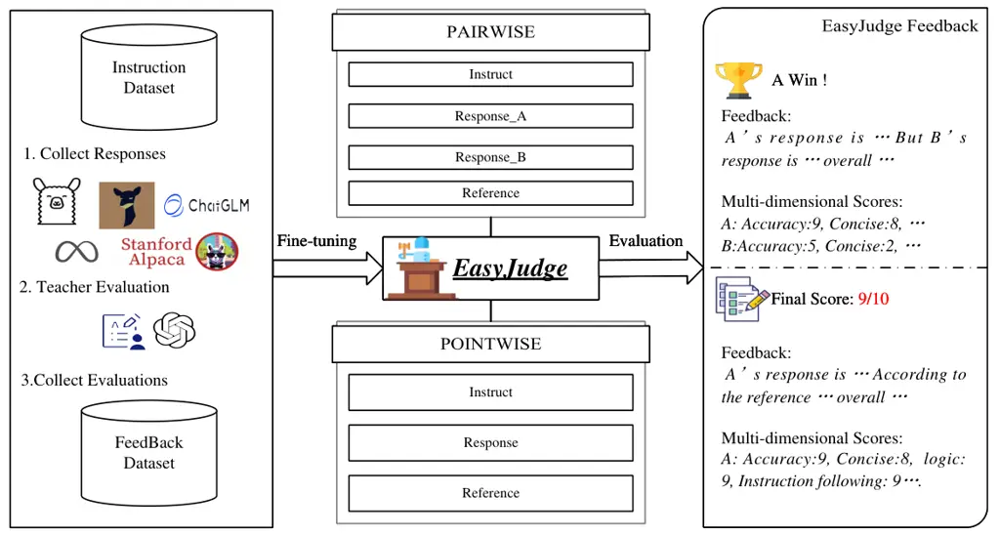
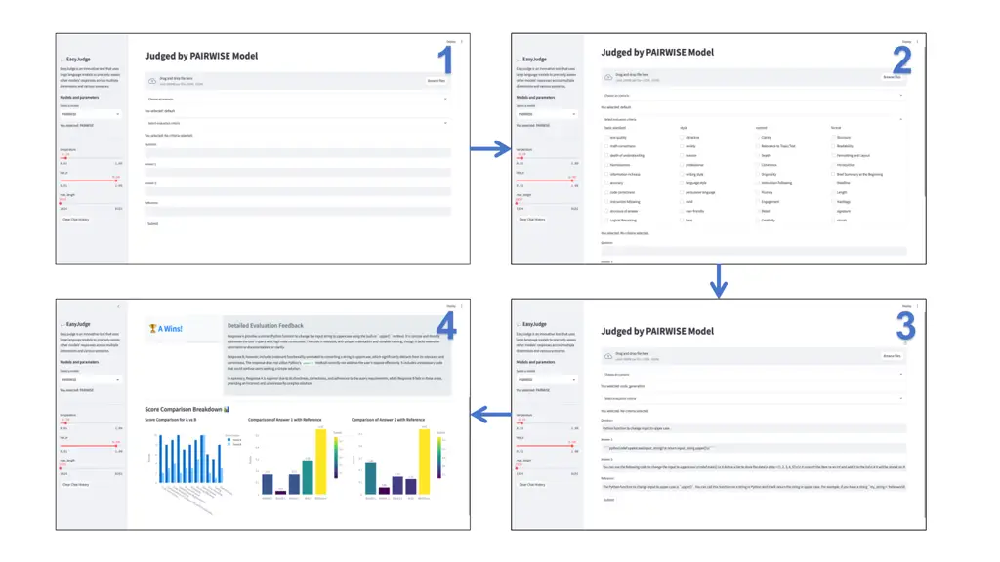
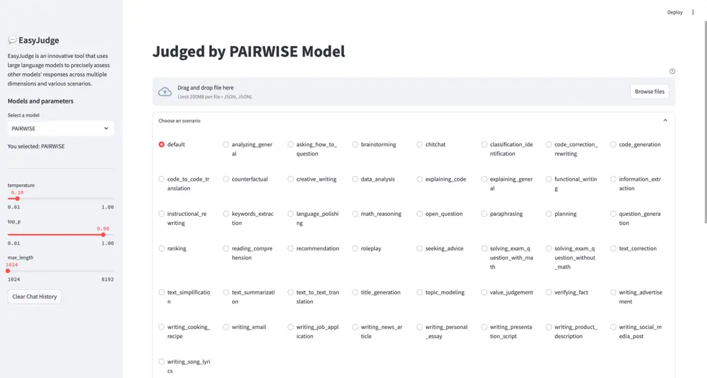
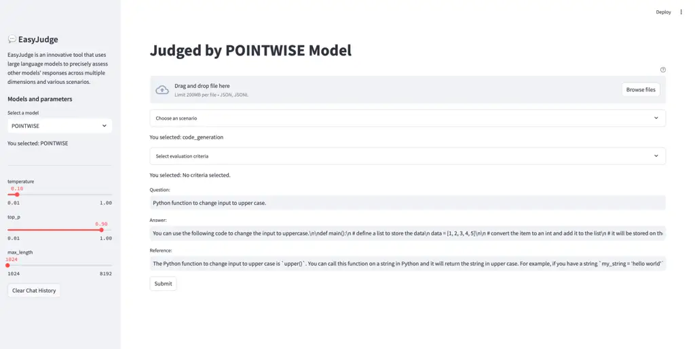
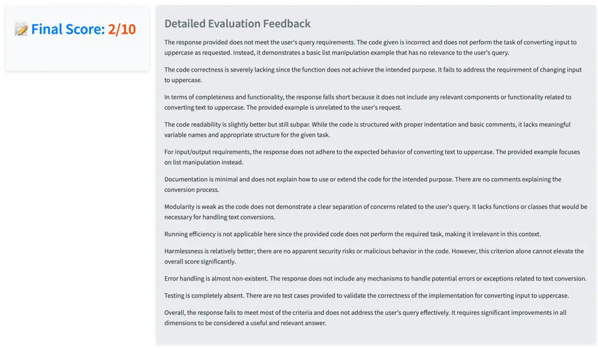
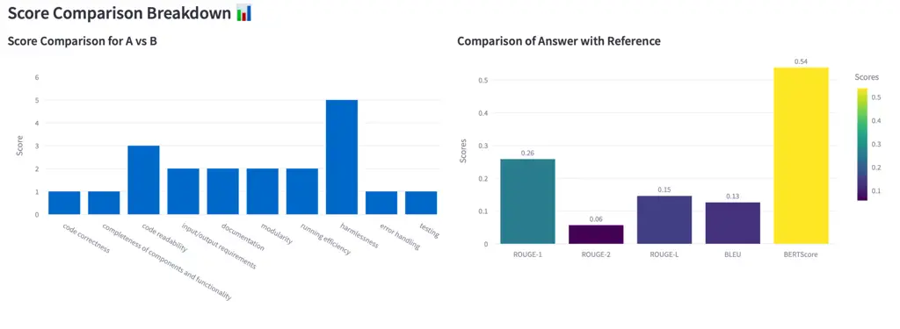

# EasyJudge: an Easy-to-use Tool for Comprehensive Response Evaluation of LLMs

Yijie Li Affiliation: Minzu University of China, Beijing, China
Affiliation: National Language Resource Monitoring & Research Center
Minority Languages BranchEmails: yijie_li_cn@163.com,
tracy.yuan.sun@gmail.com* Corresponding author: Yuan Sun    Yuan Sun
Affiliation: Minzu University of China, Beijing, China
Affiliation: National Language Resource Monitoring & Research Center
Minority Languages BranchEmails: yijie_li_cn@163.com,
tracy.yuan.sun@gmail.com* Corresponding author: Yuan Sun

###### Abstract

Recently, there has been a growing trend of employing large language
models (LLMs) to judge the quality of other LLMs. Many studies have
adopted closed-source models, mainly using GPT-4 as the
evaluator. However, due to the closed-source nature of the GPT-4 model,
employing it as an evaluator has resulted in issues including
transparency, controllability, and cost-effectiveness. Some researchers
have turned to using fine-tuned open-source LLMs as evaluators. However,
existing open-source evaluation LLMs generally lack a user-friendly
visualization tool, and they have not been optimized for accelerated
model inference, which causes inconvenience for researchers with limited
resources and those working across different fields. This paper presents
EasyJudge, a model developed to evaluate significant language model
responses. It is lightweight, precise, efficient, and user-friendly,
featuring an intuitive visualization interface for ease of deployment
and use. EasyJudge uses detailed datasets and refined prompts for model
optimization, achieving strong consistency with human and proprietary
model evaluations. The model optimized with quantitative methods enables
EasyJudge to run efficiently on consumer-grade GPUs or even CPUs. We
also provide detailed analysis and case studies to further reveal the
potential of our method. ¹¹ 1 Code is open at
[https://github.com/4real3000/EasyJudge](https://github.com/4real3000/EasyJudge).
Video demonstrations at
[https://youtu.be/3NcSWPf9rzM](https://youtu.be/3NcSWPf9rzM).

.

## 1 Introduction

The evaluation of response quality from large language models (LLMs) has
been a central concern within the research community(Liang et al., 2022;
Chang et al., 2024). As the instruction-following capabilities of LLMs
continue to evolve, a more comprehensive and precise evaluation of their
responses becomes particularly crucial(Qin et al., 2023). Traditional
evaluation metrics such as BLEU(Papineni et al., 2002), ROUGE(Lin,
2004), BERTScore(Zhang et al., 2019), BARTScore(Yuan et al., 2021), and
GPTScore(Fu et al., 2023) primarily offer shallow semantic analysis and
assessment for basic natural language processing tasks. Due to their
limited scope and poor interpretability, traditional metrics are
ill-suited for the demands of large language models, especially as tasks
evolve to better align with human needs.

Some studies have proposed the concept of LLM-as-a-Judge(Li et al.,
2023b; Zheng et al., 2023), which leverages proprietary LLMs,
particularly GPT-4(Achiam et al., 2023), to evaluate the responses of
other LLMs. By defining evaluation schemes within prompts, LLMs can
utilize their instruction-following capabilities to provide reliable
assessments, achieving high consistency with human evaluators. However,
relying on external APIs for evaluation raises potential privacy
concerns, and the lack of transparency in API models poses challenges to
the reproducibility of the evaluations. Moreover, using APIs can result
in significant cost overhead. For instance, evaluating four different
LLM variants (ranging from 7B to 65B in size) across 1,000 evaluation
instances using GPT-4 could exceed \$2,000. Such costs are often
prohibitive for academic institutions or researchers operating under
limited budgets(Kim et al., 2023).

A mainstream alternative approach is to train a evaluation model based
on open-source LLMs. For example, PandaLM(Wang et al., 2023) and
JudgeLM(Zhu et al., 2023) construct datasets from diverse instruction
sets and annotations from GPT-series models, fine-tuning open-source
models like LLaMA(Touvron et al., 2023) to serve as scalable evaluation
models. Auto-J(Li et al., 2023a) and Prometheus(Kim et al., 2023)
explore the refinement of model evaluation metrics, aiming to build
fine-grained evaluation models.

However, current LLM-as-Judge research typically provides only a
fine-tuned LLM, lacking an user-friendly visualization interface
tailored for LLM evaluation. This poses challenges for users who seek a
one-stop, simple, and efficient solution to evaluate responses generated
by some models.

To advance large model evaluation in routine research, this study aims
to develop an LLM-as-Judge evaluation model and platform named
EasyJudge. EasyJudge can evaluate model responses using POINTWISE
(direct scoring) and PAIRWISE (pairwise ranking). It is fine-tuned on a
dataset of real-world LLM instruction responses, carefully categorized
into 50 scenario types, with responses from over ten open-source LLMs in
the training data. EasyJudge provides two methods for evaluating model
responses: POINTWISE (direct scoring) and PAIRWISE (pairwise ranking).
The model is fine-tuned on a carefully curated dataset of real-world LLM
instruction responses, organized into 50 distinct scenario categories,
and includes response data from over ten open-source LLMs.

Additionally, we defined 8-10 specific evaluation criteria for each of
the 50 scenario categories, resulting in 139 evaluation criteria related
to LLM responses. In this work, these multi-scenario, multi-criteria
instruction datasets were used to fine-tune the LLaMA-3-8b model. The
fine-tuned model can provide precise and multidimensional evaluations of
LLMs’ rather than generalized assessments. Additionally, this work
employs techniques such as quantization and mixed precision to reduce
memory usage and resource overhead during runtime, thereby achieving
faster inference speeds. Finally, the model has been encapsulated to
provide users with a simplified, user-friendly interface that is clear
and intuitive to operate.

The specific features of EasyJudge are as follows:

1.  (1)
    Lightweight usage model. EasyJudge is built to minimize dependency
    requirements, offering a simple installation process and precise
    documentation. Users can initiate the evaluation interface with only
    a few basic commands.
2.  (2)
    Comprehensive evaluation tool. EasyJudge offers a highly
    customizable interface, allowing users to select evaluation
    scenarios and flexibly combine evaluation criteria based on their
    needs. The visualization interface has been carefully designed to
    provide users with an intuitive view of various aspects of the
    evaluation results.
3.  (3)
    Efficient inference engine. EasyJudge employs model quantization,
    memory management optimization, and hardware acceleration support to
    enable efficient inference. As a result, EasyJudge can run
    seamlessly on consumer-grade GPUs and even CPUs.

Figure 1: Overview of the EasyJudge method.

## 2 Related Work

### 2.1 Evaluation Based on Reference Texts

Traditional model-free scoring methods like BLEU(Papineni et al., 2002)
and ROUGE(Lin, 2004) were widely used but have limitations in evaluation
reliability. Recent model-based methods, such as BERTScore(Zhang et al.,
2019), BLEURT(Sellam et al., 2020), and BARTScore(Yuan et al., 2021),
improve evaluation by capturing semantic-level information. EasyJudge
visually compares responses using metrics like ROUGE, BLEU, and
BERTScore, offering users a more comprehensive and intuitive evaluation
of models.

### 2.2 LLM-Based Text Evaluation

Recent research has shifted towards using large language models as
evaluators, employing GPT-4 or fine-tuned Judge LLMs to assess the text
quality generated by other models. Recent studies have shown that
ChatGPT can outperform crowdsourced workers in text annotation
tasks(Gilardi et al., 2023; Chiang and Lee, 2023).Using closed-source
models like GPT-4 for evaluation poses challenges, including high costs,
privacy risks, and limited control. Fine-tuned open-source Judge LLMs,
such as PandaLM(Wang et al., 2023), AUTO-J(Li et al., 2023a),
PROMETHEUS(Kim et al., 2023), JudgeLM(Zhu et al., 2023), and
Eval-Instruct(Wu et al., 2024), have been developed to overcome this.
These models offer cost-effective, reliable evaluation solutions,
addressing issues like data leakage, evaluation bias and adapting to
diverse tasks. They collectively advance LLM evaluation by integrating
subjective criteria, enhancing multimodal and dialogue tasks, and
providing alternatives to closed-source models.

However, current LLM-as-Judge research typically only provides
fine-tuned LLMs, lacking an intuitive and user-friendly visualization
interface specifically optimized for LLM evaluation. This presents
challenges for users who seek a simple and efficient one-stop solution
for evaluating individual responses or entire texts. Additionally, users
are unable to intuitively access evaluation results from these models. A
comparison between EasyJudge and these evaluation models is provided in
Table 1.

| Name                         | Foundation      | Evaluation scheme  | Web GUI | Result visualization | Inference acceleration |
| ---------------------------- | --------------- | ------------------ | ------- | -------------------- | ---------------------- |
| PandaLM(Wang et al., 2023)   | LLaMA           | Pairwise           | Yes     | No                   | No                     |
| JudgeLM(Zhu et al., 2023)    | Vicuna          | Pairwise           | Yes     | No                   | No                     |
| Auto-J(Li et al., 2023a)     | LLaMA2-chat     | Pairwise/Pointwise | No      | No                   | No                     |
| Prometheus(Kim et al., 2023) | LLaMA2-chat     | Pointwise          | No      | No                   | No                     |
| EasyJudge(ours)              | LLaMA3-instruct | Pairwise/Pointwise | Yes     | Yes                  | Yes                    |

Table 1: Comparison of Response Evaluation Methods Based on LLMs.

## 3 System Overview

This section provides a detailed overview of the EasyJudge system. As
shown in Figure 1, EasyJudge consists of three key components:

### 3.1 Data Processing Module

We collect real-world interaction data between humans and Large Language
Models to create the initial Instruction Dataset. A classifier is then
trained to categorize this instruction data. Additionally, GPT-4 is
employed to expand the instructions through prompts. Multiple
open-source large models are then used to generate responses to the
instruction data. Finally, GPT-4 is invoked with carefully designed
prompts that include detailed evaluation criteria to produce evaluation
results. The data is then integrated for use in the subsequent model
fine-tuning.

### 3.2 Evaluation Model Training

This is the core of EasyJudge, where the LLaMA-3-8b base model is
fine-tuned using the multi-scenario, multi-criteria instruction data
obtained from the data processing phase. The result is the POINTWISE
model for direct evaluation and the PAIRWISE model for pairwise
comparison evaluation. Next, model merging techniques are applied to
integrate the performance of both models. Finally, model quantization
techniques are used to optimize the model.

### 3.3 User-Friendly Interface

The evaluation process of model responses is designed to be transparent,
offering users an intuitive interface with several key features. These
include selecting models, adjusting model parameters, configuring
evaluation scenarios, and customizing evaluation criteria. Additionally,
the interface provides a clear visualization of the evaluation results.
For example, it displays the outcomes of pairwise comparisons and direct
scoring in a straightforward manner, offers detailed feedback, and
presents multi-dimensional score references to help users better
understand the evaluation process.

## 4 Implementation Details

To better understand the evaluation process within EasyJudge, this
section will explain the implementation of three key issues.

### 4.1 Data Processing

#### 4.1.1 Definition of Evaluation Scenarios and Criteria

To ensure a more accurate and context-relevant evaluation of LLM
responses, EasyJudge, based on prior research(Kim et al., 2023; Zhu
et al., 2023; Li et al., 2023a), categorizes evaluation scenarios into
50 distinct types, which are further summarized into nine broader
categories: text generation and writing, information extraction and
analysis, mathematics and logical reasoning, code tasks, QA, reasoning
and judgment, role-playing and conversation, basic NLP tasks, and a
default type. It is intuitive to understand that the evaluation criteria
for responses in different scenarios, such as code generation and
writing a project proposal, should vary significantly. Therefore,
EasyJudge customizes evaluation criteria for each of the 50 distinct
scenarios. Each category includes 8-10 evaluation criteria, totalling
134 unique criteria divided into four main categories: Basic, Style,
Content, and Format.

#### 4.1.2 Dataset Construction

High-quality datasets are crucial for effectively fine-tuning large
language models to serve as evaluation judges. However, existing
datasets and prior research often lack sufficient diversity and detailed
evaluation criteria. To address these issues, EasyJudge introduces a new
dataset that includes various seed tasks across different evaluation
scenarios, comprehensive answers from multiple open-source LLMs, scoring
results from a teacher LLM across various criteria dimensions, and
detailed reasoning behind each evaluation.

EasyJudge extracts 15k seed tasks from a large-\_qa, flan, truthful_qa,
and ultrachat. A classification model is then used to categorize the
instructions based on the scenario definitions described in section
4.1.1. For scenarios with limited instructions, GPT-4 is employed to
supplement them using the self-instruct method. The prompt template used
for this process is provided in Figure 3. To enhance the diversity of
the dataset, we aggregate responses from multiple open-source LLMs,
including but not limited to LLaMA, Alpaca, and Vicuna. Next, we combine
the LLM-generated responses with reference answers to create an answer
set. For PAIRWISE tasks, two responses from different open-source models
are randomly selected from the answer set for the same instruction. An
advanced teacher model, GPT-4, is then used to assign detailed scores
and provide thorough reasoning for the comparison. For POINTWISE tasks,
a response from an open-source model is randomly selected from the
answer set for a given instruction. The advanced teacher model, GPT-4,
then assigns detailed scores and provides comprehensive reasoning for
the evaluation. To ensure robust and comprehensive judgments, we
utilized detailed prompt templates, the specifics of which are provided
in Figure 4 and Figure 5. The prompt contains critical inputs such as
the scenario, evaluation criteria, instruction, and response to be
evaluated, along with the evaluation requirements and output format.
Including these details ensures the model produces clear, comprehensive,
and accurate evaluation results.

### 4.2 Evaluation Model Fine-Tuning

The data required to train the EasyJudge model is constructed by
integrating the datasets mentioned in section 4.1.2. The training data
follows the Alpaca fine-tuning format, which consists of four
components: instruction, input, output, and system. The instruction
includes the task to be evaluated and its corresponding response,
evaluation requirements and the output format; the input is left empty
by default, the output contains the scores and reasoning provided by the
teacher model GPT-4, and the system includes the scenario and evaluation
criteria. The data templates are in Figure 6.

To reduce positional bias in PAIRWISE comparisons, EasyJudge applies a
simple data augmentation technique. According to the judgelm, For each
pairwise training sample, the order of the two responses in the input is
randomly swapped. Additionally, to enhance the model’s ability to handle
unknown responses, EasyJudge randomly drops the reference for each data
point(Zhu et al., 2023).

EasyJudge adopts the LLaMA-3-8b model as its base LLM and utilizes the
LLaMA-Factory framework for model fine-tuning. Training parameter
details can be found in Table 3. The PAIRWISE evaluation model is
fine-tuned using 5k data points, while the POINTWISE evaluation model
uses 10k data points.

Moreover, EasyJudge employs the DARE weight merging strategy to
integrate models trained under different evaluation modes while applying
INT8 quantization to significantly reduce model size and inference time,
enhancing deployment efficiency and applicability without compromising
evaluation performance.

To demonstrate the superior performance of the EasyJudge model in
evaluation tasks, this paper presents the model’s test results on the
PandaLM-test and Prometheus-test-ood datasets. Specifically, the
PandaLM-test dataset is used to assess the performance of the pairwise
model, while the Prometheus-test-ood dataset is employed to evaluate the
pointwise model. The results are shown in Table 2. Further test results
will be discussed in future work.

| Model        | PandaLM-test |       | Prometheus-test-ood |          |
| ------------ | ------------ | ----- | ------------------- | -------- |
|              | Accuracy     | F1    | Pearson             | Spearman |
| JudgeLM-7B   | 70.97        | 67.59 | 0.610               | 0.690    |
| PandLM-7B    | 67.57        | 57.49 | 0.386               | 0.383    |
| Auto-J-13B   | 71.47        | 61.01 | 0.591               | 0.580    |
| EasyJudge-8B | 71.83        | 68.36 | 0.679               | 0.701    |

Table 2: Results of evaluators on pairwise selection and pointwise
grading.

### 4.3 User-Friendly Interface Development

To make the evaluation process of large language models more intuitive
and user-friendly, we developed a Streamlit-based interface. Using the
Streamlit framework, we created a transparent and responsive interface.
This interface not only supports data upload and parameter adjustments
but also allows users to select evaluation scenarios dynamically through
radio buttons. The evaluation results are presented in a rich format,
including text and graphical representations, ensuring that users can
easily interpret the meaning of the model’s output. This design
significantly reduces the operational complexity of EasyJudge and
enhances user experience, enabling even non-expert users to perform
advanced model evaluations efficiently. This intuitive interface and the
model’s efficient computation capabilities can meet diverse evaluation
needs, particularly in resource-constrained environments.

## 5 Demonstration Scenarios

Figure 2: A Screenshot of EasyJudge with an example evaluation task of
PAIRWISE.

### 5.1 Diversity Classification

Figure 2 provides a screenshot of the EasyJudge user interface, through
which users can perform large model response evaluations by following
these steps:

Step 1 (Task Configuration): As shown in Figure 2-1, the configuration
interface guides users through the initial setup. Users begin by
selecting the evaluation task type, which includes single response
direct scoring (POINTWISE) and pairwise response ranking (PAIRWISE). The
system automatically selects the appropriate prompt template based on
the chosen scoring strategy. After selecting the task, another essential
configuration allows users to adjust the EasyJudge model parameters,
such as temperature, Top-p, and max_length, according to their specific
needs to achieve optimal evaluation results.

Step 2 (Scenario and Criteria Configuration): Next, users can select
specific task scenarios and criteria tailored to their evaluation data,
a crucial advantage of EasyJudge’s highly customizable system. The
evaluation criteria configuration is shown in Figure 2-2 (scenario
configuration can be found in Figure 7). Once users select a task
scenario, EasyJudge conducts a multi-dimensional evaluation based on the
specific criteria. Alternatively, users can opt not to select a scenario
where EasyJudge will evaluate the model response using the default
scenario. The default scenario encompasses ten standard evaluation
criteria suitable for most task evaluations. For more customized
evaluation results, users can manually select the criteria. EasyJudge
currently offers 40 evaluation criteria across four main categories for
tailored evaluation. If custom criteria are selected, the system will
automatically bypass scenario selection.

Step 3 (Data Upload): As shown in Figure 2-3, EasyJudge provides two
methods for data upload. Suppose a user is evaluating a single data
instance. In that case, they can sequentially copy the instruction,
Model 1’s response, Model 2’s response, and the reference answer into
the corresponding input fields, then click the submit button to initiate
the evaluation. To evaluate multiple data instances, users must upload a
JSON/JSONL file containing the evaluation data in Alpaca format. After
uploading the file, users can click the submit button to start the
evaluation process. The interface for single data evaluation in the
POINTWISE mode is shown in Figure 8.

Step 4 (Results Display): In this step, EasyJudge presents the final
evaluation results, providing users with clear evaluation information
that helps them intuitively understand the quality of the responses.
Taking PAIRWISE evaluation as an example (Details on POINTWISE
evaluation can be found in Appendix C.), as shown in Figure 2-4, the top
of the page displays the final evaluation results. At the same time, the
middle section presents the Detailed Evaluation Feedback from the
EasyJudge model. At the bottom, three charts (labeled as Figures A, b,
and c) are provided: Figure A shows the scores of Response A and
Response B across different evaluation criteria dimensions and compares
the two responses in each dimension. Figure b compares Response A with
the reference text, displaying evaluation results based on traditional
metrics, including ROUGE, BLEU, BERTScore, BLEURT, and BARTScore. Figure
c compares Response B with the reference answer evaluated using
traditional metrics. Finally, if users choose to upload a JSON/JSONL
file, then they can finally download a JSON file containing the
evaluation result data by clicking the "Download" button.

## 6 Conclusion

This paper introduces EasyJudge, an innovative tool for evaluating LLMs
with advanced models, offering a customizable interface and precise,
multi-dimensional assessments. It enhances efficiency through model
quantization, enabling use on consumer-grade GPUs and CPUs. Future
research plans include integrating new technologies to extend
EasyJudge’s capabilities to evaluate multimodal models,
Retrieval-Augmented Generation (RAG), and intelligent agents,
contributing to advancing Artificial General Intelligence (AGI) while
improving evaluation accuracy and practicality across diverse scenarios.

## Acknowledgments

This work is supported by the National Nature Science Foundation
(61972436), the National Social Science Foundation (22&ZD035), and the
Minzu University of China Foundation (GRSCP202316, 2023QNYL22,
2024GJYY43).

## References

- Achiam et al. (2023) Josh Achiam, Steven Adler, Sandhini Agarwal, Lama
  Ahmad, Ilge Akkaya, Florencia Leoni Aleman, Diogo Almeida, Janko
  Altenschmidt, Sam Altman, Shyamal Anadkat, et al. 2023. Gpt-4
  technical report. _arXiv preprint arXiv:2303.08774_.
- Chang et al. (2024) Yupeng Chang, Xu Wang, Jindong Wang, Yuan Wu,
  Linyi Yang, Kaijie Zhu, Hao Chen, Xiaoyuan Yi, Cunxiang Wang, Yidong
  Wang, et al. 2024. A survey on evaluation of large language models.
  _ACM Transactions on Intelligent Systems and Technology_, 15(3):1–45.
- Chiang and Lee (2023) Cheng-Han Chiang and Hung-yi Lee. 2023. Can
  large language models be an alternative to human evaluations? _arXiv
  preprint arXiv:2305.01937_.
- Fu et al. (2023) Jinlan Fu, See-Kiong Ng, Zhengbao Jiang, and Pengfei
  Liu. 2023. Gptscore: Evaluate as you desire. _arXiv preprint
  arXiv:2302.04166_.
- Gilardi et al. (2023) Fabrizio Gilardi, Meysam Alizadeh, and Maël
  Kubli. 2023. Chatgpt outperforms crowd workers for text-annotation
  tasks. _Proceedings of the National Academy of Sciences_,
  120(30):e2305016120.
- Kim et al. (2023) Seungone Kim, Jamin Shin, Yejin Cho, Joel Jang,
  Shayne Longpre, Hwaran Lee, Sangdoo Yun, Seongjin Shin, Sungdong Kim,
  James Thorne, et al. 2023. Prometheus: Inducing fine-grained
  evaluation capability in language models. In _The Twelfth
  International Conference on Learning Representations_.
- Li et al. (2023a) Junlong Li, Shichao Sun, Weizhe Yuan, Run-Ze Fan,
  Hai Zhao, and Pengfei Liu. 2023a. Generative judge for evaluating
  alignment. _arXiv preprint arXiv:2310.05470_.
- Li et al. (2023b) Xuechen Li, Tianyi Zhang, Yann Dubois, Rohan Taori,
  Ishaan Gulrajani, Carlos Guestrin, Percy Liang, and Tatsunori B
  Hashimoto. 2023b. Alpacaeval: An automatic evaluator of
  instruction-following models.
- Liang et al. (2022) Percy Liang, Rishi Bommasani, Tony Lee, Dimitris
  Tsipras, Dilara Soylu, Michihiro Yasunaga, Yian Zhang, Deepak
  Narayanan, Yuhuai Wu, Ananya Kumar, et al. 2022. Holistic evaluation
  of language models. _arXiv preprint arXiv:2211.09110_.
- Lin (2004) Chin-Yew Lin. 2004. Rouge: A package for automatic
  evaluation of summaries. In _Text summarization branches out_, pages
  74–81.
- Papineni et al. (2002) Kishore Papineni, Salim Roukos, Todd Ward, and
  Wei-Jing Zhu. 2002. Bleu: a method for automatic evaluation of machine
  translation. In _Proceedings of the 40th annual meeting of the
  Association for Computational Linguistics_, pages 311–318.
- Qin et al. (2023) Chengwei Qin, Aston Zhang, Zhuosheng Zhang, Jiaao
  Chen, Michihiro Yasunaga, and Diyi Yang. 2023. Is chatgpt a
  general-purpose natural language processing task solver? _arXiv
  preprint arXiv:2302.06476_.
- Sellam et al. (2020) Thibault Sellam, Dipanjan Das, and Ankur P
  Parikh. 2020. Bleurt: Learning robust metrics for text generation.
  _arXiv preprint arXiv:2004.04696_.
- Touvron et al. (2023) Hugo Touvron, Thibaut Lavril, Gautier Izacard,
  Xavier Martinet, Marie-Anne Lachaux, Timothée Lacroix, Baptiste
  Rozière, Naman Goyal, Eric Hambro, Faisal Azhar, et al. 2023. Llama:
  Open and efficient foundation language models. _arXiv preprint
  arXiv:2302.13971_.
- Wang et al. (2023) Yidong Wang, Zhuohao Yu, Zhengran Zeng, Linyi Yang,
  Cunxiang Wang, Hao Chen, Chaoya Jiang, Rui Xie, Jindong Wang, Xing
  Xie, et al. 2023. Pandalm: An automatic evaluation benchmark for llm
  instruction tuning optimization. _arXiv preprint arXiv:2306.05087_.
- Wu et al. (2024) Wenhao Wu, Wei Li, Xinyan Xiao, Jiachen Liu, and
  Sujian Li. 2024. Instructeval: Instruction-tuned text evaluator from
  human preference. In _Findings of the Association for Computational
  Linguistics ACL 2024_, pages 13462–13474.
- Yuan et al. (2021) Weizhe Yuan, Graham Neubig, and Pengfei Liu. 2021.
  Bartscore: Evaluating generated text as text generation. _Advances in
  Neural Information Processing Systems_, 34:27263–27277.
- Zhang et al. (2019) Tianyi Zhang, Varsha Kishore, Felix Wu, Kilian Q
  Weinberger, and Yoav Artzi. 2019. Bertscore: Evaluating text
  generation with bert. _arXiv preprint arXiv:1904.09675_.
- Zheng et al. (2023) Lianmin Zheng, Wei-Lin Chiang, Ying Sheng, Siyuan
  Zhuang, Zhanghao Wu, Yonghao Zhuang, Zi Lin, Zhuohan Li, Dacheng Li,
  Eric Xing, et al. 2023. Judging llm-as-a-judge with mt-bench and
  chatbot arena. _Advances in Neural Information Processing Systems_,
  36:46595–46623.
- Zhu et al. (2023) Lianghui Zhu, Xinggang Wang, and Xinlong Wang. 2023.
  Judgelm: Fine-tuned large language models are scalable judges. _arXiv
  preprint arXiv:2310.17631_.

## Appendix A Prompt Templates

This section lists all the prompt templates that EasyJudge used. Figure
3 shows the prompt for invoking GPT-4 extended instructions. Figure 4
shows the prompt used for PAIRWISE instruction evaluation. Figure 5
details the prompt for POINTWISE instruction evaluation. Figure 6
displays the ALPACA fine-tuning data template.

Figure 3: The prompt for invoking GPT-4 extended instructions.

Figure 4: The prompt used for PAIRWISE instruction evaluation.

Figure 5: The prompt used for POINTWISE instruction evaluation.

Figure 6: ALPACA fine-tuning data template.

## Appendix B User Interface Display

This section shows more user interface. Figure 7 displays all the
available scenarios for users, Figure 8 shows one input method for
POINTWISE evaluation, Figure 9 presents an example of detailed feedback
for a POINTWISE evaluation, and Figure 10 shows a detailed scoring
breakdown for a POINTWISE evaluation.

Figure 7: This interface displays all the available scenario for users.

Figure 8: This interface displays one input method for POINTWISE
evaluation.

Figure 9: This interface shows an example of detailed feedback for a
POINTWISE evaluation.

Figure 10: This interface displays a detailed scoring breakdown for a
POINTWISE evaluation.

## Appendix C Training Details

This section shows the parameter settings for training EasyJudge, as
shown in Table 3.

| Parameters                  | Value                       |
| --------------------------- | --------------------------- |
| cutoff_len                  | 2048                        |
| finetuning_type             | lora                        |
| per_device_train_batch_size | 4                           |
| lr_scheduler_type           | cosine                      |
| lora_rank                   | 8                           |
| lora_target                 | q_proj, v_proj              |
| additional_target           | embed_tokens, lm_head, norm |
| learning_rate               | $`2\times 10^{-4}`$         |
| num train epochs            | 1                           |
| gradient accumulation steps | 2                           |
| max grad norm               | 1                           |
| lora dropout                | 0.05                        |
| warmup steps                | 0                           |
| fp16                        | TRUE                        |

Table 3: The training parameters of the EasyJudge
