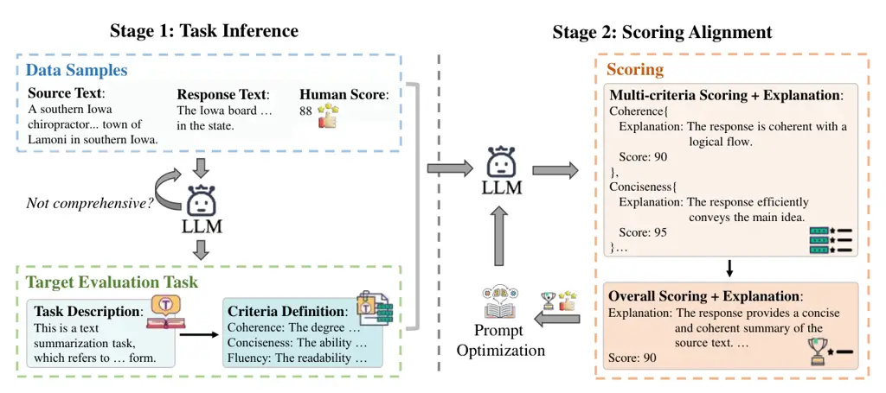

# Large Language Models Are Active Critics in NLG Evaluation

Shuying Xu Affiliation: Tongji University
Email: [shuyingxu@tongji.edu.cn](mailto:)    Junjie Hu
Affiliation: University of Wisconsin-Madison
Email: [junjie.hu@wisc.edu](mailto:)    Ming Jiang ^(†)^(†)thanks:
Corresponding author. Affiliation: Indiana University Indianapolis
Email: [mj200@iu.edu](mailto:)

###### Abstract

The conventional paradigm of using large language models (LLMs) for
natural language generation (NLG) evaluation relies on pre-defined task
definitions and evaluation criteria, positioning LLMs as “passive
critics” that strictly follow developer-provided guidelines. However,
human evaluators often apply implicit criteria, and their expectations
in practice can vary widely based on specific end-user needs.
Consequently, these rigid evaluation methods struggle to adapt to
diverse scenarios without extensive prompt customization. To address
this, we introduce Active-Critic, a novel LLM-based evaluator that
transforms LLMs into “active critics” capable of adapting to diverse NLG
tasks using limited example data. Active-Critic consists of two stages:
(1) self-inferring the target NLG task and relevant evaluation criteria,
and (2) dynamically optimizing prompts to produce human-aligned scores
along with detailed justifications. Our experiments show that
Active-Critic can generate nuanced, context-aware evaluation criteria,
enabling it to achieve superior alignment with human judgments across
multiple tasks.

## 1 Introduction

Recent advances in language technologies have accelerated the
development of natural language generation (NLG) systems, benefiting a
variety of downstream applications such as text summarization (Fabbri
et al., 2021), dialogue generation (Mehri and Eskenazi, 2020), and
storytelling (Guan et al., 2021). However, despite the rapid progress in
NLG systems, reliable techniques for automatic evaluation of NLG systems
still lay far behind, primarily due to the inherent challenges posed by
the open-ended nature of NLG and the diverse demands of different
stakeholders. This gap, in return, undermines the reliability of
machine-generated content in real-world applications.

Traditional NLG evaluation methods typically focus on a specific
criterion and require human-written references for comparison (Li
et al., 2024b). Commonly considered criteria include reference
similarity (Papineni et al., 2002; Lin, 2004; Zhang et al., 2019; Yuan
et al., 2021), text fluency (Kann et al., 2018; Mutton et al., 2007),
human likeness (Song et al., 2025; Jiang et al., 2019), and information
adequacy (Adlakha et al., 2024). Moving beyond single-aspect metrics,
recent studies propose to use a universal large language model (LLM) as
a judge to score machine-generated texts across multiple criteria in
diverse NLG tasks, either by fine-tuning  (Zhong et al., 2022; Jiang
et al., 2023; Xu et al., 2023; Ke et al., 2023) or by prompting an LLM
for assessment (Chiang and Lee, 2023a; Gong and Mao, 2023; Lin et al.,
2023). To address the high cost of human annotation and potential biases
introduced by limited references, researchers have further developed
reference-free LLM-based evaluations (Fu et al., 2024; Liu et al.,
2023a; Li et al., 2023; Jia et al., 2023).

Despite the remarkable advancements of prior work, one major concern
remains: the reliance on pre-defined evaluation task descriptions and
criteria for assessment, forcing LLM evaluators to adhere strictly to
developers’ expectations. In contrast, human evaluators often use
nuanced, implicit evaluation criteria that extend beyond these
pre-defined criteria in practice (Liu et al., 2024b; Clark et al., 2021;
Celikyilmaz et al., 2020). While recent studies (Liu et al., 2024b; Li
et al., 2024a; Liu et al., 2024a) have explored prompting LLMs to
generate evaluation criteria automatically, these methods still rely on
pre-defined task descriptions, requiring substantial manual effort to
tailor prompts for each NLG task. Moreover, even within the same task,
different stakeholders may prioritize distinct evaluation criteria,
making it potentially risky to establish a fixed set of criteria in
advance without first accounting for human evaluation nuances.

To overcome the above limitations, we propose a novel evaluation
approach, i.e., Active-Critic, that instructs an LLM to actively derive
an evaluation protocol purely from human-scored data examples. Our
approach includes two stages: (1) adaptively inferring the target NLG
task and identifying its underlying evaluation criteria that matter most
to end users, and (2) dynamically optimizing prompts to produce
human-aligned judgments across diverse NLG scenarios. To enhance
trustworthiness, Active-Critic also generates detailed text
justifications alongside its scoring.

We have conducted experiments across diverse NLG tasks using various
base LLMs. The results show that the Active-Critic consistently achieves
a noticeably higher correlation with human judgments, indicating its
ability to adapt effectively to different NLG evaluation tasks according
to different evaluation criteria. Our approach requires as few as 5
human-scored data to obtain a strong correlation with humans, with
performance steadily improving as the dataset grows. Further analysis
highlights that the task inference stage contributes more to
Active-Critic’s performance than the scoring stage, and Active-Critic
can effectively identify nuanced, context-aware criteria beyond
pre-defined ones. In summary, our method offers three key benefits:

- •
  Self-adaptive evaluation. Active-Critic can infer any NLG evaluation
  task, recover human judgment criteria, and make justified assessments
  directly from data, eliminating the need for pre-defined task
  descriptions, fixed evaluation criteria, or manual prompt engineering.
- •
  Accurate judgment alignment. Our two-stage design guides LLMs to mimic
  human judgment step by step, yielding interpretable justifications
  while achieving state-of-the-art alignment with human assessments
  against strong baselines.
- •
  Generic for diverse LLMs and NLG tasks. Our method operates
  independently of specific LLMs and evaluation tasks. Our results on
  four LLM backbones across four NLG tasks showcase its broad
  applicability.

## 2 Related Work

#### NLG Evaluation Overview.

Existing methods for NLG evaluation span three major strands, including
early human-centric evaluation (Mellish and Dale, 1998), followed by
untrained machine evaluation (Papineni et al., 2002; Lin, 2004; Lavie
and Denkowski, 2009), and more recently, machine-learned
evaluation (Sennrich et al., 2015; Zhang et al., 2019; Yuan et al.,
2021; Kim et al., 2023). These studies largely concentrate on
single-criteria metric design, targeting either general NLG tasks like
reference alignment (Liu et al., 2023b) or a specific NLG task like
coherence for text summarization (Wang et al., 2023b). To enhance
evaluation efficiency, recent works have advocated for unified
evaluation frameworks built upon LLMs, aiming to transcend task-specific
boundaries and assess multiple criteria simultaneously (Chiang and Lee,
2023a; Liu et al., 2024a; Gong and Mao, 2023; Liu et al., 2024b; Li
et al., 2024a). Our work falls into this group, and will discuss the
details below.

#### LLM-based NLG Evaluation.

Prior studies on unified evaluation frameworks primarily focus on
enhancing evaluation generalizability, with an emphasis on estimating
instance quality scores across various NLG tasks and multiple criteria
simutaneously (Xiao et al., 2023; Gao et al., 2024). Studies in this
area typically involve two strategies. One is developing
criteria-centered prompts that guide LLMs as a judge for multi-faceted,
train-free evaluations (Fu et al., 2024; Liu et al., 2023a; Lin and
Chen, 2023; Chiang and Lee, 2023b; Li et al., 2024a; Liu et al., 2024b;
Yuan et al., 2023). The other focuses on curating a large-scale
multi-scenario benchmark to fine-tune an LLM as a generalized
evaluator (Zhong et al., 2022; Li et al., 2023; Wang et al., 2023a; Ke
et al., 2023; Kim et al., 2023; Hu et al., 2024).

While prompting-based methods are more cost-effective than tuning-based
ones, one major concern with these approaches is the sensitivity of LLMs
to manual prompts, possibly causing evaluation biases. To address this
issue, several latest works have explored instructing LLMs to generate
evaluation criteria  (Liu et al., 2024b; Li et al., 2024a) or scoring
rubrics (Liu et al., 2024a) based on pre-defined context like the target
NLG task description. In essence, criteria generation in these studies
implicitly assumes that each NLG task has a fixed set of evaluation
criteria. In contrast, we argue that different end-user needs may lead
to varying emphases, even for the same NLG task, resulting in criterion
and/or rubric variation. To address this, our approach takes a
data-driven perspective, instructing the LLM for NLG evaluations through
self-inference of all relevant contexts.

#### Dynamic Prompt Optimization.

Dynamic prompt optimization iteratively refines prompts to enhance the
performance of static LLMs on specific tasks. Existing methods can be
divided into two categories based on their inference depth. Single-layer
optimization methods, such as APE (Zhou et al., 2023), APO (Pryzant
et al., 2023), OPRO (Yang et al., 2023), and IPC (Levi et al., 2024),
focus on optimizing prompts within a single stage, limiting their
adaptability to complex tasks. In contrast, multi-layer optimization
methods, like DSPy (Khattab et al., 2023) and MIPRO (Opsahl-Ong et al.,
2024), refine prompts across multiple stages, supporting more
comprehensive reasoning but relying on scalar-based comparisons between
data points, which are insufficient for tasks requiring correlations
across data vectors. We design a correlation-based comparison rather
than a scalar-based one to optimize multi-stage NLG evaluation tasks.

## 3 Notations and Problem Definition

Our goal is to develop a highly adaptive NLG evaluation approach that
can dynamically align with diverse end-user preferences to make
explainable judgments across diverse NLG scenarios. Specifically, given
a small set of source-response-quality tuples
$`\mathcal{D}=\{(x_{i},y_{i},r_{i})\}_{i=1}^{N}`$ annotated by humans
based on their hidden criteria $`\mathcal{C}=\{c_{1},...,c_{k}\}`$, we
aim to build an LLM-based reference-free evaluator
$`E(x^{\prime},y^{\prime})`$. This evaluator learns from the annotated
dataset $`\mathcal{D}`$ to infer task-relevant information, including
the target NLG task description $`T`$ and the evaluation criteria
$`\hat{\mathcal{C}}=\{\hat{c}_{1},\dots,\hat{c}_{m}\}`$. Using this
inferred information, it can estimate the quality score $`\hat{r}`$ of
the source-response pair $`(x^{\prime},y^{\prime})`$, along with a
free-text justification $`\hat{e}`$. Here, $`x_{i}`$ denotes the
$`i`$-th input text from the original NLG task, while $`y_{i}`$ denotes
the corresponding response generated by an NLG system and $`r_{i}`$ is
the quality score of $`y_{i}`$. We denote
$`\text{LLM}(\texttt{[prompt]})\to\texttt{[response]}`$ as the response
generation by LLM given a prompt.

## 4 Active-Critic

#### Overview.

Figure 1 shows the overall workflow of Active-Critic. With the
motivation that an ideal unified evaluation framework should flexibly
uncover the nuanced evaluation criteria of end users across diverse
generation scenarios and make human-aligned judgments, we design a
data-driven evaluation framework structured in two stages. The first
stage is task inference (§4.1), where we instruct an LLM to predict
task-related information by actively reviewing a small set of
human-rated data examples. Through this analysis of the human-rated
data, we expect the model to self-infer the details of the target
evaluation task and the implicit criteria used by human annotators. The
second stage is scoring alignment (§4.2), where we aim to align the LLM
evaluator with human scoring based on the predicted evaluation criteria.
Specifically, we design a dynamic prompt optimization method to
automatically select the optimal few-shot examples,
$`{\mathcal{D}}_{\text{demo}}`$, from $`\mathcal{D}`$ which enables the
LLM evaluator to achieve human-aligned scoring through in-context
prediction.



Figure 1: Overview of Active-Critic, including two stages: (1) task
inference, where the LLM is instructed to derive the target NLG
evaluation task description and relevant criteria from data samples, and
(2) scoring alignment, allowing the LLM to generate multi-criteria and
overall quality scores along with accompanying explanations.

### 4.1 Task Inference

The task inference stage, depicted on the left side of Figure 1, focuses
on identifying two key components for NLG evaluation: (1) task
description and (2) criteria definition. This stage uses the LLM to
analyze the dataset $`\mathcal{D}_{\text{train}}`$, infer the
characteristics of the NLG task, and establish relevant evaluation
criteria without human intervention.

#### Task Description.

This module instructs the LLM to formulate an accurate task description
$`T`$ by reviewing examples in $`\mathcal{D}_{\text{train}}`$ and
identifying key information that characterizes the target NLG task
(e.g., summarization, storytelling) for evaluation. Considering that
LLM’s context length limit may not fit in all examples in
$`{\mathcal{D}}_{\text{train}}`$, we split these examples into $`N`$
mini-batches, and generate one task description $`T_{n}`$ from each
mini-batch $`{\mathcal{D}}_{\text{train},n}`$. That is,
$`\text{LLM}(f_{t}({\mathcal{D}}_{\text{train},n}))\to T_{n},~\forall n\in[1,N]`$,
where $`f_{t}`$ is a prompt template shown in Table 10 in the appendix.
The final task description $`T`$ is generated by the LLM through the
ensemble of all task descriptions $`\{T_{n}\}_{n=1}^{N}`$ over all
mini-batches.

#### Criteria Definition.

After establishing the task description for each mini-batch, the LLM is
instructed to define task-specific evaluation criteria for assessing the
quality of machine-generated texts. Unlike traditional evaluation
frameworks that rely on predefined criteria (e.g., coherence, fluency),
we instruct the LLM to automatically identify the most relevant
evaluation dimensions for the target NLG task. Similar to the task
description, the final criteria set
$`\hat{C}=\{\hat{c}_{1},\hat{c}_{2},\dots,\hat{c}_{m}\}`$¹¹ 1 We
instruct the LLM to output a criteria set in the JSON format, as shown
in Table 11 in the appendix. is composed of all relevant dimensions
inferred from all the reviewed mini-batches.

To enhance efficiency, we instruct the LLM to decide whether to stop
early based on the comprehensiveness of the generated task description
and criteria set after processing each mini-batch.

### 4.2 Scoring Alignment

Our second stage, as shown on the right side of Figure 1, focuses on
aligning the LLM evaluator with human scoring judgments by automatically
optimizing the evaluation prompts. Inspired by prior research that
harnesses the potential of LLMs by breaking down complex tasks into
simpler ones (Wei et al., 2022; Khot et al., 2023), we hypothesize that
starting with fine-grained, criteria-specific scoring can help the model
further derive an accurate overall quality score. With this intuition in
mind, we structure the scoring stage into two modules: (1)
Multi-criteria Scoring with Explanation (McS-E), followed by (2) Overall
Scoring with Explanation (OS-E).

#### Multi-criteria Scoring with Explanation (McS-E).

In this module, we use the LLM to assess the model output $`y_{i}`$
based on the criteria set
$`\hat{C}=\{\hat{c}_{1},\hat{c}_{2},\dots,\hat{c}_{m}\}`$ obtained from
the task inference stage (§4.1). Specifically, for each input-output
pair $`(x_{i},y_{i})`$, the LLM is instructed to estimate a score
$`\hat{r}_{ij}`$ and a corresponding explanation $`e_{ij}`$ according to
each criterion $`\hat{c}_{j}\in\hat{C}`$:

```math
\displaystyle\text{LLM}(x_{i},y_{i},f_{\text{McS-E}}(T,C,{\mathcal{D}}_{\text{demo}}))\to\hat{R}_{i} \tag{1}
```

```math
\displaystyle\hat{R}_{i}=\{(\hat{r}_{ij},\hat{e}_{ij}),~\forall\hat{c}_{j}\in\hat{C}\} \tag{2}
```

where the output uses a JSON format, indicating a set of
score-explanation pairs $`\hat{R}_{i}`$ for all criteria in $`\hat{C}`$
and $`{\mathcal{D}}_{\text{demo}}`$ is a set of demonstration examples
randomly selected from the training set
$`{\mathcal{D}}_{\text{train}}`$. This mechanism ensures that the
evaluation is both quantitative and interpretable, offering insights
into the rationale behind each score. The prompt template
$`f_{\text{McS-E}}(T,C,{\mathcal{D}}_{\text{demo}})`$ is designed to
enable scoring across multiple criteria simultaneously, accounting for
the interconnections between them. This design enables a fine-grained
evaluation, where each criterion is treated both individually and in
connection with the others, providing detailed explanations that enhance
the interpretability of the scoring process.

#### Overall Scoring with Explanation (OS-E).

After scoring the individual criteria, we use a prompt template
$`f_{\text{OS-E}}`$ to instruct the LLM to synthesize these scores
$`\{\hat{r}_{i1},...\hat{r}_{im}\}`$ into an overall quality score
$`\hat{r}_{i}`$, and an explanation $`e_{i}`$ that provides a
comprehensive justification for the final decision.

```math
\text{LLM}(x_{i},y_{i},f_{\text{OS-E}}(T,\hat{R}_{i},{\mathcal{D}}_{\text{demo}}))\to\hat{r}_{i},\hat{e}_{i} \tag{3}
```

#### Prompt Optimization.

Given the sensitivity of LLMs’ in-context prediction performance to the
few-shot examples $`{\mathcal{D}}_{\text{demo}}`$ in the prompt, we
further propose an automatic prompt optimization strategy built upon
DSPy (Khattab et al., 2023) to iteratively select the optimal
$`{\mathcal{D}}_{\text{demo}}^{*}`$ to refine the prompts. Specifically,
given two lists of overall quality scores across all examples in
$`{\mathcal{D}}_{\text{train}}`$—one predicted by the LLM, i.e.,
$`\hat{r}=[\hat{r}_{1},\dots,\hat{r}_{N}]`$ from Eq. (3), and the other
annotated by humans, i.e., $`r=[r_{1},\dots,r_{N}]`$—we design an
objective function to maximize the correlation between these two score
lists. To mitigate potential biases caused by relying on a single
correlation measurement, we calculate the sum of three widely-used
correlation coefficients: Pearson ($`\gamma`$), Spearman ($`\rho`$), and
Kendall ($`\tau`$) with equal weights:

```math
\displaystyle\mathcal{Q}(\hat{r},r) \displaystyle=\gamma(\hat{r},r)+\rho(\hat{r},r)+\tau(\hat{r},r) \tag{4}
```

```math
\displaystyle{\mathcal{D}}_{\text{demo}}^{*} \displaystyle=\arg\max_{{\mathcal{D}}_{\text{demo}}\subset{\mathcal{D}}}{\mathcal{Q}}(\hat{r},r) \tag{5}
```

where $`{\mathcal{D}}_{\text{demo}}`$ is the optimal few-shot
demonstration examples $`{\mathcal{D}}_{\text{demo}}`$ selected from
$`{\mathcal{D}}_{\text{train}}`$. To approximately solve the above
maximization problem, we repeat $`K`$ time for the evaluations of
Eq. (3) using different randomly sampled
$`{\mathcal{D}}_{\text{demo}}`$, and select the best
$`{\mathcal{D}}_{\text{demo}}^{*}`$ that maximizes
$`{\mathcal{Q}}(\hat{r},r)`$.

## 5 Experiment Settings

#### Benchmarks

Following prior work (Zhong et al., 2022; Fu et al., 2024; Liu et al.,
2023a), we evaluate our method on four popularly-used benchmarks. These
datasets cover diverse topics (e.g., politics, sports, restaurants,
etc.) across four NLG tasks (i.e., summarization, dialogue generation,
data-to-text generation, and storytelling), aiming to construct a robust
testbed to access Active-Critic. The details of each benchmark are
described below.

- •
  SummEval (Fabbri et al., 2021): 1,600 machine-generated summaries of
  CNN/DailyMail articles were rated by both expert and layman judges on
  coherence, consistency, fluency, relevance, and overall quality.
- •
  Topical-Chat (Mehri and Eskenazi, 2020): A knowledge-grounded,
  open-domain dialogue dataset consisting of 60 conversations, each
  paired with 6 responses (2 by humans and 4 by machines). Responses are
  human-evaluated on overall quality across five dimensions:
  naturalness, coherence, engagingness, groundedness, and
  understandability.
- •
  SFRES (Wen et al., 2015): A data-to-text generation benchmark with
  1,181 instances, focusing on generating free-text utterances from
  structured restaurant information. Annotators rated the overall
  quality of each instance based on informativeness and naturalness.
- •
  OpenMEVA (ROC) (Guan et al., 2021): 1,000 open-ended commonsense
  stories generated by various models trained upon the ROCStories
  corpus. Annotators rate each story based on fluency, creativity, and
  coherence.

We standardize all benchmarks into a uniform format that includes: (1)
the machine-generated responses for evaluation, (2) the source input
used by the generation systems for response generation, and (3) the
human scores assessing response quality.

#### Baselines and Metrics

We compare Active-Critic with a variety of state-of-the-art publicly
accessible NLG evaluation methods. The baselines are grouped into two
categories: (1) fine-tuning-based methods including Auto-J  (Li et al.,
2023), UniEval (Zhong et al., 2022), InstructScore (Xu et al., 2023) and
TIGERScore (Jiang et al., 2023); and (2) prompting-based methods,
including GPTScore (Fu et al., 2024), G-eval (Liu et al., 2023a) and
four selected base LLMs under the zero-shot manner, implemented
following (Mahmoudi, 2023). Following prior work (Fu et al., 2024; Jiang
et al., 2023), we use GPTScore-src to refer to the source-hypothesis
scoring type, which is a reference-free evaluation method.

Regarding metrics, we use three correlation coefficients to assess the
evaluation consistency between machine-based evaluators and humans:
Pearson ($`\gamma`$) (Mukaka, 2012), Spearman ($`\rho`$) (Zar, 2005) and
Kendall-Tau ($`\tau`$) (Kendall, 1938).

|                            |            |          |          |             |          |          |            |          |          |                |          |          |         |
| -------------------------- | ---------- | -------- | -------- | ----------- | -------- | -------- | ---------- | -------- | -------- | -------------- | -------- | -------- | ------- |
|                            | SummEval   |          |          | TopicalChat |          |          | SFRES      |          |          | OpenMEVA (ROC) |          |          | Average |
|                            | $`\gamma`$ | $`\rho`$ | $`\tau`$ | $`\gamma`$  | $`\rho`$ | $`\tau`$ | $`\gamma`$ | $`\rho`$ | $`\tau`$ | $`\gamma`$     | $`\rho`$ | $`\tau`$ |         |
| Fine-tuning LLM            |            |          |          |             |          |          |            |          |          |                |          |          |         |
| InstructScore              | 0.3496     | 0.2703   | 0.203    | 0.2691      | 0.2774   | 0.2423   | 0.2039     | 0.1502   | 0.133    | 0.2936         | 0.2772   | 0.1658   | 0.2363  |
| Auto-J                     | 0.1345     | 0.1457   | 0.1149   | 0.4681      | 0.459    | 0.3714   | 0.1315     | 0.1053   | 0.0869   | 0.3896         | 0.3704   | 0.3065   | 0.257   |
| TIGERScore                 | 0.458      | 0.3694   | 0.2937   | 0.3785      | 0.4401   | 0.3458   | 0.1898     | 0.1246   | 0.1075   | 0.451          | 0.4413   | 0.3356   | 0.3279  |
| UniEval                    | 0.5457     | 0.4914   | 0.3707   | 0.5133      | 0.5448   | 0.4134   | 0.3247     | 0.2791   | 0.2081   | 0.4501         | 0.4408   | 0.3119   | 0.4078  |
| Prompting Open-source LLM  |            |          |          |             |          |          |            |          |          |                |          |          |         |
| GPTScore-src (FLAN-T5)     | 0.4043     | 0.3584   | 0.2696   | 0.2313      | 0.2437   | 0.1792   | 0.2819     | 0.2082   | 0.1618   | 0.2283         | 0.2265   | 0.1534   | 0.2456  |
| Zero-shot (LLaMA3-8B)      | 0.4104     | 0.3857   | 0.2809   | 0.5197      | 0.5242   | 0.4018   | 0.2138     | 0.196    | 0.152    | 0.4141         | 0.3676   | 0.2808   | 0.3456  |
| Zero-shot (Orca2-13B)      | 0.5447     | 0.4916   | 0.3999   | 0.5542      | 0.5512   | 0.4476   | 0.3068     | 0.23     | 0.1842   | 0.4809         | 0.4695   | 0.358    | 0.4182  |
| Ours:                      |            |          |          |             |          |          |            |          |          |                |          |          |         |
| AC-Coarse (LLaMA3-8B)      | 0.5307     | 0.4972   | 0.3958   | 0.4873      | 0.5246   | 0.4259   | 0.1853     | 0.1594   | 0.1451   | 0.4394         | 0.4403   | 0.3477   | 0.3816  |
| AC-Fine (LLaMA3-8B)        | 0.5334     | 0.502    | 0.401    | 0.5321      | 0.5379   | 0.4045   | 0.2265     | 0.2245   | 0.169    | 0.4506         | 0.4436   | 0.3625   | 0.399   |
| AC-Coarse (Orca2-13B)      | 0.5386     | 0.5227   | 0.4156   | 0.611       | 0.6173   | 0.4845   | 0.3612     | 0.2981   | 0.2393   | 0.4908         | 0.4962   | 0.3622   | 0.4531  |
| AC-Fine (Orca2-13B)        | 0.6301     | 0.5486   | 0.4299   | 0.6023      | 0.6214   | 0.4713   | 0.324      | 0.2834   | 0.2289   | 0.5259         | 0.5363   | 0.4109   | 0.4677  |
| Prompting Close-source LLM |            |          |          |             |          |          |            |          |          |                |          |          |         |
| G-eval (GPT-3.5)           | 0.4687     | 0.4504   | 0.3745   | 0.5427      | 0.5597   | 0.4501   | 0.2464     | 0.1956   | 0.1591   | 0.362          | 0.3408   | 0.1982   | 0.3624  |
| Zero-shot (GPT-3.5)        | 0.453      | 0.385    | 0.292    | 0.5503      | 0.5436   | 0.4231   | 0.2823     | 0.2274   | 0.1828   | 0.4229         | 0.397    | 0.3      | 0.3716  |
| Zero-shot (GPT-4)          | 0.5943     | 0.5038   | 0.4055   | 0.6659      | 0.656    | 0.4937   | 0.3301     | 0.2823   | 0.2284   | 0.5627         | 0.4928   | 0.3777   | 0.4661  |
| Ours:                      |            |          |          |             |          |          |            |          |          |                |          |          |         |
| AC-Coarse (GPT-3.5)        | 0.6569     | 0.5368   | 0.4178   | 0.6425      | 0.6171   | 0.4855   | 0.3585     | 0.2846   | 0.2374   | 0.4185         | 0.3766   | 0.2981   | 0.4442  |
| AC-Fine (GPT-3.5)          | 0.653      | 0.6016   | 0.4745   | 0.6718      | 0.6703   | 0.5156   | 0.3616     | 0.2833   | 0.2342   | 0.4693         | 0.4527   | 0.3442   | 0.4777  |
| AC-Coarse (GPT-4)          | 0.6561     | 0.5371   | 0.4277   | 0.7264      | 0.7815   | 0.6133   | 0.343      | 0.2878   | 0.2395   | 0.5366         | 0.5226   | 0.4039   | 0.5063  |
| AC-Fine (GPT-4)            | 0.6926     | 0.5723   | 0.462    | 0.7789      | 0.7753   | 0.6212   | 0.363      | 0.2809   | 0.236    | 0.5877         | 0.5581   | 0.4249   | 0.5294  |

Table 1: Correlation between LLM-based unified evaluators and human
judgments on overall quality per instance across four NLG tasks. All
train-free evaluators are built upon Orca2-13B. We compare Pearson
($`\gamma`$), Spearman ($`\rho`$) and Kendall-Tau ($`\tau`$)
correlation, respectively. The best performance per indicator is
highlighted in bold, and the second-highest results are underlined. We
implemented and tested all the methods with p-value $`<`$ 0.05.

#### Meta-evaluation

We establish Active-Critic using four widely adopted backbone models:
two open-source LLMs (Orca2-13B and LLaMA3-8B) and two closed-source
LLMs (GPT-3.5 and GPT-4)²² 2 We used GPT-3.5-turbo-1106 and gpt-4-turbo
version for the experiments. across four diverse NLG tasks. We test two
variants of Active-Critic (AC) in this study: (1) AC-Coarse performs a
coarse-grained, explainable evaluation by prompting the LLM to infer
task-related information and directly produce an overall score along
with an explanation for each test case. This process considers all
inferred criteria at once during scoring alignment. (2) AC-Fine provides
a fine-grained, explainable evaluation. Similar to AC-Coarse, it begins
with task inference, but during scoring alignment, it assesses the input
test case against each criterion individually, offering detailed
explanations for each score. The overall quality score is then generated
by combining the evaluations across all criteria. Appendix B provides
the details of implementation.

## 6 Results and Analysis

|                         |            |          |          |             |          |          |            |          |          |                |          |          |         |
| ----------------------- | ---------- | -------- | -------- | ----------- | -------- | -------- | ---------- | -------- | -------- | -------------- | -------- | -------- | ------- |
|                         | SummEval   |          |          | TopicalChat |          |          | SFRES      |          |          | OpenMEVA (ROC) |          |          | Average |
|                         | $`\gamma`$ | $`\rho`$ | $`\tau`$ | $`\gamma`$  | $`\rho`$ | $`\tau`$ | $`\gamma`$ | $`\rho`$ | $`\tau`$ | $`\gamma`$     | $`\rho`$ | $`\tau`$ |         |
| Ours (AC-Fine)          | 0.6301     | 0.5486   | 0.4299   | 0.6023      | 0.6214   | 0.4713   | 0.324      | 0.2834   | 0.2289   | 0.5259         | 0.5363   | 0.4109   | 0.4677  |
| w/o Task Description    | 0.5825     | 0.4826   | 0.3552   | 0.4949      | 0.5057   | 0.4211   | 0.2683     | 0.2017   | 0.168    | 0.3846         | 0.3802   | 0.2918   | 0.3781  |
| w/o Criteria Definition | 0.5726     | 0.522    | 0.4062   | 0.5533      | 0.5368   | 0.4451   | 0.293      | 0.2715   | 0.1907   | 0.4176         | 0.4237   | 0.326    | 0.4132  |
| w/o McS-E               | 0.5386     | 0.5227   | 0.4156   | 0.611       | 0.6173   | 0.4845   | 0.3612     | 0.2981   | 0.2393   | 0.4908         | 0.4962   | 0.3622   | 0.4531  |
| w/o OS-E                | 0.6106     | 0.5129   | 0.3908   | 0.5639      | 0.5615   | 0.4464   | 0.3165     | 0.2405   | 0.1899   | 0.509          | 0.4931   | 0.3632   | 0.4332  |

Table 2: Ablation study of key modules in Active-Critic.

### 6.1 How well does Active-Critic perform?

Table 1 displays the correlation between unified evaluators and human
judgments. Overall, Active-Critic noticeably outperforms the
corresponding prompting-based baselines and state-of-the-art
fine-tuning-based evaluators, where our variants built on Orca2-13B and
GPT-4 achieve the highest correlation in the methods using open- and
close-source LLM, respectively. Comparing two variants of Active-Critic
per LLM, we find that the fine-level variant consistently achieves
higher alignment with human scores, outperforming the coarse one by
$`\sim`$2% in average correlation. These results show that our approach
can effectively enhance LLMs’ potential to capture human-centric
assessment nuances in diverse scenarios and make more human-aligned
judgments. Moreover, prompting the LLM to assess each criterion
individually and then aggregate the scores benefits Active-Critic’s
decision-making.

We also validate the generalizability of Active-Critic’s self-inferred
evaluation prompts on unseen data within a similar NLG scenario. We use
the prompts generated by Active-Critic on SummEVAL examples to evaluate
responses from the Newsroom (Grusky et al., 2018) benchmark, similarly
focusing on news article summarization but using diverse strategies. As
shown in Appendix C, our approach outperforms state-of-the-art
baselines, demonstrating strong generalization.

Further examining our approach’s stability across base LLMs, we observe
that Active-Critic consistently achieves a noticeable improvement, with
an average gain of $`\sim`$6.8% correlation over the zero-shot baseline
for each base model. This indicates its effectiveness, regardless of the
chosen base LLM. Although Active-Critic generally obtains greater
enhancements when employing a stronger base LLM, it is noteworthy that
Active-Critic built on Orca2-13B performs comparably to its GPT-4
counterpart on SFRES and OpenMEVA (ROC). Considering the computational
cost and evaluator performance, we primarily focus on the ORCA2-based
AC-Fine for further analysis.

### 6.2 Ablation Study

#### Dependence on Human-scored Data.

To examine the impact of labeled data size on Active-Critic’s
performance, we varied the size of the feed examples from 5-shot to 5%,
15%, and the full 25% of each benchmark. Figure 2 shows the results.
While Active-Critic improves as the labeled data size increases, it can
achieve a decent correlation with human evaluators using as few as five
human-rated examples. Among four tasks, Active-Critic is more sensitive
to labeled data size in TopicalChat and SummEval than in OpenMeva and
SFRES. The former two benchmarks involve longer contexts and diverse
topics, while the latter focus on specific topics with shorter contexts,
making the first two tasks more complex. Our observations suggest that
Active-Critic requires more labeled data for evaluating complex NLG
tasks compared to simpler ones.

Figure 2: Average correlation between Orca2-based Active-Critic and
human judgments with varying label sizes. Results for each correlation
coefficient are provided in Appendix D

#### Impact of Optimization.

We compare Active-Critic’s performance by removing its dynamic prompt
optimization for scoring and, furthermore, eliminating mini-batch
iterations during task inference. As shown in Figure 3, there is a drop
in Active-Critic’s performance when removing scoring prompt
optimization, with a further decline when only using a single mini-batch
of labeled data for task inference, suggesting that both strategies
contribute to Active-Critic for making optimal decisions. Interestingly,
the Active-Critic shows greater sensitivity to scoring optimization in
the fine-level evaluation of SummEval and the coarse-level evaluation of
SFRES, indicating that this component plays a more significant role in
these specific evaluation scenarios. In contrast, the influence of
mini-batch iterations for task inference is minimal in SummEval,
suggesting that Active-Critic can effectively infer the target
evaluation task in this setting with limited training data.

Figure 3: Impact of prompt optimization on scoring and mini-batch
iterations on task inference (Kendall-Tau %). See Appendix E for Pearson
and Spearman results.

|                                                                                                                                                                                                                                                                                                                                                                                                                                                                                                                                                                                                                                                                                                                                                                                                                                                                                                                                                                                                                                           |                                                                                                                                                                                                                                                                                                                                                                                                                                                                                                                                                                                                                                                                                                               |
| ----------------------------------------------------------------------------------------------------------------------------------------------------------------------------------------------------------------------------------------------------------------------------------------------------------------------------------------------------------------------------------------------------------------------------------------------------------------------------------------------------------------------------------------------------------------------------------------------------------------------------------------------------------------------------------------------------------------------------------------------------------------------------------------------------------------------------------------------------------------------------------------------------------------------------------------------------------------------------------------------------------------------------------------- | ------------------------------------------------------------------------------------------------------------------------------------------------------------------------------------------------------------------------------------------------------------------------------------------------------------------------------------------------------------------------------------------------------------------------------------------------------------------------------------------------------------------------------------------------------------------------------------------------------------------------------------------------------------------------------------------------------------- |
| Coherence: The degree to which the summary flows logically and cohesively, with clear connections between the main points. Conciseness: The ability of the summary to convey all necessary information in a succinct and efficient manner. Coverage: The extent to which the summary captures the main events and details from the source text without omitting crucial information. Accuracy: The faithfulness of the summary to accurately reflect the main points and details of the source text. Fluency: The readability and naturalness of the language used in the summary, with smooth transitions between ideas and paragraphs. Relevance: The relevance of the summary to the main topic and the inclusion of only pertinent information from the source text. Clarity: The clarity and comprehensibility of the summary, with clear and precise language used to convey the main points. Engagement: The ability of the summary to captivate and engage the reader, drawing them into the main events and details effectively. | Coherence: the summary should be well-structured and well-organized. The summary should not just be a heap of related information, but should build from sentence to sentence to a coherent body of information about a topic. Consistency: the factual alignment between the summary and the summarized source. A factually consistent summary contains only statements that are entailed by the source document. Fluency: the summary should have no formatting problems, capitalization errors or obviously ungrammatical sentences (e.g., fragments, missing components) that make the text difficult to read. Relevance: The summary should include only important information from the source document. |
| (a) AC-Fine                                                                                                                                                                                                                                                                                                                                                                                                                                                                                                                                                                                                                                                                                                                                                                                                                                                                                                                                                                                                                               | (b) Human                                                                                                                                                                                                                                                                                                                                                                                                                                                                                                                                                                                                                                                                                                     |

Table 3: An illustrative example of the generated evaluation criteria on
SummEval, either generated by an Active-Critic (a) or predefined by
humans (b). The highlighted text in blue are additional criteria
generated by the machine compared to the human-defined ones.

#### Module Contribution.

Table 2 shows the individual contribution of each module in
Active-Critic. Note that the variant w/o criteria inference uses the
original predefined criteria from each benchmark for further
computation. In the variant w/o OS-E, we calculated the overall quality
score per test case by averaging the multiple criteria-specific scores
generated by McS-E. We find that removing task inference modules leads
to a more substantial performance drop compared to removing scoring
modules, especially when the LLM is not asked to infer the task
description (resulting in a $`\sim`$9% decrease on average). Our
findings suggest that guiding LLMs to understand what to evaluate
contributes more to Active-Critic’s effectiveness than other modules.
Additionally, the larger performance drop in the variant w/o OS-E,
compared to the one w/o McS-E, indicates that the LLM-generated overall
quality score contributes more meaningfully than simply averaging the
criteria-specific scores.

### 6.3 Qualitative Analysis of Active-Critic

#### LLM-inferred Criteria Analysis.

Moving forward from quantitative analysis, we examine the LLM-inferred
criteria in depth. Table 3 shows an illustrative comparison between the
criteria generated by Active-Critic and those pre-defined by humans in
SummEval. We find that our approach incorporates more nuanced criteria
(i.e., “clarity”, “conciseness”, “coverage”, and “engagement”) beyond
the four pre-defined aspects. Moreover, each criterion is paired with a
clear definition to specify its distinct characteristics. For example,
the human-defined “coherence” starts with a high-level description like
“well-structured and well-organized”, while the LLM’s definition tends
to be more concrete, e.g., “the summary flows logically”.

|                     |         |           |                   |          |
| ------------------- | ------- | --------- | ----------------- | -------- |
| Dimension           | Clarity | Relevance | Score Consistency | Accuracy |
| Rate$`\rightarrow`$ | Yes (%) | Yes (%)   | Yes (%)           | Yes (%)  |
| Coherence           | 99.11   | 92        | 95.78             | 85.33    |
| Conciseness         | 98.67   | 91.78     | 96.89             | 88.89    |
| Coverage            | 98.82   | 91.33     | 97.56             | 96.89    |
| Accuracy            | 98.22   | 92.22     | 95.56             | 98       |
| Fluency             | 99.56   | 98.89     | 96                | 96.67    |
| Relevance           | 98.89   | 99.11     | 98.44             | 95.56    |
| Clarity             | 98      | 94.22     | 93.56             | 95.78    |
| Engagement          | 99.33   | 94.67     | 93.33             | 91.11    |
| Overall Quality     | 98.44   | 98.44     | 97.33             | 98       |
| Average             | 98.78   | 94.74     | 96.05             | 94.03    |

Table 4: Human evaluation of criterion-specific explanations on SummEval
samples.

|                     |                             |                   |            |
| ------------------- | --------------------------- | ----------------- | ---------- |
| Dimension           | Aspect-to-Overall Alignment | Differentiability | Usefulness |
| Rate$`\rightarrow`$ | Yes (%)                     | Yes (%)           | (1-5)      |
| Overall             | 95.11                       | 90                | 4.515      |

Table 5: Human evaluation of overall explanations on SummEval samples,
emphasizing (1) the alignment of the overall explanation with
criterion-specific ones, (2) explanations’ differentiability across
vary-quality cases, and (3) explanations’ overall usefulness per case.

#### Human Evaluation of Explanations.

We also employ three proficient English-speaking annotators to evaluate
the quality of the scoring explanations generated by Active-Critic on a
random sample of 150 test cases from SummEval (see details in
Appendix G). As shown in Table 4, the individual explanations
demonstrate comparatively high quality across four dimensions, with
average scores of 98.78% for clarity, 94.74% for relevance, 96.05% for
score consistency, and 94.03% for information accuracy. As shown in
Table 5, the overall explanations generally align with the
criteria-specific ones (95.11%), and 90% of the overall explanations
effectively differentiate case quality. With an average rating of
$`\sim`$4.5 out of 5 on the generated explanations across sampled
testing cases, the result shows that explanations generated by
Active-Critic are of good quality and useful to explain the resulting
scores.

## 7 Conclusion

We proposed Active-Critic, a novel LLM-based NLG evaluation protocol
that relies solely on lightweight human-scored data. Unlike existing
machine-based evaluators that depend on human-predefined task-related
information for assessment, Active-Critic self-identifies the target
evaluation task and nuanced evaluation criteria purely from the data for
making judgments. This paradigm shift will enhance the adaptability of
Active-Critic, enabling it to flexibly capture the varying priority
expectations of different end-users across diverse generation scenarios.
Our approach reduces the need for intensive manual efforts to design
task-specific criteria and extensive prompt engineering. Experiments
across four distinct NLG tasks demonstrate LLMs’ potential as active
critics, achieving higher correlation with human judgments compared to
baselines. Fine-level criteria-specific scoring, paired with
explanations, prompts the LLM to engage more deeply with the test cases,
leading to improved overall quality scoring.

## 8 Limitation

Our work has several limitations. First, due to resource constraints, we
primarily focused on four existing NLG tasks and benchmarks for
meta-evaluation in our experiments. It would be valuable to deploy our
protocol in a broader testing environment to assess its performance in
more diverse settings. Additionally, building Active-Critic on a wider
range of backbone LLMs could provide deeper insights. Overall, we hope
this study will contribute to advancing generic NLG evaluation research
and promote system development across diverse NLG scenarios.

## References

- Adlakha et al. (2024) Vaibhav Adlakha, Parishad BehnamGhader, Xing Han
  Lu, Nicholas Meade, and Siva Reddy. 2024. [Evaluating correctness and
  faithfulness of instruction-following models for question
  answering](https://doi.org/10.1162/tacl_a_00667). _Transactions of the
  Association for Computational Linguistics_, 12:681–699.
- Celikyilmaz et al. (2020) Asli Celikyilmaz, Elizabeth Clark, and
  Jianfeng Gao. 2020. Evaluation of text generation: A survey. _arXiv
  preprint arXiv:2006.14799_.
- Chiang and Lee (2023a) Cheng-Han Chiang and Hung-Yi Lee. 2023a. Can
  large language models be an alternative to human evaluations? In
  _Proceedings of the 61st Annual Meeting of the Association for
  Computational Linguistics (Volume 1: Long Papers)_, pages 15607–15631.
- Chiang and Lee (2023b) Cheng-Han Chiang and Hung-yi Lee. 2023b. A
  closer look into using large language models for automatic evaluation.
  In _Findings of the Association for Computational Linguistics: EMNLP
  2023_, pages 8928–8942.
- Clark et al. (2021) Elizabeth Clark, Tal August, Sofia Serrano, Nikita
  Haduong, Suchin Gururangan, and Noah A Smith. 2021. All that’s
  ‘human’is not gold: Evaluating human evaluation of generated text. In
  _Proceedings of the 59th Annual Meeting of the Association for
  Computational Linguistics and the 11th International Joint Conference
  on Natural Language Processing (Volume 1: Long Papers)_, pages
  7282–7296.
- Fabbri et al. (2021) Alexander R Fabbri, Wojciech Kryściński, Bryan
  McCann, Caiming Xiong, Richard Socher, and Dragomir Radev. 2021.
  Summeval: Re-evaluating summarization evaluation. _Transactions of the
  Association for Computational Linguistics_, 9:391–409.
- Fu et al. (2024) Jinlan Fu, See Kiong Ng, Zhengbao Jiang, and Pengfei
  Liu. 2024. Gptscore: Evaluate as you desire. In _Proceedings of the
  2024 Conference of the North American Chapter of the Association for
  Computational Linguistics: Human Language Technologies (Volume 1: Long
  Papers)_, pages 6556–6576.
- Gao et al. (2024) Mingqi Gao, Xinyu Hu, Jie Ruan, Xiao Pu, and Xiaojun
  Wan. 2024. Llm-based nlg evaluation: Current status and challenges.
  _arXiv preprint arXiv:2402.01383_.
- Gong and Mao (2023) Peiyuan Gong and Jiaxin Mao. 2023. Coascore:
  Chain-of-aspects prompting for nlg evaluation. _arXiv preprint
  arXiv:2312.10355_.
- Grusky et al. (2018) Max Grusky, Mor Naaman, and Yoav Artzi. 2018.
  Newsroom: A dataset of 1.3 million summaries with diverse extractive
  strategies. In _Proceedings of the 2018 Conference of the North
  American Chapter of the Association for Computational Linguistics:
  Human Language Technologies, Volume 1 (Long Papers)_, pages 708–719.
- Guan et al. (2021) Jian Guan, Zhexin Zhang, Zhuoer Feng, Zitao Liu,
  Wenbiao Ding, Xiaoxi Mao, Changjie Fan, and Minlie Huang. 2021.
  Openmeva: A benchmark for evaluating open-ended story generation
  metrics. In _Proceedings of the 59th Annual Meeting of the Association
  for Computational Linguistics and the 11th International Joint
  Conference on Natural Language Processing (Volume 1: Long Papers)_,
  pages 6394–6407.
- Hu et al. (2024) Xinyu Hu, Li Lin, Mingqi Gao, Xunjian Yin, and
  Xiaojun Wan. 2024. Themis: A reference-free nlg evaluation language
  model with flexibility and interpretability. In _Proceedings of the
  2024 Conference on Empirical Methods in Natural Language Processing_,
  pages 15924–15951.
- Jia et al. (2023) Qi Jia, Siyu Ren, Yizhu Liu, and Kenny Zhu. 2023.
  Zero-shot faithfulness evaluation for text summarization with
  foundation language model. In _Proceedings of the 2023 Conference on
  Empirical Methods in Natural Language Processing_, pages 11017–11031.
- Jiang et al. (2023) Dongfu Jiang, Yishan Li, Ge Zhang, Wenhao Huang,
  Bill Yuchen Lin, and Wenhu Chen. 2023. Tigerscore: Towards building
  explainable metric for all text generation tasks. _Transactions on
  Machine Learning Research_.
- Jiang et al. (2019) Ming Jiang, Qiuyuan Huang, Lei Zhang, Xin Wang,
  Pengchuan Zhang, Zhe Gan, Jana Diesner, and Jianfeng Gao. 2019.
  [TIGEr: Text-to-image grounding for image caption
  evaluation](https://doi.org/10.18653/v1/D19-1220). In _Proceedings of
  the 2019 Conference on Empirical Methods in Natural Language
  Processing and the 9th International Joint Conference on Natural
  Language Processing (EMNLP-IJCNLP)_, pages 2141–2152, Hong Kong,
  China. Association for Computational Linguistics.
- Kann et al. (2018) Katharina Kann, Sascha Rothe, and Katja
  Filippova. 2018. [Sentence-level fluency evaluation: References help,
  but can be spared!](https://doi.org/10.18653/v1/K18-1031) In
  _Proceedings of the 22nd Conference on Computational Natural Language
  Learning_, pages 313–323, Brussels, Belgium. Association for
  Computational Linguistics.
- Ke et al. (2023) Pei Ke, Bosi Wen, Zhuoer Feng, Xiao Liu, Xuanyu Lei,
  Jiale Cheng, Shengyuan Wang, Aohan Zeng, Yuxiao Dong, Hongning Wang,
  et al. 2023. Critiquellm: Scaling llm-as-critic for effective and
  explainable evaluation of large language model generation. _arXiv
  preprint arXiv:2311.18702_.
- Kendall (1938) Maurice G Kendall. 1938. A new measure of rank
  correlation. _Biometrika_, 30(1-2):81–93.
- Khattab et al. (2023) Omar Khattab, Arnav Singhvi, Paridhi Maheshwari,
  Zhiyuan Zhang, Keshav Santhanam, Sri Vardhamanan, Saiful Haq, Ashutosh
  Sharma, Thomas T. Joshi, Hanna Moazam, Heather Miller, Matei Zaharia,
  and Christopher Potts. 2023. Dspy: Compiling declarative language
  model calls into self-improving pipelines. _arXiv preprint
  arXiv:2310.03714_.
- Khot et al. (2023) Tushar Khot, Harsh Trivedi, Matthew Finlayson, Yao
  Fu, Kyle Richardson, Peter Clark, and Ashish Sabharwal. 2023.
  Decomposed prompting: A modular approach for solving complex tasks. In
  _The Eleventh International Conference on Learning Representations_.
- Kim et al. (2023) Seungone Kim, Jamin Shin, Yejin Cho, Joel Jang,
  Shayne Longpre, Hwaran Lee, Sangdoo Yun, Seongjin Shin, Sungdong Kim,
  James Thorne, et al. 2023. Prometheus: Inducing fine-grained
  evaluation capability in language models. In _The Twelfth
  International Conference on Learning Representations_.
- Krippendorff (2011) Klaus Krippendorff. 2011. Computing krippendorff’s
  alpha-reliability.
- Lavie and Denkowski (2009) Alon Lavie and Michael J Denkowski. 2009.
  The meteor metric for automatic evaluation of machine translation.
  _Machine translation_, 23:105–115.
- Levi et al. (2024) Elad Levi, Eli Brosh, and Matan Friedmann. 2024.
  Intent-based prompt calibration: Enhancing prompt optimization with
  synthetic boundary cases. In _ICLR 2024 Workshop on Navigating and
  Addressing Data Problems for Foundation Models_.
- Li et al. (2023) Junlong Li, Shichao Sun, Weizhe Yuan, Run-Ze Fan,
  Pengfei Liu, et al. 2023. Generative judge for evaluating alignment.
  In _The Twelfth International Conference on Learning Representations_.
- Li et al. (2024a) Minzhi Li, Zhengyuan Liu, Shumin Deng, Shafiq Joty,
  Nancy F Chen, and Min-Yen Kan. 2024a. Decompose and aggregate: A
  step-by-step interpretable evaluation framework. _arXiv preprint
  arXiv:2405.15329_.
- Li et al. (2024b) Zhen Li, Xiaohan Xu, Tao Shen, Can Xu, Jia-Chen Gu,
  and Chongyang Tao. 2024b. Leveraging large language models for nlg
  evaluation: A survey. _arXiv preprint arXiv:2401.07103_.
- Lin et al. (2023) Bill Yuchen Lin, Abhilasha Ravichander, Ximing Lu,
  Nouha Dziri, Melanie Sclar, Khyathi Chandu, Chandra Bhagavatula, and
  Yejin Choi. 2023. The unlocking spell on base llms: Rethinking
  alignment via in-context learning. In _The Twelfth International
  Conference on Learning Representations_.
- Lin (2004) Chin-Yew Lin. 2004. Rouge: A package for automatic
  evaluation of summaries. In _Text summarization branches out_, pages
  74–81.
- Lin and Chen (2023) Yen-Ting Lin and Yun-Nung Chen. 2023. Llm-eval:
  Unified multi-dimensional automatic evaluation for open-domain
  conversations with large language models. In _Proceedings of the 5th
  Workshop on NLP for Conversational AI (NLP4ConvAI 2023)_, pages 47–58.
- Liu et al. (2023a) Yang Liu, Dan Iter, Yichong Xu, Shuohang Wang,
  Ruochen Xu, and Chenguang Zhu. 2023a. G-eval: Nlg evaluation using
  gpt-4 with better human alignment. In _Proceedings of the 2023
  Conference on Empirical Methods in Natural Language Processing_, pages
  2511–2522.
- Liu et al. (2023b) Yixin Liu, Alexander Richard Fabbri, Yilun Zhao,
  Pengfei Liu, Shafiq Joty, Chien-Sheng Wu, Caiming Xiong, and Dragomir
  Radev. 2023b. Towards interpretable and efficient automatic
  reference-based summarization evaluation. In _Proceedings of the 2023
  Conference on Empirical Methods in Natural Language Processing_, pages
  16360–16368.
- Liu et al. (2024a) Yuxuan Liu, Tianchi Yang, Shaohan Huang, Zihan
  Zhang, Haizhen Huang, Furu Wei, Weiwei Deng, Feng Sun, and Qi Zhang.
  2024a. Calibrating llm-based evaluator. In _Proceedings of the 2024
  Joint International Conference on Computational Linguistics, Language
  Resources and Evaluation (LREC-COLING 2024)_, pages 2638–2656.
- Liu et al. (2024b) Yuxuan Liu, Tianchi Yang, Shaohan Huang, Zihan
  Zhang, Haizhen Huang, Furu Wei, Weiwei Deng, Feng Sun, and Qi Zhang.
  2024b. Hd-eval: Aligning large language model evaluators through
  hierarchical criteria decomposition. _arXiv preprint
  arXiv:2402.15754_.
- Mahmoudi (2023) Ghazaleh Mahmoudi. 2023. Exploring prompting large
  language models as explainable metrics. In _Proceedings of the 4th
  Workshop on Evaluation and Comparison of NLP Systems_, pages 219–227.
- Mehri and Eskenazi (2020) Shikib Mehri and Maxine Eskenazi. 2020. Usr:
  An unsupervised and reference free evaluation metric for dialog
  generation. In _Proceedings of the 58th Annual Meeting of the
  Association for Computational Linguistics_, pages 681–707.
- Mellish and Dale (1998) Chris Mellish and Robert Dale. 1998.
  Evaluation in the context of natural language generation. _Computer
  Speech & Language_, 12(4):349–373.
- Mukaka (2012) Mavuto M Mukaka. 2012. A guide to appropriate use of
  correlation coefficient in medical research. _Malawi medical journal_,
  24(3):69–71.
- Mutton et al. (2007) Andrew Mutton, Mark Dras, Stephen Wan, and Robert
  Dale. 2007. [GLEU: Automatic evaluation of sentence-level
  fluency](https://aclanthology.org/P07-1044/). In _Proceedings of the
  45th Annual Meeting of the Association of Computational Linguistics_,
  pages 344–351, Prague, Czech Republic. Association for Computational
  Linguistics.
- Opsahl-Ong et al. (2024) Krista Opsahl-Ong, Michael J Ryan, Josh
  Purtell, David Broman, Christopher Potts, Matei Zaharia, and Omar
  Khattab. 2024. Optimizing instructions and demonstrations for
  multi-stage language model programs. _arXiv preprint
  arXiv:2406.11695_.
- Papineni et al. (2002) Kishore Papineni, Salim Roukos, Todd Ward, and
  Wei-Jing Zhu. 2002. Bleu: a method for automatic evaluation of machine
  translation. In _Proceedings of the 40th annual meeting of the
  Association for Computational Linguistics_, pages 311–318.
- Pryzant et al. (2023) Reid Pryzant, Dan Iter, Jerry Li, Yin Tat Lee,
  Chenguang Zhu, and Michael Zeng. 2023. Automatic prompt optimization
  with" gradient descent" and beam search. In _The 2023 Conference on
  Empirical Methods in Natural Language Processing_.
- Sennrich et al. (2015) Rico Sennrich, Barry Haddow, and Alexandra
  Birch. 2015. Neural machine translation of rare words with subword
  units. _arXiv preprint arXiv:1508.07909_.
- Song et al. (2025) Xiaoying Song, Sujana Mamidisetty, Eduardo Blanco,
  and Lingzi Hong. 2025. [Assessing the human likeness of AI-generated
  counterspeech](https://aclanthology.org/2025.coling-main.239/). In
  _Proceedings of the 31st International Conference on Computational
  Linguistics_, pages 3547–3559, Abu Dhabi, UAE. Association for
  Computational Linguistics.
- Wang et al. (2023a) Yidong Wang, Zhuohao Yu, Wenjin Yao, Zhengran
  Zeng, Linyi Yang, Cunxiang Wang, Hao Chen, Chaoya Jiang, Rui Xie,
  Jindong Wang, et al. 2023a. Pandalm: An automatic evaluation benchmark
  for llm instruction tuning optimization. In _The Twelfth International
  Conference on Learning Representations_.
- Wang et al. (2023b) Yiming Wang, Zhuosheng Zhang, and Rui Wang. 2023b.
  Element-aware summarization with large language models: Expert-aligned
  evaluation and chain-of-thought method. In _Proceedings of the 61st
  Annual Meeting of the Association for Computational Linguistics
  (Volume 1: Long Papers)_, pages 8640–8665.
- Wei et al. (2022) Jason Wei, Xuezhi Wang, Dale Schuurmans, Maarten
  Bosma, Fei Xia, Ed Chi, Quoc V Le, Denny Zhou, et al. 2022.
  Chain-of-thought prompting elicits reasoning in large language models.
  _Advances in neural information processing systems_, 35:24824–24837.
- Wen et al. (2015) Tsung-Hsien Wen, Milica Gasic, Nikola Mrkšić,
  Pei-Hao Su, David Vandyke, and Steve Young. 2015. Semantically
  conditioned lstm-based natural language generation for spoken dialogue
  systems. In _Proceedings of the 2015 Conference on Empirical Methods
  in Natural Language Processing_, pages 1711–1721.
- Xiao et al. (2023) Ziang Xiao, Susu Zhang, Vivian Lai, and Q Vera
  Liao. 2023. Evaluating evaluation metrics: A framework for analyzing
  nlg evaluation metrics using measurement theory. In _Proceedings of
  the 2023 Conference on Empirical Methods in Natural Language
  Processing_, pages 10967–10982.
- Xu et al. (2023) Wenda Xu, Danqing Wang, Liangming Pan, Zhenqiao Song,
  Markus Freitag, William Wang, and Lei Li. 2023. Instructscore: Towards
  explainable text generation evaluation with automatic feedback. In
  _Proceedings of the 2023 Conference on Empirical Methods in Natural
  Language Processing_, pages 5967–5994.
- Yang et al. (2023) Chengrun Yang, Xuezhi Wang, Yifeng Lu, Hanxiao Liu,
  Quoc V Le, Denny Zhou, and Xinyun Chen. 2023. Large language models as
  optimizers. _arXiv preprint arXiv:2309.03409_.
- Yuan et al. (2023) Peiwen Yuan, Shaoxiong Feng, Yiwei Li, Xinglin
  Wang, Boyuan Pan, Heda Wang, and Kan Li. 2023. Batcheval: Towards
  human-like text evaluation. _arXiv preprint arXiv:2401.00437_.
- Yuan et al. (2021) Weizhe Yuan, Graham Neubig, and Pengfei Liu. 2021.
  Bartscore: Evaluating generated text as text generation. _Advances in
  Neural Information Processing Systems_, 34:27263–27277.
- Zar (2005) Jerrold H Zar. 2005. Spearman rank correlation.
  _Encyclopedia of biostatistics_, 7.
- Zhang et al. (2019) Tianyi Zhang, Varsha Kishore, Felix Wu, Kilian Q
  Weinberger, and Yoav Artzi. 2019. Bertscore: Evaluating text
  generation with bert. In _International Conference on Learning
  Representations(ICLR)_.
- Zhong et al. (2022) Ming Zhong, Yang Liu, Da Yin, Yuning Mao, Yizhu
  Jiao, Pengfei Liu, Chenguang Zhu, Heng Ji, and Jiawei Han. 2022.
  Towards a unified multi-dimensional evaluator for text generation. In
  _2022 Conference on Empirical Methods in Natural Language Processing,
  EMNLP 2022_.
- Zhou et al. (2023) Yongchao Zhou, Andrei Ioan Muresanu, Ziwen Han,
  Keiran Paster, Silviu Pitis, Harris Chan, and Jimmy Ba. 2023. Large
  language models are human-level prompt engineers. In _The Eleventh
  International Conference on Learning Representations_.

## Appendix A An example of evaluation protocol and prompt on SummEval

### A.1 An example of input data

This section shows an example of data $`(x_{i},y_{i},r_{i})`$ from
SummEval in Table 6.

|                                                                                                                                                                                                                                                                                                                                                                                                                                                                                                                                                                                                                                                                                                                                                                                                                                                                                                                                                                                                                                                                                                                                                                                                                                                                                                                                                                                                                                                                                                                                                                                                                                                                                                                                                                                |
| ------------------------------------------------------------------------------------------------------------------------------------------------------------------------------------------------------------------------------------------------------------------------------------------------------------------------------------------------------------------------------------------------------------------------------------------------------------------------------------------------------------------------------------------------------------------------------------------------------------------------------------------------------------------------------------------------------------------------------------------------------------------------------------------------------------------------------------------------------------------------------------------------------------------------------------------------------------------------------------------------------------------------------------------------------------------------------------------------------------------------------------------------------------------------------------------------------------------------------------------------------------------------------------------------------------------------------------------------------------------------------------------------------------------------------------------------------------------------------------------------------------------------------------------------------------------------------------------------------------------------------------------------------------------------------------------------------------------------------------------------------------------------------ |
| Source ($`x_{i}`$)                                                                                                                                                                                                                                                                                                                                                                                                                                                                                                                                                                                                                                                                                                                                                                                                                                                                                                                                                                                                                                                                                                                                                                                                                                                                                                                                                                                                                                                                                                                                                                                                                                                                                                                                                             |
| A southern Iowa chiropractor accused of accepting sex as payment for his services and performing exorcisms on patients has surrendered his state license. The Iowa Board of Chiropractic released a report Wednesday detailing charges against Charles Manuel, of Lamoni. Manuel signed an agreement last month admitting his misdeeds and pledging not to apply for reinstatement for at least 10 years. Patient satisfaction: A chiropractor in Iowa has surrendered his license to practice and admitted to swapping services for sex and performing exorcisms on some patients. Nonetheless, he’s received outstanding evaluations for patient satisfaction on HealthGrades.com The agreement requires that Manuel prove any circumstances surrounding the revocation of his license no longer exist before he can resume practicing chiropractic in the state. Those circumstances included bartering sex for services with some patients. Manuel also recommended that patients stop taking medication he prescribed to them. A woman who answered a call to Manuel’s home from the Des Moines Register declined to comment on the case. A woman at his former practice said he hadn’t worked there for some time. A Lamoni address listed on the Yelp page for Manuel’s practice appears to be a home on a residential street. While Maneul has received just three patient survey responses on HealthGrades.com, those responses were quite positive. The disgraced chiropractor received a perfect five out of five stars in patient satisfaction. Strange Practice: Charles Manuel, who admitted wrongdoing to the Iowa Board of Chiropractic, listed his practice’s addresses on this residential street in the small agricultural town of Lamoni in southern Iowa. |
| Response ($`y_{i}`$)                                                                                                                                                                                                                                                                                                                                                                                                                                                                                                                                                                                                                                                                                                                                                                                                                                                                                                                                                                                                                                                                                                                                                                                                                                                                                                                                                                                                                                                                                                                                                                                                                                                                                                                                                           |
| The iowa board of chiropractic released a report wednesday detailing charges against charles manual, of lamoni. Manuel signed an agreement last month admitting his misdeeds and pledging not to apply for reinstatement for at least 10 years . The agreement requires that manuel prove any circumstances surrounding the revocation of his license no longer exist before he can resume practicing chiropractic in the state.                                                                                                                                                                                                                                                                                                                                                                                                                                                                                                                                                                                                                                                                                                                                                                                                                                                                                                                                                                                                                                                                                                                                                                                                                                                                                                                                               |
| Human Judgment Score ($`r_{i}`$)                                                                                                                                                                                                                                                                                                                                                                                                                                                                                                                                                                                                                                                                                                                                                                                                                                                                                                                                                                                                                                                                                                                                                                                                                                                                                                                                                                                                                                                                                                                                                                                                                                                                                                                                               |
| 88.33333333333332                                                                                                                                                                                                                                                                                                                                                                                                                                                                                                                                                                                                                                                                                                                                                                                                                                                                                                                                                                                                                                                                                                                                                                                                                                                                                                                                                                                                                                                                                                                                                                                                                                                                                                                                                              |

Table 6: An example of data $`(x_{i},y_{i},r_{i})`$ from SummEval

### A.2 An Example of Output

This section shows an example of output with our AC-Fine method in
table 7.

|                                                                                                                                                                                                                                                                                                                                                                                                                                                                                                                                           |
| ----------------------------------------------------------------------------------------------------------------------------------------------------------------------------------------------------------------------------------------------------------------------------------------------------------------------------------------------------------------------------------------------------------------------------------------------------------------------------------------------------------------------------------------- |
| Multi-Criteria Scoring with Explanation                                                                                                                                                                                                                                                                                                                                                                                                                                                                                                   |
| Coherence: {                                                                                                                                                                                                                                                                                                                                                                                                                                                                                                                              |
| explanation: The response is coherent and logically flows from one point to the next, with clear connections between the main points.                                                                                                                                                                                                                                                                                                                                                                                                     |
| score: 90                                                                                                                                                                                                                                                                                                                                                                                                                                                                                                                                 |
| }                                                                                                                                                                                                                                                                                                                                                                                                                                                                                                                                         |
| Conciseness: {                                                                                                                                                                                                                                                                                                                                                                                                                                                                                                                            |
| explanation: The response is concise and efficiently conveys the main events and details from the source text.                                                                                                                                                                                                                                                                                                                                                                                                                            |
| score: 90                                                                                                                                                                                                                                                                                                                                                                                                                                                                                                                                 |
| }                                                                                                                                                                                                                                                                                                                                                                                                                                                                                                                                         |
| Coverage: {                                                                                                                                                                                                                                                                                                                                                                                                                                                                                                                               |
| explanation: The response covers the main events and details from the source text without omitting crucial information.                                                                                                                                                                                                                                                                                                                                                                                                                   |
| score: 85                                                                                                                                                                                                                                                                                                                                                                                                                                                                                                                                 |
| }                                                                                                                                                                                                                                                                                                                                                                                                                                                                                                                                         |
| Accuracy: {                                                                                                                                                                                                                                                                                                                                                                                                                                                                                                                               |
| explanation: The response accurately reflects the main points and details of the source text.                                                                                                                                                                                                                                                                                                                                                                                                                                             |
| score: 90                                                                                                                                                                                                                                                                                                                                                                                                                                                                                                                                 |
| }                                                                                                                                                                                                                                                                                                                                                                                                                                                                                                                                         |
| Fluency:{                                                                                                                                                                                                                                                                                                                                                                                                                                                                                                                                 |
| explanation: The response is fluent, with smooth transitions between ideas and paragraphs, and natural language used throughout.                                                                                                                                                                                                                                                                                                                                                                                                          |
| score: 95                                                                                                                                                                                                                                                                                                                                                                                                                                                                                                                                 |
| }                                                                                                                                                                                                                                                                                                                                                                                                                                                                                                                                         |
| Relevance: {                                                                                                                                                                                                                                                                                                                                                                                                                                                                                                                              |
| explanation: The response is highly relevant to the main topic and includes pertinent information from the source text.                                                                                                                                                                                                                                                                                                                                                                                                                   |
| score: 95                                                                                                                                                                                                                                                                                                                                                                                                                                                                                                                                 |
| }                                                                                                                                                                                                                                                                                                                                                                                                                                                                                                                                         |
| Clarity: {                                                                                                                                                                                                                                                                                                                                                                                                                                                                                                                                |
| explanation: The response is clear and comprehensible, with precise language used to convey the main points effectively.                                                                                                                                                                                                                                                                                                                                                                                                                  |
| score: 90                                                                                                                                                                                                                                                                                                                                                                                                                                                                                                                                 |
| }                                                                                                                                                                                                                                                                                                                                                                                                                                                                                                                                         |
| Engagement: {                                                                                                                                                                                                                                                                                                                                                                                                                                                                                                                             |
| explanation: The response effectively draws the reader into the main events and details, making it highly engaging.                                                                                                                                                                                                                                                                                                                                                                                                                       |
| score: 95                                                                                                                                                                                                                                                                                                                                                                                                                                                                                                                                 |
| }                                                                                                                                                                                                                                                                                                                                                                                                                                                                                                                                         |
| Overall Scoring with Explanation                                                                                                                                                                                                                                                                                                                                                                                                                                                                                                          |
| Explanation: The response provides a concise and coherent summary of the source text, capturing the main events and details without omitting crucial information. The summary is accurate, relevant, and clear, with smooth transitions between ideas and paragraphs, making it highly engaging and readable. The coverage of the main events and details is comprehensive, and the language used is clear and precise. Overall, the response effectively conveys the main points of the source text in a compelling and engaging manner. |
| Overall Score: 90.0                                                                                                                                                                                                                                                                                                                                                                                                                                                                                                                       |

Table 7: An example of output with our AC-Fine method

### A.3 Instruction component of the evaluation protocol

This section presents the instruction $`I`$ in evaluation protocol
$`\Phi`$, which is also the output of the task inference module, in
table 8

|                                                                                                                                                                                                                                                                                                                                                                                                                                                                                                                                                                                                                                                                                                                                                                                                                                                                                                                                                                                                                                                                           |
| ------------------------------------------------------------------------------------------------------------------------------------------------------------------------------------------------------------------------------------------------------------------------------------------------------------------------------------------------------------------------------------------------------------------------------------------------------------------------------------------------------------------------------------------------------------------------------------------------------------------------------------------------------------------------------------------------------------------------------------------------------------------------------------------------------------------------------------------------------------------------------------------------------------------------------------------------------------------------------------------------------------------------------------------------------------------------- |
| Task Description $`T`$:                                                                                                                                                                                                                                                                                                                                                                                                                                                                                                                                                                                                                                                                                                                                                                                                                                                                                                                                                                                                                                                   |
| The evaluation task is text summarization, which refers to evaluating abstractive summaries generated from source texts. The relationship between ‘Source’ and ‘Response’ is that the responses consistently provide a summary of the main events or details described in the source text and accurately reflect the main points of the source text in a summarized form.                                                                                                                                                                                                                                                                                                                                                                                                                                                                                                                                                                                                                                                                                                 |
| Critiria $`C`$:                                                                                                                                                                                                                                                                                                                                                                                                                                                                                                                                                                                                                                                                                                                                                                                                                                                                                                                                                                                                                                                           |
| “Coherence": “The degree to which the summary flows logically and cohesively, with clear connections between the main points." “Conciseness": “The ability of the summary to convey all necessary information in a succinct and efficient manner." “Coverage": “The extent to which the summary captures the main events and details from the source text without omitting crucial information." “Accuracy": “The faithfulness of the summary to accurately reflect the main points and details of the source text." “Fluency": “The readability and naturalness of the language used in the summary, with smooth transitions between ideas and paragraphs." “Relevance": “The relevance of the summary to the main topic and the inclusion of only pertinent information from the source text." “Clarity": “The clarity and comprehensibility of the summary, with clear and precise language used to convey the main points." “Engagement": “The ability of the summary to captivate and engage the reader, drawing them into the main events and details effectively." |

Table 8: An example of instruction $`I`$ in evaluation protocol $`\Phi`$

### A.4 In-context exemplar of the evaluation protocol

This section presents the in-context exemplar $`D_{demo}`$ in evaluation
protocol $`\Phi`$ in table 9

|                                                                                                                                                                                                                                                                                                                                                                                                                                                                                                                                                                                                                                                                                        |
| -------------------------------------------------------------------------------------------------------------------------------------------------------------------------------------------------------------------------------------------------------------------------------------------------------------------------------------------------------------------------------------------------------------------------------------------------------------------------------------------------------------------------------------------------------------------------------------------------------------------------------------------------------------------------------------- |
| AC-Fine Output Example:                                                                                                                                                                                                                                                                                                                                                                                                                                                                                                                                                                                                                                                                |
| Source: “Paul Merson has restarted his row with Andros Townsend… Any bad feeling between the pair seemed to have passed but Merson was unable to resist having another dig at Townsend after Tottenham drew at Turf Moor." Response: “Paul merson has restarted his row with andros townsend .. in the 83rd minutefor tottenham as they drew 0-0 against burnley." Multiple Evaluation Criteria: Coherence: The degree to which the summaryflows logically and cohesively, with clearconnections between the main point. Conciseness: The ability of the summary to convey all necessaryinformation in a succinctand efficient manner. … Score Of Each Criterion In JSON: Coherence: { |
| Explanation: The response is somewhat coherent, but it jumps between different events and      details without clear connections between them.                                                                                                                                                                                                                                                                                                                                                                                                                                                                                                                                         |
| Score: 60                                                                                                                                                                                                                                                                                                                                                                                                                                                                                                                                                                                                                                                                              |
| }                                                                                                                                                                                                                                                                                                                                                                                                                                                                                                                                                                                                                                                                                      |
| …                                                                                                                                                                                                                                                                                                                                                                                                                                                                                                                                                                                                                                                                                      |
| Explanation: The response provides a concise summary … to provide a more compelling and logically flowing summary.                                                                                                                                                                                                                                                                                                                                                                                                                                                                                                                                                                     |
| Score of overall: 75                                                                                                                                                                                                                                                                                                                                                                                                                                                                                                                                                                                                                                                                   |
| $`\mathcal{D}_{train}`$ Example:                                                                                                                                                                                                                                                                                                                                                                                                                                                                                                                                                                                                                                                       |
| Source: Chelsea have made an offer for FC… The initial five-year deal is the biggest in the club ’s history , with the Blues now considering a two-week pre-season tour of Japan this summer.                                                                                                                                                                                                                                                                                                                                                                                                                                                                                          |
| Response: Chelsea have made an offer for fc … in muto is not connected to the 200million sponsorship deal they signed with japanese company yokohama rubber in February. "Score of Overall": 91.66666666666666                                                                                                                                                                                                                                                                                                                                                                                                                                                                         |

Table 9: An example of in-context exemplar $`D_{demo}`$

### A.5 Prompt Template

This section presents prompt templates in multiple stages: (1) Task
Description (Table 10), (2) Criteria Definition (Table 11), (3)
Multi-Criteria Scoring with Explanation (Table 12), and (4) Overall
Scoring with Explanation (Table 13).

|                                                                                                                                                                                                                                                                                                                                                                                                                                                                                                                                                                                                                                                                                                                                       |
| ------------------------------------------------------------------------------------------------------------------------------------------------------------------------------------------------------------------------------------------------------------------------------------------------------------------------------------------------------------------------------------------------------------------------------------------------------------------------------------------------------------------------------------------------------------------------------------------------------------------------------------------------------------------------------------------------------------------------------------- |
| Given several examples from an NLG evaluation dataset where each entry consists of a ‘Source’ text and its corresponding ‘Response’, along with a score that evaluates the response quality. Please write observations about trends that hold for most or all of the samples. I will also provide you with some previous observations I have already made. Please add your observations or if you feel the observations are comprehensive say ‘COMPLETE’. Some areas you may consider in your observations: content and structure, scenario, task, evaluation objective, evaluation criteria, etc. It will be useful to make an educated guess as to the nature of the task this dataset will enable. Don’t be afraid to be creative. |
| \${examples} \${prior observations}                                                                                                                                                                                                                                                                                                                                                                                                                                                                                                                                                                                                                                                                                                   |
| Given a series of observations I have made and some description about this NLG evaluation dataset. 1. Identify the type of evaluation task. Possible tasks include: machine translation, text summarization, data-to-text generation, dialogue generation, image description, text simplification, story generation, paraphrase generation, textual entailment, reasoning, etc. 2. What this evaluation task refers to evaluating. 3. Output the relationship between ‘Source’ and ‘Response’ in this task in 1-3 sentences. 4. Given a summary in fill \[ \]: The evaluation task is \[ \], which refers to evaluating \[ \] generated from \[ \]. The relationship between ‘Source’ and ‘Response’ is \[ \].                        |
| \${observations} \${prior task description}                                                                                                                                                                                                                                                                                                                                                                                                                                                                                                                                                                                                                                                                                           |

Table 10: Prompt template on Task Description

|                                                                                                                                                                                                                                                                                                                                                                                                |
| ---------------------------------------------------------------------------------------------------------------------------------------------------------------------------------------------------------------------------------------------------------------------------------------------------------------------------------------------------------------------------------------------- |
| Given a task description about this NLG evaluation dataset and a series of observations I have made. Your task is to list ten aspects that can be considered when measuring the overall quality of \${task type}. \${task description} \${observations} Output in JSON format: aspect as key, description as value.                                                                            |
| From the provided sets of criteria for evaluating \${task type}, identify the key aspects that are essential for this task. Select between 4 to 10 criteria that best align with the goals of your evaluation task and prioritize them based on their importance to the overall quality of the \${task type}. \${sets of criteria} Output in JSON format: aspect as key, description as value. |

Table 11: Prompt template on Criteria Definition

|                                                                                                                                                                                                                                                                                                                                                          |
| -------------------------------------------------------------------------------------------------------------------------------------------------------------------------------------------------------------------------------------------------------------------------------------------------------------------------------------------------------- |
| \${Task Description} Your task is to evaluate the response on multiple evaluation criteria with respect to the source on a continuous scale from 0 to 100, and explain your process for scoring each criterion. Rate the response on multiple evaluation criteria and give a brief explanation in a JSON format by filling in the placeholders in \[ \]. |
|                                                                                                                                                                                                                                                                                                                                                          |
| \${In-context exemplar}                                                                                                                                                                                                                                                                                                                                  |
|                                                                                                                                                                                                                                                                                                                                                          |
| \${Source} \${Response} \${Multiple Evaluation Criteria}                                                                                                                                                                                                                                                                                                 |
|                                                                                                                                                                                                                                                                                                                                                          |
| Output format: Score Of Each Criterion In JSON:                                                                                                                                                                                                                                                                                                          |
|                                                                                                                                                                                                                                                                                                                                                          |
| {                                                                                                                                                                                                                                                                                                                                                        |
| Coherence: {                                                                                                                                                                                                                                                                                                                                             |
| Explanation: “\[your explanation\]”,                                                                                                                                                                                                                                                                                                                     |
| Score: “\[score from 0 to 100: 0 - No logic, 100 - Perfectly coherent\]” },                                                                                                                                                                                                                                                                              |
| Conciseness: {                                                                                                                                                                                                                                                                                                                                           |
| Explanation: “\[your explanation\]”,                                                                                                                                                                                                                                                                                                                     |
| Score: “\[score from 0 to 100: 0- Overly verbose, 100- Highly efficient\]” },                                                                                                                                                                                                                                                                            |
| … }                                                                                                                                                                                                                                                                                                                                                      |

Table 12: Prompt template on Multi-Criteria Scoring with Explanation

|                                                                                                                                                                                                                                                                                                                                                                                                                                                                                                                                          |
| ---------------------------------------------------------------------------------------------------------------------------------------------------------------------------------------------------------------------------------------------------------------------------------------------------------------------------------------------------------------------------------------------------------------------------------------------------------------------------------------------------------------------------------------- |
| \${Task Description} Your task is to rate the overall quality of the response, based on the source and the scores for different criteria of the response on a continuous scale from 0 to 100, where 0 means ‘completely irrelevant and unclear’ and 100 means ‘perfectly relevant, clear, and engaging.’ IMPORTANT!! Only output the score as an ‘int’ and nothing else. “Also explain your process to get this score to response. Also please perform error Analysis of given response. What should we change to have a better result?" |
|                                                                                                                                                                                                                                                                                                                                                                                                                                                                                                                                          |
| \${In-context exemplar}                                                                                                                                                                                                                                                                                                                                                                                                                                                                                                                  |
|                                                                                                                                                                                                                                                                                                                                                                                                                                                                                                                                          |
| \${Source} \${Response} \${Score Of Different Criteria}                                                                                                                                                                                                                                                                                                                                                                                                                                                                                  |
|                                                                                                                                                                                                                                                                                                                                                                                                                                                                                                                                          |
| Output format:                                                                                                                                                                                                                                                                                                                                                                                                                                                                                                                           |
|                                                                                                                                                                                                                                                                                                                                                                                                                                                                                                                                          |
| Explanation:                                                                                                                                                                                                                                                                                                                                                                                                                                                                                                                             |
| Score Of Overall:                                                                                                                                                                                                                                                                                                                                                                                                                                                                                                                        |

Table 13: Prompt template on Overall Scoring with Explanation

## Appendix B Details of Parameter Setting and Implementation

We randomly sample 25% of the data for Active-Critic tuning and use the
remaining 75% for meta-evaluation across each NLG task. During task
inference, we set the number of mini-batches to 25, with a batch size of 5. The LLM is instructed to generate one task description and a set of
evaluation criteria per mini-batch. To enhance tuning efficiency, we
allow the LLM to decide when to stop early, capping the number of task
descriptions and criteria sets at 5. For the scoring stage, we run 11
epoches of prompt optimization. The number of in-context exemplars used
per epoch is 3 for SummEval and TopicalChat, and 8 for SFRES and
OpenMeVA (ROC), with the difference due to varying input text lengths
across tasks. All parameter settings are based on empirical testing of
sequential values to determine optimal configurations.

Our experiments were carried out using two NVIDIA V100 GPU cards. For
prompt optimization in the scoring stage, we utilized the
“BootstrapFewShotWithRandomSearch" method in DSPy (Khattab et al., 2023)
as the optimizer, which leverages random search to generate examples.

## Appendix C Generalization to Unseen Datasets

Ideally, we expect the Active-Critic-generated evaluation prompts can be
directly used for NLG system assessment in a similar future NLG
scenario. To assess the generalizability of these prompts, we use the
prompts generated by Active-Critic based on SummEval examples to assess
unseen cases in Newsroom (Grusky et al., 2018). This dataset comprises
60 news articles and their corresponding summaries generated by 7
summarization systems. Each summary is paired with an overall quality
score provided by human annotators. Table 14 displays the results. Our
Active-Critic noticeably outperforms baselines by $`\sim`$10%
correlation on average, indicating Active-Critic’s generalizability.

|                     |            |          |          |        |
| ------------------- | ---------- | -------- | -------- | ------ |
| Method              | $`\gamma`$ | $`\rho`$ | $`\tau`$ | AVE    |
| TIGERScore          | 0.3731     | 0.41     | 0.3075   | 0.3635 |
| UniEval             | 0.4485     | 0.4505   | 0.325    | 0.408  |
| G-eval (gpt3.5)     | 0.3853     | 0.4053   | 0.3012   | 0.3639 |
| GPT-3.5 (zero-shot) | 0.504      | 0.561    | 0.430    | 0.4983 |
| AC-Fine (GPT3.5)    | 0.6382     | 0.6444   | 0.4949   | 0.5925 |
| GPT-4 (zero-shot)   | 0.6583     | 0.6649   | 0.4957   | 0.6063 |
| AC-Fine (GPT4)      | 0.7466     | 0.7111   | 0.5474   | 0.6684 |

Table 14: Generalization results of Active-Critic on Unseen Datasets.

## Appendix D Additional Results of Active-Critic’s Dependence on Human-scored Data

Figure 4: Results of Active-Critic’s dependence on human-scored data by
Pearson, Spearman, and Kendell-Tau, respectively.

## Appendix E Impact of Optimization by Pearson and Spearman Correlation

Figure 5: Effectiveness of Optimization. We report the Pearson
($`\gamma`$) correlation coefficient for our two optimal experimental
variants: AC-Coarse and AC-Fine.

Figure 6: Effectiveness of Optimization. We report the Spearman
($`\rho`$) correlation coefficient for our two optimal experimental
variants: AC-Coarse and AC-Fine.

## Appendix F Helpfulness of Explanations to Active-Critic’s Judgments

To assess the impact of explanations generated by Active-Critic, we
compared our protocol’s performance with versus without explanations, at
both coarse and fine levels of evaluations. Figure 7 shows the results
based on the Kendall-Tau correlation. We also provide the results of
Pearson and Spearman correlation in Figure 8 and Figure 9 respectively.

As shown in Figures 7, Active-Critic with explanations consistently
demonstrates a higher correlation with human judgments than the version
without explanations. Notably, the difference in correlation is greater
for the fine-level Active-Critic compared to the coarse-level variant.
These findings suggest that generating explanations for scoring helps
the base LLM engage more effectively in the evaluation process,
resulting in stronger alignment with human judgments. In particular,
fine-level explanations for each model-inferred criterion are especially
effective in boosting the model’s engagement and improving evaluation
accuracy.

Figure 7: Comparison of the performance of Active-Critic w/ vs. w/o
explanations across four NLG tasks. We measure Active-Critic’s
performance by Kendall-Tau correlation (%). Both coarse-level
(AC-Coarse) and fine-level (AC-Fine) variants are investigated.

Figure 8: Effectiveness of Explanation in Pearson ($`\gamma`$).

Figure 9: Effectiveness of Explanation in Spearman ($`\rho`$).

## Appendix G Details of Human Evaluation Design on Active-Critic’s Explanations

Our assessment consisted of four parts, with details provided below.
First, for each individual explanation per case, each annotator rated
the quality based on: (1) clarity of the statement, (2) relevance to the
target criterion, (3) alignment with the corresponding score, and (4)
accuracy within the context of the test case (e.g., correctness in
matching the source text). Further emphasizing the overall scoring
explanation per case, we asked annotators to assess its alignment with
the criteria-specific explanations, and its differentiability across
cases of varying quality, respectively. Finally, we asked annotators to
provide an overall rating on a scale of 1-5 based on the usefulness of
all generated explanations per case. To validate the reliability of
human annotations, following prior work  (Fabbri et al., 2021), we
calculated intercoder reliability by Krippendorff’s alpha (Krippendorff,
2011). The 0.6534 Kappa coefficient indicates substantial agreement
among annotators.

See pages 1 of
[figs/Guidance_Human_Eval_for_Explainations.pdf](https://figs/Guidance_Human_Eval_for_Explainations.pdf)

See pages 2 of
[figs/Guidance_Human_Eval_for_Explainations.pdf](https://figs/Guidance_Human_Eval_for_Explainations.pdf)

See pages 3 of
[figs/Guidance_Human_Eval_for_Explainations.pdf](https://figs/Guidance_Human_Eval_for_Explainations.pdf)

See pages 4 of
[figs/Guidance_Human_Eval_for_Explainations.pdf](https://figs/Guidance_Human_Eval_for_Explainations.pdf)
