# Black-box Uncertainty Quantification Method for LLM-as-a-Judge

Nico Wagner¹, Michael Desmond¹, Rahul Nair¹, Zahra Ashktorab¹
Affiliation: Elizabeth M. Daly¹, Qian Pan¹, Martín Santillán Cooper¹,
Affiliation: James M. Johnson¹, Werner Geyer¹ Affiliation: ¹IBM Research
Affiliation: {nico.wagner@, mdesmond@us., rahul.nair@ie.,
Affiliation: zahra.ashktorab1@, elizabeth.daly@ie., qian.pan@,
Affiliation: msantillancooper@, jmjohnson@us., werner.geyer@us.}ibm.com

###### Abstract

LLM-as-a-Judge is a widely used method for evaluating the performance of
Large Language Models (LLMs) across various tasks. We address the
challenge of quantifying the uncertainty of LLM-as-a-Judge evaluations.
While uncertainty quantification has been well-studied in other domains,
applying it effectively to LLMs poses unique challenges due to their
complex decision-making capabilities and computational demands. In this
paper, we introduce a novel method for quantifying uncertainty designed
to enhance the trustworthiness of LLM-as-a-Judge evaluations. The method
quantifies uncertainty by analyzing the relationships between generated
assessments and possible ratings. By cross-evaluating these
relationships and constructing a confusion matrix based on token
probabilities, the method derives labels of high or low uncertainty. We
evaluate our method across multiple benchmarks, demonstrating a strong
correlation between the accuracy of LLM evaluations and the derived
uncertainty scores. Our findings suggest that this method can
significantly improve the reliability and consistency of LLM-as-a-Judge
evaluations.

## 1 Introduction

Large Language Models (LLMs) have become integral to a wide range of
tasks, including question-answering \[24\], summarization \[12\],
translation \[30\], concept extraction \[5\], classification \[8\], and
reasoning \[10\]. The evaluation of the texts they generate has emerged
as a significant challenge due to data contamination \[1\],
replicability, and the use of standard metrics or benchmarks \[17, 7,
6\] which may not cover all dimensions of use case-specific evaluations.

An emerging method for evaluating generated content involves using other
LLMs as evaluators, a method referred to as LLM-as-a-Judge \[31\]. These
evaluations can take various forms, including explanations, numeric
values, or categorical ratings. This work specifically focuses on
LLM-as-a-Judge methods that employ categorical ratings or numerical
evaluations to assess generated outputs.

Despite their widespread use, LLM-as-a-Judge methods do not always align
with human judgments, leading to instances where the evaluations may be
incorrect or misleading \[27, 2\]. This divergence highlights the need
to assess the trustworthiness of LLM-generated evaluations. Various
techniques have been proposed to enhance the performance of LLMs and
improve the reliability of their judgments \[26\].

To improve trustworthiness in LLM-as-a-Judge evaluations and to leverage
the strengths of these methods, we introduce a novel approach called
_confusion-based uncertainty_. Our method is designed to quantify the
uncertainty associated with LLM evaluations where evaluation outcomes
are discrete, i.e. multiple choice settings, or fixed number of output
options. This encompasses a majority of typical evaluation tasks
included those involving human evaluations.

The _confusion-based uncertainty_ approach, inspired by chain-of-thought
reasoning \[28\] and confusion matrices \[3\], first prompts the judge
LLM to generate an assessment for each potential output option, biased
on the implication that the option is correct. An assessment is an open
ended evaluation produced by the LLM prior to making a final judgement.
A biased assessment is generated under the implication that a given
option is correct (see Figure 1). For each biased assessment, the
probability of all output options is recorded using log probabilities.
This facilitates an analysis of the relationship between the biased
assessments and the LLMs belief in a particular output being correct. A
confusion matrix is constructed from these combinations, and levels of
uncertainty are derived from the confusion matrix by looking at the
distribution of token probabilities for output options, subject to each
of the biased assessments. If an option is consistently likely across
all potentially biased assessments, it is deemed to have low
uncertainty.

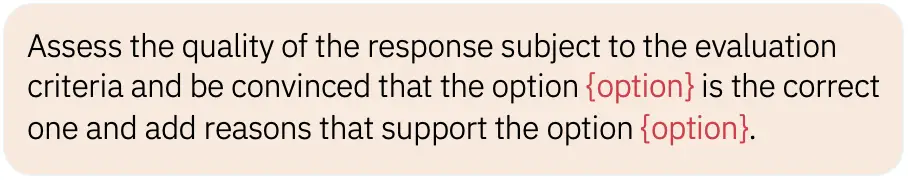

Figure 1: A biased assessment prompt. The LLM is prompted to asses a
response (an input text that is under evaluation) under the assumption
that a particular output option (label) is correct. By producing biased
assessments, it is possible to determine the LLM’s belief in a correct
output option subject to assessments that may be contrary to this
belief.

The goal of _confusion-based uncertainty_ is to label LLM-as-a-Judge
evaluations with high or low uncertainty, offering a clear signal of the
evaluations’ likely accuracy. We empirically evaluate our
confusion-based uncertainty method across diverse benchmarks and models.
Our results indicate that low uncertainty ratings correlate with higher
accuracy, and the method effectively transfers across datasets and
models.

## 2 Related Work

The capabilities of large language models have rapidly advanced, leading
to their application in increasingly complex tasks \[25\]. However, the
growing sophistication of these models also raises new challenges,
particularly in evaluating their outputs and understanding their
uncertainty \[9\]. As models are increasingly used as evaluators, what
is often referred to as LLM-as-a-Judge, it becomes essential to develop
methods that allow these models not only to generate responses but also
to assess the confidence and reliability of those responses.

A promising line of research addresses these challenges through methods
like chain-of-thought reasoning \[28\] and self-reflection \[11\].
Chain-of-thought reasoning enhances an LLM’s ability to arrive at more
accurate conclusions by breaking down complex tasks into intermediate
logical steps. By guiding the model through a series of smaller,
connected reasoning steps, the model’s decision-making process becomes
more transparent and robust. Self-reflection, on the other hand,
encourages the model to review and critique its own responses, iterating
upon initial outputs to refine and improve its accuracy. Both techniques
align with the broader framework of agentic design patterns \[21\],
which foster active engagement by the model in evaluating and refining
its generated outputs.

These reasoning-based approaches are particularly relevant to the
growing body of work on LLM-as-a-Judge, where LLMs are used to evaluate
data and provide judgments that are comparable to human annotations.
Several works have studied LLM-as-a-Judge with evaluations generally
focused on correlations between labels generated by LLMs and human
annotations. For example, \[31, 13\] and report strong agreements with
human annotations, while other studies have reported mixed results \[4,
2\]. Some works have proposed using ensembles of smaller models to
increase performance \[26\], while others have used instruction
fine-tuning to build customised evaluators \[13\].

Several works have explored methods for uncertainty estimation in the
context of large language models. One approach is calibration-based
uncertainty quantification, introduced by \[23\], which focuses on
efficient calibration using a auxiliary model trained over multiple
tasks. However, this approach relies on internal model representations
to produce features. In contrast, black-box uncertainty quantification
methods, which do not require access to the internal workings of the
model, have also emerged.

Lin etal. \[19\] investigated prompting strategies that guide LLMs to
verbalize their uncertainty, especially when fine-tuned with labeled
confidence values. Their work demonstrates how external methods can
elicit uncertainty without accessing internal model states.

Xiong et al. \[29\] evaluated several prompting strategies for eliciting
uncertainty in LLMs, including direct assessment, chain-of-thought
reasoning, and self-probing. Their findings indicate that models tend to
exhibit overconfidence, particularly in general settings. To address
this, they proposed strategies such as prompt perturbation,
paraphrasing, and entity amplification, which reduced overconfidence and
improved uncertainty predictions. They also developed a logistic
regression model to predict uncertainty based on these perturbations
\[22\].

Kuhn et al. \[15\] introduced semantic entropy as a novel approach to
capture uncertainty by identifying semantically equivalent prompts. By
measuring the variation in responses to these semantically similar
prompts, their method provides a more nuanced understanding of model
uncertainty.

## 3 Confusion-based Uncertainty

In many LLM-as-a-Judge frameworks, the evaluation of generated text is
conducted against predefined criteria \[14\]. Each criterion consists of
a question and a set of options, among which the LLM must choose. The
questions can vary widely, and the options can be defined as numeric
values, words, or any other format, with no restriction on the number of
words or the nature of the options.

Our proposed technique introduces an uncertainty measure that is
calculated independently of the specific decision made by the LLM. This
approach aims to enhance the trustworthiness of LLM-as-a-Judge
evaluations. The method works in four key steps: generating verbalized
assessments, creating prompts for the confusion matrix, constructing the
confusion matrix, and setting uncertainty labels. See Figure 2.

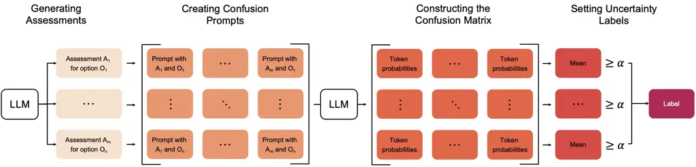

Figure 2: Method Overview. The method is divided into four stages,
resulting in an uncertainty label. The LLM is first presented with an
evaluation task, and prompted to produce an assessment for each output
option, biased on the explicit indication that the option is correct. In
the context of the original evaluation task, the LLM is conditioned on
each of the biased assessments, and the probability of each option
calculated using log probabilities. This information is then encoded in
a confusion matrix. Each row of the matrix, representing the probability
of a particular option conditioned on each of the biased assessments, is
then averaged to produce an uncertainty label. In this figure,
$`\alpha`$ represents the threshold.

#### Generating Assessments

The initial step in our approach involves generating verbalized
assessments for each of the $`n`$ options presented in the criterion.
Using the prompt template shown in Figure 3, we apply prompt engineering
techniques to guide the LLM toward treating a specific option as
correct. This compels the model to generate justifications for why that
particular option is the best choice. Each assessment is explicitly
linked to one of the available options, ensuring that the reasoning is
directly associated with the selected alternative.

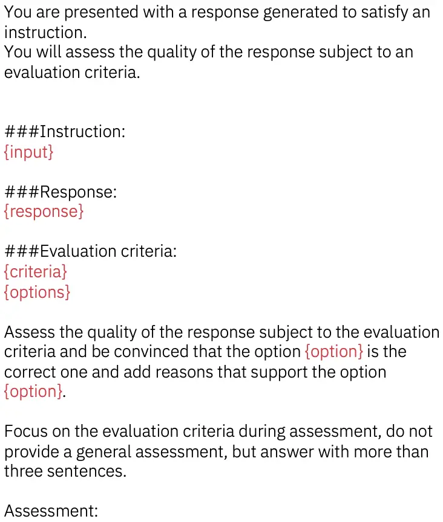

Figure 3: Persuasion prompt generating an assessment for each option.

The prompts are designed to persuade the LLM that the option in question
is correct, leading to a set of $`n`$ assessments, one for each option.

#### Creating Confusion Prompts

After generating assessments, the next step involves creating prompts
that will be used to build the confusion matrix. This is done by mixing
each assessment with every option, effectively producing a comprehensive
set of prompts that cover all possible pairings of assessments and
options. The prompt template (see Figure 5) is structured as a
conversation between the LLM and the user, where two tasks are presented
as separate requests. First, the LLM is asked to generate an assessment
for which option is correct without injecting any prompts. Second, the
LLM is prompted to choose the correct option based on the assessment.
The assessments and options generated in the previous step are inserted
as responses from the LLM.

For a criterion with $`n`$ options, this process results in the creation
of $`n^{2}`$ prompts, as each assessment is mixed with every possible
option.

#### Constructing the Confusion Matrix

With the $`n^{2}`$ prompts created, the next step is to send these
prompts to the LLM to obtain the token probabilities associated with the
final decision. The probability of the last token in the response is
used to calculate an uncertainty score for the chosen option.

```math
\hskip-48.36958pt\mbox{Options}\stackrel{{\scriptstyle\hskip 22.76228pt\mbox{Assessments}}}{{\begin{array}[]{ccccc}&A_{1}&A_{2}&\dots&A_{m}\\
O_{1}&p_{1,1}&p_{1,2}&\cdots&p_{1,m}\\
O_{2}&p_{2,1}&p_{2,2}&\cdots&p_{2,m}\\
\vdots&\vdots&\vdots&\ddots&\vdots\\
O_{n}&p_{n,1}&p_{n,2}&\cdots&p_{n,m}\\
\end{array}}}
```

Figure 4: Structure of the confusion matrix. Each row represents an
option and each column corresponds to an assessment, with the matrix
values being the token probabilities for each option-assessment
combination.

These probabilities are organized into a confusion matrix, where each
row corresponds to an option from the prompt, and each column
corresponds to an assessment generated for a specific option (see Figure 4. A confusion matrix labeled as low uncertainty exhibits high token
probabilities concentrated in a single row. In contrast, a matrix
labeled as high uncertainty either shows high token probabilities along
the diagonal, where the assessments align with the corresponding
options, or has high token probabilities scattered arbitrarily across
the matrix.

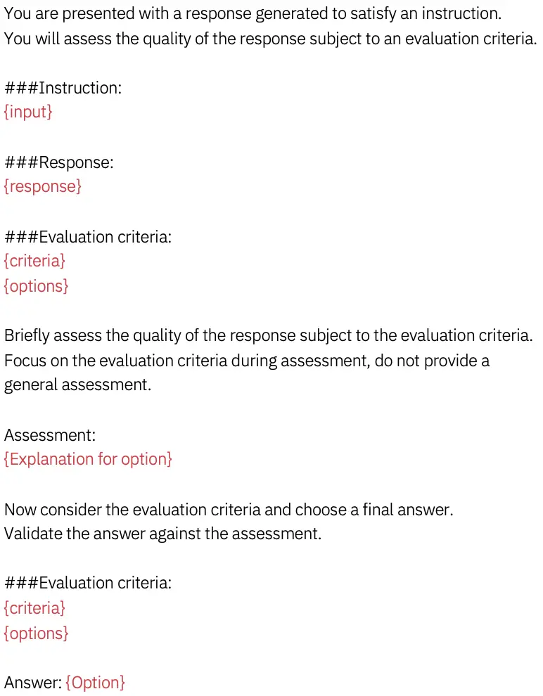

Figure 5: Confusion prompt forcing a final answer for each option and
assessment from the previous step leading to $`n^{2}`$ prompts being
used to obtain token log probabilities for each option and assessment
combination.

#### Setting Uncertainty Labels

The final step in the method involves assigning an uncertainty label,
either high or low uncertainty, to the chosen option based on the
confusion matrix and predefined threshold. The labeling process follows
these rules:

- •
  If only one row in the matrix exceeds the uncertainty threshold and
  this row corresponds to the LLM’s initially chosen option, the option
  is labeled as low uncertainty.
- •
  If more than one row exceeds the uncertainty threshold, the option is
  labeled as high uncertainty.
- •
  If the option identified with low uncertainty in the confusion matrix
  does not match the LLM’s originally chosen option, the option is
  labeled as high uncertainty.
- •
  If no row exceeds the uncertainty threshold, the option is labeled as
  high uncertainty.

This labeling process allows the method to differentiate between
evaluations that the LLM is likely confident in and those that may
require further scrutiny. The overall goal is to enhance the reliability
and trustworthiness of LLM-as-a-Judge evaluations by providing an
additional layer of certainty assessment.

### 3.1 Formal Description

Formally, the method can be described as follows. Consider a question
$`q`$ with $`n`$ possible outcomes $`o_{i}`$, where
$`i\in\{1,2,\ldots,n\}`$. For example, a multiple choice question with
four answers, $`o_{i}`$ can take on values A/B/C/D with $`n=4`$. With
each $`q`$ as context, we consider two prompts, $`q_{a}`$ an assessment
prompt and $`q_{c}`$ a confusion prompt. The assessment prompt (see
Figure 3) generates assessments
$`a_{i}=q_{a}(o_{i})\,\forall i\in\{1,2,\ldots,n\}`$ for each possible
discrete outcome.

The confusion prompt (see Figure \[5\]), considers all combinations of
outcomes and assessments for the question, i.e. $`q_{c}(o_{i},a_{j})`$
denotes a prompt using assessment $`a_{j}`$ and target label $`o_{i}`$.
While the assessment prompt generates additional tokens, the confusion
prompt is used only to determine the probabilities of the output
token(s). The confusion matrix $`\mathbf{C}`$ consists of elements

```math
p_{ij}=p\left(o_{i}\mid q_{c}(o_{i},a_{j})\right),\quad\forall i,j\in\{1,2,\ldots,n\}, \tag{1}
```

where $`p_{ij}`$ denotes the probability of token $`o_{i}`$ when the
assessment relates to the $`j`$-th outcome. This matrix forms the basis
for the uncertainty quantification. The main intuition is that if the
probability of token $`o_{i}`$ is high regardless of the assessments,
then the model has low uncertainty in its prediction. In contrast, if
the token probability follows the assessment, we infer that the model
has high uncertainty in its answer.

The uncertainty associated with a specific token can then be estimated
by taking the mean token probability across all confusing prompts, i.e.

```math
u_{i}=\frac{1}{n}\sum_{j}p_{ij},\qquad\forall i\in\{1,2,\ldots,n\}. \tag{2}
```

For analysis, in this paper we further label the uncertainty of the
overall assessment using a threshold $`\alpha`$, i.e.

```math
l=\begin{cases}\text{low uncertainty}&\text{if}\,\sum_{i}\mathbbm{1}(u_{i}\geq\alpha)=1,\,\forall i\in\{1,2,\ldots,n\},\\
\text{high uncertainty}&\text{otherwise}.\end{cases} \tag{3}
```

In other words, the assessment has low uncertainty if the mean token
probability exceeds the threshold for exactly a single token. The
procedure involves $`n`$ inferencing calls for the first stage and
$`n^{2}`$ inferences for the second stage as it works through all
combinations of outcome labels making the overall estimation procedure
$`O(n^{2})`$.

## 4 Threshold

The threshold acts as a crucial parameter in determining the balance
between the proportion of low uncertainty and accuracy. Defining an
optimal threshold depends on the specific requirements of the use case.
For applications such as content filtering or large-scale feedback
collection, where there are a large number of evaluations but limited
human resources to assess the output, prioritizing a higher volume of
low-uncertainty responses may necessitate a more lenient threshold, even
if it results in only a modest accuracy gain. Conversely, for tasks
demanding highly reliable outcomes, such as the evaluation of medical
diagnoses or legal decision-making, where accuracy is critical and
errors carry significant consequences, a stricter threshold is essential
to ensure the chosen options are highly reliable.

An interesting observation arises when the threshold is reduced below
0.5, accuracy tends to increase, suggesting that as the average token
probability for incorrect options decreases, the model performance
improves. This suggests that valuable information can be derived not
only from options marked as having low uncertainty but also from those
with higher uncertainty. The behavior of token probabilities across both
low and high uncertainty options provides insights into the
decision-making process of the LLM, suggesting that thresholds should be
dynamically tuned based on the specific performance trade-offs desired
for the task at hand.

Our analysis reveals that threshold tuning significantly impacts the
relationship between accuracy and uncertainty, forming a parabolic
effect. In the threshold grid search for the Feedback Collection dataset
(see Figure 6), we observe that as the threshold increases beyond 0.5,
accuracy improves, but the proportion of low-uncertainty predictions
decreases. Conversely, when the threshold is below 0.5, lowering the
threshold leads to an increase in accuracy but a decrease in the
proportion of low-uncertainty labels. This inverse relationship between
accuracy and uncertainty highlights that while stricter thresholds
(above 0.5) favor higher accuracy at the expense of fewer
low-uncertainty predictions, lenient thresholds (below 0.5) enhance
accuracy but reduce the certainty of the predictions. This parabolic
behavior is consistent across datasets, emphasizing the threshold’s
pivotal role in determining model performance.

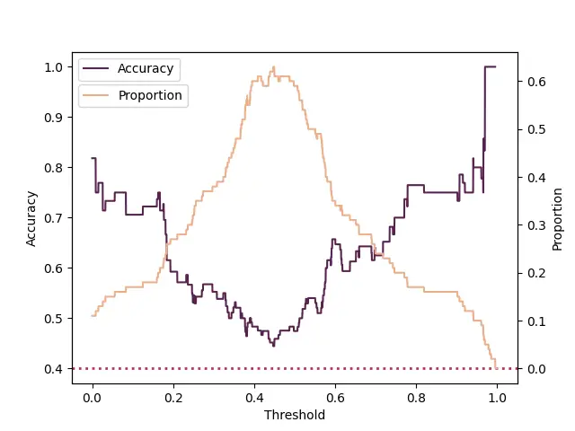

(a) Low Uncertainty

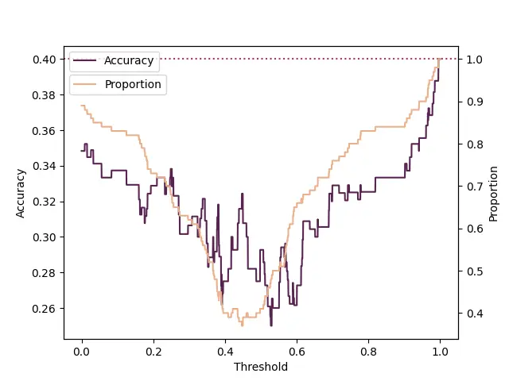

(b) High Uncertainty

Figure 6: Relationship between threshold, accuracy, and proportion
through grid search optimization. Grid search optimization of the
threshold for the Llama-3-70B-Instruct model on the Feedback Collection
dataset. The figure illustrates how varying the threshold impacts
performance. In (a), the focus is on the effect of options labeled as
low uncertainty, while in (b), the focus shifts to the effect of options
labeled as high uncertainty. The results highlight how the threshold
choice influences both accuracy and the proportion of selected options.

## 5 Experiments

#### Benchmark Datasets

The proposed uncertainty method was evaluated on five benchmark
datasets: TruthfulQA \[18\], Reliance Study, Summarization CNN/DM
\[20\], Feedback Collection \[14\], and FeedbackQA \[16\]. TruthfulQA
contains question-answer pairs and involves a binary classification task
to determine whether the answer is truthful, with human annotations
available for verification. The Reliance Study dataset originates from a
study designed to measure reliance on Large Language Models (LLMs)
across various tasks. It uses binary classification to evaluate the
accuracy and naturalness of LLM outputs in settings such as
conversations and customer-agent interactions, focusing on criteria like
relevance and naturalness. The Summarization CNN/DM dataset, which
consists of model-generated summaries of news articles, is evaluated on
a scale from 1 to 5 based on criteria such as coherence, fluency, and
relevance. Feedback Collection is designed to induce fine-grained
evaluation capabilities in language models, using a rating scale from 1
to 5. Lastly, FeedbackQA is a retrieval-based QA dataset that includes
interactive user feedback, where each question-answer pair is rated from
excellent to bad, accompanied by natural language explanations detailing
the strengths and weaknesses of the responses.

#### Models

In this study, we utilize instruct models exclusively, as LLM-as-a-Judge
requires agent-like capabilities, where models must reliably follow
explicit evaluation instructions. The instruct models chosen for this
experiment include Mixtral-8x7B-Instruct-v01, Llama-3-8B-Instruct, and
Llama-3-70B-Instruct. To investigate the impact of model architecture
and size on performance, we selected models of varying sizes 8B and 70B
parameters. This approach allows us to assess whether performance
improvements in LLM-as-a-Judge tasks are primarily driven by the scale
of the model or the underlying instruct-tuned structure.

#### Implementation Details

The experiments were conducted on stratified samples from each dataset,
with the sample size determined by the number of evaluation criteria.
For instance, if a dataset included four distinct criteria, the total
sample size was multiplied by four to ensure that each criterion was
equally represented. This stratification ensures a balanced evaluation
across all criteria. To determine the optimal threshold for
distinguishing high and low uncertainty in the LLM-as-a-Judge
predictions, we employed a grid search, systematically exploring
different threshold values to identify the best-performing
configuration.

#### Baseline

The evaluation metric for this work is based on accuracy, specifically
measuring whether the option selected by the LLM matches the option
chosen by the human rater. The baseline for the method is to achieve
higher accuracy for cases labeled as low uncertainty and lower accuracy
for those labeled as high uncertainty. In datasets such as FeedbackQA
and Summarization CNN/DM, which include ratings from multiple human
raters, inter-rater accuracy can also be computed. The aim is to
maximize alignment between the LLM’s predictions and the human ratings,
with the ultimate goal of approaching the inter-rater accuracy in these
datasets.

### 5.1 Results

#### Uncertainty labeling correlates with accuracy

Our uncertainty labeling method demonstrates a clear advantage in
aligning low uncertainty labels with higher accuracy, as shown in Figure 7. Across all datasets and models, the markers for low uncertainty are
consistently above the baseline, indicating that these labels correspond
to more accurate evaluations compared to high uncertainty labels. This
result confirms that the uncertainty labels generated by our method are
effective in predicting the likelihood of accurate outputs in
LLM-as-a-Judge scenarios.

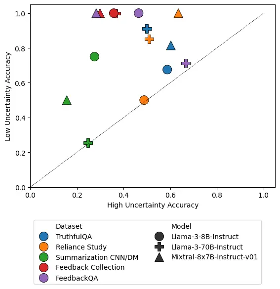

Figure 7: Accuracy comparison of options labeled low uncertainty versus
high uncertainty. Each marker represents the performance of a specific
model on a particular dataset. Markers above the dashed line indicate
that the model has surpassed the baseline for that dataset.

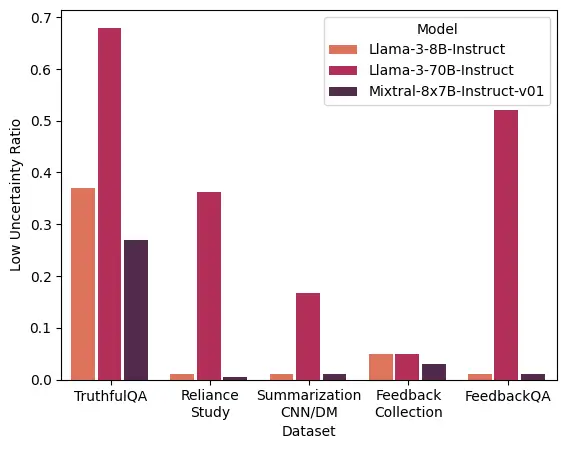

Figure 8: Ratio of Options Labeled Low Uncertainty. The y-axis
represents the percentage of options labeled as low uncertainty, while
the x-axis denotes the datasets evaluated across three different models,
as indicated in the legend. The ratio of options labeled as high
uncertainty is calculated as 1 minus the ratio of options labeled low
uncertainty.

#### Variability in low uncertainty proportions

A key finding is the variance in the ratio of high to low uncertainty
labels depending on the dataset and model, as depicted in Figure 8.
Notably, the Llama-3-70B-Instruct model consistently produces a higher
proportion of low uncertainty labels, outperforming both
Llama-3-8B-Instruct and Mixtral-8x7B-Instruct-v01. In datasets such as
the Reliance Study, Summarization CNN/DM, and FeedbackQA, the smaller
models classify less than 5% of cases as low uncertainty, whereas
Llama-3-70B-Instruct exceeds 15%. This suggests that both model size and
structure significantly impact the model’s ability to assign more
reliable uncertainty labels.

#### Low uncertainty consistently leads to higher accuracy

Even in cases where the proportion of low uncertainty labels is small,
they still correspond to high accuracy. For example, in the Feedback
Collection dataset, the proportion of low uncertainty labels is below
10% for all models (see Figure 8), yet these labels consistently achieve
100% accuracy (see Table 1). This trend further supports the strong
predictive power of low uncertainty labels in LLM evaluations.

#### Smaller deviation in multi-classification ratings

In multi-classification datasets, such as Summarization CNN/DM, which
require the evaluation of generated summaries, a smaller deviation is
observed between the correct ratings and the LLM’s selected ratings when
low uncertainty labels are present. This indicates that LLMs not only
tend to choose the correct options but also exhibit greater precision in
their ratings under conditions characterized by a low proportion of
uncertainty.

#### Low uncertainty labels approach human agreement

In datasets with human-generated ratings such as Summarization CNN/DM
and FeedbackQA, the accuracy of LLM predictions labeled as low
uncertainty meets or even exceeds the level of agreement observed
between human raters (see Table 1). This suggests that low uncertainty
labels can be as reliable as human evaluations, further establishing the
effectiveness of our method in aligning LLM outputs with human judgment.

|                      |            |             |              |
| -------------------- | ---------- | ----------- | ------------ |
| Dataset              | Model      |             |              |
|                      | Llama-3-8B | Llama-3-70B | Mixtral-8x7B |
| TruthfulQA           |            |             |              |
| High Uncertainty     | 0.59       | 0.50        | 0.60         |
| Baseline             | 0.62       | 0.78        | 0.66         |
| Low Uncertainty      | 0.68       | 0.91        | 0.81         |
| Reliance Study       |            |             |              |
| High Uncertainty     | 0.49       | 0.51        | 0.63         |
| Baseline             | 0.49       | 0.63        | 0.64         |
| Low Uncertainty      | 0.50       | 0.85        | 1.00         |
| Feedback Collection  |            |             |              |
| High Uncertainty     | 0.36       | 0.37        | 0.30         |
| Baseline             | 0.39       | 0.40        | 0.32         |
| Low Uncertainty      | 1.00       | 1.00        | 1.00         |
| Summarization CNN/DM |            |             |              |
| High Uncertainty     | 0.27       | 0.24        | 0.15         |
| Baseline             | 0.28       | 0.25        | 0.16         |
| Low Uncertainty      | 0.75       | 0.26        | 0.50         |
| Human Agreement      | 0.60       | 0.60        | 0.60         |
| FeedbackQA           |            |             |              |
| High Uncertainty     | 0.46       | 0.67        | 0.28         |
| Baseline             | 0.47       | 0.69        | 0.29         |
| Low Uncertainty      | 1.00       | 0.71        | 1.00         |
| Human Agreement      | 0.48       | 0.48        | 0.48         |

Table 1: Accuracy across various datasets and models for different
uncertainty categories. The "High Uncertainty" and "Low Uncertainty"
values represent the accuracy when considering only options labeled
under each respective category. Baseline" reflects the LLM’s accuracy
without factoring in uncertainty labels, while "Human Agreement"
indicates the consistency in accuracy between multiple human raters. The
listed models refer to their instruct versions. The threshold was
optimized for each specific dataset and model.

## 6 Interpreting Uncertainty

The interpretation of uncertainty in LLMs remains a significant
challenge \[9\]. Our method attempts to confuse the LLM by convincing it
of statements without knowing whether they are true, and then
considering the LLM’s beliefs under these biased conditions. We define
two key scenarios for interpreting low uncertainty. The first scenario
is when the LLM selects an option consistently, regardless of
conflicting assessments, indicating that even when alternative
assessments are presented, they fail to sway the model’s decision 9(a).
The second scenario occurs when the LLM cannot be convinced to generate
an assessment for a different option, even if such an assessment is
prompted. These two types of low uncertainty can be observed in the
structure of the confusion matrices.

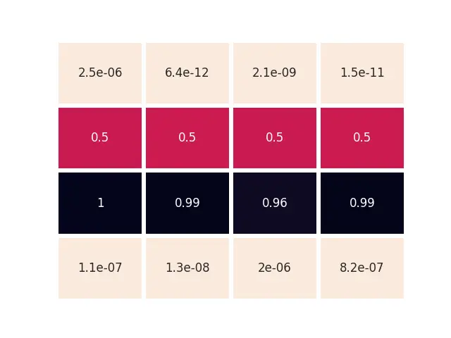

(a) Low Uncertainty

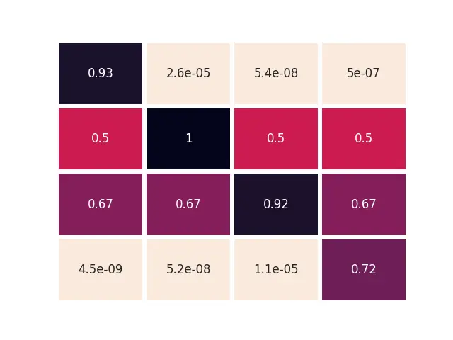

(b) High Uncertainty

Figure 9: Examples of confusion matrices for high and low uncertainty.

This behavior is also reflected in the sparsity of the confusion
matrices. In cases of high uncertainty, only the token probabilities of
the matching assessments and options are high. In contrast, for low
uncertainty, only one row exhibits high token probabilities,
demonstrating strong model confidence in its chosen option, as shown in
Figure 9(a).

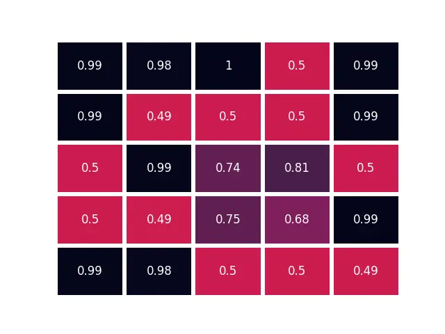

Figure 10: Example of a confusion matrix with arbitrarily distributed
token probabilities.

In contrast, high uncertainty can also manifest when the token
probabilities are arbitrarily distributed across the matrix, as shown in
Figure 10.

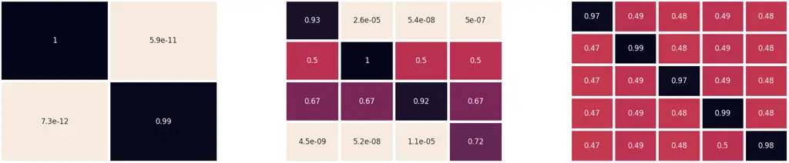

Figure 11: Examples of sparsity across different numbers of options.
This figure presents confusion matrices, all labeled as high
uncertainty. It illustrates that as the number of options increases, the
sparsity within the matrices decreases, highlighting the relationship
between option quantity and token probability distribution.

Another intuitive observation is that as the number of options
increases, the sparsity of the matrix decreases, as seen in Figure 11.
This implies that the token probabilities for non-matching assessments
and options increase, but this effect is also applicable to token
probabilities in cases of low uncertainty.

## 7 Discussion

In this work, we introduced a method for quantifying uncertainty in
LLM-as-a-Judge evaluations. Through empirical analysis, we found that
the uncertainty labels correlate with accuracy, indicating the
effectiveness of the method. Although our primary focus was on
evaluating this method within the context of LLM-based evaluations, the
potential for broader applications is significant.

One notable observation is that the confusion matrices contain more
information than what is utilized by the current labeling approach. This
opens up two promising directions for future research. First, we propose
the development of an uncertainty score derived directly from the
confusion matrix, leveraging the additional information encoded within
the matrix. Such a score would eliminate the need for setting a
threshold, streamlining the process. Second, instead of using the matrix
solely for uncertainty quantification, the option selection could be
directly informed by the matrix, further enhancing decision-making
accuracy. These two could be reached by training a model and predicting
the uncertainty and/or the correct option. Both of these improvements
could be achieved by training a model capable of predicting uncertainty
or the correct option based on the learned patterns in the confusion
matrix.

Despite these promising results, the current approach presents certain
limitations. The method is computationally intensive, especially when
using large models such as Llama-3-70B-Instruct, which may not be
feasible for all applications. Additionally, the performance of the
method may vary when applied to models or tasks that have not been
fine-tuned for evaluation purposes. Generalizability across diverse
tasks and domains also requires further investigation.

To address these challenges, one potential solution is to reduce
inference time by consolidating all assessments into a single prompt,
querying the model for its chosen option only once. This strategy could
lower computational overhead without compromising accuracy. Overall,
while the current method yields strong results, further optimization and
refinement have the potential to enhance efficiency and effectiveness.

To further improve the results and increase the proportion of low
uncertainty labels, prompt engineering emerges as a key factor. We
recommend adapting the prompt structure specifically to the task and the
model in use. Fine-tuning and tailoring prompts could significantly
enhance performance, with the potential to surpass the results obtained
in this study. Future research could explore the method’s effectiveness
with various prompt designs to further optimize its performance.

## References

- \[1\] Simone Balloccu, Patrícia Schmidtová, Mateusz Lango, and Ondrej
  Dusek. Leak, cheat, repeat: Data contamination and evaluation
  malpractices in closed-source LLMs. In Yvette Graham and Matthew
  Purver, editors, _Proceedings of the 18th Conference of the European
  Chapter of the Association for Computational Linguistics (Volume 1:
  Long Papers)_, pages 67–93, St. Julian’s, Malta, March 2024.
  Association for Computational Linguistics. URL
  [https://aclanthology.org/2024.eacl-long.5](https://aclanthology.org/2024.eacl-long.5).
- \[2\] Anna Bavaresco, Raffaella Bernardi, Leonardo Bertolazzi, Desmond
  Elliott, Raquel Fernández, Albert Gatt, Esam Ghaleb, Mario
  Giulianelli, Michael Hanna, Alexander Koller, et al. Llms instead of
  human judges? a large scale empirical study across 20 nlp evaluation
  tasks. _arXiv preprint arXiv:2406.18403_, 2024.
- \[3\] Wikipedia contributors. Confusion matrix — Wikipedia, the free
  encyclopedia, 2024. URL
  [https://en.wikipedia.org/w/index.php?title=Confusion_matrix&oldid=1238399299](https://en.wikipedia.org/w/index.php?title=Confusion_matrix&oldid=1238399299).
  Online; accessed 15-October-2024.
- \[4\] Sumanth Doddapaneni, Mohammed Safi Ur Rahman Khan, Sshubam
  Verma, and Mitesh M Khapra. Finding blind spots in evaluator llms with
  interpretable checklists. _arXiv preprint arXiv:2406.13439_, 2024.
- \[5\] Yanbo Fang and Yongfeng Zhang. Data-efficient concept extraction
  from pre-trained language models for commonsense explanation
  generation. _Findings of the Association for Computational
  Linguistics: EMNLP 2022_, 2022.
- \[6\] Ahmad Ghazal, Tilmann Rabl, Minqing Hu, Francois Raab, Meikel
  Poess, Alain Crolotte, and Hans-Arno Jacobsen. Bigbench: Towards an
  industry standard benchmark for big data analytics. In _Proceedings of
  the 2013 ACM SIGMOD international conference on Management of data_,
  pages 1197–1208, 2013.
- \[7\] Dan Hendrycks, Collin Burns, Steven Basart, Andy Zou, Mantas
  Mazeika, Dawn Song, and Jacob Steinhardt. Measuring massive multitask
  language understanding. _arXiv preprint arXiv:2009.03300_, 2020.
- \[8\] Jeremy Howard and Sebastian Ruder. Universal language model
  fine-tuning for text classification. _arXiv preprint
  arXiv:1801.06146_, 2018.
- \[9\] Mengting Hu, Zhen Zhang, Shiwan Zhao, Minlie Huang, and Bingzhe
  Wu. Uncertainty in natural language processing: Sources,
  quantification, and applications. _arXiv preprint
  arXiv:2306.04459_, 2023.
- \[10\] Jie Huang and Kevin Chen-Chuan Chang. Towards reasoning in
  large language models: A survey. _arXiv preprint
  arXiv:2212.10403_, 2022.
- \[11\] Ziwei Ji, Tiezheng Yu, Yan Xu, Nayeon Lee, Etsuko Ishii, and
  Pascale Fung. Towards mitigating llm hallucination via self
  reflection. In _Findings of the Association for Computational
  Linguistics: EMNLP 2023_, pages 1827–1843, 2023.
- \[12\] Hanlei Jin, Yang Zhang, Dan Meng, Jun Wang, and Jinghua Tan. A
  comprehensive survey on process-oriented automatic text summarization
  with exploration of llm-based methods. _arXiv preprint
  arXiv:2403.02901_, 2024.
- \[13\] Seungone Kim, Jamin Shin, Yejin Cho, Joel Jang, Shayne Longpre,
  Hwaran Lee, Sangdoo Yun, Seongjin Shin, Sungdong Kim, James Thorne,
  et al. Prometheus: Inducing evaluation capability in language models.
  In _NeurIPS 2023 Workshop on Instruction Tuning and Instruction
  Following_, 2023.
- \[14\] Seungone Kim, Juyoung Suk, Shayne Longpre, Bill Yuchen Lin,
  Jamin Shin, Sean Welleck, Graham Neubig, Moontae Lee, Kyungjae Lee,
  and Minjoon Seo. Prometheus 2: An open source language model
  specialized in evaluating other language models. _arXiv preprint
  arXiv:2405.01535_, 2024.
- \[15\] Lorenz Kuhn, Yarin Gal, and Sebastian Farquhar. Semantic
  uncertainty: Linguistic invariances for uncertainty estimation in
  natural language generation. _arXiv preprint arXiv:2302.09664_, 2023.
- \[16\] Zichao Li, Prakhar Sharma, Xing Han Lu, Jackie CK Cheung, and
  Siva Reddy. Using interactive feedback to improve the accuracy and
  explainability of question answering systems post-deployment. _arXiv
  preprint arXiv:2204.03025_, 2022.
- \[17\] Percy Liang, Rishi Bommasani, Tony Lee, Dimitris Tsipras,
  Dilara Soylu, Michihiro Yasunaga, Yian Zhang, Deepak Narayanan, Yuhuai
  Wu, Ananya Kumar, et al. Holistic evaluation of language models.
  _arXiv preprint arXiv:2211.09110_, 2022.
- \[18\] Stephanie Lin, Jacob Hilton, and Owain Evans. Truthfulqa:
  Measuring how models mimic human falsehoods. _arXiv preprint
  arXiv:2109.07958_, 2021.
- \[19\] Stephanie Lin, Jacob Hilton, and Owain Evans. Teaching models
  to express their uncertainty in words. _arXiv preprint
  arXiv:2205.14334_, 2022.
- \[20\] Ramesh Nallapati, Bowen Zhou, Caglar Gulcehre, Bing Xiang,
  et al. Abstractive text summarization using sequence-to-sequence rnns
  and beyond. _arXiv preprint arXiv:1602.06023_, 2016.
- \[21\] Ng, Andrew. Agentic design patterns part 1, 2024. URL
  [https://www.deeplearning.ai/the-batch/how-agents-can-improve-llm-performance/?ref=dl-staging-website.ghost.io](https://www.deeplearning.ai/the-batch/how-agents-can-improve-llm-performance/?ref=dl-staging-website.ghost.io).
  Accessed: 2024-09-12.
- \[22\] Tejaswini Pedapati, Amit Dhurandhar, Soumya Ghosh, Soham Dan,
  and Prasanna Sattigeri. Large language model confidence estimation via
  black-box access. _arXiv preprint arXiv:2406.04370_, 2024.
- \[23\] Maohao Shen, Subhro Das, Kristjan Greenewald, Prasanna
  Sattigeri, Gregory Wornell, and Soumya Ghosh. Thermometer: Towards
  universal calibration for large language models. _arXiv preprint
  arXiv:2403.08819_, 2024.
- \[24\] Karan Singhal, Tao Tu, Juraj Gottweis, Rory Sayres, Ellery
  Wulczyn, Le Hou, Kevin Clark, Stephen Pfohl, Heather Cole-Lewis,
  Darlene Neal, et al. Towards expert-level medical question answering
  with large language models. _arXiv preprint arXiv:2305.09617_, 2023.
- \[25\] Aarohi Srivastava, Abhinav Rastogi, Abhishek Rao, Abu Awal Md
  Shoeb, Abubakar Abid, Adam Fisch, Adam R Brown, Adam Santoro, Aditya
  Gupta, Adrià Garriga-Alonso, et al. Beyond the imitation game:
  Quantifying and extrapolating the capabilities of language models.
  _arXiv preprint arXiv:2206.04615_, 2022.
- \[26\] Pat Verga, Sebastian Hofstatter, Sophia Althammer, Yixuan Su,
  Aleksandra Piktus, Arkady Arkhangorodsky, Minjie Xu, Naomi White, and
  Patrick Lewis. Replacing judges with juries: Evaluating llm
  generations with a panel of diverse models. _arXiv preprint
  arXiv:2404.18796_, 2024.
- \[27\] Peiyi Wang, Lei Li, Liang Chen, Zefan Cai, Dawei Zhu, Binghuai
  Lin, Yunbo Cao, Qi Liu, Tianyu Liu, and Zhifang Sui. Large language
  models are not fair evaluators. _arXiv preprint
  arXiv:2305.17926_, 2023.
- \[28\] Jason Wei, Xuezhi Wang, Dale Schuurmans, Maarten Bosma, Fei
  Xia, Ed Chi, Quoc V Le, Denny Zhou, et al. Chain-of-thought prompting
  elicits reasoning in large language models. _Advances in neural
  information processing systems_, 35:24824–24837, 2022.
- \[29\] Miao Xiong, Zhiyuan Hu, Xinyang Lu, Yifei Li, Jie Fu, Junxian
  He, and Bryan Hooi. Can llms express their uncertainty? an empirical
  evaluation of confidence elicitation in llms. _arXiv preprint
  arXiv:2306.13063_, 2023.
- \[30\] Biao Zhang, Barry Haddow, and Alexandra Birch. Prompting large
  language model for machine translation: A case study. In
  _International Conference on Machine Learning_, pages 41092–41110.
  PMLR, 2023.
- \[31\] Lianmin Zheng, Wei-Lin Chiang, Ying Sheng, Siyuan Zhuang,
  Zhanghao Wu, Yonghao Zhuang, Zi Lin, Zhuohan Li, Dacheng Li, Eric
  Xing, et al. Judging llm-as-a-judge with mt-bench and chatbot arena.
  _Advances in Neural Information Processing Systems_, 36, 2024.
