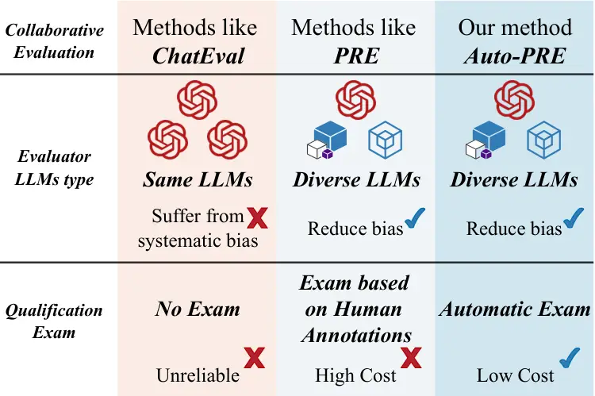
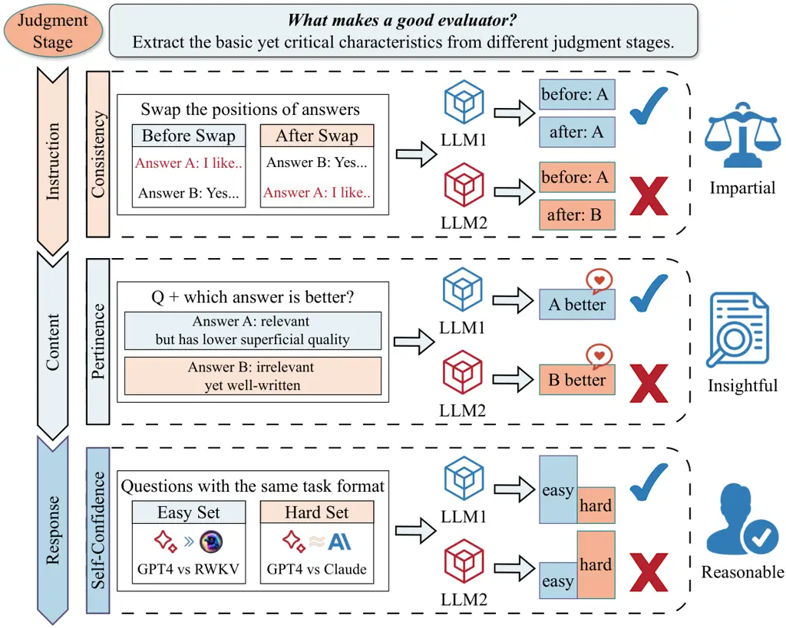
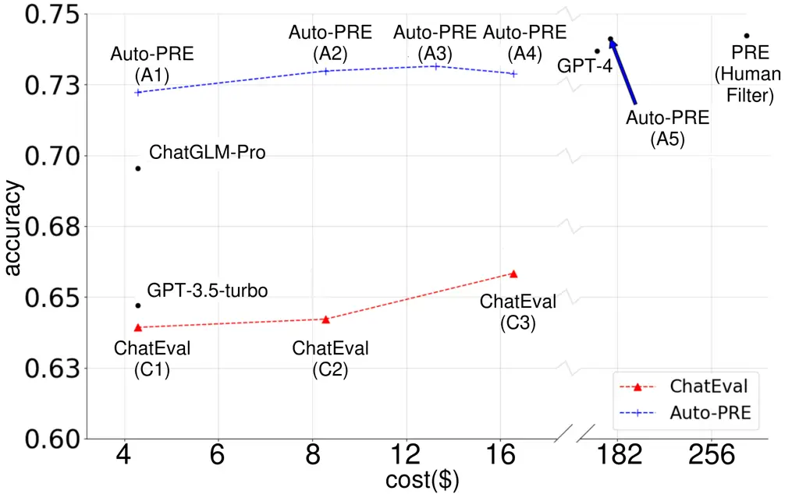
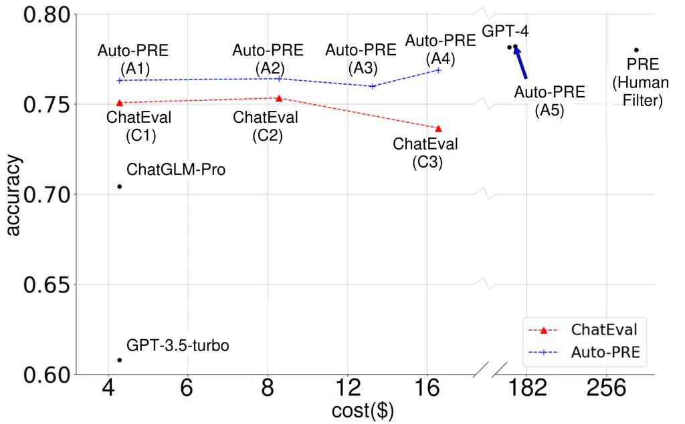

# Auto-PRE: An Automatic and Cost-Efficient Peer-Review Framework for Language Generation Evaluation

Junjie Chen    Weihang Su    Zhumin Chu    Haitao Li    Yujia Zhou   
Dingbo Yuan    Xudong Wang    Jun Zhou    Yiqun Liu    Min Zhang   
Shaoping Ma    Qingyao Ai ^(†)^(†)thanks: Corresponding Author:
aiqy@tsinghua.edu.cn

###### Abstract

The rapid development of large language models (LLMs) has highlighted
the need for efficient and reliable methods to evaluate their
performance. Traditional evaluation methods often face challenges like
high costs, limited task formats, dependence on human references, and
systematic biases. To address these limitations, we propose Auto-PRE, an
automatic LLM evaluation framework inspired by the peer review process.
Unlike previous approaches that rely on human annotations, Auto-PRE
automatically selects evaluator LLMs based on three core traits:
consistency, pertinence, and self-confidence, which correspond to the
instruction, content, and response stages, respectively, and
collectively cover the entire evaluation process. Experiments on three
representative tasks, including summarization, non-factoid QA, and
dialogue generation, demonstrate that Auto-PRE achieves state-of-the-art
performance while significantly reducing evaluation costs. Furthermore,
the structured and scalable design of our automatic qualification exam
framework provides valuable insights into automating the evaluation of
LLMs-as-judges, paving the way for more advanced LLM-based evaluation
frameworks.

¹Department of Computer Science and Technology, Tsinghua University ²Ant
Group

Code — https://github.com/cjj826/Auto-PRE

## Introduction

Recently, the rapid advancement of large language models (LLMs) has
attracted significant attention from both academia and industry (Yang et
al. 2025; Liu et al. 2024). As LLMs evolve rapidly, how to evaluate
their performance effectively and efficiently has become a crucial
question.

Existing evaluation methods for LLMs can be categorized into two types:
manual evaluation (Zheng et al. 2023) and automatic evaluation (Chang et
al. 2024). Manual evaluation is considered the most reliable and
effective method, but it is usually suboptimal due to its high costs in
practice. Automatic evaluation aims to reduce the cost by directly
assessing model performance without human annotations. However, existing
automatic evaluation methods often support limited types of task formats
(e.g., multiple-choice questions) and need human-created references for
judgments. While recent studies have attempted to build reference-free
frameworks for open-ended task evaluation with LLMs, research (Zeng et
al. 2024) has shown LLM-based evaluators (or reviewers), including the
powerful GPT-4 (Achiam et al. 2023), may exhibit a preference for
answers generated by models with the same origin. In our paper, we refer
to this preference as a systematic bias, which could limit the
reliability of the evaluation framework in practice.



Figure 1: Comparison of existing collaborative evaluation methods. Our
Auto-PRE offers advantages in reducing bias and lowering cost.



Figure 2: The framework of our automatic qualification exam. (1)
Consistency measures the proportion of consistent outputs by the LLM
after swapping answer positions in prompts; (2) Pertinence assesses
whether the LLM evaluates based on the pertinence of answers to the
question, unaffected by their superficial quality; (3) Self-Confidence
determines if the LLM exhibits higher confidence on easier question sets
when facing two sets of the same format but objectively different
difficulties.

To develop more advanced evaluation methods, recent research has
investigated the possibility of employing multiple LLMs to evaluate
collaboratively, achieving notable performance. However, similar to
human collaboration, when unqualified LLMs participate in collaboration,
they often impair the method’s performance. Therefore, selecting the
appropriate LLMs as evaluators is a crucial issue. As shown in Figure 1,
methods like ChatEval (Chan et al. 2024) directly select powerful LLMs
such as GPT-3.5-turbo or GPT-4 to build multiple agents to debate and
collaborate for evaluation. However, since it only utilizes LLMs from
the same series, it still suffers from the systematic bias. Another
method, PRE (Chu et al. 2024), simulates the academic peer-review
mechanism by selecting qualified evaluator LLMs from a diverse pool of
candidates through a qualification exam, which measures the accuracy of
their outputs against human annotations. The final evaluation scores are
then computed via weighted aggregation of the selected evaluators’
outputs. Although experiments indicate PRE can reduce the systematic
bias, it still relies on human-annotated data for the exam and is
therefore not fully automatic and high-cost.

In order to address the aforementioned limitations, we propose Auto-PRE,
a peer-review framework that introduces an automatic qualification exam
to select qualified evaluator LLMs without relying on human annotations.
To achieve this, the key question we need to answer is: What makes a
good evaluator? Our guiding principle is that qualified evaluator LLMs
should exhibit characteristics similar to those of excellent human
evaluators. However, the inherent complexity of human evaluators makes
directly summarizing their characteristics challenging. To strike a
balance between rationality and feasibility, we first structure the
evaluation process into three stages: Instruction (evaluation prompt),
Content (material to be assessed), and Response (assessment result
generated by the evaluator). This division covers the entire evaluation
process and ensures the completeness of our exam. We then extract basic
yet critical characteristics from each stage: (1) Consistency: Upon
receiving the judgment instruction, the evaluator should have no preset
biases to ensure the objectivity; (2) Pertinence: When judging the
specific content, the evaluator is expected to have a thorough
understanding of the task and identify the core factors that truly
impact the quality of the answers (e.g., pertinence to given question),
rather than relying solely on secondary or superficial factors; (3)
Self-Confidence: After providing the judgment response, the evaluator
should have a reasonable confidence to reflect the reliability (Zhao et
al. 2015). Based on these characteristics, we propose three automatic
methods for selecting evaluator LLMs for peer review. All these methods
require no human annotations, making the framework fully automatic,
cost-efficient, scalable, and robust to LLM-introduced systematic bias.

Experimental results on three tasks, including summary generation,
non-factoid question-answering, and dialogue generation, indicate that
our Auto-PRE can achieve state-of-the-art performance at a much lower
cost. Furthermore, our qualification exam covers the entire evaluation
process and is easily adapted to support additional traits, serving as a
potential guide for automating the evaluation of LLMs-as-judges and
advancing the LLM-based evaluation methods.

## Related Work

Evaluation methods for LLMs fall into manual and automatic types. Manual
evaluation (e.g., Chatbot Arena (Zheng et al. 2023)) offers high
reliability but is expensive and non-scalable. Automatic methods
include: (1) reference-based metrics such as BLEU (Papineni et al.
2002), ROUGE (Lin 2004), and BERTScore (Zhang et al. 2019), which are
limited in capturing answer quality, and vulnerable to overfitting if
references are leaked; (2) multiple-choice evaluation, which is simple
but insufficient for open-ended tasks; and (3) LLM-based
evaluation (Chan et al. 2024; Chu et al. 2024), where LLMs serve as
evaluators. Although LLM-based evaluation methods have shown competitive
evaluation performance, these evaluator LLMs still have many flaws, such
as a preference for verbose answers or answers generated by similar LLMs
(Zeng et al. 2024). Therefore, researchers have begun to explore whether
these evaluator LLMs are truly qualified. Some of this work involves
constructing evaluation benchmarks through random sampling output pairs
and crowdsourced manual annotations, such as LLMEval (Zhang et al.
2023), MT-Bench (Zheng et al. 2023), and FairEval (Wang et al. 2023),
but these works overlook biases introduced by the subjective preferences
of human annotators. To address this, some researchers attempt to create
more objective meta-evaluation benchmarks; for instance, LLMBAR (Zeng et
al. 2024) is designed to assess if evaluator LLMs follow instructions,
with data samples that have been manually checked by experts to ensure
objectivity. In contrast to these annotation-heavy evaluation methods,
our methods automatically select evaluator LLMs based on objective
traits across different judgment stages.

## Methodology

As previously discussed, one of the key issues in collaborative
evaluation methods is how to automatically, objectively, and
cost-effectively select qualified evaluator LLMs. Based on the different
judgment stages, we extract basic yet critical characteristics:
Consistency, Pertinence, and Self-Confidence. Leveraging these three
characteristics, we have designed an automatic qualification exam that
incorporates three different selection methods, as shown in Figure 2. It
is worth noting that the ability requirements for evaluators may vary
across different tasks or even between datasets within the same task.
However, the requirements tend to be similar for different instances
within the same dataset of a given task. To balance effectiveness and
cost-efficiency, our selection methods are designed to be performed per
dataset. Next, we provide a detailed description of our methods.

### Consistency

When receiving judgment instructions, an excellent evaluator should
remain objective, impartial, and consistent, avoiding the influence of
preset biases. Consider a task to evaluate the quality of $`n`$ answers,
denoted as $`\{Y_{1},Y_{2},\dots,Y_{n}\}`$, to the same question $`Q`$.
Within the judgment instructions, there exists a subset that should not
affect the evaluation outcomes, denoted as $`NI`$. This subset includes
factors such as the order of answers and the placement of
question-answer pairs within the prompt. A qualified evaluator should
demonstrate no bias towards specific $`NI`$. Formally, this means the
evaluation score for any given answer $`Y_{t}`$ should remain invariant
under changes to $`NI`$:

```math
Score(Y_{t}\mid NI_{1})=Score(Y_{t}\mid NI_{2}), \tag{1}
```

where $`NI_{1}`$ and $`NI_{2}`$ represent different $`NI`$.

Currently, numerous studies (Wang et al. 2023; Li et al. 2024) have
shown that some LLMs exhibit various preset biases, so we can use the
degree of biases of different LLMs for selection. Specifically, we
implement the most common position bias and set $`n=2`$. The candidate
LLM $`L`$ is given the tuple $`(Q,Y_{1},Y_{2})`$ as input, and generates
a preference relation $`T_{1}`$. Next, the positions of $`Y_{1}`$ and
$`Y_{2}`$ are swapped to form the tuple $`(Q,Y_{2},Y_{1})`$, which is
then inputted to $`L`$ to generate another preference relation
$`T_{2}`$. We randomly sample $`m`$ instances from the specific dataset,
with $`(Q_{i},Y_{1,i},Y_{2,i})`$ ($`i=1,2,\dots,m`$). Then, the
proportion of consistent outputs for the candidate LLM $`L`$ is computed
as:

```math
P_{c}=\frac{\sum_{i=1}^{m}\mathbb{I}(T_{1,i}=T_{2,i})}{m}, \tag{2}
```

where $`\mathbb{I}(\cdot)`$ is the 0-1 indicator function, and this
definition remains consistent throughout our paper. If the $`P_{c}`$
exceeds the threshold $`\eta_{c}`$, the candidate LLM $`L`$ is
considered to have passed the exam. It should be noted that our
framework is highly scalable and can be easily adapted to support the
detection of other types of biases based on task requirements, such as
token or prompt bias.

| Q                                           | Q’                                                |
| ------------------------------------------- | ------------------------------------------------- |
| Could someone define Christian for me?      | Can anyone explain the concept of Buddhism to me? |
| What is the best Fantasy Football Platform? | What is the top Fantasy Baseball App?             |

Table 1: Some cases of how GPT-4 modifies Q to Q’.

### Pertinence

When judging specific contents, unqualified evaluators may struggle to
identify the core factors that truly impact answer quality (e.g., the
pertinence between answer and question) (Zeng et al. 2024). Instead,
they tend to provide unreliable scores based on secondary or superficial
factors such as the length or format of the answer. Therefore, we design
a method to select insightful evaluator LLMs based on whether the
candidate LLMs can effectively distinguish between the answer’s
pertinence to the given question and its superficial quality. To
implement this method, we generate two types of answers: (1) answers
that are highly pertinent to the given questions but of lower
superficial quality, denoted as RA (Relevant Answers); and (2) answers
that are less pertinent but exhibit higher superficial quality, denoted
as IA (Irrelevant yet well-written Answers). Specifically, the process
of constructing RA and IA involves two steps:

Step 1: Generate a variant of the original question $`Q`$, denoted as
$`Q^{\prime}`$, where $`Q`$ and $`Q^{\prime}`$ are similar but
sufficiently different to ensure that answers generated based on each
have significantly different pertinence to the original question $`Q`$.
The difference in pertinence decreases as the similarity between $`Q`$
and $`Q^{\prime}`$ increases. We design two methods for constructing
$`Q^{\prime}`$: one is to search other questions from the same dataset
as $`Q`$ to find a suitable $`Q^{\prime}`$, and the other is to prompt a
capable LLM (like GPT-4) to modify $`Q`$ to obtain $`Q^{\prime}`$. Table
1 shows that GPT-4 mainly achieves the transformation from $`Q`$ to
$`Q^{\prime}`$ by changing the keywords in the $`Q`$.

Step 2: Select one LLM’s response to $`Q`$ as the RA and another LLM’s
response to $`Q^{\prime}`$ as the IA. Here, the LLM generating the IA
can be a more capable LLM than the LLM generating the RA, or it can be
the candidate LLM itself. The former is based on the assumption that a
more capable LLM is likely to produce answers with higher superficial
quality, while the latter assumes that the candidate LLM considers its
own answers to be of sufficient superficial quality.

After obtaining $`m`$ pairs of RA and IA, we calculate the proportion of
candidate LLM outputs where the $`RA_{i}`$ is rated better than the
$`IA_{i}`$ as a filtering metric:

```math
P_{p}=\frac{\sum_{i=1}^{m}\mathbb{I}(RA_{i}>IA_{i})}{m}. \tag{3}
```

If $`P_{p}`$ exceeds a certain threshold $`\eta_{p}`$, the candidate LLM
is considered qualified.

### Self-Confidence

After providing judgment responses, like reliable human evaluators,
qualified evaluator LLMs should have a reasonable self-confidence level
based on their understanding of the task difficulty and their
capabilities (Zhao et al. 2015). As for what counts as a reasonable
level of self-confidence, a suitable prior assumption is that when the
same LLM encounters two questions with the same task format but
objectively different difficulties, it should have more self-confidence
in solving the easier question. It is noteworthy that in the above
assumption, the task formats for both questions must be identical to
ensure that the LLM requires the same capabilities to solve them.
Additionally, the difference in difficulties between the two questions
must be based on objective criteria rather than human subjective
judgment, to eliminate potential biases arising from the disagreement
between humans and LLMs.

Based on this assumption, we select those LLMs that show higher
self-confidence on the easier set than on the harder ones as evaluators.
Implementing this requires addressing two key issues: (1) How to
construct two question sets with the same task format but objectively
different difficulties? (2) How to extract the self-confidence of LLMs?

|                  | Content                                                         |
| ---------------- | --------------------------------------------------------------- |
| Original News    | The man’s body was discovered in a field near Belsyde Avenue…   |
| GPT-4’s Summary  | A man’s body was found in a field near Belsyde Avenue…          |
| Claude’s Summary | The body of an unidentified man was discovered in a field near… |
| RWKV’s Summary   | Bob: Hey Alice, have you heard about the death of a man…        |

Table 2: Summaries by different LLMs.

Regarding issue (1), we initially select evaluating the quality
differences between two answers to the same question as our task format.
For this task, an objective principle holds: the more similar the two
answers in quality, the more difficult it becomes to distinguish between
them. Based on this, we construct the easy and hard question sets by
assuming that the similarity in answer quality is correlated with the
capability gap between the two LLMs that generate them. Specifically, we
pair LLMs with a large capability gap (e.g., GPT-4 vs. RWKV-7B) to form
the easy set, and LLMs with similar capabilities (e.g., GPT-4 vs.
Claude) to form the hard set. Table 2 presents a summarization example
where GPT-4 and Claude generate valid summaries, while RWKV-7B produces
an irrelevant dialogue. This highlights that comparing high-quality
answers (e.g., GPT-4 vs. Claude) is objectively more challenging than
answers with a clear quality gap (e.g., GPT-4 vs. RWKV-7B).

Regarding issue (2), we convert the probability of outputting a specific
token into the uncertainty of the output (Duan et al. 2023; Manakul et
al. 2023), and assume that higher uncertainty represents lower
self-confidence. Specifically, for the task we select, which involves
evaluating the quality difference between two answers, the candidate
LLMs are only required to output the specific token ‘one’ or ‘two’ to
indicate which answer is better. Through this simplification, we can
directly convert the probability $`p`$ of an LLM outputting ‘one’ or
‘two’ into the LLM’s uncertainty $`-log(p)`$, thereby obtaining
self-confidence. However, this method requires access to the
probabilities of the specific tokens, making it unsuitable for some
closed-source LLMs. For this situation, we directly prompt these LLMs to
output specific self-confidence level labels. Since these popular and
closed-source LLMs (e.g., GPT-4) typically have an enormous number of
parameters and exceptional capabilities, this straightforward and
low-cost method shows good performance in our experiments.

If the candidate LLM’s average confidence level on the easy set is
$`S_{\text{easy}}`$, and its average confidence level on the hard set is
$`S_{\text{hard}}`$, then $`P_{s}`$ is defined as follows:

```math
P_{s}=\begin{cases}1,&\text{if }S_{\text{easy}}>S_{\text{hard}}\\
0,&\text{otherwise}.\end{cases} \tag{4}
```

More details on the implementation and validation of our methods’
effectiveness are in Appendix Section 3.

[TABLE]

Table 3: The overall performance (accuracy) of Auto-PRE and other
baselines. The best result is highlighted in bold.
$`\dagger`$/$`\dagger\dagger`$ indicates $`p`$-value of paired sample
t-test where the method outperforms PRE (Auto-Exam) is less than
0.05/0.01.

## Experimental Setup

### Tasks And Datasets

Unlike the automatic evaluation methods for multiple-choice questions,
we focus on open-ended questions. To this end, we select three
generative tasks along with representative datasets: (1) Summary
generation: Xsum (Narayan et al. 2018), (2) Non-factual
question-answering: NF_CATS (Bolotova et al. 2022), (3) Dialogue
generation: DailyDialog (Li et al. 2017). For the above three datasets,
we randomly sample 100 instances from each as the question set and
select 7 different LLMs to generate answers, forming the answer set.
Then, we employ human annotators to provide annotations over the answer
set. We use these annotations as ground truth to evaluate the
performance of each evaluation method. More dataset details can be found
in Appendix Section 1.

### Evaluation Formats And Metrics

We compare two evaluation formats: pointwise and pairwise. For
pointwise, we design two implementation approaches: 5-level and
100-level. For pairwise evaluation, we minimize the bias introduced by
the positioning of answers by calculating the mean of the evaluation
results before and after swapping the positions of the two answers. We
use accuracy as the main evaluation metric, defined as the agreement
rate between the manual preference annotations and the method’s
evaluation results. When using pointwise evaluation, we will convert
each answer’s individual scores into pairwise rankings. In addition, for
pointwise, we also use Spearman correlation coefficient (Lehman et al. 2013) ($`S`$) to measure the consistency between the model’s outputs and
manual annotations. We calculate $`S`$ for each instance of the task,
and report the mean of them as the overall performance.

### Baselines

We compare our Auto-PRE with different baselines:

1. ROUGE-L and BERTScore: These are widely used reference-based metrics
   (not applicable to the NF_CATS due to the lack of reference answers).
   For BERTScore, we use deberta-xlarge-mnli (He et al. 2020) as the base
   model. We report the F1 score for both metrics.

2. GPTScore (Fu et al. 2023): This metric assesses the quality of
   generated text by computing the log-probability of the output given the
   prompt under a specific LLM. We use text-davinci-003 (Brown et al. 2020)
   as the base model.

3. Single LLM: Use a single general LLM as evaluator. The LLMs used are
   marked with an asterisk (\*) in Table 3.

4. PandaLM (Wang et al. 2024): A fine-tuned variant of LLaMA-7B
   specifically designed for preference judgment.

5. Deepseek-R1-250528 (Guo et al. 2025): A strong representative of
   recently popular reasoning-specialized LLMs.

6. ChatEval (Chan et al. 2024): Use two GPT-3.5-turbo to build two
   agents as evaluators to debate in two rounds with a one-by-one
   communication strategy.

7. PRE (Human Filter): Use all 7 LLMs in Single LLM as candidates and
   select evaluators based on human annotations. Unless noted otherwise,
   PRE refers to this version.

8. PRE (w/o Filter): Use all candidates as evaluators without any
   filtering.

9. PRE (Auto-Exam): The original PRE offers a preliminary and simplified
   version of the automatic qualification exam, using only consistency for
   selection.

### Implementation Details

We set temperature to 0 and do*sample to False for reproducibility. In
our Auto-PRE, $`\eta*{c}`$ and $`\eta*{p}`$ are respectively defined as
the mean $`P*{c}`$ and $`P*{p}`$ across all candidate LLMs. The fusion
weight for each evaluator LLM is the average of $`P*{c}`$, $`P*{p}`$,
and $`P*{s}`$. Evaluation prompts and hyperparameter details are in
Appendix Sections 2 and 5, respectively.

## Experimental Results

In this section, we present the experimental results and aim to address
the following four research questions (RQs):

1\. How does the performance of Auto-PRE compare to other baseline
methods?

2\. Does Auto-PRE help mitigate the systematic bias caused by relying on
LLMs from the same series?

3\. What are the benefits of Auto-PRE in reducing costs?

4\. How do the three selection methods in Auto-PRE interact and
complement each other?

### Main Results (RQ1)

[TABLE]

Table 4: The spearman correlation coefficient ($`S`$) of Auto-PRE and
other baselines. Here, 5-l and 100-l denote 5-level and 100-level
annotations, respectively.

Table 3 and 4 show the overall results, leading to the following
observations:

Across various settings, Auto-PRE consistently outperforms existing
methods and achieves the best overall performance on average. In
contrast, reference-based metrics such as ROUGE-L and BERTScore exhibit
significant performance gaps relative to the top-performing methods,
while GPTScore also falls notably behind. PandaLM performs reasonably
well, but only on the NF_CATS. Deepseek-R1-0528 demonstrates strong
competitiveness, particularly under the pointwise format, highlighting
the potential of reasoning LLMs for evaluation tasks. Additionally, the
comparison with ChatEval in Table 3 is not entirely fair (as we don’t
use GPT-4 as the base for the agent due to cost considerations), but we
will provide a detailed comparison of the performance between Auto-PRE
and ChatEval under equivalent cost conditions in the cost analysis
section.

Compared to GPT-4, Auto-PRE exhibits significant improvements in
pointwise format, with an average increase of 4.53% in accuracy. In
terms of pairwise, Auto-PRE performs comparably with GPT-4. Moreover, we
believe that GPT-4’s systemic bias may not be apparent in the context of
the overall dataset, as 70% of the answer pairs in our experimental
setup do not include LLMs from the GPT series. In the bias analysis
section, we will test on instances containing LLMs from the GPT series
to further discuss the advantages of Auto-PRE in mitigating bias
compared to GPT-4.

Compared to PRE (w/o Filter) and PRE (Auto-Exam), Auto-PRE achieves
significantly better performance while keeping low costs, with an
average improvement of 2.44% in accuracy and 0.0325 in $`S`$ over PRE
(w/o Filter), and an average improvement of 1.45% in accuracy and 0.0256
in $`S`$ over PRE (Auto-Exam). This underscores the necessity of our
more well-designed qualification exam.

Compared to PRE (Human Filter), Auto-PRE achieves comparable performance
while significantly reducing costs, which will be discussed in the cost
analysis section. Interestingly, Auto-PRE even outperforms PRE (Human
Filter) to some extent, which might be because of the more comprehensive
coverage of different judgment stages in our automatic qualification
exam. In contrast, while manual annotation-based filtering emphasizes
evaluator accuracy, it does not fully account for all judgment stages.
This will be discussed in detail in the ablation study section.

### Bias Analysis (RQ2)

To demonstrate that Auto-PRE effectively reduces bias in
single-evaluator LLM (e.g., GPT-4), we conduct experiments using
GPT-3.5-turbo and ChatGLM2-6B as two answer generators, tested on the
Xsum and NF_CATS datasets in the pairwise evaluation format.

|                    |                         |          |                         |          |
| ------------------ | ----------------------- | -------- | ----------------------- | -------- |
| Methods            | Xsum                    |          | NF_CATS                 |          |
|                    | accuracy                | rate (%) | accuracy                | rate (%) |
| GPT-4              | 0.5366                  | 83.64    | 0.8618                  | 87.88    |
| PRE (w/o Filter)   | 0.5610                  | 68.18    | 0.8553                  | 84.85    |
| PRE (Auto-Exam)    | 0.5671                  | 65.45    | 0.8750                  | 86.36    |
| PRE (Human Filter) | 0.5549                  | 77.27    | $`\textbf{0.8816}^{*}`$ | 71.21    |
| Auto-PRE           | $`\textbf{0.5854}^{*}`$ | 65.45    | $`\textbf{0.8816}^{*}`$ | 74.24    |

Table 5: The bias analysis of GPT-4 (pairwise). \* indicates p-value of
paired sample t-test, where the method outperforms GPT-4 is less than
0.05.

Table 5 presents the results. As Equation 5 shows, $`rate`$ is defined
as the proportion of instances where, despite human annotators judging
the two LLMs as tied or preferring ChatGLM2-6B, the method still favors
GPT-3.5-turbo.

```math
rate_{m}=\frac{\sum\mathbb{I}(T_{h}\in\{0,-1\}\land T_{m}=1)}{\sum\mathbb{I}(T_{h}\in\{0,-1\})}\times 100\%, \tag{5}
```

where $`T_{h}`$ and $`T_{m}`$ denote human and method preferences,
respectively; $`1`$ indicates a preference for GPT-3.5-turbo, $`-1`$ for
ChatGLM2-6B, and $`0`$ for a tie.

From the results, we can observe a significant performance gap between
GPT-4 and Auto-PRE, with an average difference of 3.43% in accuracy.
Furthermore, GPT-4 demonstrates a notably higher $`rate`$ compared to
Auto-PRE, with an average disparity of 15.92% in $`rate`$. This suggests
that GPT-4’s preference for GPT-3.5-turbo could compromise its
performance and reliability. In contrast, Auto-PRE improves both overall
performance and reliability by effectively leveraging collaboration
across diverse LLMs.

### Cost Analysis (RQ3)

In this section, we analyze the cost-effectiveness of Auto-PRE and
compare its performance with ChatEval under equivalent costs. To achieve
this, we implement several variants of the above methods. ChatEval
includes three variants (C1, C2, C3), while Auto-PRE includes five
variants (A1, A2, A3, A4, A5). Their detailed configurations are
provided in Appendix Section 4. We use pairwise as the evaluation format
on Xsum and NF_CATS. Each task has 4200 instances, and each instance has
about 1K tokens, so completing each task requires approximately 4.2 M
tokens. Based on the official pricing released (AI 2025; OpenAI 2025),
the costs of ChatGLM_Pro and GPT-3.5-turbo are estimated to be similar
at \$1 per million tokens. The cost of GPT-4 is estimated at \$40 per
million tokens. Open-source LLMs are considered cost-free. Additionally,
the cost of the qualification exam of PRE based on human annotations is
about \$115 while the cost of our automatic qualification exam (less
than \$1) can be neglected compared to the total costs.



Figure 3: The performance on the Xsum (pairwise).

Figure 3 shows the relationship between the total cost and accuracy. The
results show that at the same cost, our Auto-PRE (A1, A2, A3, A4, A5)
can achieve higher performance than all baselines, including ChatEval
(C1, C2, C3). Compared to PRE (Human Filter), our methods significantly
reduce costs (about \$115) while maintaining performance without notable
differences. Compared to GPT-4, our methods can reduce costs by 90%,
while keeping nearly the same performance (with only a 0.54% decrease in
accuracy). Overall, our methods can achieve performance comparable to
state-of-the-art methods at a much lower cost.

### Ablation Studies (RQ4)

In this section, we delve into the contributions of each selection
method of Auto-PRE to the overall performance. We explore the
performance of several variants of Auto-PRE that combine different
selection methods on three tasks in the pairwise task format, including
PRE (Auto-Exam): using only Consistency; Auto-PRE (P): using only
Pertinence; Auto-PRE (S): using only Self-Confidence; and Auto-PRE
(C+P+S): using all three methods.

[TABLE]

Table 6: The performance (accuracy) of different Auto-PRE variants
(pairwise). The meaning of $`\dagger\dagger`$ is the same as in Table 3.
‘pass’ records the qualified LLMs in specific exams (Vicuna-7b-v1,
ChatGLM3-6B, Baichuan-2-13b, FastChat-t5-3b, GPT-3.5-turbo, ChatGLM-Pro,
and GPT-4 are abbreviated as integers 1-7).

The results in Table 6 indicate that Auto-PRE (C+P+S), which integrates
all three selection methods, achieves the best performance,
significantly outperforming PRE (Auto-Exam), Auto-PRE (P), and Auto-PRE
(S) that use only a single selection method, with an average improvement
of 1.33% in accuracy. This demonstrates that the three selection methods
exhibit a synergistic effect, complementing each other to enhance
overall performance.

Interestingly, we observe Auto-PRE (C+P+S) even outperforms PRE (Human
Filter) to some extent, showing the potential of our automatic methods.
Taking NF_CATS as an example, in our automatic qualification exam,
GPT-3.5-turbo is filtered out in the self-confidence test due to
exhibiting unreasonable confidence levels. In contrast, this issue is
not detected by the manual annotation-based qualification exam. This
suggests our method covers a broader range of judgment stages: it not
only considers the model’s unbiased understanding of the judgment
instruction but also emphasizes its insightful comprehension of the
judgment content and its reasonable self-confidence level after
generating a judgment response. In comparison, the manual
annotation-based qualification exam places greater emphasis on the
accuracy of evaluation results while neglecting aspects such as the
judge’s self-confidence in its generated responses.

## Conclusion

This paper develops the Auto-PRE by designing an automatic qualification
exam based on three characteristics: (1) Consistency, (2) Pertinence,
(3) Self-Confidence extracted from different judgment stages.
Experimental results indicate that Auto-PRE achieves state-of-the-art
performance while significantly reducing cost. By providing a scalable
and efficient qualification exam, our work lays a foundation for
automating the evaluation of LLMs-as-judges and improving the
reliability of LLM-based evaluation methods.

## References

- Achiam et al. (2023) J. Achiam, S. Adler, S. Agarwal, L. Ahmad, I.
  Akkaya, F. L. Aleman, D. Almeida, J. Altenschmidt, S. Altman, S.
  Anadkat, et al. Gpt-4 technical report. arXiv preprint
  arXiv:2303.08774. Cited by: Introduction.
- AI (2025) Z. AI The price of chatglm-pro. Note:
  https://open.bigmodel.cn/pricing Cited by: Cost Analysis (RQ3), 4.
  Detailed Settings Of Various Variants.
- Bolotova et al. (2022) V. Bolotova, V. Blinov, F. Scholer, W. B.
  Croft, and M. Sanderson A non-factoid question-answering taxonomy. In
  Proceedings of the 45th International ACM SIGIR Conference on Research
  and Development in Information Retrieval, pp. 1196–1207. Cited by:
  Tasks And Datasets, 1. Dataset Details.
- Brown et al. (2020) T. Brown, B. Mann, N. Ryder, M. Subbiah, J. D.
  Kaplan, P. Dhariwal, A. Neelakantan, P. Shyam, G. Sastry, A. Askell,
  et al. Language models are few-shot learners. Advances in neural
  information processing systems 33, pp. 1877–1901. Cited by: Baselines.
- Chan et al. (2024) C. Chan, W. Chen, Y. Su, J. Yu, W. Xue, S.
  Zhang, J. Fu, and Z. Liu ChatEval: towards better llm-based evaluators
  through multi-agent debate. In Proceedings of the International
  Conference on Learning Representations (ICLR), External Links:
  [Link](https://arxiv.org/abs/2308.07201) Cited by: Introduction,
  Related Work, Baselines.
- Chang et al. (2024) Y. Chang, X. Wang, J. Wang, Y. Wu, L. Yang, K.
  Zhu, H. Chen, X. Yi, C. Wang, Y. Wang, et al. A survey on evaluation
  of large language models. ACM Transactions on Intelligent Systems and
  Technology 15 (3), pp. 1–45. Cited by: Introduction.
- Chu et al. (2024) Z. Chu, Q. Ai, Y. Tu, H. Li, and Y. Liu PRE: a peer
  review based large language model evaluator. In Proceedings of the
  33rd ACM International Conference on Information and Knowledge
  Management (CIKM), Cited by: Introduction, Related Work.
- Duan et al. (2023) J. Duan, H. Cheng, S. Wang, C. Wang, A. Zavalny, R.
  Xu, B. Kailkhura, and K. Xu Shifting attention to relevance: towards
  the uncertainty estimation of large language models. arXiv preprint
  arXiv:2307.01379. Cited by: Self-Confidence.
- Fu et al. (2023) J. Fu, S. Ng, Z. Jiang, and P. Liu Gptscore: evaluate
  as you desire. arXiv preprint arXiv:2302.04166. Cited by: Baselines.
- Guo et al. (2025) D. Guo, D. Yang, H. Zhang, J. Song, R. Zhang, R.
  Xu, Q. Zhu, S. Ma, P. Wang, X. Bi, et al. Deepseek-r1: incentivizing
  reasoning capability in llms via reinforcement learning. arXiv
  preprint arXiv:2501.12948. Cited by: Baselines.
- He et al. (2020) P. He, X. Liu, J. Gao, and W. Chen Deberta:
  decoding-enhanced bert with disentangled attention. arXiv preprint
  arXiv:2006.03654. Cited by: Baselines.
- Lehman et al. (2013) A. Lehman, N. O’Rourke, L. Hatcher, and E.
  Stepanski JMP for basic univariate and multivariate statistics:
  methods for researchers and social scientists. Sas Institute. Cited
  by: Evaluation Formats And Metrics.
- Li et al. (2024) H. Li, J. Chen, Q. Ai, Z. Chu, Y. Zhou, Q. Dong,
  and Y. Liu Calibraeval: calibrating prediction distribution to
  mitigate selection bias in llms-as-judges. arXiv preprint
  arXiv:2410.15393. Cited by: Consistency.
- Li et al. (2017) Y. Li, H. Su, X. Shen, W. Li, Z. Cao, and S. Niu
  Dailydialog: a manually labelled multi-turn dialogue dataset. arXiv
  preprint arXiv:1710.03957. Cited by: Tasks And Datasets, 1. Dataset
  Details.
- Lin (2004) C. Lin Rouge: a package for automatic evaluation of
  summaries. In Text summarization branches out, pp. 74–81. Cited by:
  Related Work.
- Liu et al. (2024) A. Liu, B. Feng, B. Xue, B. Wang, B. Wu, C. Lu, C.
  Zhao, C. Deng, C. Zhang, C. Ruan, et al. Deepseek-v3 technical report.
  arXiv preprint arXiv:2412.19437. Cited by: Introduction.
- Manakul et al. (2023) P. Manakul, A. Liusie, and M. J. Gales
  Selfcheckgpt: zero-resource black-box hallucination detection for
  generative large language models. arXiv preprint arXiv:2303.08896.
  Cited by: Self-Confidence.
- Narayan et al. (2018) S. Narayan, S. B. Cohen, and M. Lapata Don’t
  give me the details, just the summary! topic-aware convolutional
  neural networks for extreme summarization. In Proceedings of the 2018
  Conference on Empirical Methods in Natural Language Processing, E.
  Riloff, D. Chiang, J. Hockenmaier, and J. Tsujii (Eds.), Brussels,
  Belgium, pp. 1797–1807. External Links:
  [Link](https://aclanthology.org/D18-1206),
  [Document](https://dx.doi.org/10.18653/v1/D18-1206) Cited by: Tasks
  And Datasets, 1. Dataset Details.
- OpenAI (2025) OpenAI The price of gpt-3.5-turbo. Note:
  https://openai.com/api/pricing/ Cited by: Cost Analysis (RQ3), 4.
  Detailed Settings Of Various Variants.
- Papineni et al. (2002) K. Papineni, S. Roukos, T. Ward, and W. Zhu
  Bleu: a method for automatic evaluation of machine translation. In
  Proceedings of the 40th annual meeting of the Association for
  Computational Linguistics, pp. 311–318. Cited by: Related Work.
- Wang et al. (2023) P. Wang, L. Li, L. Chen, Z. Cai, D. Zhu, B. Lin, Y.
  Cao, Q. Liu, T. Liu, and Z. Sui Large language models are not fair
  evaluators. arXiv preprint arXiv:2305.17926. Cited by: Related Work,
  Consistency.
- Wang et al. (2024) Y. Wang, Z. Yu, Z. Zeng, L. Yang, C. Wang, H.
  Chen, C. Jiang, R. Xie, J. Wang, X. Xie, W. Ye, S. Zhang, and Y. Zhang
  PandaLM: an automatic evaluation benchmark for llm instruction tuning
  optimization. In Proceedings of the International Conference on
  Learning Representations (ICLR), External Links:
  [Link](https://arxiv.org/abs/2306.05087) Cited by: Baselines.
- Williamson et al. (1989) D. F. Williamson, R. A. Parker, and J. S.
  Kendrick The box plot: a simple visual method to interpret data.
  Annals of internal medicine 110 (11), pp. 916–921. Cited by: Figure 4.
- Yang et al. (2025) A. Yang, A. Li, B. Yang, B. Zhang, B. Hui, B.
  Zheng, B. Yu, C. Gao, C. Huang, C. Lv, et al. Qwen3 technical report.
  arXiv preprint arXiv:2505.09388. Cited by: Introduction.
- Zeng et al. (2024) Z. Zeng, J. Yu, T. Gao, Y. Meng, T. Goyal, and D.
  Chen Evaluating large language models at evaluating instruction
  following. In Proceedings of the International Conference on Learning
  Representations (ICLR), External Links:
  [Link](https://arxiv.org/abs/2310.07641) Cited by: Introduction,
  Related Work, Pertinence.
- Zhang et al. (2019) T. Zhang, V. Kishore, F. Wu, K. Q. Weinberger,
  and Y. Artzi Bertscore: evaluating text generation with bert. arXiv
  preprint arXiv:1904.09675. Cited by: Related Work.
- Zhang et al. (2023) X. Zhang, B. Yu, H. Yu, Y. Lv, T. Liu, F.
  Huang, H. Xu, and Y. Li Wider and deeper llm networks are fairer llm
  evaluators. arXiv preprint arXiv:2308.01862. Cited by: Related Work.
- Zhao et al. (2015) Y. W. Zhao, C. Chi, and W. van den Heuvel Imperfect
  referees: reducing the impact of multiple biases in peer review.
  Journal of the Association for Information Science and Technology 66
  (11), pp. 2340–2356. Cited by: Introduction, Self-Confidence.
- Zheng et al. (2023) L. Zheng, W. Chiang, Y. Sheng, S. Zhuang, Z.
  Wu, Y. Zhuang, Z. Lin, Z. Li, D. Li, E. P. Xing, H. Zhang, J.
  Gonzalez, and I. Stoica Judging llm-as-a-judge with mt-bench and
  chatbot arena. ArXiv abs/2306.05685. External Links:
  [Link](https://api.semanticscholar.org/CorpusID:259129398) Cited by:
  Introduction, Related Work.

## Appendix

### 1. Dataset Details

Unlike the automatic evaluation methods for multiple-choice questions,
we focus on open-ended questions. To this end, we select three
representative generative tasks:

Summary generation involves generating a summary for a given text. For
this task, we utilize the Extreme Summary (Xsum) dataset (Narayan et al.
2018), which consists of over 220,000 real single-document news and
summaries.

Non-factual question-answering refers to providing answers to questions
that do not have fixed responses. For this task, we choose the NF_CATS
dataset (Bolotova et al. 2022), which contains about 12,000 non-factual
questions.

Dialogue generation requires generating human-like responses to numerous
topics in daily conversation contexts. For this, we select DailyDialog
(Li et al. 2017), which is a high-quality dataset of 13k multi-turn
dialogues.

For Xsum and NF_CATS, we reuse the manual preference annotations over 7
LLMs’ outputs from the PRE, which can be found in Table 7. We also use
the experimental settings from the original PRE, utilizing the answers
and their corresponding manual annotations from 3 LLMs as PRE’s
qualification exam data. Moreover, we select 7 LLMs as candidate LLMs.
Among them, ChatGLM2-6B has evolved to ChatGLM3-6B during our work, so
we choose ChatGLM3-6B as a candidate LLM while reusing the manual
annotations of ChatGLM2-6B.

For DailyDialog, we uniformly sample 100 conversations from the original
datasets to construct the question set. The average number of turns in
these conversations is 7.67, with an average length of 99.15 words.
Subsequently, we retain the candidate LLMs unchanged while selecting
another 7 LLMs to generate the next sentence based on the conversation
history. The average length of the generated responses is 16.14 words.
After obtaining the question and answer sets, for each question-answer
pair, we employ three human annotators to provide scores ranging from 1
to 5. Finally, Cohen’s Kappa value for the annotations is 0.8571,
indicating a high level of inter-rater reliability. We take the median
of these scores as the final annotation.

[TABLE]

Table 7: The basic information and all the uses of LLMs.

[TABLE]

Table 8: Evaluation formats and templates used for pointwise and
pairwise assessment of answer quality.

[TABLE]

Table 9: The $`P_{p}`$ of different candidate LLMs.

| candidate LLMs (uncertainty $`\downarrow`$) | easy set (mean±std) | hard set (mean±std) |
| ------------------------------------------- | ------------------- | ------------------- |
| prompt1 + ChatGLM3-6B                       | 0.6090±0.2027       | 0.6407±0.1960       |
| prompt2 + ChatGLM3-6B                       | 0.5573±0.1932       | 0.5015±0.1671       |
| prompt1 + Baichuan2-13b                     | 0.3198±0.2288       | 0.4088±0.1776       |
| prompt2 + Baichuan2-13b                     | 0.3631±0.2137       | 0.4308±0.1881       |
| prompt1 + GPT-3.5-turbo                     | 0.2871±0.3008       | 0.3776±0.2844       |
| prompt2 + GPT-3.5-turbo                     | 0.2102±0.2444       | 0.3269±0.2516       |

Table 10: The uncertainty extracted by probability transformation, with
lower values indicating higher self-confidence.

| candidate LLMs (level labels $`\uparrow`$) | easy set (mean±std) | hard set (mean±std) |
| ------------------------------------------ | ------------------- | ------------------- |
| doubtful_ChatGLM-Pro                       | 4.0824±0.5333       | 3.7474±0.4796       |
| null_ChatGLM-Pro                           | 3.9738±0.4020       | 3.8883±0.4293       |
| doubtful_ChatGLM3-6B                       | 4.0331±0.8913       | 3.8101±0.9322       |
| null_ChatGLM3-6B                           | 3.9206±1.0979       | 4.0964±1.0155       |
| doubtful_GPT-3.5-turbo                     | 4.2050±0.5683       | 3.7450±0.4359       |
| null_GPT-3.5-turbo                         | 4.0500±0.2179       | 3.9600±0.2417       |

Table 11: The self-confidence levels extracted by direct prompting, with
higher values indicating higher self-confidence.

### 2. Evaluation Prompts

We compare two evaluation formats: pointwise and pairwise. For
pointwise, we design two implementation approaches: 5-level and
100-level. For pairwise evaluation, we minimize the bias introduced by
the positioning of answers by calculating the mean of the evaluation
results before and after swapping the positions of the two answers. The
specific prompts can be found in Table 8.

### 3. Implementation and Validation

In this section, we validate the effectiveness of our proposed methods
and introduce the implementation details.

#### Consistency:

While PRE (Auto-Exam) has preliminarily validated the effectiveness of
this method, we argue that its design and implementation appear overly
simplistic. For example, the threshold value is rigidly fixed at 0.55,
which lacks explainability and generalizability. To address this issue,
we explore some dynamic approaches to threshold setting. Experimental
results indicate that using the mean $`P_{c}`$ of all candidate LLMs as
the threshold is an efficient, cost-effective, and adaptable solution.
Accordingly, we adopt this method in our experiments. It will be
interesting to explore other threshold-setting strategies for future
research.

#### Pertinence:

We conduct an experiment to validate the method’s effectiveness.
Specifically, we use Xsum as the question set $`Q`$ and employ GPT-4 to
modify $`Q`$ into $`Q^{\prime}`$. Then we explore the impact of LLMs
that generate RA ($`L_{1}`$) and IA ($`L_{2}`$), selecting ChatGLM3-6B,
FastChat-t5-3b, Baichuan2-13b, ChatGLM-Pro, and GPT-3.5-turbo as
candidate LLMs. Table 9 shows that the candidate’s $`P_{p}`$ generally
decreases as $`L_{1}`$ weakens and $`L_{2}`$ strengthens. This trend can
be attributed to weaker $`L_{1}`$ degrading RA quality and stronger
$`L_{2}`$ enhancing IA, which in turn makes candidates more prone to
being misled by IA. Notably, when $`L_{2}`$ is the candidate LLM itself
(‘self-generate’), the candidate’s $`P_{p}`$ does not significantly
differ from when $`L_{2}`$ is another LLM, suggesting the feasibility of
self-generated IA. In our experiments, we use GPT-4 to modify $`Q`$ into
$`Q^{\prime}`$, set the threshold $`\eta_{p}`$ as the mean $`P_{p}`$ of
all candidate LLMs, and designate $`L1`$ as ChatGLM2-6B and $`L2`$ as
GPT-3.5-turbo.

Figure 4: The left vertical axis represents LLM uncertainty. The right
vertical axis shows LLM accuracy in manual annotation-based
qualification exams. The horizontal axis displays experimental groups,
divided into easy and hard sets (e.g., glm3_e_p2 denotes ChatGLM3-6B
with prompt2 on the easy set). Accuracy is marked by red triangles,
while uncertainty is illustrated using box plots (Williamson et al.
1989). A paired box with a higher median (blue line) on the left than on
the right indicates unreasonable confidence levels.

#### Self-Confidence:

We present methods for extracting LLMs’ self-confidence using
probability transformation and direct prompting. For probability
transformation, we constrain the model’s output with the statement: ”You
only need to output one or two to indicate which answer is better.” We
design two prompts based on the statement’s position: ‘prompt1’ places
it at the beginning, and ‘prompt2’ places it at the end. For direct
prompting, we design two strategies with different self-confidence level
labels: \[‘doubtful’, ‘uncertain’, ‘moderate’, ‘confident’, ‘absolute’\]
(referred to as ‘doubtful’) and \[‘null’, ‘low’, ‘medium’, ‘high’,
‘expert’\] (referred to as ‘null’). After obtaining self-confidence
level labels, we convert them into integers from 1 to 5 (with higher
numbers indicating greater confidence). Next, we explore whether our
method can effectively filter out LLMs with unreasonable self-confidence
levels. Table 10 and 11 show the self-confidence levels extracted by two
methods on the Xsum dataset. The easy set is formed by GPT-4 and RWKV,
and the hard set is formed by GPT-4 and Claude. Both results show that
ChatGLM3-6B has lower self-confidence on the easy set than on the hard
set, indicating unreasonable confidence, and is therefore filtered out.
Then, we compare our filtering results with those of PRE (Human_Filter),
as shown in Figure 4. The results indicate that LLMs with unreasonable
confidence levels also exhibit lower accuracy in qualification tests
based on manual annotations, which demonstrates the effectiveness of our
method. In our experiments, we use GPT-4 and Claude to construct the
hard set, GPT-4 and RWKV to construct the easy set, and adopt the ‘null’
and ‘prompt1’.

### 4. Detailed Settings Of Various Variants



Figure 5: The performance on the NF_CATS (pairwise).

[TABLE]

Table 12: The detailed settings and cost of various variants of
evaluation methods. In Auto-PRE, if two same LLMs are used, the
difference is the prompt strategy.

In this section, we analyze the cost-effectiveness of Auto-PRE and
compare its performance with ChatEval under equivalent costs. To achieve
this, we implement several variants of the above methods. ChatEval
includes three variants (C1, C2, C3), while Auto-PRE includes five
variants (A1, A2, A3, A4, A5). Their detailed configurations are
provided in Table 12. We use pairwise as the evaluation format on Xsum
and NF_CATS. Each task has 4200 instances, and each instance has about
1K tokens, so completing each task requires approximately 4.2 M tokens.
Based on the official pricing released (AI 2025; OpenAI 2025), the costs
of ChatGLM_Pro and GPT-3.5-turbo are estimated to be similar at \$1 per
million tokens. The cost of GPT-4 is estimated at \$40 per million
tokens. Open-source LLMs are considered cost-free. Additionally, the
cost of the qualification exam of PRE based on human annotations is
about \$115 while the cost of our automatic qualification exam (less
than \$1) can be neglected compared to the total costs.

### 5. Hyperparameter Settings

The PRE and its variants include two other important hyperparameters:
threshold and weight:

The threshold serves as the pass line for candidate LLMs in the exam.
Following the original PRE paper, we set the threshold to 0.6 for PRE
(Human Filter) and 0.55 for PRE (Auto-Exam).

The weight refers to the fusion weight of each evaluator LLM when
merging all evaluation results in the final stage. Unless otherwise
specified, the weight is set to 1 by default in our experiments. For PRE
(Human Filter), we follow the original PRE and assign the weight based
on the score achieved in the qualification exam.

In addition to the above, unless otherwise specified, the results
reported in our experiments represent the best performance achieved by
Auto-PRE, using a combination of three selection methods based on task
requirements. The candidate LLMs are identical to those used in PRE
(Human Filter). The weight of Auto-PRE is calculated as the average of
the scores from the three selection methods ($`P_{c}`$, $`P_{p}`$, and
$`P_{s}`$).
