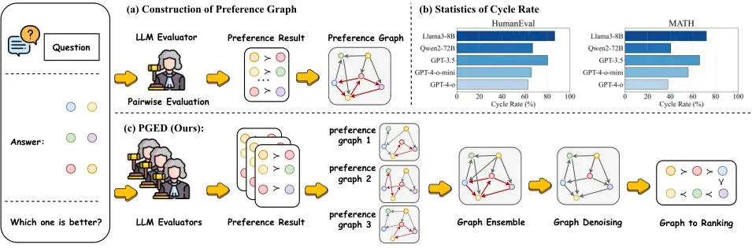
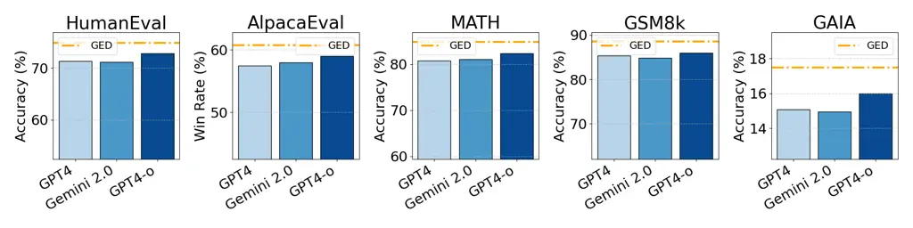
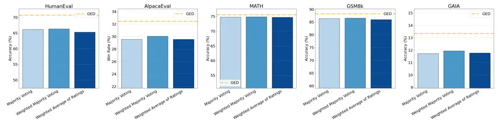

# Towards Acyclic Preference Evaluation of Language Models via Multiple Evaluators

Zhengyu Hu    Jieyu Zhang    Zhihan Xiong    Alexander Ratner    Kaize
Ding    Ranjay Krishna

###### Abstract

Despite the remarkable success of Large Language Models (LLMs),
evaluating their outputs’ quality regarding _preference_ remains a
critical challenge. While existing works usually leverage a strong LLM
as the judge for comparing LLMs’ response pairwisely, such a
single-evaluator approach is vulnerable to _cyclic preference_ , i.e.,
output A is better than B, B than C, but C is better than A, causing
contradictory evaluation results. To address this, we introduce PGED
(Preference Graph Ensemble and Denoising), a novel approach that
leverages multiple model-based evaluators to construct preference
graphs, and then ensembles and denoises these graphs for acyclic,
non-contradictory evaluation results. We provide theoretical guarantees
for our framework, demonstrating its efficacy in recovering the ground
truth preference structure. Extensive experiments on ten benchmarks
demonstrate PGED’s superiority in three applications: 1) model ranking
for evaluation, 2) response selection for test-time scaling, and 3) data
selection for model fine-tuning. Notably, PGED combines small LLM
evaluators (e.g., Llama3-8B, Mistral-7B, Qwen2-7B) to outperform strong
ones (e.g., Qwen2-72B), showcasing its effectiveness in enhancing
evaluation reliability and improving model performance.

¹ Hong Kong University of Science and Technology, Clear Water Bay, Hong
Kong SAR, China

² University of Washington, Seattle, WA, USA

³ Northwestern University, Evanston, IL, USA

## 1 Introduction

Large Language Models (LLMs) have rapidly advanced various areas of
artificial intelligence, particularly natural language processing and
decision-making (Wu et al. 2023; Li et al. 2023a). As LLMs become
increasingly capable, effective evaluation becomes critical (Siska et
al. 2024; Boyeau et al. 2024; Chatzi et al. 2024). Among evaluation
methods, preference evaluation plays a critical role in both evaluating
and aligning LLMs (Rafailov et al. 2024; Yuan et al. 2024; Dubois et al.
2024b). A common practice is to rely on a strong LLM (e.g.,
GPT-4 (Achiam et al. 2023)) as the judge to conduct pairwise
comparisons (Li et al. 2023c; Chen et al. 2023b).



Figure 1: (a) A preference graph exhibiting cyclic inconsistencies
(e.g., A $`\succ`$ B $`\succ`$ C $`\succ`$ A), which violate
transitivity. (b) Empirical results showing that even advanced LLMs
(e.g., GPT-4-o) exhibit significant noise in preference judgments,
leading to inconsistent evaluations. (c) Overview of our proposed
framework, PGED, which ensembles multiple preference evaluators and
applies denoising to recover a directed acyclic graph.

However, such model-based evaluator setups often lead to cyclic
preferences, where inconsistent rankings emerge, for instance,
preferring A over B, B over C, yet C over A (Naresh et al. 2024; Zhang
et al. 2024b). These cyclic patterns violate the transitivity assumption
of preferences established in prior work (Ouyang et al. 2022; Song et
al. 2024; Hou et al. 2024; Liu et al. 2024), thereby undermining the
reliability of evaluation results. We model this _conflicting
preference_ using a preference graph, where nodes represent responses
and directed edges indicate pairwise preferences. Cycles in such graphs
(e.g., A $`\succ`$ B $`\succ`$ C $`\succ`$ A) reflect evaluation noise,
as shown in Figure 1(a). Ideally, a preference graph should be a
directed acyclic graph (DAG) to maintain consistency. Empirically, we
evaluated 10 Llama3-70B (AI@Meta 2024) responses on HumanEval (Chen et
al. 2021) and MATH (Hendrycks et al. 2021), using GPT-4-o, GPT-4-o-mini,
GPT-3.5 (Achiam et al. 2023), Qwen2-72B (Yang et al. 2024a), and
Llama3-8B as judges. Even with GPT-4-o, 64% of preference graphs in
HumanEval and 38% in MATH contained cycles, (Figure 1(b)), demonstrating
the persistent noise in LLM-based preference evaluations and motivating
the need for a more robust approach.

To address this, we propose a novel framework, PGED (Preference Graph
Ensemble and Denoising). Our method involves two key steps: (1)
ensembling multiple preference evaluators to mitigate noise introduced
by individual evaluators and (2) applying a denoising process to the
resulting preference graph. By aggregating evaluations from multiple
individual evaluators, we "average out" the noise and biases, resulting
in a more robust approximation of the true preference structure. The
denoising step further refines this aggregated graph by removing
inconsistencies, ensuring the final preference graph is more reliable
for downstream tasks. The overall process of PGED is illustrated in
Figure 1 (c). We provide a theoretical analysis demonstrating the
soundness of PGED, showing that by treating each individual preference
graph as a random perturbation of a ground truth DAG, our ensemble and
denoising framework can recover the ground truth DAG with high
probability. To validate the practical efficacy of PGED, we conduct ten
tasks ranging from response selection, model ranking to model alignment
tasks, utilizing ten widely recognized benchmark datasets. In these
experiments, PGED consistently outperformed baseline methods.
Additionally, PGED demonstrated substantial gains in scenarios where
combining preference graphs from small evaluators surpassed the
performance of even stronger individual evaluators. Specifically, when
using using Llama3-8B, Mistral-7B, and Qwen2-7B as evaluators, PGED
exceeded the performance of using the Qwen2-72B in response selection
task. These results highlight PGED’s ability to mitigate preference
noise, improve consistency, and enhance model performance across diverse
evaluation settings. Our contributions are summarized as follows:

- •
  We propose PGED, a novel framework that ensembles multiple preference
  evaluators and denoises the resulting preference graphs to produce
  acyclic and reliable evaluation outputs.
- •
  We provide theoretical guarantees that PGED can recover the
  ground-truth preference DAG under a reasonable noise model, thereby
  offering provable consistency.
- •
  We conduct extensive experiments on ten benchmark datasets and three
  key tasks, model ranking, response selection, and data selection for
  fine-tuning, demonstrating that PGED significantly improves evaluation
  robustness. Notably, PGED using small models outperforms even strong
  single evaluators like Qwen2-72B.

## 2 Related Work

#### Preference evaluation.

Classical preference aggregation includes Elo, which iteratively updates
item ratings from pairwise outcomes (Jiang et al. 2023b); Bradley–Terry
(BT/BTL) models, which assign latent utilities to explain win
probabilities (Bradley and Terry 1952; Lu and Boutilier 2011); and
MergeSort-style procedures, which sort items via pairwise comparisons
with $`O(n\log n)`$ queries (Shyamasundar 1996). LLM-based preference
evaluation increasingly relies on a strong model (e.g., GPT-4) as a
zero-shot, reference-free judge of weaker models’ outputs (Shen et al.
2023; Dubois et al. 2024b). PRD combines peer ranking over pairwise
preferences with peer discussion between LLMs to reach consensus (Li et
al. 2023b). ChatEval forms a multi-agent referee team that debates and
evaluates responses for more reliable assessments (Chan et al. 2023a).
However, LLM judges can induce contradictory preferences and cycles when
aggregating across outputs, yielding noisy and inconsistent preference
graphs (Naresh et al. 2024; Zhang et al. 2024b). SPA (Kadekodi et al. 2025) produces partial-order rankings that abstain on disputed pairs to
balance comparability and disagreement, while ContraSolver (Zhang et al.
2024b) builds a preference graph with self-annotations and flags edges
likely responsible for contradictions. In contrast, our approach
ensembles multiple evaluator-induced graphs and denoises them via a
weighted feedback-arc-set objective to recover an acyclic structure
suitable for robust ranking.

#### Weak supervision.

The concept of weak supervision originates from the need to leverage
noisy or partial labels in machine learning tasks, enabling the
development of more robust models from imperfect data (Zhang et al.
2023). In LLMs, weak-to-strong supervision aids AI alignment by allowing
weaker models to improve strong ones, enhancing performance without
extensive data and supporting scalable oversight (Zheng et al. 2024a;
Guo and Yang 2024; Tong et al. 2024). Similarly, in task-oriented LLMs,
weak-to-strong learning improves LLM’s ability by enabling strong models
to refine their data autonomously, boosting perfoArmance without
extensive high-quality input (Yang et al. 2024b). Through weak-to-strong
supervision, LLM performance can be significantly improved by
iteratively transforming low-quality labels into more reliable ones,
leading to more effective model training and robust
outputs (Zakershahrak and Ghodratnama 2024; Lang et al. 2024). Recent
work also shows weak LLMs can rival human feedback quality, enabling
scalable and cost-efficient alignment (Tao and Li 2024; Li et al. 2025).

## 3 Preference Graph Ensemble and Denoising

In this section, we first introduce key definitions and assumptions
underlying our approach, including the formal definition of a preference
graph and the assumption of preference transitivity (Section 3.1).
Building on these preliminaries, we then present our proposed framework,
PGED, which consists of three main steps: (1) _Graph Ensemble_
(Section 3.2), aggregating multiple evaluators’ preference graphs into a
single unified structure; (2) _Graph Denoising_ (Section 3.3), removing
cycles to ensure an acyclic, consistent preference structure; and (3)
_Graph-to-Ranking_ (Section 3.4), converting the denoised graph into a
reliable candidate ranking. The overall process of PGED is illustrated
in Figure 1(c).

### 3.1 Preliminarily

#### Transitivity of Preferences.

In preference evaluation, we assume that the _ground-truth_ preference
relation is transitive. That is, for any distinct $`u,v,w\in V`$, if
$`u\succ v`$ and $`v\succ w`$, then it must hold that $`u\succ w`$:

```math
(u\succ v)\wedge(v\succ w)\Longrightarrow(u\succ w). \tag{1}
```

This transitivity assumption ensures that pairwise comparisons can be
consistently embedded into a global ranking.

#### Preference Graph.

A preference graph is a directed graph $`G_{P}=(V,A,w)`$, where
$`V=\{v_{1},v_{2},\ldots,v_{n}\}`$ represents $`n`$ candidates,
$`A\subseteq V\times V`$ is a set of directed arcs indicating pairwise
preferences, and $`w:A\rightarrow\mathbb{R}^{+}`$ assigns weights to
arcs, representing preference strength. For distinct $`u,v\in V`$, an
arc $`(u,v)\in A`$ exists if $`w(u,v)>0`$.

### 3.2 Graph Ensemble

Given $`k`$ weighted preference graphs $`G_{i}=(V,A_{i},w_{i})`$ on a
common vertex set $`V`$, define

```math
\displaystyle A_{E} \displaystyle\triangleq\Big\{(u,v)\in V\times V:\ \sum_{i=1}^{k}w_{i}(u,v)>0\Big\}, \tag{2}
```

```math
\displaystyle w_{E}(u,v) \displaystyle\triangleq\sum_{i=1}^{k}w_{i}(u,v),\quad(u,v)\in A_{E},
```

where $`k`$ is the total number of preference sources and $`w_{i}(u,v)`$
is the preference result from the $`i`$-th source and $`w_{i}(u,v)=0`$
if $`(u,v)\notin A_{i}`$. The ensemble graph is
$`G_{E}=(V,A_{E},w_{E})`$.

### 3.3 Graph Denoising

To ensure consistency in the aggregated preference graph, we apply a
denoising step that transforms a potentially cyclic weighted digraph
$`G=(V,A,w)`$ into a directed acyclic graph (DAG). We cast this as the
classical _weighted feedback arc set_ (WFAS) problem (Gabow 1995), which
seeks a minimum-total-weight set of arcs whose removal renders the graph
acyclic. Formally,

```math
\displaystyle R^{*}(G)\;=\;\arg\min_{R\subseteq A}\sum_{(u,v)\in R}w(u,v) \tag{3}
```

```math
\displaystyle\text{s.t.}\quad(V,A\setminus R)\ \text{is acyclic}.
```

A convenient formulation uses vertex sequencing. Given an ordering
$`s=\{v_{1},\ldots,v_{n}\}`$, the induced feedback arc set $`R(s)`$
comprises all arcs that violate the order, i.e., $`(v_{j}\to v_{i})`$
with $`j>i`$. The denoising problem then reduces to finding $`s^{*}`$
that minimizes the total weight of backward edges. Computing the optimal
ordering is NP-hard (Karp 2010), so we adopt an efficient greedy
procedure tailored to weighted graphs. Our algorithm iteratively builds
a total order by removing structurally informative vertices. At each
step, we first peel all _sinks_ (zero out-degree) and place them at the
end of the order, then peel all _sources_ (zero in-degree) and place
them at the beginning. When neither exists, we choose a vertex $`u`$
maximizing the weighted degree difference

```math
\delta(u)\;=\;d^{+}(u)-d^{-}(u), \tag{4}
```

where $`d^{+}(u)=\sum_{(u,v)\in A}w(u,v)`$ and
$`d^{-}(u)=\sum_{(v,u)\in A}w(v,u)`$. Repeating until all vertices are
removed yields a total order; the backward arcs under this order form an
approximate feedback arc set $`R(s)`$. We then construct and _return
only_ the denoised graph $`G^{\prime}=(V,A\setminus R(s),w)`$, which is
a subgraph of the input and is typically sparse rather than fully
connected. The full procedure is summarized in Algorithm 1. Its
theoretical guarantee can be seen in Appendix M.

1: Input: Weighted digraph $`G=(V,A,w)`$

2: Output: Denoised graph $`G^{\prime}=(V,A^{\prime},w)`$

3: Let $`A_{0}\leftarrow A`$; initialize
$`s_{1}\leftarrow[\ ],\ s_{2}\leftarrow[\ ]`$

4: while $`V\neq\emptyset`$ do

5:   while $`\exists`$ sink $`u`$ in $`G`$ do

6:    Prepend $`u`$ to $`s_{2}`$

7:    Remove $`u`$ and its incident arcs from $`G`$

8:   end while

9:   while $`\exists`$ source $`u`$ in $`G`$ do

10:    Append $`u`$ to $`s_{1}`$

11:    Remove $`u`$ and its incident arcs from $`G`$

12:   end while

13:   if $`V=\emptyset`$ then break

14:   end if

15:   Select $`u=\arg\max_{v\in V}\big(d^{+}(v)-d^{-}(v)\big)`$

16:   Append $`u`$ to $`s_{1}`$

17:   Remove $`u`$ and its incident arcs from $`G`$

18: end while

19: Concatenate $`s=s_{1}\|s_{2}`$

20: Compute $`R(s)=\{(v_{j}\to v_{i})\in A_{0}:j>i\text{ in }s\}`$

21: Set $`A^{\prime}=A_{0}\setminus R(s)`$

22: return $`G^{\prime}=(V,A^{\prime},w)`$

Algorithm 1 Preference Graph Denoising for PGED

### 3.4 Graph to ranking

Given a DAG $`G=(V,A,w)`$, we derive a ranking by computing the
descendant count $`\text{desc}(v)`$ for each vertex $`v`$, defined as
the number of vertices reachable from $`v`$:

```math
\text{desc}(v)=\left|\{u\in V:v\rightarrow u\}\right|, \tag{5}
```

where $`v\rightarrow u`$ denotes a directed path. Vertices are ranked
based on $`\text{desc}(v)`$, with ties broken lexicographically:

```math
v_{1}\succ v_{2}\succ\cdots\succ v_{n}. \tag{6}
```

This ranking reflects both individual preferences and their relative
strengths in the graph.

## 4 Downstream Tasks

We apply PGED to three tasks: Response Selection (selecting the best
response from LLM-generated candidates), Model Ranking (ranking models
based on task performance), and Model Alignment (identifying the best
instruction-response pairs for training). Details on how preference
graphs are constructed for each of the three settings can be found in
Appendix H.

### 4.1 Response Selection

For each question $`q\in Q`$, a model $`\mathcal{M}`$ generates $`n`$
candidate answers $`C_{q}=\{ans_{1},\ldots,ans_{n}\}`$. A set of
evaluators $`\mathcal{A}=\{a_{1},\ldots,a_{k}\}`$ provides pairwise
preferences over $`C_{q}`$. For each evaluator $`a`$, we construct a
weighted preference graph $`G_{a}^{q}=(V_{q},A_{a},w_{a})`$, where
$`V_{q}=\{v_{1},\ldots,v_{n}\}`$ indexes candidates and $`w_{a}(u,v)`$
accumulates the number of wins of $`u`$ over $`v`$ (ties are ignored).
We then apply PGED: (i) _Graph Ensemble_ aggregates
$`\{G_{a}^{q}\}_{a\in\mathcal{A}}`$ into a single graph $`G_{E}^{q}`$
(Section 3.2); (ii) _Graph Denoising_ removes a minimum-weight set of
feedback arcs to produce a DAG $`G^{\prime}_{q}`$ (Section 3.3); and
(iii) _Graph-to-Ranking_ converts $`G^{\prime}_{q}`$ into a total order
$`\mathcal{R}_{q}=\{v_{1}\succ\cdots\succ v_{n}\}`$ (Section 3.4). The
top-ranked candidate is selected as $`ans_{q}^{*}`$. Repeating this for
all $`q\in Q`$ yields $`ans^{*}=\{ans_{1}^{*},\ldots,ans_{t}^{*}\}`$.

### 4.2 Model Ranking

Given a set of models $`M=\{\mathcal{M}_{1},\ldots,\mathcal{M}_{n}\}`$
and questions $`Q=\{q_{1},\ldots,q_{t}\}`$, our goal is to produce a
global ranking of $`M`$. For each question $`q\in Q`$ and evaluator
$`a\in\mathcal{A}`$, we construct a weighted preference graph
$`G_{a}^{q}=(V_{q},A_{a},w_{a})`$, where
$`V_{q}=\{m_{1},\ldots,m_{n}\}`$ indexes model outputs
$`\mathcal{M}_{i}(q)`$ and $`w_{a}(u,v)`$ accumulates wins of $`u`$ over
$`v`$ (ties are ignored). We then apply PGED per question: (i) _Graph
Ensemble_ aggregates $`\{G_{a}^{q}\}_{a\in\mathcal{A}}`$ into
$`G_{E}^{q}`$ (Section 3.2); (ii) _Graph Denoising_ yields a DAG
$`G^{\prime}_{q}`$ (Section 3.3); and (iii) _Graph-to-Ranking_ returns a
total order $`\mathcal{R}_{q}`$ over $`V_{q}`$ (Section 3.4). Finally,
we aggregate $`\{\mathcal{R}_{q}:q\in Q\}`$ into an overall model
ranking $`\mathcal{R}^{*}`$ using a ranking-ensemble procedure
(Appendix Q).

### 4.3 Model Alignment

For each instruction $`x\in X`$, let the candidate set be
$`Y_{x}=\{y_{1},\ldots,y_{n}\}`$. Evaluators $`\mathcal{A}`$ provide
pairwise preferences over $`Y_{x}`$. For each $`a\in\mathcal{A}`$, we
build a weighted preference graph $`G_{a}^{x}=(V_{x},A_{a},w_{a})`$,
where $`V_{x}=\{v_{1},\ldots,v_{n}\}`$ indexes responses and
$`w_{a}(u,v)`$ aggregates wins of $`u`$ over $`v`$ (ties ignored ).
Applying PGED, ensemble, denoising, and graph-to-ranking, produces a
total order $`\mathcal{R}_{x}`$; we select the top response
$`y_{x}^{*}`$ for instruction $`x`$. Repeating this for all $`x\in X`$
yields the aligned training set $`\{(x,y_{x}^{*}):x\in X\}`$.

## 5 Theoretical Analysis

In this section, we provide a theoretical foundation for our method,
showing that by modeling preference graphs as random perturbations of a
ground truth DAG, PGED can reliably recover the true structure through
graph ensemble and denoising with high probability, demonstrating its
robustness in handling noisy evaluations. Theoretically, we treat each
of our preference graph as a random perturbation of some ground truth
DAG $`G=(V,A)`$. Specifically, we consider a random graph generator
$`\mathcal{G}(G,\delta_{1},\delta_{2})`$ with parameters
$`\delta_{1},\delta_{2}\in[0,1]`$ such that
$`G_{i}=(V_{i},A_{i})\sim\mathcal{G}(G,\delta_{1},\delta_{2})`$
satisfies $`V_{i}=V`$.

Furthermore, for each $`u,v\in V`$ with $`u\neq v`$,

1.  1.  If $`(u\rightarrow v)\in A`$, then

    ```math
    \displaystyle\mathbb{P}((u\rightarrow v)\in A_{i}) \displaystyle=1-\delta_{1},
    ```

    ```math
    \displaystyle\mathbb{P}((v\rightarrow u)\in A_{i}) \displaystyle=\delta_{1}.
    ```

2.  2.  If $`(u\rightarrow v),(v\rightarrow u)\notin A`$, then

    ```math
    \displaystyle\mathbb{P}((u\rightarrow v),(v\rightarrow u)\notin A_{i}) \displaystyle=1-\delta_{2},
    ```

    ```math
    \displaystyle\mathbb{P}((u\rightarrow v)\in A_{i}) \displaystyle=\frac{\delta_{2}}{2},
    ```

    ```math
    \displaystyle\mathbb{P}((v\rightarrow u)\in A_{i}) \displaystyle=\frac{\delta_{2}}{2}.
    ```

That is, each edge in $`E`$ has probability $`\delta_{1}`$ of being
flipped and each pair of unconnected nodes has probability
$`\delta_{2}`$ of being connected with a random direction.

Now, given that
$`G_{1},\dots,G_{N}\overset{\text{i.i.d.}}{\sim}\mathcal{G}(G,\delta_{1},\delta_{2})`$,
we will show that to some extent our combination of graph ensemble and
graph denoising can indeed provably recover the ground truth DAG $`G`$.
For simplicity, all edges in $`G_{1},\dots,G_{N}`$ and $`G`$ are
considered equal weighted. Meanwhile, we use $`\text{MAS}(\cdot)`$ to
denote the graph obtained by denoising, which stands for the maximum
acyclic subgraph (MAS). Then, we have the following theorem.

###### Theorem 1

Suppose
$`G_{1},\dots,G_{N}\overset{\text{i.i.d.}}{\sim}\mathcal{G}(G,\delta_{1},\delta_{2})`$
for some ground truth $`G=(V,A)`$. Let $`\widehat{G}`$ be the graph
ensembled from $`G_{1},\dots,G_{N}`$ by operations defined in Section 3.
Then, as long as $`\delta_{1}=0.5-\epsilon`$ for some $`\epsilon>0`$, we
have

```math
\begin{split}\mathbb{P}\left(G\subseteq\text{MAS}(\widehat{G})\right)&\geq 1-2|A|\exp\left(-\frac{N\epsilon^{2}}{2}\right)\\
&\quad-2U\exp\left(-\frac{N\epsilon^{2}}{6U^{2}\delta_{2}+2U\epsilon}\right),\end{split}
```

where $`G\subseteq\text{MAS}(\widehat{G})`$ represents that $`G`$ is a
subgraph of $`\text{MAS}(\widehat{G})`$ and
$`U=\frac{|V|(|V|-1)}{2}-|A|`$ is the number of pairs of unconnected
nodes in $`G`$.

The full proof is given in Appendix J. From the theorem, we can see that
the probability of failure decreases exponentially as the number of
samples $`N`$ increases. Meanwhile, this guarantee only requires
$`\delta_{1}<0.5`$ and does not place restrictions on $`\delta_{2}`$,
which are very mild conditions.

|                    |                          |           |            |       |       |       |       |
| ------------------ | ------------------------ | --------- | ---------- | ----- | ----- | ----- | ----- |
| Method             |                          | HumanEval | AlpacaEval | MATH  | GSM8k | GAIA  | Avg   |
|                    | Llama3-8B                | 43.90     | 27.29      | 22.08 | 56.67 | 6.78  | 31.34 |
|                    | Mistral-7B               | 23.17     | 11.80      | 23.25 | 39.83 | 7.03  | 21.01 |
|                    | Qwen2-7B                 | 48.58     | 25.71      | 59.92 | 76.75 | 7.70  | 43.73 |
|                    | Qwen2-72B                | 57.93     | 29.58      | 72.75 | 84.67 | 11.52 | 51.29 |
|                    | ContraSolver (Qwen2-72B) | 65.42     | 31.12      | 74.95 | 86.84 | 12.22 | 54.11 |
|                    | ListPreference           | 61.52     | 31.67      | 71.75 | 85.0  | 10.90 | 52.16 |
| Single model       | Self-consistency         | 60.98     | 29.33      | 73.58 | 84.91 | 8.86  | 51.53 |
|                    | Elo                      | 62.21     | 31.34      | 75.01 | 87.21 | 12.36 | 53.63 |
|                    | Bradley-Terry            | 62.83     | 32.91      | 74.97 | 86.64 | 12.07 | 53.88 |
|                    | Merge Sort               | 62.81     | 31.88      | 74.83 | 86.90 | 12.13 | 53.71 |
|                    | Llama3-8B                | 62.19     | 29.31      | 74.27 | 83.16 | 11.31 | 52.04 |
|                    | with graph denoising     | 64.02     | 30.18      | 74.73 | 86.00 | 11.72 | 53.33 |
|                    | Mistral-7B               | 67.24     | 27.70      | 74.41 | 83.83 | 10.50 | 52.73 |
|                    | with graph denoising     | 68.73     | 29.93      | 74.77 | 83.91 | 10.74 | 53.61 |
|                    | Qwen2-7B                 | 61.58     | 28.69      | 74.50 | 85.41 | 11.11 | 52.25 |
|                    | with graph denoising     | 65.85     | 29.44      | 74.79 | 86.38 | 11.25 | 53.54 |
|                    | Qwen2-72B                | 60.97     | 31.04      | 74.73 | 86.47 | 12.14 | 53.07 |
| Single evaluator   | with graph denoising     | 68.90     | 31.17      | 75.33 | 87.45 | 12.26 | 55.02 |
|                    | Majority Voting          | 66.18     | 29.57      | 74.77 | 86.42 | 11.72 | 53.73 |
|                    | Weight Majority Voting   | 66.43     | 30.12      | 74.79 | 86.68 | 11.84 | 53.97 |
|                    | PRD                      | 66.53     | 30.33      | 74.89 | 86.75 | 11.83 | 54.07 |
|                    | ChatEval                 | 66.51     | 30.26      | 74.79 | 86.85 | 11.92 | 54.07 |
|                    | SPA                      | 66.32     | 30.05      | 74.82 | 86.57 | 11.81 | 53.91 |
|                    | PGED(w/o denoising)      | 69.25     | 30.98      | 74.29 | 87.17 | 12.68 | 54.87 |
| Multiple evaluator | PGED                     | 71.86     | 32.95      | 76.57 | 89.76 | 13.74 | 56.98 |

Table 1: Performance comparison of response selection methods across
five benchmarks. PGED consistently outperforms baseline methods,
highlighting the effectiveness of graph denoising and multi-evaluator
aggregation. Single model denotes directly using the evaluator to answer
the question. Single evaluator and Multi evaluator refer to selecting
the best response from ten Qwen2-72B-generated candidates using a single
or multiple evaluators, respectively.

## 6 Response Selection for Test-time Scaling

#### Experiment Setup.

In this section, we evaluate the performance of PGED on five benchmarks:
HumanEval (Chen et al. 2021), AlpacaEval (Li et al. 2023c),
MATH (Hendrycks et al. 2021), GSM8k (Chen et al. 2021), and GAIA (Mialon
et al. 2023). The Qwen2-72B (Yang et al. 2024a) model ($`\mathcal{M}`$)
generates ten candidate responses per question, and we assess the
effectiveness of different methods in selecting the best response. We
evaluate performance using three setups. First, in the single model
setting, the baselines include ContraSolver(Zhang et al. 2024b),
Self-consistency(Wang et al. 2022), and direct evaluation with models
(Llama3-8B, Mistral-7B, Qwen2-7B and Qwen2-72B). Additionally, we
include a baseline called ListPreference, where instead of pairwise
comparisons, all candidate responses are input into Qwen2-72B for
selecting the most appropriate response. Then, in the single evaluator
setting, individual evaluators (Llama3-8B, Mistral-7B, Qwen2-7B,
Qwen2-72B) select the best response from $`\mathcal{M}`$’s outputs, with
and without applying PGED’s graph denoising. We additionally report
results for three classical baselines in this setting: Elo (Jiang et al.
2023b), Bradley–Terry (BTL) (Bradley and Terry 1952; Lu and Boutilier
2011), and MergeSort (Shyamasundar 1996). Finally, in the multiple
evaluators setup, we combine three small evaluators (Llama3-8B,
Qwen2-7B, Mistral-7B) to select responses from Qwen2-72B with PGED. We
additionally include four aggregation baselines: Majority Voting,
Weighted Majority Voting, PRD (Li et al. 2023b), ChatEval (Chan et al.
2023a), and SPA (Kadekodi et al. 2025). We present the results of PGED
and its variant (w/o denoising), which ensembles the preference graphs
without the denoising step.

Note that, among the baselines we report: (i) in the single model
setting, ContraSolver, ListPreference, and Self-consistency use
Qwen2-72B as the base model; (ii) in the single evaluator setting, Elo,
Bradley–Terry, and MergeSort use Qwen2-72B as the base model; and (iii)
in the multiple evaluators setting, Majority Voting, Weighted Majority
Voting, PRD, ChatEval and SPA use Llama3-8B, Mistral-7B, and Qwen2-7B as
the base model set. For details on the datasets and baselines, please
refer to Appendix A.

Figure 2: Comparison of PGED with GPT-3.5, GPT-4-o-mini, and GPT-4-o on
100 randomly selected tasks. PGED consistently outperforms GPT-3.5
across all tasks and surpasses GPT-4-o-mini on challenging tasks like
HumanEval and GSM8k, showcasing the effectiveness of weak evaluator
aggregation with graph denoising.

#### Main results.

Table 1 presents the results of the response selection task across five
benchmarks. PGED consistently outperforms all baseline methods,
including single model evaluations (single model), direct response
selection by individual models (single evaluator) and Multiple
evaluator. This demonstrates the strength of aggregating preference
evaluators with PGED, particularly when coupled with graph denoising,
which enhances response quality by filtering out noise and biases.
Furthermore, by combining preference graphs derived from smaller models
(Llama3-8B, Mistral-7B, Qwen2-7B), PGED outperforms a much larger
evaluator (Qwen2-72B). This underscores the value of ensemble methods in
mitigating the limitations of individual evaluators. Then, the denoising
process proves to be crucial for improving consistency and overall
response quality. The substantial performance gains observed when using
PGED with denoising, compared to both the single evaluator setup and the
ensemble without denoising, highlight its importance in refining
response selection. For Majority Voting, while it improves upon
individual evaluators, it still underperforms PGED, highlighting PGED’s
ability to capture nuanced evaluation signals and reduce
inconsistencies. Additionally, we observed that the ListPreference
baseline performed worse than Qwen2-72B as single evaluator, likely due
to LLM limitations in handling long-text. Lastly, to further evaluate
PGED, we compared its performance with GPT-3.5, GPT-4-o-mini, and
GPT-4-o. Due to computational and API cost constraints, we limited the
evaluation to 100 data points for each task. As shown in Figure 2, PGED
consistently outperformed GPT-3.5 across all tasks and surpassed
GPT-4-o-mini on challenging benchmarks like HumanEval and GSM8k. These
results highlight the superiority of PGED, particularly in leveraging
multi-preference evaluators and graph denoising to outperform individual
state-of-the-art models. More discussion on cost is provided in
Appendix R.

[TABLE]

Table 2: Results of the model ranking task, evaluated using Ranking
Correction. Higher correlation values indicate a stronger alignment with
the ground truth rankings.

## 7 Model Ranking for Evaluation

#### Experiment Setup.

In this section, we evaluate the effectiveness of PGED in the model
ranking task within a human preference setting, using the AlpacaEval
2.0 (Li et al. 2023c). We employ 30 widely used models from the
AlpacaEval dataset as our model set $`\mathcal{M}`$, while the
benchmark’s questions form the question set $`Q`$. The rankings provided
by the AlpacaEval benchmark serve as ground truth for evaluating the
accuracy of various ranking methods. This is justified by AlpacaEval’s
strong correlation with Chatbot Arena rankings, making it a reasonable
proxy for human judgments (Dubois et al. 2024a). We adopt Ranking
Correction, measured by the Spearman rank correlation coefficient, to
evaluate the similarity. To generate rankings, we utilize outputs from
the open-source models Llama3-70B, Qwen2-72B, Mistral-8$`\times`$7B, and
Qwen1.5-72B as our evaluators. We investigate two variants of PGED: (w/o
ensemble) denoises the preference graphs from different evaluators for
the same question, converts each into a ranking, and then ensembles
these rankings to produce the final output, while (w/o denoising)
directly ensembles the preference graphs to obtain the final ranking
without denoising. For details on the datasets and baselines, please
refer to Appendix A.

#### Main results.

The results, presented in Table 2, show that PGED outperforms all
single-model baselines, highlighting the significant improvement in
ranking accuracy achieved by leveraging preference information from
multiple evaluators. Moreover, PGED surpasses the (w/o ensemble)
variant, indicating that generating rankings through graph ensemble
first prevents information loss compared to converting individual graphs
into rankings. When the ensemble graph is not denoised (w/o denoising),
residual noise can adversely affect the final ranking quality.
Additionally, our denoising method also enhances results in single-model
settings.

Figure 3: Performance comparison of different methods (Random, Longest,
ContraSolver, and PGED) across multiple benchmarks. The results show
PGED effectively filters low-quality responses, improving performance
and model alignment over baselines.

## 8 Data Selection for Model Fine-tuning

#### Experiment Setup.

|            |              |                 |                |                  |                |       |
| ---------- | ------------ | --------------- | -------------- | ---------------- | -------------- | ----- |
| Base Model |              | Harmless (base) | Helpful (base) | Helpful (online) | Helpful (rej.) | Avg.  |
|            | Origin       | 69.68           | 61.65          | 64.84            | 63.37          | 64.89 |
|            | Random       | 69.85           | 63.53          | 67.00            | 65.85          | 66.56 |
|            | Longest      | 69.32           | 64.15          | 66.56            | 66.30          | 66.58 |
|            | ContraSolver | 69.75           | 63.28          | 66.71            | 65.86          | 66.40 |
| Llama-2-7B | Ours         | 72.27           | 65.56          | 69.44            | 67.60          | 68.72 |
|            | Origin       | 61.30           | 59.95          | 65.21            | 63.75          | 62.55 |
|            | Random       | 59.85           | 59.34          | 63.38            | 61.87          | 61.11 |
|            | Longest      | 61.66           | 59.73          | 64.92            | 62.92          | 62.31 |
|            | ContraSolver | 60.87           | 59.83          | 64.23            | 63.26          | 62.05 |
| Mistral-7B | Ours         | 64.57           | 64.48          | 69.66            | 67.73          | 66.61 |

Table 3: Performance comparison of different methods on model alignment
task across the HH-RLHF benchmark.

In this section, we explore the effects of various data selection
methods for model alignment on Llama-2-7B (Touvron et al. 2023) and
Mistral-7B (Jiang et al. 2023a) through instruct tuning. Specifically,
we randomly sampled 5,000 data points from UltraFeedback (Cui et al. 2023) and used Qwen1.5-14B (Yang et al. 2024a) to generate eight
responses per data point as instruct data. We then applied four
different methods—Random, Longest (Zhao et al. 2024), ContraSolver
(using Qwen2-72B as the evaluator) (Zhang et al. 2024b), and our
proposed PGED, which leverages Llama3-8B, Mistral-7B, and Qwen2-7B as
evaluators—to select a subset of these responses for model alignment
training. The Origin refers to the performance of the base model without
alignment. The models were evaluated on the HH-RLHF (Bai et al. 2022)
benchmark, which comprises four subsets: Harmless (base), Helpful
(base), Helpful (online), and Helpful (rejection). For evaluation, we
employed the same Reward model as in prior work (Song et al. 2024; Yu et
al. 2023) to quantify human preference levels. The results are presented
in Table 3. To ensure a comprehensive assessment, we further evaluated
the models—using the Llama-2-7B backbone—on additional benchmarks,
including AlpacaEval 2.0 (Li et al. 2023c), LIMA (Zhou et al. 2023),
Koala (Vu et al. 2023), and Self-Instruct (Wang et al. 2022), in
accordance with recent studies (Chen et al. 2023b; Zhang et al. 2024a;
Hu et al. 2024). The corresponding results are summarized in Figure 3.
For details on the datasets and baselines, please refer to Appendix A.

#### Main results.

From Table 3, we observe that PGED consistently outperforms all baseline
methods, demonstrating its effectiveness in selecting high-quality
responses when multiple answers are available for a given instruction.
When faced with multiple responses $`y_{1},y_{2},\ldots,y_{n}`$ for a
given instruction $`x`$, the Random selection method can have a
detrimental impact, especially when the quality of the responses is
inconsistent. This effect is most evident with the Mistral-7B, where
Random selection actually performs worse than the Origin, indicating
that randomly chosen data points can introduce noise and degrade the
model’s performance. Moreover, we find that simply selecting the longest
response does not always lead to the best outcomes. While longer
responses may provide more detailed answers, they are not necessarily
better in terms of quality, particularly when both high-quality and
low-quality answers exist for the same question. This is reflected in
the results where the Longest method underperforms compared to both
ContraSolver and PGED, emphasizing that response length alone is not
always a reliable criterion. From Figure 3, we observe similar trends as
in Table 3. PGED consistently outperforms all baselines across various
datasets, demonstrating its effectiveness in selecting high-quality
responses. Notably, in AlpacaEval and Self-Instruct, the Random baseline
performs worse than the Origin model, highlighting that when response
quality varies significantly, poor selection can degrade model
performance. In contrast, PGED leverages preference graphs and denoising
techniques to filter out low-quality responses, ensuring more robust and
reliable performance, particularly in settings with inconsistent
responses, as it removes evaluation noise and leads to more robust
performance.

## 9 Case Study

|     |     |
| --- | --- |
|     |     |
|     |     |

(a) Raw Preference Graph 1

(b) Denoised Preference Graph 1

(c) Raw Preference Graph 2

(d) Denoised Preference Graph 2

Figure 4: Case studies showcasing the raw and denoised preference
graphs.

In this section, we present two HumanEval case studies illustrating PGED
on evaluator-aggregated graphs. Raw graphs are built from Llama3-8B,
Mistral-7B, and Qwen2-7B judging ten Qwen2-72B responses (nodes 0–9).
Figure 4 contrasts raw graphs (a, c) with denoised DAGs (b, d); dashed
edges indicate removals. In Case 1, the raw graph contains cycles (e.g.,
$`9\succ 4\succ 3\succ 9`$, $`9\succ 4\succ 3\succ 2\succ 9`$). Removing
a single edge $`4\to 3`$ breaks all cycles, yielding the DAG in
Figure 4(b). In Case 2, cycles such as $`7\succ 0\succ 6\succ 7`$ and
$`7\succ 1\succ 0\succ 6\succ 7`$ are eliminated by deleting $`0\to 6`$,
producing the DAG in Figure 4(d). In both cases, alternative single-edge
deletions fail to restore acyclicity without further removals. PGED thus
identifies a minimal feedback arc set, preserving information while
ensuring consistency.

## 10 Conclusion

In this paper, we presented PGED, a framework designed to address
inconsistencies in pairwise preference evaluations by LLMs. By employing
graph ensemble techniques and denoising, PGED reduces cyclic patterns
and enhances the reliability of evaluation outcomes. Our theoretical
analysis shows that PGED can recover the ground truth DAG under
reasonable conditions, improving consistency in preference rankings.
Extensive experiments across response selection, model ranking, and
instruct tuning demonstrate the efficacy of our method. PGED
consistently outperformed baseline methods in both single-evaluator and
multi-evaluator settings, particularly in scenarios where combining
small evaluators led to superior results over larger individual
evaluators. Future work will explore extending PGED to broader
evaluation frameworks and applying its principles to more complex
decision-making tasks, including multi-agent systems and human-AI
interaction.

## References

- Achiam et al. (2023) J. Achiam, S. Adler, S. Agarwal, L. Ahmad, I.
  Akkaya, F. L. Aleman, D. Almeida, J. Altenschmidt, S. Altman, S.
  Anadkat, et al. Gpt-4 technical report. arXiv preprint
  arXiv:2303.08774. Cited by: §A.5, §1, §1.
- Adler et al. (2002) N. Adler, L. Friedman, and Z. Sinuany-Stern Review
  of ranking methods in the data envelopment analysis context. European
  journal of operational research. Cited by: Appendix Q.
- AI@Meta (2024) AI@Meta Llama 3 model card. External Links:
  [Link](https://github.com/meta-llama/llama3/blob/main/MODEL_CARD.md)
  Cited by: §1.
- Anthropic (2024) Anthropic Introducing the next generation of claude.
  External Links: [Link](https://www.anthropic.com/news/claude-3-family)
  Cited by: §A.5.
- Bai et al. (2022) Y. Bai, A. Jones, K. Ndousse, A. Askell, A. Chen, N.
  DasSarma, D. Drain, S. Fort, D. Ganguli, T. Henighan, et al. Training
  a helpful and harmless assistant with reinforcement learning from
  human feedback. arXiv preprint arXiv:2204.05862. External Links:
  [Link](https://arxiv.org/abs/2204.05862) Cited by: 2nd item, Appendix
  V, §8.
- Baumgartner et al. (2020) J. Baumgartner, S. Zannettou, B. Keegan, M.
  Squire, and J. Blackburn The pushshift reddit dataset. In AAAI, Cited
  by: 8th item.
- Boyeau et al. (2024) P. Boyeau, A. N. Angelopoulos, N. Yosef, J.
  Malik, and M. I. Jordan AutoEval done right: using synthetic data for
  model evaluation. arXiv preprint arXiv:2403.07008. Cited by: §1.
- Bradley and Terry (1952) R. A. Bradley and M. E. Terry Rank analysis
  of incomplete block designs: i. the method of paired comparisons.
  Biometrika. Cited by: §2, §6.
- Caragiannis et al. (2016) I. Caragiannis, A. D. Procaccia, and N. Shah
  When do noisy votes reveal the truth?. ACM Transactions on Economics
  and Computation (TEAC). Cited by: Appendix Q.
- Chan et al. (2023a) C. Chan, W. Chen, Y. Su, J. Yu, W. Xue, S.
  Zhang, J. Fu, and Z. Liu ChatEval: towards better llm-based evaluators
  through multi-agent debate. ArXiv. Cited by: §2, §6.
- Chan et al. (2023b) C. Chan, W. Chen, Y. Su, J. Yu, W. Xue, S.
  Zhang, J. Fu, and Z. Liu Chateval: towards better llm-based evaluators
  through multi-agent debate. arXiv preprint arXiv:2308.07201. Cited by:
  Appendix S.
- Chatzi et al. (2024) I. Chatzi, E. Straitouri, S. Thejaswi, and M. G.
  Rodriguez Prediction-powered ranking of large language models. arXiv
  preprint arXiv:2402.17826. Cited by: §1.
- Chen et al. (2023a) L. Chen, Y. Deng, Y. Bian, Z. Qin, B. Wu, T. Chua,
  and K. Wong Beyond factuality: a comprehensive evaluation of large
  language models as knowledge generators. arXiv preprint
  arXiv:2310.07289. Cited by: Appendix D.
- Chen et al. (2023b) L. Chen, S. Li, J. Yan, H. Wang, K. Gunaratna, V.
  Yadav, Z. Tang, V. Srinivasan, T. Zhou, H. Huang, and H. Jin
  AlpaGasus: training a better alpaca with fewer data. arXiv preprint
  arXiv:2307.08701. Cited by: §1, §8.
- Chen et al. (2021) M. Chen, J. Tworek, H. Jun, Q. Yuan, H. P. D. O.
  Pinto, J. Kaplan, H. Edwards, Y. Burda, N. Joseph, G. Brockman, et al.
  Evaluating large language models trained on code. arXiv preprint
  arXiv:2107.03374. Cited by: 4th item, 6th item, Appendix V, §1, §6.
- Chiang et al. (2023) W. Chiang, Z. Li, Z. Lin, Y. Sheng, Z. Wu, H.
  Zhang, L. Zheng, S. Zhuang, Y. Zhuang, J. E. Gonzalez, I. Stoica,
  and E. P. Xing Vicuna: an open-source chatbot impressing gpt-4 with
  90%\* chatgpt quality. External Links:
  [Link](https://lmsys.org/blog/2023-03-30-vicuna/) Cited by: 7th item,
  9th item.
- Chowdhury et al. (2024) S. R. Chowdhury, A. Kini, and N. Natarajan
  Provably robust dpo: aligning language models with noisy feedback.
  arXiv preprint arXiv:2403.00409. Cited by: Appendix L.
- Cui et al. (2023) G. Cui, L. Yuan, N. Ding, G. Yao, W. Zhu, Y. Ni, G.
  Xie, Z. Liu, and M. Sun UltraFeedback: boosting language models with
  high-quality feedback. External Links: 2310.01377 Cited by: 1st item,
  §8.
- Dubois et al. (2024a) Y. Dubois, B. Galambosi, P. Liang, and T. B.
  Hashimoto Length-controlled alpacaeval: a simple way to debias
  automatic evaluators. arXiv preprint arXiv:2404.04475. Cited by: §7.
- Dubois et al. (2024b) Y. Dubois, C. X. Li, R. Taori, T. Zhang, I.
  Gulrajani, J. Ba, C. Guestrin, P. S. Liang, and T. B. Hashimoto
  Alpacafarm: a simulation framework for methods that learn from human
  feedback. Neurips. Cited by: 7th item, §A.1, Appendix V, §1, §2.
- Gabow (1995) H. N. Gabow Centroids, representations, and submodular
  flows. Journal of Algorithms. Cited by: §3.3.
- Guo and Yang (2024) Y. Guo and Y. Yang Improving weak-to-strong
  generalization with reliability-aware alignment. arXiv preprint
  arXiv:2406.19032. Cited by: §2.
- Hendrycks et al. (2021) D. Hendrycks, C. Burns, S. Kadavath, A.
  Arora, S. Basart, E. Tang, D. Song, and J. Steinhardt Measuring
  mathematical problem solving with the math dataset. arXiv preprint
  arXiv:2103.03874. Cited by: 3rd item, Appendix V, §1, §6.
- Hou et al. (2024) Y. Hou, J. Zhang, Z. Lin, H. Lu, R. Xie, J. McAuley,
  and W. X. Zhao Large language models are zero-shot rankers for
  recommender systems. In ECIR, Cited by: Appendix I, §1.
- Hu et al. (2024) Z. Hu, L. Song, J. Zhang, Z. Xiao, J. Wang, Z.
  Chen, J. Zhao, and H. Xiong Rethinking llm-based preference
  evaluation. arXiv preprint arXiv:2407.01085. Cited by: §8.
- Jiang et al. (2023a) A. Q. Jiang, A. Sablayrolles, A. Mensch, C.
  Bamford, D. S. Chaplot, D. d. l. Casas, F. Bressand, G. Lengyel, G.
  Lample, L. Saulnier, et al. Mistral 7b. arXiv preprint
  arXiv:2310.06825. Cited by: §A.5, §8.
- Jiang et al. (2023b) D. Jiang, X. Ren, and B. Y. Lin LLM-blender:
  ensembling large language models with pairwise ranking and generative
  fusion. In ACL, Cited by: §2, §6.
- Kadekodi et al. (2025) S. Kadekodi, H. McTavish, and B. Ustun
  Selective preference aggregation. In 2nd Workshop on Models of Human
  Feedback for AI Alignment, Cited by: §2, §6.
- Karp (2010) R. M. Karp Reducibility among combinatorial problems.
  Springer. Cited by: §3.3.
- Kemeny (1959) J. G. Kemeny Mathematics without numbers. Daedalus 88
  (4), pp. 577–591. Cited by: Appendix Q.
- Lang et al. (2024) H. Lang, D. Sontag, and A. Vijayaraghavan
  Theoretical analysis of weak-to-strong generalization. arXiv preprint
  arXiv:2405.16043. Cited by: §2.
- Li et al. (2023a) G. Li, H. A. A. K. Hammoud, H. Itani, D. Khizbullin,
  and B. Ghanem CAMEL: communicative agents for "mind" exploration of
  large language model society. In Neurips, Cited by: §1.
- Li et al. (2023b) R. Li, T. Patel, and X. Du PRD: peer rank and
  discussion improve large language model based evaluations. Trans.
  Mach. Learn. Res.. Cited by: Appendix S, §2, §6.
- Li et al. (2023c) X. Li, T. Zhang, Y. Dubois, R. Taori, I.
  Gulrajani, C. Guestrin, P. Liang, and T. B. Hashimoto AlpacaEval: an
  automatic evaluator of instruction-following models. GitHub. Note:
  https://github.com/tatsu-lab/alpaca_eval Cited by: §1, §6, §7, §8.
- Li et al. (2025) Y. Li, X. Miao, M. Xu, and T. Qian Strong empowered
  and aligned weak mastered annotation for weak-to-strong
  generalization. In AAAI, Cited by: §2.
- Liu et al. (2024) Y. Liu, H. Zhou, Z. Guo, E. Shareghi, I. Vulic, A.
  Korhonen, and N. Collier Aligning with human judgement: the role of
  pairwise preference in large language model evaluators. arXiv preprint
  arXiv:2403.16950. Cited by: Appendix I, §1.
- Lu and Boutilier (2011) T. Lu and C. Boutilier Learning mallows models
  with pairwise preferences. In International Conference on Machine
  Learning, Cited by: §2, §6.
- Mialon et al. (2023) G. Mialon, C. Fourrier, C. Swift, T. Wolf, Y.
  LeCun, and T. Scialom Gaia: a benchmark for general ai assistants.
  arXiv preprint arXiv:2311.12983. Cited by: 5th item, Appendix V, §6.
- Mitchell (2023) E. Mitchell A note on dpo with noisy preferences &
  relationship to ipo. Cited by: Appendix L.
- Naresh et al. (2024) N. U. Naresh T. Tulabandhula et al. CURATRON:
  complete and robust preference data for rigorous alignment of large
  language models. In DaSH 2024, Cited by: Appendix L, §1, §2.
- Ouyang et al. (2022) L. Ouyang, J. Wu, X. Jiang, D. Almeida, C.
  Wainwright, P. Mishkin, C. Zhang, S. Agarwal, K. Slama, A. Ray, et al.
  Training language models to follow instructions with human feedback.
  Neurips. Cited by: Appendix I, §1.
- Rafailov et al. (2024) R. Rafailov, A. Sharma, E. Mitchell, C. D.
  Manning, S. Ermon, and C. Finn Direct preference optimization: your
  language model is secretly a reward model. Neurips 36. Cited by: §1.
- Shen et al. (2023) W. Shen, R. Zheng, W. Zhan, J. Zhao, S. Dou, T.
  Gui, Q. Zhang, and X. Huang Loose lips sink ships: mitigating length
  bias in reinforcement learning from human feedback. In EMNLP, Cited
  by: §2.
- Shyamasundar (1996) R. K. Shyamasundar Introduction to algorithms.
  Resonance. Cited by: §2, §6.
- Siska et al. (2024) C. Siska, K. Marazopoulou, M. Ailem, and J. Bono
  Examining the robustness of llm evaluation to the distributional
  assumptions of benchmarks. In ACL, Cited by: §1.
- Song et al. (2024) F. Song, B. Yu, M. Li, H. Yu, F. Huang, Y. Li,
  and H. Wang Preference ranking optimization for human alignment. In
  AAAI, Cited by: 2nd item, §A.1, Appendix I, §1, §8.
- Tao and Li (2024) L. Tao and Y. Li Your weak llm is secretly a strong
  teacher for alignment. arXiv preprint arXiv:2409.08813. Cited by: §2.
- Tong et al. (2024) Y. Tong, S. Wang, D. Li, Y. Wang, S. Han, Z.
  Lin, C. Huang, J. Huang, and J. Shang Optimizing language model’s
  reasoning abilities with weak supervision. arXiv preprint
  arXiv:2405.04086. Cited by: §2.
- Touvron et al. (2023) H. Touvron, L. Martin, K. Stone, P. Albert, A.
  Almahairi, Y. Babaei, N. Bashlykov, S. Batra, P. Bhargava, S. Bhosale,
  et al. Llama 2: open foundation and fine-tuned chat models. arXiv
  preprint arXiv:2307.09288. Cited by: §A.5, §8.
- Vu et al. (2023) T. Vu, X. He, G. Haffari, and E. Shareghi Koala: an
  index for quantifying overlaps with pre-training corpora. arXiv
  preprint arXiv:2303.14770. Cited by: 12nd item, 7th item, §8.
- Wang et al. (2022) X. Wang, J. Wei, D. Schuurmans, Q. Le, E. Chi, S.
  Narang, A. Chowdhery, and D. Zhou Self-consistency improves chain of
  thought reasoning in language models. arXiv preprint arXiv:2203.11171.
  Cited by: 10th item, 7th item, §6, §8.
- Wu et al. (2023) Q. Wu, G. Bansal, J. Zhang, Y. Wu, S. Zhang, E.
  Zhu, B. Li, L. Jiang, X. Zhang, and C. Wang AutoGen: enabling next-gen
  llm applications via multi-agent conversation framework. ArXiv
  abs/2308.08155. Cited by: §1.
- Xu et al. (2023) C. Xu, Q. Sun, K. Zheng, X. Geng, P. Zhao, J.
  Feng, C. Tao, and D. Jiang Wizardlm: empowering large language models
  to follow complex instructions. arXiv preprint arXiv:2304.12244. Cited
  by: 11st item, 9th item, §A.5.
- Yang et al. (2024a) A. Yang, B. Yang, B. Hui, B. Zheng, B. Yu, C.
  Zhou, C. Li, C. Li, D. Liu, F. Huang, et al. Qwen2 technical report.
  arXiv preprint arXiv:2407.10671. Cited by: §A.5, §1, §6, §8.
- Yang et al. (2024b) Y. Yang, Y. Ma, and P. Liu Weak-to-strong
  reasoning. arXiv preprint arXiv:2407.13647. Cited by: §2.
- Young et al. (2024) A. Young, B. Chen, C. Li, C. Huang, G. Zhang, G.
  Zhang, H. Li, J. Zhu, J. Chen, J. Chang, et al. Yi: open foundation
  models by 01. ai. arXiv preprint arXiv:2403.04652. Cited by: §A.5.
- Yu et al. (2023) T. Yu, T. Lin, Y. Wu, M. Yang, F. Huang, and Y. Li
  Constructive large language models alignment with diverse feedback.
  arXiv preprint arXiv:2310.06450. Cited by: 2nd item, §A.1, §8.
- Yuan et al. (2024) W. Yuan, R. Y. Pang, K. Cho, S. Sukhbaatar, J. Xu,
  and J. Weston Self-rewarding language models. arXiv preprint
  arXiv:2401.10020. Cited by: §A.1, §1.
- Zakershahrak and Ghodratnama (2024) M. Zakershahrak and S. Ghodratnama
  Explanation, debate, align: a weak-to-strong framework for language
  model generalization. arXiv preprint arXiv:2409.07335. Cited by: §2.
- Zhang et al. (2023) J. Zhang, L. Song, and A. Ratner Leveraging
  instance features for label aggregation in programmatic weak
  supervision. PMLR. Cited by: §2.
- Zhang et al. (2024a) Q. Zhang, Y. Zhang, H. Wang, and J. Zhao RECOST:
  external knowledge guided data-efficient instruction tuning. arXiv
  preprint arXiv:2402.17355. Cited by: §8.
- Zhang et al. (2024b) X. Zhang, X. Yin, and X. Wan ContraSolver:
  self-alignment of language models by resolving internal preference
  contradictions. arXiv preprint arXiv:2406.08842. Cited by: §1, §2, §6,
  §8.
- Zhao et al. (2024) H. Zhao, M. Andriushchenko, F. Croce, and N.
  Flammarion Long is more for alignment: a simple but tough-to-beat
  baseline for instruction fine-tuning. arXiv preprint arXiv:2402.04833.
  Cited by: §8.
- Zheng et al. (2024a) C. Zheng, Z. Wang, H. Ji, M. Huang, and N. Peng
  Weak-to-strong extrapolation expedites alignment. arXiv preprint
  arXiv:2404.16792. Cited by: §2.
- Zheng et al. (2023) L. Zheng, W. Chiang, Y. Sheng, S. Zhuang, Z.
  Wu, Y. Zhuang, Z. Lin, Z. Li, D. Li, E. P. Xing, H. Zhang, J. E.
  Gonzalez, and I. Stoica Judging llm-as-a-judge with mt-bench and
  chatbot arena. arXiv preprint arXiv:2306.05685. Cited by: §A.5.
- Zheng et al. (2024b) Y. Zheng, R. Zhang, J. Zhang, Y. Ye, Z. Luo, Z.
  Feng, and Y. Ma LlamaFactory: unified efficient fine-tuning of 100+
  language models. In ACL, External Links:
  [Link](http://arxiv.org/abs/2403.13372) Cited by: §A.1.
- Zhou et al. (2023) C. Zhou, P. Liu, P. Xu, S. Iyer, J. Sun, Y. Mao, X.
  Ma, A. Efrat, P. Yu, L. Yu, et al. Lima: less is more for alignment.
  arXiv preprint arXiv:2305.11206. Cited by: 7th item, 8th item, §8.

## Appendix A Implementation Details

### A.1 Experimental Setup

All experimental procedures were conducted on a machine equipped with an
AMD EPYC 7543 32-Core Processor, 512GB memory, 128 CPUs, and four 80GB
NVIDIA A800 GPUs. The references to Llama-2-7B, Llama3-70B, Llama3-8B,
Mistral-7B, Mistral-8×7B, Qwen2-7B, and Qwen2-72B in the main text refer
to the specific models: Llama-2-7b-chat-hf, Meta-Llama-3-70B-Instruct,
Meta-Llama-3-8B-Instruct, Mixtral-7B-Instruct-v0.3,
Mixtral-8x7B-Instruct-v0.1, Qwen2-7B-Instruct, and Qwen2-72B-Instruct.
We utilized the reward model oasst-rm-2-pythia-6.9b-epoch-1 following
prior works (Song et al. 2024; Yu et al. 2023). Each experiment was
repeated three times, and the average performance was reported as the
final result. Our training script was adapted from the example provided
in LlamaFactory  (Zheng et al. 2024b). The training was configured with
a batch size of 1 per device, gradient accumulation steps of 4, a
learning rate of 1e-5, and the model was trained for 3 epochs, with
warmup over 20 steps and a cosine learning rate scheduler. For
generating diverse responses from LLMs, we followed the configuration in
(Yuan et al. 2024), setting $`T=0.7`$ and $`p=0.9`$. For tasks such as
AlpacaEval (Dubois et al. 2024b), we used GPT-4-o unless stated
otherwise.

### A.2 Details of Evaluator Selection Across Different Tasks

In this subsection, we provide more detailed information about the
selection of evaluators across different tasks.

#### Response Selection.

In the response selection task, we evaluated both single models and
ensembles of evaluators using the PGEDmethod. For single model
evaluation, we assessed the standalone performance of Llama3-8B,
Mistral-7B, Qwen2-7B, and Qwen2-72B on benchmarks such as HumanEval,
AlpacaEval, MATH, GSM8k, and GAIA. This served two purposes: first, to
establish the baseline performance of smaller models (Llama3-8B,
Mistral-7B, Qwen2-7B) that are later combined using PGED, and second, to
compare against Qwen2-72B, where we tested a baseline approach by
randomly selecting one response from the 10 it generated for each
question. For single evaluator evaluation, each model (Llama3-8B,
Mistral-7B, Qwen2-7B, and Qwen2-72B) was also used as an evaluator to
rank responses generated by Qwen2-72B. Notably, Qwen2-72B acted as a
self-evaluator, selecting the best response from its own generated
outputs. Finally, for multiple evaluator evaluation, our PGEDmethod
combined the evaluations of Llama3-8B, Mistral-7B, and Qwen2-7B to rank
responses.

#### Model Ranking.

For the model ranking task, we selected larger models as evaluators to
ensure alignment with rankings produced by GPT-4. Specifically, we used
Llama3-70B, Qwen2-72B, Qwen1.5-72B, and Mistral-8×7B as single
evaluators. This choice was guided by two factors: performance
considerations and practical feasibility. Larger models generally
produce more reliable rankings, closely aligning with GPT-4, and the
AlpacaEval benchmark, containing 805 tasks, makes the computational cost
of using larger models acceptable. In the multiple evaluator setting,
our PGEDmethod aggregated the evaluations from these four larger models
to produce robust and consistent rankings. The combination of these
high-capacity models ensures that our approach yields rankings that are
both accurate and consistent across tasks.

#### Instruction Tuning.

In the instruction tuning task, the objective was to perform data
selection for model training. For this task, we employed Llama3-8B,
Mistral-7B, and Qwen2-7B as evaluators. These models were selected
because they balance computational efficiency and evaluation
performance, making them suitable for iterative instruction tuning
processes. The evaluators’ pairwise preferences were aggregated using
PGEDto identify the most appropriate responses for training. This
approach ensured that the selected data pairs reflected a consensus
among the evaluators while keeping computational costs manageable.

### A.3 Evaluation Settings: Single Model vs. Single Evaluator

The "single model" setting evaluates each model’s (Llama3-8B,
Mistral-7B, Qwen2-7B, Qwen2-72B) outputs directly on benchmarks like
HumanEval, AlpacaEval, MATH, GSM8k, and GAIA, without selection or
modification. In contrast, the "single evaluator" setting uses these
models to select the best response from ten candidates generated by
Qwen2-72B, assessing their evaluation capability. The key difference is
that the single model setting focuses on generation quality, while the
single evaluator setting assesses evaluation ability.

### A.4 Definition of Cycle Rate

The Cycle Rate is the percentage of preference graphs with at least one
cycle, indicating inconsistency in pairwise comparisons. For example, if
an evaluator produces cycles in 100 out of 164 graphs for the HumanEval
dataset, the Cycle Rate is $`\frac{100}{164}\times 100=60.97\%`$. A
lower Cycle Rate indicates greater consistency, while a higher rate
suggests evaluator biases or difficulties with ambiguous comparisons.
This metric helps assess the reliability of evaluators, such as GPT-4-o
and GPT-4-o-mini, across different datasets.

### A.5 Models Used for Ranking

We evaluate model ranking using 30 widely used models from the
AlpacaEval dataset, covering diverse architectures and capabilities. Our
model set $`\mathcal{M}`$ includes families such as Llama (Touvron et
al. 2023), Vicuna (Zheng et al. 2023), GPT (Achiam et al. 2023),
Claude (Anthropic 2024), Qwen (Yang et al. 2024a), Mistral (Jiang et al.
2023a), Yi (Young et al. 2024), and WizardLM (Xu et al. 2023), ensuring
a broad assessment. Proprietary models include OpenAI’s GPT series
(e.g., gpt-3.5-turbo-0301, gpt-4o-2024-05-13) and Anthropic’s Claude
models (e.g., claude-2, claude-3-opus-20240229), serving as strong
baselines. Open-source models include multiple versions of Llama (e.g.,
Meta-Llama-3-8B-Instruct, llama-2-70b-chat-hf) and Qwen (e.g.,
Qwen1.5-72B-Chat, Qwen2-72B). We also incorporate Mistral models (e.g.,
Mistral-7B-Instruct-v0.2, Mixtral-8x22B-Instruct-v0.1), reflecting
advances in mixture-of-experts architectures. Additional selections
include gemini-pro, tulu-2-dpo-70b, oasst-sft-llama-33b, dbrx-instruct,
wizardlm-13b, and Yi-34B-Chat, contributing to ranking diversity. This
diverse model set enables a comprehensive evaluation of ranking accuracy
using AlpacaEval’s ground-truth rankings.

### A.6 Dataset

In this appendix, we provide detailed information about the datasets
used in main text.

- •
  UltraFeedback (Cui et al. 2023): UltraFeedback is a large-scale,
  fine-grained, diverse preference dataset, used for training powerful
  reward models and critic models. We collect about 64k prompts from
  diverse resources (including UltraChat, ShareGPT, Evol-Instruct,
  TruthfulQA, FalseQA, and FLAN). We then use these prompts to query
  multiple LLMs (see Table for model lists) and generate 4 different
  responses for each prompt, resulting in a total of 256k samples.
- •
  HH-RLHF (Bai et al. 2022): The HH-RLHF dataset contains human
  preference data for training language models to be helpful and
  harmless, as well as red teaming data to identify harmful model
  outputs. The preference data includes pairs of chosen and rejected
  responses, while the red teaming data includes transcripts of
  adversarial interactions with AI assistants, rated for harmfulness. We
  strictly follow prior works (Song et al. 2024; Yu et al. 2023) for
  testing.
- •
  MATH (Hendrycks et al. 2021): The MATH dataset consists of 12,500
  challenging competition-level math problems, each with a detailed
  step-by-step solution. It is designed to teach models to generate
  answer derivations and explanations, aiding in mathematical reasoning.
  Despite progress in improving accuracy, the dataset highlights the
  limitations of large Transformer models in solving complex math
  problems without new algorithmic advancements. Due to the high
  resource cost of using the full test set, we randomly sampled 400
  problems from the test set for evaluation.
- •
  GSM8k (Chen et al. 2021): GSM8K (Grade School Math 8K) is a collection
  of 8.5K high-quality math word problems designed for grade school
  students. It supports the task of multi-step reasoning and question
  answering in basic math. The problems require 2 to 8 steps, focusing
  on elementary arithmetic operations (addition, subtraction,
  multiplication, and division). The solutions are provided in natural
  language, making it accessible for evaluation of language models’
  internal reasoning. GSM8K has been widely used to test logic and
  mathematical capabilities in language models, especially for
  benchmarks like the LLM Leaderboard. Due to the high computational
  cost of using the entire test set, we randomly sampled 400 data points
  from the test set for our evaluation.
- •
  GAIA (Mialon et al. 2023): The GAIA dataset is a benchmark designed to
  evaluate next-generation LLMs with augmented capabilities like tooling
  and search access. It consists of over 450 complex questions with
  unambiguous answers, requiring various levels of autonomy and tooling.
  The dataset is divided into three levels, each increasing in
  difficulty, with a public dev set for validation and a private test
  set for evaluation. We used the entire test set for our evaluation.
- •
  HumanEval (Chen et al. 2021): The OpenAI HumanEval dataset contains
  164 programming problems, each with a function signature, docstring,
  body, and unit tests. These problems are handwritten to ensure they
  were not included in the training sets of code generation models. The
  dataset is designed to evaluate the performance of models in Python
  code generation. We used the entire test set for evaluation.
- •
  AlpacaEval. (Dubois et al. 2024b): AlpacaEval consists of 805
  instructions, including 252 from the self-instruct test set (Wang et
  al. 2022), 188 from the Open Assistant (OASST) test set, 129 from
  Anthropic’s helpful test set (Zhou et al. 2023), 80 from the Vicuna
  test set (Chiang et al. 2023), and 156 from the Koala test set (Vu et
  al. 2023).
- •
  LIMA. (Zhou et al. 2023): LIMA collects a training dataset of 1000
  prompts and responses, curated to ensure stylistic consistency while
  accommodating diverse input types. It also includes an open-source
  test set of 300 prompts and a development set of 50. The data is
  primarily sourced from community-driven Q&A platforms like Stack
  Exchange, wikiHow, and the Pushshift Reddit Dataset (Baumgartner et
  al. 2020), along with manually curated examples. The inclusion of
  human-authored examples further increases dataset diversity. In our
  experiments, we use the LIMA test set to evaluate our models.
- •
  Vicuna. (Chiang et al. 2023): Vicuna organizes its 80 test
  instructions into eight distinct categories: Fermi problems,
  commonsense, roleplaying, coding/math/writing tasks, counterfactuals,
  knowledge, and general questions. This categorization aims to
  comprehensively assess different facets of chatbot performance. Prior
  work suggests that Vicuna’s instructions are generally of lower
  complexity and difficulty (Xu et al. 2023). We utilize the Vicuna test
  set to assess the performance of large language models across these
  varied categories of instructions.
- •
  Self-Instruct. (Wang et al. 2022): Self-Instruct contains 252
  human-authored test instructions, each paired with a well-constructed
  output. This dataset is curated to simulate real-world use cases of
  instruction-following models, spanning various domains such as email
  composition, social media, productivity tools, and coding tasks. The
  instructions differ in format and complexity, featuring diverse task
  lengths and output types such as bullet points, tables, code snippets,
  and mathematical expressions. In our research, we utilized the
  Self-Instruct test set to rigorously evaluate our model’s ability to
  follow detailed instructions across multiple domains.
- •
  Wizardlm. (Xu et al. 2023): Wizardlm consists of a training set of 70k
  examples derived from 52k instructions initially provided by Alpaca.
  The test set includes 218 instructions sourced from various
  open-source projects and online communities, covering 29 distinct
  skills derived from real-world tasks. These skills range from Code
  Generation & Debugging to Reasoning, Mathematics, Writing, Complex
  Format Handling, and Mastery of Extensive Domains. In our study, we
  employed the Wizardlm test set to evaluate the model’s ability to
  adhere to detailed instructions comprehensively.
- •
  Koala. (Vu et al. 2023): Koala comprises 180 real-world user queries
  sourced from the web, spanning diverse topics and typically reflecting
  a conversational tone. These queries are especially relevant for
  evaluating models intended for chat-based applications. To ensure no
  overlap with training data, any query yielding a BLEU score above 20%
  compared to examples from our training set is excluded. Additionally,
  queries involving programming or non-English languages are omitted, as
  our evaluation team, composed of crowd-sourced raters, lacks the
  expertise to assess such content effectively. We exclusively used the
  Koala test set to gauge our model’s proficiency in handling authentic
  conversational queries.

### A.7 Aggregation Process in PGEDAcross Different Tasks

The PGEDimplementation differs between response selection and model
ranking tasks due to their objectives. In response selection,
PGEDaggregates preference graphs from multiple evaluators for each
question into a single DAG. From this DAG, a final ranking is derived,
and the top-ranked answer is selected as the output. Notably,
aggregation is performed only at the per-question level, without a rank
aggregation across questions. In model ranking, PGEDinvolves two steps:
first, aggregating the evaluators’ preference graphs into a DAG for each
question to rank the models, and second, employing a rank ensemble
method to aggregate these per-question rankings into a final overall
model ranking across all questions. For details on the aggregation
modeling, see Section 4, covering Response Selection, Model Ranking, and
Model Alignment.

## Appendix B Ablation study for Test Time scaling

We evaluate the impact of removing the ensembling step in PGED, referred
to as the (w/o ensemble) variant. In this case, individual evaluators’
preference graphs are denoised and converted to rankings, which are then
aggregated using methods such as Weight Score, Kemeny, Weighted Kemeny,
Pairwise Majority, and Weighted Pairwise Majority (detailed in
Appendix Q). For simplicity of presentation, we use Weight Score to
represent PGED(w/o ensemble) (Weight Score). As shown in Figure 5, all
(w/o ensemble) methods consistently underperform compared to PGED. This
performance gap arises because converting graphs to ranks before
aggregation leads to information loss. In contrast, PGED ensembles the
graphs directly, preserving more detailed preference information and
resulting in better final rankings.

Figure 5: Comparison of PGED and (w/o ensemble) variants. PGED
outperforms due to preserving more information by directly ensembling
preference graphs, while rank aggregation in the (w/o ensemble) methods
leads to performance loss.

## Appendix C Limitation

Our framework improves consistency in preference evaluations, but it
implicitly promotes a "majority view" by aggregating judgments from
multiple LLM-based evaluators. This may inadvertently suppress minority
or dissenting preferences, especially in cases where subjectivity,
cultural variation, or ethical nuance plays a critical role. While the
goal is to reduce noise, there is a risk that important human
disagreement is treated as inconsistency to be "denoised." In socially
sensitive domains, such as education, healthcare, or content moderation,
this could limit the diversity of acceptable outputs or reinforce
dominant norms embedded in current LLMs.

|            |       |       |       |       |       |        |       |
| ---------- | ----- | ----- | ----- | ----- | ----- | ------ | ----- |
| Method     | Fact. | Rel.  | Coh.  | Info. | Help. | Valid. | Avg.  |
| Random     | 86.73 | 87.91 | 92.47 | 77.62 | 17.48 | 48.92  | 68.52 |
| Llama3-8B  | 88.59 | 89.91 | 94.41 | 79.77 | 18.48 | 50.92  | 70.35 |
| Mistral-7B | 89.10 | 90.29 | 94.85 | 79.95 | 18.55 | 51.13  | 70.65 |
| Qwen2-7B   | 89.25 | 90.44 | 95.03 | 80.09 | 18.58 | 51.21  | 70.77 |
| PGED       | 94.73 | 95.91 | 97.36 | 86.62 | 19.48 | 55.92  | 75.00 |

Table 4: Performance comparison on nuanced quality metrics (%).
PGEDoutperforms individual evaluators and random selection across
Factuality, Relevance, Coherence, Inform., Helpful. and Validity
metrics.

## Appendix D Evaluating PGED on More Metrics

To assess PGEDon more metrics, we evaluated its impact on nuanced
quality aspects of LLM outputs, including factuality, relevance,
coherence, informativeness, helpfulness, and validity. Since LLM tasks
often require subtle judgments, PGED’s adaptability is crucial.
Following (Chen et al. 2023a), we used Llama3-70B to generate ten
candidate responses per query and applied PGEDfor response selection,
with Llama3-8B, Mistral-7B, and Qwen2-7B as evaluators. Table 4 shows
that PGEDconsistently outperformed individual evaluators and random
selection across all metrics. It improved factuality by  5 % points over
the best evaluator, while also enhancing relevance, coherence,
informativeness, and helpfulness. These results highlight PGED’s ability
to aggregate preferences effectively, capturing subtle qualities of
generated content and improving overall reliability and utility in LLM
assessments.

## Appendix E Alternative Evaluator Configurations for Model Ranking

To address concerns about the computational cost and fairness of using
70B-level models as preference evaluators in the model ranking task, we
conducted additional experiments using smaller, more comparable models.
Table 5 summarizes the performance of these models, both individually
and when combined using PGED. The results show that PGEDoutperforms
individual evaluators even when using smaller 7B-scale models, achieving
an average score of 62.70 compared to the best individual performance of
57.92 (Qwen2-7B with graph denoising). This demonstrates that the
aggregation of smaller models through PGEDeffectively enhances
performance while reducing computational costs. These findings validate
the versatility of PGED, showing that it can provide robust and accurate
rankings without relying solely on large-scale models.

[TABLE]

Table 5: Performance comparison in the model ranking task using 7B-scale
models as evaluators on the AlpacaEval dataset. Higher values indicate
better performance. PGEDachieves robust performance even with smaller
evaluators.

1: Set of models
$`M=\{\mathcal{M}_{1},\mathcal{M}_{2},\ldots,\mathcal{M}_{n}\}`$, set of
questions $`Q=\{q_{1},q_{2},\ldots,q_{t}\}`$, set of evaluators
$`\mathcal{A}=\{a_{1},a_{2},\ldots,a_{k}\}`$

2: Set of preference graph sets $`\{G_{a}:a\in\mathcal{A}\}`$ for each
question $`q\in Q`$

3: for each question $`q\in Q`$ do

4:   for each evaluator $`a\in\mathcal{A}`$ do

5:    Initialize vertex set $`V_{q}=\{v_{1},v_{2},\ldots,v_{n}\}`$,
where each $`v_{i}`$ corresponds to model $`\mathcal{M}_{i}`$

6:    Initialize edge set $`A_{a}=\emptyset`$, and weight function
$`w_{a}:A_{a}\rightarrow\mathbb{R}^{+}`$

7:    for each pair of models $`(\mathcal{M}_{i},\mathcal{M}_{j})`$ with
$`i\neq j`$ do

8:      Let $`ans_{i}=\mathcal{M}_{i}(q)`$ and
$`ans_{j}=\mathcal{M}_{j}(q)`$

9:      if $`a(ans_{i},ans_{j})>0`$ then $`\triangleright`$ evaluator
$`a`$ prefers $`\mathcal{M}_{i}`$ over $`\mathcal{M}_{j}`$

10:       if $`(v_{i},v_{j})\notin A_{a}`$ then

11:         Add directed edge $`(v_{i}\rightarrow v_{j})`$ to $`A_{a}`$

12:         Set $`w_{a}(v_{i},v_{j})=1`$

13:       else

14:         Increment $`w_{a}(v_{i},v_{j})`$ by 1

15:       end if

16:      else

17:       if $`(v_{j},v_{i})\notin A_{a}`$ then

18:         Add directed edge $`(v_{j}\rightarrow v_{i})`$ to $`A_{a}`$

19:         Set $`w_{a}(v_{j},v_{i})=1`$

20:       else

21:         Increment $`w_{a}(v_{j},v_{i})`$ by 1

22:       end if

23:      end if

24:    end for

25:    Store the preference graph $`G_{a}=(V_{q},A_{a},w_{a})`$ for
evaluator $`a`$

26:   end for

27: end for

Algorithm 2 Construction of the Preference Graph for Model Ranking

## Appendix F Comparison with Point-Wise Scoring Methods

To further investigate the difference between point-wise and
preference-based scoring methods, we conducted additional experiments
under the response selection setting. Specifically, we evaluated a
point-wise baseline where evaluators assigned scores to responses on a
scale of 1 to 5, selecting the highest-rated response. The results are
shown in Table 6.

|                                       |           |            |       |       |       |       |
| ------------------------------------- | --------- | ---------- | ----- | ----- | ----- | ----- |
| Model                                 | HumanEval | AlpacaEval | MATH  | GSM8k | GAIA  | Avg   |
| Point-wise - Llama3-8B                | 60.97     | 28.77      | 74.06 | 82.65 | 10.97 | 51.48 |
| Point-wise - Mistral-7B               | 62.83     | 26.93      | 74.02 | 83.21 | 10.22 | 51.44 |
| Point-wise - Qwen2-7B                 | 60.41     | 28.30      | 74.32 | 84.27 | 10.82 | 51.62 |
| Point-wise - Majority Voting          | 63.72     | 29.42      | 74.71 | 84.36 | 11.32 | 52.70 |
| PGED(Llama3-8B, Mistral-7B, Qwen2-7B) | 70.73     | 32.44      | 75.58 | 88.18 | 13.33 | 56.05 |

Table 6: Comparison of point-wise methods and PGEDon response selection
tasks.

From the results, we observe that point-wise methods consistently
underperform compared to PGEDacross all tasks. This can be attributed to
the fact that point-wise scoring assesses each response independently,
without considering the relative quality of different responses. As a
result, it lacks the global information available in preference-based
ranking, where responses are directly compared. While majority voting
improves point-wise performance slightly by aggregating scores from
multiple evaluators, it remains inferior to PGED, which leverages
pairwise preferences to construct a more informed global ranking.
Despite its limitations, the point-wise approach has an advantage in
terms of computational efficiency, as it requires fewer comparisons than
pairwise methods. This trade-off suggests that the choice between
point-wise and preference-based scoring should depend on the specific
application: point-wise scoring may be preferable in large-scale
settings where efficiency is critical, while PGEDis more effective for
achieving higher-quality rankings.

## Appendix G Impact of Evaluator Quantity on Denoising Quality

We investigated how the number of evaluators affects the denoising
quality in PGEDby conducting experiments using different numbers of
evaluators in the response selection setting. Specifically, we evaluated
the performance of PGEDwhen aggregating preferences from two, three, and
four evaluators. The evaluators used were Llama3-8B, Mistral-7B,
Qwen2-7B, and Gemma-9B.

|                                           |           |            |       |       |       |       |
| ----------------------------------------- | --------- | ---------- | ----- | ----- | ----- | ----- |
| Evaluators Set                            | HumanEval | AlpacaEval | MATH  | GSM8k | GAIA  | Avg.  |
| Llama3-8B, Mistral-7B                     | 69.21     | 31.87      | 74.97 | 86.92 | 12.51 | 55.10 |
| Llama3-8B, Mistral-7B, Qwen2-7B           | 70.73     | 32.44      | 75.58 | 88.18 | 13.33 | 56.05 |
| Llama3-8B, Mistral-7B, Qwen2-7B, Gemma-9B | 70.98     | 32.87      | 75.91 | 88.75 | 13.46 | 56.39 |

Table 7: Performance comparison of PGEDwith varying numbers of
evaluators across five benchmarks. Increasing the number of evaluators
enhances denoising quality, reflected in improved performance metrics.

As shown in Table 7, increasing the number of evaluators consistently
improves the denoising quality of PGED, as reflected by higher
performance across all benchmarks. For instance, the average performance
improves from 55.10% with two evaluators to 56.39% with four evaluators.
This enhancement can be attributed to the diverse perspectives and
complementary strengths of multiple evaluators, contributing to a more
robust and accurate aggregation of preferences. These results highlight
the importance of selecting a diverse and capable set of evaluators to
enhance PGED’s effectiveness. Incorporating more evaluators allows the
denoising process to better identify and mitigate inconsistencies in the
preference graphs, leading to improved overall performance in response
selection tasks.

## Appendix H Construction of the Preference Graph

In this section, we provide a detailed explanation of the process used
to construct the preference graph sets for both the model ranking and
response selection tasks, as outlined in Algorithms 2 and 3. These
algorithms form the backbone of our method, enabling the representation
of pairwise preferences as directed graphs, which are essential for
downstream aggregation and ranking.

Algorithm 2 describes the construction process for generating a set of
preference graphs for the model ranking task. The procedure is as
follows: Initialization: For each question $`q\in Q`$, we begin by
initializing a vertex set $`V_{q}`$, where each vertex $`v_{i}`$
corresponds to a model $`\mathcal{M}_{i}`$ in the set of models $`M`$.
We also initialize an empty set of edges $`A_{a}`$ and a weight function
$`w_{a}`$, which will be used to track the strength of the preferences
between model pairs. Pairwise Comparisons: For each pair of models
$`\mathcal{M}_{i}`$ and $`\mathcal{M}_{j}`$, the assigned evaluator
$`a\in\mathcal{A}`$ assesses their responses to the given question
$`q`$. If evaluator $`a`$ prefers $`\mathcal{M}_{i}`$ over
$`\mathcal{M}_{j}`$, a directed edge $`(v_{i}\rightarrow v_{j})`$ is
added to the edge set $`A_{a}`$, and its corresponding weight is
incremented. Conversely, if $`\mathcal{M}_{j}`$ is preferred, the edge
$`(v_{j}\rightarrow v_{i})`$ is added or its weight is updated. Graph
Storage: Once all pairwise comparisons have been processed for a given
evaluator, the resulting graph $`G_{a}=(V_{q},A_{a},w_{a})`$ is stored
for that evaluator. This process is repeated for all evaluators in
$`\mathcal{A}`$ and for all questions in $`Q`$, generating a set of
preference graphs for each evaluator and question.

Algorithm 3 follows a similar structure but applies to the response
selection task, where the objective is to rank a set of candidate
answers for each question: Initialization: For each question $`q\in Q`$,
we initialize a vertex set $`V_{q}`$, where each vertex corresponds to a
candidate answer $`ans_{i}`$. As in the model ranking task, we also
initialize an edge set $`A_{a}`$ and a weight function $`w_{a}`$ for
each evaluator $`a\in\mathcal{A}`$. Pairwise Comparisons: Evaluators
compare the quality of pairs of candidate answers $`ans_{i}`$ and
$`ans_{j}`$ for each question. A directed edge is added based on the
evaluator’s preference, with the weight reflecting the strength of
preference. As before, if evaluator $`a`$ prefers $`ans_{i}`$ over
$`ans_{j}`$, an edge $`(v_{i}\rightarrow v_{j})`$ is added or its weight
incremented, and vice versa. Graph Storage: After all pairwise
comparisons are complete, the preference graph
$`G_{a}=(V_{q},A_{a},w_{a})`$ for evaluator $`a`$ is stored. This
procedure is repeated for all evaluators and questions, resulting in a
set of preference graphs for each evaluator and each question.

Both algorithms ensure that the preference graphs are constructed in a
consistent manner, forming the basis for the aggregation and denoising
processes used later in our framework. These graphs encapsulate the
evaluators’ preferences and provide a structured representation of
pairwise comparisons, facilitating further analysis.

Set of candidate answers $`\{ans_{1},ans_{2},\ldots,ans_{n}\}`$ for each
question $`q\in Q`$, set of evaluators
$`\mathcal{A}=\{a_{1},a_{2},\ldots,a_{k}\}`$

Set of preference graph sets $`\{G_{a}:a\in\mathcal{A}\}`$ for each
question $`q\in Q`$

for each question $`q\in Q`$ do

  for each evaluator $`a\in\mathcal{A}`$ do

   Initialize vertex set $`V_{q}=\{v_{1},v_{2},\ldots,v_{n}\}`$, where
each $`v_{i}`$ corresponds to $`ans_{i}`$

   Initialize edge set $`A_{a}=\emptyset`$, and weight function
$`w_{a}:A_{a}\rightarrow\mathbb{R}^{+}`$

   for each pair of answers $`(ans_{i},ans_{j})`$ with $`i\neq j`$ do

     if $`a(ans_{i},ans_{j})>0`$ then

      if $`(v_{i},v_{j})\notin A_{a}`$ then

        Add directed edge $`(v_{i}\rightarrow v_{j})`$ to $`A_{a}`$, set
$`w_{a}(v_{i},v_{j})=1`$

      else

        Increment $`w_{a}(v_{i},v_{j})`$ by 1

      end if

     else

      if $`(v_{j},v_{i})\notin A_{a}`$ then

        Add directed edge $`(v_{j}\rightarrow v_{i})`$ to $`A_{a}`$, set
$`w_{a}(v_{j},v_{i})=1`$

      else

        Increment $`w_{a}(v_{j},v_{i})`$ by 1

      end if

     end if

   end for

   Store the preference graph $`G_{a}=(V_{q},A_{a},w_{a})`$ for
evaluator $`a`$

  end for

end for

Algorithm 3 Construction of the Preference Graph for Response Selection

## Appendix I The Importance of Addressing Cyclic Inconsistency

Cyclic inconsistencies in preference data introduce contradictions that
undermine meaningful ranking and evaluation. Many applications,
including alignment optimization (Ouyang et al. 2022; Song et al. 2024),
recommendation systems (Hou et al. 2024), and model evaluation (Liu et
al. 2024), rely on transitive preferences for stability and
interpretability. For example, OpenAI’s RLHF pipelines (Ouyang et al. 2022) construct training data based on transitive preferences (e.g., A
$`\succ`$ B $`\succ`$ C), which ensures consistency in model learning.
However, if preference cycles exist (e.g., A $`\succ`$ B $`\succ`$ C
$`\succ`$ A), the resulting contradictions lead to instability and
degrade training performance. In our experiments, removing cycles and
transforming preference graphs into directed acyclic graphs (DAGs)
improved results across multiple tasks, including response selection,
model ranking, and instruction tuning. These improvements were
consistent across widely used benchmarks, suggesting that most observed
cycles are artifacts of noise rather than meaningful violations of
transitivity. Ensuring acyclicity enhances dataset reliability and
improves model effectiveness in ranking and evaluation tasks.

## Appendix J Proof of Theorem 1

See 1

###### Proof J.1

For brevity, we consider all edges in $`G`$ have weights equal to 1 and
all weights in $`\widehat{G}`$ are divided by $`N`$. By construction, we
can notice that for each $`(u\rightarrow v)\in A`$, the weight
$`w_{\widehat{G}}(v\rightarrow u)`$ can be viewed as an empirical
estimate of $`\delta_{1}`$. Then, we claim that the following two events
can imply $`G\subseteq\mathrm{MAS}(\widehat{G})`$:

- •
  $`(\mathcal{E}_{1})`$ For any $`(u\rightarrow v)\in A`$, it holds
  $`\left|w_{\widehat{G}}(v\rightarrow u)-\delta_{1}\right|\leq\frac{\epsilon}{2}`$.
- •
  $`(\mathcal{E}_{2})`$ For any pair of nodes $`(u,v)`$ such that
  $`(u\rightarrow v),(v\rightarrow u)\notin A`$, it holds
  $`\left|w_{\widehat{G}}(u\rightarrow v)-w_{\widehat{G}}(v\rightarrow u)\right|\leq\frac{\epsilon}{U}`$.

To see this, first by Lemma 1, we know that for any pair of nodes
$`(u,v)`$, $`\mathrm{MAS}(\widehat{G})`$ will contain exactly one of
$`(u\rightarrow v)`$ and $`(v\rightarrow u)`$.¹¹ 1 There is non-zero
probability that some edges in $`\widehat{G}`$ will have zero weight,
but we treat them as existing for the ease of argument. That is, we
allow only $`\widehat{G}`$ to contain zero-weight edges. Therefore, for
any $`(u\rightarrow v)\in A`$, $`\mathrm{MAS}(\widehat{G})`$ will
contain exactly one of $`(u\rightarrow v)`$ and $`(v\rightarrow u)`$.
Then, since $`\mathcal{E}_{1}`$ holds, $`\delta_{1}=0.5-\epsilon<0.5`$
and
$`w_{\widehat{G}}(u\rightarrow v)+w_{\widehat{G}}(v\rightarrow u)=1`$,
we have
$`w_{\widehat{G}}(u\rightarrow v)-w_{\widehat{G}}(v\rightarrow u)\geq\epsilon`$.
Furthermore, since $`\mathcal{E}_{2}`$ holds, for $`(u,v)`$ such that
$`(u\rightarrow v),(v\rightarrow u)\notin A`$, arbitrary way of edge
removing among these nodes can influence the total edge weights by at
most $`\epsilon`$. Therefore, when applying the denoising operation to
$`\widehat{G}`$, for any $`(u\rightarrow v)\in A`$, only
$`(u\rightarrow v)`$ will be kept in $`\mathrm{MAS}(\widehat{G})`$,
which makes $`G\subseteq\mathrm{MAS}(\widehat{G})`$. As a result, we
have
$`\mathbb{P}(\mathcal{E}_{1}\cap\mathcal{E}_{2})\leq\mathbb{P}\left(G\subseteq\mathrm{MAS}(\widehat{G})\right)`$.

Then, we can now bound the probability of
$`\mathcal{E}_{1}\cap\mathcal{E}_{2}`$. In particular, for fixed
$`(u\rightarrow v)\in A`$, since $`w_{\widehat{G}}(v\rightarrow u)`$ is
an empirical mean estimate of $`\delta_{1}`$, by Hoeffding’s inequality,
we have

```math
\displaystyle\mathbb{P}\left(\left|w_{\widehat{G}}(v\rightarrow u)-\delta_{1}\right|\leq\frac{\epsilon}{2}\right)\geq \displaystyle 1-2\exp\left(-N\epsilon^{2}/2\right)
```

```math
\displaystyle\implies\mathbb{P}(\mathcal{E}_{1})\geq \displaystyle 1-2|A|\exp\left(-N\epsilon^{2}/2\right),
```

where the second inequality comes from the union bound over all edges in
$`A`$. Similarly, for fixed node pair $`(u,v)`$ that is unconnected in
$`G`$,
$`w_{\widehat{G}}(u\rightarrow v)-w_{\widehat{G}}(v\rightarrow u)`$ can
be viewed as $`\frac{1}{N}\sum_{i=1}^{N}X_{i}`$, where $`X_{i}`$’s are
i.i.d. and

```math
X_{i}=\begin{cases}1,&\text{with probability }\frac{\delta_{2}}{2}\\
-1,&\text{with probability }\frac{\delta_{2}}{2}\\
0,&\text{with probability }1-\delta_{2}\end{cases}.
```

Therefore, by Bernstein’s inequality, we have

```math
\displaystyle\mathbb{P}\left(\left|w_{\widehat{G}}(u\rightarrow v)-w_{\widehat{G}}(v\rightarrow u)\right|\leq\frac{\epsilon}{U}\right)
```

```math
\displaystyle\geq 1-2\exp\left(-\frac{N\epsilon^{2}}{6U^{2}\delta_{2}+2U\epsilon}\right)
```

```math
\displaystyle\implies\mathbb{P}(\mathcal{E}_{2}) \displaystyle\geq 1-2U\exp\left(-\frac{N\epsilon^{2}}{6U^{2}\delta_{2}+2U\epsilon}\right),
```

where the second inequality is an union bound over all unconnected node
pairs in $`G`$. As a result, we eventually have

```math
\displaystyle\mathbb{P}\left(G\subseteq\mathrm{MAS}(\widehat{G})\right)\geq\mathbb{P}\left(\mathcal{E}_{1}\cap\mathcal{E}_{2}\right)
```

```math
\displaystyle\geq 1-2|A|\exp\left(-\frac{N\epsilon^{2}}{2}\right)-2U\exp\left(-\frac{N\epsilon^{2}}{6U^{2}\delta_{2}+2U\epsilon}\right).
```

###### Lemma 1

For a weighted directed graph $`G=(V,A,w)`$, if
$`(u\rightarrow v),(v\rightarrow u)\in A`$, then $`\mathrm{MAS}(G)`$
contains exactly one of $`(u\rightarrow v)`$ and $`(v\rightarrow u)`$.

###### Proof J.2

Recall that $`\mathrm{MAS}(G)`$ gives an acyclic subgraph of $`G`$ with
the maximum weight. Since it has to be acyclic, it is obvious that
$`\mathrm{MAS}(G)`$ cannot contain both $`(u\rightarrow v)`$ and
$`(v\rightarrow u)`$.

We will then use contradiction to show it is impossible for
$`\mathrm{MAS}(G)`$ to contain neither $`(u\rightarrow v)`$ nor
$`(v\rightarrow u)`$. Suppose this is true instead. Then, since
$`\mathrm{MAS}(G)`$ is a maximum acyclic subgraph, adding either
$`(u\rightarrow v)`$ or $`(v\rightarrow u)`$ to $`\mathrm{MAS}(G)`$ will
make it cyclic. That is, $`\mathrm{MAS}(G)`$ contains a path that goes
from $`v`$ to $`u`$; meanwhile, it also contains a path from $`u`$ to
$`v`$. As a result, it contains a cycle that goes from $`v`$ to $`u`$
and then from $`u`$ to $`v`$, which contradicts with the fact that
$`\mathrm{MAS}(G)`$ is a maximum acyclic subgraph. Therefore,
$`\mathrm{MAS}(G)`$ must contain exactly one of $`(u\rightarrow v)`$ and
$`(v\rightarrow u)`$.

## Appendix K Impact of Evaluator Weighting on PGED

In our theoretical analysis, PGEDassumes equal weighting of edges in the
preference graphs. However, in practical scenarios, evaluators may have
varying levels of reliability or expertise. Incorporating
evaluator-specific confidence scores or performance metrics could
enhance the effectiveness of PGED. To investigate this, we conducted
experiments using a weighted version of PGED, referred to as WeightGED,
under the Response Selection setting. In WeightGED, we assigned weights
to evaluators based on their individual performance on specific
datasets. For example, on the GSM8k dataset, the response selection
accuracies for Llama3-8B, Mistral-7B, and Qwen2-7B were 62.19%, 67.24%,
and 61.58%, respectively. These accuracies were normalized to compute
evaluator weights:

```math
\displaystyle\text{weight}(\text{Llama3-8B}) \displaystyle=\frac{62.19}{62.19+67.24+61.58}=0.326,
```

```math
\displaystyle\text{weight}(\text{Mistral-7B}) \displaystyle=\frac{67.24}{62.19+67.24+61.58}=0.352,
```

```math
\displaystyle\text{weight}(\text{Qwen2-7B}) \displaystyle=\frac{61.58}{62.19+67.24+61.58}=0.322.
```

These weights were used to scale the contributions of each evaluator’s
preferences during graph construction. We compared the performance of
PGEDand WeightGED across multiple benchmarks, as presented in Table 8.

|                |           |           |            |       |       |       |       |
| -------------- | --------- | --------- | ---------- | ----- | ----- | ----- | ----- |
| Method         |           | HumanEval | AlpacaEval | MATH  | GSM8k | GAIA  | Avg.  |
|                | PGED      | 70.73     | 32.44      | 75.58 | 88.18 | 13.33 | 56.05 |
| 7B Evaluators  | WeightGED | 70.97     | 32.67      | 75.71 | 88.24 | 13.56 | 56.23 |
|                | PGED      | 73.21     | 59.87      | 82.49 | 86.43 | 16.27 | 63.65 |
| GPT Evaluators | WeightGED | 74.52     | 61.71      | 83.93 | 87.84 | 17.32 | 65.06 |

Table 8: Performance comparison of PGEDand WeightGED using 7B-scale
evaluators across five benchmarks. WeightGED marginally outperforms
PGED, demonstrating the potential benefits of incorporating
evaluator-specific weights.

As shown in Table 8, WeightGED achieves marginal but consistent
improvements over PGEDacross all benchmarks. For instance, using
7B-scale evaluators, WeightGED improves the average performance from
56.05% to 56.23%. Similarly, with GPT evaluators, the average
performance increases from 63.65% to 65.06%. These results suggest that
incorporating evaluator-specific weights based on performance metrics
can enhance the effectiveness of PGED. Furthermore, we conducted
additional experiments using stronger evaluators such as GPT-3.5,
GPT-4-o-mini, and GPT-4-o. The weights were computed based on their
respective performance accuracies, following the same normalization
procedure. The improvements observed with these evaluators reinforce the
potential of weighting schemes in enhancing PGED. In summary, our
preliminary findings indicate that integrating evaluator-specific
confidence scores or performance metrics is a promising direction for
future work. Systematically designing and optimizing these weighting
schemes could lead to more robust and accurate evaluation frameworks.

## Appendix L Expanded Related Work on Preference Denoising for LLMs

This work situates itself within the broader field of denoising
preference evaluations for LLMs, addressing inconsistencies and noise in
preference graphs. We acknowledge that existing literature has explored
two primary approaches to this challenge: within-model preference
modeling and modular pre-processing. Below, we provide a detailed
comparison of PGED with representative methods from these approaches.
Within-model approaches, such as robust DPO (rDPO) (Chowdhury et al. 2024) and conservative DPO (cDPO) (Mitchell 2023), focus on integrating
denoising mechanisms directly within the preference modeling process.
These methods incorporate regularization techniques to mitigate the
effects of noisy or adversarial preference data during model alignment.
While these approaches are effective in refining the preference modeling
pipeline, they are tightly coupled with specific models and tasks,
limiting their versatility. In contrast, PGED is a modular framework
that operates as a pre-processing step, denoising preference graphs
before downstream tasks, making it adaptable to a wide range of
applications and models. Modular approaches like CURATRON (Naresh et al. 2024) address noise and missing comparisons in preference datasets using
techniques such as low-rank matrix completion. While CURATRON
effectively mitigates certain types of noise, it does not explicitly
target cyclic inconsistencies (e.g., A $`\succ`$ B, B $`\succ`$ C, C
$`\succ`$ A), which are a critical focus of PGED. By leveraging a
graph-based framework, PGED detects and removes such cycles through its
denoising process, ensuring that the resulting preference graph is
acyclic and thus more consistent and reliable for downstream use.
Additionally, PGED distinguishes itself by providing theoretical
guarantees for recovering the ground truth preference DAG under certain
conditions. Furthermore, the ensemble mechanism in PGED demonstrates the
novel insight that combining small evaluators can surpass the
performance of a single stronger evaluator, a feature not emphasized in
the aforementioned methods.

## Appendix M Theoretical Analysis of Graph Denoising

Let $`G=(V,A,w)`$ be the aggregated digraph, with
$`w:A\to\mathbb{R}_{\geq 0}`$. Write
$`m\triangleq|\{(u,v)\in A:w(u,v)>0\}|`$. For $`u\in V`$, define

```math
\displaystyle d^{+}(u) \displaystyle\triangleq\sum_{(u,v)\in A}w(u,v),d^{-}(u)\triangleq\sum_{(v,u)\in A}w(v,u),
```

```math
\displaystyle d(u) \displaystyle\triangleq d^{+}(u)+d^{-}(u),\delta(u)\triangleq d^{+}(u)-d^{-}(u).
```

Let $`s=s_{1}\|s_{2}`$ be the order returned by Algorithm 1, and

```math
\displaystyle R(s) \displaystyle\triangleq\{(v_{j}\to v_{i})\in A:\ j>i\text{ in }s\},
```

```math
\displaystyle G^{\prime} \displaystyle\triangleq(V,A\setminus R(s),w).
```

###### Proposition 1 (Acyclicity)

$`G^{\prime}`$ is a directed acyclic graph.

###### Proof M.1

We prove by contradiction. Assume $`G^{\prime}`$ contains a directed
cycle $`C=(u_{1}\!\to u_{2}\!\to\cdots\!\to u_{\ell}\!\to u_{1})`$.
Since $`G^{\prime}`$ keeps exactly the _forward_ arcs w.r.t. the total
order $`s`$, every arc $`(u_{t}\!\to u_{t+1})`$ in $`C`$ must satisfy
$`\mathrm{pos}_{s}(u_{t})<\mathrm{pos}_{s}(u_{t+1})`$, where
$`\mathrm{pos}_{s}(\cdot)`$ is the index in $`s`$. Summing these strict
inequalities around the cycle yields

```math
\mathrm{pos}_{s}(u_{1})<\mathrm{pos}_{s}(u_{2})<\cdots<\mathrm{pos}_{s}(u_{\ell})<\mathrm{pos}_{s}(u_{1}),
```

which is impossible. Therefore $`G^{\prime}`$ has no directed cycle.

###### Assumption 1 (Bounded integral weights)

There exists a fixed integer $`k\geq 1`$ (the number of evaluators) such
that $`w(u,v)\in\{0,1,\dots,k\}`$ for all $`(u,v)\in A`$.

Assumption 1 holds in our ensemble setting because each evaluator
contributes at most one unit to any arc weight.

#### Data structures.

We maintain: (i) a queue $`Q^{-}`$ of sources ($`d^{-}(u)=0`$); (ii) a
queue $`Q^{+}`$ of sinks ($`d^{+}(u)=0`$); (iii) $`\delta`$-buckets
$`\{B_{\Delta}\}_{\Delta=-M}^{M}`$, where
$`M\triangleq\max_{u\in V}d(u)`$. Each bucket is a doubly linked list of
vertices with current $`\delta(u)=\Delta`$ and $`d^{\pm}(u)>0`$. We also
keep an integer pointer $`p`$ storing the maximum index $`\Delta`$ with
$`B_{\Delta}\neq\emptyset`$. All vertices are in exactly one of
$`Q^{-}`$, $`Q^{+}`$, or some $`B_{\Delta}`$.

###### Lemma 2 (Range and update magnitude)

Under Assumption 1: (a) $`M=\mathcal{O}(m)`$; (b) when removing a vertex
$`u`$, for any neighbor $`v`$ we have

```math
\displaystyle\delta_{\text{new}}(v) \displaystyle=\delta_{\text{old}}(v)+w(u,v)-w(v,u),
```

```math
\displaystyle\Rightarrow\quad|\delta_{\text{new}}(v)-\delta_{\text{old}}(v)| \displaystyle\leq k.
```

###### Proof M.2

(a) Since each incident arc contributes at most $`k`$ to
$`d^{\pm}(\cdot)`$,

```math
d(u)=\sum_{(u,x)}w(u,x)+\sum_{(x,u)}w(x,u)\;\leq\;k\cdot\deg(u),
```

hence
$`M=\max_{u}d(u)\leq k\cdot\max_{u}\deg(u)\leq k\cdot m=\mathcal{O}(m)`$.
(b) When $`u`$ is removed, exactly the arcs $`(u,v)`$ and $`(v,u)`$ (if
present) are deleted among $`v`$’s incidences. Thus $`d^{-}(v)`$
decreases by $`w(u,v)`$, $`d^{+}(v)`$ decreases by $`w(v,u)`$, and
$`\delta(v)=d^{+}(v)-d^{-}(v)`$ increases by $`w(u,v)`$ and decreases by
$`w(v,u)`$, as claimed. By Assumption 1, $`w(u,v),w(v,u)\leq k`$, hence
the $`|\cdot|`$ bound.

###### Lemma 3 (Bucket maintenance in $`\mathcal{O}(1)`$ amortized time)

Under Assumption 1 , the following hold.

1.  1.  Initialization. Computing $`d^{\pm}(\cdot)`$ and placing vertices
        into $`Q^{-}`$, $`Q^{+}`$, or $`B_{\Delta}`$ takes
        $`\mathcal{O}(m)`$ time and $`\mathcal{O}(m)`$ space.
2.  2.  Updates. Removing a vertex $`u`$ and processing all its incident
        arcs take time $`\mathcal{O}(1+\deg(u))`$: every neighbor $`v`$ is
        updated once, and $`v`$ moves from $`B_{\Delta}`$ to
        $`B_{\Delta^{\prime}}`$ with $`|\Delta^{\prime}-\Delta|\leq k`$;
        enqueuing/dequeuing from $`Q^{\pm}`$ or $`B_{\Delta}`$ is
        $`\mathcal{O}(1)`$ via doubly linked lists.
3.  3.  Selecting $`\max\delta`$. Maintaining pointer $`p`$ to the largest
        index with $`B_{p}\neq\emptyset`$ costs $`\mathcal{O}(1)`$ amortized
        per removal.

###### Proof M.3

(1) We make one pass over adjacency lists: for $`(x,y)`$ add $`w(x,y)`$
to $`d^{+}(x)`$ and to $`d^{-}(y)`$. This is $`\mathcal{O}(m)`$.
Classification into $`Q^{\pm}`$ or some $`B_{\Delta}`$ is then
$`\mathcal{O}(n)`$, dominated by $`\mathcal{O}(m)`$ since a connected
digraph has $`m\geq n-1`$. (2) When removing $`u`$, we unlink $`u`$ from
its current container in $`\mathcal{O}(1)`$. For each incident arc
touching $`u`$, we visit the unique neighbor $`v`$ once, adjust
$`d^{\pm}(v)`$ by Lemma 2, recompute $`\delta(v)`$, and move $`v`$:

```math
\begin{cases}\text{to }Q^{-}&\text{if }d^{-}(v)=0\text{ and }d^{+}(v)>0,\\[2.0pt]
\text{to }Q^{+}&\text{if }d^{+}(v)=0\text{ and }d^{-}(v)>0,\\[2.0pt]
\text{to }B_{\delta(v)}&\text{if }d^{+}(v),d^{-}(v)>0.\end{cases}
```

Each move is pointer manipulation in a doubly linked list, costing
$`\mathcal{O}(1)`$. Hence the work per removal is
$`\mathcal{O}(1+\deg(u))`$ and each arc is processed _exactly once_
(when the first endpoint is removed). (3) _Amortized bound for $`p`$._
Let $`p_{t}`$ be the pointer after the $`t`$-th removal. There are two
kinds of motion:

_Downward motion._ Whenever $`B_{p_{t}}`$ becomes empty, we decrement
$`p_{t}`$ until finding the next nonempty bucket. Since $`p`$ never
moves below $`-M`$ and never increases during this downward scan, the
_total_ number of decrements over the entire execution is at most
$`2M=\mathcal{O}(m)`$.

_Upward motion._ Deleting $`u`$ can increase some $`\delta(v)`$, but by
Lemma 2 the new maximum bucket index can exceed the previous maximum by
at most $`k`$:

```math
\displaystyle\max_{x\in V}\delta_{t}(x) \displaystyle\leq\max\Bigl\{\max_{x\in V}\delta_{t-1}(x),\ \max_{v\in N(u)}\delta_{t-1}(v)+k\Bigr\}
```

```math
\displaystyle\leq p_{t-1}+k.
```

We therefore scan upward by at most $`k`$ to reestablish $`p_{t}`$.
Since $`k`$ is a fixed constant and there are $`|V|`$ removals, the
_total_ upward scans cost $`\mathcal{O}(k|V|)=\mathcal{O}(|V|)`$. For
connected digraphs, $`|V|\leq m+1`$, hence
$`\mathcal{O}(|V|)=\mathcal{O}(m)`$. Combining both motions gives
$`\mathcal{O}(1)`$ amortized per removal.

###### Theorem 2 (Linear time and space)

Under Assumption 1, Algorithm 1 runs in $`\mathcal{O}(m)`$ time and uses
$`\mathcal{O}(m)`$ space.

###### Proof M.4

Time. Initialization is $`\mathcal{O}(m)`$ by Lemma 3(1). Across the
execution, each vertex is removed once. By Lemma 3(2), the cost of
removing $`u`$ is $`\mathcal{O}(1+\deg(u))`$. Summing over all $`u`$ and
noting $`\sum_{u}\deg(u)=2m`$, we obtain

```math
\displaystyle\sum_{u\in V}\mathcal{O}(1+\deg(u)) \displaystyle=\mathcal{O}\bigl(|V|+\sum_{u}\deg(u)\bigr)
```

```math
\displaystyle=\mathcal{O}(|V|+m)
```

```math
\displaystyle=\mathcal{O}(m),
```

since a connected digraph has $`|V|\leq m+1`$. The amortized
$`\mathcal{O}(1)`$ selection of the maximum-$`\delta`$ bucket follows
from Lemma 3(3), and is already charged in the removal step. Therefore
the overall running time is $`\mathcal{O}(m)`$.

Space. Adjacency lists and degree/weight arrays take $`\mathcal{O}(m)`$.
The queues $`Q^{\pm}`$ store disjoint subsets of $`V`$; the buckets
$`\{B_{\Delta}\}`$ occupy an array of size $`2M+1=\mathcal{O}(m)`$ with
total stored vertices $`|V|`$. All pointers and auxiliary counters are
$`\mathcal{O}(1)`$ each. Hence the working memory is $`\mathcal{O}(m)`$.

###### Remark 1 (Arbitrary real weights)

If $`w`$ is real-valued without a constant bound on per-arc increments,
the bucket update in Lemma 3 no longer yields $`\mathcal{O}(1)`$.
Replacing buckets by a binary max-heap over current $`\delta(u)`$
preserves correctness and yields $`\mathcal{O}(m\log n)`$ time and
$`\mathcal{O}(m)`$ space.

## Appendix N Impact of Evaluator Selection on PGED

The selection of preference evaluators is a critical factor influencing
the performance of PGED. While our initial experiments demonstrated the
benefits of combining preference evaluators, further analysis is
necessary to understand how their diversity and capabilities affect
PGED’s effectiveness. To address this, we conducted additional
experiments evaluating three different configurations of evaluator sets:
the original set comprising Llama3-8B, Mistral-7B, and Qwen2-7B; a
diverse set that adds Gemma-9B to introduce more variation in model
architecture and training data; and a higher-capability set that
replaces smaller models with larger ones, specifically Llama3-70B,
Mistral-8×7B, and Qwen2-72B. The results, shown in Table 9, reveal two
key insights. First, incorporating diversity by adding Gemma-9B improves
PGED’s performance slightly, increasing the average score from 56.05% to
56.39%. This suggests that models with diverse training data and
architectures can contribute to more robust aggregated evaluations.
Second, replacing smaller evaluators with higher-capability models
yields a more substantial improvement, with the average score rising to
60.89%. Notably, benchmarks like AlpacaEval and GAIA benefit the most
from the advanced reasoning and language understanding capabilities of
larger models. These findings demonstrate the importance of both
diversity and capability in evaluator selection. Diversity provides
marginal gains by bringing varied perspectives, while higher-capacity
models contribute to more significant improvements by enhancing the
overall quality of evaluations. This suggests that, when computational
resources allow, incorporating advanced models into the evaluator set
can meaningfully boost PGED’s performance.

|                   |           |            |       |       |       |       |
| ----------------- | --------- | ---------- | ----- | ----- | ----- | ----- |
| Evaluators Set    | HumanEval | AlpacaEval | MATH  | GSM8k | GAIA  | Avg   |
| Original          | 70.73     | 32.44      | 75.58 | 88.18 | 13.33 | 56.05 |
| Diverse           | 70.98     | 32.87      | 75.91 | 88.75 | 13.46 | 56.39 |
| Higher Capability | 74.73     | 47.92      | 75.58 | 90.04 | 16.21 | 60.89 |

Table 9: Performance comparison with different evaluator sets across
five benchmarks. The results highlight the impact of evaluator diversity
and capability on PGED’s effectiveness.

1: Candidate set $`V=\{v_{1},v_{2},\dots,v_{n}\}`$; Initial preference
graph $`G=(V,A,w)`$; Evaluator set
$`E=\{\text{ev}_{1},\dots,\text{ev}_{k}\}`$; Total budget $`B`$; Random
budget ratio $`\alpha\in(0,1)`$

2: Updated preference graph $`G^{*}=(V,A^{*},w^{*})`$

3: Randomly select $`m_{\text{rand}}=\alpha B`$ edges from
$`(V\times V)\setminus A`$ to form $`A_{\text{rand}}`$

4: for each edge $`(u,v)\in A_{\text{rand}}`$ do

5:   for each evaluator $`\text{ev}_{i}\in E`$ do

6:    Obtain preference weight $`w_{i}(u,v)`$

7:   end for

8:   Aggregate weights $`w(u,v)=\frac{1}{k}\sum_{i=1}^{k}w_{i}(u,v)`$

9: end for

10: Update $`A^{*}\leftarrow A\cup A_{\text{rand}}`$

11: Set current budget $`b\leftarrow m_{\text{rand}}`$

12: Compute PageRank $`PR(v)`$ for all $`v\in V`$ using
$`G^{*}=(V,A^{*},w^{*})`$

13: while $`b<B`$ do

14:   for each unevaluated edge $`(u,v)\in(V\times V)\setminus A^{*}`$
do

15:    Estimate uncertainty $`U(u,v)`$ based on current PageRank scores

16:   end for

17:   Select edge $`(u^{*},v^{*})`$ with highest $`U(u,v)`$

18:   for each evaluator $`\text{ev}_{i}\in E`$ do

19:    Obtain preference weight $`w_{i}(u^{*},v^{*})`$

20:   end for

21:   Aggregate weights
$`w(u^{*},v^{*})=\frac{1}{k}\sum_{i=1}^{k}w_{i}(u^{*},v^{*})`$

22:   Update $`A^{*}\leftarrow A^{*}\cup\{(u^{*},v^{*})\}`$

23:   Increment $`b\leftarrow b+1`$

24:   Recompute PageRank $`PR(v)`$ for all $`v\in V`$ using the updated
$`G^{*}`$

25: end while

26: return $`G^{*}=(V,A^{*},w^{*})`$

Algorithm 4 ActiveGED

## Appendix O Cost Considerations and Active Learning with ActiveGED

Using multiple evaluators and aggregating their preferences can be
computationally expensive, especially when constructing dense preference
graphs. This limitation becomes more pronounced in scenarios where
preferences across all pairs of evaluators are required, which scales
quadratically with the number of responses or models being compared. To
address this, we clarify the computational trade-offs and propose an
active learning-based approach to reduce the number of required pairwise
evaluations. To further reduce the number of pairwise evaluations
needed, we developed an active learning algorithm called ActiveGED. This
algorithm strategically selects the most informative pairs for
evaluation, effectively lowering the overall computational cost while
maintaining high performance. ActiveGED combines random sampling with
uncertainty-based selection to maximize information gain from each
additional pairwise evaluation. We evaluated ActiveGED under budget
constraints of 30% and 50% of the total possible pairwise comparisons,
where we set the random budget ratio as 0.5. The results, presented in
Table 10, demonstrate that ActiveGED achieves competitive performance
with significantly fewer evaluations. For example, under a 50% budget,
ActiveGED retains most of the performance benefits of full PGEDwhile
cutting the number of pairwise comparisons in half.

|                        |           |            |       |       |       |       |
| ---------------------- | --------- | ---------- | ----- | ----- | ----- | ----- |
| Evaluators Set of PGED | HumanEval | AlpacaEval | MATH  | GSM8k | GAIA  | Avg.  |
| Random                 | 57.93     | 29.58      | 72.75 | 84.67 | 11.52 | 51.29 |
| ActiveGED (30%)        | 67.28     | 30.96      | 74.65 | 85.73 | 11.39 | 54.00 |
| ActiveGED (50%)        | 68.62     | 31.91      | 74.87 | 87.06 | 12.08 | 54.91 |
| PGED(Full Budget)      | 70.73     | 32.44      | 75.58 | 88.18 | 13.33 | 56.05 |

Table 10: Performance comparison of ActiveGED under different budget
constraints. ActiveGED achieves competitive performance with
significantly fewer pairwise evaluations.

The algorithm behind ActiveGED is outlined in Algorithm 4. It begins by
randomly selecting a portion of the budget to initialize the preference
graph and then iteratively selects the most informative edges based on
uncertainty, as estimated using PageRank scores. This approach balances
exploration (random sampling) and exploitation (uncertainty-based
selection) to efficiently construct an accurate preference graph.

ActiveGED demonstrates that by carefully selecting the most informative
pairs, it is possible to achieve competitive performance with
significantly fewer evaluations. This makes PGEDmore scalable and
practical for real-world applications where computational resources are
limited.

## Appendix P Mitigating Evaluator Biases in PGED

Evaluator biases, such as position bias and token bias, can
significantly impact the accuracy and fairness of the preference graphs
used in PGED. Addressing these biases is crucial for ensuring reliable
evaluations and robust performance. In this section, we describe the
strategies employed in our framework to mitigate these biases and
discuss potential areas for future improvement. Position bias arises
when evaluators exhibit a preference for a particular position in a
pairwise comparison, such as consistently favoring the first or second
option regardless of content. To counter this, we explicitly include
both orderings of each question and its candidate answers in the
response selection setting. Specifically, for a question $`Q`$ with two
candidate answers $`A_{1}`$ and $`A_{2}`$, we evaluate both
configurations:

- •
  Order 1:

  ```ltx_verbatim
      Question: [Question Text]

      Answer 1: [Answer Text A1]

      Answer 2: [Answer Text A2]

      Which one is better?

  ```

- •
  Order 2:

  ```ltx_verbatim
      Question: [Question Text]

      Answer 1: [Answer Text A2]

      Answer 2: [Answer Text A1]

      Which one is better?

  ```

By testing both (Q, A1, A2) and (Q, A2, A1), we ensure that any
positional preferences of the evaluators are balanced out when
constructing the preference graph. This approach minimizes the impact of
position bias on the overall rankings. Token bias occurs when an
evaluator exhibits a latent preference for a specific option or label
(e.g., consistently favoring "Option A" over "Option B"). Our framework
implicitly mitigates token bias through the aforementioned
position-swapping strategy, which prevents evaluators from associating a
fixed label with a specific position. By averaging the results across
both orderings, any systematic preference for a particular label is
effectively neutralized.

## Appendix Q Rank ensemble method

#### Weight score (Adler et al. 2002)

: The Weight Score method assigns a score to each vertex $`v`$ based on
its position in each ranking $`\mathcal{R}_{i}`$. For a vertex $`v`$ in
ranking $`\mathcal{R}_{i}`$, the score is given by:

```math
S_{i}(v)=l_{i}-r_{i}(v)+1 \tag{7}
```

where $`l_{i}`$ is the length of ranking $`\mathcal{R}_{i}`$ and
$`r_{i}(v)`$ is the rank of vertex $`v`$ in $`\mathcal{R}_{i}`$. If
$`v`$ is not present in $`\mathcal{R}_{i}`$, $`S_{i}(v)=0`$. The total
score for each vertex across all rankings is:

```math
T(v)=\sum_{i=1}^{k}S_{i}(v) \tag{8}
```

The final consensus ranking $`\mathcal{R}^{*}`$ is obtained by sorting
the vertices $`v`$ in descending order of $`T(v)`$.

#### Kemeny and weighted Kemeny (Kemeny 1959)

: The Kemeny method seeks a consensus ranking $`\mathcal{R}^{*}`$ that
minimizes the total pairwise disagreements between $`\mathcal{R}^{*}`$
and the input rankings, measured using the Kendall $`\tau`$-distance:

```math
\mathcal{R}^{*}=\arg\min_{\mathcal{R}}\sum_{i=1}^{k}\tau(\mathcal{R},\mathcal{R}_{i}) \tag{9}
```

The Weighted Kemeny method introduces a weight $`\alpha_{i}`$ for each
ranking $`\mathcal{R}_{i}`$, reflecting its importance or reliability:

```math
\mathcal{R}^{*}=\arg\min_{\mathcal{R}}\sum_{i=1}^{k}\alpha_{i}\cdot\tau(\mathcal{R},\mathcal{R}_{i}) \tag{10}
```

Here, the goal is to minimize the weighted Kendall tau distance,
emphasizing rankings with higher weights.

#### Pairwise majority and weighted pairwise majority

(Caragiannis et al. 2016): The Pairwise Majority (PM) method determines
a consensus ranking $`\mathcal{R}^{*}`$ by maximizing the number of
pairwise agreements with the input rankings. For each pair of vertices
$`(v_{i},v_{j})`$, the goal is to ensure that the majority of rankings
agree with their relative order in $`\mathcal{R}^{*}`$:

```math
\displaystyle\mathcal{R}^{*}=\arg\max_{\mathcal{R}}\sum_{i<j}\left(\sum_{p=1}^{k}\mathds{1}(\mathcal{R}_{p}(v_{i})<\mathcal{R}_{p}(v_{j}))\right)\cdot\mathds{1}(\mathcal{R}(v_{i})<\mathcal{R}(v_{j})) \tag{11}
```

The Weighted Pairwise Majority method incorporates weights
$`\alpha_{p}`$ to account for the reliability of each ranking
$`\mathcal{R}_{p}`$:

```math
\displaystyle\mathcal{R}^{*}=\arg\max_{\mathcal{R}}\sum_{i<j}\left(\sum_{p=1}^{k}\alpha_{p}\cdot\mathds{1}(\mathcal{R}_{p}(v_{i})<\mathcal{R}_{p}(v_{j}))\right)\cdot\mathds{1}(\mathcal{R}(v_{i})<\mathcal{R}(v_{j})) \tag{12}
```

In both methods, the objective is to maximize the (weighted) pairwise
agreement between the consensus ranking and the input rankings.

## Appendix R Cost-Performance Analysis of PGED

We conducted a detailed cost-performance analysis based on publicly
available API pricing from Amazon Bedrock. API Cost Comparison: For our
PGED method, we utilize three relatively lightweight evaluators:
Llama3-8B, Mistral-7B, and Qwen2-7B. Since pricing information for Qwen2
is not currently available on Amazon Bedrock, we conservatively adopt
the pricing of Llama3 as a proxy. Specifically, the cost per 1 million
input tokens is \$0.09, and the cost per 1 million output tokens is
\$0.175. In contrast, using a single strong evaluator such as Qwen2-72B
is significantly more expensive, with costs of \$0.23 per 1 million
input tokens and \$0.40 per 1 million output tokens. This comparison
shows that our PGED method can achieve superior evaluation performance
at only approximately 39.13% of the input cost and 43.75% of the output
cost. Performance vs. Budget Trade-off: As demonstrated in Appendix O,
PGED is capable of outperforming strong evaluators like Qwen2-72B even
when utilizing only 30–50% of the evaluation budget. This efficiency
arises from effectively aggregating and denoising multiple weaker
signals. The computational overhead involved in graph fusion and
denoising steps within PGED is minimal compared to the inference time of
large language models, making PGED a cost-effective and practical
solution for scalable preference evaluations.

|          |           |            |       |       |       |       |
| -------- | --------- | ---------- | ----- | ----- | ----- | ----- |
| Method   | HumanEval | AlpacaEval | MATH  | GSM8k | GAIA  | Avg.  |
| PRD      | 66.53     | 30.33      | 74.89 | 86.75 | 11.83 | 54.07 |
| ChatEval | 66.42     | 29.71      | 74.62 | 86.66 | 11.53 | 53.79 |
| PGED     | 70.73     | 32.44      | 75.58 | 88.18 | 13.33 | 56.05 |

Table 11: Performance comparison of PGEDwith multi-evaluator baselines
PRD and ChatEval. PGEDachieves the highest score on each dataset and the
best overall average.

## Appendix S Comparison with More Baselines

We extend our experimental analysis to include two recent
multi-evaluator baselines: PRD (Li et al. 2023b) and ChatEval (Chan et
al. 2023b). Both methods are designed to improve evaluation reliability
by aggregating feedback from multiple evaluators. PRD focuses on
pairwise ranking distillation, while ChatEval employs evaluator voting
mechanisms. For a fair comparison, we evaluate all methods using the
same set of models: Llama3-8B, Mistral-7B, and Qwen2-7B. Table 11
summarizes the results across five standard benchmark datasets.
PGEDconsistently outperforms both PRD and ChatEval across all tasks.
These results highlight the effectiveness of PGED’s structural approach.
Unlike debate-style or voting-based methods, PGEDconstructs and denoises
preference graphs to enforce global consistency, resulting in both
improved empirical performance and stronger theoretical guarantees.

## Appendix T PGED with Strong Evaluators

To examine whether PGED can benefit from stronger evaluators, we
conducted additional experiments using three high-capacity language
models: GPT-4-o-mini, GPT-4-o, and Gemini 2.0. These evaluators were
used to construct individual and ensemble preference graphs under the
PGED framework. The results, presented in Figure 6, demonstrate clear
improvements of PGED over each individual evaluator across multiple
tasks. This confirms that PGED not only performs well with lightweight
models but also enhances the evaluation quality when applied to strong
LLMs such as GPT-4 and Gemini. These findings support the generality and
scalability of our framework. By aggregating and denoising even
high-quality but noisy judgments, PGED consistently improves robustness
and overall evaluation accuracy.



Figure 6: Performance of PGED using strong evaluators: GPT-4-o-mini,
GPT-4-o, and Gemini 2.0. PGED ensemble improves upon each individual
model across tasks.

## Appendix U Comparison with Weighted Voting Baselines

We further evaluate PGED against two intuitive multi-evaluator
aggregation baselines: Weighted Majority Voting and Weighted Average of
Ratings. Both baselines utilize the same set of evaluators (Llama3-8B,
Mistral-7B, and Qwen2-7B) and apply weight-based schemes to either
majority votes or numerical scores. Weighted Majority Voting assigns
each evaluator a weight and determines the preferred candidate based on
weighted voting outcomes across all pairwise comparisons. Weighted
Average of Ratings aggregates normalized point-wise scores by evaluator
weights to rank responses. As shown in Figure 7, PGED consistently
outperforms both baselines across all evaluated tasks. This demonstrates
that leveraging the structure of preference graphs and enforcing global
consistency through denoising leads to more accurate and robust
evaluations compared to simple weighted heuristics.



Figure 7: Performance comparison of GED with Weighted Majority Voting
and Weighted Average of Ratings. GED outperforms both across tasks.

## Appendix V Prompt Template

#### Prompt for Response Selection.

In this section, we provide detailed prompt templates used for response
selection across five datasets: HumanEval (Chen et al. 2021),
AlpacaEval (Dubois et al. 2024b), MATH (Hendrycks et al. 2021),
GSM8k (Chen et al. 2021), and GAIA (Mialon et al. 2023). These prompts
include both a system prompt to establish the evaluator’s context and a
user prompt tailored to the specific task requirements. Each prompt is
designed to guide the evaluators in comparing two candidate responses
based on task-specific criteria such as correctness, clarity,
efficiency, relevance, and completeness. The templates are shown in
Table 12, Table 13, Table 14, Table 15, and Table 16.

#### Prompt for Model Ranking.

This section presents the prompt template used in the Model Ranking
task. The template is designed to evaluate and compare responses
generated by different models for a given instruction, based on criteria
such as accuracy, clarity, completeness, and helpfulness. The evaluation
process involves analyzing two candidate responses and identifying which
one better fulfills the requirements of the instruction. The detailed
prompt for the Model Ranking is provided in Table 17.

#### Prompt for Instruct Tuning.

In this section, we provide the prompt template used for data selection
in the Instruct Tuning task. The goal is to select the most appropriate
response for each instruction from multiple candidates, ensuring that
the selected responses are helpful, harmless, and relevant. We use the
HH-RLHF dataset (Bai et al. 2022), which contains human preference data
aimed at training language models to be both helpful and harmless. The
detailed prompt used by evaluators to assess and compare candidate
responses is presented in Table 18.

|                                                            |
| ---------------------------------------------------------- |
|  |

Table 12: Prompt template for evaluating programming solutions on the
HumanEval dataset.

|                                                            |
| ---------------------------------------------------------- |
|  |

Table 13: Prompt template for assessing instruction-following responses
on the AlpacaEval dataset.

|                                                            |
| ---------------------------------------------------------- |
|  |

Table 14: Prompt template for evaluating mathematical solutions on the
MATH dataset.

|                                                            |
| ---------------------------------------------------------- |
|  |

Table 15: Prompt template for assessing multi-step reasoning answers on
the GSM8k dataset.

|                                                            |
| ---------------------------------------------------------- |
|  |

Table 16: Prompt template for evaluating complex question answers on the
GAIA dataset.

|                                                            |
| ---------------------------------------------------------- |
|  |

Table 17: Prompt template in the Model Ranking.

|                                                            |
| ---------------------------------------------------------- |
|  |

Table 18: Prompt template for evaluating responses in the Instruct
Tuning.
