# CalibraEval: Calibrating Prediction Distribution to Mitigate Selection Bias in LLMs-as-Judges

Haitao Li Affiliation: DCST, Tsinghua University Affiliation: Quan Cheng
Laboratory email: <liht22@mails.tsinghua.edu.cn> , Junjie Chen
Affiliation: DCST, Tsinghua University Affiliation: Quan Cheng
Laboratory email: <chenjj24@mails.tsinghua.edu.cn> , Qingyao Ai
Affiliation: DCST, Tsinghua University Note: Corresponding author
Affiliation: Quan Cheng Laboratory email: <aiqy@tsinghua.edu.cn> ,
Zhumin Chu Affiliation: DCST, Tsinghua University Affiliation: Quan
Cheng Laboratory email: <chuzm19@mails.tsinghua.edu.cn> , Yujia Zhou
Affiliation: DCST, Tsinghua University Affiliation: Quan Cheng
Laboratory email: <zhouyujia@tsinghua.edu.cn> , Qian Dong
Affiliation: DCST, Tsinghua University Affiliation: Quan Cheng
Laboratory email: <dq22@mails.tsinghua.edu.cn> and Yiqun Liu
Affiliation: DCST, Tsinghua University Affiliation: Zhongguancun
Laboratory email: <yiqunliu@tsinghua.edu.cn>

###### Abstract.

The use of large language models (LLMs) as automated evaluation tools to
assess the quality of generated natural language, known as
‘‘LLMs-as-Judges’’, has demonstrated promising capabilities and is
rapidly gaining widespread attention. However, when applied to pairwise
comparisons of candidate responses, LLM-based evaluators often exhibit
selection bias. Specifically, their judgments may become inconsistent
when the option positions or ID tokens are swapped, compromising the
effectiveness and fairness of the evaluation result. To address this
challenge, we introduce CalibraEval, a novel label-free method for
mitigating selection bias during inference. Specifically, CalibraEval
reformulates debiasing as an optimization task aimed at adjusting
observed prediction distributions to align with unbiased prediction
distributions. To solve this optimization problem, we propose a
non-parametric order-preserving algorithm (NOA). This algorithm
leverages the partial order relationships between model prediction
distributions, thereby eliminating the need for explicit labels and
precise mathematical function modeling. Empirical evaluations of LLMs in
multiple representative benchmarks demonstrate that CalibraEval
effectively mitigates selection bias and improves performance compared
to existing debiasing methods. This work marks a step toward building
more robust and unbiased automated evaluation frameworks, paving the way
for improved reliability in AI-driven assessments¹¹ 1 The code can be
found at
[https://github.com/CSHaitao/CalibraEval](https://github.com/CSHaitao/CalibraEval)..

###### Keywords: 

LLM-as-Judges, Seclection Bias, Calibrate Prediction Distribution

## 1. Introduction

In recent years, large language models (LLMs) have attracted widespread
attention in both academia and industry (OpenAI, 2023; Zeng et al.,
2022; Li et al., 2024a). These models achieve significant performance in
a wide range of tasks, sometimes even exceeding human capabilities (Dong
et al., 2024a). However, evaluating the quality of the texts generated
by LLMs is difficult, particularly in subjective tasks such as
open-ended story creation and summarization. Traditional n-gram metrics
(like BLEU (Papineni et al., 2002) and ROUGE (Lin, 2004)) and
semantic-based metrics (such as BERTScore (Zhang et al., 2019) and
BARTScore (Yuan et al., 2021)) are insufficient to comprehensively
reflect the capabilities of LLMs. Human evaluation, often regarded as
the “gold standard”, can measure model performance most accurately and
provide valuable feedback, but it is costly and time-consuming.
Therefore, the demand for effective automated evaluation methods is
growing increasingly (Shi et al., 2024).

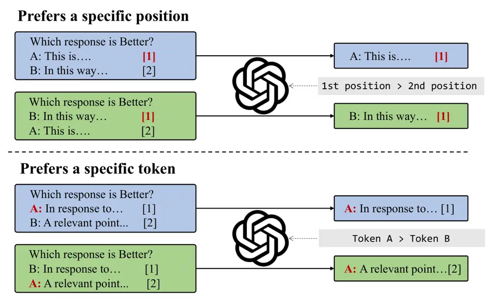

Figure 1. Illustration of selection bias in LLMs-as-Judges. Selection
bias manifests in two aspects: prefers a specific position or prefers a
specific token.

Some powerful commercial LLMs, such as GPT-4, have been widely applied
to evaluate the quality of texts generated in response to open-ended
questions. This paradigm, known as “LLMs-as-Judges”, provides a scalable
and transparent alternative to human evaluation of text quality. Within
this paradigm, two common methods are pointwise and pairwise
evaluations. In pointwise evaluation, LLMs assign scores to individual
responses based on specific criteria, while in pairwise comparison, LLMs
select the better response between two options. Pointwise evaluation
tends to be unstable and susceptible to noise, as subtle differences in
wording or interpretation may lead to inconsistent results. In contrast,
pairwise comparison can better reflect human judgment (Liu et al., 2024;
Zheng et al., 2023a), resulting in its widespread application and
considerable attention.

Despite the success, LLMs are not perfect evaluators and are believed to
exhibit certain biases (Zheng et al., 2023b; Zheng et al., 2023a). As
shown in Figure  1, when applied to pairwise comparisons of candidate
responses, simply changing the positions or the ID tokens may lead to
inconsistent evaluation results. Previous studies have classified these
biases as position bias (Zheng et al., 2023a; Shi et al., 2024) and
token bias (Pezeshkpour and Hruschka, 2023; Raina et al., 2024).
Positional bias refers to the tendency of LLMs to favor answers based on
their specific positions (e.g., first or last), and token bias indicates
that LLMs may assign more probability to certain option ID tokens (e.g.,
A or B). Given the inherent link between option tokens and their
positions, we collectively refer to them as selection bias in this
paper.

Addressing selection bias in “LLMs-as-Judges” is crucial for ensuring
valid and fair evaluations. However, this task is not trivial, as
selection bias is influenced by task-specific characteristics, such as
domain and difficulty, as well as the inherent properties of LLMs, such
as context window, family characteristics, and model capabilities (Shi
et al., 2024; Ye et al., 2024). A straightforward method is to exclude
inconsistent judgments or consider them “ties” (Chen et al., 2024a;
Zheng et al., 2023a). While this approach enhances consistency and
reliability, it may lead to a loss of evaluative information.
Furthermore, more advanced methods, such as split and merge (Li et al.,
2023c) or discussions (Chan et al., 2023; Li et al., 2023b) among
multiple agents, have been proposed to improve evaluation effectiveness.
However, these approaches typically require multiple rounds of
interaction, making them costly and time-consuming, and their
effectiveness in mitigating selection bias remains uncertain.

To address these limitations, we propose CalibraEval, a label-free,
inference-time method for mitigating selection bias. CalibraEval
reformulates the debiasing problem as an optimization task to build a
projection function that maps the original prediction distribution to an
unbiased distribution. Our optimization objective is based on
consistency judgments obtained after swapping option positions and ID
tokens. Moreover, we propose a non-parametric order-preserving algorithm
(NOA). The NOA narrows the solution space by preserving the partial
order relationship between predicted distributions of observed samples.
It derives the optimal calibration function by exploiting the
relationship between the prediction distributions from different
combinations of options. This approach effectively minimizes the
reliance on explicit labels and precise mathematical function modeling,
enhancing scalability and transferability.

We conduct extensive experiments on representative evaluation benchmarks
with various LLMs. The experimental results indicate that CalibraEval
outperforms strong baselines in debiasing performance and achieves
state-of-the-art results. Furthermore, we validate CalibraEval’s
robustness across diverse prompt templates, varied option tokens, and
in-context learning scenarios, demonstrating its potential for
application in a variety of contexts. To summarize, we make the
following contributions:

1.  (1)
    We propose a label-free, inference-time calibrated method
    CalibraEval. By learning a lightweight calibration function,
    CalibraEval effectively mitigates selection bias, demonstrating both
    significant effectiveness and efficiency.
2.  (2)
    We reformulate the debiasing problem as an optimization task and
    propose a non-parametric order-preserving algorithm (NOA) to solve
    it efficiently.
3.  (3)
    We conduct extensive experiments on public benchmarks. Experimental
    results demonstrate the effectiveness and robustness of CalibraEval.

## 2. Related Work

### 2.1. LLMs as Judges

The rapid development of large language models (LLMs) in recent years
has highlighted the urgent need for effective evaluation methods (Shi
et al., 2024; Wei et al., 2024; Li et al., 2023a; Chen et al., 2024b).
Traditional evaluation metrics, such as BLEU (Papineni et al., 2002) and
ROUGE (Lin, 2004), fall short in comprehensively capturing model
performance. These metrics typically overlook nuanced aspects of
generated texts, such as coherence, relevance, and contextual
appropriateness. Moreover, manual evaluation can provide more accurate
assessments and nuanced insights, but it is both costly and
time-consuming, making it impractical for large-scale assessments. This
situation highlights the urgent need for more advanced and efficient
automated evaluation techniques that can keep pace with the evolving
capabilities of LLMs (Chu et al., 2024; Xie et al., 2023; Li et al.,
2024c; Li et al., 2024b).

To tackle these challenges, the “LLMs-as-Judges” approach has emerged as
a promising alternative (Ye et al., 2024). This method utilizes
powerful, widely recognized LLMs, such as GPT-4 (OpenAI, 2023), to
facilitate automated evaluation, thereby reducing the dependence on
manual assessment. Generally speaking, the “LLMs-as-Judges” evaluation
approach can be classified into two categories: pointwise (Kim et al., 2023) and pairwise (Lambert et al., 2024; Zhu et al., 2023). Pointwise
evaluation involves LLM judges scoring individual responses based on
specific criteria. Pairwise comparison requires choosing the better
answer from two responses. Pairwise comparison evaluation has gained
widespread adoption and particular attention due to its outstanding
performance. Wang et al.  (Wang et al., 2023) discovered that pairwise
comparison methods outperform traditional score-based evaluation
approaches in terms of consistency with human assessments. Liu et
al. (Liu et al., 2024) observed that pairwise comparisons better reflect
human evaluation standards compared to other methods. This advantage may
be attributed to the fact that LLMs often utilize pairwise preference or
ranking data during the Reinforcement Learning from Human Feedback
(RLHF) training phase (Dong et al., 2024b).

Furthermore, some researchers have explored integrating multiple LLMs
into evaluation systems, aiming to produce effective results through
collaboration (Chan et al., 2023), discussion (Li et al., 2023b), and
debate (Chu et al., 2024) among the models. However, these approaches
typically require multiple rounds of interaction, leading to increased
resource consumption. In summary, pairwise comparison evaluation is
relatively more straightforward and less resource-intensive, which is
regarded as a more economical and effective solution.

### 2.2. Bias in LLM Judges

While “LLMs-as-Judges” has emerged as a promising alternative to human
evaluation in many tasks, concerns have been raised about the
reliability of these judges due to potential biases inherent in LLMs.
These biases pose significant challenges to the effectiveness and
fairness of such evaluation systems (Shi et al., 2024; Zhou et al.,
2024).

Recent research has identified various biases affecting LLM evaluations,
including selection bias (Zheng et al., 2023a), position bias (Li
et al., 2023c), contextual bias (Zhou et al., 2023), and
self-reinforcing bias (Li et al., 2023b; Zhang et al., 2024). Among
these, selection bias has emerged as a particularly critical issue, as
it is prevalent across various tasks and affects both open-source and
commercial models, significantly impacting their performance. This bias
is typically evident in pairwise comparison evaluations: if an LLM
evaluation model consistently favors a specific option even after
swapping positions or IDs, this indicates the presence of selection
bias. Two types of bias may contribute to selection bias: position bias
and token bias. However, there is still no consensus on which of these
two is the dominant factor (Pezeshkpour and Hruschka, 2023; Raina
et al., 2024).

Effectively mitigating bias remains an unresolved issue. Scholars are
exploring various approaches to identify and reduce biases in LLMs (Shi
et al., 2024; Zhou et al., 2024; Zhang et al., 2024). Shi et al. (Shi
et al., 2024) conducted a systematic study on positional bias through
pairwise comparison evaluations, providing detailed recommendations for
selecting judgment LLMs that balance consistency, fairness, and
cost-effectiveness. Chua et al.  (Chua et al., 2024) proposed
Bias-Consistent Training (BCT) to fine-tune models, aiming to enhance
consistent reasoning between prompts with or without biased features. Li
et al. (Li et al., 2023c) introduced the “split and merge” method, which
divides answers into multiple parts and aligns similar content in
candidate answers to calibrate position bias. Zheng et al.  (Zheng
et al., 2023b) use prior estimates from partial samples to address
selection bias. Furthermore, Liu et al.  (Liu et al., 2024) argued that
existing calibration techniques aimed at reducing bias are insufficient
for calibrating LLM evaluators, even with supervised data. Therefore,
mitigating biases in “LLM-as-Judges” is a widespread, significantly
impactful, and challenging issue.

## 3. CalibraEval

In this section, we first present the problem statement of the debiasing
process and the optimization objective. Then, we provide a detailed
introduction to the non-parametric order-preserving algorithm (NOA).

### 3.1. Problem Statement

In this paper, we focus on addressing the selection bias present in
“LLMs-as-Judges”. Selection bias refers to the phenomenon where LLMs
consistently prefer a specific option during pairwise comparisons,
regardless of the content.

To standardize the terminology, we define the following terms: $`t_{i}`$
represent the option ID tokens (e.g., A, B), and $`o_{i}`$ denotes the
specific option contents (e.g., Response*x, Response_y). Additionally,
let $`I`$ represent the input instruction, and $`X*{0}`$ represent the
default connection of option ID tokens and contents, that is,
$`X*{0}=[(t*{1},o*{1});(t*{2},o\_{2})]`$.

Following previous studies (Zheng et al., 2023b), we assume that when
the LLM serves as an evaluator, the observed probability distribution
$`P_{observed}`$ on $`t_{i}`$ can be decomposed into a combination of
the prior distribution $`P_{prior}`$ and the debiased distribution
$`P_{debiased}`$, i.e.,

```math
P_{observed}(t_{i}|I,X_{0})=f(P_{prior}(t_{i}|I,X_{0}),P_{debiased}(t_{i}|I,X_{0})) \tag{1}
```

where $`f(\cdot)`$ is a function that represents the relationship
between $`P_{observed}`$, $`P_{prior}`$ and $`P_{debiased}`$. Accurately
estimating the form of $`f(\cdot)`$ is challenging. Firstly, the
interaction between $`P_{prior}`$ and $`P_{debiased}`$ is complex and
may not be simply multiplicative or additive. Secondly, the observed
probability distributions $`P_{observed}`$ may be affected by noise,
complicating the identification of the precise form of $`f(\cdot)`$. In
previous work, Zheng et al. (Zheng et al., 2023b) proposed Pride, which
simplify the problem by assuming that $`f(\cdot)`$ is a linear
multiplication, i.e.,

```math
P_{observed}(t_{i}|I,X_{0})\propto Z^{-1}_{I,X_{0}}P_{prior}(t_{i}|I,X_{0})\times P_{debiased}(t_{i}|I,X_{0}) \tag{2}
```

where $`Z^{-1}_{I,X_{0}}`$ is the normalization item. Zheng et
al. (Zheng et al., 2023b) select a subset of test samples and then use
the average observed probability distributions from different
arrangements as the prior estimates $`\tilde{P}_{prior}(t_{i})`$. The
debiasing is then performed using the following equation:

```math
P_{debiased}(t_{i}|I,X_{0})\propto P_{observed}(t_{i}|I,X_{0})/\tilde{P}_{prior}(t_{i}) \tag{3}
```

Although Pride is effective, its simplified assumption overlooks the
complex relationships between probability distributions, leading to
suboptimal performance.

In this paper, considering the complexity of $`f(\cdot)`$, we do not
attempt to directly create a precise mathematical function of
$`f(\cdot)`$. Instead, we focus on determining a calibration function
$`g(\cdot)`$, which can map the observed probabilities to an unbiased
probability distribution, i.e.,

```math
P_{debiased}(t_{i}|I,X_{0})=g(P_{observed}(t_{i}|I,X_{0})) \tag{4}
```

Figure 2. Four different types of combinations. $`t_{1}/t_{2}`$
represents the option IDs (A/B), while $`o_{1}/o_{2}`$ denotes the
corresponding option contents. An unbiased evaluator consistently ranks
the responses regardless of changes in option order (Swap Positions) or
option ID tokens (Swap Tokens), ensuring fairness and consistency in the
results.

### 3.2. Optimization Objective

In this section, we reformulate the debiasing problem as an optimization
task, with the unbiased probability distribution serving as the
optimization objective. Intuitively, an unbiased evaluator should
provide consistent judgments even when the option position or ID tokens
are swapped. Specifically, in pairwise comparisons, there are four
possible combinations of positions and ID tokens:

```math
X_{0}=[(t_{1},o_{1});(t_{2},o_{2})],X_{1}=[(t_{2},o_{2});(t_{1},o_{1})] \tag{5}
```

```math
X_{2}=[(t_{1},o_{2});(t_{2},o_{1})],X_{3}=[(t_{2},o_{1});(t_{1},o_{2})] \tag{6}
```

In Figure 2, we present the relationship among these four combinations.
An unbiased evaluator can accurately determine the correct option
context, regardless of changes in option orders (Swap Positions) or
option ID tokens (Swap Tokens). Suppose that the ground truth is
$`o_{1}`$, the evaluator should satisfy the following conditions:

```math
P_{debiased}(t_{1}|I,X_{0})=P_{debiased}(t_{1}|I,X_{1})=P_{debiased}(t_{2}|I,X_{2}) \tag{7}
```

```math
P_{debiased}(t_{2}|I,X_{2})=P_{debiased}(t_{2}|I,X_{3})=P_{debiased}(t_{1}|I,X_{0}) \tag{8}
```

Since Equations (7) and Equations (8) are duals, we only need to select
one as the optimization objective. Also, we can simply normalize the
original token prediction probabilities, ensuring that the sum of the
probabilities for outputs $`t_{1}`$ and $`t_{2}`$ equals 100%, i.e.,

```math
P_{debiased}(t_{1}|I,X_{0})=1-P_{debiased}(t_{2}|I,X_{0}) \tag{9}
```

With the above reasoning, we formulate the debiasing problem on $`K`$
samples as follows:

```math
\min_{g\in\mathcal{G}}\sum_{i=1}^{K}[g(s_{0}^{i})+g(s_{2}^{i})-1]^{2}+[g(s_{0}^{i})-g(s_{1}^{i})]^{2}-\lambda[g(s_{0}^{i})-g(s_{2}^{i})]^{2} \tag{10}
```

```math
s.t.s_{j}^{i}=P_{observed}(t_{1}|I,X_{j}),j={0,1,2},i={1,...,K}. \tag{11}
```

where $`g(\cdot)`$ is the mapping function for the probability of token
$`t_{1}`$. $`\mathcal{G}`$ denotes the solution space of $`g(\cdot)`$.
$`\lambda`$ is a hyper-parameter. For each option ID token, a
corresponding mapping function $`g(\cdot)`$ is defined. In the following
process, we use $`g(\cdot)`$ as an example. In Equations (10), the first
term ensures consistent judgments when option ID tokens are swapped. The
second term aims to maintain consistent judgment when option positions
are exchanged. The third term serves as a regularization term, which
prevents convergence to the trivial solution $`g(\cdot)=0.5`$.

### 3.3. Non-parametric Order-Preserving Algorithm (NOA)

The optimization problem presented in Equation (10) is an NP problem,
featuring an extensive solution space $`\mathcal{G}`$. Furthermore, the
absence of explicit labels prevents us from employing supervised methods
to determine $`g(\cdot)`$.

To address these limitations, we propose a non-parametric
order-preserving algorithm called NOA. Non-parametric methods do not
rely on specific model assumptions, making them well-suited for handling
high-dimensional data or complex functions. NOA searches for the optimal
solution by directly evaluating the output of the calibration function,
eliminating the need for explicit labels or precise mathematical
modeling.

To narrow the solution space $`\mathcal{G}`$, we assume that the mapping
function $`g(\cdot)`$ is order-preserving for the same ID token. This
assumption, widely and implicitly applied in previous work (Zheng
et al., 2023b; Zhao et al., 2021), rests on the premise that the prior
distribution $`P_{prior}`$ reflects the LLM’s inherent bias toward
certain option ID tokens, which remains conditionally independent of the
unbiased probability distribution $`P_{debiased}`$. Intuitively, for a
given LLM, the partial order relationship under the same prior bias
should remain consistent, meaning higher observed probabilities
generally correspond to higher unbiased probabilities for the same ID
token.

Specifically, we first collect an estimation set with $`K`$ samples.
Each sample is processed by swapping ID tokens and swapping positions,
resulting in three probabilities $`s_{0}`$ (default output), $`s_{1}`$
(swap positions), and $`s_{2}`$ (swap ID tokens). The probabilities from
all samples are combined into a set
$`S=\{s^{i}_{0},s^{i}_{1},s^{i}_{2}|i\in{1,...,K}\}`$. Then, we sort
$`S`$ in ascending order to form a sequence
$`z_{1}\leq z_{2}\leq...\leq z_{M-1}`$, where $`M=3K+1`$. We then append
boundary conditions to the sorted sequence by defining $`z_{0}=0`$ and
$`z_{M}=1`$, producing the complete sequence
$`Z=\{z_{0},z_{1},...,z_{M-1},z_{M}\}`$.

To optimize the model, we introduce a set of parameters $`d_{k}`$
($`k=0,1,2,...,M`$) initialized to the values of $`z_{k}`$. These
parameters will be optimized during the process. Then, we define the
mapping function $`g(\cdot)`$ using the softmax-like expression:

```math
g(z_{k})=\frac{\sum_{i=0}^{k}exp(d_{i})}{{\textstyle\sum_{i=0}^{M}}exp(d_{i})} \tag{12}
```

$`g(\cdot)`$ is a discrete mapping function with parameters $`d_{k}`$,
which satisfies the constraint of order preservation. We employ gradient
descent methods to iteratively update the parameters $`d_{k}`$. The
update rule is given by:

```math
d_{k}^{(new)}=d_{k}^{(old)}-\gamma\frac{\partial L}{\partial d_{k}} \tag{13}
```

where $`\gamma`$ is the learning rate,
$`L=[g(s_{0}^{i})+g(s_{2}^{i})-1]^{2}+[g(s_{0}^{i})-g(s_{1}^{i})]^{2}-\lambda[g(s_{0}^{i})-g(s_{2}^{i})]^{2}`$.
This iterative process allows the parameters to converge toward the
optimal values that minimize the loss, thereby reducing the bias in the
probability distribution.

For $`\frac{\partial L}{\partial d_{k}}`$, we derive the following
equation. The detailed derivation process can be found in Appendix  A.

```math
\displaystyle\frac{\partial L}{\partial d_{k}} \displaystyle=\left(2\left[g\left(s_{0}^{i}\right)+g\left(s_{2}^{i}\right)-1\right]+2\left[g\left(s_{0}^{i}\right)-g\left(s_{1}^{i}\right)\right]\right)\frac{\partial g\left(s_{0}^{i}\right)}{\partial d_{k}}
```

```math
\displaystyle\quad+\left(-2\left[g\left(s_{0}^{i}\right)-g\left(s_{1}^{i}\right)\right]\right)\frac{\partial g\left(s_{1}^{i}\right)}{\partial d_{k}}
```

```math
\displaystyle\quad+\left(2\left[g\left(s_{0}^{i}\right)+g\left(s_{2}^{i}\right)-1\right]-2\lambda\left[g\left(s_{0}^{i}\right)-g\left(s_{2}^{i}\right)\right]\right)\frac{\partial g\left(s_{2}^{i}\right)}{\partial d_{k}} \tag{14}
```

```math
\frac{\partial g\left(z_{j}\right)}{\partial d_{k}}=\begin{cases}-\frac{\sum_{i=0}^{j}\exp\left(d_{i}\right)\exp\left(d_{k}\right)}{\left(\sum_{i=0}^{M}\exp\left(d_{i}\right)\right)^{2}}&(j<k)\\
\frac{\exp\left(d_{k}\right)\left(\sum_{i=0}^{M}\exp\left(d_{i}\right)-\sum_{i=0}^{j}\exp\left(d_{i}\right)\right)}{\left(\sum_{i=0}^{M}\exp\left(d_{i}\right)\right)^{2}}&(j\geq k)\end{cases} \tag{15}
```

We note that there are infinite solutions that satisfy the optimization
problem. This is because any constant change in the value of $`d_{k}`$
does not affect the relative values in the exponential terms of Equation
(12). To obtain a unique solution, we apply the normalization constraint
$`\sum_{i=0}^{M}d_{i}=0`$ after each iteration. The optimization
proceeds until a convergence criterion is met, such as the loss function
$`L`$ reaching a minimum threshold or the parameter updates becoming
sufficiently small.

After the solution process converges, we obtain the sample points
$`Z=\{z_{1},...,z_{M-1}\}`$ and their corresponding calibrated values
$`y=\{g(z_{1}),...,g(z_{M-1}\}`$. For sample points not included in
$`Z`$, we use existing sample points to learn the continuous calibration
function $`g^{*}(\cdot)`$. The goal is to identify a set of
non-decreasing piecewise linear functions that minimize the sum of
squared deviations between the estimated values and the calibrated
values of the samples. Specifically, we fit the calibration values by
minimizing the following objective function:

```math
min\sum_{i=1}^{M-1}w_{i}(g(z_{i})-g^{*}(z_{i}))^{2} \tag{16}
```

```math
s.t.z_{1}\leq z_{2}...\leq z_{M-1} \tag{17}
```

```math
\sum_{i=1}^{M-1}w_{i}=1,w_{i}\geq 0 \tag{18}
```

The above problem is a weighted least squares quadratic programming
problem. We apply the Pool Adjacent Violators Algorithm (PAVA) (Zadora
et al., 2014) to derive the continuous calibration function
$`g^{*}(\cdot)`$.

It is worth noting that CalibraEval does not require explicit labels and
can be executed during inference with minimal computational cost. The
calibration function can be calculated after observing all test samples
or by utilizing a subset of samples. The entire process of CalibraEval
is summarized in Algorithm 1 in the Appendix.

## 4. EXPERIMENT SETUP

### 4.1. Datasets and Metrics

We conduct experiments on three representative benchmarks. The
statistics are shown in Appendix B.1.

- •
  RewardBench (Lambert et al., 2024) is a benchmark dataset designed for
  evaluating reward models. It contains 2,985 prompt-choice-rejection
  trios across four task categories: Chat, Chat Hard, Safety, and
  Reasoning.
- •
  MTBench (Zheng et al., 2023a) is a multi-turn response dataset. It
  contains 3,355 expert-level pairwise human preferences for responses,
  generated by 6 models for 80 MTBench questions.
- •
  PreferenceBench (Kim et al., 2024) is a test set designed to assess
  the evaluation capabilities of LLMs, comprising 2,000 response pairs
  (classified as “win” or “lose”) and 200 evaluation criteria.

In the evaluation, we primarily utilize reference-free metrics to
measure the consistency of model evaluations. We compute Fleiss’s Kappa
coefficient (Falotico and Quatto, 2015) and intraclass correlation
coefficient (ICC) (Bartko, 1966) between the evaluation results obtained
after swapping option ID tokens and option positions. We report two
specific ICC metrics: ICC(2,k) and ICC(3,k) in this paper.

For the reference-based evaluation, we report the standard deviation of
recalls (RStd) and accuracy. Following Zheng et al. (Zheng et al.,
2023b), the balance of recalls serves as an effective measure of the
extent of selection bias. A greater imbalance in recalls signifies a
more pronounced selection bias. In addition, MTBench includes “tie”
options assessed by human evaluators. We exclude all “tie” options when
calculating the reference-based metrics. In Appendix B.2, we provide the
details of evaluation metrics.

| Model        | RewardBench |          |          | MTBench |          |          | PreferenceBench |          |          | Average |          |          |
| ------------ | ----------- | -------- | -------- | ------- | -------- | -------- | --------------- | -------- | -------- | ------- | -------- | -------- |
|              | Kappa       | ICC(2,k) | ICC(3,k) | Kappa   | ICC(2,k) | ICC(3,k) | Kappa           | ICC(2,k) | ICC(3,k) | Kappa   | ICC(2,k) | ICC(3,k) |
| Llama-3-8B   | 20.81       | 66.24    | 71.79    | 14.36   | 60.96    | 73.08    | 58.25           | 86.23    | 86.61    | 31.14   | 71.14    | 77.16    |
| DI           | 19.63       | 64.98    | 70.87    | 15.93   | 59.11    | 65.00    | 39.90           | 76.77    | 80.87    | 25.15   | 66.95    | 72.25    |
| CC           | 15.49       | 58.77    | 63.70    | 5.60    | 39.48    | 52.45    | 54.84           | 83.60    | 86.26    | 25.31   | 60.62    | 67.47    |
| DC           | 23.57       | 69.04    | 72.79    | 25.28   | 69.83    | 72.75    | 50.78           | 84.88    | 85.09    | 33.21   | 74.58    | 76.88    |
| Pride        | 27.65       | 72.72    | 73.77    | 27.38   | 72.27    | 74.50    | 57.01           | 85.49    | 86.33    | 37.35   | 76.83    | 78.20    |
| CalibraEval  | 30.32       | 86.51    | 86.66    | 28.63   | 75.45    | 76.80    | 58.54           | 88.17    | 89.43    | 39.16   | 83.38    | 84.30    |
| Llama-3.1-8B | 15.02       | 68.82    | 76.65    | 16.91   | 62.51    | 67.60    | 38.73           | 74.61    | 78.46    | 23.55   | 68.65    | 74.24    |
| DI           | 21.59       | 74.04    | 80.00    | 15.12   | 53.24    | 57.08    | 36.59           | 68.47    | 72.14    | 24.43   | 65.25    | 69.74    |
| CC           | 16.89       | 59.24    | 60.09    | 2.59    | 32.42    | 33.96    | 40.80           | 76.69    | 78.44    | 20.09   | 56.12    | 57.50    |
| DC           | 23.17       | 72.89    | 76.22    | 16.02   | 65.86    | 68.80    | 41.61           | 77.23    | 78.81    | 26.55   | 71.68    | 74.18    |
| Pride        | 14.63       | 66.62    | 76.02    | 17.98   | 63.76    | 67.51    | 38.58           | 76.84    | 79.35    | 23.73   | 69.07    | 74.29    |
| CalibraEval  | 20.67       | 83.23    | 86.68    | 19.12   | 66.00    | 69.26    | 43.04           | 81.56    | 82.78    | 27.61   | 76.93    | 79.57    |
| Qwen-14B     | 19.69       | 63.41    | 66.86    | 17.53   | 54.43    | 65.11    | 48.94           | 84.90    | 88.78    | 28.72   | 67.58    | 73.58    |
| DI           | 11.90       | 50.46    | 53.20    | 4.98    | 36.83    | 46.02    | 30.76           | 74.41    | 82.95    | 15.88   | 53.90    | 60.72    |
| CC           | -1.62       | -4.71    | -4.93    | -5.48   | 18.08    | 31.20    | 40.35           | 73.79    | 75.56    | 11.08   | 29.05    | 33.94    |
| DC           | 16.04       | 45.10    | 45.26    | 25.51   | 64.37    | 66.46    | 48.15           | 82.29    | 84.52    | 29.90   | 63.92    | 65.41    |
| Pride        | 24.73       | 67.46    | 68.30    | 13.00   | 51.73    | 57.39    | 52.79           | 90.86    | 91.20    | 30.17   | 70.02    | 72.30    |
| CalibraEval  | 26.40       | 75.75    | 76.11    | 17.68   | 53.64    | 63.43    | 62.91           | 92.56    | 92.57    | 35.66   | 73.98    | 77.37    |
| Qwen-72B     | 78.28       | 92.77    | 93.13    | 71.35   | 90.33    | 91.16    | 82.77           | 94.78    | 94.90    | 77.47   | 92.63    | 93.06    |
| DI           | 77.33       | 92.27    | 92.63    | 68.17   | 89.13    | 89.99    | 83.31           | 95.09    | 95.11    | 76.27   | 92.16    | 92.58    |
| CC           | 69.23       | 88.71    | 89.92    | 70.64   | 90.29    | 90.72    | 78.08           | 92.63    | 93.24    | 72.65   | 90.54    | 91.29    |
| DC           | 66.61       | 87.03    | 87.90    | 64.59   | 87.46    | 88.45    | 74.03           | 91.01    | 92.01    | 68.41   | 88.50    | 89.45    |
| Pride        | 78.64       | 92.99    | 93.30    | 71.50   | 90.54    | 91.27    | 83.44           | 94.89    | 95.00    | 77.86   | 92.81    | 93.19    |
| CalibraEval  | 82.80       | 95.47    | 95.75    | 71.88   | 95.70    | 96.71    | 85.25           | 97.56    | 97.57    | 79.98   | 96.24    | 96.68    |
| ChatGPT      | 20.08       | 62.67    | 70.75    | 37.25   | 73.90    | 76.92    | 64.62           | 87.63    | 87.81    | 40.65   | 74.73    | 78.49    |
| DI           | 24.52       | 70.23    | 71.58    | 24.33   | 66.80    | 67.69    | 56.00           | 82.90    | 84.89    | 34.95   | 73.31    | 74.72    |
| CC           | 24.28       | 57.25    | 58.23    | 23.71   | 64.06    | 71.91    | 61.63           | 86.18    | 86.38    | 36.54   | 69.16    | 72.17    |
| DC           | 27.94       | 66.09    | 70.54    | 16.68   | 58.37    | 70.26    | 55.33           | 81.92    | 82.58    | 33.32   | 68.79    | 74.46    |
| Pride        | 28.25       | 70.38    | 73.16    | 39.02   | 76.61    | 77.61    | 64.64           | 87.56    | 87.82    | 43.97   | 78.18    | 79.53    |
| CalibraEval  | 32.02       | 77.25    | 77.60    | 39.71   | 79.07    | 79.85    | 65.52           | 87.77    | 87.92    | 45.75   | 81.36    | 81.79    |
| GPT4o        | 82.57       | 94.83    | 94.89    | 72.42   | 92.99    | 93.20    | 79.42           | 93.50    | 94.11    | 78.14   | 93.77    | 94.07    |
| DI           | 78.57       | 93.72    | 94.01    | 74.21   | 93.35    | 93.50    | 79.97           | 94.48    | 94.93    | 77.58   | 93.85    | 94.15    |
| CC           | 81.38       | 94.47    | 94.48    | 67.10   | 90.30    | 90.78    | 77.56           | 92.76    | 93.43    | 75.35   | 92.51    | 92.90    |
| DC           | 76.89       | 92.28    | 92.35    | 68.94   | 90.94    | 91.64    | 70.48           | 89.30    | 90.02    | 72.10   | 90.84    | 91.34    |
| Pride        | 82.53       | 94.94    | 94.98    | 70.34   | 92.35    | 92.74    | 79.74           | 93.62    | 94.20    | 77.54   | 93.64    | 93.97    |
| CalibraEval  | 83.25       | 96.25    | 96.27    | 72.60   | 95.04    | 95.20    | 79.73           | 97.29    | 97.60    | 78.53   | 96.19    | 96.36    |

Table 1. Performance comparison between CalibraEval and baselines. We
report the Fleiss’ Kappa (%) and Intraclass Correlation Coefficient (%)
for each dataset and the averages. The row corresponding to the model
name represents the default results without applying any debiasing
methods. Best performances are marked bold.

### 4.2. Baselines

We employ the following methods as our baselines. Since CalibraEval is a
label-free method, we do not compare it with supervised methods.

- •
  Debiasing Instruct (DI) is implemented by including the instruction:
  “Avoid any position bias and ensure that the order in which the
  responses were presented does not influence your decision. Do not
  allow the length of the responses to influence your evaluation. Do not
  favor certain tokens of the option. Be as objective as possible”.
- •
  Contextual Calibration (CC) (Zhao et al., 2021) involves applying an
  affine transformation to model outputs in order to calibrate LLM
  predictions. It estimates the bias for each option tokens by
  requesting its prediction with a prompt alongside a content-free
  input, such as “N/A”.
- •
  Domain-context Calibration (DC) (Fei et al., 2023) is designed to
  minimize label bias in in-context learning. It estimates a contextual
  prior by using a random in-domain sequence, achieving state-of-the-art
  results.
- •
  Pride (Zheng et al., 2023b) estimates the model’s prior bias toward
  option ID token by reorganizing the test samples and then removes this
  bias using a division operation.

### 4.3. Implementation Details

We evaluate six models from three LLM-families including:
Llama-3-8B (Touvron et al., 2023), Llama-3.1-8B (Touvron et al., 2023),
Qwen-14B (Bai et al., 2023), Qwen-72B (Bai et al., 2023),
ChatGPT (OpenAI, 2023), and GPT-4o (OpenAI, 2023). The version of
ChatGPT used is gpt-3.5-turbo-1106. The estimation set used to derive
the calibration function can be constructed either by sampling from the
test data or by using the entire test set without the gold labels. For a
fair comparison, we opted for the latter approach. In the main
experiment, all baselines used the full test data as the prior
estimation set. For CC, we use the predefined token “N/A” to replace the
option contents, generating content-free input. For DC, we randomly
extract words from the task corpus to construct the content-free input.
Moreover, we set $`\lambda=0.5`$ and $`\gamma=10`$. We employ the batch
gradient descent method with a batch size of 32. The optimization
process stops when the parameters change range is less than the
threshold $`\epsilon`$ i.e.,
$`\sum_{i=1}^{N}\bigtriangleup d_{i}<\epsilon`$. The $`\epsilon`$ is set
to 0.001. All experiments presented in this paper are conducted on 8
NVIDIA Tesla A100 GPUs. All the prompts used in this paper can be found
in Appendix D.

## 5. Experiment Result

### 5.1. Main Results

To validate the effectiveness of CalibraEval in mitigating selection
bias, we test the consistency of evaluation results among different
models on benchmarks. The performance comparison of CalibraEval with
baselines is presented in Table 1. Based on the experimental results, we
can draw the following conclusions.

- •
  Debiasing Instruct does not consistently lead to improved or more
  robust performance, as its effectiveness is limited by the
  instruction-following capabilities of LLMs and the nature of tasks. In
  some cases, adding debiasing instructions may even result in
  consistency degradation. Consequently, relying solely on instructions
  is not a reliable approach for effective debiasing.
- •
  CC and DC are originally designed to mitigate label bias in in-context
  learning. Therefore, their estimated priors may not accurately reflect
  the inherent selection bias in LLMs-as-Judges, leading to suboptimal
  debiasing performance and difficulties in interpretation.
- •
  When applied to lower-capability LLMs, such as Llama-3-8B and
  Qwen-14B, Pride effectively estimates bias and improves consistency.
  However, its effectiveness diminishes with more advanced models (e.g.,
  GPT4o). This limitation may arise from the simplified probabilistic
  relationships employed in Pride.
- •
  CalibraEval consistently improves performance across various LLMs and
  tasks. On average, CalibraEval shows enhancements over all the
  baselines. Overall, CalibraEval is a versatile technique applicable to
  multiple evaluation tasks, delivering stable performance improvement.
  This also indicates that CalibraEval can effectively reduce selection
  bias in LLMs-as-judges, leading to more consistent and fair evaluation
  results.

Table 2 presents the performance of the reference-based metrics. Due to
space constraints, we only report the experimental results for
Llama-3-8B, Qwen-14B, and ChatGPT, while the complete results are
available in Appendix C. For a fair comparison, we report the average
values of Rstd and Accuracy under the conditions of swapping option
positions and option IDs. Across the average performance of the three
datasets, CalibraEval consistently achieves lower Rstd and higher
accuracy, outperforming other baselines. Surprisingly, although this is
not the original intent, CalibraEval frequently improves accuracy. We
believe this may indicate that selection bias influences the model’s
judgments, leading to reduced accuracy. Therefore, effective bias
mitigation methods can enhance the model’s performance in its evaluative
role. Additionally, we found that lower Rstd is often associated with
higher accuracy. The more pronounced the debiasing effect, the more
significant the performance improvement. For example, on RewardBench,
ChatGPT’s Rstd decreased from 16.79 to 5.51, while its accuracy
increased from 65.27 to 67.13. Overall, CalibraEval not only enhances
the reliability of model evaluations but also unlocks the potential for
these LLMs to perform optimally in various tasks.

|             |             |         |         |         |                  |         |
| ----------- | ----------- | ------- | ------- | ------- | ---------------- | ------- |
| Model       | RewardBench |         | MTbench |         | Preference Bench |         |
|             | Rstd        | Acc.(%) | Rstd    | Acc.(%) | Rstd             | Acc.(%) |
| Llama-3-8B  | 15.01       | 65.79   | 16.42   | 67.08   | 3.36             | 83.43   |
| Pride       | 7.51        | 66.54   | 11.64   | 70.63   | 4.35             | 83.24   |
| CalibraEval | 6.48        | 68.12   | 5.22    | 70.63   | 3.42             | 83.98   |
| Qwen-14B    | 11.63       | 63.14   | 17.24   | 65.61   | 11.99            | 80.68   |
| Pride       | 4.18        | 64.09   | 16.31   | 65.29   | 7.36             | 83.55   |
| CalibraEval | 2.72        | 64.25   | 6.26    | 68.64   | 5.12             | 83.88   |
| ChatGPT     | 16.79       | 65.27   | 7.66    | 72.67   | 3.04             | 85.61   |
| Pride       | 8.54        | 66.36   | 6.01    | 72.86   | 3.51             | 85.68   |
| CalibraEval | 5.51        | 67.13   | 5.20    | 72.98   | 2.82             | 85.98   |

Table 2. Results of reference-based metrics. We report the Standard
Deviation of Recalls (RStd) and Accuracy (Acc.), with the best results
highlighted in bold. $`\downarrow`$ indicates that lower values
correspond to better performance.

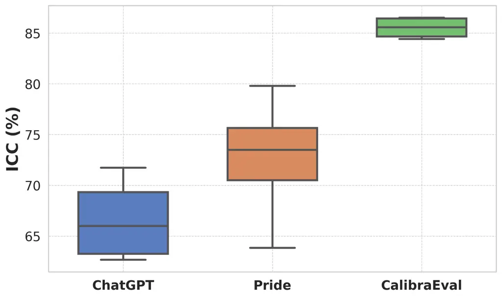

(a) ChatGPT-ICC

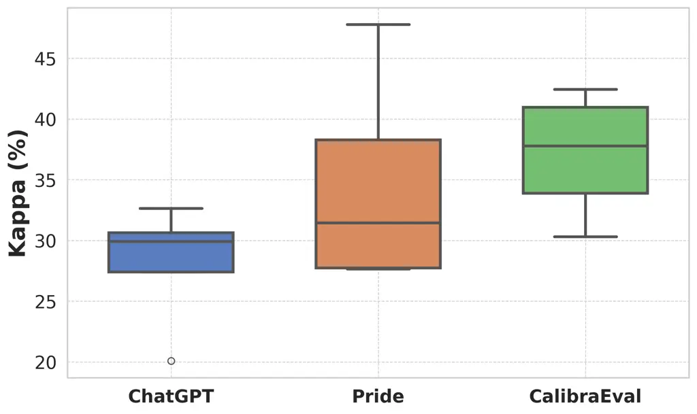

(b) ChatGPT-Kappa

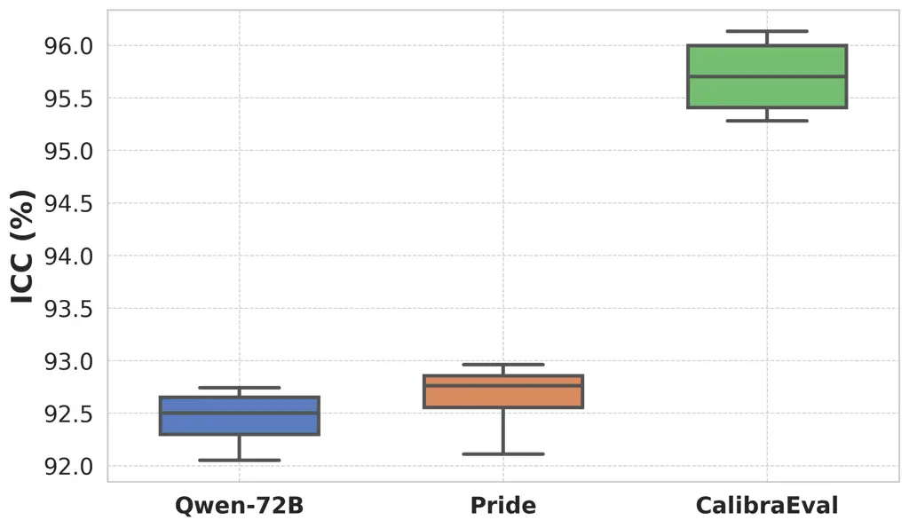

(c) Qwen72B-ICC

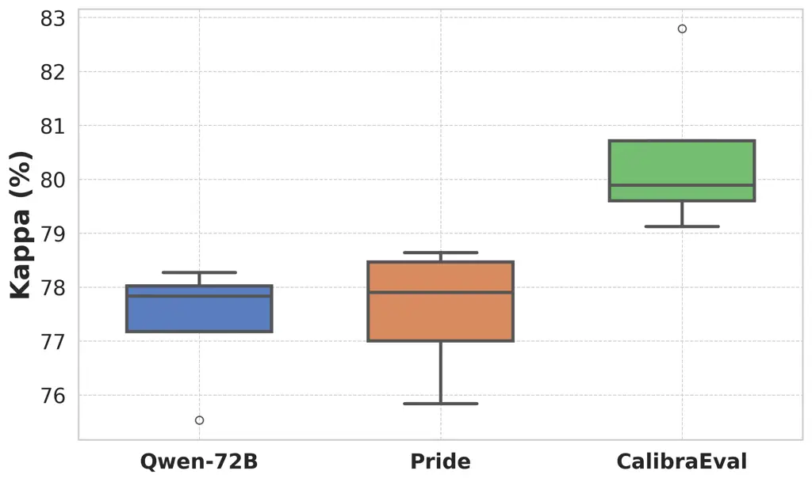

(d) Qwen72B-Kappa

Figure 3. Performance comparison across different prompt templates.

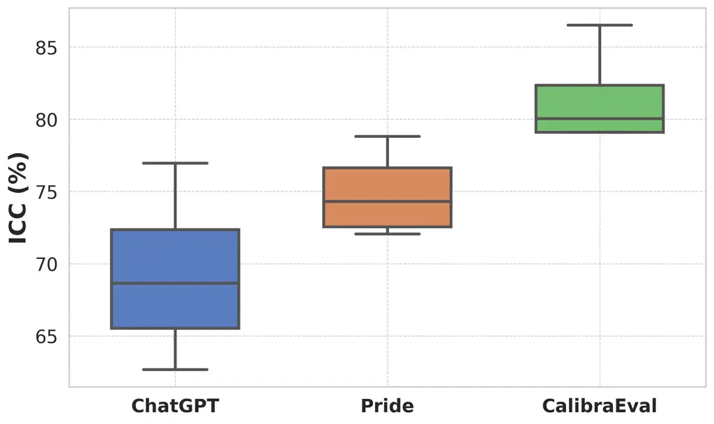

(a) ChatGPT-ICC

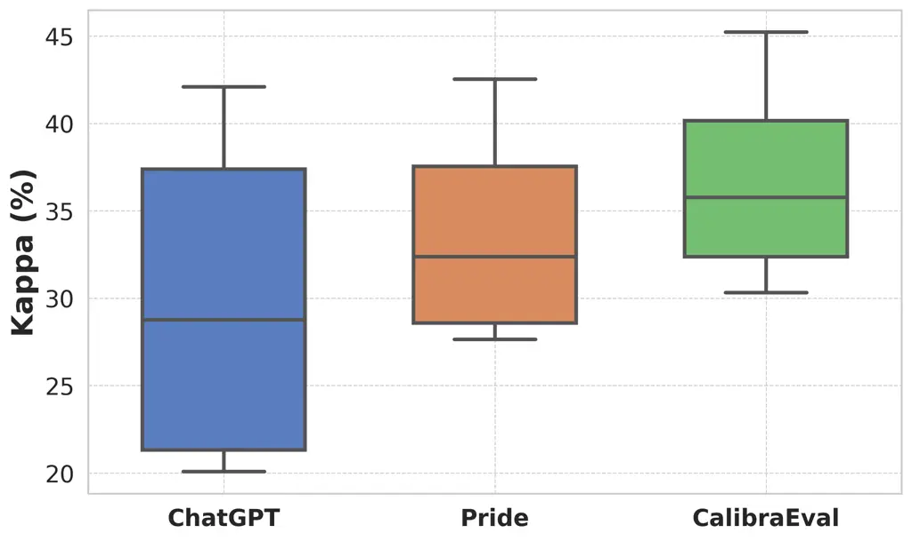

(b) ChatGPT-Kappa

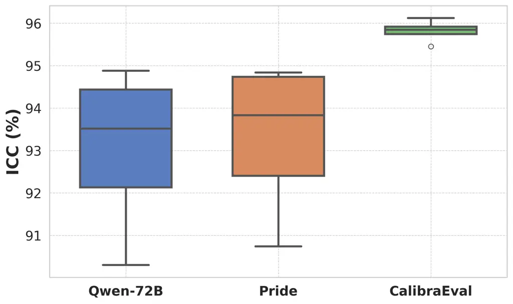

(c) Qwen72B-ICC

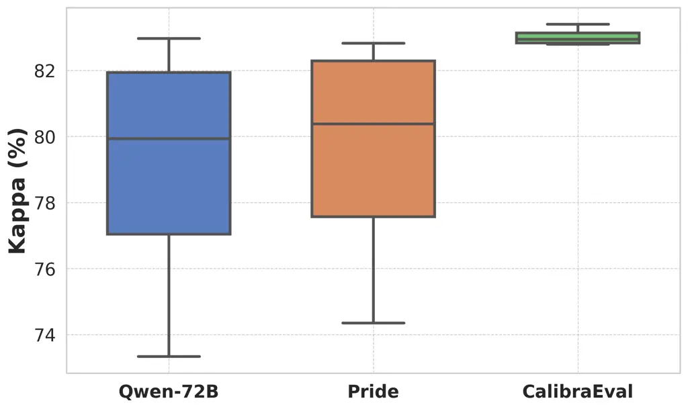

(d) Qwen72B-Kappa

Figure 4. Performance comparison across different ID tokens.

### 5.2. Robustness Analysis

In this section, we conduct additional experiments to further validate
the effectiveness of CalibraEval across diverse scenarios. Due to the
high cost of GPT-4o, we opt for Qwen-72B and ChatGPT on the RewardBench
for the following experiments. Unless otherwise stated, the ICC for
subsequent experiments is ICC(2,k).

#### 5.2.1. Different prompt templates

We conduct experiments on four distinct prompt templates (see Appendix D
for details). Figure D shows performance comparisons on RewardBench. We
observed that model outputs without bias correction exhibit low
consistency and high variance. While Pride improves consistency, it
still exhibited considerable variance. In contrast, CalibreEval
demonstrates substantial performance enhancement while maintaining low
variance, indicating its consistent effectiveness across different
prompt templates.

#### 5.2.2. Different ID tokens

We also conduct experiments using four distinct sets of ID tokens: A/B,
a/b, Alice/Bob, and X/Y. Figure 4 illustrates the performance
comparison. CalibraEval consistently achieves significant performance
improvements with low variance across all tested ID tokens. This
highlights its robustness and effectiveness regardless of the specific
tokens used. Furthermore, when applied to the highly consistent model
Qwen-72B, the improvement of Pride is negligible, while CalibreEval
continued to enhance consistency even further.

#### 5.2.3. Different number of in-context learning examples

We further investigate the effectiveness of CalibraEval when conducting
in-context learning. Specifically, we provided the LLMs with 1-shot,
2-shot, and 3-shot examples, respectively. As shown in Figure 5,
CalibraEval remains effective even when examples are provided for
in-context learning. We find that as the number of examples increases,
the consistency of the model’s judgments also improves. This may be
because examples help the model better understand the task, leading to
more confident and consistent evaluations. Additionally, we also
observed that the effectiveness of calibration methods like Pride and
CalibraEval decreases as the number of examples increases. This may be
due to these examples introducing new biases, which affect the
effectiveness of the calibration. Therefore, we believe that calibration
methods have greater potential for application in zero-shot scenarios.

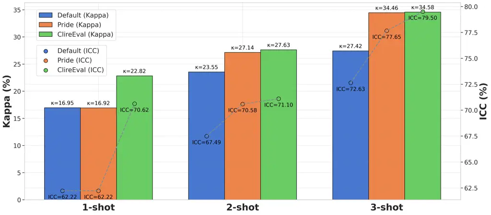

(a) ChatGPT

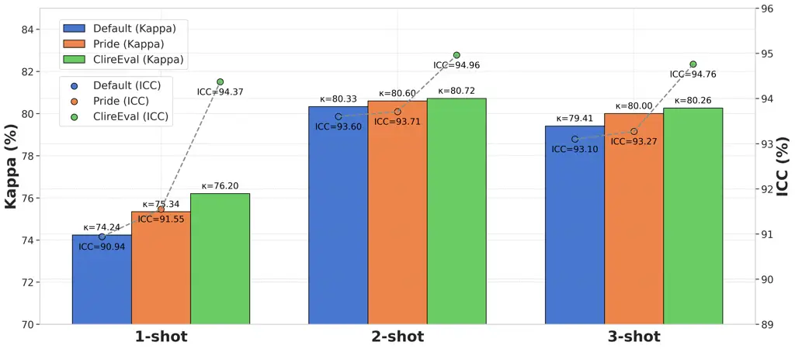

(b) Qwen-72B

Figure 5. Performance comparison under in-context learning.

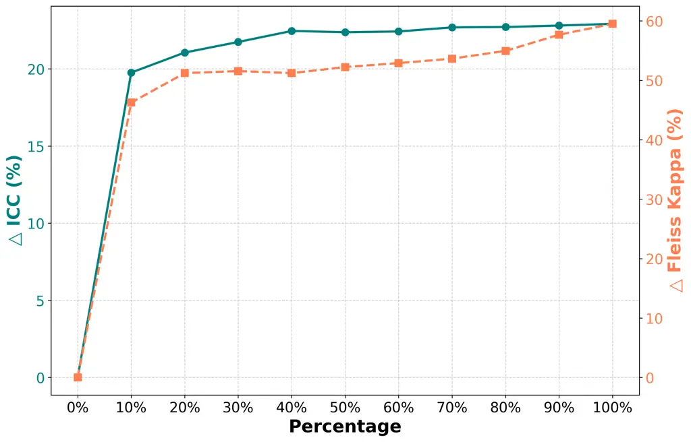

(a) ChatGPT

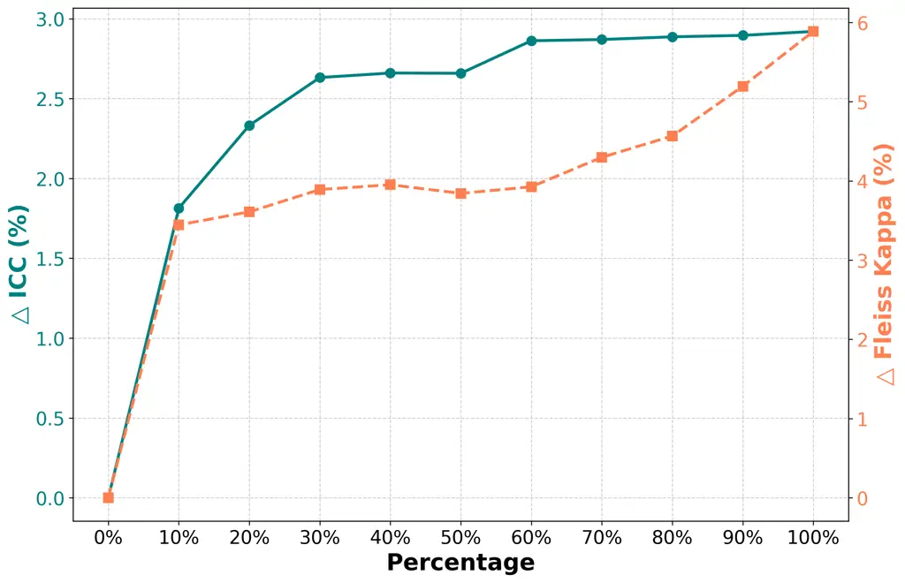

(b) Qwen-72B

Figure 6. Performance of CalibraEval across different estimate set
sizes. “Percentage” refers to the proportion of the test set selected
for use as the estimation set.

### 5.3. Ablation Studies

To better illustrate the rationality and effectiveness of model design,
we conduct two ablation experiments. We first analyze the effectiveness
of well-defined optimization objectives. Specifically, we consider two
variants. The first variant focuses solely on ensuring that the model
maintains consistent judgments after swap ID tokens, i.e.,

```math
L_{1}=arg\min_{g\in G}\sum_{i=1}^{K}[g(s_{0}^{i})+g(s_{2}^{i})-1]^{2}-\lambda[g(s_{0}^{i})-g(s_{2}^{i})]^{2} \tag{19}
```

The other variant focuses on ensuring that the model maintains
consistent judgments after position exchanges, represented as:

```math
L_{2}=arg\min_{g\in G}\sum_{i=1}^{K}[g(s_{0}^{i})-g(s_{1}^{i})]^{2}-\lambda[g(s_{0}^{i})-0.5]^{2} \tag{20}
```

Since this variant does not involve $`s_{2}^{i}`$, the regularization
term is modified to $`[g(s_{0}^{i})-0.5]^{2}`$ to prevent the model from
converging to a trivial solution.

Table 3 illustrates the impact of different optimization objectives.
Both objectives contribute to the calibration benefits observed. When
the model is significantly influenced by position bias, the improvements
from $`L_{2}`$ are more substantial. Conversely, when token bias is more
prevalent, $`L_{1}`$ leads to better improvements. The combination of
both objectives, which defines our CalibraEval optimization goal,
achieves optimal performance. These experiments validate the
effectiveness of our chosen optimization settings.

In Figure 6, we further test the impact of the estimation set size on
the performance. We randomly sampled a certain proportion of test data
to estimate the calibration function, which is then applied to debias
the entire test set. We found that increasing the size of the estimation
set can better enhance consistency. Additionally, a smaller estimation
set can also effectively support CalibraEval in reducing bias. For
ChatGPT, using only 10% of the data resulted in improvements of over 85%
compared to the full dataset. Overall, even with limited data,
CalibraEval can still produce reliable calibration functions.

| Model         | Kappa | ICC(2,k) | ICC(3,k) | Rstd$`\downarrow`$ | Acc.  |
| ------------- | ----- | -------- | -------- | ------------------ | ----- |
| ChatGPT       | 20.08 | 62.67    | 70.75    | 16.79              | 65.27 |
| w\. $`L_{1}`$ | 26.78 | 72.04    | 73.66    | 10.32              | 65.33 |
| w\. $`L_{2}`$ | 27.38 | 72.73    | 75.99    | 8.64               | 66.04 |
| w\. both      | 32.02 | 77.25    | 77.60    | 5.50               | 67.13 |
| Qwen-72B      | 78.28 | 92.77    | 93.13    | 4.01               | 87.20 |
| w\. $`L_{1}`$ | 81.95 | 94.94    | 95.04    | 2.42               | 87.78 |
| w\. $`L_{2}`$ | 81.32 | 93.77    | 95.52    | 2.78               | 87.74 |
| w\. both      | 82.80 | 95.47    | 95.75    | 0.94               | 88.06 |

Table 3. Ablation study on RewardBench. Best results are marked bold.

## 6. Conclusion

In this paper, we propose CalibraEval to mitigate the selection bias
present in LLM-as-judges. We reformulate the debiasing problem as an
optimization problem and utilize the characteristics of unbiased
evaluators as our optimization objectives. Moreover, we propose the
non-parametric order-preserving algorithm (NOA) to determine the
calibration function. Experiments involving six LLMs across three
representative datasets demonstrate that CalibraEval effectively reduces
selection bias while enhancing accuracy. We argue that mitigating
selection bias is essential for developing more reliable LLM evaluators.
In the future, we plan to investigate additional biases in LLM-as-judges
applications to create even more robust and trustworthy automated
evaluations of large models.

## References

- Bai et al. (2023) Jinze Bai, Shuai Bai, Yunfei Chu, Zeyu Cui, Kai
  Dang, Xiaodong Deng, Yang Fan, Wenbin Ge, Yu Han, Fei Huang,
  et al. 2023. Qwen technical report. _arXiv preprint arXiv:2309.16609_
  (2023).
- Bartko (1966) John J Bartko. 1966. The intraclass correlation
  coefficient as a measure of reliability. _Psychological reports_ 19, 1
  (1966), 3–11.
- Chan et al. (2023) Chi-Min Chan, Weize Chen, Yusheng Su, Jianxuan Yu,
  Wei Xue, Shanghang Zhang, Jie Fu, and Zhiyuan Liu. 2023. Chateval:
  Towards better llm-based evaluators through multi-agent debate. _arXiv
  preprint arXiv:2308.07201_ (2023).
- Chen et al. (2024a) Guiming Hardy Chen, Shunian Chen, Ziche Liu, Feng
  Jiang, and Benyou Wang. 2024a. Humans or llms as the judge? a study on
  judgement biases. _arXiv preprint arXiv:2402.10669_ (2024).
- Chen et al. (2024b) Junjie Chen, Weihang Su, Zhumin Chu, Haitao Li,
  Qinyao Ai, Yiqun Liu, Min Zhang, and Shaoping Ma. 2024b. An Automatic
  and Cost-Efficient Peer-Review Framework for Language Generation
  Evaluation. arXiv:2410.12265 \[cs.CL\]
  [https://arxiv.org/abs/2410.12265](https://arxiv.org/abs/2410.12265)
- Chu et al. (2024) Zhumin Chu, Qingyao Ai, Yiteng Tu, Haitao Li, and
  Yiqun Liu. 2024. PRE: A Peer Review Based Large Language Model
  Evaluator. arXiv:2401.15641 \[cs.IR\]
  [https://arxiv.org/abs/2401.15641](https://arxiv.org/abs/2401.15641)
- Chua et al. (2024) James Chua, Edward Rees, Hunar Batra, Samuel R
  Bowman, Julian Michael, Ethan Perez, and Miles Turpin. 2024.
  Bias-Augmented Consistency Training Reduces Biased Reasoning in
  Chain-of-Thought. _arXiv preprint arXiv:2403.05518_ (2024).
- Dong et al. (2024a) Qian Dong, Yiding Liu, Qingyao Ai, Zhijing Wu,
  Haitao Li, Yiqun Liu, Shuaiqiang Wang, Dawei Yin, and Shaoping Ma.
  2024a. Unsupervised Large Language Model Alignment for Information
  Retrieval via Contrastive Feedback. In _Proceedings of the 47th
  International ACM SIGIR Conference on Research and Development in
  Information Retrieval_ (Washington DC, USA) _(SIGIR ’24)_. Association
  for Computing Machinery, New York, NY, USA, 48–58.
  [https://doi.org/10.1145/3626772.3657689](https://doi.org/10.1145/3626772.3657689)
- Dong et al. (2024b) Qian Dong, Yiding Liu, Qingyao Ai, Zhijing Wu,
  Haitao Li, Yiqun Liu, Shuaiqiang Wang, Dawei Yin, and Shaoping Ma.
  2024b. Unsupervised Large Language Model Alignment for Information
  Retrieval via Contrastive Feedback. arXiv:2309.17078 \[cs.IR\]
  [https://arxiv.org/abs/2309.17078](https://arxiv.org/abs/2309.17078)
- Falotico and Quatto (2015) Rosa Falotico and Piero Quatto. 2015.
  Fleiss’ kappa statistic without paradoxes. _Quality & Quantity_ 49
  (2015), 463–470.
- Fei et al. (2023) Yu Fei, Yifan Hou, Zeming Chen, and Antoine
  Bosselut. 2023. Mitigating label biases for in-context learning.
  _arXiv preprint arXiv:2305.19148_ (2023).
- Kim et al. (2023) Seungone Kim, Jamin Shin, Yejin Cho, Joel Jang,
  Shayne Longpre, Hwaran Lee, Sangdoo Yun, Seongjin Shin, Sungdong Kim,
  James Thorne, et al. 2023. Prometheus: Inducing fine-grained
  evaluation capability in language models. In _The Twelfth
  International Conference on Learning Representations_.
- Kim et al. (2024) Seungone Kim, Juyoung Suk, Shayne Longpre,
  Bill Yuchen Lin, Jamin Shin, Sean Welleck, Graham Neubig, Moontae Lee,
  Kyungjae Lee, and Minjoon Seo. 2024. Prometheus 2: An open source
  language model specialized in evaluating other language models. _arXiv
  preprint arXiv:2405.01535_ (2024).
- Lambert et al. (2024) Nathan Lambert, Valentina Pyatkin, Jacob
  Morrison, LJ Miranda, Bill Yuchen Lin, Khyathi Chandu, Nouha Dziri,
  Sachin Kumar, Tom Zick, Yejin Choi, et al. 2024. Rewardbench:
  Evaluating reward models for language modeling. _arXiv preprint
  arXiv:2403.13787_ (2024).
- Li et al. (2023a) Haitao Li, Qingyao Ai, Jia Chen, Qian Dong, Yueyue
  Wu, Yiqun Liu, Chong Chen, and Qi Tian. 2023a. SAILER: Structure-aware
  Pre-trained Language Model for Legal Case Retrieval. In _Proceedings
  of the 46th International ACM SIGIR Conference on Research and
  Development in Information Retrieval_ (Taipei, Taiwan) _(SIGIR ’23)_.
  Association for Computing Machinery, New York, NY, USA, 1035–1044.
  [https://doi.org/10.1145/3539618.3591761](https://doi.org/10.1145/3539618.3591761)
- Li et al. (2024a) Haitao Li, Qingyao Ai, Jia Chen, Qian Dong, Zhijing
  Wu, Yiqun Liu, Chong Chen, and Qi Tian. 2024a. BLADE: Enhancing
  Black-box Large Language Models with Small Domain-Specific Models.
  arXiv:2403.18365 \[cs.CL\]
  [https://arxiv.org/abs/2403.18365](https://arxiv.org/abs/2403.18365)
- Li et al. (2024b) Haitao Li, You Chen, Qingyao Ai, Yueyue Wu, Ruizhe
  Zhang, and Yiqun Liu. 2024b. LexEval: A Comprehensive Chinese Legal
  Benchmark for Evaluating Large Language Models.
  arXiv:2409.20288 \[cs.CL\]
  [https://arxiv.org/abs/2409.20288](https://arxiv.org/abs/2409.20288)
- Li et al. (2024c) Haitao Li, Yunqiu Shao, Yueyue Wu, Qingyao Ai,
  Yixiao Ma, and Yiqun Liu. 2024c. LeCaRDv2: A Large-Scale Chinese Legal
  Case Retrieval Dataset. In _Proceedings of the 47th International ACM
  SIGIR Conference on Research and Development in Information Retrieval_
  (Washington DC, USA) _(SIGIR ’24)_. Association for Computing
  Machinery, New York, NY, USA, 2251–2260.
  [https://doi.org/10.1145/3626772.3657887](https://doi.org/10.1145/3626772.3657887)
- Li et al. (2023b) Ruosen Li, Teerth Patel, and Xinya Du. 2023b. Prd:
  Peer rank and discussion improve large language model based
  evaluations. _arXiv preprint arXiv:2307.02762_ (2023).
- Li et al. (2023c) Zongjie Li, Chaozheng Wang, Pingchuan Ma, Daoyuan
  Wu, Shuai Wang, Cuiyun Gao, and Yang Liu. 2023c. Split and merge:
  Aligning position biases in large language model based evaluators.
  _arXiv preprint arXiv:2310.01432_ (2023).
- Lin (2004) Chin-Yew Lin. 2004. Rouge: A package for automatic
  evaluation of summaries. In _Text summarization branches out_. 74–81.
- Liu et al. (2024) Yinhong Liu, Han Zhou, Zhijiang Guo, Ehsan Shareghi,
  Ivan Vulic, Anna Korhonen, and Nigel Collier. 2024. Aligning with
  human judgement: The role of pairwise preference in large language
  model evaluators. _arXiv preprint arXiv:2403.16950_ (2024).
- OpenAI (2023) OpenAI. 2023. GPT-4 Technical Report.
  arXiv:2303.08774 \[cs.CL\]
- Papineni et al. (2002) Kishore Papineni, Salim Roukos, Todd Ward, and
  Wei-Jing Zhu. 2002. Bleu: a method for automatic evaluation of machine
  translation. In _Proceedings of the 40th annual meeting of the
  Association for Computational Linguistics_. 311–318.
- Pezeshkpour and Hruschka (2023) Pouya Pezeshkpour and Estevam
  Hruschka. 2023. Large language models sensitivity to the order of
  options in multiple-choice questions. _arXiv preprint
  arXiv:2308.11483_ (2023).
- Raina et al. (2024) Vyas Raina, Adian Liusie, and Mark Gales. 2024. Is
  LLM-as-a-Judge Robust? Investigating Universal Adversarial Attacks on
  Zero-shot LLM Assessment. _arXiv preprint arXiv:2402.14016_ (2024).
- Shi et al. (2024) Lin Shi, Weicheng Ma, and Soroush Vosoughi. 2024.
  Judging the Judges: A Systematic Investigation of Position Bias in
  Pairwise Comparative Assessments by LLMs. _arXiv preprint
  arXiv:2406.07791_ (2024).
- Touvron et al. (2023) Hugo Touvron, Louis Martin, Kevin Stone, Peter
  Albert, Amjad Almahairi, Yasmine Babaei, Nikolay Bashlykov, Soumya
  Batra, Prajjwal Bhargava, Shruti Bhosale, et al. 2023. Llama 2: Open
  foundation and fine-tuned chat models. _arXiv preprint
  arXiv:2307.09288_ (2023).
- Wang et al. (2023) Peiyi Wang, Lei Li, Liang Chen, Zefan Cai, Dawei
  Zhu, Binghuai Lin, Yunbo Cao, Qi Liu, Tianyu Liu, and Zhifang
  Sui. 2023. Large Language Models are not Fair Evaluators.
  arXiv:2305.17926 \[cs.CL\]
  [https://arxiv.org/abs/2305.17926](https://arxiv.org/abs/2305.17926)
- Wei et al. (2024) Sheng-Lun Wei, Cheng-Kuang Wu, Hen-Hsen Huang, and
  Hsin-Hsi Chen. 2024. Unveiling Selection Biases: Exploring Order and
  Token Sensitivity in Large Language Models. _arXiv preprint
  arXiv:2406.03009_ (2024).
- Xie et al. (2023) Xiaohui Xie, Qian Dong, Bingning Wang, Feiyang Lv,
  Ting Yao, Weinan Gan, Zhijing Wu, Xiangsheng Li, Haitao Li, Yiqun Liu,
  and Jin Ma. 2023. T2Ranking: A Large-scale Chinese Benchmark for
  Passage Ranking. In _Proceedings of the 46th International ACM SIGIR
  Conference on Research and Development in Information Retrieval_
  (Taipei, Taiwan) _(SIGIR ’23)_. Association for Computing Machinery,
  New York, NY, USA, 2681–2690.
  [https://doi.org/10.1145/3539618.3591874](https://doi.org/10.1145/3539618.3591874)
- Ye et al. (2024) Jiayi Ye, Yanbo Wang, Yue Huang, Dongping Chen, Qihui
  Zhang, Nuno Moniz, Tian Gao, Werner Geyer, Chao Huang, Pin-Yu Chen,
  et al. 2024. Justice or Prejudice? Quantifying Biases in
  LLM-as-a-Judge. _arXiv preprint arXiv:2410.02736_ (2024).
- Yuan et al. (2021) Weizhe Yuan, Graham Neubig, and Pengfei Liu. 2021.
  Bartscore: Evaluating generated text as text generation. _Advances in
  Neural Information Processing Systems_ 34 (2021), 27263–27277.
- Zadora et al. (2014) Grzegorz Zadora, Agnieszka Martyna, Daniel Ramos,
  and Colin Aitken. 2014. Pool adjacent violators algorithm. (2014).
- Zeng et al. (2022) Aohan Zeng, Xiao Liu, Zhengxiao Du, Zihan Wang,
  Hanyu Lai, Ming Ding, Zhuoyi Yang, Yifan Xu, Wendi Zheng, Xiao Xia,
  et al. 2022. Glm-130b: An open bilingual pre-trained model. _arXiv
  preprint arXiv:2210.02414_ (2022).
- Zhang et al. (2024) Ruizhe Zhang, Haitao Li, Yueyue Wu, Qingyao Ai,
  Yiqun Liu, Min Zhang, and Shaoping Ma. 2024. Evaluation Ethics of LLMs
  in Legal Domain. arXiv:2403.11152 \[cs.CL\]
  [https://arxiv.org/abs/2403.11152](https://arxiv.org/abs/2403.11152)
- Zhang et al. (2019) Tianyi Zhang, Varsha Kishore, Felix Wu, Kilian Q
  Weinberger, and Yoav Artzi. 2019. Bertscore: Evaluating text
  generation with bert. _arXiv preprint arXiv:1904.09675_ (2019).
- Zhao et al. (2021) Zihao Zhao, Eric Wallace, Shi Feng, Dan Klein, and
  Sameer Singh. 2021. Calibrate before use: Improving few-shot
  performance of language models. In _International conference on
  machine learning_. PMLR, 12697–12706.
- Zheng et al. (2023b) Chujie Zheng, Hao Zhou, Fandong Meng, Jie Zhou,
  and Minlie Huang. 2023b. Large language models are not robust multiple
  choice selectors. In _The Twelfth International Conference on Learning
  Representations_.
- Zheng et al. (2023a) Lianmin Zheng, Wei-Lin Chiang, Ying Sheng, Siyuan
  Zhuang, Zhanghao Wu, Yonghao Zhuang, Zi Lin, Zhuohan Li, Dacheng Li,
  Eric Xing, et al. 2023a. Judging llm-as-a-judge with mt-bench and
  chatbot arena. _Advances in Neural Information Processing Systems_ 36
  (2023), 46595–46623.
- Zhou et al. (2024) Hongli Zhou, Hui Huang, Yunfei Long, Bing Xu,
  Conghui Zhu, Hailong Cao, Muyun Yang, and Tiejun Zhao. 2024.
  Mitigating the Bias of Large Language Model Evaluation. _arXiv
  preprint arXiv:2409.16788_ (2024).
- Zhou et al. (2023) Han Zhou, Xingchen Wan, Lev Proleev, Diana Mincu,
  Jilin Chen, Katherine Heller, and Subhrajit Roy. 2023. Batch
  calibration: Rethinking calibration for in-context learning and prompt
  engineering. _arXiv preprint arXiv:2309.17249_ (2023).
- Zhu et al. (2023) Lianghui Zhu, Xinggang Wang, and Xinlong Wang. 2023.
  Judgelm: Fine-tuned large language models are scalable judges. _arXiv
  preprint arXiv:2310.17631_ (2023).

## Appendix A SUPPLEMENTARY PROOF

To compute $`\frac{\partial L}{\partial d_{k}}`$ for the given loss
function:

```math
[g(s_{0}^{i})+g(s_{2}^{i})-1]^{2}+[g(s_{0}^{i})-g(s_{1}^{i})]^{2}-\lambda[g(s_{0}^{i})-g(s_{2}^{i})]^{2} \tag{21}
```

Applying the chain rule, we have:

```math
\frac{\partial L}{\partial d_{k}}=\frac{\partial L}{\partial g\left(s_{0}^{i}\right)}\frac{\partial g\left(s_{0}^{i}\right)}{\partial d_{k}}+\frac{\partial L}{\partial g\left(s_{1}^{i}\right)}\frac{\partial g\left(s_{1}^{i}\right)}{\partial d_{k}}+\frac{\partial L}{\partial g\left(s_{2}^{i}\right)}\frac{\partial g\left(s_{2}^{i}\right)}{\partial d_{k}} \tag{22}
```

For $`g(s_{0}^{i})`$:

```math
\frac{\partial L}{\partial g\left(s_{0}^{i}\right)}=2\left[g\left(s_{0}^{i}\right)+g\left(s_{2}^{i}\right)-1\right]+2\left[g\left(s_{0}^{i}\right)-g\left(s_{1}^{i}\right)\right] \tag{23}
```

For $`g(s_{1}^{i})`$:

```math
\frac{\partial L}{\partial g\left(s_{1}^{i}\right)}=-2\left[g\left(s_{0}^{i}\right)-g\left(s_{1}^{i}\right)\right] \tag{24}
```

For $`g(s_{2}^{i})`$:

```math
\frac{\partial L}{\partial g\left(s_{2}^{i}\right)}=2\left[g\left(s_{0}^{i}\right)+g\left(s_{2}^{i}\right)-1\right]-2\lambda\left[g\left(s_{0}^{i}\right)-g\left(s_{2}^{i}\right)\right] \tag{25}
```

Then, We substitute the derivatives back into the equation 22:

```math
\displaystyle\frac{\partial L}{\partial d_{k}} \displaystyle=\left(2\left[g\left(s_{0}^{i}\right)+g\left(s_{2}^{i}\right)-1\right]+2\left[g\left(s_{0}^{i}\right)-g\left(s_{1}^{i}\right)\right]\right)\frac{\partial g\left(s_{0}^{i}\right)}{\partial d_{k}}
```

```math
\displaystyle\quad+\left(-2\left[g\left(s_{0}^{i}\right)-g\left(s_{1}^{i}\right)\right]\right)\frac{\partial g\left(s_{1}^{i}\right)}{\partial d_{k}}
```

```math
\displaystyle\quad+\left(2\left[g\left(s_{0}^{i}\right)+g\left(s_{2}^{i}\right)-1\right]-2\lambda\left[g\left(s_{0}^{i}\right)-g\left(s_{2}^{i}\right)\right]\right)\frac{\partial g\left(s_{2}^{i}\right)}{\partial d_{k}} \tag{26}
```

Next, using the quotient rule, the derivative of $`g(z_{j})`$ with
respect to $`d_{k}`$ is:

```math
\frac{\partial g\left(z_{j}\right)}{\partial d_{k}}=\frac{\partial}{\partial d_{k}}\left(\frac{\sum_{i=0}^{j}\exp\left(d_{i}\right)}{\sum_{i=0}^{M}\exp\left(d_{i}\right)}\right) \tag{27}
```

For $`j<k`$, $`d_{k}`$ affects the denominator:

```math
\frac{\partial g\left(z_{j}\right)}{\partial d_{k}}=\frac{-\sum_{i=0}^{j}\exp\left(d_{i}\right)\exp\left(d_{k}\right)}{\left(\sum_{i=0}^{M}\exp\left(d_{i}\right)\right)^{2}} \tag{28}
```

For $`j>=k`$, $`d_{k}`$ affects both the numerator and the denominator:

```math
\frac{\partial g\left(z_{j}\right)}{\partial d_{k}}=\frac{\exp\left(d_{k}\right)\left(\sum_{i=0}^{M}\exp\left(d_{i}\right)-\sum_{i=0}^{j}\exp\left(d_{i}\right)\right)}{\left(\sum_{i=0}^{M}\exp\left(d_{i}\right)\right)^{2}} \tag{29}
```

The final formula is as follows.

```math
\frac{\partial g\left(z_{j}\right)}{\partial d_{k}}=\begin{cases}-\frac{\sum_{i=0}^{j}\exp\left(d_{i}\right)\exp\left(d_{k}\right)}{\left(\sum_{i=0}^{M}\exp\left(d_{i}\right)\right)^{2}}&(j<k)\\
\frac{\exp\left(d_{k}\right)\left(\sum_{i=0}^{M}\exp\left(d_{i}\right)-\sum_{i=0}^{j}\exp\left(d_{i}\right)\right)}{\left(\sum_{i=0}^{M}\exp\left(d_{i}\right)\right)^{2}}&(j\geq k)\end{cases} \tag{30}
```

Input: Language model, test samples $`\mathcal{D}`$, estimate set size
$`K`$, threshold $`\epsilon`$

Output: Debiased Prediction $`\mathcal{Y}`$

1 Sample $`K`$ estimation samples from the test samples $`\mathcal{D}`$

2 for _each sample $`i\in\{1,...,K\}`$_ do

    3 Generate the probabilities after exchanging option IDs and
positions.

    4 Obtain the set $`s^{i}=\{s^{i}_{0},s^{i}_{1},s^{i}_{2}\}`$

5 end for

6 Combine all sets $`s`$ to form a global set
$`S=\bigcup_{i=1}^{K}S^{i}`$

7 Sort $`S`$ in ascending order and append $`z_{0}=0,z_{3K+1}=1`$.
Obtain the sequence $`Z=\{z_{0},z_{1},...,z_{3K},z_{3K+1}\}`$

8 Initialize the parameter $`d_{k}`$ as $`z_{k}`$ for each $`k`$

9 while _$`\sum_{i=0}^{3K+1}\bigtriangleup d_{i}>\epsilon`$_ do

    10 for _$`i=0`$ to $`3K+1`$_ do

       11 Calculate $`\frac{\partial L}{\partial d_{i}}`$ using Equation
(14) and Equation (15)

       12 Update the $`d_{i}`$ using Equation (13)

    13 end for

14 end while

15 Standardize $`d_{i}`$ to satisfy $`\sum_{i=0}^{3K+1}d_{i}=0`$

16 Obtain the discrete mapping function $`g(\cdot)`$ by using Equation
(12)

17 Obtain the continuous calibration function $`g^{*}(\cdot)`$ by
solving Equation (16)

18 for _$`q\in\mathcal{D}`$_ do

    19 Debias the model prediction with $`g^{*}(\cdot)`$

    20 Add the predicted answer to $`\mathcal{Y}`$

21 end for

22 return Debiased Prediction $`\mathcal{Y}`$

Algorithm 1 Calibration process of CalibraEval

## Appendix B Details of Dataset and Metrics

|                 |           |                |          |          |           |        |     |           |          |
| --------------- | --------- | -------------- | -------- | -------- | --------- | ------ | --- | --------- | -------- |
| Datasets        | Total_num | Avergae_Length |          |          | Label_num |        |     | Type      | Type_num |
|                 |           | prompt         | answer_a | answer_b | first     | second | tie |           |          |
| RewardBench     | 2985      | 1771           | 667      | 658      | 1490      | 1495   | 0   | Chat      | 358      |
|                 |           |                |          |          |           |        |     | Chat_Hard | 456      |
|                 |           |                |          |          |           |        |     | Safety    | 739      |
|                 |           |                |          |          |           |        |     | Reasoning | 1432     |
| MTBench         | 3355      | 4039           | 1524     | 1512     | 1293      | 1282   | 780 | Turn1     | 1689     |
|                 |           |                |          |          |           |        |     | Turn2     | 1666     |
| PreferenceBench | 1998      | 2485           | 886      | 893      | 980       | 1018   | 0   | \-        | \-       |

Table 4. Statistics of benchmark datasets.

### B.1. Details of Datasets

Table 4 presents the statistical of benchmarks. The average answer
length of different options in each dataset is nearly identical, and the
distribution of label categories is balanced. This design minimizes the
potential influence of other biases on the evaluation results. Overall,
the datasets exhibit a well-balanced difficulty distribution and are
thoughtfully constructed, ensuring a fair and robust evaluation process.

### B.2. Details of Metrics

#### B.2.1. Reference-Free Metrics

Fleiss’s Kappa is a statistical measure used to assess the reliability
of agreement between multiple raters. It is calculated using the
formula:

```math
K=\frac{P_{o}-P_{e}}{1-P_{e}} \tag{31}
```

where $`P_{o}`$ is the observed agreement among raters. $`P_{e}`$ is the
expected agreement by chance. The value of Kappa ranges from -1 to 1,
where values closer to 1 indicate strong agreement among raters, values
around 0 suggest no agreement beyond chance, and negative values
indicate systematic disagreement.

Intraclass Correlation Coefficient (ICC) is a measure of reliability
that assesses the consistency or agreement of measurements made by
different raters or instruments. In this paper, we report two specific
Intraclass Correlation Coefficient (ICC) metrics: ICC(2,k) and ICC(3,k).
ICC(2,k) measures the consistency of ratings from multiple raters for
the same set of subjects under a random effects model, while ICC(3,k)
assesses the consistency of ratings from specific and fixed raters for
the same subjects under a fixed effects model. Both are useful for
measuring the reliability and consistency of ratings.

The ICC(2,k) is calculated using the formula:

```math
\operatorname{ICC}(2,k)=\frac{\sigma_{B}^{2}-\sigma_{W}^{2}}{\sigma_{B}^{2}+(k-1)\sigma_{W}^{2}} \tag{32}
```

The ICC(3,k) is calculated using the formula:

```math
\operatorname{ICC}(3,k)=\frac{\sigma_{B}^{2}-\sigma_{W}^{2}}{\sigma_{B}^{2}+k\cdot\sigma_{W}^{2}} \tag{33}
```

where $`\sigma_{B}^{2}`$ is the variance between the subjects.
$`\sigma_{W}^{2}`$ is the variance within the subjects. $`k`$ is the
number of raters.

#### B.2.2. Reference-based Metrics

The standard deviation of recalls (RStd) quantifies the variability in
recall scores across different evaluations. It is calculated using the
formula:

```math
RStd=\sqrt{\frac{1}{N-1}\sum_{i=1}^{N}\left(R_{i}-\bar{R}\right)^{2}} \tag{34}
```

where $`R_{i}`$ is the recall for the $`i`$-th evaluation. $`\bar{R}`$
is the mean recall across all evaluations. $`N`$ is the total number of
evaluations.

Accuracy is a widely used evaluation metric that measures the overall
correctness of a model’s predictions:

```math
\text{Accuracy}=\frac{TP+TN}{TP+TN+FP+FN} \tag{35}
```

where $`TP`$ represents the number of instances that are correctly
predicted as positive, while $`TN`$ denotes the number of instances that
are correctly predicted as negative. Conversely, $`FP`$ indicates the
number of instances that are incorrectly predicted as positive, and
$`FN`$ refers to the number of instances that are incorrectly predicted
as negative.

## Appendix C More Evaluation Result

In Table 5, we present the complete results of the reference-based
experimental metrics. On average, CalibraEval achieved better
improvements in Rstd and accuracy. This indicates that CalibraEval
effectively reduces selection bias and enables the model to realize its
potential. By mitigating selection bias in the evaluation process,
CalibraEval contributes to achieving more accurate and reliable results,
paving the way for further advancements in model calibration and
evaluation methodologies.

## Appendix D THE DESIGN OF PROMPT

Table 6 presents all the prompts used in this paper. The default prompt,
employed in the main experiments, serves as the foundational basis for
assessing model performance. In the robustness experiments, four
distinct prompts are utilized to evaluate variations in model responses.

| Model        | RewardBench         |         | MTBench            |         | PreferenceBench     |         | Average             |         |
| ------------ | ------------------- | ------- | ------------------ | ------- | ------------------- | ------- | ------------------- | ------- |
|              | Rstd $`\downarrow`$ | Acc.(%) | Rstd$`\downarrow`$ | Acc.(%) | Rstd $`\downarrow`$ | Acc.(%) | Rstd $`\downarrow`$ | Acc.(%) |
| Llama-3-8B   | 15.01               | 65.79   | 16.42              | 67.08   | 3.36                | 83.43   | 11.60               | 72.10   |
| DI           | 15.61               | 66.35   | 9.42               | 66.79   | 4.03                | 83.45   | 9.69                | 72.20   |
| CC           | 14.62               | 64.52   | 8.70               | 69.09   | 9.47                | 82.78   | 10.93               | 72.13   |
| DC           | 13.79               | 66.31   | 20.86              | 64.60   | 2.90                | 83.65   | 12.52               | 71.52   |
| Pride        | 7.51                | 66.54   | 11.64              | 70.63   | 4.35                | 83.24   | 7.83                | 73.47   |
| CalibraEval  | 6.48                | 68.12   | 5.22               | 70.63   | 2.42                | 83.98   | 5.04                | 74.24   |
| Llama-3.1-8B | 17.93               | 64.96   | 14.73              | 67.58   | 6.65                | 77.54   | 13.10               | 70.03   |
| DI           | 12.02               | 64.25   | 13.72              | 67.47   | 12.42               | 75.14   | 12.72               | 68.95   |
| CC           | 8.43                | 65.39   | 6.75               | 65.09   | 6.31                | 77.91   | 7.16                | 69.49   |
| DC           | 14.54               | 66.90   | 9.72               | 67.74   | 5.91                | 77.98   | 10.06               | 70.87   |
| Pride        | 13.94               | 65.90   | 12.63              | 67.56   | 9.47                | 77.92   | 12.01               | 70.46   |
| CalibraEval  | 6.88                | 67.11   | 6.67               | 67.86   | 6.19                | 78.64   | 6.58                | 71.20   |
| Qwen-14B     | 11.63               | 63.14   | 17.24              | 65.61   | 11.99               | 80.68   | 13.62               | 69.81   |
| DI           | 9.76                | 61.88   | 19.09              | 62.18   | 15.77               | 76.14   | 14.87               | 66.73   |
| CC           | 7.01                | 60.21   | 26.47              | 58.21   | 7.03                | 78.41   | 13.50               | 65.61   |
| DC           | 3.02                | 62.47   | 8.23               | 68.48   | 10.07               | 79.96   | 7.11                | 70.30   |
| Pride        | 4.18                | 64.09   | 16.31              | 65.29   | 7.36                | 83.55   | 9.28                | 70.98   |
| CalibraEval  | 2.72                | 64.25   | 6.26               | 68.64   | 5.12                | 83.88   | 4.70                | 72.26   |
| Qwen-72B     | 4.01                | 87.20   | 5.76               | 81.32   | 2.54                | 90.12   | 4.10                | 86.21   |
| DI           | 3.65                | 86.32   | 5.79               | 80.82   | 0.80                | 90.21   | 3.41                | 85.78   |
| CC           | 7.72                | 85.74   | 4.72               | 81.05   | 5.41                | 89.30   | 5.95                | 85.36   |
| DC           | 6.57                | 83.87   | 6.76               | 80.52   | 7.04                | 88.83   | 6.79                | 84.41   |
| Pride        | 3.82                | 87.25   | 5.24               | 81.23   | 2.27                | 90.26   | 3.78                | 86.25   |
| CalibraEval  | 0.94                | 88.06   | 4.99               | 81.25   | 0.69                | 90.71   | 2.21                | 86.67   |
| ChatGPT      | 16.79               | 65.27   | 7.66               | 72.67   | 3.04                | 85.61   | 9.16                | 74.70   |
| DI           | 7.22                | 65.24   | 7.01               | 69.84   | 9.82                | 83.94   | 8.02                | 73.01   |
| CC           | 7.93                | 64.89   | 16.31              | 70.49   | 3.13                | 84.83   | 9.12                | 73.40   |
| DC           | 11.40               | 66.89   | 20.23              | 68.67   | 5.81                | 82.68   | 12.48               | 72.75   |
| Pride        | 8.54                | 66.36   | 6.01               | 72.86   | 3.51                | 85.68   | 6.02                | 74.97   |
| CalibraEval  | 5.51                | 67.13   | 5.20               | 72.98   | 2.82                | 85.98   | 4.51                | 75.36   |
| GPT4o        | 1.95                | 89.34   | 3.23               | 82.27   | 5.29                | 90.44   | 3.49                | 87.35   |
| DI           | 3.91                | 88.64   | 2.24               | 82.26   | 4.49                | 90.46   | 3.55                | 87.12   |
| CC           | 0.54                | 89.11   | 4.84               | 81.23   | 5.79                | 90.02   | 3.72                | 86.79   |
| DC           | 1.84                | 87.84   | 3.57               | 81.93   | 5.99                | 88.22   | 3.80                | 86.00   |
| Pride        | 1.68                | 89.38   | 3.84               | 82.10   | 5.24                | 90.47   | 3.60                | 87.32   |
| CalibraEval  | 1.42                | 89.54   | 2.89               | 82.29   | 4.29                | 90.49   | 2.87                | 87.44   |

Table 5. The complete results of reference-based metrics. We report the
Standard Deviation of Recalls (RStd) and Accuracy (Acc.), with the best
results highlighted in bold. $`\downarrow`$ indicates that lower values
correspond to better performance.

[TABLE]

Table 6. Different promtp templates used in this paper
