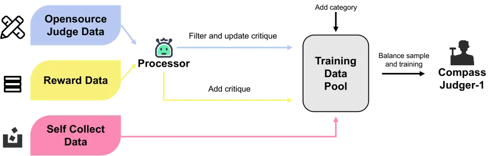

breakatwhitespace=false, breaklines=true, captionpos=b, keepspaces=true,
showspaces=false, showstringspaces=false, showtabs=false, tabsize=2

# CompassJudger-1: All-in-one Judge Model Helps Model Evaluation and Evolution

Maosong Cao    Alexander Lam    Haodong Duan    Hongwei Liu
Affiliation: Songyang Zhang^(\*), Kai Chen^(\*) Affiliation: Shanghai AI
Laboratory Email: [opencompass@pjlab.org.cn](mailto:) Affiliation: ^(\*)
corresponding authors

###### Abstract

Efficient and accurate evaluation is crucial for the continuous
improvement of large language models (LLMs). Among various assessment
methods, subjective evaluation has garnered significant attention due to
its superior alignment with real-world usage scenarios and human
preferences. However, human-based evaluations are costly and lack
reproducibility, making precise automated evaluators (judgers) vital in
this process. In this report, we introduce CompassJudger-1, the first
open-source all-in-one judge LLM. CompassJudger-1 is a general-purpose
LLM that demonstrates remarkable versatility. It is capable of: 1.
Performing unitary scoring and two-model comparisons as a reward model; 2. Conducting evaluations according to specified formats; 3. Generating
critiques; 4. Executing diverse tasks like a general LLM. To assess the
evaluation capabilities of different judge models under a unified
setting, we have also established JudgerBench, a new benchmark that
encompasses various subjective evaluation tasks and covers a wide range
of topics. CompassJudger-1 offers a comprehensive solution for various
evaluation tasks while maintaining the flexibility to adapt to diverse
requirements. Both CompassJudger and JudgerBench are released and
available to the research community at
[CompassJudger](https://github.com/open-compass/CompassJudger). We
believe that by open-sourcing these tools, we can foster collaboration
and accelerate progress in LLM evaluation methodologies.

|     |
| --- |
|     |

## 1 Introduction

The evaluation of large language models (LLMs) typically falls into two
major categories: objective evaluation and subjective evaluation.
Objective evaluation evaluates LLMs using questions with ground-truth
answers (multiple-choice questions, fill-in-the-blank questions, etc.).
Given LLM responses and answers, rule-based approaches are adopted to
check if the responses are correct or not. Subjective evaluation, on the
other hand, often requires a more comprehensive assessment of models’
responses from multiple perspectives such as helpfulness, honesty, or
creativity (Liu et al., 2023). Most questions in subjective evaluation
do not have a ground-truth answer, thus requiring human judgement for
response quality assessment.

Despite the effectiveness, human-based subjective evaluation is
time-consuming, labor-intensive, as well as hard to reproduce.
Therefore, in early stages of subjective evaluation, using the
best-performing model (such as GPT4 (Achiam et al., 2023)) to evaluate
the responses of LLMs became the most adopted approach, which has been
applied to multiple subjective evaluation benchmarks including
AlpacaEval (Dubois et al., 2024a), ArenaHard (Li et al., 2024),
WildBench (Lin et al., 2024), and AlignBench (Liu et al., 2023).
However, those judge models with stronger critique capabilities are
often commercial APIs with limited transparency and charge per use. The
cost can be prohibitive for research studies when evaluations are
frequently conducted.

Recent efforts in the research community have focused on developing
open-source judge models for subjective evaluation of large language
models (LLMs). For example, CritiqueLLM (Ke et al., 2023) has been
developed to evaluate AlignBench instead of GPT-4. Works like Auto-J (Li
et al., 2023) and Prometheus (Kim et al., 2024) also explore different
training paradigms for judge models. However, most open-source judge
LLMs are constrained by their specific training tasks and can only
adhere to certain formats. This limitation restricts their applicability
across multiple subjective benchmarks simultaneously. We posit that,
rather than developing LLMs solely for judging purposes, it is crucial
for a judge LLM to excel in both judging tasks and general tasks to
achieve good generalization capability, similar to GPT-4. Therefore, the
development of an all-in-one model with strong judge capabilities is
paramount. Such a model should demonstrate: 1. Robust generalization
abilities; 2. Applicability to diverse subjective evaluation settings; 3. Adaptability to emerging evaluation tasks.

In addition, evaluating the effectiveness of judge models on subjective
evaluation tasks is crucial. However, among the numerous existing LLM
benchmarks, very few are specifically designed for assessing judge
models or reward models. RewardBench (Lambert et al., 2024) represents
an initial attempt in this direction, comprising approximately 3,000
questions with corresponding answers from two models and annotated
ground truth preferences from humans. This benchmark aims to test
whether judge models or reward models can accurately identify relative
response quality. Despite being a commendable first step, the scenarios
covered by RewardBench are relatively simplified. It also lacks an
examination of the model’s critique capabilities and the ability to
generate formatted judgement. Given these constraints, there is a clear
need for a more comprehensive benchmark to assess judgment capabilities.

In response to the aforementioned challenges, we conduct extensive
investigations on two key components: all-in-one judger training and
judge model evaluation. High-quality data is paramount to the effective
training of models, therefore, we first explore the data recipe for
training CompassJudger-1, which includes various data sources such as
pair-wise data used for reward model tuning, open-source critique data,
and self-collected data. We further develop several data filtering and
sampling strategies for the training process. Additionally, we also
investigate the influence of the general SFT (G-SFT) data on training a
judge model. We also introduce the JudgerBench in this work, which
includes the bi-lingual realistic human annotation from the LLM arena
(ChatBot Arena (Chiang et al., 2024) and CompassArena¹¹ 1 LLM Arena
released by OpenCompass:
[https://arena.opencompass.org.cn/](https://arena.opencompass.org.cn/)),
as well as GPT annotations on the typical subjective Benchmarks. The
related code and models are released in
[https://github.com/open-compass/CompassJudger](https://github.com/open-compass/CompassJudger).

## 2 CompassJudger-1

In this section, we first introduce the training data used to build
CompassJudger-1 in Sec. 2.1, followed by the details of training
strategies in Sec. 2.2

### 2.1 Data Collection

Figure 1: Training Data Collection of CompassJudger-1.

High-quality data is essential for training an effective model, and the
judge model is no exception. Therefore, we focus on data collection and
the composition of the training dataset. Our training data is primarily
divided into three categories: publicly available judge data,
self-collected subjective evaluation data, and reward data used for
training reward models.

We present the relevant information of all the data in Table 1. The
table clearly shows that the number of entries in the training data pool
from different sources can vary greatly, making it highly imbalanced.
Due to the unique nature of judge data, the output format from the same
dataset is often uniform. This can cause the model’s response patterns
to become rigid, which is a key reason why most judge models struggle
with out-of-domain evaluation. Therefore, appropriate sampling strategy
is necessary when incorporating the data into the final training set.

|                          |                                   |                                 |        |          |
| ------------------------ | --------------------------------- | ------------------------------- | ------ | -------- |
| Attribution              | Dataset Name                      | Data Format                     | Number | Language |
| Open-source Judge Data   | AlpacaFarm (Dubois et al., 2024b) | Pairwise                        | 39k    | EN       |
|                          | Auto-J (Li et al., 2023)          | Pointwise, Pairwise, Generative | 9k     | ZH, EN   |
|                          | PandaLM (Wang et al., 2023)       | Pairwise                        | 287k   | EN       |
|                          | JudgeLM (Zhu et al., 2023)        | Pointwise                       | 100k   | EN       |
|                          | LLM-Eval2 (Zhang et al., 2023)    | Pointwise, Generative           | 10k    | ZH       |
|                          | CritiqueBench (Lan et al., 2024)  | Generative                      | 1k     | EN       |
|                          | UltraFeedback (Cui et al., 2023)  | Pointwise, Generative           | 380k   | EN       |
| Open-source Reward Data  | OffsetBias (Park et al., 2024)    | Pairwise                        | 8k     | EN       |
|                          | Hendrydong (Dong et al., 2024)    | Pairwise                        | 700k   | EN       |
|                          | SkyWorker (Shiwen et al., 2024)   | Pairwise                        | 80k    | EN       |
|                          | Airoboros                         | Pairwise                        | 36k    | EN       |
|                          | Anthropic                         | Pairwise                        | 161k   | EN       |
|                          | PKU Alignment                     | Pairwise                        | 82k    | EN       |
| Self Collect Judge Data  | CJ-Judge-Data-v1                  | Pointwise, Pairwise, Generative | 60k    | ZH, EN   |
| Self Collect Reward Data | Math Code Preference              | Pairwise                        | 11k    | EN       |
|                          | Chinese Math                      | Pairwise                        | 76k    | ZH       |
|                          | LengthControl                     | Pairwise                        | 0.6k   | EN       |
|                          | Language Match                    | Pairwise                        | 0.5k   | ZH, EN   |

Table 1: Training Data Construction of CompassJudger-1, Pointwise
indicates that the data contains only one model’s response along with
the score given by the Judge model/Reward model. Pairwise indicates that
the data includes responses from two models and the comparison result
given by the Judge model/Reward model. Generative indicates that the
data includes the Judge results as well as the reasoning process of the
Judge. The number of each dataset refers to the number of candidates in
the Training Data pool, not the final amount of training data.

Additionally, the proportion of generative data in the overall data pool
is relatively small, with most data containing only judgment results
rather than the reasoning behind them. Therefore, to strengthen the
model’s critique capabilities, it is essential to expand the generative
critique portion of the existing data. To address this, we introduce the
following strategies for datasets from various sources. The specific
data processing procedures are also illustrated in Figure 1.

#### Public Judge Data:

We collect public available judge data from below datasets:
PandaLM (Wang et al., 2023), JudgeLM (Zhu et al., 2023), AutoJ (Li
et al., 2023), AlpacaFarm (Dubois et al., 2024b), CritiqueBench (Lan
et al., 2024), Ultrafeedback (Cui et al., 2023), etc. Then, we introduce
three methods to improve the training data quality of them.

$`\bullet`$ Re-evaluate. We start by updating outdated judge data, which
uses older models like ChatGPT for judging and has lost relevance.
Therefore, we use the more powerful Qwen-2.5-72B (Yang et al., 2024), to
re-evaluate the original tasks and generate new training data.

$`\bullet`$ Data Categorization. We further categorize the data to
facilitate subsequent sampling. The question components are extracted,
and each question is assigned to a category using LLMs with specifically
designed prompts. Detailed prompts and category labels can be found in
the A.1.

$`\bullet`$ Balance Sampling. During the training of general models (Cai
et al., 2024), we achieved better results when the various class labels
in the training data maintain a certain level of balance. Thus to ensure
category balance, we applied category-balanced sampling to the judge
data. Using the class labels obtained from the previous process, we
performed undersampling on categories with ample data and oversampling
on categories with insufficient data, ultimately maintaining a balance
across all categories in the dataset.

#### Self-collect Data

During the iterative training of InternLM2.5 (Cai et al., 2024), we
conducted extensive evaluation on our internal subjective test sets. We
collected this internal data, which covers a wide range of question
types, including pointwise, pairwise, and single-turn dialogue
evaluations, and multi-turn dialogue evaluations. Since the judgments
are made by models with strong evaluation capabilities, they are
directly added to the training data pool after balancing the quantities,
resulting in approximately 20k entries in the final trainingset.

#### Reward Data

Our early experiments indicates that excessive reward data, which lacked
a critique process and contained only judge results, led to model
collapse, necessitating strict limitations on its quantity to maintain
balanced training data. To enhance the judge model’s critique
capabilities, particularly for reasoning and mathematics problems, we
reformat questions and implemented a processing system to generate
detailed critique processes, ultimately curating approximately 500,000
entries of high-quality data. The prompts for obtaining critiques are
detailed in the  A.2.

### 2.2 Training Strategy and Ablation Study

In this section, we present our training configuration and discuss our
ablation study on different data sources.

#### Training Configuration

Based on the processed training data pool, we conduct experiments with
varying data ratios. We employ Xtuner (Contributors, 2023b) as our
training framework and, through extensive experimentation, determine
that an epoch of 2 and a learning rate of 2e-5 are optimal parameters.
We perform ablation experiments specifically on the proportions of
reward data and general SFT data.

#### Ablation Study on Reward Data

We first examine the proportion of the reward data. As the pairwise
evaluation tasks in reward data only require the categorical annotation,
we can easily collect a large number of data from the public community.
While incorporating reward data benefits the training of an all-in-one
judge model, our experiments reveal that excessive reward data can lead
to model overfitting, resulting in simplistic outputs resembling a
reward model and compromising the ability to perform complex critique
tasks. Through experimentation (See in Table 2), we determine that the
optimal proportion of reward data lies between 50% and 70%, enabling the
model to achieve strong judging capabilities while maintaining
generalizability.

| Models             | Proportion of Reward Data | RewardBench | JudgerBench | Average |
| ------------------ | ------------------------- | ----------- | ----------- | ------- |
| CompassJudger-1-7B | 25%                       | 0.810       | 0.633       | 0.722   |
|                    | 33%                       | 0.812       | 0.646       | 0.729   |
|                    | 50%                       | 0.823       | 0.665       | 0.744   |
|                    | 66%                       | 0.831       | 0.697       | 0.764   |
|                    | 75%                       | 0.833       | 0.612       | 0.723   |
|                    | 83%                       | 0.834       | 0.438       | 0.636   |

Table 2: Ablation Study About the Proportion of Reward Data.

| Models            | Judge Average | AlignBench | ArenaHard | Fofo  | WildBench | Sub. Average |
| ----------------- | ------------- | ---------- | --------- | ----- | --------- | ------------ |
| CJ-1-7B-w/o G-SFT | 0.693         | 0.590      | 0.487     | 0.750 | -0.071    | 0.490        |
| CJ-1-7B-w. G-SFT  | 0.697         | 0.624      | 0.562     | 0.740 | 0.015     | 0.528        |

Table 3: Ablation Study of General SFT Data. ”Judge Average” refers to
the evaluation score that encompasses the judging capabilities of both
RewardBench and JudgerBench, while ”Subjective Average” is the
evaluation score on several subjective datasets listed in the table. The
relevant evaluation results are obtained using
OpenCompass (Contributors, 2023a). All results from the corresponding
datasets have been normalized to percentages.

#### Influence of General SFT Data

We then investigate the impact of general SFT data proportions. Since
our goal is to create a powerful all-in-one model with judging
capabilities rather than a model specific to particular datasets,
incorporating general SFT (G-SFT) training data is essential for
maintaining generalizability. Our G-SFT data comes from the internal
training data for SFT. Our experiments show that an appropriate amount
not only preserves the model’s general capabilities but also enhances
its judging performance. We present these results in Table 3.

#### Data Recipes

Based on our findings, we establish the optimal training data ratio as:

Our final training dataset comprises approximately 900k entries. We
select the recently released open-source Qwen2.5 series (Yang et al., 2024) as the foundation models for our judge SFT training. We detail the
related results in the following sections.

## 3 JudgerBench

In this section, we introduce JudgerBench, a specialized evaluation
dataset designed to evaluate the judge models. To replicate realistic
judge model application scenarios, JudgerBench incorporates two distinct
types of annotations: human annotations for the arena part and LLM
annotations for the benchmark component. We detail the construction
process of these components in Sec. 3.1 and present CompassJudger’s
performance on JudgerBench in Sec. 3.2.

### 3.1 JudgerBench Construction

JudgerBench consists of two primary components: the Arena component
(denoted as JDB-A) and the Benchmark component (denoted as JDB-B).
JDB-A, similar to RewardBench, focuses on alignment with human
preferences and requires only simple judge outputs such as \[\[A\]\] or
\[\[B\]\]. JDB-B, on the other hand, assesses the model’s critique
capabilities and its ability to provide judgments following specific
formats.

#### JudgerBench A (Arena Part)

$`\bullet`$ Data Source. JDB-A consists of two sections: English and
Chinese. The English section is derived from the released data of
Chatbot Arena (Chiang et al., 2024), while the Chinese section comes
from the collected data of CompassArena (Contributors, 2023a). These
data are the results of human voting, with each entry containing a
question and the corresponding responses from two models, along with the
vote on which model is the winner. Both Chinese and English include
single-turn and multi-turn dialogue data, with approximately 500
single-turn dialogues and 250 multi-turn dialogues, totaling around 1500
pieces of data. We introduced in next paragraph how we screen and obtain
these data.

$`\bullet`$ Screening Process. The 1,500 data points in JDB-A were
obtained through the following screening process: We first performed
unsupervised clustering (specifically, k-means with k set to 50 in our
implementation) on all the data to get rough categories. Then, the
Processor model (Qwen2.5-72B) summarized specific category names based
on typical cases within these categories (detailed category names can be
found in the results of Table 7). After obtaining the top 10 category
names summarized by the processor, we used the processor to process each
data point individually, assigning them to their respective categories.
Following the detailed categorization, we conducted manual screening to
ensure the correctness of the judging data.

In addition, to give JDB-A a difficulty grading system, besides setting
categories and handling single-turn and multi-turn dialogues, we also
performed difficulty grading based on the length of model responses.
According to the experience of subjective evaluation (Dubois et al.,
2024a), Judgers often exhibit a length bias, meaning they tend to favor
longer responses when the quality of responses from two models is
similar. To avoid fitting this length bias of the Judgers, we selected a
batch of shorter responses that were marked as winners to serve as
difficult data, thus increasing the difficulty of JDB-A.

#### JudgerBench B (Benchmark Part)

$`\bullet`$ Construction Methods. JDB-B primarily includes four datasets
(AlignBench (Liu et al., 2023), ArenaHard (Li et al., 2024), FoFo (Xia
et al., 2024), and WildBench (Lin et al., 2024)), which are very
commonly used in subjective evaluations, covering different subjective
scenarios (such as daily chat, instruction following), different
evaluation methods (such as scoring, head-to-head competition),
different languages (Chinese and English), and single and multi-turn
dialogues. We detail the relevant properties of these datasets in
Table 4. For these four subjective datasets, we sampled 100 questions
from each dataset according to their respective subcategories, totaling
400 questions. Then, we used the top 10 closely ranked models from the
OpenCompass leaderboard²² 2 We use the data of 202407 version. to obtain
their responses to these 400 questions (specific model information can
be found in the data json), thus acquiring a total of 4000 QA pairs,
note that these 10 models have very similar and high capabilities, which
also demonstrates the difficulty of judging with JDB-B. We then used
GPT-4o³³ 3 We use gpt-4o-2024-08-06 as default if not specified. to
judge these pairs, using this judgment as a benchmark to check whether
the judgment results of other models align with those of GPT-4o.

| Dataset Name | Data Format | Turns                   | Scenario Label                    | Language |
| ------------ | ----------- | ----------------------- | --------------------------------- | -------- |
| AlignBench   | Pairwise    | Single Turn             | Daily Chat, Chinese Culture       | ZH       |
| ArenaHard    | Pairwise    | Single Turn             | Daily Chat, Reasoning, Math, Code | EN       |
| FoFo         | Pointwise   | Single Turn             | Instruction Following             | ZH, EN   |
| WildBench    | Pairwise    | Single Turn, Multi Turn | Daily Chat                        | EN       |

Table 4: Detailed Introduction of Subjective Evaluation Datasets in
JDB-B The official FoFo dataset includes only English, and we created
the Chinese portion. Additionally, due to the outdated references in
AlignBench, we changed its evaluation method from Pointwise to Pairwise.

|                         |             |          |          |           |            |             |
| ----------------------- | ----------- | -------- | -------- | --------- | ---------- | ----------- |
| Models                  | RewardBench | JDB-A EN | JDB-A CN | JDB-B Acc | JDB-B Corr | JudgerBench |
| Qwen2.5-7B-Chat         | 0.789       | 0.567    | 0.535    | 0.590     | 0.874      | 0.641       |
| Qwen2-72B-Chat          | 0.822       | 0.588    | 0.584    | 0.625     | 0.935      | 0.683       |
| Qwen2.5-72B-Chat        | 0.832       | 0.615    | 0.590    | 0.681     | 0.937      | 0.706       |
| GPT-4o-0806             | 0.867       | 0.664    | 0.608    | 1         | 1          | 0.818       |
| Skywork-llama3.1-8B     | 0.890       | 0.630    | 0.605    | -         | -          | -           |
| Selftaught-llama3.1-70B | 0.900       | 0.443    | 0.570    | 0.598     | 0.869      | 0.620       |
| CJ-1-1.5B               | 0.724       | 0.553    | 0.527    | 0.629     | 0.905      | 0.654       |
| CJ-1-7B                 | 0.831       | 0.570    | 0.583    | 0.687     | 0.948      | 0.697       |
| CJ-1-14B                | 0.842       | 0.599    | 0.615    | 0.699     | 0.959      | 0.718       |
| CJ-1-32B                | 0.854       | 0.614    | 0.612    | 0.720     | 0.963      | 0.727       |

Table 5: Results on RewardBench and JudgerBench, Which JDB-A means
JudgerBench partA, JDB-B means JudgerBench partB.

$`\bullet`$ Evaluation Metrics. To facilitate the research, we adopt the
GPT-4o’s judgement as the reference ground-truth (though there may exist
noise and errors). We calculate from two metrics for JDB-B, accuracy and
correlation.

- •
  The accuracy per question, i.e., whether each model’s judgment on each
  question matches GPT-4o’s judgment, which is a very stringent
  indicator, especially when dealing with datasets like WildBench that
  require five-category judgments (A++, A+, A=B, B+, B++). The accuracy
  rate of judge models tends to be lower.
- •
  For the correction metric, we adopt Pearson product-moment correlation
  coefficients. We first obtain the scoring results of 10 reference
  models and then sort this result. If these average scores on whole
  dataset align closely with GPT-4o’s scores, then even if there are
  discrepancies in the scoring on each question, it indicates that the
  Judge Model can reflect good judgment effects overall.

### 3.2 JudgerBench Results

#### Overall Results

We test baseline Chat models, current SOTA Judge Models, and our
CompassJudger series on RewardBench and JudgerBench, reporting the
overall results in Table 5, with more detailed results presented in
subsequent tables. Notably, many judge models failed to adhere to the
prompt templates of the subjective datasets, leading to test failures,
and we showcase one of these failure cases in Appendix A.3. From the
table, it can be observed that our CompassJudger series outperforms all
open-source models and achieves over 95% of GPT-4o’s judging capability
in the relevance tests on JDB-B. While GPT-4o demonstrates high
consistency with human evaluation results across different data domains,
some models (such as Selftaught, skyworker), despite achieving high
scores in one domain like RewardBench, lose a certain degree of
generalization in other domains and do not possess good universal
judging capabilities. Even though they are generative models, they are
no longer able to follow instructions to evaluate common subjective
datasets. In contrast, CompassJudger v1 achieved relatively balanced
results on both RewardBench and JDB-A, and showed a significant lead on
JDB-B.

#### RewardBench Results

We present the detailed results on RewardBench in Table 6. For
RewardBench, some existing Judge Models perform well (e.g. Skywork and
Selftaught), even surpassing GPT-4o. However, upon closer inspection,
the main gap is evident in the Chat Hard category. The number of
questions in this category does not constitute a large proportion of the
total questions on RewardBench. There is a possibility of over-training
with respect to these Judge Models, and our CompassJudger series also
shows improving scores in this category as the model size increases.

|                         |       |           |        |           |         |
| ----------------------- | ----- | --------- | ------ | --------- | ------- |
| Models                  | Chat  | Chat Hard | Safety | Reasoning | Average |
| Qwen2.5-7B-Chat         | 0.961 | 0.567     | 0.831  | 0.797     | 0.789   |
| Qwen2-72B-Chat          | 0.955 | 0.640     | 0.843  | 0.848     | 0.822   |
| Qwen2.5-72B-Chat        | 0.961 | 0.680     | 0.838  | 0.850     | 0.832   |
| GPT-4o-0806             | 0.961 | 0.761     | 0.881  | 0.866     | 0.867   |
| Skywork-llama3.1-8B     | 0.936 | 0.814     | 0.911  | 0.898     | 0.890   |
| Selftaught-llama3.1-70B | 0.969 | 0.851     | 0.896  | 0.884     | 0.900   |
| CJ-1-1.5B               | 0.964 | 0.495     | 0.781  | 0.656     | 0.724   |
| CJ-1-7B                 | 0.978 | 0.605     | 0.847  | 0.895     | 0.831   |
| CJ-1-14B                | 0.975 | 0.623     | 0.845  | 0.925     | 0.842   |
| CJ-1-32B                | 0.978 | 0.656     | 0.861  | 0.922     | 0.854   |

Table 6: Detailed Results on RewardBench.

|                         |        |      |          |      |      |           |          |      |         |            |
| ----------------------- | ------ | ---- | -------- | ---- | ---- | --------- | -------- | ---- | ------- | ---------- |
| Models                  | Teaser | AI   | Roleplay | Chat | Math | Reasoning | Creation | Code | Science | Humanities |
| Qwen2.5-7B-Chat         | 0.54   | 0.59 | 0.59     | 0.46 | 0.69 | 0.43      | 0.61     | 0.65 | 0.58    | 0.52       |
| Qwen2-72B-Chat          | 0.63   | 0.59 | 0.54     | 0.49 | 0.62 | 0.64      | 0.60     | 0.74 | 0.51    | 0.52       |
| Qwen2.5-72B-Chat        | 0.68   | 0.57 | 0.57     | 0.47 | 0.78 | 0.64      | 0.58     | 0.75 | 0.61    | 0.52       |
| GPT-4o-0806             | 0.82   | 0.53 | 0.62     | 0.61 | 0.83 | 0.67      | 0.67     | 0.73 | 0.64    | 0.55       |
| Skywork-llama3.1-8B     | 0.69   | 0.61 | 0.54     | 0.62 | 0.63 | 0.64      | 0.60     | 0.69 | 0.74    | 0.53       |
| Selftaught-llama3.1-70B | 0.47   | 0.45 | 0.47     | 0.37 | 0.45 | 0.43      | 0.36     | 0.58 | 0.48    | 0.36       |
| CJ-1-1.5B               | 0.42   | 0.56 | 0.56     | 0.43 | 0.66 | 0.47      | 0.55     | 0.78 | 0.64    | 0.44       |
| CJ-1-7B                 | 0.56   | 0.56 | 0.51     | 0.47 | 0.68 | 0.58      | 0.58     | 0.75 | 0.58    | 0.43       |
| CJ-1-14B                | 0.66   | 0.51 | 0.57     | 0.54 | 0.72 | 0.61      | 0.56     | 0.74 | 0.61    | 0.47       |
| CJ-1-32B                | 0.66   | 0.57 | 0.56     | 0.59 | 0.78 | 0.58      | 0.55     | 0.75 | 0.60    | 0.49       |

Table 7: Detailed Results on JDB-A-EN.

#### JudgerBench A Results

The detailed results for JudgerBench A are presented in Tables  7 and
 8, showing that there are slight differences in the judging
capabilities of various models in both Chinese and English domains. For
instance, the English reasoning judging performance of Qwen2.5-7B-Chat
is lower than its Chinese reasoning performance, and the English scores
for humanities are also much lower than the Chinese scores for all
models. On the other hand, GPT-4o leads in both Chinese and English
across all domains, particularly in the Teaser category, where GPT-4o
significantly outperforms other models, indicating its better
understanding and discernment of human teasers. In the Chat category,
the scores of the models are relatively close in both Chinese and
English. From the scoring situation of CompassJudger, its strengths are
evident in Math, Reasoning, and Code, and these sub-domains are closely
related to the model’s judging capabilities. Therefore, the high judging
performance of CompassJudger is also attributed to the enhanced
reasoning and mathematical abilities in its training data, which also
provides insights for the development of subsequent Judge Models and
general-purpose models.

|                         |        |      |          |      |      |           |          |      |         |            |
| ----------------------- | ------ | ---- | -------- | ---- | ---- | --------- | -------- | ---- | ------- | ---------- |
| Models                  | Teaser | AI   | Roleplay | Chat | Math | Reasoning | Creation | Code | Science | Humanities |
| Qwen2.5-7B-Chat         | 0.46   | 0.58 | 0.36     | 0.45 | 0.70 | 0.53      | 0.52     | 0.53 | 0.52    | 0.64       |
| Qwen2-72B-Chat          | 0.62   | 0.54 | 0.34     | 0.55 | 0.68 | 0.63      | 0.58     | 0.58 | 0.62    | 0.64       |
| Qwen2.5-72B-Chat        | 0.65   | 0.47 | 0.49     | 0.47 | 0.71 | 0.60      | 0.57     | 0.58 | 0.69    | 0.60       |
| GPT-4o-0806             | 0.77   | 0.56 | 0.51     | 0.53 | 0.67 | 0.66      | 0.63     | 0.58 | 0.62    | 0.58       |
| Skywork-llama3.1-8B     | 0.62   | 0.58 | 0.58     | 0.59 | 0.63 | 0.58      | 0.60     | 0.61 | 0.60    | 0.61       |
| Selftaught-llama3.1-70B | 0.62   | 0.56 | 0.55     | 0.48 | 0.67 | 0.55      | 0.57     | 0.57 | 0.51    | 0.61       |
| CJ-1-1.5B               | 0.54   | 0.58 | 0.38     | 0.38 | 0.62 | 0.63      | 0.54     | 0.52 | 0.55    | 0.54       |
| CJ-1-7B                 | 0.62   | 0.54 | 0.41     | 0.58 | 0.70 | 0.60      | 0.59     | 0.56 | 0.59    | 0.60       |
| CJ-1-14B                | 0.69   | 0.61 | 0.51     | 0.55 | 0.71 | 0.68      | 0.60     | 0.58 | 0.61    | 0.65       |
| CJ-1-32B                | 0.69   | 0.58 | 0.53     | 0.52 | 0.71 | 0.53      | 0.60     | 0.61 | 0.61    | 0.69       |

Table 8: Detailed Results on JDB-A-CN.

#### JudgerBench B Results

On JudgerBenchB, we report the results based on the accuracy rate per
question and the correlation results based on the overall model scores,
shown in Tables 9 and  10, respectively. Many models, although they are
generative Judge Models, are fundamentally unable to evaluate according
to the instructions given by the dataset, and therefore we cannot report
their scores on JudgerBenchB. This is also one of the original
intentions behind our proposal for an All-in-one judge model. From the
tables, we can see that even though Selftaught-llama3.1-70B is a more
generalizable Judge Model than Skywork-llama3.1-8B, the performance of
this specialized Judge Model in subjective evaluations is even inferior
to that of general models like the Qwen-chat series. This also indicates
that the domains for training current Judge Models are too narrow, while
CompassJudger maintains excellent generalizability and judging
capabilities among them.

| Models                  | AlignBench | Fofo  | WildBench | ArenaHard | Average |
| ----------------------- | ---------- | ----- | --------- | --------- | ------- |
| Qwen2.5-7B-Chat         | 0.777      | 0.670 | 0.470     | 0.444     | 0.590   |
| Qwen2-72B-Chat          | 0.867      | 0.692 | 0.564     | 0.376     | 0.625   |
| Qwen2.5-72B-Chat        | 0.878      | 0.677 | 0.599     | 0.570     | 0.681   |
| Selftaught-llama3.1-70B | 0.755      | 0.627 | 0.538     | 0.472     | 0.598   |
| CJ-1-1.5B               | 0.822      | 0.712 | 0.550     | 0.430     | 0.629   |
| CJ-1-7B                 | 0.816      | 0.783 | 0.564     | 0.586     | 0.687   |
| CJ-1-14B                | 0.839      | 0.787 | 0.566     | 0.602     | 0.699   |
| CJ-1-32B                | 0.857      | 0.806 | 0.596     | 0.621     | 0.720   |

Table 9: Detailed Accuracy Results on JDB-B.

| Models                  | AlignBench | Fofo  | WildBench | ArenaHard | Average |
| ----------------------- | ---------- | ----- | --------- | --------- | ------- |
| Qwen2.5-7B-Chat         | 0.916      | 0.681 | 0.967     | 0.931     | 0.874   |
| Qwen2-72B-Chat          | 0.937      | 0.889 | 0.976     | 0.936     | 0.935   |
| Qwen2.5-72B-Chat        | 0.964      | 0.916 | 0.958     | 0.912     | 0.937   |
| Selftaught-llama3.1-70B | 0.918      | 0.667 | 0.950     | 0.942     | 0.869   |
| CJ-1-1.5B               | 0.928      | 0.851 | 0.981     | 0.858     | 0.905   |
| CJ-1-7B                 | 0.956      | 0.936 | 0.970     | 0.932     | 0.948   |
| CJ-1-14B                | 0.966      | 0.956 | 0.965     | 0.951     | 0.959   |
| CJ-1-32B                | 0.973      | 0.951 | 0.954     | 0.975     | 0.963   |

Table 10: Detailed Correlation Results on JDB-B.

## 4 Conclusion and Discussion

In this report, we propose the all-in-one Judge model, CompassJudger,
and the JudgerBench for evaluating model judging capabilities. Our
CompassJudger model has achieved the best results among open-source
models on JudgerBench and is truly capable of replacing GPT-4o for
evaluating common subjective datasets, greatly reducing the cost of
subjective evaluations. In addition, we have many issues for further
discussion.

#### How can the Judge Model assist in the iteration of models?

The potential of a good judge model is not limited to just judging and
critiquing capabilities; it can also help models iterate and evolve. It
should point out the shortcomings of the model when answering questions
and provide guidance, which is more conducive to the model improving its
responses or achieving a more standardized answer—something that a
regular reward model cannot accomplish. This has been validated in
related experiments, and our internal experimental results are coming
soon, which will demonstrate how we use the judge model to facilitate
better iteration of the model.

#### If the model’s judging capability is part of its general abilities, can judge training enhance the model’s overall general capabilities?

Just as GPT-4 can handle all judge tasks, we believe that judge
capability is just a part of the model’s general abilities, with a focus
on reasoning and instruction following. Our experiments have also
observed that good training in instruction following and reasoning
abilities can significantly improve the model’s judging capability.
Conversely, relevant judge data can further enhance the model’s
reasoning and instruction following abilities.

## 5 Acknowledgement

We would like to express our sincere gratitude to InternLM’s
post-training team for generously providing the data used in this
research. Their contribution is essential to the success of this
project. We also extend our thanks to Jiaye Ge for their invaluable
support, guidance, and coordination throughout the project.

## References

- Achiam et al. (2023) Josh Achiam, Steven Adler, Sandhini Agarwal, Lama
  Ahmad, Ilge Akkaya, Florencia Leoni Aleman, Diogo Almeida, Janko
  Altenschmidt, Sam Altman, Shyamal Anadkat, et al. Gpt-4 technical
  report. _arXiv preprint arXiv:2303.08774_, 2023.
- Cai et al. (2024) Zheng Cai, Maosong Cao, Haojiong Chen, Kai Chen,
  Keyu Chen, Xin Chen, Xun Chen, Zehui Chen, Zhi Chen, Pei Chu, et al.
  Internlm2 technical report. _arXiv preprint arXiv:2403.17297_, 2024.
- Chiang et al. (2024) Wei-Lin Chiang, Lianmin Zheng, Ying Sheng,
  Anastasios Nikolas Angelopoulos, Tianle Li, Dacheng Li, Hao Zhang,
  Banghua Zhu, Michael Jordan, Joseph E Gonzalez, et al. Chatbot arena:
  An open platform for evaluating llms by human preference. _arXiv
  preprint arXiv:2403.04132_, 2024.
- Contributors (2023a) OpenCompass Contributors. Opencompass: A
  universal evaluation platform for foundation models.
  [https://github.com/open-compass/opencompass](https://github.com/open-compass/opencompass),
  2023a.
- Contributors (2023b) XTuner Contributors. Xtuner: A toolkit for
  efficiently fine-tuning llm.
  [https://github.com/InternLM/xtuner](https://github.com/InternLM/xtuner),
  2023b.
- Cui et al. (2023) Ganqu Cui, Lifan Yuan, Ning Ding, Guanming Yao, Wei
  Zhu, Yuan Ni, Guotong Xie, Zhiyuan Liu, and Maosong Sun.
  Ultrafeedback: Boosting language models with high-quality
  feedback, 2023.
- Dong et al. (2024) Hanze Dong, Wei Xiong, Bo Pang, Haoxiang Wang, Han
  Zhao, Yingbo Zhou, Nan Jiang, Doyen Sahoo, Caiming Xiong, and Tong
  Zhang. Rlhf workflow: From reward modeling to online rlhf, 2024.
- Dubois et al. (2024a) Yann Dubois, Balázs Galambosi, Percy Liang, and
  Tatsunori B Hashimoto. Length-controlled alpacaeval: A simple way to
  debias automatic evaluators. _arXiv preprint arXiv:2404.04475_, 2024a.
- Dubois et al. (2024b) Yann Dubois, Chen Xuechen Li, Rohan Taori,
  Tianyi Zhang, Ishaan Gulrajani, Jimmy Ba, Carlos Guestrin, Percy S
  Liang, and Tatsunori B Hashimoto. Alpacafarm: A simulation framework
  for methods that learn from human feedback. _Advances in Neural
  Information Processing Systems_, 36, 2024b.
- Ke et al. (2023) Pei Ke, Bosi Wen, Zhuoer Feng, Xiao Liu, Xuanyu Lei,
  Jiale Cheng, Shengyuan Wang, Aohan Zeng, Yuxiao Dong, Hongning Wang,
  et al. Critiquellm: Scaling llm-as-critic for effective and
  explainable evaluation of large language model generation. _arXiv
  preprint arXiv:2311.18702_, 2023.
- Kim et al. (2024) Seungone Kim, Juyoung Suk, Ji Yong Cho, Shayne
  Longpre, Chaeeun Kim, Dongkeun Yoon, Guijin Son, Yejin Cho, Sheikh
  Shafayat, Jinheon Baek, et al. The biggen bench: A principled
  benchmark for fine-grained evaluation of language models with language
  models. _arXiv preprint arXiv:2406.05761_, 2024.
- Lambert et al. (2024) Nathan Lambert, Valentina Pyatkin, Jacob
  Morrison, LJ Miranda, Bill Yuchen Lin, Khyathi Chandu, Nouha Dziri,
  Sachin Kumar, Tom Zick, Yejin Choi, et al. Rewardbench: Evaluating
  reward models for language modeling. _arXiv preprint
  arXiv:2403.13787_, 2024.
- Lan et al. (2024) Tian Lan, Wenwei Zhang, Chen Xu, Heyan Huang, Dahua
  Lin, Kai Chen, and Xian-ling Mao. Criticbench: Evaluating large
  language models as critic. _arXiv preprint arXiv:2402.13764_, 2024.
- Li et al. (2023) Junlong Li, Shichao Sun, Weizhe Yuan, Run-Ze Fan, Hai
  Zhao, and Pengfei Liu. Generative judge for evaluating alignment.
  _arXiv preprint arXiv:2310.05470_, 2023.
- Li et al. (2024) Tianle Li, Wei-Lin Chiang, Evan Frick, Lisa Dunlap,
  Tianhao Wu, Banghua Zhu, Joseph E Gonzalez, and Ion Stoica. From
  crowdsourced data to high-quality benchmarks: Arena-hard and
  benchbuilder pipeline. _arXiv preprint arXiv:2406.11939_, 2024.
- Lin et al. (2024) Bill Yuchen Lin, Yuntian Deng, Khyathi Chandu, Faeze
  Brahman, Abhilasha Ravichander, Valentina Pyatkin, Nouha Dziri,
  Ronan Le Bras, and Yejin Choi. Wildbench: Benchmarking llms with
  challenging tasks from real users in the wild. _arXiv preprint
  arXiv:2406.04770_, 2024.
- Liu et al. (2023) Xiao Liu, Xuanyu Lei, Shengyuan Wang, Yue Huang,
  Zhuoer Feng, Bosi Wen, Jiale Cheng, Pei Ke, Yifan Xu, Weng Lam Tam,
  et al. Alignbench: Benchmarking chinese alignment of large language
  models. _arXiv preprint arXiv:2311.18743_, 2023.
- Park et al. (2024) Junsoo Park, Seungyeon Jwa, Meiying Ren, Daeyoung
  Kim, and Sanghyuk Choi. Offsetbias: Leveraging debiased data for
  tuning evaluators, 2024.
- Shiwen et al. (2024) Tu Shiwen, Zhao Liang, Chris Yuhao Liu, Liang
  Zeng, and Yang Liu. Skywork critic model series.
  [https://huggingface.co/Skywork](https://huggingface.co/Skywork),
  September 2024. URL
  [https://huggingface.co/Skywork](https://huggingface.co/Skywork).
- Wang et al. (2023) Yidong Wang, Zhuohao Yu, Zhengran Zeng, Linyi Yang,
  Cunxiang Wang, Hao Chen, Chaoya Jiang, Rui Xie, Jindong Wang, Xing
  Xie, et al. Pandalm: An automatic evaluation benchmark for llm
  instruction tuning optimization. _arXiv preprint
  arXiv:2306.05087_, 2023.
- Xia et al. (2024) Congying Xia, Chen Xing, Jiangshu Du, Xinyi Yang,
  Yihao Feng, Ran Xu, Wenpeng Yin, and Caiming Xiong. Fofo: A benchmark
  to evaluate llms’ format-following capability. _arXiv preprint
  arXiv:2402.18667_, 2024.
- Yang et al. (2024) An Yang, Baosong Yang, Binyuan Hui, Bo Zheng, Bowen
  Yu, Chang Zhou, Chengpeng Li, Chengyuan Li, Dayiheng Liu, Fei Huang,
  et al. Qwen2 technical report. _arXiv preprint
  arXiv:2407.10671_, 2024.
- Zhang et al. (2023) Ming Zhang, Yue Zhang, Shichun Liu, Haipeng Yuan,
  Junzhe Wang, Yurui Dong, Jingyi Deng, Tao Gui, Qi Zhang, and Xuanjing
  Huang. LLMEval-2, July 2023. URL
  [https://github.com/llmeval/llmeval-2](https://github.com/llmeval/llmeval-2).
- Zhu et al. (2023) Lianghui Zhu, Xinggang Wang, and Xinlong Wang.
  Judgelm: Fine-tuned large language models are scalable judges. _arXiv
  preprint arXiv:2310.17631_, 2023.

## Appendix A Appendix

### A.1 Prompt and category label for data categorization of public judge data.

### A.2 Prompt for getting critique of reward data.

### A.3 Failure Case for JudgerBench B

