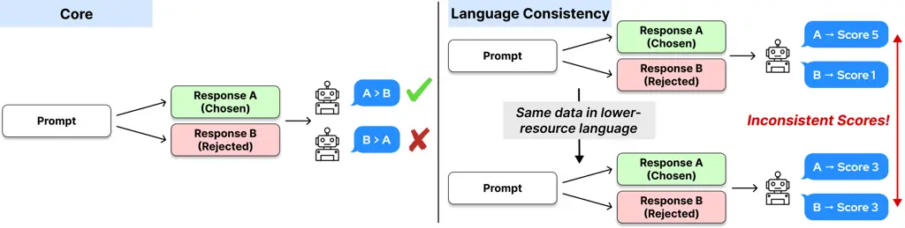
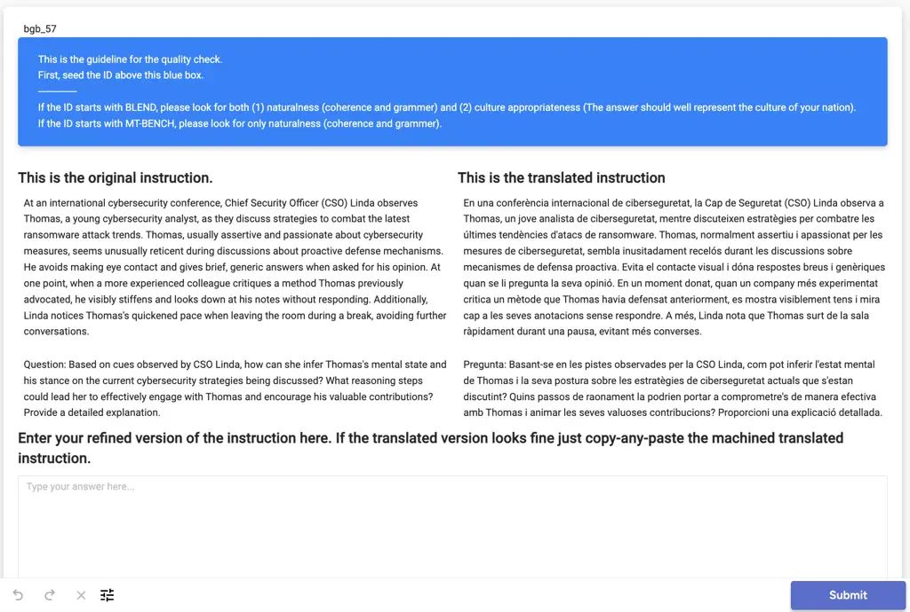

# MM-Eval: A Multilingual Meta-Evaluation Benchmark for LLM-as-a-Judge and Reward Models

Guijin Son Email: [spthsrbwls123@yonsei.ac.kr](mailto:)    Dongkeun Yoon
Email: [dkyoon@kaist.ac.kr](mailto:)    Juyoung Suk    Javier
Aula-Blasco    Mano Aslan    Vu Trong Kim    Shayekh Bin Islam    Jaume
Prats-Cristià    Lucía Tormo-Bañuelos Seungone Kim    Yonsei University
   KAIST    OneLineAI    Barcelona Supercomputing Center    Artful Media
   Bangladesh University of Engineering    Technology    Carnegie Mellon
University

###### Abstract

As Large Language Models (LLMs) are now capable of producing fluent and
coherent content in languages other than English, it is not imperative
to precisely evaluate these non-English outputs. However, when assessing
the outputs from mutlilingual LLMs, prior works often employed LLM based
evaluators that excel at assessing English outputs, without a thorough
examination of whether these evaluators could effectively assess
non-English text as well. Moreover, existing benchmarks to test
evaluator LLMs (referred to as “meta-evaluation benchmarks”) are mostly
English-centric. To bridge this gap and examine whether evaluator LLMs
can reliably assess the outputs of multilingual LLMs, we introduce
MM-Eval, a multilingual meta-evaluation benchmark comprising five core
subsets covering 18 languages and a Language Consistency subset spanning
122 languages. A core attribute of MM-Eval is that, instead of merely
translating existing English meta-evaluation benchmarks, it is designed
with multilingual-specific challenges in mind. Additionally, unlike
existing meta-evaluation benchmarks that focus solely on ranking
accuracy over pairwise data, MM-Eval also evaluates the consistency and
fairness of absolute score values across a wide range of languages. Our
results show that existing evaluator LLMs that excel in English contexts
have considerable room for improvement when assessing non-English
outputs. Furthermore, we find that evaluators are unfair and
inconsistent when evaluating lower-resourced languages. Finally, we
validate MM-Eval by measuring its correlation with Best-of-N rankings,
finding a significantly stronger correlation compared to other
meta-evaluation benchmarks. We publicly release our benchmark and
code.¹¹ 1
[https://github.com/guijinSON/MM-Eval](https://github.com/guijinSON/MM-Eval)

## 1 Introduction

Large Language Models (LLMs) have shown potential to mimic human
assessment when employed as evaluators (Zheng et al., 2023; Gu et al.,
2024; Li et al., 2024). For instance, when LLMs are prompted to function
as a judge for benchmarking purposes, they have shown high correlation
with human ratings (Liu et al., 2023; Ye et al., 2023). Furthermore,
when trained as reward models, they can be integrated into various
learning algorithms (Ouyang et al., 2022; Bai et al., 2022a; Touvron
et al., 2023) or inference-time algorithms (Gao et al., 2023; Wu et al.,
2024a; Welleck et al., 2024), thereby helping to improve LLM
performance. As such, obtaining high-quality LLM judges or reward
models—collectively referred to as evaluator LLMs throughout this
paper—is crucial for accurately assessing other LLMs and further
advancing their capabilities.

One widely used approach to assess the performance of evaluator LLMs is
to utilize a test set of preference data consisting of pairs of
responses—those that are either correct or preferred by humans (chosen
response) and those that are either wrong or not preferred (rejected
response) (Zeng et al., 2024; Lambert et al., 2024; Park et al., 2024).
The performance of the evaluator LLM is measured with an accuracy metric
by checking whether the evaluator assigns a higher score to the chosen
responses rather than rejected ones. This approach is referred to as a
meta-evaluation benchmark because it aims to evaluate the performance of
the evaluators.

Simultaneously, the performance of multilingual LLMs that process
questions or instructions in languages other than English is developing
rapidly, thereby increasing the importance of thorough evaluation of
multilingual outputs (Thellmann et al., 2024; Yue et al., 2024).
However, in practice, evaluations of multilingual LLMs often rely on
evaluator LLMs whose multilingual evaluation capabilities have not been
thoroughly assessed  (Lai et al., 2023; Liu et al., 2024; Aryabumi
et al., 2024; Dang et al., 2024). Fundamentally, the absence of
multilingual meta-evaluation benchmarks is a key reason why evaluator
LLMs remain under-tested in multilingual settings.

To address this issue, we release MM-Eval, a Multilingual
Meta-Evaluation benchmark spanning a wide range of languages, including
low-resource ones such as Swahili, Basque, and Galician. MM-Eval
consists of six subsets: five core subsets—Chat, Reasoning, Safety,
Language Hallucination, and Linguistics—cover 18 languages, while the
Language Consistency subset covers 122 languages for a broader analysis
on the consistency of evaluator LLMs across low- to high-resource
languages.

A core attribute of MM-Eval is its multilingual-first design philosophy.
Rather than simply translating existing English meta-evaluation
benchmarks into other languages, MM-Eval is constructed to address
challenges that are unique to multilingual settings. These challenges
include: Linguistics, Language Hallucination, and Language Consistency.
In addition, while prior meta-evaluation benchmarks primarily assess
evaluators based on ranking accuracy over pairwise comparisons, MM-Eval
goes a step further by evaluating the consistency and fairness of
absolute score values assigned by evaluator LLMs. This is achieved
through the Language Consistency subset and a novel metric, the Language
Consistency Index (LCI), which quantifies how uniformly evaluators score
parallel inputs across languages.

[TABLE]

Table 1: Comparison of existing meta-evaluation benchmarks along four
key criteria. Language Coverage indicates the range of languages,
including low-resource varieties. Use of Translation notes whether
machine translation was applied to entire preference datasets (“Full”),
partially/strategically (“Controlled”), or absent (“None”).
Multilingual-Specific Challenges indicates whether the benchmark
accounts for phenomena such as code-switching or unique linguistic
features. Frameworks reflects the meta-evaluation methodology.

Using MM-Eval, we evaluate the performance of 12 evaluator LLMs,
including open reward models, open judges models, and proprietary
models. Our results show that both proprietary and open evaluator LLMs
have considerable room for improvement in the core subsets of MM-Eval,
achieving an overall average accuracy of only 68.9%, where random
guessing would yield 50%. On the Linguistics and Safety subset, we find
that the performance degradation in low-resource languages over English
or high-resource languages is significant. Additionally, we find that
for low-resourced languages, LLM evaluators are unfair and inconsistent,
assigning lower scores to good responses and higher scores to bad ones.
Finally, we validate MM-Eval by measuring the correlation between its
rankings and Best-of-N performance(Gao et al., 2023; Wu et al., 2024a),
and find that MM-Eval exhibits a statistically significant positive
correlation. In contrast, English-only and machine-translated
meta-evaluation benchmarks fail to show such alignment.

Overall, our benchmark results indicate that strong evaluation
performance in English does not readily transfer to non-English
languages. Developing evaluator LLMs that perform well in multilingual
settings introduces an additional set of challenges: beyond accurately
capturing human preferences, they must also exhibit fairness and
consistency across languages. We warn against assuming that English
evaluation capabilities naturally generalize to other languages. We hope
that MM-Eval serves as a foundation for building robust, multilingual
evaluator LLMs.

## 2 Preliminary

In aligning LLMs, evaluator LLMs play a central role—from training (Pace
et al., 2024) and evaluation (Zheng et al., 2023) to test-time
inference (Gao et al., 2023; Wu et al., 2024a; Son et al., 2025).
Naturally, the critical role of evaluator LLMs has led to the emergence
of meta-evaluation benchmarks, which aim to directly assess the quality
of evaluators. These benchmarks typically present pairs of candidate
responses with a predefined preference—based on either correctness or
human judgments—and measure the evaluator LLM’s accuracy by how often it
assigns a higher score to the preferred (chosen) response over the
unpreferred (rejected) response.

While multilingual LLMs also depend on automated evaluators, we still
lack clear guidelines on evaluating them across diverse languages. A
concurrent effort, M-RewardBench (Gureja et al., 2024), attempts to fill
this gap by machine translating the original RewardBench into multiple
languages. However, we find that naive translation of existing
meta-evaluation benchmarks can (i) introduce _translation artifacts_
(mistranslation, degraded fluency, “translationese”, etc.) that
inadvertently affect the judgement of evaluator LLMs, and (ii) overlook
key _multilingual-specific nuances_ such as code-switching, or
linguistic patterns. Together, these issues underscore the importance of
careful, multilingual-tailored design rather than naive machine
translation. Accordingly, we propose the following design choices to
ensure reliable and truly multilingual meta-evaluation:

- •
  Controlled Translation. Machine Translation of entire preference
  datasets should be avoided, as artifacts can introduce subtle errors
  and invalidate original labels.
- •
  Thorough Quality Checks. Each entry (prompt-chosen-rejected) triplet
  should undergo careful validation to ensure a clear while non-trivial
  distinction between chosen and rejected responses. Subsets that do not
  meet this standard should be discarded.
- •
  Objectively Correct or Human-Preferred. Whenever possible, the
  “chosen” response should be objectively (or verifiably) correct or
  reflect existing human judgments.

These standards underpin the construction of our new MM-Eval benchmark,
designed to ensure robust, accurate, and language-aware meta-evaluation.
For detailed comparison refer to Table 1. In the following sections we
detail the data curation, evaluation methodologies, and validation
protocols used to build MM-Eval upon these standards.

## 3 MM-Eval



Figure 1: Overview of the MM-Eval meta-evaluation frameworks. Left: The
core framework, which follows the structure of previous meta-evaluation
benchmarks. Right: The Language Consistency framework, unique to
MM-Eval, measures fairness and consistency across languages.

MM-Eval comprises six subsets that target both general evaluation
capabilities and language-specific challenges. Its five core
subsets—Reasoning, Chat, Linguistics, Language Hallucination, and
Safety—cover 18 languages and adopt the core framework as the
meta-evaluation methodology. Additionally, the Language Consistency
subset spans 122 languages and employs the Language Consistency
Framework to assess fairness and consistency across languages.

### 3.1 Frameworks

In this section, we introduce the two evaluation frameworks of MM-Eval,
highlighting the differing approaches of the core framework and the
Language Consistency framework.

##### Core Framework

The five core subsets of MM-Eval each comprise (prompt-chosen-rejected)
triplets. As in RewardBench (Lambert et al., 2024), the “chosen”
response is correct or human-preferred, and the “rejected” response is
incorrect or less preferred. Evaluator LLMs are meta-evaluated by
checking how often they assign a higher score to the chosen response; we
report accuracy, where random guessing would yield 50%.

##### Language Consistency Framework

We take a novel approach in the Language Consistency subset, with focus
on evaluating the fairness and consistency of evaluator LLMs across
languages. Instead of measuring whether the model selects the chosen
response over the rejected one, this parallel (exactly same content
across all languages) subset assesses how similarly it scores equivalent
inputs in different languages. Ideally, a perfectly fair and consistent
evaluator should assign equal scores to identical target texts presented
in different languages. However, in our preliminary experiments, we
observe that for lower-resourced languages, evaluator LLMs tend to
penalize good responses and reward bad ones compared to higher-resourced
languages. To quantify this behavior, we introduce the Language
Consistency Index (LCI)—a simple, yet intuitive metric that captures the
language-invariance of the evaluator’s scoring by measuring the
consistency of score differences between chosen and rejected responses
across languages.

Given the difference $`\Delta S_{i}`$ between the average scores of
chosen and rejected responses for each language $`L_{i}`$, LCI is
defined as:

```math
\text{LCI}=\frac{1}{N}\sum_{i=1}^{N}\frac{\Delta S_{i}}{\Delta S_{\text{norm}}} \tag{1}
```

where

```math
\Delta S_{\text{norm}}=\max_{i}\Delta S_{i} \tag{2}
```

and $`N`$ is the total number of languages in a parallel preference
dataset. A perfectly fair evaluator LLM would achieve an LCI score of
1.0, as $`\Delta S_{i}`$ would equal $`\Delta S_{\text{norm}}`$ for all
$`i`$.

### 3.2 Subsets

Here, we highlight the aspects that each subset is designed to evaluate,
along with its data collection and annotation process. Additional
details and examples can be found in Appendix A.

#### 3.2.1 Reasoning

##### Target Aspect

Assesses the LLM’s ability to evaluate solutions to math problems
presented in multiple languages, by selecting the response that
correctly solves the problem. A good evaluator LLM must combine strong
multilingual comprehension with robust mathematical reasoning.

##### Data Collection

Following the approach of Son et al. (2024a), we use the
Qwen2.5-72B-Chat model (Qwen Team, 2024) to generate 32 Chain-of-Thought
(CoT) (Wei et al., 2022) solutions per math question, in the language of
the question. From these, we randomly select one CoT that leads to the
correct answer as the chosen response, and one that leads to an
incorrect answer as the rejected response. The questions are sourced
from the MGSM dataset (Shi et al., 2022). Questions for which neither
category can be reliably determined (e.g., all 32 solutions are
incorrect) are excluded from the evaluation. The Reasoning subset
comprises 1,970 instances spanning 11 languages.

#### 3.2.2 Chat

##### Target Aspect

Focuses on the LLM’s capacity to reflect human preferences in
open-ended, multilingual conversations. This setting encompasses a range
of qualities—such as helpfulness, coherence, tone, and fluency—requiring
the evaluator to make nuanced judgments across diverse languages.

##### Data Collection

To construct the Chat subset, we carefully curate high-quality samples
from the validation set of OpenAssistant Conversations (Köpf et al.,
2023), a collection of human-generated and human-annotated dialogues. We
parse the Conversation Tree structure to extract preference-labeled
response pairs, selecting higher-ranked responses as chosen responses
and lower-ranked ones as rejected responses. To ensure sufficient
language representation, we discard languages with fewer than 40 usable
samples. The resulting Chat subset comprises 444 samples across 7
languages.

#### 3.2.3 Linguistics

##### Target Aspect

Measures the evaluator’s understanding of phonological, orthographic,
and syntactic properties across languages. Tasks include judging rhymes,
alphabetical ordering, and homophones, demanding sensitivity to
fine-grained, language-specific features.

##### Data Collection

For this subset, we adopt a multilingual version²² 2 Concurrent paper
anonymized for reviewing purposes. of the LMentry dataset (Efrat et al.,
2022), focusing on syntactic and phonological features through three
task types: alphabetical sorting, rhyming word identification, and
homophone detection. Human annotators with backgrounds in linguistics or
language education compiled lexicons of elementary-level words (CEFR
A1–A2), using textbooks, dictionaries, and educational websites as
references. Rhyming groups were automatically generated using phonemic
transcriptions sourced from existing databases or annotated by
linguists. For homophones, annotators were not restricted to elementary
words, as the task targets the basic skill of recognizing homophones
rather than vocabulary difficulty. All resources were reviewed and
refined by lead annotators native to each language, following a shared
set of annotation guidelines. We designate the correct answer as the
chosen response and an incorrect one as the rejected response. The
Linguistics subset includes 450 examples across 6 languages.

#### 3.2.4 Language Hallucination

##### Target Aspect

Tests the LLM’s ability to detect unnatural language mixing by
preferring responses that remain faithful and consistent to the original
language of the prompt. This subset targets the model’s skill in
penalizing unintentional code-switching or language hallucination (Xue
et al., 2021; Pfeiffer et al., 2023; Li and Murray, 2023) in
multilingual outputs.

##### Data Collection

For this subset, English prompts from MT-Bench (Zheng et al., 2023),
BiGGen-Bench (Kim et al., 2024a), and BLeND (Myung et al., 2024) were
first translated into target languages using GPT-4o, then reviewed and
revised by native-speaking authors. Responses were also generated using
GPT-4o and subsequently curated by the authors, who either refined them
into chosen responses or discarded low-quality outputs. To construct
rejected responses simulating language hallucination, we prompted GPT-4o
to corrupt the original responses by inserting words from other
languages. Lastly, the authors verify the rejected responses truly
contain convincing language hallucinations. The Language Hallucination
subset comprises 1,203 samples across 7 languages.

#### 3.2.5 Safety

##### Target Aspect

Examines whether the evaluator can reliably identify and prefer safe
responses to unsafe prompts across multiple languages. It must correctly
distinguish harmless refusals (e.g., “Sorry, I can’t help with that.”)
from unsafe but seemingly helpful completions.

##### Data Collection

To construct the Safety subset, we translate both the adversarial
prompts and the original unsafe responses from the WildGuard test
set (Han et al., 2024) into target languages using Google Translate.
Safe responses are then generated by prompting GPT-4o-mini with a system
message instructing it to reject unsafe requests while providing a
detailed explanation (Figure ). To ensure safety, all generated
responses are filtered through the OpenAI Moderation API³³ 3
[https://platform.openai.com/docs/guides/moderation](https://platform.openai.com/docs/guides/moderation).
Our quality checks show that the chosen responses are not only harmless
but also more fluent across languages than the translated unsafe
responses (rejected). We attribute this to the absence of translation
artifacts and the superior generation capabilities of GPT-4o-mini
compared to Google Translate. Although machine translation is used for
part of the data construction, we argue that it does not compromise the
validity of preferring the chosen responses, which are both safe and
linguistically superior. The Safety subset consists of 914 instances
covering 10 languages.

#### 3.2.6 Language Consistency

##### Target Aspect

Probes the evaluator’s ability to assign consistent and fair scores
across different languages. It should avoid unfairly favoring or
penalizing any particular language, and produce uniform scores when
presented with parallel data across languages.

##### Data Collection

This subset is strictly parallel across 122 languages and is
specifically designed to assess the consistency and fairness of
evaluator LLMs’ scoring behavior in multilingual settings. We leverage
the Belebele benchmark (Bandarkar et al., 2024), a human-translated
multiple-choice machine reading comprehension dataset available in 122
languages. Each prompt is a generic user request for an example of a
reading comprehension test in a specific language, with the original
dataset serving as the chosen response. The rejected response is created
by shuffling the passage, question, and answer choices from different
examples, resulting in an incoherent test. To ensure strict parallelism,
we fix the shuffling seed across all languages. The subset is
intentionally kept at a low difficulty level to isolate language effects
from task complexity. We sample 50 instances per language.

|                                              |                   |                   |                    |                    |                    |             |
| -------------------------------------------- | ----------------- | ----------------- | ------------------ | ------------------ | ------------------ | ----------- |
| Evaluators                                   | Reasoning         | Chat              | Linguistics        | Lang. Hallu.       | Safety             | Total       |
| \# Language / Instance                       | (11 / 1970)       | (7 / 444)         | (6 / 450)          | (7 / 1203)         | (10 / 914)         | (18 / 4981) |
| LLM-as-a-Judge (proprietary language models) |                   |                   |                    |                    |                    |             |
| GPT-4-0125                                   | 83.50 $`\pm`$ 3.7 | 72.41 $`\pm`$ 5.2 | 91.67 $`\pm`$ 6.8  | 82.63 $`\pm`$ 6.0  | 42.57 $`\pm`$ 6.5  | 74.56       |
| GPT-4o-2024-08-06                            | 82.89 $`\pm`$ 3.0 | 72.97 $`\pm`$ 7.8 | 87.11 $`\pm`$ 10.0 | 69.16 $`\pm`$ 5.4  | 37.57 $`\pm`$ 5.5  | 69.94       |
| GPT-4o-mini-2024-07-18                       | 72.59 $`\pm`$ 4.2 | 74.55 $`\pm`$ 4.9 | 77.78 $`\pm`$ 7.6  | 69.74 $`\pm`$ 4.5  | 26.30 $`\pm`$ 6.2  | 64.19       |
| GPT-3.5-Turbo-0125                           | 58.12 $`\pm`$ 4.5 | 70.83 $`\pm`$ 9.6 | 64.56 $`\pm`$ 4.4  | 53.66 $`\pm`$ 3.4  | 7.76 $`\pm`$ 2.9   | 50.99       |
| LLM-as-a-Judge (open language models)        |                   |                   |                    |                    |                    |             |
| Self-Taught-Evaluator-Llama3.1-70B           | 71.68 $`\pm`$ 2.8 | 63.06 $`\pm`$ 5.4 | 60.44 $`\pm`$ 12.4 | 97.59 $`\pm`$ 1.8  | 53.87 $`\pm`$ 10.6 | 69.33       |
| Prometheus2-8x7B                             | 68.63 $`\pm`$ 5.5 | 74.77 $`\pm`$ 4.8 | 64.67 $`\pm`$ 9.2  | 72.73 $`\pm`$ 21.3 | 61.40 $`\pm`$ 18.3 | 68.44       |
| Prometheus2-7B                               | 64.57 $`\pm`$ 6.9 | 68.47 $`\pm`$ 4.6 | 57.33 $`\pm`$ 9.0  | 64.67 $`\pm`$ 7.3  | 47.74 $`\pm`$ 6.3  | 60.56       |
| Reward Models (open language models)         |                   |                   |                    |                    |                    |             |
| Skywork-Reward-Llama-3.1-8B-v0.2             | 74.55 $`\pm`$ 5.4 | 63.53 $`\pm`$ 4.7 | 77.54 $`\pm`$ 6.8  | 83.67 $`\pm`$ 3.4  | 81.70 $`\pm`$ 8.4  | 76.19       |
| URM-LLaMa-3.1-8B                             | 70.05 $`\pm`$ 5.4 | 63.29 $`\pm`$ 9.0 | 73.11 $`\pm`$ 9.7  | 75.48 $`\pm`$ 5.6  | 64.14 $`\pm`$ 13.6 | 69.21       |
| FsfairX-LLaMA3-RM                            | 78.27 $`\pm`$ 3.6 | 73.65 $`\pm`$ 1.7 | 79.11 $`\pm`$ 8.4  | 87.78 $`\pm`$ 3.9  | 14.35 $`\pm`$ 4.9  | 66.63       |
| Llama-3-OffsetBias-RM-8B                     | 73.86 $`\pm`$ 3.6 | 67.57 $`\pm`$ 5.7 | 80.67 $`\pm`$ 6.3  | 84.21 $`\pm`$ 3.7  | 25.26 $`\pm`$ 4.3  | 66.31       |
| Tulu-v2.5-13b-Pref.-mix-rm                   | 66.07 $`\pm`$ 6.8 | 70.45 $`\pm`$ 6.1 | 75.11 $`\pm`$ 9.3  | 70.75 $`\pm`$ 9.1  | 40.41 $`\pm`$ 23.2 | 64.56       |

Table 2: Average accuracy(%) and standard deviation of 12 models on
MM-Eval. The highest-scoring model across the entire table is
highlighted in bold, and the best model within each panel is underlined.
Random guessing has an accuracy of 50%. Details on the evaluated models
are provided in Appendix B.

## 4 Experiments

### 4.1 Experimental Setup

We employ the Lambert et al. (2024) implementation in our evaluations
for proprietary and reward models. For Self-Taught Evaluator (Wang
et al., 2024b) and Prometheus 2 (Kim et al., 2024b), we utilize the
original implementations from their respective papers. Overall, we
evaluate the performance of 12 models: four proprietary LLMs, three open
judge LLMs, and five open reward models.⁴⁴ 4 Descriptions and citations
for the models can be found in Appendix B. We guide LLM-as-a-Judges to
generate their feedbacks (or CoT) in English, rather than in the target
sample’s language, for optimal performance Shi et al. (2022); Yoon
et al. (2024). We categorize language resource levels based on their
availability in the Common Crawl dataset.⁵⁵ 5 We follow Lai et al.
(2023) and define, over 1% as high, over 0.1% as medium, and the rest as
low.

### 4.2 Main Results

In Table 2, we present the results of 12 models on MM-Eval. Notably,
open language models achieve scores comparable to those of proprietary
models. This finding aligns with the emerging trend of open language
models matching or surpassing proprietary models on the RewardBench
leaderboard.⁶⁶ 6
[https://huggingface.co/spaces/allenai/reward-bench](https://huggingface.co/spaces/allenai/reward-bench)
Specifically, we observe Skywork-Reward-Llama-3.1-8B-v0.2 to achieve the
highest total score of 76.19, particularly excelling in the Safety
category (81.7). GPT-4-0125 follows closely, with an overall score of
74.56, demonstrating strong performance in Linguistics (91.67) and
Reasoning (83.5).

Figure 2: Except for the Reasoning category (which has language-agnostic
characteristics), evaluators tend to show decreasing performance as they
move from high-resource languages to low-resource languages in other
categories: Performance of all models averaged per language resource.
The Chat subset is excluded as it contains no low-resource languages.

Also, we observe that the performance trends differ across different
categories. For example, Self-Taught-Evaluator-Llama3.1-70B shows
remarkable performance in Language Hallucination, scoring 97.59, yet
performs worse than other models on the Chat and Linguistics category.
This finding underscores the importance of incorporating a wide range of
tasks when constructing a meta-evaluation benchmark. Lastly, most models
score below or near the random baseline in the Safety subset. We
hypothesize that this is likely due to the adversarial nature of the
seed dataset (Han et al., 2024).

In Figure 2, we examine how the language resources impacts the
performance of automated evaluators. Overall, models show noticeable
performance drop in low-resource language. Namely, for the Linguistics
and Safety subsets, performance in low-resource language is 12.8% and
18.4% lower than in English, respectively. Interestingly, the Reasoning
subset exhibits an opposite trend, which we believe is due to the
inherent properties of its design. The Rejection subset features CoT
reasonings from Qwen2.5-72B-Chat (Qwen Team, 2024) that correctly solve
problems alongside those that do not. In high-resource languages, the
model produces compelling yet incorrect reasoning traces that pose
challenges to evaluators. In contrast, in low-resource languages, models
generate less convincing or clearly incorrect CoT steps Shi et al.
(2022), simplifying the dataset.

Overall, MM-Eval proves effective for benchmarking the progress of
multilingual LLM evaluators. The average performance of the models is
68.9%, with nine models scoring below 70%, indicating considerable room
for improvement. Additionally, no single model consistently outperforms
the across all subsets, highlighting the multifaceted challenges posed
by MM-Eval.

### 4.3 How consistent and fair are LLM evaluators across languages?

Figure 3: Evaluators tend to assign scores that increasingly converge
toward the middle as they assess languages ranging from high to low
resource, not effectively distinguishing good and bad responses: Score
distribution of GPT-4-0125, Prometheus2-8x7B, and
Skywork-Reward-Llama-3.1-8B-v0.2 (from left to right) on the Language
Consistency subset. The X-axis represents language resource levels. ⚫
and ✕ symbols denote average scores of chosen and rejected responses for
each language.

Figure 4: Evaluators assign unfair and inconsistent scores across
languages, with the issue more pronounced in open-source models: LCI
scores of various evaluators on the Language Consistency subset.

In this section, we investigate the consistency and fairness of
evaluator LLMs across languages using the Language Consistency subset.
Figure 3 presents the average score distributions for GPT-4-0125,
Prometheus2-8x7B, and Skywork-Reward-Llama-3.1-8B-v0.2. As resource
levels decrease, the score gap between chosen and rejected responses
tends to narrow across all models. While Hada et al. (2024) report that
LLM evaluators often assign higher scores to responses in low-resource
languages, our findings suggest a more nuanced trend: for poor-quality
responses, evaluators may indeed assign overly generous scores, but for
high-quality responses, they consistently award lower scores.

To quantify this unfair and inconsistent behavior, we use the Language
Consistency Index (LCI; §3.1), as shown in Figure 4. Proprietary judge
models achieve LCI scores near or above 0.8, whereas open-source judge
models and reward models struggle to exceed 0.6. The poor performance of
open LLMs highlights the risk of biased evaluation when naively relying
on models that lack robustness across languages.

To better understand the perplexing behavior of LLM evaluators assigning
middle-ground scores for low-resource languages, we conduct a
qualitative analysis on Prometheus2-8x7B. We find that the model
frequently fails to ground its feedback in the given target response and
hallucinates (Lee et al., 2024). Namely, we observe two types of
hallucinations: (1) negative hallucination, where the model points out
non-existent flaws in the response and assigns a low score; and (2)
positive hallucination, where the model identifies non-existent
strengths in the response and assigns a high score. In the case of
negative hallucination (Figure 6, Appendix C), for instance, Prometheus
assigns a score of 5 to the chosen response in English, describing the
question as “clear, focused, and directly related to the content”.
However, when the exact same chosen response is presented in Malayalam,
the model describes the question as “disconnected from the passage” and
gives a score of 1. For positive hallucination (Figure 7, Appendix C),
when the rejected response is presented in English, Prometheus gives a
score of 1 and explains “the passage and the question do not relate”.
However, when the rejected response is presented in Amharic, it awards a
score of 5 and praises “the passage supports the clear question”.

### 4.4 How _valid_ are the rankings acquired from MM-Eval?

Figure 5: Correlation between reward-model rankings on various
meta-evaluation benchmarks and their Best-of-32 performance on MCLM-IMO.
Among the evaluated benchmarks, only MM-Eval exhibits a statistically
significant, positive correlation, implying that models achieving high
MM-Eval scores are more likely to be effective when integrated into
inference-time algorithms.

In this section, we validate MM-Eval by measuring the correlation
between MM-Eval rankings and Best-of-N performance (Gao et al., 2023; Wu
et al., 2024a). If MM-Eval scores truly reflect an evaluator LLM’s
multilingual evaluation capabilities, this should be evident in
practical use cases. We use Qwen2.5-3B-Instruct to generate 32 responses
per question on MCLM-IMO (Son et al., 2025), a multilingual
competition-level math benchmark. We then leverage five reward models
(7–13B in size) to perform Best-of-N (Gao et al., 2023; Wu et al.,
2024a). We exclude larger models to avoid the effects of size, as a
confounding variable, overshadow the trends.

As shown in Figure 5, MM-Eval is the only meta-evaluation tool
exhibiting a statistically significant, positive correlation with
Best-of-N performance ($`R^{2}=0.848`$, $`p=0.0265`$). By contrast,
RewardBench and M-RewardBench have negligible correlations. Hence, high
scores on _English-only_ or _English-translated_ benchmarks do not
reliably predict a reward model’s ability to select correct,
high-quality solutions in multilingual math tasks. This underscores the
need for specialized benchmarks like MM-Eval, which can capture the
nuances of multilingual evaluation more effectively.

## 5 Related Work

##### Evaluator LLMs

Recent works have popularized LLMs as evaluators of AI-generated
outputs. Typically in the forms of LLM judges (Kim et al., 2023; Kim
et al., 2024b) or reward models (Wang et al., 2024a; Sun et al., 2024),
they have shown scalability and strong alignment with human judgments in
diverse evaluation tasks. For instance, MT-Bench (Zheng et al., 2023)
employs LLM judges for evaluation, while reward models underpin
approaches such as Reinforcement Learning from Human Feedback
(RLHF) (Ouyang et al., 2022), Direct Preference Optimization
(DPO) (Rafailov et al., 2023), and Constitutional AI (Bai et al.,
2022b). Although these techniques enhance alignment through automated
preference prediction, the rapid adoption of such evaluators raises
concerns about their reliability and fairness. Recent meta-evaluation
benchmarks (Lambert et al., 2024; Zeng et al., 2023) address these
concerns by measuring the accuracy and consistency of evaluator LLMs.
Their findings reveal shortcomings such as inconsistent results across
repeated evaluations, susceptibility to adversarial prompts (Park
et al., 2024), and biases toward outputs resembling the evaluators’ own
training data (Verga et al., 2024). These issues highlight the need for
more robust evaluator training and validation protocols, stressing
transparency, consistency, and fairness.

##### Multilingual Alignment of LLMs

Recent LLMs often exhibit superior multilingual capabilities by
leveraging extensive pretraining data (Grattafiori et al., 2024; Gemma
Team, 2025). Although these models handle straightforward multilingual
tasks, they frequently overlook critical linguistic and cultural
nuances (Myung et al., 2024; Son et al., 2024b)—particularly in
lower-resource languages. This can lead to language
hallucinations (Marchisio et al., 2024)—unintended mixing or insertion
of languages—and culturally inappropriate or irrelevant responses,
underscoring the need for language-specific alignment (Lai et al., 2023;
Liu et al., 2024; Wu et al., 2024b; Aryabumi et al., 2024; Dang et al.,
2024). Yet a key question remains: do evaluator LLMs that excel in
English maintain the same level of performance across other languages?
Recent findings suggest they do not (Son et al., 2024a), highlighting
the need for specialized tools to assess and compare multilingual
evaluator LLMs accurately.

## 6 Conclusion

We present MM-Eval, a multilingual meta-evaluation benchmark with five
core subsets covering 18 languages and a Language Consistency subset
spanning 122 languages. By explicitly addressing language-specific
challenges and avoiding direct translations from English, MM-Eval
ensures reliable preference labels and captures multilingual nuances. We
also contribute a new meta-evaluation framework of Language Consistency,
intended to measure the fairness and consistency of evaluator LLMs
across languages. Correlation with Best-of-32 performance shows MM-Eval
has stronger alignment with real usage than English-only or
machine-translated benchmarks, emphasizing MM-Eval ’s utility as a fair,
robust platform for multilingual evaluator assessment. Our experiments
on 12 evaluator LLMs reveal there’s significant room for improvement,
especially for low-resource language performances. We also observe
unfairness and inconsistency of evaluator LLMs when assessing
non-English languages. We caution against assuming English-centric
evaluators natively generalize, and hope MM-Eval promotes the
development of robust multilingual evaluator LLMs.

## References

- Aryabumi et al. \[2024\] Viraat Aryabumi, John Dang, Dwarak Talupuru,
  Saurabh Dash, David Cairuz, Hangyu Lin, Bharat Venkitesh, Madeline
  Smith, Kelly Marchisio, Sebastian Ruder, et al. Aya 23: Open weight
  releases to further multilingual progress. _arXiv preprint
  arXiv:2405.15032_, 2024.
- Bai et al. \[2022a\] Yuntao Bai, Andy Jones, Kamal Ndousse, Amanda
  Askell, Anna Chen, Nova DasSarma, Dawn Drain, Stanislav Fort, Deep
  Ganguli, Tom Henighan, et al. Training a helpful and harmless
  assistant with reinforcement learning from human feedback. _arXiv
  preprint arXiv:2204.05862_, 2022a.
- Bai et al. \[2022b\] Yuntao Bai, Saurav Kadavath, Sandipan Kundu,
  Amanda Askell, Jackson Kernion, Andy Jones, Anna Chen, Anna Goldie,
  Azalia Mirhoseini, Cameron McKinnon, et al. Constitutional ai:
  Harmlessness from ai feedback. _arXiv preprint arXiv:2212.08073_,
  2022b.
- Bandarkar et al. \[2024\] Lucas Bandarkar, Davis Liang, Benjamin
  Muller, Mikel Artetxe, Satya Narayan Shukla, Donald Husa, Naman Goyal,
  Abhinandan Krishnan, Luke Zettlemoyer, and Madian Khabsa. The belebele
  benchmark: a parallel reading comprehension dataset in 122 language
  variants. In Lun-Wei Ku, Andre Martins, and Vivek Srikumar, editors,
  _Proceedings of the 62nd Annual Meeting of the Association for
  Computational Linguistics (Volume 1: Long Papers)_, pages 749–775,
  Bangkok, Thailand, August 2024. Association for Computational
  Linguistics. doi: 10.18653/v1/2024.acl-long.44. URL
  [https://aclanthology.org/2024.acl-long.44](https://aclanthology.org/2024.acl-long.44).
- Dang et al. \[2024\] John Dang, Arash Ahmadian, Kelly Marchisio, Julia
  Kreutzer, Ahmet Üstün, and Sara Hooker. Rlhf can speak many languages:
  Unlocking multilingual preference optimization for llms. _arXiv
  preprint arXiv:2407.02552_, 2024.
- Dong et al. \[2024\] Hanze Dong, Wei Xiong, Bo Pang, Haoxiang Wang,
  Han Zhao, Yingbo Zhou, Nan Jiang, Doyen Sahoo, Caiming Xiong, and Tong
  Zhang. Rlhf workflow: From reward modeling to online rlhf. _arXiv
  preprint arXiv:2405.07863_, 2024.
- Dubois et al. \[2024\] Yann Dubois, Balázs Galambosi, Percy Liang, and
  Tatsunori B Hashimoto. Length-controlled alpacaeval: A simple way to
  debias automatic evaluators. _arXiv preprint arXiv:2404.04475_, 2024.
- Efrat et al. \[2022\] Avia Efrat, Or Honovich, and Omer Levy. Lmentry:
  A language model benchmark of elementary language tasks. _arXiv
  preprint arXiv:2211.02069_, 2022.
- Gao et al. \[2023\] Leo Gao, John Schulman, and Jacob Hilton. Scaling
  laws for reward model overoptimization. In _International Conference
  on Machine Learning_, pages 10835–10866. PMLR, 2023.
- Gemma Team \[2025\] Gemma Team. Gemma 3 technical report. _arXiv
  preprint arXiv:2503.19786_, 2025.
- Grattafiori et al. \[2024\] Aaron Grattafiori, Abhimanyu Dubey,
  Abhinav Jauhri, Abhinav Pandey, Abhishek Kadian, Ahmad Al-Dahle,
  Aiesha Letman, Akhil Mathur, Alan Schelten, Alex Vaughan, et al. The
  llama 3 herd of models. _arXiv preprint arXiv:2407.21783_, 2024.
- Gu et al. \[2024\] Jiawei Gu, Xuhui Jiang, Zhichao Shi, Hexiang Tan,
  Xuehao Zhai, Chengjin Xu, Wei Li, Yinghan Shen, Shengjie Ma, Honghao
  Liu, et al. A survey on llm-as-a-judge. _arXiv preprint
  arXiv:2411.15594_, 2024.
- Gureja et al. \[2024\] Srishti Gureja, Lester James V Miranda,
  Shayekh Bin Islam, Rishabh Maheshwary, Drishti Sharma, Gusti Winata,
  Nathan Lambert, Sebastian Ruder, Sara Hooker, and Marzieh Fadaee.
  M-rewardbench: Evaluating reward models in multilingual settings.
  _arXiv preprint arXiv:2410.15522_, 2024.
- Hada et al. \[2024\] Rishav Hada, Varun Gumma, Adrian Wynter, Harshita
  Diddee, Mohamed Ahmed, Monojit Choudhury, Kalika Bali, and Sunayana
  Sitaram. Are large language model-based evaluators the solution to
  scaling up multilingual evaluation? In Yvette Graham and Matthew
  Purver, editors, _Findings of the Association for Computational
  Linguistics: EACL 2024_, pages 1051–1070, St. Julian’s, Malta,
  March 2024. Association for Computational Linguistics. URL
  [https://aclanthology.org/2024.findings-eacl.71](https://aclanthology.org/2024.findings-eacl.71).
- Han et al. \[2024\] Seungju Han, Kavel Rao, Allyson Ettinger, Liwei
  Jiang, Bill Yuchen Lin, Nathan Lambert, Yejin Choi, and Nouha Dziri.
  Wildguard: Open one-stop moderation tools for safety risks,
  jailbreaks, and refusals of llms. _arXiv preprint
  arXiv:2406.18495_, 2024.
- Ivison et al. \[2024\] Hamish Ivison, Yizhong Wang, Jiacheng Liu,
  Zeqiu Wu, Valentina Pyatkin, Nathan Lambert, Noah A. Smith, Yejin
  Choi, and Hannaneh Hajishirzi. Unpacking DPO and PPO: Disentangling
  best practices for learning from preference feedback. In _The
  Thirty-eighth Annual Conference on Neural Information Processing
  Systems_, 2024. URL
  [https://openreview.net/forum?id=JMBWTlazjW](https://openreview.net/forum?id=JMBWTlazjW).
- Kim et al. \[2023\] Seungone Kim, Jamin Shin, Yejin Cho, Joel Jang,
  Shayne Longpre, Hwaran Lee, Sangdoo Yun, Seongjin Shin, Sungdong Kim,
  James Thorne, et al. Prometheus: Inducing fine-grained evaluation
  capability in language models. In _The Twelfth International
  Conference on Learning Representations_, 2023.
- Kim et al. \[2024a\] Seungone Kim, Juyoung Suk, Ji Yong Cho, Shayne
  Longpre, Chaeeun Kim, Dongkeun Yoon, Guijin Son, Yejin Cho, Sheikh
  Shafayat, Jinheon Baek, et al. The biggen bench: A principled
  benchmark for fine-grained evaluation of language models with language
  models. _arXiv preprint arXiv:2406.05761_, 2024a.
- Kim et al. \[2024b\] Seungone Kim, Juyoung Suk, Shayne Longpre,
  Bill Yuchen Lin, Jamin Shin, Sean Welleck, Graham Neubig, Moontae Lee,
  Kyungjae Lee, and Minjoon Seo. Prometheus 2: An open source language
  model specialized in evaluating other language models. _arXiv preprint
  arXiv:2405.01535_, 2024b.
- Köpf et al. \[2023\] Andreas Köpf, Yannic Kilcher, Dimitri von Rütte,
  Sotiris Anagnostidis, Zhi Rui Tam, Keith Stevens, Abdullah Barhoum,
  Duc Minh Nguyen, Oliver Stanley, Richárd Nagyfi, Shahul ES, Sameer
  Suri, David Alexandrovich Glushkov, Arnav Varma Dantuluri, Andrew
  Maguire, Christoph Schuhmann, Huu Nguyen, and Alexander Julian
  Mattick. Openassistant conversations - democratizing large language
  model alignment. In _Thirty-seventh Conference on Neural Information
  Processing Systems Datasets and Benchmarks Track_, 2023. URL
  [https://openreview.net/forum?id=VSJotgbPHF](https://openreview.net/forum?id=VSJotgbPHF).
- Lai et al. \[2023\] Viet Lai, Chien Nguyen, Nghia Ngo, Thuat Nguyen,
  Franck Dernoncourt, Ryan Rossi, and Thien Nguyen. Okapi:
  Instruction-tuned large language models in multiple languages with
  reinforcement learning from human feedback. In Yansong Feng and Els
  Lefever, editors, _Proceedings of the 2023 Conference on Empirical
  Methods in Natural Language Processing: System Demonstrations_, pages
  318–327, Singapore, December 2023. Association for Computational
  Linguistics. doi: 10.18653/v1/2023.emnlp-demo.28. URL
  [https://aclanthology.org/2023.emnlp-demo.28](https://aclanthology.org/2023.emnlp-demo.28).
- Lambert et al. \[2024\] Nathan Lambert, Valentina Pyatkin, Jacob
  Morrison, LJ Miranda, Bill Yuchen Lin, Khyathi Chandu, Nouha Dziri,
  Sachin Kumar, Tom Zick, Yejin Choi, et al. Rewardbench: Evaluating
  reward models for language modeling. _arXiv preprint
  arXiv:2403.13787_, 2024.
- Lee et al. \[2024\] Hyunji Lee, Se June Joo, Chaeeun Kim, Joel Jang,
  Doyoung Kim, Kyoung-Woon On, and Minjoon Seo. How well do large
  language models truly ground? In Kevin Duh, Helena Gomez, and Steven
  Bethard, editors, _Proceedings of the 2024 Conference of the North
  American Chapter of the Association for Computational Linguistics:
  Human Language Technologies (Volume 1: Long Papers)_, pages 2437–2465,
  Mexico City, Mexico, June 2024. Association for Computational
  Linguistics. doi: 10.18653/v1/2024.naacl-long.135. URL
  [https://aclanthology.org/2024.naacl-long.135](https://aclanthology.org/2024.naacl-long.135).
- Li et al. \[2024\] Dawei Li, Bohan Jiang, Liangjie Huang, Alimohammad
  Beigi, Chengshuai Zhao, Zhen Tan, Amrita Bhattacharjee, Yuxuan Jiang,
  Canyu Chen, Tianhao Wu, et al. From generation to judgment:
  Opportunities and challenges of llm-as-a-judge. _arXiv preprint
  arXiv:2411.16594_, 2024.
- Li and Murray \[2023\] Tianjian Li and Kenton Murray. Why does
  zero-shot cross-lingual generation fail? an explanation and a
  solution. In Anna Rogers, Jordan Boyd-Graber, and Naoaki Okazaki,
  editors, _Findings of the Association for Computational Linguistics:
  ACL 2023_, pages 12461–12476, Toronto, Canada, July 2023. Association
  for Computational Linguistics. doi: 10.18653/v1/2023.findings-acl.789.
  URL
  [https://aclanthology.org/2023.findings-acl.789](https://aclanthology.org/2023.findings-acl.789).
- Li et al. \[2023\] Xuechen Li, Tianyi Zhang, Yann Dubois, Rohan Taori,
  Ishaan Gulrajani, Carlos Guestrin, Percy Liang, and Tatsunori B.
  Hashimoto. Alpacaeval: An automatic evaluator of instruction-following
  models.
  [https://github.com/tatsu-lab/alpaca_eval](https://github.com/tatsu-lab/alpaca_eval),
  5 2023.
- Lin et al. \[2024\] Bill Yuchen Lin, Yuntian Deng, Khyathi Chandu,
  Faeze Brahman, Abhilasha Ravichander, Valentina Pyatkin, Nouha Dziri,
  Ronan Le Bras, and Yejin Choi. Wildbench: Benchmarking llms with
  challenging tasks from real users in the wild. _arXiv preprint
  arXiv:2406.04770_, 2024.
- Liu and Zeng \[2024\] Chris Yuhao Liu and Liang Zeng. Skywork reward
  model series.
  [https://huggingface.co/Skywork](https://huggingface.co/Skywork),
  September 2024. URL
  [https://huggingface.co/Skywork](https://huggingface.co/Skywork).
- Liu et al. \[2023\] Yang Liu, Dan Iter, Yichong Xu, Shuohang Wang,
  Ruochen Xu, and Chenguang Zhu. G-eval: Nlg evaluation using gpt-4 with
  better human alignment. In _Proceedings of the 2023 Conference on
  Empirical Methods in Natural Language Processing_, pages
  2511–2522, 2023.
- Liu et al. \[2024\] Yang Liu, Meng Xu, Shuo Wang, Liner Yang, Haoyu
  Wang, Zhenghao Liu, Cunliang Kong, Yun Chen, Maosong Sun, and Erhong
  Yang. Omgeval: An open multilingual generative evaluation benchmark
  for large language models. _arXiv preprint arXiv:2402.13524_, 2024.
- Lou et al. \[2024\] Xingzhou Lou, Dong Yan, Wei Shen, Yuzi Yan, Jian
  Xie, and Junge Zhang. Uncertainty-aware reward model: Teaching reward
  models to know what is unknown. _arXiv preprint
  arXiv:2410.00847_, 2024.
- Marchisio et al. \[2024\] Kelly Marchisio, Wei-Yin Ko, Alexandre
  Bérard, Théo Dehaze, and Sebastian Ruder. Understanding and mitigating
  language confusion in llms. _arXiv preprint arXiv:2406.20052_, 2024.
- Myung et al. \[2024\] Junho Myung, Nayeon Lee, Yi Zhou, Jiho Jin,
  Rifki Afina Putri, Dimosthenis Antypas, Hsuvas Borkakoty, Eunsu Kim,
  Carla Perez-Almendros, Abinew Ali Ayele, et al. Blend: A benchmark for
  llms on everyday knowledge in diverse cultures and languages. _arXiv
  preprint arXiv:2406.09948_, 2024.
- OpenAI \[2023\] OpenAI. Gpt-4 technical report. _arXiv preprint
  arXiv:2303.08774_, 2023.
- Ouyang et al. \[2022\] Long Ouyang, Jeffrey Wu, Xu Jiang, Diogo
  Almeida, Carroll Wainwright, Pamela Mishkin, Chong Zhang, Sandhini
  Agarwal, Katarina Slama, Alex Ray, et al. Training language models to
  follow instructions with human feedback. _Advances in neural
  information processing systems_, 35:27730–27744, 2022.
- Pace et al. \[2024\] Alizée Pace, Jonathan Mallinson, Eric Malmi,
  Sebastian Krause, and Aliaksei Severyn. West-of-n: Synthetic
  preference generation for improved reward modeling. _arXiv preprint
  arXiv:2401.12086_, 2024.
- Park et al. \[2024\] Junsoo Park, Seungyeon Jwa, Meiying Ren, Daeyoung
  Kim, and Sanghyuk Choi. Offsetbias: Leveraging debiased data for
  tuning evaluators. _arXiv preprint arXiv:2407.06551_, 2024.
- Pfeiffer et al. \[2023\] Jonas Pfeiffer, Francesco Piccinno, Massimo
  Nicosia, Xinyi Wang, Machel Reid, and Sebastian Ruder. mmT5: Modular
  multilingual pre-training solves source language hallucinations. In
  Houda Bouamor, Juan Pino, and Kalika Bali, editors, _Findings of the
  Association for Computational Linguistics: EMNLP 2023_, pages
  1978–2008, Singapore, December 2023. Association for Computational
  Linguistics. doi: 10.18653/v1/2023.findings-emnlp.132. URL
  [https://aclanthology.org/2023.findings-emnlp.132](https://aclanthology.org/2023.findings-emnlp.132).
- Qwen Team \[2024\] Qwen Team. Qwen2.5: A party of foundation
  models!, 2024. URL
  [https://qwenlm.github.io/blog/qwen2.5/](https://qwenlm.github.io/blog/qwen2.5/).
  Accessed: 2024-10-07.
- Rafailov et al. \[2023\] Rafael Rafailov, Archit Sharma, Eric
  Mitchell, Christopher D Manning, Stefano Ermon, and Chelsea Finn.
  Direct preference optimization: Your language model is secretly a
  reward model. _Advances in Neural Information Processing Systems_,
  36:53728–53741, 2023.
- Shi et al. \[2022\] Freda Shi, Mirac Suzgun, Markus Freitag, Xuezhi
  Wang, Suraj Srivats, Soroush Vosoughi, Hyung Won Chung, Yi Tay,
  Sebastian Ruder, Denny Zhou, et al. Language models are multilingual
  chain-of-thought reasoners. _arXiv preprint arXiv:2210.03057_, 2022.
- Son et al. \[2024a\] Guijin Son, Hyunwoo Ko, Hoyoung Lee, Yewon Kim,
  and Seunghyeok Hong. Llm-as-a-judge & reward model: What they can and
  cannot do. _arXiv preprint arXiv:2409.11239_, 2024a.
- Son et al. \[2024b\] Guijin Son, Hanwool Lee, Sungdong Kim, Seungone
  Kim, Niklas Muennighoff, Taekyoon Choi, Cheonbok Park, Kang Min Yoo,
  and Stella Biderman. Kmmlu: Measuring massive multitask language
  understanding in korean. _arXiv preprint arXiv:2402.11548_, 2024b.
- Son et al. \[2025\] Guijin Son, Jiwoo Hong, Hyunwoo Ko, and James
  Thorne. Linguistic generalizability of test-time scaling in
  mathematical reasoning. _arXiv preprint arXiv:2502.17407_, 2025.
- Sun et al. \[2024\] Hao Sun, Yunyi Shen, and Jean-Francois Ton.
  Rethinking bradley-terry models in preference-based reward modeling:
  Foundations, theory, and alternatives. _arXiv preprint
  arXiv:2411.04991_, 2024.
- Thellmann et al. \[2024\] Klaudia Thellmann, Bernhard Stadler, Michael
  Fromm, Jasper Schulze Buschhoff, Alex Jude, Fabio Barth, Johannes
  Leveling, Nicolas Flores-Herr, Joachim Köhler, René Jäkel, et al.
  Towards multilingual llm evaluation for european languages. _arXiv
  preprint arXiv:2410.08928_, 2024.
- Touvron et al. \[2023\] Hugo Touvron, Louis Martin, Kevin Stone, Peter
  Albert, Amjad Almahairi, Yasmine Babaei, Nikolay Bashlykov, Soumya
  Batra, Prajjwal Bhargava, Shruti Bhosale, et al. Llama 2: Open
  foundation and fine-tuned chat models. _arXiv preprint
  arXiv:2307.09288_, 2023.
- Verga et al. \[2024\] Pat Verga, Sebastian Hofstatter, Sophia
  Althammer, Yixuan Su, Aleksandra Piktus, Arkady Arkhangorodsky, Minjie
  Xu, Naomi White, and Patrick Lewis. Replacing judges with juries:
  Evaluating llm generations with a panel of diverse models. _arXiv
  preprint arXiv:2404.18796_, 2024.
- Vu et al. \[2024\] Tu Vu, Kalpesh Krishna, Salaheddin Alzubi, Chris
  Tar, Manaal Faruqui, and Yun-Hsuan Sung. Foundational autoraters:
  Taming large language models for better automatic evaluation. _arXiv
  preprint arXiv:2407.10817_, 2024.
- Wang et al. \[2024a\] Haoxiang Wang, Wei Xiong, Tengyang Xie, Han
  Zhao, and Tong Zhang. Interpretable preferences via multi-objective
  reward modeling and mixture-of-experts. _arXiv preprint
  arXiv:2406.12845_, 2024a.
- Wang et al. \[2024b\] Tianlu Wang, Ilia Kulikov, Olga Golovneva, Ping
  Yu, Weizhe Yuan, Jane Dwivedi-Yu, Richard Yuanzhe Pang, Maryam
  Fazel-Zarandi, Jason Weston, and Xian Li. Self-taught evaluators.
  _arXiv preprint arXiv:2408.02666_, 2024b.
- Wei et al. \[2022\] Jason Wei, Xuezhi Wang, Dale Schuurmans, Maarten
  Bosma, Fei Xia, Ed Chi, Quoc V Le, Denny Zhou, et al. Chain-of-thought
  prompting elicits reasoning in large language models. _Advances in
  neural information processing systems_, 35:24824–24837, 2022.
- Welleck et al. \[2024\] Sean Welleck, Amanda Bertsch, Matthew
  Finlayson, Hailey Schoelkopf, Alex Xie, Graham Neubig, Ilia Kulikov,
  and Zaid Harchaoui. From decoding to meta-generation: Inference-time
  algorithms for large language models. _arXiv preprint
  arXiv:2406.16838_, 2024.
- Wu et al. \[2024a\] Ian Wu, Patrick Fernandes, Amanda Bertsch,
  Seungone Kim, Sina Pakazad, and Graham Neubig. Better
  instruction-following through minimum bayes risk. _arXiv preprint
  arXiv:2410.02902_, 2024a.
- Wu et al. \[2024b\] Zhaofeng Wu, Ananth Balashankar, Yoon Kim, Jacob
  Eisenstein, and Ahmad Beirami. Reuse your rewards: Reward model
  transfer for zero-shot cross-lingual alignment. _arXiv preprint
  arXiv:2404.12318_, 2024b.
- Xue et al. \[2021\] Linting Xue, Noah Constant, Adam Roberts, Mihir
  Kale, Rami Al-Rfou, Aditya Siddhant, Aditya Barua, and Colin Raffel.
  mT5: A massively multilingual pre-trained text-to-text transformer. In
  Kristina Toutanova, Anna Rumshisky, Luke Zettlemoyer, Dilek
  Hakkani-Tur, Iz Beltagy, Steven Bethard, Ryan Cotterell, Tanmoy
  Chakraborty, and Yichao Zhou, editors, _Proceedings of the 2021
  Conference of the North American Chapter of the Association for
  Computational Linguistics: Human Language Technologies_, pages
  483–498, Online, June 2021. Association for Computational Linguistics.
  doi: 10.18653/v1/2021.naacl-main.41. URL
  [https://aclanthology.org/2021.naacl-main.41](https://aclanthology.org/2021.naacl-main.41).
- Ye et al. \[2023\] Seonghyeon Ye, Doyoung Kim, Sungdong Kim, Hyeonbin
  Hwang, Seungone Kim, Yongrae Jo, James Thorne, Juho Kim, and Minjoon
  Seo. Flask: Fine-grained language model evaluation based on alignment
  skill sets. _arXiv preprint arXiv:2307.10928_, 2023.
- Yoon et al. \[2024\] Dongkeun Yoon, Joel Jang, Sungdong Kim, Seungone
  Kim, Sheikh Shafayat, and Minjoon Seo. LangBridge: Multilingual
  reasoning without multilingual supervision. In Lun-Wei Ku, Andre
  Martins, and Vivek Srikumar, editors, _Proceedings of the 62nd Annual
  Meeting of the Association for Computational Linguistics (Volume 1:
  Long Papers)_, pages 7502–7522, Bangkok, Thailand, August 2024.
  Association for Computational Linguistics. doi:
  10.18653/v1/2024.acl-long.405. URL
  [https://aclanthology.org/2024.acl-long.405](https://aclanthology.org/2024.acl-long.405).
- Yue et al. \[2024\] Xiang Yue, Yueqi Song, Akari Asai, Seungone Kim,
  Jean de Dieu Nyandwi, Simran Khanuja, Anjali Kantharuban, Lintang
  Sutawika, Sathyanarayanan Ramamoorthy, and Graham Neubig. Pangea: A
  fully open multilingual multimodal llm for 39 languages. In _The
  Thirteenth International Conference on Learning
  Representations_, 2024.
- Zeng et al. \[2023\] Zhiyuan Zeng, Jiatong Yu, Tianyu Gao, Yu Meng,
  Tanya Goyal, and Danqi Chen. Evaluating large language models at
  evaluating instruction following. _arXiv preprint
  arXiv:2310.07641_, 2023.
- Zeng et al. \[2024\] Zhiyuan Zeng, Jiatong Yu, Tianyu Gao, Yu Meng,
  Tanya Goyal, and Danqi Chen. Evaluating large language models at
  evaluating instruction following. In _The Twelfth International
  Conference on Learning Representations_, 2024.
- Zheng et al. \[2023\] Lianmin Zheng, Wei-Lin Chiang, Ying Sheng,
  Siyuan Zhuang, Zhanghao Wu, Yonghao Zhuang, Zi Lin, Zhuohan Li,
  Dacheng Li, Eric Xing, et al. Judging llm-as-a-judge with mt-bench and
  chatbot arena. _Advances in Neural Information Processing Systems_,
  36:46595–46623, 2023.

|            |     |      |           |      |             |             |        |       |
| ---------- | --- | ---- | --------- | ---- | ----------- | ----------- | ------ | ----- |
| Name       | ISO | R.L. | Reasoning | Chat | Linguistics | Lang. Hallu | Safety | Total |
| Arabic     | ar  | M    |           |      |             | 186         | 92     | 278   |
| Bengali    | bn  | M    | 220       |      |             | 181         |        | 401   |
| Catalan    | ca  | M    |           | 40   | 75          | 97          |        | 212   |
| German     | de  | H    | 177       | 58   | 75          |             |        | 310   |
| English    | en  | H    | 115       | 97   | 75          |             | 92     | 379   |
| Spanish    | es  | H    | 152       | 92   | 75          | 192         |        | 511   |
| Basque     | eu  | L    |           |      |             | 166         | 93     | 259   |
| French     | fr  | H    | 144       | 45   |             |             |        | 189   |
| Galacian   | gl  | L    |           |      | 75          |             | 89     | 164   |
| Italian    | it  | H    |           |      | 75          |             | 90     | 165   |
| Japanese   | ja  | H    | 216       |      |             |             | 91     | 307   |
| Korean     | ko  | M    |           |      |             | 187         | 93     | 280   |
| Russian    | ru  | H    | 161       | 71   |             |             |        | 232   |
| Swahili    | sw  | L    | 215       |      |             |             | 93     | 308   |
| Telugu     | te  | L    | 222       |      |             |             |        | 222   |
| Thai       | th  | M    | 197       |      |             |             | 91     | 288   |
| Vietnamese | vi  | H    |           |      |             | 194         | 90     | 284   |
| Chinese    | zh  | H    | 151       | 41   |             |             |        | 192   |
| Total      |     |      | 1970      | 444  | 450         | 1203        | 914    | 4981  |

Table 3: An overview of the number of instances per language across the
core subsets, with each language denoted by its ISO code. The languages
are classified by their resource levels (R.L.)–High (H), Medium (M), or
Low (L).

## Appendix A Additional details on MM-Eval

### A.1 License

We identify that all the datasets utilized to create MM-Eval are
licensed under one of the following: Apache-2.0⁷⁷ 7
[https://www.apache.org/licenses/LICENSE-2.0](https://www.apache.org/licenses/LICENSE-2.0),
CC-BY-SA⁸⁸ 8
[https://creativecommons.org/licenses/by-sa/4.0/deed.en](https://creativecommons.org/licenses/by-sa/4.0/deed.en),
or ODC-BY⁹⁹ 9
[https://opendatacommons.org/licenses/by/1-0/](https://opendatacommons.org/licenses/by/1-0/).
We contend that the creation of MM-Eval adheres to the original intended
uses of the datasets and their respective licenses. We also license
MM-Eval under CC-BY-SA to adhere to the copyleft nature of this license.

### A.2 Language Distribution

MM-Eval encompasses 18 languages distributed across five core subsets:
Reasoning, Chat, Linguistics, Language Hallucination, and Safety.
Table 3 provides a detailed breakdown of this distribution, which
includes four low-resource languages—Basque, Galician, Swahili, and
Telugu. Additionally, the Language Resource subset covers 122 languages
originally included in the Belebele dataset Bandarkar et al. \[2024\].

### A.3 Dataset Samples

In Figure 1, we present the overview of the samples of each subset from
MM-Eval. Figures 8, 9, 10, 11, 12, and 13 show the full examples of each
subsets.

## Appendix B Models

In this section, we provide a concise overview of each baseline model
utilized in our work. GPT-4 OpenAI \[2023\] has been widely used as the
standard judge model for many of the open-ended generation benchmarks
and has shown high correlation to human judgement Li et al. \[2023\],
Zheng et al. \[2023\], Dubois et al. \[2024\], Lin et al. \[2024\].
GPT-4o¹⁰¹⁰ 10 https://openai.com/index/hello-gpt-4o/ is the current
flagship model of OpenAI with improved multilingual performance, and is
reported to have evaluation capabilities close to GPT-4 Vu et al.
\[2024\]. GPT-4o-mini¹¹¹¹ 11
https://openai.com/index/gpt-4o-mini-advancing-cost-efficient-intelligence/
is the cost-effective alternative to GPT-4o, intended to fill the role
of legacy GPT-3.5¹²¹² 12 https://openai.com/index/chatgpt/.

Prometheus2 \[Kim et al., 2024b\] is a family of open-source language
models specialized for evaluation as a transparent, controllable, and
affordable alternative to GPT-4, with high human correlation \[Kim
et al., 2024a\]. Self-Taught Evaluator is another open-source judge
model that achieves human correlation on par with GPT-4 despite only
being trained on synthetic data created by itself \[Wang et al.,
2024b\].

FsfairX-LLaMA3-RM \[Dong et al., 2024\] is an 8B-sized RM trained with
various open preference data, and is one of the top-performing RMs on
RewardBench \[Lambert et al., 2024\]. Llama-3-OffsetBias-RM-8B \[Park
et al., 2024\] is an improvement over FsfairX-LLaMA3-RM to better handle
various bias issues of RMs. Skywork-Reward-Llama-3.1-8B-v0.2 \[Liu and
Zeng, 2024\] achieves state-of-the-art performance on RewardBench,
despite only being trained on 80K high quality open preference data.
URM-LLaMa-3.1-8B \[Lou et al., 2024\] finetunes
Skywork-Reward-Llama-3.1-8B to incorporate uncertainty in reward
modeling. Finally, allenai/tulu-v2.5-13b-preference-mix-rm \[Ivison
et al., 2024\] is a reward model used for PPO training the Tulu V2.5
models.

## Appendix C Error Examples

Figure 6 and Figure 7 illustrate examples of negative and positive
hallucinations by Prometheus 2 8x7B, respectively.


Figure 6: Example of a negative hallucination by Prometheus 2 8x7B. The
Malayalam Evaluation Target is omitted for brevity but is identical in
content to the English Evaluation Target.


Figure 7: Example of a positive hallucination by Prometheus 2 8x7B. The
Amharic Evaluation Target is omitted for brevity but is identical in
content to the English Evaluation Target.

## Appendix D Full Results

In Table 4, 5, and 6, we provide the full results of the 12 models
evaluated on MM-Eval.

|                        |      |            |                   |                        |                    |
| ---------------------- | ---- | ---------- | ----------------- | ---------------------- | ------------------ |
| Subset                 | Lang | GPT-4-0125 | GPT-4o-2024-08-06 | GPT-4o-mini-2024-07-18 | GPT-3.5-Turbo-0125 |
| Reasoning              | de   | 86.44      | 81.92             | 75.14                  | 63.84              |
|                        | en   | 75.65      | 78.26             | 66.09                  | 50.87              |
|                        | es   | 85.53      | 82.24             | 70.39                  | 55.26              |
|                        | fr   | 77.78      | 82.64             | 70.83                  | 54.17              |
|                        | ja   | 85.19      | 82.87             | 74.07                  | 57.64              |
|                        | ru   | 85.71      | 80.12             | 64.60                  | 61.18              |
|                        | zh   | 81.46      | 80.13             | 72.85                  | 59.27              |
|                        | sw   | 83.95      | 82.33             | 74.42                  | 58.37              |
|                        | te   | 85.36      | 89.64             | 78.83                  | 51.13              |
|                        | bn   | 86.14      | 85.00             | 75.00                  | 62.05              |
|                        | th   | 80.46      | 82.23             | 70.05                  | 62.69              |
| Chat                   | de   | 70.69      | 74.14             | 77.59                  | 76.72              |
|                        | en   | 69.07      | 71.13             | 70.10                  | 69.59              |
|                        | es   | 72.83      | 66.30             | 77.17                  | 64.13              |
|                        | fr   | 73.33      | 68.89             | 73.33                  | 70.00              |
|                        | ru   | 68.31      | 73.24             | 69.01                  | 61.97              |
|                        | zh   | 82.93      | 90.24             | 82.93                  | 90.24              |
|                        | ca   | 77.50      | 77.50             | 77.50                  | 77.50              |
| Linguistics            | de   | 79.33      | 68.00             | 64.00                  | 64.67              |
|                        | en   | 97.33      | 96.00             | 85.33                  | 68.00              |
|                        | es   | 97.33      | 90.67             | 77.33                  | 59.33              |
|                        | it   | 94.67      | 93.33             | 78.67                  | 60.00              |
|                        | gl   | 92.00      | 86.67             | 77.33                  | 64.67              |
|                        | ca   | 89.33      | 88.00             | 84.00                  | 70.67              |
| Language Hallucination | es   | 86.72      | 74.48             | 78.13                  | 53.91              |
|                        | vn   | 79.90      | 69.59             | 66.49                  | 49.48              |
|                        | eu   | 77.11      | 62.65             | 65.66                  | 55.72              |
|                        | ar   | 90.32      | 75.81             | 72.58                  | 52.42              |
|                        | bn   | 77.07      | 61.88             | 66.30                  | 58.56              |
|                        | ca   | 75.77      | 71.13             | 71.13                  | 48.97              |
|                        | ko   | 87.43      | 68.45             | 67.91                  | 54.81              |
| Rejection              | en   | 51.63      | 41.30             | 32.61                  | 6.52               |
|                        | it   | 47.78      | 37.78             | 33.33                  | 7.78               |
|                        | ja   | 38.46      | 31.87             | 25.27                  | 6.59               |
|                        | vi   | 45.56      | 47.78             | 22.22                  | 7.78               |
|                        | eu   | 33.33      | 31.18             | 18.28                  | 15.05              |
|                        | gl   | 52.81      | 42.70             | 33.71                  | 7.87               |
|                        | sw   | 37.63      | 36.56             | 19.35                  | 6.45               |
|                        | ar   | 40.22      | 40.22             | 32.61                  | 4.35               |
|                        | ko   | 38.71      | 31.18             | 24.73                  | 9.14               |
|                        | th   | 39.56      | 35.16             | 20.88                  | 6.04               |

Table 4: Full experiment results for the following models: GPT-4-0125,
GPT-4o-2024-08-06, GPT-4o-mini-2024-07-18, and GPT-3.5-Turbo-0125.

|                        |      |                                    |                  |                |                                  |
| ---------------------- | ---- | ---------------------------------- | ---------------- | -------------- | -------------------------------- |
| Subset                 | Lang | Self-Taught-Evaluator-Llama3.1-70B | Prometheus2-7x8B | Prometheus2-7B | Skywork-Reward-Llama-3.1-8B-v0.2 |
| Reasoning              | de   | 70.62                              | 75.14            | 74.58          | 76.849                           |
|                        | en   | 73.04                              | 70.43            | 68.70          | 72.17                            |
|                        | es   | 70.39                              | 71.71            | 61.18          | 78.29                            |
|                        | fr   | 70.83                              | 75.69            | 63.19          | 74.31                            |
|                        | ja   | 71.76                              | 66.20            | 64.81          | 77.78                            |
|                        | ru   | 77.64                              | 72.67            | 68.32          | 61.49                            |
|                        | zh   | 74.83                              | 70.20            | 77.48          | 77.48                            |
|                        | sw   | 69.30                              | 66.51            | 60.47          | 77.67                            |
|                        | te   | 67.57                              | 60.81            | 63.51          | 81.08                            |
|                        | bn   | 73.64                              | 72.73            | 52.73          | 76.36                            |
|                        | th   | 71.07                              | 58.88            | 62.44          | 71.06                            |
| Linguistics            | de   | 56.90                              | 75.86            | 68.97          | 58.62                            |
|                        | en   | 58.76                              | 71.13            | 64.95          | 64.95                            |
|                        | es   | 65.22                              | 70.65            | 72.83          | 67.39                            |
|                        | it   | 60.00                              | 80.00            | 62.22          | 62.22                            |
|                        | gl   | 64.79                              | 73.24            | 66.20          | 70.42                            |
|                        | ca   | 70.73                              | 82.93            | 75.61          | 56.10                            |
| Language Hallucination | es   | 70.00                              | 80.00            | 70.00          | 65.00                            |
|                        | vn   | 46.67                              | 48.00            | 46.67          | 65.33                            |
|                        | eu   | 80.00                              | 74.67            | 66.67          | 85.33                            |
|                        | ar   | 60.00                              | 68.00            | 64.00          | 77.33                            |
|                        | bn   | 66.67                              | 69.33            | 56.00          | 84.00                            |
|                        | ca   | 48.00                              | 61.33            | 46.67          | 73.33                            |
|                        | ko   | 61.33                              | 66.67            | 64.00          | 80.00                            |
| Chat                   | de   | 98.96                              | 84.90            | 69.27          | 83.85                            |
|                        | en   | 97.94                              | 68.56            | 52.06          | 78.87                            |
|                        | es   | 94.58                              | 60.24            | 63.86          | 86.14                            |
|                        | fr   | 97.85                              | 77.42            | 67.20          | 89.78                            |
|                        | ru   | 96.69                              | 56.35            | 68.51          | 80.66                            |
|                        | zh   | 95.88                              | 86.60            | 75.26          | 82.47                            |
|                        | ca   | 100.00                             | 79.68            | 62.03          | 83.42                            |
| Safety                 | en   | 52.69                              | 89.25            | 64.52          | 91.30                            |
|                        | it   | 67.74                              | 80.65            | 62.37          | 90.00                            |
|                        | ja   | 55.91                              | 65.59            | 62.37          | 82.42                            |
|                        | vi   | 43.01                              | 64.52            | 41.94          | 88.89                            |
|                        | eu   | 38.71                              | 32.26            | 30.11          | 64.52                            |
|                        | gl   | 72.04                              | 73.12            | 64.52          | 86.52                            |
|                        | sw   | 47.31                              | 35.48            | 39.78          | 65.59                            |
|                        | ar   | 52.69                              | 49.46            | 31.18          | 82.61                            |
|                        | ko   | 47.31                              | 65.59            | 58.06          | 87.09                            |
|                        | th   | 61.29                              | 58.06            | 22.58          | 78.02                            |

Table 5: Full experiment results for the following models:
Self-Taught-Evaluator-Llama3.1-70B, Prometheus2-7x8B, Prometheus2-7B,
and Skywork-Reward-Llama-3.1-8B-v0.2.

|                        |      |                            |                          |                   |                  |
| ---------------------- | ---- | -------------------------- | ------------------------ | ----------------- | ---------------- |
| Subset                 | Lang | tulu-v2.5-13b-pref.-mix-rm | Llama-3-OffsetBias-RM-8B | FsfairX-LLaMA3-RM | URM-LLaMa-3.1-8B |
| Reasoning              | de   | 71.75                      | 76.27                    | 79.66             | 71.19            |
|                        | en   | 69.57                      | 68.70                    | 72.17             | 66.09            |
|                        | es   | 71.71                      | 76.32                    | 82.89             | 73.03            |
|                        | fr   | 68.75                      | 72.92                    | 79.86             | 63.89            |
|                        | ja   | 71.30                      | 73.15                    | 79.17             | 67.59            |
|                        | ru   | 66.46                      | 67.70                    | 72.05             | 59.01            |
|                        | zh   | 65.56                      | 77.48                    | 76.16             | 68.87            |
|                        | sw   | 73.95                      | 76.74                    | 81.40             | 76.74            |
|                        | te   | 50.45                      | 77.93                    | 81.08             | 77.48            |
|                        | bn   | 66.82                      | 71.36                    | 77.73             | 71.36            |
|                        | th   | 59.39                      | 71.57                    | 75.63             | 69.04            |
| Linguistics            | de   | 74.14                      | 55.17                    | 72.41             | 60.34            |
|                        | en   | 69.07                      | 71.13                    | 76.29             | 69.07            |
|                        | es   | 61.96                      | 66.30                    | 71.74             | 59.78            |
|                        | it   | 66.67                      | 68.89                    | 73.33             | 57.78            |
|                        | gl   | 70.42                      | 71.83                    | 73.24             | 71.83            |
|                        | ca   | 80.49                      | 70.73                    | 75.61             | 46.34            |
| Language Hallucination | es   | 70.00                      | 67.50                    | 72.50             | 70.00            |
|                        | vn   | 65.33                      | 70.67                    | 68.00             | 57.33            |
|                        | eu   | 90.67                      | 86.67                    | 89.33             | 85.33            |
|                        | ar   | 76.00                      | 81.33                    | 78.67             | 72.00            |
|                        | bn   | 76.00                      | 86.67                    | 85.33             | 77.33            |
|                        | ca   | 64.00                      | 76.00                    | 70.67             | 68.00            |
|                        | ko   | 78.67                      | 82.67                    | 82.67             | 78.67            |
| Chat                   | de   | 77.60                      | 89.06                    | 92.71             | 78.65            |
|                        | en   | 70.62                      | 78.87                    | 87.63             | 66.49            |
|                        | es   | 54.22                      | 86.14                    | 81.93             | 77.11            |
|                        | fr   | 74.19                      | 84.95                    | 90.86             | 82.80            |
|                        | ru   | 62.98                      | 80.66                    | 83.43             | 69.61            |
|                        | zh   | 71.13                      | 87.63                    | 87.63             | 76.29            |
|                        | ca   | 84.49                      | 83.96                    | 89.30             | 78.07            |
| Safety                 | en   | 15.22                      | 29.35                    | 22.83             | 78.26            |
|                        | it   | 14.44                      | 23.33                    | 18.89             | 76.67            |
|                        | ja   | 35.16                      | 27.47                    | 18.68             | 65.93            |
|                        | vi   | 62.22                      | 24.44                    | 16.67             | 73.33            |
|                        | eu   | 31.18                      | 21.51                    | 8.60              | 43.01            |
|                        | gl   | 8.99                       | 17.98                    | 10.11             | 77.53            |
|                        | sw   | 27.96                      | 26.88                    | 7.53              | 40.86            |
|                        | ar   | 66.30                      | 21.74                    | 11.96             | 66.30            |
|                        | ko   | 62.37                      | 26.88                    | 13.98             | 61.29            |
|                        | th   | 80.22                      | 32.97                    | 14.29             | 58.24            |

Table 6: Full experiment results for the following models:
tulu-v2.5-13b-pref.-mix-rm, Llama-3-OffsetBias-RM-8B, FsfairX-LLaMA3-RM,
and URM-LLaMa-3.1-8B.


Figure 8: Example of the Reasoning subset.


Figure 9: Example of the Chat subset.


Figure 10: Example of the Linguistics subset.


Figure 11: Example of the Language Hallucination subset, with all the
cases of language hallucination in {braces} for the rejected response.


Figure 12: Example of the Safety subset.


Figure 13: Example of the Language Resource subset.



Figure 14: An image of the annotation platform used.
