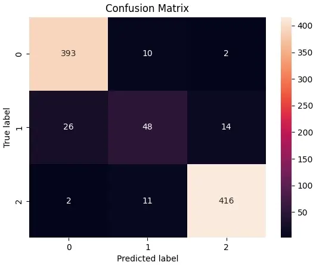

# Bielik 7B v0.1: A Polish Language Model – Development, Insights, and Evaluation

Krzysztof Ociepa    Łukasz Flis    Krzysztof Wróbel
Affiliation: SpeakLeash, ACK Cyfronet AGH, Jagiellonian University,
Azurro, Enelpol    Adrian Gwoździej    Remigiusz Kinas

###### Abstract

We introduce Bielik 7B v0.1, a 7-billion-parameter generative text model
for Polish language processing. Trained on curated Polish corpora, this
model addresses key challenges in language model development through
innovative techniques. These include Weighted Instruction Cross-Entropy
Loss, which balances the learning of different instruction types, and
Adaptive Learning Rate, which dynamically adjusts the learning rate
based on training progress. To evaluate performance, we created the Open
PL LLM Leaderboard and Polish MT-Bench, novel frameworks assessing
various NLP tasks and conversational abilities. Bielik 7B v0.1
demonstrates significant improvements, achieving a 9 percentage point
increase in average score compared to Mistral-7B-v0.1 on the RAG Reader
task. It also excels in the Polish MT-Bench, particularly in Reasoning
(6.15/10) and Role-playing (7.83/10) categories. This model represents a
substantial advancement in Polish language AI, offering a powerful tool
for diverse linguistic applications and setting new benchmarks in the
field.

## 1 Introduction

The rapid advancement in natural language processing (NLP) has led to
the development of increasingly sophisticated language models that can
understand and generate human-like text. These models have shown
remarkable success in various linguistic tasks across multiple
languages. However, the development of high-performing models for
less-resourced languages remains a significant challenge due to the
scarcity of large and diverse datasets and computational resources.

Existing Polish language models, such as TRURL 2 Voicelab 2023 and Qra
National Information Processing Institute and Gdańsk University of
Technology 2024, have made important strides in this domain. TRURL 2, a
collection of fine-tuned Llama 2 models with 7 billion and 13 billion
parameters was trained on approximately 1 million conversational Polish
and English samples, with a context size of 4,096 tokens. Another series
of models is Qra, which comprises continuously pretrained models with 1,
7, and 13 billion parameters. The Qra models were trained on Polish
data, totaling 90 billion tokens, and also employ a context size of
4,096 tokens. While numerous other Polish-focused language models exist,
the majority of them are fine-tuned using significantly smaller datasets
or fine-tuning approaches, which can limit their performance and
versatility.

This paper introduces Bielik 7B v0.1, a state-of-the-art Polish language
model developed as a collaborative effort between the open-science
project SpeakLeash and the High Performance Computing (HPC) center: ACK
Cyfronet AGH. Bielik 7B v0.1 is an evolution of the Mistral 7B v0.1
model Jiang et al. 2023, enhanced to understand and generate Polish text
with high accuracy. This model leverages a massive corpus of Polish
texts and advanced machine learning techniques, making it a pioneering
tool in the realm of Polish Natural Language Processing (NLP). The
development of Bielik 7B v0.1 addresses several challenges, including
the adaptation of a model trained primarily on English data to the
Polish language, which involves significant linguistic and semantic
adjustments.

In the following sections, we detail the architecture of Bielik 7B v0.1,
describe the dataset preparation, discuss the training process, and
evaluate the model’s performance on various NLP tasks. Our results
demonstrate that Bielik 7B v0.1 not only advances the state of Polish
language understanding but also serves as a valuable resource for
further research and application in Polish NLP.

## 2 Model and Tokenizer

In this section, we introduce the model design and tokenizer, presenting
architectural decisions and configurations.

### 2.1 Model Architecture

| Parameter             | Value                   |
| --------------------- | ----------------------- |
| Layers                | 32                      |
| Model Dimension       | 4096                    |
| Attention Heads       | 32                      |
| Key/Value Heads       | 8                       |
| Head Size             | 128                     |
| Intermediate Size     | 14336                   |
| Activation Function   | SwiGLU                  |
| Vocabulary Size       | 32000                   |
| Positional Embeddings | RoPE ($`\theta=10000`$) |
| Context Length        | 8192                    |
| Sliding Window        | 4096                    |

Table 1: Model architecture.

The Bielik 7B v0.1 model builds upon the Transformer architecture
Vaswani et al. 2017, with its key parameters detailed in Table 1, and
incorporates a suite of advanced techniques to enhance its performance.

Self-attention with causal masks Vaswani et al. 2017 allows the model to
weigh the importance of different parts of the input sequence. The
causal mask ensures that the model only attends to previous tokens,
which is crucial for maintaining the autoregressive property in language
modeling tasks.

Grouped-query attention (GQA) Ainslie et al. 2023 reduces computational
complexity and memory usage while maintaining model quality. It achieves
this by using fewer key-value heads than query heads, allowing for more
efficient processing of long sequences.

Sliding Window Attention Child et al. 2019; Beltagy et al. 2020 limits
the attention span to a fixed window size, reducing computational
complexity from quadratic to linear in sequence length. It enables the
model to process longer sequences more efficiently while still capturing
local context effectively.

SwiGLU activation function Dauphin et al. 2016; Shazeer 2020 is a
combination of the Swish activation function and Gated Linear Units
(GLU), offering improved performance and trainability compared to
traditional activation functions like ReLU.

Rotary Positional Embeddings (RoPE) Su et al. 2024 allow the model to
better capture the relative positions of tokens in the input sequence,
offering advantages over absolute positional embeddings. It excels in
tasks requiring nuanced understanding of token positions, providing
better extrapolation to longer sequences and improving overall
performance.

Root Mean Square Layer Normalization (RMSNorm) Jiang et al. 2024 is used
for normalizing activations within the network. It offers improved
training stability and slightly faster computation compared to
traditional Layer Normalization, contributing to more efficient training
and inference.

Pre-normalization applies layer normalization before the self-attention
and feed-forward layers, rather than after, resulting in improved model
convergence and overall performance.

The Bielik 7B v0.1 model was adapted from the Mistral 7B v0.1 model and
further pretrained. The decision to use an existing model instead of
training our own from scratch was due to the lack of access to
sufficient high-quality data. Additionally, training from scratch would
have required significantly more resources, including GPU power and
time. We chose the Mistral 7B v0.1 model because of its strong
performance in benchmarks and its permissive Apache 2.0 license.

### 2.2 Tokenizer

|                     |            |            | Polish |      |      | English |      |      |
| ------------------- | ---------- | ---------- | ------ | ---- | ---- | ------- | ---- | ---- |
| Tokenizer           | Vocab Size | Avg tokens | Tokens | CpT  | TpW  | Tokens  | CpT  | TpW  |
| APT3                | 31980      | 480        | 344    | 5.22 | 1.48 | 615     | 3.15 | 1.93 |
| Llama2              | 32000      | 554        | 681    | 2.63 | 2.94 | 427     | 4.53 | 1.34 |
| Mistral v0.1        | 32000      | 578        | 747    | 2.40 | 3.22 | 408     | 4.75 | 1.28 |
| Llama2 + APT3       | 57362      | 442        | 441    | 4.07 | 1.90 | 442     | 4.38 | 1.39 |
| Mistral v0.1 + APT3 | 58690      | 450        | 493    | 3.64 | 2.12 | 407     | 4.76 | 1.28 |

Table 2: Comparison of token count, characters per token (CpT), and
tokens per word (TpW) for the preamble of the Constitution of the
Republic of Poland in Polish and English versions, processed by various
tokenizers: APT3 (dedicated Polish language tokenizer), Llama2 and
Mistral v0.1 (multilingual tokenizers with minimal Polish support), and
merged tokenizers Llama2 + APT3 and Mistral v0.1 + APT3.

One measure of the effectiveness of the tokenization process is the
count of tokens generated for the input text. A lower number of tokens
indicates faster and more efficient text generation by the language
model. The tokenizer from the Mistral 7B model was not specifically
trained for the Polish language. Therefore, we conducted a series of
experiments aimed at expanding the original tokenizer to include Polish
tokens. Our approach to expanding the tokenizer involved incorporating
tokens from the Polish APT3 model Ociepa and Azurro Team 2024 by
extending the model’s edge layers (embeddings and language model head)
and continuing the training process. We chose the preamble of the
Constitution of the Republic of Poland as the benchmark text because it
effectively captures the essence of Polish writing and includes official
English versions for comparative analysis. Table 2 presents a detailed
comparison of various metrics, including token count, characters per
token (CpT), and tokens per word (TpW). These metrics illustrate the
performance of different tokenizers when applied to both the Polish and
English versions of the preamble.

Despite achieving good results on benchmarks with the trained models, we
observed issues in text generation, which occasionally manifested as
incorrect token combinations for Polish words. This problem arose partly
due to the ambiguity that occurs when merging pairs of tokens during the
tokenization process Imamura and Sumita 2022. This process utilizes the
byte pair encoding (BPE) algorithm Sennrich et al. 2016, which is
implemented through SentencePiece Kudo and Richardson 2018. Since the
tokens from the APT3 model tokenizer and the Mistral 7B model tokenizer
are not mutually exclusive (their vocabularies overlap), ambiguity
arises during the merging of token pairs, making it impossible to
directly combine both tokenizers.

In light of these issues, we decided to retain the original tokenizer
from the Mistral 7B model, which has a vocabulary size of 32,000 tokens,
while continuing to explore potential expansion options for future model
versions.

## 3 Pre-training

The primary objective of the pre-training phase was to enhance the
model’s Polish language capabilities, focusing on both accuracy and
fluency. To accomplish this, we employed a diverse selection of
high-quality Polish texts. These materials were subjected to rigorous
cleaning procedures and meticulous quality evaluations, ensuring the
highest standard of training data.

### 3.1 Pre-training Data

The pre-training of the Bielik model involved constructing a novel,
diverse, and high-quality dataset, primarily made up of Polish language
texts. We leveraged resources from the SpeakLeash project SpeakLeash
Team 2024. Using metadata assigned to each document, which included
information about its topic and various stylometric features, we
selected 18 million documents from different datasets that offered high
quality and topic diversity. These selected texts underwent thorough
cleaning and quality assessment procedures, detailed in sections 3.1.1
and 3.1.2. Additionally, we removed documents where, although robots.txt
did not prohibit scraping, the terms and conditions explicitly forbade
using them for training language models. Only documents meeting our
stringent quality criteria were retained for training and subsequently
tokenized. This meticulous process yielded a training dataset comprising
22 billion tokens. To improve the model’s adaptation to a new language
and mitigate catastrophic forgetting Li et al. 2022; Ostapenko et al.
2022; Ibrahim et al. 2024, we supplemented our training dataset with
English texts, sourced from the SlimPajama dataset Soboleva et al. 2023,
known for its diverse and high-quality English content. Ultimately, our
final training dataset consisted of 36 billion tokens.

#### 3.1.1 Data Cleanup

To improve the quality of the documents, we implemented a series of
heuristics aimed at removing damaged and unwanted text fragments,
anonymizing personal data (such as physical addresses, email addresses,
phone numbers, and URLs), and fixing encoding or formatting issues. As a
result of this process, we obtained higher-quality texts, which allowed
for further quality assessment.

#### 3.1.2 Quality Evaluation

To create the training dataset for text quality evaluation, we manually
selected and annotated 9,000 documents, assigning each to one of three
quality classes: HIGH, MEDIUM, or LOW. The HIGH class represented
documents of superior quality, LOW denoted poor-quality texts, while
MEDIUM was reserved for documents where the quality was ambiguous to the
annotator, falling between high and low standards. This classification
scheme allowed for a nuanced approach to quality assessment, accounting
for the inherent complexities in determining text quality.

For each document, we calculated 266 stylometric features, including
metrics such as the frequency of verbs, nouns, sentences, and
punctuation marks. This comprehensive set of features was derived based
on the methodology outlined in the StyloMetrix tool Okulska et al. 2023.
These linguistic and structural attributes provided a multifaceted
representation of each text’s stylistic properties.

Using these stylometric features as input, we trained an XGBoost
classifier model. This machine learning approach allowed us to leverage
the complex interactions between various textual characteristics to
predict document quality effectively, as presented in Table 3 and Figure

1.

|           |        |        |
| --------- | ------ | ------ |
| Precision | Recall | F1     |
| 0.8640    | 0.8285 | 0.8431 |

Table 3: Validation results for the XGBoost classifier model.



Figure 1: Confusion matrix illustrating validation results for the
XGBoost classifier model.

To determine an appropriate threshold for identifying high-quality
documents, we conducted a manual analysis of 1,000 documents. Based on
this thorough examination, we established a cut-off point for the HIGH
category at a probability score exceeding 90%. Documents that did not
meet this threshold were excluded from the target training dataset of
the Bielik model.

### 3.2 Training Hyperparameters

We utilized the AdamW optimizer Loshchilov and Hutter 2017 with
hyperparameters $`\beta_{1}=0.9`$, $`\beta_{2}=0.95`$, and weight decay
= 0.1. The learning rate followed a cosine decay schedule, starting at
3e-05 and decreasing to 2e-05, with a warmup period of 2000 iterations.
Training continued for a total of 17350 iterations. We employed a global
batch size of 256, composed of local batches of size 4. The gradient
clipping norm was set to 1.0, and we used mixed precision with bfloat16.
The model was trained on 36B tokens over 2 epochs, with a maximum
context length of 4096. The training loss and accuracy over the training
tokens for the base model are presented in Figures 2 and 3.

Figure 2: Training loss over the training tokens for the base model.

Figure 3: Training accuracy over the training tokens for the base model.

## 4 Post-training

After finishing the pre-training phase, we moved on to the post-training
phase, which focused on improving the model’s capabilities across
various areas, such as coding, mathematics, logical reasoning, and
following instructions.

### 4.1 Post-training Data

There was no sufficiently large and open dataset of instructions and
dialogues for the Polish language, which is why we have begun creating
our own dataset that is continuously expanded and refined by annotators.
This dataset was being manually developed through the writing of
instructions and dialogues by annotators, ensuring high-quality and
relevant content tailored to the needs of the Polish language.

To supplement the manually annotated data, we also generated
instructions based on the data used in pre-training (see Section 3.1).
For this purpose, we selected a collection of 1 million articles from
various categories, and then generated an instruction and response based
on each article. A portion of these instructions was manually verified
and corrected before being used for training purposes.

To further increase the number and diversity of instructions, we
utilized publicly accessible collections of English instructions, such
as the OpenHermes-2.5 Teknium 2023 and orca-math-word-problems-200k
Mitra et al. 2024 datasets, which accounted for half of the instructions
used in training. As a result, we obtained a training dataset containing
over 2.3 million instructions, amounting to more than 700 million
tokens.

### 4.2 Supervised Fine-Tuning

The varying quality of training instructions negatively impacts a
model’s benchmark performance, as demonstrated in previous studies,
which found that poor-quality instructions degrade model capabilities
Zhou et al. 2023. These studies showed that smaller, higher-quality
instruction datasets often yield better results than larger, noisier
datasets. To address this, we introduced several improvements,
summarized below, while still utilizing the previously mentioned
datasets.

#### 4.2.1 Masked Tokens

We employed a masked token approach, selectively applying loss only to
certain parts of the output. Specifically, we masked the loss on user
instruction and control tokens Shi et al. 2024. This technique ensures
that these tokens do not contribute to the overall loss during training,
allowing the model to focus on learning from the content tokens.

#### 4.2.2 Adaptive Learning Rate

The lengths of instructions can vary significantly, leading to
fluctuations in the number of tokens used in computing the loss
function. To ensure consistent influence from each instruction, we
implemented an adaptive learning rate (ALR). This approach is based on
prior research that links learning rates to batch sizes Granziol et al. 2020. In particular, the learning rate (LR) is scaled according to the
square root of the ratio between the number of tokens in the batch (T)
and the baseline batch size (BS):

```math
\text{ALR}=\text{LR}\cdot\sqrt{\frac{\text{T}}{\text{BS}}} \tag{1}
```

#### 4.2.3 Weighted Instruction Cross-Entropy Loss

This strategy, inspired by weighted cross-entropy loss Wu et al. 2024,
offline reinforcement learning Xu et al. 2022 and C-RLFT Wang et al.
2024, enabled us to effectively utilize mixed-quality training data
annotated with fine-grained weight labels.

Given the SFT conversation dataset $`\mathcal{D}={(x_{i},y_{i})}`$,
where $`x_{i}`$ indicates the instruction, $`y_{i}`$ is its
corresponding response, we assign a weight $`w_{i}\in(0,1]`$ to each
instruction-response pair $`(x_{i},y_{i})`$ that is representing the
quality of the pair. This allows us to construct a weighted dataset,
$`\mathcal{D}_{w}`$, where the highest quality pairs are assigned a
weight of $`1.0`$, while lower quality instructions have smaller weights
($`w_{i}<1.0`$). We can express the relationship between weights and
quality as:

```math
w_{i}=\begin{cases}1.0,&\text{highest quality}\\
\alpha,&\text{lower quality}\quad(0<\alpha<1)\end{cases} \tag{2}
```

This weighting scheme guides the model to favor high-quality responses
while still learning from a diverse range of instruction-response pairs.
We labeled our dataset, as described in Section 4.1, and assigned
weights to the instruction-response pairs based on predefined rules:

```math
w_{i}=\begin{cases}1.0,&\text{high quality}\\
0.7,&\text{medium quality}\\
0.5,&\text{low quality}\end{cases} \tag{3}
```

where:  
high quality - instructions and dialogues manually written by
annotators, the OpenHermes-2.5 Teknium 2023 and
orca-math-word-problems-200k Mitra et al. 2024 datasets.  
medium quality - generated instructions based on pre-training data,
which have been manually verified and corrected.  
low quality - generated instructions based on pre-training data without
manual verification.

Supervised Fine-Tuning (SFT) methods are designed to adapt a pre-trained
language model $`\pi_{0}`$ into a fine-tuned model $`\pi_{\text{SFT}}`$
using a high-quality instruction dataset $`\mathcal{D}`$ and supervised
learning. We use $`\pi(y|x)`$ to represent the probability of generating
response $`y`$ given instruction $`x`$ in the dataset $`\mathcal{D}`$.
The objective of SFT can be expressed as a maximum likelihood estimate
(MLE):

```math
J_{\text{SFT}}=\mathbb{E}_{(x,y)\sim\mathcal{D}}[\log\pi_{\text{SFT}}(y|x)] \tag{4}
```

To ensure optimal fine-tuning performance, SFT requires the instruction
dataset $`\mathcal{D}`$ to be of the highest possible quality, as it
treats all training data uniformly Zhou et al. 2023; Chen et al. 2024.
However, assembling a sufficiently large and high-quality dataset can be
both time-consuming and financially expensive.

In practice, the quality of available instructions often varies. It is
possible that valuable and informative instructions may have lower
quality than desired. To leverage the potential of such mixed-quality
data, we introduce the weighted instruction cross-entropy loss, which
guides the learning process to prioritize more preferred answers while
still allowing the model to learn valuable insights from lower-quality
instructions.

The standard Weighted Cross-Entropy Loss King and Zeng 2001, originating
from the weighted exogenous sampling maximum-likelihood estimator, is
frequently used in multi-class classification problems Wu et al. 2024.
It is commonly employed, for instance, to address imbalanced class
distributions Rezaei-Dastjerdehei et al. 2020. We can formulate standard
Weighted Cross-Entropy Loss as follows:

```math
l(o_{i},y_{i})=-\sum_{c=1}^{C}w_{c}\cdot y_{i,c}\cdot\log p_{i,c} \tag{5}
```

where $`C`$ is the number of classes,
$`\mathbf{y}_{i}=(y_{i,1},\dots,y_{i,C})\in\{0,1\}^{C}`$ is the one-hot
encoding of the ground truth label for sample $`x_{i}`$, and
$`y_{i,c}=1`$ indicates that $`x_{i}`$ belongs to class $`c`$.
Meanwhile,
$`\mathbf{p}_{i}=(p_{i,1},\dots,p_{i,C})\in\mathbb{R}_{+}^{C}`$
represents the predicted probability vector for sample $`x_{i}`$ across
$`C`$ classes. In multi-class classification problems using deep neural
networks, $`p_{i}`$ corresponds to the softmax values of the logits for
each class produced by the last layer of the network. Specifically,
$`p_{i,c}=\frac{\exp(o_{i,c})}{\sum_{j=1}^{C}\exp(o_{i,j})}`$, where
$`o_{i,c}`$ is the logit for class $`c`$ for sample $`x_{i}`$.

To integrate fine-grained weights from the dataset $`\mathcal{D}_{w}`$,
we modify Eq. 5 as follows:

```math
l(o_{i},y_{i})=-w_{i}\cdot\sum_{c=1}^{C}y_{i,c}\cdot\log p_{i,c} \tag{6}
```

where $`w_{i}`$ represents the weight assigned to the
instruction-response pair $`(x_{i},y_{i})`$. This learning objective
provides a flexible framework for fine-tuning language models, offering
more granular control over the importance of each instruction during
training. It can capture subtle differences in data quality while
maintaining computational efficiency.

### 4.3 Training Hyperparameters

We applied the AdamW optimizer, using $`\beta_{1}=0.9`$,
$`\beta_{2}=0.95`$, and a weight decay of 0.05. The adaptive learning
rate followed a cosine decay, starting at 7e-6 and tapering down to
6e-7, with 50 warmup iterations. The training process spanned a total of
55,440 iterations. Our setup used a global batch size of 128, made up of
local batches with a size of 1. Gradient clipping was enforced with a
threshold of 1.0, and the model was trained in mixed precision using
bfloat16. We trained the model for 3 epochs with a maximum context
length of 4,096, processing a total of 2.1 billion tokens. The training
loss, accuracy, and adaptive learning rate over the training iterations
for the instruction model are presented in Figures 4, 5, and 6.

Figure 4: Training loss over the training iterations for the instruction
model.

Figure 5: Training accuracy over the training iterations for the
instruction model.

Figure 6: Adaptive learning rate over the training iterations for the
instruction model.

### 4.4 Efficient Implementation

For our training needs, we utilized the ALLaMo framework Ociepa 2023,
developed by a co-author of the Bielik model to optimize training
throughput. This framework allowed us to maximize the computational
resources of the supercomputer, enabling faster calculations and
reducing overall training time. ALLaMo achieves high efficiency through
numerous optimizations at the dataloader, model, and training process
levels, along with a strong reliance on torch.compile in conjunction
with an efficient attention implementation using PyTorch SDPA and the
PyTorch Fused AdamW optimizer Ansel et al. 2024. A significant advantage
of ALLaMo is its primary reliance on PyTorch, without dependencies on
other popular frameworks or libraries, which allows for better
optimization and easier implementation of functionalities not available
in other frameworks. For post-training, we implemented the weighted
instruction cross-entropy loss and adaptive learning rate strategies,
detailed in sections 4.2.3 and 4.2.2. These improvements enabled us to
efficiently conduct numerous experiments and successfully complete the
final model training. During the base model training, we utilized 256
NVIDIA GH200 GPUs, achieving a throughput of over 9,200 tokens per GPU
per second.

To validate the performance of the ALLaMo framework, we conducted a
comparison with the implementation used in training the TinyLlama model
Zhang et al. 2024. The authors of this model introduced numerous
improvements to accelerate training, including FlashAttention-2 Dao
2023, fused LayerNorm, fused SwiGLU, fused Cross-Entropy Loss, and fused
Rotary Positional Embeddings. The experiment was carried out on A100
40GB GPUs in 8x and 16x A100 configurations, using a model with
parameters identical to the TinyLlama 1.1B model. When using ALLaMo, it
was possible to increase the local batch size from 8 to 9, which further
enhanced training throughput. Table 4 illustrates the performance
differences between the TinyLlama implementation and the ALLaMo
framework.

|                                                   |               |                  |                               |
| ------------------------------------------------- | ------------- | ---------------- | ----------------------------- |
| Framework                                         | Configuration | Total Batch Size | Throughput                    |
| TinyLlama                                         | 8xA100 40GB   | 2,097,152 tokens | 24,390 tokens/GPU/sec         |
| ALLaMo                                            | 8xA100 40GB   | 2,097,152 tokens | 26,150 tokens/GPU/sec (+7.2%) |
| ALLaMo                                            | 8xA100 40GB   | 2,359,296 tokens | 26,550 tokens/GPU/sec (+8.8%) |
| TinyLlama                                         | 16xA100 40GB  | 2,097,152 tokens | 24,000 tokens/GPU/sec ¹       |
| ALLaMo                                            | 16xA100 40GB  | 2,097,152 tokens | 25,850 tokens/GPU/sec (+7.7%) |
| ALLaMo                                            | 16xA100 40GB  | 2,359,296 tokens | 26,000 tokens/GPU/sec (+8.3%) |
| ¹ The value reported by the authors of the model. |               |                  |                               |

Table 4: A comparison of the training performance between the TinyLlama
implementation and the ALLaMo framework.

## 5 Evaluations

### 5.1 Open PL LLM Leaderboard

The Open PL LLM Leaderboard, based on the Open LLM Leaderboard v1
Beeching et al. 2023, evaluates models on various NLP tasks, including:
sentiment analysis, categorization, and text classification, but does
not test their conversational capabilities Wróbel et al. 2024. The
leaderboard utilizes the lm-evaluation-harness framework for model
evaluation Gao et al. 2024.

##### Tasks:

- •
  polemo2: Sentiment analysis of online consumer reviews across four
  domains (medicine, hotels, products, university) with four-class
  labeling (positive, negative, neutral, ambiguous) Kocoń et al. 2019;
  metric: accuracy.
- •
  klej-ner: Named entity recognition in sentences containing single-type
  entities, classifying into six categories (no entity, place, person,
  organization, time, geographical name) Rybak et al. 2020; metric:
  accuracy.
- •
  8tags: Topic classification of social media headlines into eight
  categories (film, history, food, medicine, motorization, work, sport,
  technology) Dadas et al. 2020; metric: accuracy.
- •
  belebele: Machine reading comprehension for question answering
  Bandarkar et al. 2024; metric: accuracy.
- •
  dyk: Question answering based on human-annotated pairs from
  Wikipedia’s "Did You Know" section Marcinczuk et al. 2013; metric:
  binary F1.
- •
  ppc: Text similarity assessment using manually labeled sentence pairs
  (exact paraphrases, close paraphrases, non-paraphrases) Dadas 2022;
  metric: accuracy.
- •
  psc: Summarization of news articles Ogrodniczuk and Kopeć 2014;
  metric: binary F1.
- •
  cbd: Text classification for cyberbullying and hate-speech detection
  Ptaszynski et al. 2023; metric: macro F1.
- •
  polqa: Open-domain question answering from the "Jeden z dziesięciu" TV
  show, with and without context (abstractive QA/RAG) Rybak et al. 2024;
  metric: accuracy, levenshtein.
- •
  poquad: Context-based extractive question answering (QA/RAG) Tuora
  et al. 2023; metric: levenshtein.

Most of the tasks are multiple-choice tests, which means that the model
chooses the correct answer from a set of options. They are implemented
as two types of tests:

- •
  Loglikelihood: We choose the highest probability token from the given
  set, e.g., ABCD. These tests are suitable for base models.
- •
  Generate: Model generates answer freely.

All tasks are evaluated in both 0-shot and 5-shot settings.

##### Evaluation scores:

- •
  All tasks: The average score across all tasks, normalized by baseline
  scores.
- •
  Reranking: The score of reranking task, commonly used in
  Retrieval-Augmented Generation (RAG).
- •
  Reader (Generator): The score of open-book question-answering task,
  also commonly used in RAG.
- •
  Perplexity: A bonus metric that does not correlate with other scores
  and should not be used for direct model comparison (lower is better).

As of April 3, 2024, Table 5 presents the current scores of both
pretrained and continuously pretrained models, as evaluated on the Open
PL LLM Leaderboard in a 5-shot setting.

The Bielik 7B v0.1 model achieved one of the highest scores in the RAG
Reader task, demonstrating a notable improvement of nearly 9 percentage
points in average score compared to Mistral-7B-v0.1. In our subjective
evaluations of conversational abilities, our models outperformed others
that had higher average scores. The results presented in Table 5 were
obtained without employing instruction templates for the instructional
models, treating them instead as base models. This approach may have
skewed the results, as instructional models are specifically optimized
to follow particular instructions.

|                                                              |           |               |            |            |
| ------------------------------------------------------------ | --------- | ------------- | ---------- | ---------- |
| Model                                                        | All tasks | RAG Reranking | RAG Reader | Perplexity |
| 7B parameters models:                                        |           |               |            |            |
| berkeley-nest/Starling-LM-7B-alpha                           | 47.46     | 75.73         | 82.86      | 1438.04    |
| openchat/openchat-3.5-0106                                   | 47.32     | 74.71         | 83.60      | 1106.56    |
| Nexusflow/Starling-LM-7B-beta                                | 45.69     | 74.58         | 81.22      | 1161.54    |
| openchat/openchat-3.5-1210                                   | 44.17     | 71.76         | 82.15      | 1923.83    |
| teknium/OpenHermes-2.5-Mistral-7B                            | 42.64     | 70.63         | 80.25      | 1463.00    |
| mistralai/Mistral-7B-Instruct-v0.2                           | 40.29     | 72.58         | 79.39      | 2088.08    |
| Bielik-7B-Instruct-v0.1                                      | 39.28     | 61.89         | 86.00      | 277.92     |
| internlm/internlm2-chat-7b                                   | 37.64     | 72.29         | 71.17      | 3892.50    |
| internlm/internlm2-chat-7b-sft                               | 36.97     | 73.22         | 69.96      | 4269.63    |
| HuggingFaceH4/zephyr-7b-alpha                                | 33.97     | 71.47         | 73.35      | 4464.45    |
| HuggingFaceH4/zephyr-7b-beta                                 | 33.15     | 71.65         | 71.27      | 3613.14    |
| szymonrucinski/Curie-7B-v1                                   | 26.72     | 55.58         | 85.19      | 389.17     |
| mistralai/Mistral-7B-Instruct-v0.1                           | 26.42     | 56.35         | 73.68      | 6909.94    |
| meta-llama/Llama-2-7b-chat-hf                                | 21.04     | 54.65         | 72.93      | 4018.74    |
| Voicelab/trurl-2-7b                                          | 18.85     | 60.67         | 77.19      | 1098.88    |
| Baseline (majority class)                                    | 0.00      | 53.36         | \-         | \-         |
| Models with different sizes:                                 |           |               |            |            |
| upstage/SOLAR-10.7B-Instruct-v1.0 (10.7B)                    | 46.07     | 76.93         | 82.86      | 789.58     |
| Voicelab/trurl-2-13b-academic (13B)                          | 29.45     | 68.19         | 79.88      | 733.91     |
| Azurro/APT3-1B-Instruct-v1 (1B)                              | -13.80    | 52.11         | 12.23      | 739.09     |
| 7B parameters pretrained and continuously pretrained models: |           |               |            |            |
| alpindale/Mistral-7B-v0.2-hf                                 | 33.05     | 60.23         | 85.21      | 932.60     |
| internlm/internlm2-7b                                        | 33.03     | 69.39         | 73.63      | 5498.23    |
| mistralai/Mistral-7B-v0.1                                    | 30.67     | 60.35         | 85.39      | 857.32     |
| Bielik-7B-v0.1                                               | 29.38     | 62.13         | 88.39      | 123.31     |
| internlm/internlm2-base-7b                                   | 20.68     | 52.39         | 69.85      | 3110.92    |
| meta-llama/Llama-2-7b-hf                                     | 12.73     | 54.02         | 77.92      | 850.45     |
| OPI-PG/Qra-7b                                                | 11.13     | 54.40         | 75.25      | 203.36     |

Table 5: Detailed comparison among Bielik 7B v0.1 and other
representative open-source models

### 5.2 Polish MT-Bench

MT-bench Zheng et al. 2023 is a tool designed to test the ability of
language models (LLMs) to conduct two-step conversations and follow
instructions. It covers typical use cases and focuses on challenging
questions to differentiate the capabilities of various models. Eight
main categories of user queries were identified, which were used to
construct MT-bench:

- •
  writing
- •
  role-playing
- •
  information extraction
- •
  reasoning
- •
  mathematics
- •
  coding
- •
  knowledge / hard sciences / stem
- •
  knowledge / humanities / social sciences

For each category, two-step questions were manually developed.

The evaluation of responses is performed by a metamodel. In the case of
MT-Bench, this is the GPT-4 model. By using a metamodel, we can verify
responses from open-ended questions, e.g., write an article about hybrid
cars. The model evaluates the content of the response, the quality of
facts used, creativity, etc.

The Polish MT-Bench Kinas et al. 2024 has been completely polonized.
Each task was first machine-translated and then verified. Additionally,
we introduced Polish accents, e.g., instead of describing a vacation in
Hawaii, we suggested the location - Masuria. In our language version,
many changes were introduced to transfer the test into Polish linguistic
realities.

| Model                      | pl_score | responses_pl | Average Score |
| -------------------------- | -------- | ------------ | ------------- |
| Mixtral-8x7b               | 7.64     | 1.00         | 7.64          |
| Mistral-Nemo-Instruct-2407 | 7.37     | 1.00         | 7.37          |
| openchat-3.5-0106-gemma    | 6.51     | 0.96         | 6.81          |
| Meta-Llama-3.1-8B-Instruct | 6.24     | 1.00         | 6.24          |
| Starling-LM-7B-alpha       | 6.05     | 0.93         | 6.49          |
| openchat-3.5-0106          | 6.03     | 0.94         | 6.39          |
| Mistral-7B-Instruct-v0.3   | 5.75     | 0.98         | 5.82          |
| Bielik-7B-Instruct-v0.1    | 5.40     | 0.89         | 6.08          |
| dolphin-2.9.1-llama-3-8b   | 5.24     | 0.89         | 5.86          |
| Polka-Mistral-7B-SFT       | 4.43     | 0.98         | 4.52          |
| trurl-2-7b                 | 2.75     | 0.99         | 2.76          |
| Mistral-7B-Instruct-v0.2   | 2.05     | 0.31         | 6.56          |

Table 6: Polish MT-Bench results for various language models

Table 6 presents the results of the Polish MT-Bench evaluation for
various language models. The table shows three key metrics: the Polish
score (pl_score), the proportion of responses in Polish (responses_pl),
and the average score. The Bielik 7B v0.1 model has a pl_score of 5.40,
demonstrating competitive performance among larger models.

| Model                      | Coding | Extraction | Humanities | Mathematics | Reasoning | Role-playing | Stem | Writing |
| -------------------------- | ------ | ---------- | ---------- | ----------- | --------- | ------------ | ---- | ------- |
| Mixtral-8x7b               | 5.20   | 8.15       | 9.45       | 5.65        | 5.80      | 8.95         | 8.55 | 9.35    |
| Mistral-Nemo-Instruct-2407 | 5.85   | 8.95       | 9.50       | 6.70        | 5.80      | 7.45         | 8.30 | 6.40    |
| openchat-3.5-0106-gemma    | 5.35   | 6.90       | 8.80       | 4.55        | 5.40      | 7.97         | 8.47 | 7.05    |
| Meta-Llama-3.1-8B-Instruct | 4.60   | 9.10       | 8.82       | 5.30        | 2.50      | 5.60         | 6.30 | 7.70    |
| Starling-LM-7B-alpha       | 4.75   | 7.35       | 8.50       | 4.15        | 3.90      | 6.90         | 8.85 | 7.55    |
| openchat-3.5-0106          | 5.05   | 6.90       | 9.30       | 3.80        | 3.90      | 6.00         | 8.40 | 7.75    |
| Mistral-7B-Instruct-v0.3   | 4.30   | 7.30       | 6.75       | 2.35        | 3.80      | 7.25         | 7.45 | 7.35    |
| Bielik-7B-Instruct-v0.1    | 3.00   | 4.35       | 8.47       | 4.10        | 6.15      | 7.83         | 6.90 | 7.85    |
| dolphin-2.9.1-llama-3-8b   | 4.60   | 6.15       | 8.80       | 4.80        | 3.30      | 7.40         | 6.35 | 5.50    |
| Polka-Mistral-7B-SFT       | 2.95   | 5.25       | 5.60       | 2.95        | 2.45      | 4.90         | 6.80 | 5.25    |
| trurl-2-7b                 | 1.80   | 3.50       | 3.95       | 1.70        | 2.05      | 3.30         | 2.65 | 3.15    |
| Mistral-7B-Instruct-v0.2   | 4.25   | 7.40       | 8.40       | 3.20        | 5.00      | \-           | \-   | \-      |

Table 7: Polish MT-Bench results for various language models by category

Table 7 provides a more detailed breakdown of the Polish MT-Bench
results, showing scores across eight different categories for each
model. The Bielik 7B v0.1 model shows competitive performance in several
categories, notably excelling in Reasoning (6.15) and Role-playing
(7.83). These results demonstrate the model’s versatility across various
tasks, despite its smaller size compared to some of the top-performing
models.

### 5.3 Bias, Toxicity and Misinformation

Language models have been shown to reproduce and amplify biases present
in the training data, and can generate toxic or offensive content. Since
our training dataset contains a large proportion of data from the web,
Bielik-7B-v0.1 may produce factually incorrect output and should not be
relied upon for producing accurate information. Despite significant
efforts to clean the training data, it is still possible for this model
to generate lewd, false, biased, or otherwise offensive content.

## 6 Model Quantization

In our work on the Bielik 7B v0.1 model, our primary objective was to
create quantized versions that could be accessible to users with limited
computational resources. This effort was driven by a vision to
democratize advanced language models and make them available to those
who do not have access to powerful computing infrastructure. By
optimizing our model for low-resource environments, we aimed to
facilitate deployment on various devices, including edge devices such as
mobile phones and embedded systems.

To achieve this, we developed and delivered several quantized versions
of Bielik 7B v0.1, including GGUF (GPT - Generated Unified Format)¹¹ 1
[https://github.com/ggerganov/ggml](https://github.com/ggerganov/ggml),
HQQ (Half-Quadratic Quantization) Badri and Shaji 2023, AWQ
(Activation-aware Weight Quantization) Lin et al. 2024, MLX (Apple MLX
Framework) Hannun et al. 2023, EXL2 (ExLlamaV2)²² 2
[https://github.com/turboderp/exllamav2](https://github.com/turboderp/exllamav2),
GPTQ (Accurate Post-Training Quantization for Generative Pre-trained
Transformers) Frantar et al. 2022, and IQ2_XXS (GGUF IQ)³³ 3
[https://github.com/ggerganov/llama.cpp](https://github.com/ggerganov/llama.cpp).
Each quantization technique offered different trade-offs in terms of
performance, memory usage, and computational requirements, allowing for
flexibility depending on the intended use case and hardware
capabilities. The IQ2_XXS version, in particular, was specifically
designed for edge devices, with a bit-per-weight quantization of 2.06
bpw, providing an efficient solution for deployment on
resource-constrained platforms such as mobile phones.

### 6.1 Calibration and Evaluation of Quantized Models

In addition to the standard quantization process, we created calibrated
versions of the imatrix (Importance Matrix) GGUF model. Calibration
plays a crucial role in minimizing performance degradation, which is
often a concern during quantization. To support this process, we
developed a multilingual (Polish-English) calibration dataset with a
specific emphasis on the Polish language. This multilingual approach
aimed to improve the model’s generalization capabilities across
languages while ensuring high fidelity in its Polish-language outputs.

To assess the impact of calibration, we conducted a thorough comparison
between the uncalibrated and calibrated versions of the model for the
Polish language. Our evaluation metrics focused on both the accuracy of
language understanding and the quality of generated text. The results
showed that the calibration process improved the model’s performance,
particularly in language-specific contexts where nuances and subtleties
are crucial.

Across all quantization schemes examined (Q8_0, Q6_K, Q5_K_M, Q4_K_M,
Q3_K_M, Q2_K) (see table 8), models quantized with imatrix consistently
outperform their counterparts without imatrix quantization. This is
evident through multiple evaluation metrics, indicating that imatrix
quantization effectively preserves model quality even at lower
bit-widths. The KLD values are consistently lower for imatrix-quantized
models, indicating a closer alignment of the probability distributions
between the quantized and the original FP16 models. Imatrix quantization
results in Mean $`\Delta`$p values closer to zero, indicating less
degradation in the model’s ability to predict the correct token. At
Q3_K_M, the Mean $`\Delta`$p improves from -0.9160 without imatrix to
-0.3860 with imatrix. The advantages of imatrix quantization become more
pronounced at lower bit-width quantization levels. The reduction in
performance metrics such as PPL, KLD, Mean $`\Delta`$p, and RMS
$`\Delta`$p is more significant when comparing imatrix and non-imatrix
models at Q2_K and Q3_K_M levels, demonstrating imatrix’s effectiveness
in mitigating the adverse effects of aggressive quantization.

The application of imatrix quantization to the Polish language model
leads to significant improvements in maintaining model quality across
various quantization levels. These findings support the adoption of
imatrix quantization as an effective technique for compressing language
models without substantially compromising their performance.

| Quant. | imatrix | Size    | PPL    | $`\Delta`$PPL | KLD    | Mean $`\Delta`$p | RMS $`\Delta`$p | Same top p |
| ------ | ------- | ------- | ------ | ------------- | ------ | ---------------- | --------------- | ---------- |
|        |         | \[GiB\] |        |               |        |                  |                 | \[%\]      |
| FP16   | \-      | 13.49   | 3.9393 | \-            | \-     | \-               | \-              | \-         |
| Q8_0   | No      | 7.17    | 3.9422 | 0.0029        | 0.0010 | -0.0070          | 0.9800          | 98.6890    |
| Q8_0   | Yes     | 7.17    | 3.9422 | 0.0029        | 0.0010 | -0.0070          | 0.9800          | 98.6890    |
| Q6_K   | No      | 5.53    | 3.9450 | 0.0057        | 0.0051 | -0.0420          | 2.1850          | 97.2410    |
| Q6_K   | Yes     | 5.53    | 3.9406 | 0.0013        | 0.0037 | -0.0030          | 1.8490          | 97.6130    |
| Q5_K_M | No      | 4.78    | 3.9520 | 0.0127        | 0.0106 | -0.0680          | 3.1320          | 96.0510    |
| Q5_K_M | Yes     | 4.78    | 3.9473 | 0.0080        | 0.0086 | -0.0250          | 2.8320          | 96.4670    |
| Q4_K_M | No      | 4.07    | 3.9876 | 0.0483        | 0.0286 | -0.2690          | 5.1300          | 93.6550    |
| Q4_K_M | Yes     | 4.07    | 3.9727 | 0.0333        | 0.0220 | -0.1440          | 4.4880          | 94.4700    |
| Q3_K_M | No      | 3.28    | 4.0915 | 0.1522        | 0.0826 | -0.9160          | 8.6880          | 89.5780    |
| Q3_K_M | Yes     | 3.28    | 4.0458 | 0.1065        | 0.0683 | -0.3860          | 7.8390          | 90.6290    |
| Q2_K   | No      | 2.53    | 4.7045 | 0.7652        | 0.2852 | -3.8050          | 16.3760         | 81.1100    |
| Q2_K   | Yes     | 2.53    | 4.3522 | 0.4128        | 0.1939 | -1.8980          | 13.4190         | 84.5580    |

Table 8: Comparison of quantization results for the Bielik 7B v0.1 model
using imatrix: PPL - Perplexity, $`\Delta`$PPL - change in perplexity,
KLD - Kullback-Leibler Divergence, Mean $`\Delta`$p - mean change in
correct token probability, RMS $`\Delta`$p - root mean square of change
in token probabilities, Same top p - the percentage of instances where
the quantized model and the FP16 model assign the highest probability to
the same token.

## 7 Conclusion

In this paper, we introduced Bielik 7B v0.1, a language model
specifically trained for the Polish language. We demonstrated that it is
possible to significantly enhance the linguistic capabilities of an
already trained model by fine-tuning it on texts exclusively in that
language. Without changing the tokenizer, we achieved a high quality of
responses generated by the model, which resembled texts written by
native Polish speakers. Furthermore, the model performed well in various
tasks, opening up intriguing possibilities for its further development.

## Acknowledgements

We gratefully acknowledge Poland’s high-performance Infrastructure
PLGrid ACK Cyfronet AGH for providing computer facilities and support
within computational grant no PLG/2024/016951.

The model could not have been created without the commitment and work of
the entire SpeakLeash team, whose contribution is invaluable. Thanks to
the hard work of many individuals, it was possible to gather a large
amount of content in Polish and establish collaboration between the
open-science SpeakLeash project and the HPC center: ACK Cyfronet AGH.
Individuals who contributed to the creation of the model through their
commitment to the open-science SpeakLeash project: Sebastian Kondracki,
Szymon Mazurek, Maria Filipkowska, Paweł Kiszczak, Igor Ciuciura, Jacek
Chwiła, Szymon Baczyński, Grzegorz Urbanowicz, Paweł Cyrta, Jan Maria
Kowalski, Karol Jezierski, Kamil Nonckiewicz, Izabela Babis, Nina Babis,
Waldemar Boszko, and many other wonderful researchers and enthusiasts of
the AI world.

## References

- Ainslie et al. (2023) Joshua Ainslie, James Lee-Thorp, Michiel
  de Jong, Yury Zemlyanskiy, Federico Lebron, and Sumit Sanghai. 2023.
  [GQA: Training generalized multi-query transformer models from
  multi-head
  checkpoints](https://doi.org/10.18653/v1/2023.emnlp-main.298). In
  _Proceedings of the 2023 Conference on Empirical Methods in Natural
  Language Processing_, pages 4895–4901, Singapore. Association for
  Computational Linguistics.
- Ansel et al. (2024) Jason Ansel, Edward Yang, Horace He, Natalia
  Gimelshein, Animesh Jain, Michael Voznesensky, Bin Bao, Peter Bell,
  David Berard, Evgeni Burovski, Geeta Chauhan, Anjali Chourdia, Will
  Constable, Alban Desmaison, Zachary DeVito, Elias Ellison, Will Feng,
  Jiong Gong, Michael Gschwind, Brian Hirsh, Sherlock Huang, Kshiteej
  Kalambarkar, Laurent Kirsch, Michael Lazos, Mario Lezcano, Yanbo
  Liang, Jason Liang, Yinghai Lu, CK Luk, Bert Maher, Yunjie Pan,
  Christian Puhrsch, Matthias Reso, Mark Saroufim, Marcos Yukio
  Siraichi, Helen Suk, Michael Suo, Phil Tillet, Eikan Wang, Xiaodong
  Wang, William Wen, Shunting Zhang, Xu Zhao, Keren Zhou, Richard Zou,
  Ajit Mathews, Gregory Chanan, Peng Wu, and Soumith Chintala. 2024.
  [PyTorch 2: Faster Machine Learning Through Dynamic Python Bytecode
  Transformation and Graph
  Compilation](https://doi.org/10.1145/3620665.3640366). In _29th ACM
  International Conference on Architectural Support for Programming
  Languages and Operating Systems, Volume 2 (ASPLOS ’24)_. ACM.
- Badri and Shaji (2023) Hicham Badri and Appu Shaji. 2023.
  [Half-quadratic quantization of large machine learning
  models](https://mobiusml.github.io/hqq_blog/).
- Bandarkar et al. (2024) Lucas Bandarkar, Davis Liang, Benjamin Muller,
  Mikel Artetxe, Satya Narayan Shukla, Donald Husa, Naman Goyal,
  Abhinandan Krishnan, Luke Zettlemoyer, and Madian Khabsa. 2024. [The
  belebele benchmark: a parallel reading comprehension dataset in 122
  language variants](https://aclanthology.org/2024.acl-long.44). In
  _Proceedings of the 62nd Annual Meeting of the Association for
  Computational Linguistics (Volume 1: Long Papers)_, pages 749–775,
  Bangkok, Thailand and virtual meeting. Association for Computational
  Linguistics.
- Beeching et al. (2023) Edward Beeching, Clémentine Fourrier, Nathan
  Habib, Sheon Han, Nathan Lambert, Nazneen Rajani, Omar Sanseviero,
  Lewis Tunstall, and Thomas Wolf. 2023. Open llm leaderboard
  (2023-2024).
  [https://huggingface.co/spaces/open-llm-leaderboard-old/open_llm_leaderboard](https://huggingface.co/spaces/open-llm-leaderboard-old/open_llm_leaderboard).
- Beltagy et al. (2020) Iz Beltagy, Matthew E. Peters, and Arman
  Cohan. 2020. [Longformer: The long-document
  transformer](https://api.semanticscholar.org/CorpusID:215737171).
  _ArXiv_, abs/2004.05150.
- Chen et al. (2024) Lichang Chen, Shiyang Li, Jun Yan, Hai Wang, Kalpa
  Gunaratna, Vikas Yadav, Zheng Tang, Vijay Srinivasan, Tianyi Zhou,
  Heng Huang, and Hongxia Jin. 2024. [Alpagasus: Training a better
  alpaca with fewer data](http://arxiv.org/abs/2307.08701).
- Child et al. (2019) Rewon Child, Scott Gray, Alec Radford, and Ilya
  Sutskever. 2019. [Generating long sequences with sparse
  transformers](https://api.semanticscholar.org/CorpusID:129945531).
  _ArXiv_, abs/1904.10509.
- Dadas (2022) Sławomir Dadas. 2022. [Training effective neural sentence
  encoders from automatically mined
  paraphrases](https://doi.org/10.1109/SMC53654.2022.9945218). In _2022
  IEEE International Conference on Systems, Man, and Cybernetics (SMC)_,
  pages 371–378.
- Dadas et al. (2020) Sławomir Dadas, Michał Perełkiewicz, and Rafał
  Poświata. 2020. [Evaluation of sentence representations in
  Polish](https://aclanthology.org/2020.lrec-1.207). In _Proceedings of
  the 12th Language Resources and Evaluation Conference_, pages
  1674–1680, Marseille, France. European Language Resources Association.
- Dao (2023) Tri Dao. 2023. [Flashattention-2: Faster attention with
  better parallelism and work
  partitioning](http://arxiv.org/abs/2307.08691).
- Dauphin et al. (2016) Yann Dauphin, Angela Fan, Michael Auli, and
  David Grangier. 2016. [Language modeling with gated convolutional
  networks](https://api.semanticscholar.org/CorpusID:16119010). In
  _International Conference on Machine Learning_.
- Frantar et al. (2022) Elias Frantar, Saleh Ashkboos, Torsten Hoefler,
  and Dan Alistarh. 2022. GPTQ: Accurate post-training compression for
  generative pretrained transformers. _arXiv preprint arXiv:2210.17323_.
- Gao et al. (2024) Leo Gao, Jonathan Tow, Baber Abbasi, Stella
  Biderman, Sid Black, Anthony DiPofi, Charles Foster, Laurence Golding,
  Jeffrey Hsu, Alain Le Noac’h, Haonan Li, Kyle McDonell, Niklas
  Muennighoff, Chris Ociepa, Jason Phang, Laria Reynolds, Hailey
  Schoelkopf, Aviya Skowron, Lintang Sutawika, Eric Tang, Anish Thite,
  Ben Wang, Kevin Wang, and Andy Zou. 2024. [A framework for few-shot
  language model evaluation](https://doi.org/10.5281/zenodo.12608602).
- Granziol et al. (2020) Diego Granziol, Stefan Zohren, and Stephen J.
  Roberts. 2020. [Learning rates as a function of batch size: A random
  matrix theory approach to neural network
  training](https://api.semanticscholar.org/CorpusID:226281826). _J.
  Mach. Learn. Res._, 23:173:1–173:65.
- Hannun et al. (2023) Awni Hannun, Jagrit Digani, Angelos
  Katharopoulos, and Ronan Collobert. 2023. [MLX: Efficient and flexible
  machine learning on apple silicon](https://github.com/ml-explore).
- Ibrahim et al. (2024) Adam Ibrahim, Benjamin Thérien, Kshitij Gupta,
  Mats L. Richter, Quentin Anthony, Timothée Lesort, Eugene Belilovsky,
  and Irina Rish. 2024. [Simple and scalable strategies to continually
  pre-train large language models](http://arxiv.org/abs/2403.08763).
- Imamura and Sumita (2022) Kenji Imamura and Eiichiro Sumita. 2022.
  [Extending the subwording model of multilingual pretrained models for
  new languages](http://arxiv.org/abs/2211.15965).
- Jiang et al. (2023) Albert Q. Jiang, Alexandre Sablayrolles, Arthur
  Mensch, Chris Bamford, Devendra Singh Chaplot, Diego de las Casas,
  Florian Bressand, Gianna Lengyel, Guillaume Lample, Lucile Saulnier,
  Lélio Renard Lavaud, Marie-Anne Lachaux, Pierre Stock, Teven Le Scao,
  Thibaut Lavril, Thomas Wang, Timothée Lacroix, and William El
  Sayed. 2023. [Mistral 7b](http://arxiv.org/abs/2310.06825).
- Jiang et al. (2024) Zixuan Jiang, Jiaqi Gu, Hanqing Zhu, and David Z.
  Pan. 2024. Pre-rmsnorm and pre-crmsnorm transformers: equivalent and
  efficient pre-ln transformers. In _Proceedings of the 37th
  International Conference on Neural Information Processing Systems_,
  NIPS ’23, Red Hook, NY, USA. Curran Associates Inc.
- Kinas et al. (2024) Remigiusz Kinas, Filipkowska Maria, SpeakLeash
  Team, and Cyfronet Team. 2024. Mt-bench pl.
  [https://huggingface.co/spaces/speakleash/mt-bench-pl](https://huggingface.co/spaces/speakleash/mt-bench-pl).
- King and Zeng (2001) Gary King and Langche Zeng. 2001. [Logistic
  regression in rare events
  data](https://doi.org/10.1093/oxfordjournals.pan.a004868). _Political
  Analysis_, 9(2):137–163.
- Kocoń et al. (2019) Jan Kocoń, Piotr Miłkowski, and Monika
  Zaśko-Zielińska. 2019. [Multi-level sentiment analysis of PolEmo 2.0:
  Extended corpus of multi-domain consumer
  reviews](https://doi.org/10.18653/v1/K19-1092). In _Proceedings of the
  23rd Conference on Computational Natural Language Learning (CoNLL)_,
  pages 980–991, Hong Kong, China. Association for Computational
  Linguistics.
- Kudo and Richardson (2018) Taku Kudo and John Richardson. 2018.
  [Sentencepiece: A simple and language independent subword tokenizer
  and detokenizer for neural text
  processing](http://arxiv.org/abs/1808.06226).
- Li et al. (2022) Dingcheng Li, Zheng Chen, Eunah Cho, Jie Hao, Xiaohu
  Liu, Xing Fan, and Chenlei Guo. 2022. [Overcoming catastrophic
  forgetting during domain adaptation of seq2seq language
  generation](https://api.semanticscholar.org/CorpusID:249268165). In
  _North American Chapter of the Association for Computational
  Linguistics_.
- Lin et al. (2024) Ji Lin, Jiaming Tang, Haotian Tang, Shang Yang,
  Wei-Ming Chen, Wei-Chen Wang, Guangxuan Xiao, Xingyu Dang, Chuang Gan,
  and Song Han. 2024. Awq: Activation-aware weight quantization for llm
  compression and acceleration. In _MLSys_.
- Loshchilov and Hutter (2017) Ilya Loshchilov and Frank Hutter. 2017.
  [Decoupled weight decay
  regularization](https://api.semanticscholar.org/CorpusID:53592270). In
  _International Conference on Learning Representations_.
- Marcinczuk et al. (2013) Michał Marcinczuk, Marcin Ptak, Adam
  Radziszewski, and Maciej Piasecki. 2013. Open dataset for development
  of polish question answering systems. In _Proceedings of the 6th
  Language & Technology Conference: Human Language Technologies as a
  Challenge for Computer Science and Linguistics, Wydawnictwo
  Poznanskie, Fundacja Uniwersytetu im. Adama Mickiewicza_.
- Mitra et al. (2024) Arindam Mitra, Hamed Khanpour, Corby Rosset, and
  Ahmed Awadallah. 2024. [Orca-math: Unlocking the potential of slms in
  grade school math](http://arxiv.org/abs/2402.14830).
- National Information Processing Institute and Gdańsk University of
  Technology (2024) National Information Processing Institute and Gdańsk
  University of Technology. 2024. [Qra
  models](https://huggingface.co/OPI-PG).
- Ociepa (2023) Krzysztof Ociepa. 2023. Allamo: A simple, hackable, and
  fast framework for training medium-sized llms.
  [https://github.com/chrisociepa/allamo](https://github.com/chrisociepa/allamo).
- Ociepa and Azurro Team (2024) Krzysztof Ociepa and Azurro Team. 2024.
  [Introducing apt3-1b-base: Polish language
  model](https://azurro.pl/apt3-1b-base-en). Accessed: 2024-09-30.
- Ogrodniczuk and Kopeć (2014) Maciej Ogrodniczuk and Mateusz
  Kopeć. 2014. The Polish Summaries Corpus. In _Proceedings of the Ninth
  International Conference on Language Resources and Evaluation,
  LREC 2014_.
- Okulska et al. (2023) Inez Okulska, Daria Stetsenko, Anna Kołos,
  Agnieszka Karlińska, Kinga Głąbińska, and Adam Nowakowski. 2023.
  [Stylometrix: An open-source multilingual tool for representing
  stylometric vectors](http://arxiv.org/abs/2309.12810).
- Ostapenko et al. (2022) Oleksiy Ostapenko, Timothee Lesort, Pau
  Rodriguez, Md Rifat Arefin, Arthur Douillard, Irina Rish, and Laurent
  Charlin. 2022. [Continual learning with foundation models: An
  empirical study of latent
  replay](https://proceedings.mlr.press/v199/ostapenko22a.html). In
  _Proceedings of The 1st Conference on Lifelong Learning Agents_,
  volume 199 of _Proceedings of Machine Learning Research_, pages 60–91.
  PMLR.
- Ptaszynski et al. (2023) Michal Ptaszynski, Agata Pieciukiewicz, Pawel
  Dybala, Pawel Skrzek, Kamil Soliwoda, Marcin Fortuna, Gniewosz Leliwa,
  and Michal Wroczynski. 2023. Expert-annotated dataset to study
  cyberbullying in polish language. _Data_, 9(1):1.
- Rezaei-Dastjerdehei et al. (2020) Mohammad Reza Rezaei-Dastjerdehei,
  Amir Mohammad Mijani, and Emad Fatemizadeh. 2020. [Addressing
  imbalance in multi-label classification using weighted cross entropy
  loss function](https://api.semanticscholar.org/CorpusID:231684807).
  _2020 27th National and 5th International Iranian Conference on
  Biomedical Engineering (ICBME)_, pages 333–338.
- Rybak et al. (2020) Piotr Rybak, Robert Mroczkowski, Janusz Tracz, and
  Ireneusz Gawlik. 2020. [KLEJ: Comprehensive benchmark for polish
  language
  understanding](https://www.aclweb.org/anthology/2020.acl-main.111). In
  _Proceedings of the 58th Annual Meeting of the Association for
  Computational Linguistics_, pages 1191–1201, Online. Association for
  Computational Linguistics.
- Rybak et al. (2024) Piotr Rybak, Piotr Przybyła, and Maciej
  Ogrodniczuk. 2024. [PolQA: Polish question answering
  dataset](https://aclanthology.org/2024.lrec-main.1125). In
  _Proceedings of the 2024 Joint International Conference on
  Computational Linguistics, Language Resources and Evaluation
  (LREC-COLING 2024)_, pages 12846–12855, Torino, Italia. ELRA and ICCL.
- Sennrich et al. (2016) Rico Sennrich, Barry Haddow, and Alexandra
  Birch. 2016. [Neural machine translation of rare words with subword
  units](http://arxiv.org/abs/1508.07909).
- Shazeer (2020) Noam Shazeer. 2020. [Glu variants improve
  transformer](http://arxiv.org/abs/2002.05202).
- Shi et al. (2024) Zhengyan Shi, Adam X. Yang, Bin Wu, Laurence
  Aitchison, Emine Yilmaz, and Aldo Lipani. 2024. [Instruction tuning
  with loss over instructions](http://arxiv.org/abs/2405.14394).
- Soboleva et al. (2023) Daria Soboleva, Faisal Al-Khateeb, Robert
  Myers, Jacob R Steeves, Joel Hestness, and Nolan Dey. 2023.
  [SlimPajama: A 627B token cleaned and deduplicated version of
  RedPajama](https://huggingface.co/datasets/cerebras/SlimPajama-627B).
  [https://www.cerebras.net/blog/slimpajama-a-627b-token-cleaned-and-deduplicated-version-of-redpajama](https://www.cerebras.net/blog/slimpajama-a-627b-token-cleaned-and-deduplicated-version-of-redpajama).
- SpeakLeash Team (2024) SpeakLeash Team. 2024. [Speakleash a.k.a
  spichlerz!](https://www.speakleash.org) Accessed: 2024-09-30.
- Su et al. (2024) Jianlin Su, Murtadha Ahmed, Yu Lu, Shengfeng Pan, Wen
  Bo, and Yunfeng Liu. 2024. [Roformer: Enhanced transformer with rotary
  position
  embedding](https://doi.org/https://doi.org/10.1016/j.neucom.2023.127063).
  _Neurocomputing_, 568:127063.
- Teknium (2023) Teknium. 2023. Openhermes 2.5: An open dataset of
  synthetic data for generalist llm assistants.
  [https://huggingface.co/datasets/teknium/OpenHermes-2.5](https://huggingface.co/datasets/teknium/OpenHermes-2.5).
- Tuora et al. (2023) Ryszard Tuora, Aleksandra Zwierzchowska, Natalia
  Zawadzka-Paluektau, Cezary Klamra, and Łukasz Kobyliński. 2023.
  Poquad-the polish question answering dataset-description and analysis.
  In _Proceedings of the 12th Knowledge Capture Conference 2023_, pages
  105–113.
- Vaswani et al. (2017) Ashish Vaswani, Noam M. Shazeer, Niki Parmar,
  Jakob Uszkoreit, Llion Jones, Aidan N. Gomez, Lukasz Kaiser, and Illia
  Polosukhin. 2017. [Attention is all you
  need](https://api.semanticscholar.org/CorpusID:13756489). In _Neural
  Information Processing Systems_.
- Voicelab (2023) Voicelab. 2023. [Trurl 2
  models)](https://huggingface.co/Voicelab).
- Wang et al. (2024) Guan Wang, Sijie Cheng, Xianyuan Zhan, Xiangang Li,
  Sen Song, and Yang Liu. 2024. [Openchat: Advancing open-source
  language models with mixed-quality
  data](http://arxiv.org/abs/2309.11235).
- Wróbel et al. (2024) Krzysztof Wróbel, SpeakLeash Team, and Cyfronet
  Team. 2024. Open pl llm leaderboard.
  [https://huggingface.co/spaces/speakleash/open_pl_llm_leaderboard](https://huggingface.co/spaces/speakleash/open_pl_llm_leaderboard).
- Wu et al. (2024) Yanxue Wu, Kai Du, Xian-Jie Wang, and Fan Min. 2024.
  [Misclassification-guided loss under the weighted cross-entropy loss
  framework](https://api.semanticscholar.org/CorpusID:269765983).
  _Knowl. Inf. Syst._, 66:4685–4720.
- Xu et al. (2022) Haoran Xu, Xianyuan Zhan, Honglei Yin, and Huiling
  Qin. 2022. [Discriminator-weighted offline imitation learning from
  suboptimal
  demonstrations](https://proceedings.mlr.press/v162/xu22l.html). In
  _Proceedings of the 39th International Conference on Machine
  Learning_, volume 162 of _Proceedings of Machine Learning Research_,
  pages 24725–24742. PMLR.
- Zhang et al. (2024) Peiyuan Zhang, Guangtao Zeng, Tianduo Wang, and
  Wei Lu. 2024. [Tinyllama: An open-source small language
  model](http://arxiv.org/abs/2401.02385).
- Zheng et al. (2023) Lianmin Zheng, Wei-Lin Chiang, Ying Sheng, Siyuan
  Zhuang, Zhanghao Wu, Yonghao Zhuang, Zi Lin, Zhuohan Li, Dacheng Li,
  Eric. P Xing, Hao Zhang, Joseph E. Gonzalez, and Ion Stoica. 2023.
  [Judging llm-as-a-judge with mt-bench and chatbot
  arena](http://arxiv.org/abs/2306.05685).
- Zhou et al. (2023) Chunting Zhou, Pengfei Liu, Puxin Xu, Srinivasan
  Iyer, Jiao Sun, Yuning Mao, Xuezhe Ma, Avia Efrat, Ping Yu, LILI YU,
  Susan Zhang, Gargi Ghosh, Mike Lewis, Luke Zettlemoyer, and Omer
  Levy. 2023. [Lima: Less is more for
  alignment](https://proceedings.neurips.cc/paper_files/paper/2023/file/ac662d74829e4407ce1d126477f4a03a-Paper-Conference.pdf).
  In _Advances in Neural Information Processing Systems_, volume 36,
  pages 55006–55021. Curran Associates, Inc.

## Appendix A Examples of Tasks

### A.1 polemo2

Task: Sentiment analysis of online consumer reviews across four domains
(medicine, hotels, products, university) with four-class labeling
(positive, negative, neutral, ambiguous).

Example:

Opinia: "Leczyłam się u niej parę lat i nic mi nie pomogła, a jak
zmieniła m lekarza po krótkim czasie zobaczyła m już poprawę a w tej
chwili jestem już bez leków 6 lat i jest wszystko dobrze . Dr Ciborska
leczyła mnie na depresję a potem przez dr Kopystecką miała m rozpoznany
zespół maniakalno depresyjny i odtąd zmianę leków i przede wszystkim
wysłuchała mnie z zaangażowaniem a nie jak dr Ciborska aby mnie zbyć"

Określ sentyment podanej opinii. Możliwe odpowiedzi:

A - Neutralny, B - Negatywny, C - Pozytywny, D - Niejednoznaczny

Prawidłowa odpowiedź: B

### A.2 klej-ner

Task: Named entity recognition in sentences containing single-type
entities, classifying into six categories (no entity, place, person,
organization, time, geographical name).

Example:

Zdanie: "Ulewne deszcze nawiedziły także Słupsk ."

Pytanie: Jakiego rodzaju jest nazwana jednostka, jeżeli występuje w
podanym zdaniu?

Możliwe odpowiedzi: A - Brak nazwanej jednostki, B - Nazwa miejsca, C -
Nazwa osoby, D - Nazwa organizacji, E - Czas, F - Nazwa geograficzna

Prawidłowa odpowiedź: B

### A.3 8tags

Task: Topic classification of social media headlines into eight
categories (film, history, food, medicine, motorization, work, sport,
technology).

Example:

Tytuł: "Czy bateria zrobiona z 1000 cytryn jest w stanie uruchomić
silnik?."

Pytanie: jaka kategoria najlepiej pasuje do podanego tytułu?

Możliwe odpowiedzi:

A - film, B - historia, C - jedzenie, D - medycyna, E - motoryzacja, F -
praca, G - sport, H - technologie

Prawidłowa odpowiedź: E

### A.4 belebele

Task: Machine reading comprehension for question answering.

Example:

Fragment: "Atom może być uważany za jeden z fundamentalnych elementów
budujących całą materię. To bardzo złożona jednostka, która składa się,
według uproszczonego modelu Bohra, z centralnego jądra, wokół którego
znajdują się elektrony, co nieco przypomina planety krążące wokół Słońca
– patrz rysunek 1.1. W skład jądra wchodzą dwa typy cząsteczek: neutrony
i protony. Pod względem ładunku elektrycznego protony są dodatnie,
elektrony są ujemne, a neutrony nie mają żadnego ładunku."

Pytanie: "Jaki ładunek mają cząstki krążące wokół jądra?"

Możliwe odpowiedzi: A - Ładunek dodatni, B - Bez ładunku, C - Ładunek
ujemny, D - Ładunek dodatni i ujemny

Prawidłowa odpowiedź: C

### A.5 dyk

Task: Question answering based on human-annotated pairs from Wikipedia’s
"Did You Know" section.

Example:

Pytanie: "za co Iwanowi Tyszkiwiczowi ucięto dłoń?"

Sugerowana odpowiedź: "Tyszkiewicz był torturowany – wyrwano mu język za
"bluźnierstwo przeciw Bogu", a za rzucenie krucyfiksu na ziemię ucięto
mu dłoń i nogę."

Czy sugerowana odpowiedź na zadane pytanie jest poprawna? Możliwe opcje:
A - brakuje sugerowanej odpowiedzi, B - nie, sugerowana odpowiedź nie
jest poprawna, C - tak, sugerowana odpowiedź jest poprawna, D - brakuje
pytania

Prawidłowa opcja: C

### A.6 ppc

Task: Text similarity assessment using manually labeled sentence pairs
(exact paraphrases, close paraphrases, non-paraphrases).

Example:

Zdanie A: "Piasek nad Chinami."

Zdanie B: "Burza piaskowa w Chinach."

Pytanie: jaka jest zależność między zdaniami A i B?

Możliwe odpowiedzi: A - wszystkie odpowiedzi poprawne, B - znaczą
dokładnie to samo, C - mają podobne znaczenie, D - mają różne znaczenie

Prawidłowa odpowiedź: C

### A.7 psc

Task: Summarization of news articles.

Example:

Fragment 1: "Zwykle zaczyna się od siąkających nosami kilku osób. Jednak
choroba postępuje lawinowo. Wirus grypy przenosi się drogą kropelkową -
podczas rozmowy, kaszlu i kichania. Jedna zagrypiona osoba, która pojawi
się w towarzystwie, może zakazić wielu ludzi.Lekarz dyżurny kraju Michał
Sobolewski uspokaja: w Polsce jeszcze nie ma epidemii grypy. Wybuchnie,
kiedy będzie dużo źródeł zakażenia."

Fragment 2: "W niedzielę przychodnie w Warszwie zalała fala pacjentów z
objawami grypy. Lekarz dyżurny kraju uspokaja, że w Polsce nie ma
jeszcze epidemii grypy. Podkreśla też, że Polacy lekceważą
profilaktyczne szczepienia przeciwko tej chorobie, a tylko one
zapobiegają rozprzestrzenianiu się schorzeń zakaźnych. W Europie
epidemia grypy dociera do kolejnych państw. Odnotowano już przypadki
śmiertelne."

Pytanie: jaka jest zależność między fragmentami 1 i 2?

Możliwe odpowiedzi: A - wszystkie odpowiedzi poprawne, B - dotyczą tego
samego artykułu, C - dotyczą różnych artykułów, D - brak poprawnej
odpowiedzi

Prawidłowa odpowiedź: B

### A.8 cbd

Task: Text classification for cyberbullying and hate-speech detection.

Example:

Wypowiedź: "Ty wiesz lepiej. Ja wiem, że nawet wiceprezydentem nie
będziesz na 100%"

Pytanie: Jaka kategoria najlepiej pasuje do podanej wypowiedzi?

Możliwe odpowiedzi: A - nieszkodliwa, B - szyderstwo, C - obelga, D -
insynuacja, E - groźba, F - molestowanie

Prawidłowa odpowiedź: B

### A.9 polqa

Task: Open-domain question answering from the "Jeden z dziesięciu" TV
show, with and without context (abstractive QA/RAG).

Example:

Kontekst: Przymiotnik. Przymiotniki, podobnie jak w języku polskim,
odmieniały się przez liczby, rodzaje i przypadki. Wyraz określający
następował zawsze po wyrazie określanym, tak jak w innych językach
semickich, np. "ezzūtu šārū" „porywiste wiatry", dosłownie „wiatry
porywiste"

Pytanie: Czy przymiotniki odmienia się przez przypadki?

Czy kontekst jest relewantny dla pytania?

Odpowiedz krótko "Tak" lub "Nie". Prawidłowa odpowiedź: Tak

Kontekst: Alibi (łac. gdzie indziej) – dowód w postępowaniu karnym na
okoliczność, że podejrzany albo oskarżony znajdował się w miejscu innym
niż miejsce popełnienia zarzucanego mu przestępstwa.

Pytanie: Jak z łaciny nazywa się dowód sądowy polegający na wykazaniu,
że osoba oskarżona nie przebywała na miejscu przestępstwa w chwili gdy
je popełniono?

Prawidłowa odpowiedź: alibi

### A.10 poquad

Task: Context-based extractive question answering (QA/RAG). Example:

Tytuł: Miszna

Kontekst: Pisma rabiniczne – w tym Miszna – stanowią kompilację poglądów
różnych rabinów na określony temat. Zgodnie z wierzeniami judaizmu
Mojżesz otrzymał od Boga całą Torę, ale w dwóch częściach: jedną część w
formie pisanej, a drugą część w formie ustnej. Miszna – jako Tora ustna
– była traktowana nie tylko jako uzupełnienie Tory spisanej, ale również
jako jej interpretacja i wyjaśnienie w konkretnych sytuacjach życiowych.
Tym samym Miszna stanowiąca kodeks Prawa religijnego zaczęła
równocześnie służyć za jego ustnie przekazywany podręcznik.

Pytanie: Czym są pisma rabiniczne?

Prawidłowa odpowiedź (krótki cytat z Kontekstu): kompilację poglądów
różnych rabinów na określony temat

## Appendix B Evaluation Reproducibility

To reproduce our results, you need to clone the repository:

git clone https://github.com/speakleash/lm-evaluation-harness.git -b
polish3

cd lm-evaluation-harness

pip install -e .

and run benchmark for 0-shot and 5-shot:

lm_eval –model hf –model_args
pretrained=speakleash/Bielik-7B-Instruct-v0.1 –tasks polish_generate
–num_fewshot 0 –output_path results/ –log_samples

lm_eval –model hf –model_args
pretrained=speakleash/Bielik-7B-Instruct-v0.1 –tasks polish_mc
–num_fewshot 0 –output_path results/ –log_samples

lm_eval –model hf –model_args
pretrained=speakleash/Bielik-7B-Instruct-v0.1 –tasks polish_generate_few
–num_fewshot 5 –output_path results/ –log_samples

lm_eval –model hf –model_args
pretrained=speakleash/Bielik-7B-Instruct-v0.1 –tasks polish_mc
–num_fewshot 5 –output_path results/ –log_samples
