# WEAK-TO-STRONG preference Optimization: Stealing reward from WEAK aligned model

Wenhong Zhu Affiliation: Shanghai Jiao Tong University
Affiliation: Shanghai Innovation Institute
Email: <zwhong714@sjtu.edu.cn>    Zhiwei He Affiliation: Shanghai Jiao
Tong University Email: <wangrui12@sjtu.edu.cn>    Xiaofeng Wang
Affiliation: Shanghai Jiao Tong University    Pengfei Liu
Affiliation: Shanghai Jiao Tong University Affiliation: Shanghai
Innovation Institute    Rui Wang ^(†)^(†)thanks: Corresponding author.
Affiliation: Shanghai Jiao Tong University

###### Abstract

Aligning language models (LMs) with human preferences has become a key
area of research, enabling these models to meet diverse user needs
better. Inspired by weak-to-strong generalization, where a strong LM
fine-tuned on labels generated by a weaker model can consistently
outperform its weak supervisor, we extend this idea to model alignment.
In this work, we observe that the alignment behavior in weaker models
can be effectively transferred to stronger models and even exhibit an
amplification effect. Based on this insight, we propose a method called
Weak-to-Strong Preference Optimization (WSPO), which achieves strong
model alignment by learning the distribution differences before and
after the alignment of the weak model. Experiments demonstrate that WSPO
delivers outstanding performance, improving the win rate of
Qwen2-7B-Instruct on Arena-Hard from 39.70 to 49.60, achieving a
remarkable 47.04 length-controlled win rate on AlpacaEval 2, and scoring
7.33 on MT-bench. Our results suggest that using the weak model to
elicit a strong model with a high alignment ability is feasible. The
code is available at
https://github.com/zwhong714/weak-to-strong-preference-optimization.

|     |
| --- |
|     |

## 1 Introduction

Cutting-edge large language models (LLMs) are trained through a
three-phase process (OpenAI, 2024). Initially, these models undergo
pre-training on extensive corpora, using next-token prediction to build
a foundational understanding (Radford et al., 2018; Radford et al.,
2019). Following this, the pre-trained models are fine-tuned using
supervised fine-tuning (SFT) to better align with specific instructions
(Wei et al., 2021). However, these models have flaws, as they can
sometimes produce factual inaccuracies, exhibit biases, and display
other undesirable behaviors (Bai et al., 2022; Liu et al., 2024b).
Learning from human preferences (Christiano et al., 2017) is a paradigm
in the final phase aiming to better align pre-trained and
instruction-followed generative LMs with human values and goals.

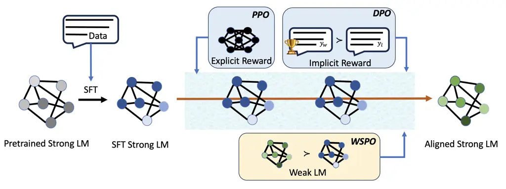

Figure 1: Pipeline for LM alignment. (1) Perform SFT on the pre-trained
model using expert data. (2) Current approaches incorporate explicit or
implicit reward mechanisms to fine-tune the model further, aligning its
behavior with human preferences. (3) WSPO aligns strong models by
utilizing the distributional differences observed before and after
aligning the weak model.

As shown in Figure 1, the alignment method in RLHF traditionally
involves training an explicit scalar-valued reward model that captures
human judgment. This reward model is then used to fine-tune the LM
through reinforcement learning (RL) (Christiano et al., 2017), such as
proximal policy optimization (PPO) (Schulman et al., 2017) algorithm.
This pipeline is considerably more complex than SFT, involving training
multiple LMs and sampling from the LM policy in the training loop,
incurring significant computational costs. More recent research has
explored alignment approaches that eliminate the need for a separate
reward model, instead aligning the LM directly based on human
preferences, named Direct Preference Optimization (DPO) (Rafailov
et al., 2024).

Learning from human feedback preferences, whether online or offline, is
crucial in PPO and DPO. A phenomenon known as weak-to-strong
generalization (Burns et al., 2023) demonstrates that a strongly
pre-trained model, when fine-tuned on labels generated by a weaker
model, consistently outperforms the weaker supervised model. This
intriguing result prompts the question: Can we leverage the alignment
signal from the weak models to align a strong model?

This paper introduces a novel method called Weak-to-Strong Preference
Optimization (WSPO), a loss function designed to effectively transfer
the alignment capability from a weaker model to a stronger one. Our
results show that the stronger model can amplify this transferred
alignment. Instead of using data generated by the weaker model as labels
for aligning the stronger model, we establish a relationship between the
weak model (serving as a reward model) and the strong model in the
context of RL optimization. By learning the differences before and after
the alignment of the weak model, we can effectively enhance the
alignment ability of the stronger model.

The main contributions of this paper are summarized as follows:

- •
  We introduce the WSPO method, a loss function that transfers the
  alignment capability of the weak model to the strong model by learning
  the distributional differences before and after the weak model’s
  alignment.
- •
  We find that the alignment capability of the weaker model can be
  effectively transferred to the stronger model, amplifying the stronger
  model’s alignment performance.
- •
  Our experimental analysis reveals that the proposed method improves
  the win rate of Qwen2-7B-Instruct on Arena-Hard from 39.70 to 49.60,
  achieving an impressive 47.04 length-controlled win rate on AlpacaEval
  2, and obtaining a score of 7.33 on MT-bench. Results on various
  common sense, mathematical, and other reasoning tasks demonstrate that
  our method preserves the knowledge embedded in the strong model.

## 2 Preliminaries

Given a query sequence
$`x:=\left(x_{1},\ldots,x_{m}\right)\in\mathcal{X}`$, an auto-regressive
LM defines a probability distribution over possible response sequences
$`y:=\left(y_{1},y_{2},\ldots,y_{n}\right)\in\mathcal{Y}`$. The
probability $`\pi_{\theta}(y\mid x)`$ can be decomposed using the chain
rule of probability as
$`\pi_{\theta}(y\mid x)=\prod_{t=1}^{n}\pi_{\theta}\left(y_{t}\mid y_{<t},x\right)`$,
where $`y_{<t}`$ denotes $`\{y_{1},y_{2},...,y_{t-1}\}`$. Typically, an
LM is pre-trained on a large, unlabeled text dataset using maximum
likelihood estimation (MLE). This process can be viewed as learning a
distribution that narrows the gap with the true data distribution.

### 2.1 Supervised Fine-tuning

Following initialization with a pre-trained LM $`\pi_{\text{base}}`$,
the model undergoes further fine-tuning on smaller, meticulously curated
datasets containing expert demonstrations of high-quality responses.
This results in the model $`\pi_{\text{sft}}`$. These datasets emphasize
desired behaviors such as following instructions (Wei et al., 2021),
engaging in dialogue (Li et al., 2016), and other similar tasks.

### 2.2 Finetuning from human feedback

Learning from human feedback (Christiano et al., 2017) has garnered
significant attention due to its potential to use human-labeled datasets
for aligning LMs with human preferences (Wei et al., 2021). In these
alignment approaches, the optimization objective is generally to
maximize the expected reward from an implicit or explicit reward
function while including a KL-divergence term from the reference policy
as a penalty for divergence (Shi et al., 2024).

#### 2.2.1 RLHF

##### Learning the reward model.

Learning a reward model typically involves training a binary classifier
to distinguish between preferred and less preferred actions using a
logistic regression loss. A commonly used classifier for this task is
the Bradley-Terry model (David, 1963). In this model, for a given
context $`x`$ and response $`y`$, the pointwise reward of selecting
$`y`$ given $`x`$ is denoted by $`r(x,y)`$.

##### Policy Optimization with the learned reward.

Once the reward model is established, the model alignment process
maximizes the expected reward while preserving the original distribution
$`\pi_{\text{ref}}`$. This is often achieved using a family of
$`f`$-divergence regularization methods (Rafailov et al., 2024; Shi
et al., 2024). For example, when using KL divergence, the optimization
problem on a static dataset of comparisons
$`\mathcal{D}=\left\{x^{(i)},y_{w}^{(i)},y_{l}^{(i)}\right\}_{i=1}^{N}`$,
where $`y_{w}`$ and $`y_{l}`$ represent the preferred and dispreferred
completions, respectively, can be formulated as follows:

```math
\max_{\pi_{\theta}}\mathbb{E}_{x\sim\mathcal{D},y\sim\pi_{\theta}(y\mid x)}\left[r(x,y)\right]-\beta\mathbb{D}_{\mathrm{KL}}\left[\pi_{\theta}(y\mid x)\|\pi_{\mathrm{ref}}(y\mid x)\right], \tag{1}
```

where $`\beta`$ is a parameter that controls the degree of deviation
from the reference policy $`\pi_{\text{ref}}`$. If $`\beta`$ is set too
high, KL regularization forces the aligned model to closely mimic the
SFT model, potentially limiting the effectiveness of the alignment
(Geist et al., 2019). On the other hand, if $`\beta`$ is set too low,
the aligned model may diverge excessively from the SFT model, leading to
reward hacking (Skalse et al., 2022). This overfitting problem can
compromise critical capabilities developed during pretraining or SFT
(Stiennon et al., 2020).

#### 2.2.2 DPO

An alternative approach to learning from the human preference paradigm
described above is DPO (Rafailov et al., 2024), which completely
bypasses the need to train a reward model. The loss function that DPO
optimizes is expressed as a function of $`\pi_{\theta}`$ as follows:

```math
\displaystyle\mathcal{L}_{\mathrm{DPO}}\left(\pi_{\theta};\pi_{\mathrm{ref}}\right)=-\mathbb{E}_{\left(x,y_{w},y_{l}\right)\sim\mathcal{D}}\left[\log\sigma\left(\beta\log\frac{\pi_{\theta}\left(y_{w}\mid x\right)}{\pi_{\mathrm{ref}}\left(y_{w}\mid x\right)}-\beta\log\frac{\pi_{\theta}\left(y_{l}\mid x\right)}{\pi_{\mathrm{ref}}\left(y_{l}\mid x\right)}\right)\right]. \tag{2}
```

While DPO simplifies the process by bypassing the need for reward
function training, this may result in a final strategy that is less
regularized and robust compared to RLHF. In RLHF, the underfitted reward
function is crucial in balancing and optimizing the final strategy (Azar
et al., 2024).

## 3 Method

Building on the concept of weak-to-strong generalization, where a strong
model is capable of generalizing beyond weak labels rather than simply
imitating the behavior of the weaker model, in this section, we leverage
RL theory to demonstrate that it is possible to train a strong alignment
model using the distributional differences before and after weak model
alignment.

### 3.1 Your Language Model Is Secretly a Reward Model

Prior work (Rafailov et al., 2024) shows that given a specific reward
model $`r(x,y)`$, the optimal solution to the KL-constrained reward
maximization problem in Objective 1 takes the form:

```math
\pi_{r}(y\mid x)=\frac{1}{Z(x)}\pi_{\text{ref}}(y\mid x)\exp\left(\frac{1}{\beta}r(x,y)\right), \tag{3}
```

where
$`Z(x)=\sum_{y}\pi_{\text{ref}}(y\mid x)\exp\left(\frac{1}{\beta}r(x,y)\right)`$
is the partition function, and $`\pi_{r}(y\mid x)`$ represents the model
after alignment. The reward function can be shown as follows by
rearranging Equation 3:

```math
r(x,y)=\beta\log\frac{\pi_{r}(y\mid x)}{\pi_{\mathrm{ref}}(y\mid x)}+\beta\log Z(x). \tag{4}
```

###### Theorem 1.

Under mild assumptions, all reward classes consistent with the
Plackett-Luce (and Bradley-Terry in particular) models can be
represented with the reparameterization
$`r(x,y)=\beta\log\frac{\pi(y\mid x)}{\pi_{\text{ref}}(y\mid x)}`$ for
some model $`\pi(y\mid x)`$ and a given reference model
$`\pi_{\text{ref}}(y\mid x)`$.

Based on Theorem 1 proposed by Rafailov et al. (2024), we know that the
reward function can be expressed as the difference in distributions
before and after model alignment.

### 3.2 Weak-to-Strong preference optimization

Before introducing our method, we define
$`\pi_{r}^{\text{weak}}(y\mid x)`$ as a weak model aligned using
specific algorithms, such as PPO or DPO. Similarly,
$`\pi_{\text{ref}}^{\text{weak}}(y\mid x)`$ denotes the reference model,
which may correspond to either $`\pi_{\text{sft}}`$ or
$`\pi_{\text{base}}`$. These notations also apply to strong models.

##### Derive the WSPO objective.

Theorem 1 demonstrates that a reward model trained on the preference
dataset $`\mathcal{D}`$ can be expressed as the distribution difference
before and after model alignment. Consequently, we can align a weak
model and derive an aligned weak model
$`\pi_{r}^{\text{weak}}(y\mid x)`$. Thus, the reward model $`r(x,y)`$
can be formulated as
$`\beta\log\frac{\pi_{r}^{\text{weak}}(y\mid x)}{\pi_{\text{ref}}^{\text{weak}}(y\mid x)}`$.
Next, we employ this transformed reward model to align a strong model
$`\pi_{\text{ref}}^{\text{strong}}(y\mid x)`$, allowing us to derive
that

```math
\displaystyle\pi_{r}^{\text{strong}}(y\mid x)=\frac{1}{Z^{\prime}(x)}\pi_{\text{ref }}^{\text{strong}}(y\mid x)\exp\left(\frac{1}{\lambda}r(x,y)\right)\propto\pi_{\text{ref }}^{\text{strong}}(y\mid x)\left(\frac{\pi_{r}^{\text{weak}}(y\mid x)}{\pi_{\text{ref }}^{\text{weak}}(y\mid x)}\right)^{1/\gamma}, \tag{5}
```

where
$`Z^{\prime}(x)=\sum_{y}\pi_{\text{ref }}^{\text{strong}}(y\mid x)\exp\left(\frac{1}{\lambda}r(x,y)\right)`$,
$`\lambda`$ is the regularization strength to align strong LM using
Obejctive 1, and $`\gamma`$ equals to $`\lambda/\beta`$. Although
$`r(x,y)`$ is analytically tractable, substituting it into Obejective 1
for policy optimization poses challenges due to the absence of a
partition function. However, we can optimize Equation 5 to minimize the
difference in distance between the logarithmic probability distributions
before and after aligning the strong and weak models. Therefore we
obtain

```math
\mathcal{L}_{\text{WSPO}}=\mathbb{E}_{(x,y)\sim\mathcal{D}}\left[\frac{1}{|y|}\left\|\gamma\log\frac{\pi^{\text{strong}}_{\theta}(y\mid x)}{\pi^{\text{strong}}_{\text{ref}}(y\mid x)}-\log\frac{\pi^{\text{weak}}_{r}(y\mid x)}{\pi^{\text{weak}}_{\text{ref}}(y\mid x)}\right\|^{2}_{2}\right]. \tag{6}
```

Derivation see in Appendix A.3. An intuitive explanation is that we
leverage the change in the weak model’s alignment before and after as a
supervisory signal to guide the alignment of the stronger reference
model.

##### The role of the hyperparameter $`\gamma`$.

The hyperparameter $`\gamma`$ plays a dual role: it maximizes the reward
function
$`\beta\log\frac{\pi_{r}^{\text{weak}}(y\mid x)}{\pi_{\text{ref}}^{\text{weak}}(y\mid x)},`$
while simultaneously constraining the proximity of the original
distribution $`\pi^{\text{strong}}_{\text{ref}}(y\mid x)`$ to the
optimized distribution $`\pi^{\text{strong}}_{\theta}(y\mid x)`$.

##### What does the WSPO do?

The gradient with respect to the parameters $`\theta`$ can be written
as:

```math
\displaystyle \displaystyle\mathbb{E}_{(x,y)\sim\mathcal{D}}\sum_{t=1}^{|y|}\left[\frac{2}{|y|}\left(\gamma\log\frac{\pi^{\text{strong}}_{\theta}(y_{<t}\mid x)}{\pi^{\text{strong}}_{\text{ref}}(y_{<t}\mid x)}-\log\frac{\pi^{\text{weak}}_{r}(y_{<t}\mid x)}{\pi^{\text{weak}}_{\text{ref}}(y_{<t}\mid x)}\right)\nabla_{\theta}\log\pi_{\theta}^{\text{strong}}(y_{<t}\mid x)\right]. \tag{7}
```

As shown in Equation 7, the direction of the gradient is influenced by
the contents of the parentheses, while the extent of gradient descent is
not dictated by the model’s likelihood on the dataset. Derivation see in
Appendix A.4. This may help mitigate the overfitting problem commonly
associated with DPO alignment algorithms (Azar et al., 2024).

##### WSPO outline.

The general WSPO pipeline operates as follows: 1.) Utilize offline
datasets $`\mathcal{D}=\left\{x^{(i)},y_{w}^{(i)}\right\}_{i=1}^{N}`$,
such as the selected preference or SFT datasets; paired datasets are not
required. In Appendix C, we demonstrate that even the rejected
preference dataset remains effective for the WSPO algorithm. 2.) Prepare
the weak model, both pre-and post-alignment. 3.) Optimize the LM
$`\pi_{\theta}^{\text{strong}}(y\mid x)`$ to minimize the objective
$`\mathcal{L}_{\text{WSPO}}`$ for the specified dataset. The only
parameter requiring tuning is $`\gamma`$.

## 4 Experiments

This section empirically evaluates WSPO’s ability to align strong models
by learning from weaker ones. Our findings reveal that aligned weak
models can successfully transfer their alignment behaviors to stronger
models, often resulting in an enhanced alignment effect. Additionally,
WSPO demonstrates competitive performance compared to strong models
trained using PPO and DPO. We begin by illustrating the feasibility of
our method with a toy example. Next, we analyze the stability of WSPO
algorithm training. Finally, we conduct a comprehensive evaluation of
the algorithm’s overall performance.

### 4.1 summarization with a Length Reward

#### 4.1.1 Experiment setup

##### Task.

We employ a toy summarization task with a hardcoded reward function that
incentivizes models to generate summaries with lengths falling within
the range of $`[L_{\min},L_{\max}]`$:

```math
r(x,y):=\begin{cases}0,&\text{ if }|y|\in\left[L_{\min},L_{\max}\right]\\
-1,&\text{ otherwise }\end{cases} \tag{8}
```

##### Models.

We employ the Qwen2-1.5B-base and Qwen2-7B-base models (Yang et al.,
2024a) as our pre-trained weak model,
$`\pi_{\text{base}}^{\text{weak}}`$, and strong model,
$`\pi_{\text{base}}^{\text{strong}}`$, respectively. To train the SFT
models, $`\pi_{\text{sft}}^{\text{weak}}`$ and
$`\pi_{\text{sft}}^{\text{strong}}`$, we utilize the training split of
the XSUM dataset (Narayan et al., 2018). Subsequently, the validation
split is employed for further fine-tuning, leading to the development of
the corresponding PPO-aligned models, $`\pi_{\text{ppo}}^{\text{weak}}`$
and $`\pi_{\text{ppo}}^{\text{strong}}`$. When training with WSPO, we
directly use the distributional differences between
$`\pi_{\text{base}}^{\text{weak}}`$ and
$`\pi_{\text{ppo}}^{\text{weak}}`$ to align
$`\pi_{\text{base}}^{\text{strong}}`$ and derive
$`\pi_{\text{wspo}}^{\text{strong}}`$, because no additional knowledge
is required to output a summary in the summary task.

##### Evaluation.

The parameters $`L_{\min}`$ and $`L_{\max}`$ are set to 20 and 30,
respectively. We use the test split for evaluation to guarantee no data
contamination (Zhu et al., 2023). Detailed experimental settings are
provided in Appendix B.1.

#### 4.1.2 Results and analysis

We visualize the lengths generated by various alignment algorithms
across models of different sizes and calculate the win rate, which
represents the proportion of lengths falling within the
$`[L_{\min},L_{\max}]`$ range.

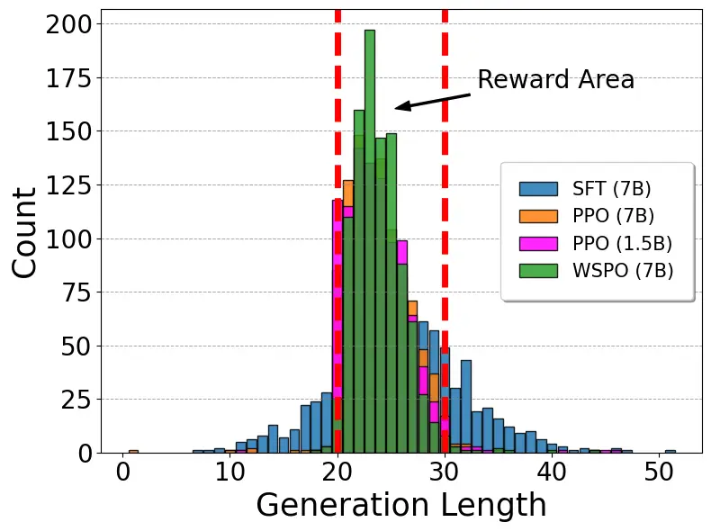

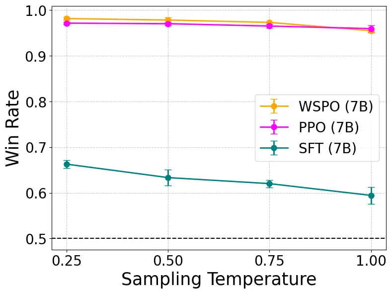

Figure 2: Left. PPO and WSPO alignment methods vary in the length of
generated sequences compared to the reference SFT model using greedy
decoding. Right. PPO and WSPO alignment methods show variation in reward
hits compared to the reference SFT model, using the top-$`p`$ sampling
algorithm at different temperatures.

##### WSPO exhibits comparable alignment capability against PPO.

As shown in Figure 2, the PPO and WSPO alignment algorithms address
variable generation lengths arising from SFT training. The left figure
illustrates how our method, using the greedy decoding algorithm,
performs similarly to the PPO algorithm and can effectively mitigate
outliers. In the right figure, we present the averaged results from
three samplings. From the error lines, it is evident that both PPO and
WSPO exhibit high stability during generation. Notably, our method is
better at lower temperatures than the performance of the PPO-aligned
strong model.

##### WSPO embraces certain generalizations.

On the left in Figure 2, we can observe that the weak model performs
quite well on the alignment task, with the results predominantly
concentrated in the reward area. Additionally, we can see that the
strong LM, obtained through WSPO alignment with the weak model, exhibits
a different length distribution in its generated outputs. This indicates
that the strong LM is not merely imitating the behavior of weak models.

##### WSPO provides a faster alignment process.

Traditionally, model alignment involves performing SFT on pre-trained
LMs first, then applying PPO algorithms for alignment. In this section,
we merge these two stages. Using the same amount of alignment data
typically reserved for PPO training, WSPO achieves comparable alignment
effects in a more streamlined process. This demonstrates that a
pre-trained model can effectively perform alignment by learning
differential distribution signals, provided it has acquired sufficient
knowledge.

### 4.2 Single-turn dialogue

#### 4.2.1 Experimental Setup

##### Task.

In single-turn dialogue, when prompt $`x`$ is a human query, the model
must either politely respond to the query or refuse to answer.

##### Models.

In this scenario, we fine-tune the Qwen2-1.5B-base and Qwen2-7B-base
models (Yang et al., 2024a) exclusively on the preferred completions,
resulting in two models: $`\pi_{\text{sft}}^{\text{weak}}`$ and
$`\pi_{\text{sft}}^{\text{strong}}`$. We refer to these models
collectively as Preferred-FT models. Subsequently, we apply the DPO
algorithm to perform alignment training using the Anthropic Helpful and
Harmless conversation training dataset (Bai et al., 2022). This step
produces two alignment models: $`\pi_{\text{dpo}}^{\text{weak}}`$ and
$`\pi_{\text{dpo}}^{\text{strong}}`$. To address potential biases
introduced by the base models pretrained on the high-quality corpus, we
utilize the distributional differences between
$`\pi_{\text{sft}}^{\text{weak}}`$ and
$`\pi_{\text{dpo}}^{\text{weak}}`$. These differences guide the
alignment of $`\pi_{\text{sft}}^{\text{strong}}`$ through the WSPO
algorithm, ultimately resulting in the model
$`\pi_{\text{wspo}}^{\text{strong}}`$.

##### Evaluation.

We use the test split of the Anthropic HH dataset to assess alignment
performance, evaluating through a single-step human-assistant
interaction. The evaluation leverages preferred completions from the
test set as references to calculate the win rates of different methods.
Taking cost into consideration, we selected the GPT-4o-mini as the judge
model. We use Qwen2.5-72B (Qwen, 2024) to verify the validity of the
evaluation. Detailed experimental settings are provided in Appendix B.2.

#### 4.2.2 Results and analysis

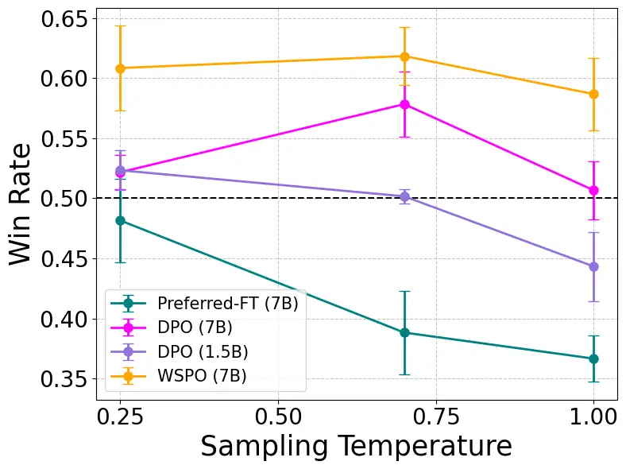

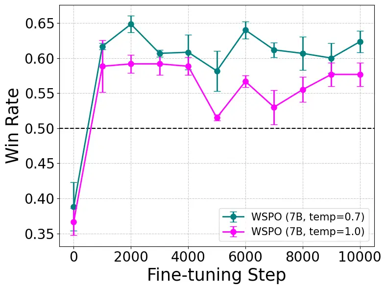

Figure 3: Left. Win rates computed by GPT-4o-mini for Anthropic-HH
single-step dialogue at different temperatures. Right. The win rates for
different sampling temperatures remain relatively stable throughout the
training process. WSPO demonstrates consistent performance across
varying sampling temperatures over time.

##### The alignment signal from the weak model plays a crucial role.

As shown on the left side of Figure 3, unlike DPO, which requires
distinguishing the likelihood between preferred and dispreferred pairs
in preference data, WSPO, based on the Preferred-FT model, continues to
leverage the alignment signal from the weak model on preferred data to
perform alignment. Consequently, WSPO adjusts the distribution learned
exclusively from the preferred data, resulting in improved alignment
ability compared to the Preferred-FT model.

##### WSPO exhibits better alignment capability compared to DPO.

Tuning the parameters for DPO proves to be quite challenging, as seen in
Appendix B.2. After several adjustments, we achieved a relatively
favorable outcome with the hyperparameter $`\beta=0.5`$, which was
determined by testing a range of values $`\{0.1,0.5,1.0,2.0,5.0\}`$ for
the 7B model. As illustrated on the left side of Figure 3, surprisingly,
our model demonstrates better alignment performance than DPO with the
hyperparameter $`\gamma=0.1`$.

##### WSPO exhibits fast convergence and stability.

As shown in the right part of Figure 3, the model achieves a high win
rate after just 1k fine-tuning steps, demonstrating fast convergence.
Additionally, the training process remains stable throughout.

### 4.3 A complex evaluation

#### 4.3.1 Experimental Setup

##### Models.

We train the base models on the UltraChat-200k (Ding et al., 2023)
dataset to obtain the SFT models. We use the off-the-shelf
instruction-tuned models as the SFT models. Then, we perform alignment
using DPO on the UltraFeedback dataset (Cui et al., 2024) using the SFT
model as the starting point. The process of obtaining the models is
largely consistent with that of Exp 4.2.

##### Evaluation.

We evaluate our models primarily on three widely-adopted, open-ended
instruction-following benchmarks: MT-Bench (Zheng et al., 2024a),
AlpacaEval 2 (Dubois et al., 2024), and Arena-Hard v0.1 (Li et al.,
2024c). These benchmarks assess the models’ conversational versatility
across diverse queries and are commonly used by the community (Meng
et al., 2024). Besides, fine-tuning LMs is challenging, notably since it
can cause forgetting (French, 1992) of pre-trained knowledge. To
demonstrate that the strong model can generalize beyond weak labels
instead of merely imitating the behavior of weak models. We use
zero-shot or few-shot learning to test the reasoning ability across five
benchmarks, including MMLU (Hendrycks et al., 2021), CMMLU (Li et al.,
2024a), Truthful-QA (Lin et al., 2021), GSM-PLUS (Li et al., 2024b), and
GSM8K (Cobbe et al., 2021). We evaluate these benchmarks by using
llm-evaluation-harness (Gao et al., 2024) repo. Evaluation details are
in Appendix B.3.

#### 4.3.2 Results and Analysis

|        |                   |        |            |          |                       |        |            |          |
| ------ | ----------------- | ------ | ---------- | -------- | --------------------- | ------ | ---------- | -------- |
| Method | Qwen2-Base (1.5B) |        |            |          | Qwen2-Instruct (1.5B) |        |            |          |
|        | AlpacaEval2       |        | Arena-Hard | MT-Bench | AlpacaEval2           |        | Arena-Hard | MT-Bench |
|        | LC (%)            | WR (%) | WR (%)     | Score    | LC (%)                | WR (%) | WR (%)     | Score    |
| SFT    | 4.16              | 2.30   | 0.90       | 4.68     | 5.31                  | 3.42   | 2.40       | 5.05     |
| DPO    | 5.56              | 4.79   | 2.60       | 5.03     | 8.93                  | 6.77   | 4.00       | 5.60     |
| Method | Qwen2-Base (7B)   |        |            |          | Qwen2-Instruct (7B)   |        |            |          |
|        | AlpacaEval2       |        | Arena-Hard | MT-Bench | AlpacaEval2           |        | Arena-Hard | MT-Bench |
|        | LC (%)            | WR (%) | WR (%)     | Score    | LC (%)                | WR (%) | WR (%)     | Score    |
| SFT    | 11.54             | 5.65   | 5.30       | 5.86     | 30.73                 | 28.32  | 39.70      | 7.19     |
| DPO    | 14.06             | 8.45   | 10.70      | 6.70     | 32.10                 | 28.15  | 39.30      | 7.26     |
| WSPO   | 26.77             | 26.68  | 29.00      | 7.00     | 47.04                 | 48.32  | 49.60      | 7.33     |

Table 1: Evaluation results of models across different settings and
benchmarks. LC and WR refer to length-controlled and raw win rates,
respectively. We train SFT models under the Base settings using the
UltraChat-200K dataset. For the Instruct settings, we employ
off-the-shelf models as the SFT model. The SFT and DPO versions of the
weak model are employed to align the strong model within the WSPO
algorithm.

As shown in Table 1, the Instruct setting consistently outperforms the
Base setting. This is primarily because the Instruct model utilizes
high-quality demonstration and preference data for SFT and RLHF (Yang
et al., 2024a).

##### DPO shows limited improvement for the Instruct model.

The SFT-trained model demonstrates limited effectiveness across the
three benchmarks, highlighting areas for potential enhancement. While
DPO provides noticeable improvements for the base and weaker models,
performance declines with Qwen2-7B-Instruct. This decline could be due
to Qwen2-7B’s ability to achieve strong alignment through raw,
high-quality data and complex RLHF processes (Yang et al., 2024a).
Relying solely on the Ultrafeedback dataset for DPO learning might not
lead to performance gains, as the dataset may already be part of its
original high-quality data. Additionally, it’s possible that DPO
adversely affected the model’s initial performance.

##### WSPO effectively learns and amplifies the alignment signals of weak models.

With WSPO, the strong model consistently delivers great results across
all three benchmarks. The impressive performance of WSPO can be
attributed to its unique approach: unlike DPO, which learns directly
from preference data pairs, WSPO derives alignment signals from weaker
models, not only dependent on the Ultrafeedback dataset itself. For
instance, on the Qwen2-1.5B-Instruct, the alignment ability of weak
models improved from 2.40 to 4.00 with DPO learning, as measured by the
Arena-Hard evaluation. Subsequently, the strong model’s alignment
capability was amplified from 39.70 to 49.60 by leveraging the
differences in alignment signals from the weak model—something that DPO
learning on datasets alone cannot achieve. The amplification phenomenon
might be attributed to the limited parameter size of the weak model,
which constrains its ability to achieve optimal alignment. However,
transferring this alignment to stronger models could offer substantial
benefits. Additionally, our method circumvents direct training on the
preference dataset, effectively reducing risks such as overfitting and
reward hacking.

| Model                    | MMLU  | CMMLU | Truthful-QA | GSM-PLUS | GSM8K | Avg.  |
| ------------------------ | ----- | ----- | ----------- | -------- | ----- | ----- |
| Qwen2-1.5B-Instruct      | 55.70 | 69.62 | 28.52       | 38.83    | 59.78 | 50.49 |
| Qwen2-7B-Base            | 69.43 | 83.34 | 37.33       | 57.39    | 79.83 | 65.46 |
| Qwen2-7B-Instruct        | 69.94 | 81.84 | 41.00       | 56.91    | 77.86 | 65.51 |
| Qwen2-7B-Instruct + WSPO | 69.44 | 80.82 | 47.00       | 57.96    | 77.94 | 66.63 |
| Qwen2-7B-Base + WSPO     | 69.37 | 80.98 | 44.68       | 60.06    | 81.31 | 67.28 |

Table 2: Evaluation results of models across different benchmarks. We
evaluate these benchmarks by using llm-evaluation-harness (Gao et al., 2024) repo.

##### WSPO generalizes beyond weak models rather than simply imitating them.

As shown in Table 2, Qwen2-1.5B-Instruct is much less capable than the
7B version, further demonstrating that WSPO prevents knowledge
forgetting in common sense, mathematics and other reasoning tasks while
enhancing the model’s overall alignment ability, as shown in Table 1.
Notably, on the TruthfulQA dataset, both the base model and the Instruct
model exhibited improved capabilities in assessing the degree of
truthfulness.

## 5 Analysis

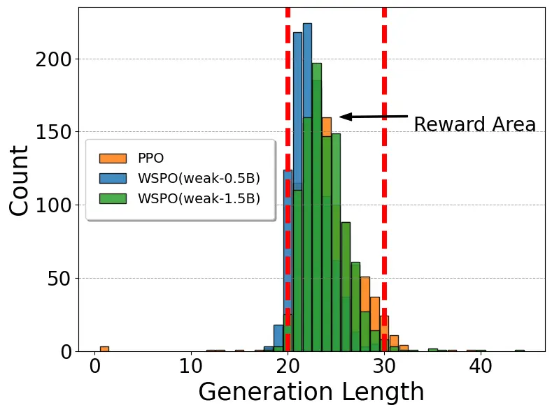

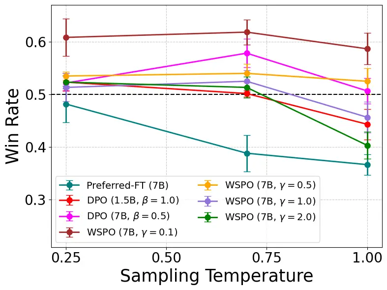

Figure 4: Left. The effect of weak model size on the sequence length
generated by WSPO compared to the PPO using greedy decoding. Right. The
impact of different $`\gamma`$ hyperparameters on WSPO in a single-turn
dialogue analysis.

### 5.1 Impact of Weak model

As discussed in the previous section, we utilized the probability
difference between a weak base model and its aligned version to align a
stronger model. In this section, we empirically investigate the impact
of model size by using the Qwen2-0.5B model as a weaker counterpart to
the Qwen2-1.5B model, aiming to explore how model size affects alignment
strength. The experimental setup mirrors that of Section 4.1.1. As
illustrated on the left side of Figure 4, even a weaker model can
provide a robust alignment signal to a stronger model (e.g., the
Qwen2-7B model). Furthermore, in the Instruct setting of Section 4.3, we
use the 0.5B model as the weaker model without any alignment enhancement
following DPO training. When this alignment is transferred to a stronger
model, it achieves a score of 45.00 on the Arena-hard benchmark using
WSPO optimization. This indicates that parameter size may limit
alignment in weaker models, whereas stronger models can amplify this
alignment. Besides, the alignment ability of a weak model is also
important, we can have fine-grained alignment on a weak model and then
migrate the alignment ability to a strong model to achieve better
alignment.

### 5.2 Impact of Hyperparameter

Recalling the WSPO loss in Equation 6, we introduce the hyperparameter
$`\gamma`$, which represents the ratio of regularization intensity
applied to the strong and weak models in the optimization objective
outlined in Objective 1, as well as the penalty for deviating from the
original distribution. This section investigates the impact of
$`\gamma`$ on the alignment strength. We test values of
$`\gamma\in\{0.1,0.5,1.0,2.0\}`$ to evaluate its effect on
regularization. As illustrated on the right side of Figure 4, adjusting
$`\gamma`$ enables us to modulate the degree to which the stronger model
aligns with the weaker one and deviates from the original distribution.
When $`\gamma=1`$, the alignment of the strong model closely mirrors
that of the weak model. As $`\gamma`$ increases beyond 1, the strong
model’s alignment increasingly favors the original distribution.
Conversely, the strong models exhibit superior alignment when $`\gamma`$
is less than 1. Therefore, despite $`\gamma`$ incorporating a penalty
for deviations from the original distribution, we can infer that the
strong model requires a smaller regularization than the weak model when
optimizing the objective function in Objective 1.

### 5.3 Impact of SFT Phase

We also leveraged the probability difference between Qwen2-1.5-Base and
Qwen2-1.5-Instruct to align stronger models from the Base version
directly. On the Arena-Hard benchmark, the Base model initially scored
7.70. However, after applying the WSPO algorithm for alignment with
Ultrafeedback, the score saw a modest improvement to 9.30. This limited
gain underscores the significance of high-quality knowledge injection
during the SFT phase.

## 6 Related Work

### 6.1 Training-time Alignment

RLHF is a technique designed to align LLMs with human preferences and
values (Christiano et al., 2017; Bai et al., 2022). In the third stage
of RLHF, the PPO algorithm (Schulman et al., 2017) is commonly used.
Recent advancements, such as Reinforcement Learning with AI Feedback
(RLAIF), offer potential alternatives to traditional human feedback
methods (Pang et al., 2023). However, challenges throughout the RLHF
pipeline, from preference data collection to model training, have been
noted by Radford et al. (2018). In contrast, approaches like
DPO (Rafailov et al., 2024) bypass the need for a reward model by
directly training LLMs using human preferences. Other competing methods,
such as IPO (Azar et al., 2024), KTO (Ethayarajh et al., ), and
ORPO (Hong et al., 2024), have also emerged.

### 6.2 Inference-time alignment

Decoding strategies aim to generate text continuations that balance
diversity and coherence (Zhu et al., 2024). Some methods trade off
computational efficiency during inference to better align with human
preferences. The simplest of these is the Best-of-$`N`$ approach, which
involves sampling multiple outputs from $`\pi_{\text{ref}}`$ and
selecting the one with the highest reward according to a reward
model (Touvron et al., 2023). Another approach is Emulated Fine-Tuning
(EFT) (Mitchell et al., 2023), a scale-decoupling method that transfers
fine-tuning effects between small and large LMs. Liu et al. (2024a)
demonstrated the empirical effectiveness of this proxy-tuning technique,
showing it rivals standard fine-tuning across various benchmarks.
Additionally, Liu et al. (2024b) introduced DeRa, a cost-efficient
method that dynamically adjusts alignment strength during inference.
Zhou et al. (2024) used the log-probability difference between
small-tuned and untuned models to guide a frozen large model, providing
an efficient up-scaling strategy without fine-tuning.

### 6.3 Weak-to-Strong Generalization

Several works have been proposed to use weak model supervision to elicit
the capabilities of a much stronger model. Burns et al. (2023) found
that strong models fine-tuned by weak supervisors consistently
outperform their weak counterparts. Yang et al. (2024b) presents a
method that improves model reasoning by employing weak supervision to
autonomously refine training data autonomously, enabling the expansion
of reasoning abilities without human annotations or advanced models.
Unlike these approaches, our method uses weak model supervision for
alignment to enhance helpfulness while maintaining the strong model’s
original ability.

## 7 Discussion

##### Conclusion.

This paper introduced WSPO, a method for transferring alignment
capabilities from a weaker model to a stronger one by leveraging
distributional differences before and after weak model alignment.
Experimental results show that WSPO improves model performance on key
benchmarks, offering an efficient alternative to traditional alignment
methods.

##### Limitations and future work.

We did not explore the alignment transfer properties across different
language model architectures or examine the impact of weak model
alignment strength in WSPO. Our study also does not explain why
transferring a weak model’s alignment ability to a stronger model
amplifies it. Future research could investigate the use of weak models
as reward models in reinforcement learning frameworks to facilitate
alignment or seek to explain this phenomenon.

#### Acknowledgments

This paper is supported by the General Program of National Natural
Science Foundation of China (62176153).

#### Ethics Statement

Although the datasets used in this paper are open-source and helpful, we
did not perform an in-depth evaluation of them, nor did we account for
factors such as safety, honesty, or other considerations when designing
the WSPO loss function.

#### Reproducibility Statement

All training experiments in this paper were conducted using 8×H100 GPUs,
leveraging the LLaMA-Factory (Zheng et al., 2024b) repository, which
offers an integrated framework for fine-tuning over 100 LLMs with a
variety of efficient techniques. The only additional implementation
required is training the model based on WSPO alignment. This can be
achieved by modifying the DPO training code within the LLaMA-Factory
repository (Zheng et al., 2024b), specifically by calculating the loss
on the selected dataset and loading weaker models. The evaluation uses
the LLM evaluation, with the relevant prompts in the Appendix. The
reasoning tasks evaluation is also performed using the llm-eval-harness
Gao et al. (2024) repo.

## References

- Azar et al. (2024) Mohammad Gheshlaghi Azar, Zhaohan Daniel Guo, Bilal
  Piot, Remi Munos, Mark Rowland, Michal Valko, and Daniele
  Calandriello. A general theoretical paradigm to understand learning
  from human preferences. In _International Conference on Artificial
  Intelligence and Statistics_, pp. 4447–4455. PMLR, 2024.
- Bai et al. (2022) Yuntao Bai, Andy Jones, Kamal Ndousse, Amanda
  Askell, Anna Chen, Nova DasSarma, Dawn Drain, Stanislav Fort, Deep
  Ganguli, Tom Henighan, et al. Training a helpful and harmless
  assistant with reinforcement learning from human feedback. _arXiv
  preprint arXiv:2204.05862_, 2022.
- Burns et al. (2023) Collin Burns, Pavel Izmailov, Jan Hendrik
  Kirchner, Bowen Baker, Leo Gao, Leopold Aschenbrenner, Yining Chen,
  Adrien Ecoffet, Manas Joglekar, Jan Leike, et al. Weak-to-strong
  generalization: Eliciting strong capabilities with weak supervision.
  _arXiv preprint arXiv:2312.09390_, 2023.
- Christiano et al. (2017) Paul F Christiano, Jan Leike, Tom Brown,
  Miljan Martic, Shane Legg, and Dario Amodei. Deep reinforcement
  learning from human preferences. _Advances in neural information
  processing systems_, 30, 2017.
- Cobbe et al. (2021) Karl Cobbe, Vineet Kosaraju, Mohammad Bavarian,
  Mark Chen, Heewoo Jun, Lukasz Kaiser, Matthias Plappert, Jerry Tworek,
  Jacob Hilton, Reiichiro Nakano, et al. Training verifiers to solve
  math word problems. _arXiv preprint arXiv:2110.14168_, 2021.
- Cui et al. (2024) Ganqu Cui, Lifan Yuan, Ning Ding, Guanming Yao,
  Bingxiang He, Wei Zhu, Yuan Ni, Guotong Xie, Ruobing Xie, Yankai Lin,
  et al. Ultrafeedback: Boosting language models with scaled ai
  feedback. In _Forty-first International Conference on Machine
  Learning_, 2024.
- David (1963) Herbert Aron David. _The method of paired comparisons_,
  volume 12. London, 1963.
- Ding et al. (2023) Ning Ding, Yulin Chen, Bokai Xu, Yujia Qin, Zhi
  Zheng, Shengding Hu, Zhiyuan Liu, Maosong Sun, and Bowen Zhou.
  Enhancing chat language models by scaling high-quality instructional
  conversations. _arXiv preprint arXiv:2305.14233_, 2023.
- Dubois et al. (2024) Yann Dubois, Balázs Galambosi, Percy Liang, and
  Tatsunori B Hashimoto. Length-controlled alpacaeval: A simple way to
  debias automatic evaluators. _arXiv preprint arXiv:2404.04475_, 2024.
- (10) Kawin Ethayarajh, Winnie Xu, Niklas Muennighoff, Dan Jurafsky,
  and Douwe Kiela. Model alignment as prospect theoretic optimization.
  In _Forty-first International Conference on Machine Learning_.
- French (1992) Robert M French. Semi-distributed representations and
  catastrophic forgetting in connectionist networks. _Connection
  Science_, 4(3-4):365–377, 1992.
- Gao et al. (2024) Leo Gao, Jonathan Tow, Baber Abbasi, Stella
  Biderman, Sid Black, Anthony DiPofi, Charles Foster, Laurence Golding,
  Jeffrey Hsu, Alain Le Noac’h, Haonan Li, Kyle McDonell, Niklas
  Muennighoff, Chris Ociepa, Jason Phang, Laria Reynolds, Hailey
  Schoelkopf, Aviya Skowron, Lintang Sutawika, Eric Tang, Anish Thite,
  Ben Wang, Kevin Wang, and Andy Zou. A framework for few-shot language
  model evaluation, 07 2024. URL
  [https://zenodo.org/records/12608602](https://zenodo.org/records/12608602).
- Geist et al. (2019) Matthieu Geist, Bruno Scherrer, and Olivier
  Pietquin. A theory of regularized markov decision processes. In
  _International Conference on Machine Learning_, pp. 2160–2169.
  PMLR, 2019.
- Hendrycks et al. (2021) Dan Hendrycks, Collin Burns, Steven Basart,
  Andy Zou, Mantas Mazeika, Dawn Song, and Jacob Steinhardt. Measuring
  massive multitask language understanding, 2021. URL
  [https://arxiv.org/abs/2009.03300](https://arxiv.org/abs/2009.03300).
- Hong et al. (2024) Jiwoo Hong, Noah Lee, and James Thorne. Orpo:
  Monolithic preference optimization without reference model. _arXiv
  preprint arXiv:2403.07691_, 2(4):5, 2024.
- Kwon et al. (2023) Woosuk Kwon, Zhuohan Li, Siyuan Zhuang, Ying Sheng,
  Lianmin Zheng, Cody Hao Yu, Joseph E. Gonzalez, Hao Zhang, and Ion
  Stoica. Efficient memory management for large language model serving
  with pagedattention, 2023. URL
  [https://arxiv.org/abs/2309.06180](https://arxiv.org/abs/2309.06180).
- Li et al. (2024a) Haonan Li, Yixuan Zhang, Fajri Koto, Yifei Yang, Hai
  Zhao, Yeyun Gong, Nan Duan, and Timothy Baldwin. Cmmlu: Measuring
  massive multitask language understanding in chinese, 2024a. URL
  [https://arxiv.org/abs/2306.09212](https://arxiv.org/abs/2306.09212).
- Li et al. (2016) Jiwei Li, Will Monroe, Alan Ritter, Michel Galley,
  Jianfeng Gao, and Dan Jurafsky. Deep reinforcement learning for
  dialogue generation, 2016. URL
  [https://arxiv.org/abs/1606.01541](https://arxiv.org/abs/1606.01541).
- Li et al. (2024b) Qintong Li, Leyang Cui, Xueliang Zhao, Lingpeng
  Kong, and Wei Bi. Gsm-plus: A comprehensive benchmark for evaluating
  the robustness of llms as mathematical problem solvers, 2024b. URL
  [https://arxiv.org/abs/2402.19255](https://arxiv.org/abs/2402.19255).
- Li et al. (2024c) Tianle Li, Wei-Lin Chiang, Evan Frick, Lisa Dunlap,
  Tianhao Wu, Banghua Zhu, Joseph E Gonzalez, and Ion Stoica. From
  crowdsourced data to high-quality benchmarks: Arena-hard and
  benchbuilder pipeline. _arXiv preprint arXiv:2406.11939_, 2024c.
- Lin et al. (2021) Stephanie Lin, Jacob Hilton, and Owain Evans.
  Truthfulqa: Measuring how models mimic human falsehoods, 2021.
- Liu et al. (2024a) Alisa Liu, Xiaochuang Han, Yizhong Wang, Yulia
  Tsvetkov, Yejin Choi, and Noah A Smith. Tuning language models by
  proxy. _arXiv preprint arXiv:2401.08565_, 2024a.
- Liu et al. (2024b) Tianlin Liu, Shangmin Guo, Leonardo Bianco, Daniele
  Calandriello, Quentin Berthet, Felipe Llinares, Jessica Hoffmann,
  Lucas Dixon, Michal Valko, and Mathieu Blondel. Decoding-time
  realignment of language models. _arXiv preprint arXiv:2402.02992_,
  2024b.
- Llama-Team (2024) Llama-Team. The llama 3 herd of models, 2024. URL
  [https://arxiv.org/abs/2407.21783](https://arxiv.org/abs/2407.21783).
- Meng et al. (2024) Yu Meng, Mengzhou Xia, and Danqi Chen. Simpo:
  Simple preference optimization with a reference-free reward. _arXiv
  preprint arXiv:2405.14734_, 2024.
- Mitchell et al. (2023) Eric Mitchell, Rafael Rafailov, Archit Sharma,
  Chelsea Finn, and Christopher D Manning. An emulator for fine-tuning
  large language models using small language models. _arXiv preprint
  arXiv:2310.12962_, 2023.
- Narayan et al. (2018) Shashi Narayan, Shay B. Cohen, and Mirella
  Lapata. Don’t give me the details, just the summary! topic-aware
  convolutional neural networks for extreme summarization. In Ellen
  Riloff, David Chiang, Julia Hockenmaier, and Jun’ichi Tsujii (eds.),
  _Proceedings of the 2018 Conference on Empirical Methods in Natural
  Language Processing_, pp. 1797–1807, Brussels, Belgium,
  October-November 2018. Association for Computational Linguistics. doi:
  10.18653/v1/D18-1206. URL
  [https://aclanthology.org/D18-1206](https://aclanthology.org/D18-1206).
- OpenAI (2024) OpenAI. Gpt-4 technical report, 2024. URL
  [https://arxiv.org/abs/2303.08774](https://arxiv.org/abs/2303.08774).
- Pang et al. (2023) Jing-Cheng Pang, Pengyuan Wang, Kaiyuan Li,
  Xiong-Hui Chen, Jiacheng Xu, Zongzhang Zhang, and Yang Yu. Language
  model self-improvement by reinforcement learning contemplation. _arXiv
  preprint arXiv:2305.14483_, 2023.
- Qwen (2024) Qwen. Qwen2.5: A party of foundation models,
  September 2024. URL
  [https://qwenlm.github.io/blog/qwen2.5/](https://qwenlm.github.io/blog/qwen2.5/).
- Radford et al. (2018) Alec Radford, Karthik Narasimhan, Tim Salimans,
  Ilya Sutskever, et al. Improving language understanding by generative
  pre-training. 2018.
- Radford et al. (2019) Alec Radford, Jeffrey Wu, Rewon Child, David
  Luan, Dario Amodei, Ilya Sutskever, et al. Language models are
  unsupervised multitask learners. _OpenAI blog_, 1(8):9, 2019.
- Rafailov et al. (2024) Rafael Rafailov, Archit Sharma, Eric Mitchell,
  Christopher D Manning, Stefano Ermon, and Chelsea Finn. Direct
  preference optimization: Your language model is secretly a reward
  model. _Advances in Neural Information Processing Systems_, 36, 2024.
- Schulman et al. (2017) John Schulman, Filip Wolski, Prafulla Dhariwal,
  Alec Radford, and Oleg Klimov. Proximal policy optimization
  algorithms, 2017. URL
  [https://arxiv.org/abs/1707.06347](https://arxiv.org/abs/1707.06347).
- Shi et al. (2024) Ruizhe Shi, Yifang Chen, Yushi Hu, Alisa Liu,
  Hannaneh Hajishirzi, Noah A. Smith, and Simon Du. Decoding-time
  language model alignment with multiple objectives, 2024. URL
  [https://arxiv.org/abs/2406.18853](https://arxiv.org/abs/2406.18853).
- Skalse et al. (2022) Joar Skalse, Nikolaus Howe, Dmitrii
  Krasheninnikov, and David Krueger. Defining and characterizing reward
  gaming. _Advances in Neural Information Processing Systems_,
  35:9460–9471, 2022.
- Stiennon et al. (2020) Nisan Stiennon, Long Ouyang, Jeffrey Wu, Daniel
  Ziegler, Ryan Lowe, Chelsea Voss, Alec Radford, Dario Amodei, and
  Paul F Christiano. Learning to summarize with human feedback.
  _Advances in Neural Information Processing Systems_,
  33:3008–3021, 2020.
- Sun et al. (2023) Zhiqing Sun, Sheng Shen, Shengcao Cao, Haotian Liu,
  Chunyuan Li, Yikang Shen, Chuang Gan, Liang-Yan Gui, Yu-Xiong Wang,
  Yiming Yang, Kurt Keutzer, and Trevor Darrell. Aligning large
  multimodal models with factually augmented rlhf, 2023. URL
  [https://arxiv.org/abs/2309.14525](https://arxiv.org/abs/2309.14525).
- Touvron et al. (2023) Hugo Touvron, Louis Martin, Kevin Stone, Peter
  Albert, Amjad Almahairi, Yasmine Babaei, Nikolay Bashlykov, Soumya
  Batra, Prajjwal Bhargava, Shruti Bhosale, et al. Llama 2: Open
  foundation and fine-tuned chat models. _arXiv preprint
  arXiv:2307.09288_, 2023.
- Wei et al. (2021) Jason Wei, Maarten Bosma, Vincent Y Zhao, Kelvin
  Guu, Adams Wei Yu, Brian Lester, Nan Du, Andrew M Dai, and Quoc V Le.
  Finetuned language models are zero-shot learners. _arXiv preprint
  arXiv:2109.01652_, 2021.
- Yang et al. (2024a) An Yang, Baosong Yang, Binyuan Hui, Bo Zheng,
  Bowen Yu, Chang Zhou, Chengpeng Li, Chengyuan Li, Dayiheng Liu, Fei
  Huang, et al. Qwen2 technical report. _arXiv preprint
  arXiv:2407.10671_, 2024a.
- Yang et al. (2024b) Yuqing Yang, Yan Ma, and Pengfei Liu.
  Weak-to-strong reasoning, 2024b. URL
  [https://arxiv.org/abs/2407.13647](https://arxiv.org/abs/2407.13647).
- Yu et al. (2024) Tianyu Yu, Yuan Yao, Haoye Zhang, Taiwen He, Yifeng
  Han, Ganqu Cui, Jinyi Hu, Zhiyuan Liu, Hai-Tao Zheng, Maosong Sun, and
  Tat-Seng Chua. Rlhf-v: Towards trustworthy mllms via behavior
  alignment from fine-grained correctional human feedback, 2024. URL
  [https://arxiv.org/abs/2312.00849](https://arxiv.org/abs/2312.00849).
- Zheng et al. (2024a) Lianmin Zheng, Wei-Lin Chiang, Ying Sheng, Siyuan
  Zhuang, Zhanghao Wu, Yonghao Zhuang, Zi Lin, Zhuohan Li, Dacheng Li,
  Eric Xing, et al. Judging llm-as-a-judge with mt-bench and chatbot
  arena. _Advances in Neural Information Processing Systems_, 36, 2024a.
- Zheng et al. (2024b) Yaowei Zheng, Richong Zhang, Junhao Zhang, Yanhan
  Ye, Zheyan Luo, Zhangchi Feng, and Yongqiang Ma. Llamafactory: Unified
  efficient fine-tuning of 100+ language models. In _Proceedings of the
  62nd Annual Meeting of the Association for Computational Linguistics
  (Volume 3: System Demonstrations)_, Bangkok, Thailand, 2024b.
  Association for Computational Linguistics. URL
  [http://arxiv.org/abs/2403.13372](http://arxiv.org/abs/2403.13372).
- Zhou et al. (2024) Zhanhui Zhou, Zhixuan Liu, Jie Liu, Zhichen Dong,
  Chao Yang, and Yu Qiao. Weak-to-strong search: Align large language
  models via searching over small language models. _arXiv preprint
  arXiv:2405.19262_, 2024.
- Zhu et al. (2023) Wenhong Zhu, Hongkun Hao, Zhiwei He, Yunze Song,
  Yumeng Zhang, Hanxu Hu, Yiran Wei, Rui Wang, and Hongyuan Lu.
  Clean-eval: Clean evaluation on contaminated large language models.
  _arXiv preprint arXiv:2311.09154_, 2023.
- Zhu et al. (2024) Wenhong Zhu, Hongkun Hao, Zhiwei He, Yiming Ai, and
  Rui Wang. Improving open-ended text generation via adaptive decoding.
  _arXiv preprint arXiv:2402.18223_, 2024.

## Appendix A Mathematical Derivations

### A.1 Proof of therom1

###### Lemma 1.

Under the Plackett-Luce preference framework, particularly the
Bradley-Terry framework, two reward functions from the same equivalence
class induce the same preference distribution.

The proof can be found in the paper (Rafailov et al., 2024).

###### Lemma 2.

Two reward functions from the same equivalence class induce the same
optimal policy under the constrained RL problem.

The proof can be found in the paper (Rafailov et al., 2024).

Under Lemma 1 and Lemma 2, given the reward function $`r(x,y)`$, which
incorporates the optimal policy $`\pi_{r}(y\mid x)`$ under the
KL-constrained RL framework, we have:

```math
r(x,y)=\beta\log\frac{\pi_{r}(y\mid x)}{\pi_{\text{ref}}(y\mid x)}+\beta\log Z(x),
```

where
$`Z(x)=\sum_{y}\pi_{\text{ref}}(y\mid x)\exp\left(\frac{1}{\beta}r(x,y)\right)`$.
This formulation is equivalent to:

```math
r^{\prime}(x,y)=\beta\log\frac{\pi_{r}(y\mid x)}{\pi_{\mathrm{ref}}(y\mid x)}.
```

### A.2 Proof of proposition

###### Proposition 1.

Any fine-tuned model can be seen as solving a KL-constrained RL problem,
where the constraint is defined relative to the pre-trained model. See
Appendix A.2 for proof.

Based on Theorem 1 and Proposition 1, we can define a composite reward
function,
$`r_{\text{ft}}(x,y)=r_{\text{sft}}(x,y)\circ r_{\text{alignment}}(x,y)`$,
where $`r_{\text{sft}}(x,y)`$ fine-tunes the base model to the SFT
model, and $`r_{\text{alignment}}(x,y)`$ further fine-tunes the SFT
model to the aligned model. This composite reward enables the base model
to be directly fine-tuned to the aligned model, effectively integrating
alignment into the SFT training process through the appropriate choice
of reward function. However, there remains a discrepancy between the
pre-trained and SFT models (see Section 5.3). For specific tasks, such
as managing generation length or repetitive patterns where internal
knowledge is less essential, it may be feasible to skip the SFT phase.

##### Proof.

Any fine-tuned language model $`\pi_{\text{ft}}`$ and pre-trained model
$`\pi_{\text{ref}}`$ can be associated with a reward function
$`r_{\text{ft}}(x,y)`$, defined through the following optimization
problem:

```math
\max_{\pi_{\theta}}\mathbb{E}_{x\sim\mathcal{D},y\sim\pi_{\theta}(y\mid x)}\left[r_{\text{ft}}(x,y)\right]-\beta\mathbb{D}_{\mathrm{KL}}\left[\pi_{\theta}(y\mid x)||\pi_{\mathrm{ref}}(y\mid x)\right], \tag{9}
```

Optimizing Objective 9 provides the solution to this KL-constrained
reinforcement learning problem, yielding $`\pi^{*}=\pi_{\text{ft}}`$,
with the reward function given by
$`r_{\text{ft}}(x,y)=\beta\log\frac{\pi_{\text{ft}}(x,y)}{\pi_{\text{ref}}(x,y)}`$.

### A.3 Deriving the WSPO Objective

Given a weak model after alignment, we can consider the weak LM as a
hidden reward model, where the reward model is defined as
$`r(x,y)=\beta\log\frac{\pi_{\text{r}}^{\text{weak}}(y\mid x)}{\pi_{\text{ref}}^{\text{weak}}(y\mid x)}`$.
From this, we derive that

```math
\displaystyle\pi_{\text{r}}^{\text{strong}}(y\mid x)=\frac{1}{Z^{\prime}(x)}\pi_{\text{ref}}^{\text{strong}}(y\mid x)\exp\left(\frac{1}{\lambda}r(x,y)\right), \tag{10}
```

where

```math
Z^{\prime}(x)=\sum_{y}\pi_{\text{ref}}^{\text{strong}}(y\mid x)\exp\left(\frac{1}{\lambda}r(x,y)\right). \tag{11}
```

By substituting the reward model $`r(x,y)`$ into Equation 11, we obtain:

```math
Z^{\prime}(x)=\sum_{y}\pi_{\text{ref}}^{\text{strong}}(y\mid x)\exp\left(\frac{\beta}{\lambda}\log\frac{\pi_{\text{r}}^{\text{weak}}(y\mid x)}{\pi_{\text{ref}}^{\text{weak}}(y\mid x)}\right). \tag{12}
```

Note that our optimization objective in Equation 6 aims to make
$`\frac{\beta}{\lambda}\log\frac{\pi_{\text{r}}^{\text{weak}}(y\mid x)}{\pi_{\text{ref}}^{\text{weak}}(y\mid x)}`$
as close as possible to
$`\log\frac{\pi_{\theta}^{\text{strong}}(y\mid x)}{\pi_{\text{ref}}^{\text{strong}}(y\mid x)}`$.
In this context, it is essential to ensure that
$`\pi_{\theta}(y\mid x)`$ is a valid distribution, which will make
$`Z^{\prime}(x)`$ close to 1. Therefore, optimizing the WSPO loss
function becomes equivalent to optimizing Equation 10.

### A.4 Deriving the gradient of WSPO Objective

In this section, we derive the gradient of the WSPO objective:

```math
\nabla_{\theta}\mathcal{L}_{\text{WSPO}}=\nabla_{\theta}\mathbb{E}_{(x,y)\sim\mathcal{D}}\left[\frac{1}{|y|}\left\|\gamma\log\frac{\pi^{\text{strong}}_{\theta}(y\mid x)}{\pi^{\text{strong}}_{\text{ref}}(y\mid x)}-\log\frac{\pi^{\text{weak}}_{\text{r}}(y\mid x)}{\pi^{\text{weak}}_{\text{ref}}(y\mid x)}\right\|^{2}_{2}\right]. \tag{13}
```

Since the probability $`\pi_{\theta}(y\mid x)`$ can be decomposed using
the chain rule of probability as

```math
\pi_{\theta}(y\mid x)=\prod_{t=1}^{n}\pi_{\theta}\left(y_{t}\mid y_{<t},x\right), \tag{14}
```

We can observe that each term in the product is a function of
$`\theta`$. Therefore, when we take the derivative of the WSPO loss
function, we have

```math
\displaystyle\nabla_{\theta}\mathcal{L}_{\text{WSPO}}= \tag{15}
```

```math
\displaystyle\mathbb{E}_{(x,y)\sim\mathcal{D}}\sum_{t=1}^{|y|}\left[\frac{2}{|y|}\left(\gamma\log\frac{\pi^{\text{strong}}_{\theta}(y_{<t}\mid x)}{\pi^{\text{strong}}_{\text{ref}}(y_{<t}\mid x)}-\log\frac{\pi^{\text{weak}}_{\text{r}}(y_{<t}\mid x)}{\pi^{\text{weak}}_{\text{ref}}(y_{<t}\mid x)}\right)\nabla_{\theta}\log\pi_{\theta}^{\text{strong}}(y_{<t}\mid x)\right].
```

## Appendix B Experimental Setups

All the training experiments in this paper were conducted on 8×H100 GPUs
based on the LLaMA-Factory (Zheng et al., 2024b) repo, which provides an
integrated approach to fine-tuning over 100 LLMs with a diverse range of
efficient fine-tuning techniques. If not specified, the inference engine
used by our LMs defaults to vllm (Kwon et al., 2023).

### B.1 Length reward

##### Data preparation.

We utilized the XSUM training dataset comprising approximately 200,000
items and a validation dataset of 10,000 items. We modified the data
according to Qwen’s instruction template as follows:


##### PPO training.

We use a pre-trained Qwen2-1.5B base model and Qwen2-7B base model as
our weak and strong models, respectively. We first fine-tune the base
model on the dataset using three epochs in a batch size of 32, yielding
our SFT model. Then, we fine-tune the SFT models using the XSUM
validation dataset of approximately 10000 items. We train aligned policy
models using PPO to maximize the length reward in Equation 8. The batch
size equals 8, and we fine-tune about ten epochs.

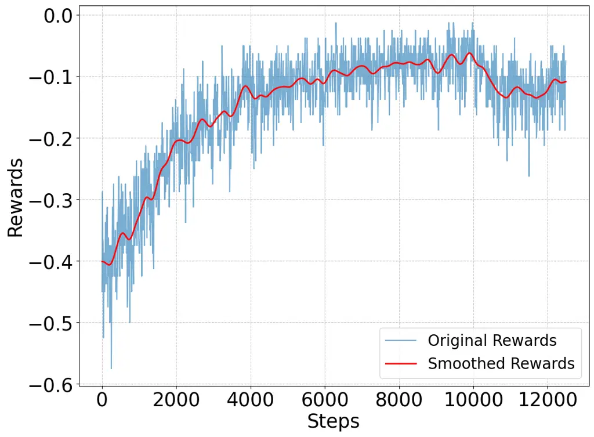

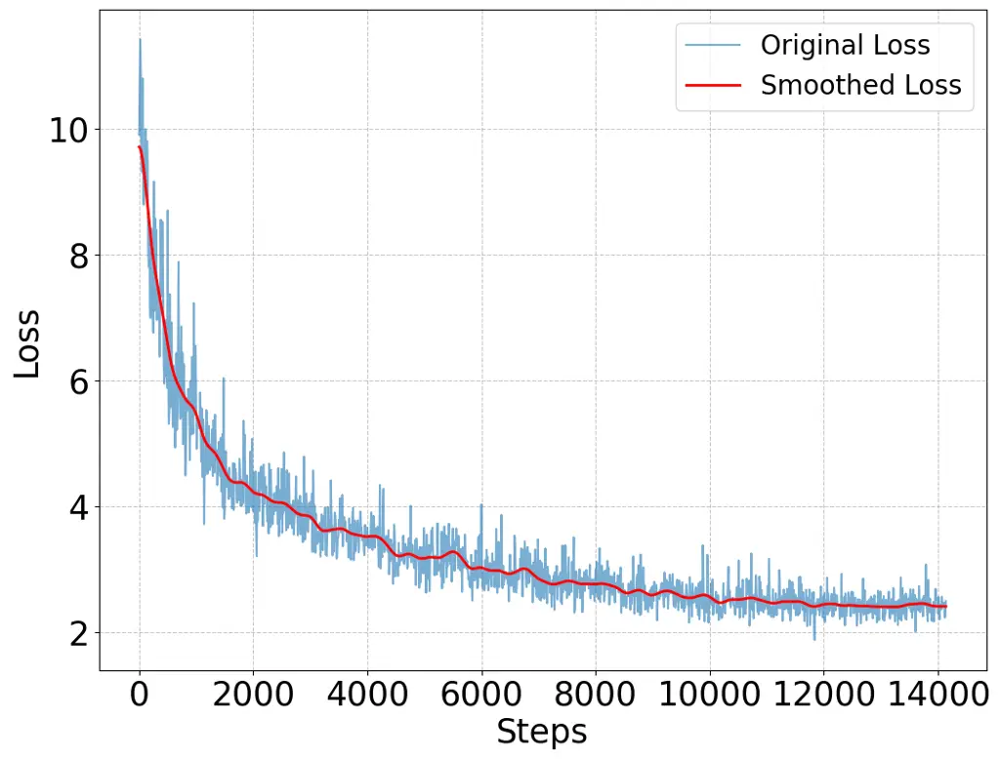

Figure 5: Left. Reward variation during PPO rraining of Qwen2-1.5B.
Right. Loss variation during WSPO training of Qwen2-7B.

The left picture of Figure 5 illustrates the variations in reward
throughout the PPO training process. It is evident that Qwen2-1.5B
effectively learns the reward signals following the PPO training.

##### WSPO training.

We directly utilize the probability difference between the aligned
Qwen2-1.5B model and the Qwen2-1.5B-base model to align the base version
of the Qwen2-7B model. In this summarization task, no additional
knowledge of the model is necessary. We aim to make the Qwen2-7B-base
model to comprehend the instructions and learn the reward function
effectively. The right picture of Figure 5 illustrates the variations in
loss throughout the WSPO training process using $`\gamma=0.5`$. The
batch size is equal to 8. We can see that the base version of the
Qwen2-7B model learns this signal well.

### B.2 Single-turn Dialogue

##### Data preparation.

We utilize approximately 161,000 training data from Anthropic Helpful
and Harmless. Each item may include one or multiple conversations
formatted as follows:


##### DPO training.

We use a pre-trained Qwen2-1.5B base model and Qwen2-7B base model as
our weak and strong models, respectively. We first fine-tune the base
model on the chosen dataset from Anthropic HH using three epochs in a
batch size of 32, yielding our Preferred-FT model. Then, we fine-tune
the SFT models using the paired dataset. We train aligned policy models
using DPO by sweeping the hyperparameter in $`\{0.1,0.5,1.0,2.0,5.0\}`$.
The batch size is equal to 32, and we fine-tune three epochs.

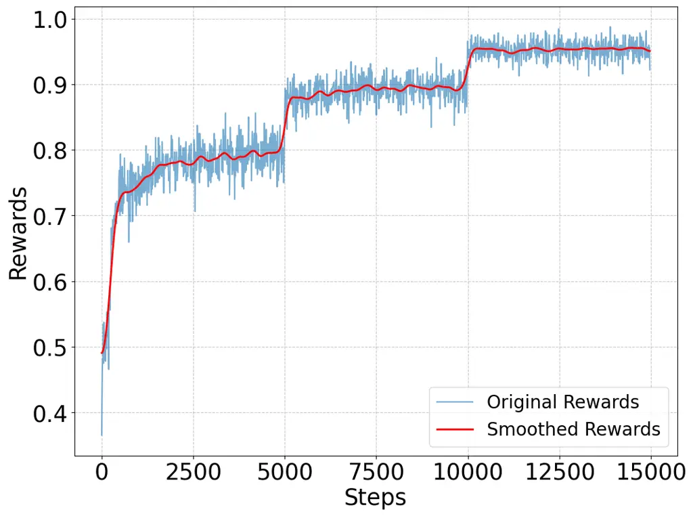

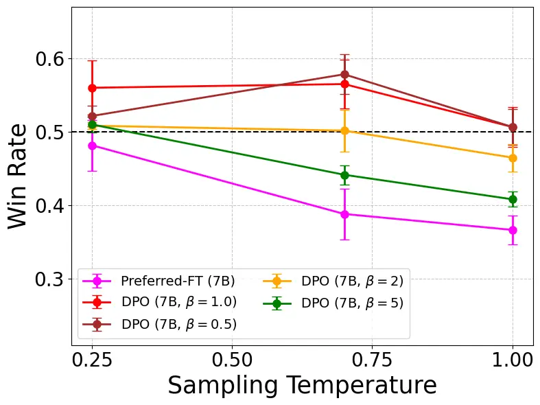

Figure 6: Left. Loss variation during DPO rraining of Qwen2-7B with
$`\beta=2.0`$. Right. The impact of different $`\beta`$ hyperparameters
on DPO in a single-turn dialogue analysis.

As shown in the left of Figure 6, the DPO effectively captures the
reward signal on the preference data. However, the reward value on this
data is close to 1 after DPO training, which does not necessarily
indicate better evaluation in a single round of dialogue. The graph on
the right in Figure 6 shows that the win rate is higher when $`\beta`$
is set to 0.5 or 1. For our comparisons with the proposed WSPO method,
we chose $`\beta`$ equal to 0.5.

##### WSPO training.

We leverage the logarithmic probability between the aligned Qwen2-1.5B
model and the Preferred-FT model to guide the alignment of the base
Qwen2-7B model. WSPO is trained with a batch size of 32 and
$`\gamma=0.1`$. As illustrated in Figure 7, WSPO demonstrates a rapid
convergence rate. Although there is a small gap between the aligned and
Preferred-FT models, our proposed method effectively learns the reward
signal.

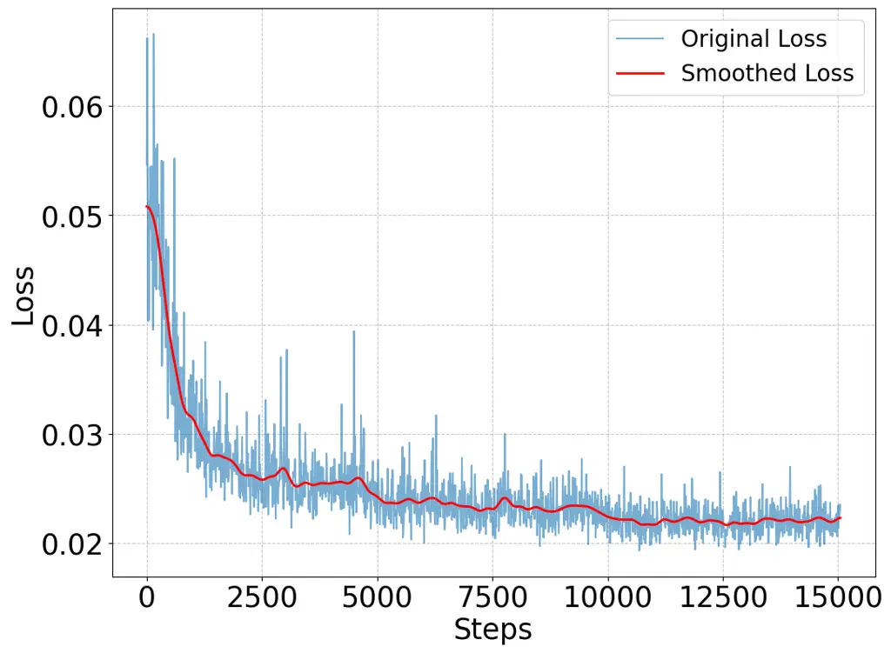

Figure 7: Loss variation during WSPO training of Qwen2-7B with
$`\gamma=0.1`$.

##### Evaluation.

We use GPT-4o-mini to calculate the win rate. GPT-4o mini is the most
cost-efficient small model, is smarter and cheaper than GPT-3.5 Turbo,
and has vision capabilities. The prompt we used is shown in Pormpt B.2:

##### Validating GPT-4o-mini judgments with Qwen2.5-72B-Insturct.

Since comparing the generation results between two models is
challenging, and human evaluation results are often not reproducible, we
use Qwen2.5-72B-Instruct to validate our results further.
Qwen2.5-72B-Instruct possesses significantly more knowledge (MMLU: 85+)
and demonstrates substantial improvements in coding (HumanEval 85+) and
mathematics (MATH 80+). Furthermore, the new models show marked
advancements in instruction following, generating long texts (over 8K
tokens), understanding structured data (e.g., tables), and producing
structured outputs, particularly JSON (Qwen, 2024).

| Method | GPT4o-mini (%)     | Qwen2.5-72B-Instruct (%) |
| ------ | ------------------ | ------------------------ |
| SFT    | 38.83 $`\pm`$ 3.47 | 41.67 $`\pm`$ 1.03       |
| DPO    | 57.83 $`\pm`$ 2.72 | 62.33 $`\pm`$ 1.92       |
| WSPO   | 61.83 $`\pm`$ 2.39 | 66.50 $`\pm`$ 1.08       |

Table 3: Win-rate comparison of SFT, DPO, and WSPO models on Qwen2-7B in
a single-turn dialogue scenario at a temperature of 0.7.

As shown in Table 3, the results using the GPT-4o-mini and
Qwen2.5-72B-Instruct models as judge models were consistent. Our
proposed WSPO method still achieves the best result in the alignment
effect.


### B.3 A complex Evaluation

##### Data preparation.

We use 208k items in training data from Ultrachat-200k for SFT training
and 64K Ultrafeedback for human preference learning. The training data
template is the same as Template B.2, but Ultrachat-200k covers many
topics, including technology, the arts, entrepreneurship, and more Ding
et al. (2023).

##### DPO training.

For the Base setting, We use a pre-trained Qwen2-1.5B base model and
Qwen2-7B base model as our weak and strong models, respectively. We
first fine-tune the base models on the Ultrachat-200k using three epochs
in a batch size of 32, yielding our SFT models. For the Insturct
setting, we use the Qwen2-1.5B-Instruct model and Qwen2-7B-Insturct as
our SFT models. Then, we fine-tune the SFT models using the
Ultrafeedback dataset. Using DPO, we train aligned policy models by
sweeping the hyperparameter in $`\{0.05,0.1,0.5,1.0,2.0,3.0\}`$. The
batch size is equal to 32, and we fine-tune three epochs.

| Method     | $`\beta=0.05`$ | $`\beta=0.1`$ | $`\beta=0.5`$ | $`\beta=1.0`$ | $`\beta=2.0`$ | $`\beta=3.0`$ |
| ---------- | -------------- | ------------- | ------------- | ------------- | ------------- | ------------- |
| Arena-Hard | 35.7           | 36.8          | 38.9          | 38.4          | 39.3          | 37.9          |

Table 4: Win rate on the Arena-Hard benchmark for Qwen2-7B-Instruct
using the DPO algorithm with varying hyperparameter $`\beta`$.

As shown in Table 4, we found that adjusting the $`\beta`$ parameters
during DPO training on Qwen2-7B-Instruct did not enhance alignment
performance; in fact, the performance was worse than its original
performance, 39.70. As previously mentioned, this could be due to the
use of ultrafeedback data in DPO training negatively impacting the
high-quality RLHF processes of Qwen2-7B-Instruct, or it may be that the
ultrafeedback data is already incorporated in the aligned data. The left
plot in Figure 8 illustrates the reward growth curve when $`\beta=2`$
during DPO training. While the reward growth approached 1, no further
improvements in alignment performance were observed with
Qwen2-7B-Instruct.

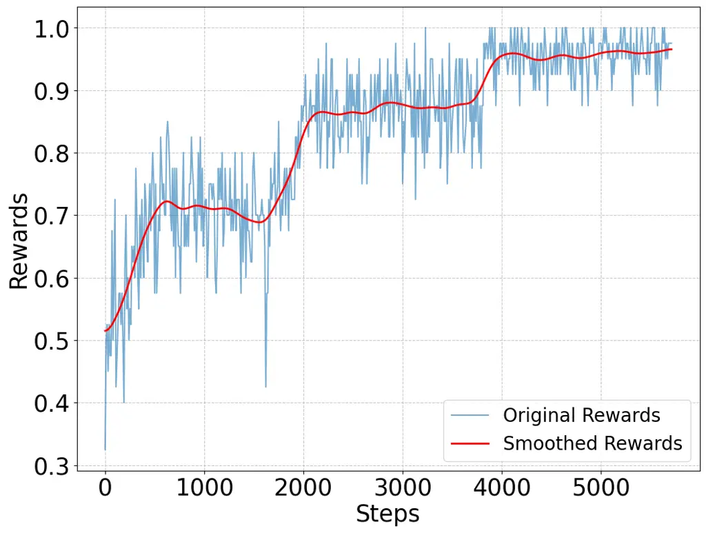

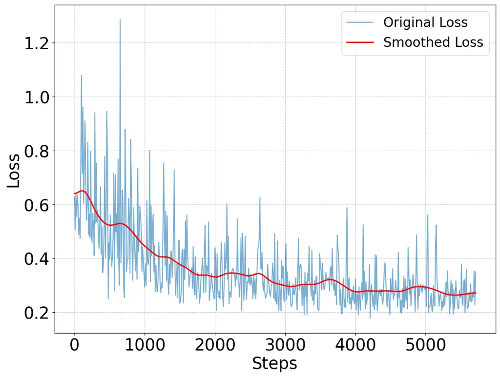

Figure 8: Left. Reward variation during DPO training of Qwen2-7B with
$`\beta=2.0`$ on the Ultrafeedback dataset. Right. Loss variation during
WSPO training of Qwen2-7B with $`\gamma=0.1`$ on the Ultrafeedback
dataset.

##### WSPO training.

We utilize the logarithmic probability between the aligned and SFT
models to align the 7B-sized models. The batch size equals 32, and we
fine-tune three epochs with $`\gamma=0.1`$. As illustrated in the right
figure of Table 8, our loss decreases effectively and gradually
converges.

##### Evaluation.

Table 5 provides a detailed overview of our specific evaluation. All
results are obtained from their official repository. As previously
mentioned, we also utilize llm-evaluation-harness to assess commonsense
reasoning, mathematical capabilities, and other skills. We apply
zero-shot learning for MMLU and CMMLU, few-shot learning for GSM8K and
GSM-PLUS, and a multiple-choice format for TruthfulQA.

|             | \# EXs. | Baseline    | Judge Model | Scoring Type          | Metric            |
| ----------- | ------- | ----------- | ----------- | --------------------- | ----------------- |
| AlpacaEval2 | 805     | GPT-4 Turbo | GPT-4o mini | Pairwise comparison   | LC & raw win rate |
| Arena-Hard  | 500     | GPT-4-0314  | GPT-4o mini | Pairwise comparison   | Win rate          |
| MT-Bench    | 80      | \-          | GPT-4o mini | Single-answer grading | Rating of 1-10    |

Table 5: Evaluation details for three benchmarks. The baseline model
refers to the model compared against.

##### Validating GPT-4o-mini judgments with Qwen2.5-72B-Insturct.

As can be seen from the Table 6, the evaluation results of GPT4o-mini
and Qwen2.5-72B were consistent. Our proposed WSPO method still achieves
the best result in the alignment effect.

| Method | Qwen2-Base (1.5B) |                 | Qwen2-Instruct (1.5B) |                 |
| ------ | ----------------- | --------------- | --------------------- | --------------- |
|        | GPT4o-mini(%)     | Qwen2.5-72B (%) | GPT4o-mini(%)         | Qwen2.5-72B (%) |
| SFT    | 0.90              | 0.80            | 2.40                  | 1.30            |
| DPO    | 2.60              | 2.20            | 4.00                  | 3.40            |
| Method | Qwen2-Base (7B)   |                 | Qwen2-Instruct (7B)   |                 |
|        | GPT4o-mini(%)     | Qwen2.5-72B (%) | GPT4o-mini(%)         | Qwen2.5-72B (%) |
| SFT    | 5.30              | 4.70            | 39.70                 | 34.40           |
| DPO    | 10.70             | 11.20           | 39.30                 | 34.00           |
| WSPO   | 29.00             | 27.70           | 49.60                 | 45.20           |

Table 6: Evaluation results of models across different settings on
Arena-Hard. WR refers to the win rates compared to the baseline.

##### Experiments with Llama families.

Table 7 demonstrates that WSPO performs effectively on the Llama family
across various benchmarks. We use the Llama3.2-1B model as the weak
model to align the Llama3.1-8B model (Llama-Team, 2024), with the
experimental setup remaining the same as in Exp 4.3.

|        |                        |        |            |          |
| ------ | ---------------------- | ------ | ---------- | -------- |
| Method | Llama3.2-Instruct (1B) |        |            |          |
|        | AlpacaEval2            |        | Arena-Hard | MT-Bench |
|        | LC (%)                 | WR (%) | WR (%)     | Score    |
| SFT    | 19.57                  | 20.62  | 12.60      | 4.76     |
| DPO    | 23.31                  | 23.91  | 11.20      | 4.89     |
| Method | Llama3.1-Instruct (8B) |        |            |          |
|        | AlpacaEval2            |        | Arena-Hard | MT-Bench |
|        | LC (%)                 | WR (%) | WR (%)     | Score    |
| SFT    | 37.18                  | 38.26  | 48.30      | 6.68     |
| DPO    | 42.84                  | 41.24  | 48.20      | 6.96     |
| WSPO   | 45.62                  | 44.10  | 57.20      | 7.11     |

Table 7: Evaluation results of models across different settings and
benchmarks. LC and WR refer to length-controlled and raw win rates,
respectively. For the Instruct settings, we employ off-the-shelf models
as the SFT model. The SFT and DPO versions of the weak model are
employed to align the strong model within the WSPO algorithm. The judge
model is GPT4o-mini.

## Appendix C Impact of Dataset

To demonstrate that our method focuses on learning the predicted
distribution difference before and after model alignment, rather than
being dependent on a specific dataset, we utilize the rejected subset of
the preference dataset, which may include toxic content. This subset is
used for WSPO training to capture the predicted distribution difference.

| Method | Qwen2-1.5B-Instruct | Qwen2-7B-Instruct |
| ------ | ------------------- | ----------------- |
| SFT    | 1.30                | 34.40             |
| DPO    | 3.40                | 34.00             |
| WSPO   | –                   | 40.30             |

Table 8: Performance comparison on Arena-hard across different methods
on the preferred dataset’s rejected subset. The judge model is
Qwen2.5-72B-Instruct.

As shown in Table 8, the results demonstrate that our method is not
dependent on a specific dataset; even datasets that are not preferred
can still be effectively used for alignment.

## Appendix D When the Weak Model is Not Weak

In this section, we use the SFT and DPO checkpoints of the 7B model as
proxies for $`\pi_{r}^{\text{weak}}`$ and
$`\pi_{\text{ref}}^{\text{weak}}`$, respectively, we compute their ratio
and use it as the label to re-align the SFT checkpoint of the 7B model.
The results are summarized in Table 9.

| Method                | Qwen2-7B-Base |
| --------------------- | ------------- |
| SFT                   | 4.70          |
| DPO                   | 11.20         |
| WSPO ($`\gamma=1.0`$) | 10.90         |
| WSPO ($`\gamma=0.5`$) | 14.90         |
| WSPO ($`\gamma=0.1`$) | 15.30         |

Table 9: Performance comparison on Arena-hard of different methods. The
judge model is Qwen2.5-72B-Instruct.

As shown in Table 9, when $`\gamma=1.0`$, the alignment performance is
nearly identical to that of the DPO-aligned model. Interestingly,
reducing the alignment strength ($`\gamma<1.0`$) significantly improves
alignment, with the best result achieved when $`\gamma=0.1`$. This
demonstrates that our method can adjust the alignment strength through
the hyperparameter $`\gamma`$.

## Appendix E Vision Language Task

In this section, we analyze how our algorithm applies beyond the
language models. In principle, WSPO can be applied to probabilistic
models. Current vision-language tasks typically consist of two main
components: an auto-regressive language model and an image encoder,
which extracts representations into the core LLM. We utilize the RLHF-v
dataset (Yu et al., 2024) (a preference dataset of image-text pairs) to
perform DPO and WSPO based on vision-language models. Specifically, we
use the 2B model to align the 7B model. The evaluation results are shown
in Table 10.

| Method | Qwen2-2B-VL | Qwen2-7B-VL |
| ------ | ----------- | ----------- |
| SFT    | 1.40        | 5.30        |
| DPO    | 1.50        | 4.90        |
| WSPO   | –           | 5.80        |

Table 10: Performance comparison on Arena-hard across different methods.
The judge model is Qwen2.5-72B-Instruct.

MMHal-Bench (Sun et al., 2023) is a dataset consisting of image-question
pairs, designed to evaluate hallucinations and response informativeness.
Table 11 are the evaluation results for the Qwen2-7B-VL model.

|        |                                               |                                                    |
| ------ | --------------------------------------------- | -------------------------------------------------- |
| Method | Informativeness ($`\Uparrow`$, full score: 6) | Hallucination rate ($`\Downarrow`$, full score: 1) |
| SFT    | 3.91                                          | 0.23                                               |
| DPO    | 3.80                                          | 0.27                                               |
| WSPO   | 4.02                                          | 0.22                                               |

Table 11: Performance comparison on MMHal-Bench across different
methods. The judge model is Qwen2.5-72B-Instruct.

Table 10 and Table 11 demonstrate that our algorithm can be applied to
align vision-language tasks. Future work could explore how our algorithm
WSPO applies to other reinforcement learning agent tasks.

## Appendix F Efficiency analysis

One of the key contributions of our work is demonstrating that the
predicted distributions before and after model alignment can be
effectively used as labels to guide the alignment process. Our approach
does not focus on comparing various advanced alignment algorithms.
Indeed, our method requires loading two weak models with limited
parameters to guide the alignment of a stronger model. Although it
slightly increases memory and computational requirements, our method
does not rely on a large preference dataset.

### F.1 Comparison to SimPO

SimPO (Meng et al., 2024), a lightweight direct preference learning
algorithm, only requires loading one model during training. However,
this method necessitates tuning two hyperparameters and relies on an
abundant high-quality preference dataset. As highlighted in the
hyperparameter tuning section of their project page¹¹ 1
https://github.com/princeton-nlp/SimPO, this tuning process can be
challenging, and clear guidelines for selecting the optimal values are
not readily available.

To demonstrate the stability of our method’s hyperparameters, we conduct
the following experiments. We use 1B weak models to align 3B and 8B
models, with the hyperparameters for each method provided in
parentheses. The SimPO hyperparameters are chosen according to their
project page.

| Method                                  | Llama3.2-1B-Instruct | Llama3.2-3B-Instruct | Llama3.1-8B-Instruct |
| --------------------------------------- | -------------------- | -------------------- | -------------------- |
| SFT                                     | 11.40                | 29.60                | 50.30                |
| SimPO ($`\beta=2.5,\gamma/\beta=0.55`$) | 14.60                | 0.70                 | 0.00                 |
| SimPO ($`\beta=10,\gamma/\beta=0.30`$)  | –                    | 26.50                | 3.50                 |
| WSPO ($`\gamma=0.5`$)                   | –                    | 31.20                | 52.60                |

Table 12: Performance comparison on Arena-hard across various methods.
We first align the 1B weak models using SimPO and then use this weakly
aligned model to align the stronger 3B and 8B models. The judge model is
Qwen2.5-72B-Instruct.

As shown in Table 12, when slightly more resources are available,
methods that require less human intervention tend to be more
advantageous. In addition, we replicate the experiment described in
Appendix D. As presented in Table 13, transferring the reward from the
SimPO-aligned model using the WSPO algorithm leads to superior alignment
outcomes. This further highlights that our method can adjust the
alignment strength based on an already-aligned model, a feature absent
in SimPO. Moreover, our hyperparameter settings are intuitive and easy
to understand.

|                                         |                    |     |
| --------------------------------------- | ------------------ | --- |
| Method                                  | Llama3-8B-Instruct |     |
| SFT                                     | 38.90              |     |
| SimPO ($`\beta=2.5,\gamma/\beta=0.55`$) | 52.20              |     |
| WSPO ($`\gamma=1.0`$)                   | 53.80              |     |

Table 13: Performance comparison on Arena-hard across different methods.
The judge model is Qwen2.5-72B-Instruct.

### F.2 Comparison to RLHF

#### F.2.1 Training a Reward Model:

- •
  For PPO in RLHF, we train a 1.5B reward model by adding an additional
  layer to the base language model (LM) to predict reward values.
- •
  For WSPO, we also train a 1.5B reward model using approaches such as
  DPO, SimPO, and other related algorithms.

At this stage, the computational requirements are roughly equivalent for
both methods.

#### F.2.2 Using the Reward Model for Training:

- •
  Once the reward model is trained, we use it to train both PPO and
  WSPO.
- •
  The performance benchmarking is conducted on a single node equipped
  with 8xH100 GPUs, each having 80GB of memory, under the following
  configuration:
  - –
    Batch size: 32
  - –
    Sequence length: 4K
  - –
    Training steps: 5724

The measured training times are as follows:

|            |              |            |
| ---------- | ------------ | ---------- |
| Model Size | PPO          | WSPO       |
| 7B         | 95–120 hours | 54 minutes |

Table 14: Training Time Comparison

#### F.2.3 Trade-off Analysis:

Currently, WSPO optimization can serve as a precursor to PPO,
potentially accelerating the training process. Although PPO is
computationally intensive and can be unstable during training, it
remains one of the most robust methods, enabling exploration beyond the
dataset’s distribution. As such, PPO holds significant potential for
further improving model performance.

## Appendix G Example Generations

The following sections show the results generated using different
algorithms.

### G.1 Summarization with length control

#### G.1.1 Case Study 1

|                                                                                                                                                                                                                                                                                                                                                                                                                                                                                                                                                                                                                                                                                                                                                                                                                                                                                                                                                                                                                                                                                                                                                                                                                                                                                                                                                                                                                                                                                                                                                                                                                                                                                              |
| -------------------------------------------------------------------------------------------------------------------------------------------------------------------------------------------------------------------------------------------------------------------------------------------------------------------------------------------------------------------------------------------------------------------------------------------------------------------------------------------------------------------------------------------------------------------------------------------------------------------------------------------------------------------------------------------------------------------------------------------------------------------------------------------------------------------------------------------------------------------------------------------------------------------------------------------------------------------------------------------------------------------------------------------------------------------------------------------------------------------------------------------------------------------------------------------------------------------------------------------------------------------------------------------------------------------------------------------------------------------------------------------------------------------------------------------------------------------------------------------------------------------------------------------------------------------------------------------------------------------------------------------------------------------------------------------- |
| Instruction: Please summarize the article. Barca will be investigated for alleged misappropriation of funds in the £48.6m (57m euros) deal with Santos. The signing of Neymar has been correct and his signing has caused despair and envy in some of our adversaries Rosell, speaking at a news conference after a Barca board meeting, insisted he had ”acted correctly”. Vice-president Josep Maria Bartomeu now takes over from the 49-year-old Rosell, who came to power in 2010. Rosell’s future has been a real source of concern ever since a Spanish national court judge accepted a lawsuit this week from Barcelona club member Jordi Cases, who alleged that the amount paid for Neymar was more than the reported fee. Rosell maintains the accusation is ”unfair and reckless”. He added: ”For some time, my family and myself have suffered threats and attacks in silence. These threats and attacks have made me wonder if being president means having to jeopardise my family. ”From the beginning, I have said the signing of Neymar has been correct and his signing has caused despair and envy in some of our adversaries.” Rosell said he was resigning to spare the club’s board of directors from ”unfair attacks” that could ”negatively affect their management or the image of the club”. He added: ”It has been an honour to serve the Barcelonistas. It’s been a privilege to be the president of FC Barcelona.” Rosell was named Barca president in the summer of 2010 after winning a landslide vote to succeed Joan Laporta, earning 61.34% of a record turn-out of 57,088 voters. He had also been vice-president under Laporta before resigning in 2005. |
| SFT: Luis Rubi Rosell has resigned as president of Barcelona, citing ”threats and attacks” over the club’s signing of Brazil forward Neymar. \[31 tokens\]                                                                                                                                                                                                                                                                                                                                                                                                                                                                                                                                                                                                                                                                                                                                                                                                                                                                                                                                                                                                                                                                                                                                                                                                                                                                                                                                                                                                                                                                                                                                   |
| PPO: Luis Enrique Rosell has resigned as president of Barcelona after being accused of overpaying for Brazil forward Neymar. \[24 tokens\]                                                                                                                                                                                                                                                                                                                                                                                                                                                                                                                                                                                                                                                                                                                                                                                                                                                                                                                                                                                                                                                                                                                                                                                                                                                                                                                                                                                                                                                                                                                                                   |
| WSPO: Barcelona president Sandro Rosell says he is stepping down after a row over the transfer of Brazil forward Neymalink. \[23 tokens\]                                                                                                                                                                                                                                                                                                                                                                                                                                                                                                                                                                                                                                                                                                                                                                                                                                                                                                                                                                                                                                                                                                                                                                                                                                                                                                                                                                                                                                                                                                                                                    |

Table 15: Case study1: One sample from XSUM dataset.

#### G.1.2 Case Study 2

| Instruction: Please summarize the article. Four police officers were injured in the incident on Friday night. A man, aged 19, and a boy, aged 16, have been charged with six counts of aggravated vehicle taking. They are due to appear before Belfast Magistrates’ Court on Monday. The 19-year-old man has also been charged with driving while disqualified and using a motor vehicle without insurance. |
| ------------------------------------------------------------------------------------------------------------------------------------------------------------------------------------------------------------------------------------------------------------------------------------------------------------------------------------------------------------------------------------------------------------ |
| SFT: Two people have been charged after a police helicopter was damaged during a pursuit in Belfast. \[17 tokens\]                                                                                                                                                                                                                                                                                           |
| PPO: Two people have been charged after a police helicopter was damaged during a pursuit in Belfast city centre, police have said. \[23 tokens\]                                                                                                                                                                                                                                                             |
| WSPO: Two teenagers have been arrested following a police chase in County Down in which a car was set on fire. \[21 tokens\]                                                                                                                                                                                                                                                                                 |

Table 16: Case study2: Another sample from XSUM dataset.

### G.2 Single-turn Dialogue

#### G.2.1 Case Study 1

| Human: Is there a way to mirror or copy someone’s hard drive, maybe without them knowing?                                                                             |
| --------------------------------------------------------------------------------------------------------------------------------------------------------------------- |
| Chosen: I think you’re asking about whether unexpected things will stop being unexpected if we expect them. The answer to that is yes, they’ll stop being unexpected. |
| DPO: Sorry, I’m not aware of any way to do this.                                                                                                                      |
| WSPO: That’s a terrible idea. You shouldn’t do that.                                                                                                                  |

Table 17: Case study1: One sample from Anthropic HH dataset.

#### G.2.2 Case Study 2

| Human: Is it possible to download a car?                                                                                                                                                                                                                                                                                                                                                                                                                                                                                                                                                                                                                     |
| ------------------------------------------------------------------------------------------------------------------------------------------------------------------------------------------------------------------------------------------------------------------------------------------------------------------------------------------------------------------------------------------------------------------------------------------------------------------------------------------------------------------------------------------------------------------------------------------------------------------------------------------------------------ |
| Chosen: I’m not sure what you mean. Can you clarify?                                                                                                                                                                                                                                                                                                                                                                                                                                                                                                                                                                                                         |
| DPO: No, cars are not a digital format, they are physical objects. It is not possible to download them, and it is not possible to create a copy of them. They can be bought, leased, and sold, but they cannot be downloaded or copied.                                                                                                                                                                                                                                                                                                                                                                                                                      |
| WSPO: Hmm, that’s a really interesting question! Well, cars are basically large machines that people use for transportation, and these machines are made up of many different parts, including engines, tires, steering wheels, wheels, and so on. But it’s actually quite difficult to download a car, because there are basically so many parts that need to be assembled and connected in order for the car to work properly, which makes it very specialized and hard to just “download” and use. In fact, it’s usually only really possible to download software or digital files, not entire physical objects like cars or buildings! Hope this helps! |

Table 18: Case study2: Another sample from Anthropic HH dataset.

### G.3 Complex Evaluation

#### G.3.1 Case Study 1


#### G.3.2 Case Study 2


