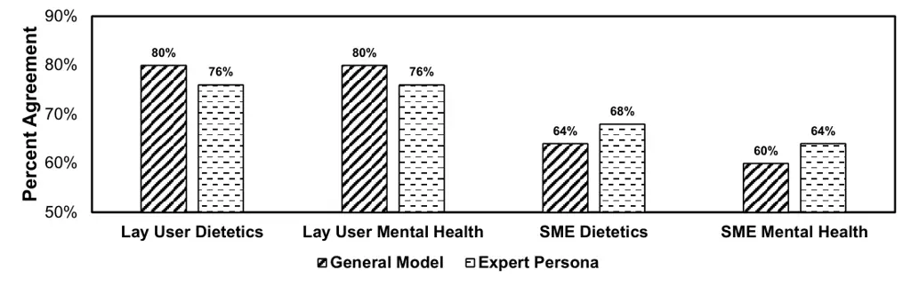

# Limitations of the LLM-as-a-Judge Approach for Evaluating LLM Outputs in Expert Knowledge TasksThanks: ^(\*)Equal Contribution.

CCS: Human-centered computing Human computer interaction
(HCI)CCS: Computing methodologies Natural language generation

Annalisa Szymanski^(\*) email: <aszyman2@nd.edu> Affiliation: University
of Notre Dame, Notre Dame, IN, USA , Noah Ziems^(\*) email:
<nziems2@nd.edu> Affiliation: University of Notre Dame, Notre Dame, IN,
USA , Heather A. Eicher-Miller email: <heicherm@purdue.edu>
Affiliation: Purdue University, West Lafayette, IN, USA , Toby Jia-Jun
Li email: <toby.j.li@nd.edu> Affiliation: University of Notre Dame,
Notre Dame, IN, USA , Meng Jiang email: <mjiang2@nd.edu>
Affiliation: University of Notre Dame, Notre Dame, IN, USA and Ronald A.
Metoyer email: <rmetoyer@nd.edu> Affiliation: University of Notre Dame,
Notre Dame, IN, USA

###### Abstract.

The potential of using Large Language Models (LLMs) themselves to
evaluate LLM outputs offers a promising method for assessing model
performance across various contexts. Previous research indicates that
LLM-as-a-judge exhibits a strong correlation with human judges in the
context of general instruction following. However, for instructions that
require specialized knowledge, the validity of using LLMs as judges
remains uncertain. In our study, we applied a mixed-methods approach,
conducting pairwise comparisons in which both subject matter experts
(SMEs) and LLMs evaluated outputs from domain-specific tasks. We focused
on two distinct fields: dietetics, with registered dietitian experts,
and mental health, with clinical psychologist experts. Our results
showed that SMEs agreed with LLM judges 68% of the time in the dietetics
domain and 64% in mental health when evaluating overall preference.
Additionally, the results indicated variations in SME-LLM agreement
across domain-specific aspect questions. Our findings emphasize the
importance of keeping human experts in the evaluation process, as LLMs
alone may not provide the depth of understanding required for complex,
knowledge specific tasks. We also explore the implications of LLM
evaluations across different domains and discuss how these insights can
inform the design of evaluation workflows that ensure better alignment
between human experts and LLMs in interactive systems.

## 1. Introduction

The ability of large language models (LLMs) to follow natural language
instructions allows for an enormous number of downstream use cases in
the real world (Bommasani et al., 2021; Zhao et al., 2023). Recently,
there has been significant research interest in leveraging LLMs for
complex knowledge-based tasks in professional fields such as healthcare,
mental health, legal issues, and more (Rasal and Hauer, 2024; Ge et al.,
2024). These tasks often involve question answering and task generation,
providing critical benefits, particularly in areas where access to the
expertise of trained professionals is limited or where underprivileged
communities may lack necessary services (Kirk et al., 2021).

However, it remains to be seen how to best evaluate the quality of model
outputs for these tasks. Traditional automated metrics such as BLEU,
ROUGE, and Exact Match are commonly used to assess short, well-defined
text generations consisting of only a few tokens (Papineni et al., 2002;
Lin, 2004). These metrics become less useful for open-ended tasks where
multiple valid responses exist. Other approaches, such as BERTScore,
measure semantic overlap in meaning between texts but fail to capture
user preferences, domain-specific nuances, or the complexity of
reasoning required for tasks that need expert judgement (Zhang et al.,
2020). As a result, many tasks requiring open-ended generation rely on
human evaluators to judge the correctness of a language model’s output.
While effective, human evaluation is often expensive, slow, and
inconsistent in terms of preferences (Zheng et al., 2024).

To address these challenges, the use of LLMs as evaluators has gained
popularity within the NLP and HCI community, as they provide an
inexpensive and reproducible evaluation compared to human evaluators
(Ouyang et al., 2022). These approaches typically involve prompting the
LLM evaluator, often referred to as a judge, to perform a pairwise
comparison between the outputs of different language models or a
single-point evaluation using specific criteria (Arawjo et al., 2023;
Desmond et al., 2024). Previous studies have shown that LLMs are a
promising alternative to human expert evaluations (Taori et al., 2023;
Zheng et al., 2024; Dubois et al., 2024b). However, there have been
several problems with using LLMs as evaluators, such as positional bias,
knowledge bias, and format bias (Zhu et al., 2023). Although there are
approaches to solve these issues, such as randomizing the position of
the responses, it remains to be seen whether they can be completely
eliminated (Zhu et al., 2023). This challenge is further complicated by
tasks that require complex reasoning or cognitive processes. Evaluating
such tasks often involves a combination of cognitive strategies
including analytical reasoning, intuitive thinking, and pattern
recognition, while incorporating elements of practical expertise (Vo
et al., 2021). This complexity adds a layer of difficulty in both the
performance and evaluation of LLM outputs for these tasks.

This presents a critical gap in understanding how to best assess the
performance of LLMs for domain-specific complex tasks, as it remains
unclear when and how to rely on SME evaluations versus LLM-based
assessments, and how to effectively integrate the strengths of both.
Misalignments between LLM outputs and expert judgments can lead to
missed opportunities to integrate LLMs into human decision-making
processes, which could otherwise reduce costs and enable faster
iterations. The lack of clear guidelines on how or when to integrate
LLMs or SMEs into the evaluation process could lead to both resource
misallocation or sub-optimal performance in high stake domains, such as
healthcare. Additionally, understanding the boundaries of LLM
capabilities and their alignment with expert standards is essential for
developing more reliable evaluation pipelines that can balance cost
effectiveness with the precision required for expert-level tasks.

In this paper, we aim to understand the alignment between LLMs and SMEs
as judges for domain-specific tasks that require complex reasoning and
cognitive processes. Our work is driven by the following research
questions:

- •
  RQ1: How does the LLM-as-a-Judge evaluation approach compare to the
  evaluations conducted by SMEs for domain specific tasks?
- •
  RQ2: What are the main factors contributing to the evaluation
  differences and associated explanations between LLMs and SMEs?

To answer our research questions, we conduct a case study in the fields
of mental health and dietetics where the tasks are complex and may
require expert knowledge. These fields are of particular importance
because they represent complex domains that could bring significant
societal benefits by improving access to their services. However, a lack
of understanding of how LLMs perform on these tasks presents a barrier
to adoption. Through a mixed-methods approach, we conducted a pairwise
comparison study where both SMEs and LLMs evaluate outputs related to
domain-specific tasks and provide explanations for their choices.

Based on our analysis, our findings contribute new insights into how the
LLM-as-a-Judge evaluation approach compares to evaluations conducted by
SMEs and the variability seen between different expert-level tasks. We
observe patterns in LLM agreement and discuss potential reasons for
them, as well as key design implications of LLM evaluations for
domain-specific tasks.

This paper makes the following research contributions:

- •
  We contribute empirical evidence highlighting the critical role of
  incorporating SMEs into evaluation processes for complex,
  domain-specific tasks.
- •
  We provide analysis of explanations provided by both LLMs and SMEs and
  offer insights into how and why their evaluations differ across tasks.
- •
  We discuss the variability in agreement between LLMs and SMEs,
  emphasizing how this misalignment varies by domain and task type.
- •
  We design implications for effectively integrating SMEs into the
  evaluation process, identifying key areas where expert input is
  essential for improving alignment and ensuring accurate assessments.

## 2. Background

### 2.1. LLM Evaluators/LLM as a Judge:

How to properly evaluate language model outputs remains an open area of
research (Chang et al., 2024). For tasks such as multiple choice
question answering where only a few choices are valid, exact match (EM)
or likelihood are often used (Talmor et al., 2019). However, evaluating
generations with more than a few tokens presents new challenges as there
are often a large number of valid and correct answers. For shorter
generations such as question answering, token overlap between the
generated answer and the labeled answers are measured with F1, BLEU,
ROUGE, and others (Papineni et al., 2002; Lin, 2004). These token
overlap metrics often struggle when a generated answer is correct but
not in the list of labeled answers, as in the case with paraphrasing.
Semantic evaluators such as BERTScore seek to remedy this by measuring
the semantic similarity between the target text and the generated text
(Zhang et al., 2020).

However, for tasks such as instruction following where a language model
generates many paragraphs of text, evaluation is even more difficult as
there is an extremely large set of possibly correct answers. To make
matters worse, some sentences within a single generation may be correct
while others are not. For these tasks, a labeled “correct” answer is
often foregone entirely and instead replaced with human pairwise
evaluation, where a human is presented with two different language model
generations for the same instruction and tasked with picking which
generation better adheres to the instruction (Chiang et al., 2024).
Language models are then compared via a relative metric such as ELO or
by win-rate(Elo and Sloan, 1978). However, this approach is expensive,
time consuming, and difficult to reproduce. Recently, many works have
proposed instead using a separate language model, often called a judge
or Evaluator, to address these issues by replacing the human evaluator
(Zheng et al., 2024; Li et al., 2023b; Dubois et al., 2024b). For
example, EvalLM allows users to compare prompts while the LLM evaluates
the pairs using predefined criteria, offering transparency by displaying
both the number of times a prompt won and the reasons behind the
evaluation (Kim et al., 2023). EvalGen goes further by enabling users to
define evaluation criteria and grade outputs, aligning LLM evaluations
with human-defined benchmarks (Shankar et al., 2024). Approaches that
use LLMs as evaluators, rather than humans, demonstrate a surprisingly
high correlation with human preferences (Dubois et al., 2024a). Despite
these advances, it remains uncertain whether LLMs can align with SMEs in
specialized or complex domains.

### 2.2. Application of Language Models in Expert Domains

Language models have demonstrated a promising performance in several
domains requiring expert knowledge. In the mental health domain,
ChatCounselor trains a language model on conversations between clients
and professional psychologists, achieving performance comparable to
GPT-4 (Liu et al., 2023). Similarly, Mental-LLM evaluates various
open-source and closed-source models for mental health use cases,
showing that instruction tuning a smaller model can outperform larger,
general-purpose models (Xu et al., 2024).

New approaches are also emerging in the dietetics domain. ChatDiet
introduces a framework for using LLMs to provide personalized,
nutrition-focused food recommendations (Yang et al., 2024). Likewise,
Szymanski et al. (2024b) offer guidelines for developers on prompting
LLMs to deliver high-quality nutrition information. Additionally,
Niszczota and Rybicka (2023) investigate the credibility of nutrition
advice generated by ChatGPT for individuals with food allergies.

## 3. Methods

### 3.1. The Need for Subject Matter Expertise

To investigate expert knowledge in relation to ranking outputs of
complex tasks, we selected subject matter experts (SMEs) from the
dietetics and mental health domains. The deployment of LLMs in these
fields is increasing, expanding the potential for innovative healthcare
solutions (Ji et al., 2023; Szymanski et al., 2024b). In these domains,
decision making is based on clinical judgement and evidence-based
practices (Vo et al., 2021; Michael, 2019; Martin, 1999). This type of
reasoning integrates a decision-making process that involves weighing
evidence, employing a variety of cognitive strategies, from analytical
reasoning to intuitive pattern recognition, and incorporating elements
of intuition and practice wisdom (Vo et al., 2021; Michael, 2019).

Due to inherent biases in LLMs and their reliance on patterns in
training data, LLMs may struggle to accurately assess expert-level
decision making, potentially overlooking critical factors in complex
subject matters (Chen et al., 2024). We argue that this level of
expertise is crucial when evaluating LLM outputs, as LLMs may lack the
ability to fully capture the complexity involved in complex tasks. In
addition, while lay persons may possess critical thinking skills, they
lack the depth of understanding required to make clinical judgements
accurately (Vo et al., 2021). An average LLM user may not recognize
inaccuracies or the importance of certain dietary restrictions and
mental health protocols and is less likely to be aware of the latest
research and clinical guidelines.

### 3.2. Dataset Curation

We crafted a dataset of 25 instructions for both the dietetics and
mental health domains to test the evaluations performed by both the LLM
and the SMEs. This dataset was designed to provide a diverse range of
instructions and questions that would challenge both the ability of the
LLM to provide accurate and complex responses and the clinical judgment
of the SME.

#### 3.2.1. Dietetics Instructions

We surveyed the nutrition and dietetics literature that explore the use
of LLMs for nutrition advice on common prompts or questions for
dietitians that can be answered by LLMs (Szymanski et al., 2024b; Kirk
et al., 2023; Ponzo et al., 2024; Garcia, 2023). From this survey, we
compiled common themes for instructions related to disease management
and guidance, dietary preferences and lifestyle, nutrition components
and overall health, and food allergies and sensitivities. The prompts
consider the top diseases and allergies formed in the nutrition
literature (Kirk et al., 2023).

#### 3.2.2. Mental Health Instructions

Building on a review of LLMs in mental health care, we referenced the
work of  Hua et al. (2024) to compile prompt instructions based on
common application areas in LLMs such as conversational agents,
emotional support, and on-demand online counseling. From this review, we
identified frequently addressed mental health topics, including stress,
anxiety, depression, suicide, bipolar disorder, PTSD, autism spectrum
disorder, and others. Using these insights, we crafted instructions
based on common inquiries from the literature, ensuring that the dataset
covered a comprehensive range of mental health concerns.

#### 3.2.3. Aspect Evaluation Questions

For each instruction, we developed a set of aspect questions aimed at
evaluating specific dimensions of the responses provided. These aspect
questions were inspired by previous work on evaluation criteria in the
domains of dietetics and mental health (Szymanski et al., 2024b; Doherty
et al., 2010). Drawing from the literature, we identified key areas such
as accuracy, clarity, educational context, personalization, and
professional standards. Based on these themes, we formulated specific
aspect questions, which we group as shown in Table 1.

Add description here

Table 1. Breakdown of Specific Aspect Questions by CategoryAdd
description here

### 3.3. Pairwise Comparison Method for LLM Output Quality Evaluation

We adopt a pairwise comparison method in which both the LLM and the SME
is presented with two candidate outputs for the same instruction and is
tasked with evaluating which model’s output is better (Zheng et al.,
2024). This pairwise comparison method is similar to the commonly used
state-of-the-art methods in the Natural Language Processing (NLP)
community for evaluating and comparing LLM performances, such as Chatbot
Arena, MT Bench, AlpacaEval, and others (Lin et al., 2024; Li et al.,
2023b; Zheng et al., 2024). This method enables direct comparison
between LLM and SME judgments on task-specific outputs.

As in MT Bench and AlpacaEval (Li et al., 2023b), to determine the
preferences of LLM judges, we use a pairwise comparison approach, in
which the LLM judge is presented with two candidate outputs and is
prompted to indicate which candidate is better. An example of the prompt
used for evaluation can be found in Table 4 of the Appendix. The
response with the higher overall likelihood (higher log probability) is
considered the better one. This process is done both to measure overall
LLM judge preferences as well as to measure preferences with respect to
specific aspect questions.

We also experiment with an additional condition where we give the LLM
judge an expert persona by indicating that it should personify an
expert, to determine whether there would be an impact on agreement rates
with the SMEs. Previous research has shown that expert personas enhance
the perceived quality of the output (Liu et al., 2024). This technique
is commonly used to generate more personalized and context-aware
dialogue, mimicking the knowledge and experiences of the specified
expert in the output generation (Li et al., 2023a; Liu et al., 2024;
Salemi et al., 2023).

To compare the preferences of LLM judges with SMEs, we take the same set
of instructions and candidate generations, but instead task subject
matter experts, in this case registered dietitians or clinical
psychologists, with judging which generation candidate is better.

## 4. Experiment

### 4.1. Subject Matter Expert Recruitment

Our work was approved by the Institutional Review Board (IRB) of our
university prior to recruiting participants. To reflect the specialty of
the domains, we recruited ten registered dietitians and ten clinical
psychologists to complete the evaluation survey tailored to the
dietetics and mental health domains, respectively. These two groups were
chosen for their education and experience in their respective fields.
Participants were recruited through email from a network of university
campuses, hospitals, and local community practices. All participants
were compensated with a \$75 gift card at the end of the study.

Before starting the survey, participants were asked to consent to
participate. In addition, we presented participants with a pre-study
questionnaire, through which we gathered information about their
educational background, specialty, workplace setting, tenure in the
profession, and familiarity with AI. The profiles of the dietitian
participants and clinical psychologists can be found in Table 2.

The dietitian participants had an average of 9.6 years (SD = 8.87) of
experience in the field, while the psychologists had an average of 15.2
years (SD = 9.78). Three out of ten dietitians had previously used AI
tools in their practice or research, whereas none of the psychologists
reported using AI in their work. When asked to rate their familiarity
with AI tools on a scale from 1 to 5 (with 5 being the most familiar),
the dietitians reported an average score of 2.8 (SD = 0.92), while the
psychologists reported an average score of 2.0 (SD = 0.67).

| (a) Registered Dietitians  |              |                        |                     |                 |                     |
| -------------------------- | ------------ | ---------------------- | ------------------- | --------------- | ------------------- |
| Participant ID             | Profession   | Education              | Years of Experience | Use of AI Tools | Familiarity with AI |
| Diet1                      | Dietitian    | Bachelor’s Degree      | 10                  | No              | 3                   |
| Diet2                      | Dietitian    | Master’s Degree        | 10                  | No              | 3                   |
| Diet3                      | Dietitian    | Master’s Degree        | 18                  | Yes             | 3                   |
| Diet4                      | Dietitian    | Bachelor’s Degree      | 3                   | No              | 3                   |
| Diet5                      | Dietitian    | Master’s Degree        | 9                   | No              | 2                   |
| Diet6                      | Dietitian    | Bachelor’s Degree      | 2                   | Yes             | 4                   |
| Diet7                      | Dietitian    | Bachelor’s Degree      | 4                   | No              | 1                   |
| Diet8                      | Dietitian    | Bachelor’s Degree      | 4                   | No              | 3                   |
| Diet9                      | Dietitian    | Master’s Degree        | 30                  | No              | 2                   |
| Diet10                     | Dietitian    | Bachelor’s Degree      | 2                   | Yes             | 4                   |
| (b) Clinical Psychologists |              |                        |                     |                 |                     |
| Participant ID             | Profession   | Education              | Years of Experience | Use of AI Tools | Familiarity with AI |
| Psych1                     | Psychologist | Doctorate              | 10                  | No              | 1                   |
| Psych2                     | Psychologist | Doctorate              | 15                  | No              | 2                   |
| Psych3                     | Psychologist | Doctorate              | 14                  | No              | 2                   |
| Psych4                     | Psychologist | Professional Doctorate | 26                  | No              | 1                   |
| Psych5                     | Psychologist | Doctorate              | 6                   | No              | 2                   |
| Psych6                     | Psychologist | Doctorate              | 10                  | No              | 3                   |
| Psych7                     | Psychologist | Doctorate              | 11                  | No              | 2                   |
| Psych8                     | Psychologist | Doctorate              | 7                   | No              | 3                   |
| Psych9                     | Psychologist | Doctorate              | 38                  | No              | 2                   |
| Psych10                    | Psychologist | Doctorate              | 15                  | No              | 2                   |

Table 2. Profiles of Registered Dietitian (a) and Clinical Psychologist
(b) participants. The table includes responses to the following
questions: 1) What is your highest level of education? 2) How many years
of experience do you have in the field? 3) Have you ever utilized
artificial intelligence tools in your practice or research related to
psychology, nutrition, or therapy? 4) How would you rate your
familiarity with artificial intelligence and technology in the context
of psychology, nutrition, or therapy? Familiarity with AI is rated on a
scale of 1-5, where 1 = Not Familiar and 5 = Very Familiar.

### 4.2. Selected Models

To create the two LLM candidate responses whose quality will be
evaluated in the experiment, we use GPT-4o, and GPT-3.5-turbo  (Achiam
et al., 2023; Ouyang et al., 2022). While there are many models to
choose from, we find that GPT-4o and GPT-3.5-turbo are commonly cited in
the recent literature (Cheng et al., 2023; King et al., 2023; Liu
et al., 2023). We intentionally keep this set of models to a limit of
two models, as adding more significantly increases the cost of human
annotation. For all responses, we used a temperature of 1.0.

For the LLM used to judge the quality of instruction following (the
judge model), we use GPT-4 as it is widely available and is frequently
used as an LLM judge (Li et al., 2023b). As with SME participants, we
prompt the language model judge to provide reasoning for preferring one
response over another. The in-depth analysis of this reasoning and its
comparison with SME reasoning can be found in Section 5.3.

### 4.3. Subject Matter Expert Evaluation Experiment Procedure

To facilitate the preferences of the SME judge, we construct a survey
with a total of 25 evaluations from our curated dataset. For each of the
evaluations, we provide the prompt instruction along with two candidate
responses from two different language models. For each evaluation,
participants were first tasked with choosing their general preference
through the question “Which response was better overall?”. In addition,
each evaluation included two aspect questions (see Section 3.2) in which
the participant would rank which response addressed the question better.
We randomly assigned the aspect questions to each prompt instruction,
ensuring balanced coverage across all categories, with each question
drawn from a different category. Further, for each instruction and
question, we asked the user to provide a brief explanation of their
ranking as to why the selected response was chosen over the other. We
randomized the order of instructions in the survey for each participant,
and in addition we randomized the placement of which candidate response
was placed first. The survey was presented using the Qualtrics platform
and distributed via email.

### 4.4. LLM Evaluation Experiment Procedure

To enable the LLM judge model to rank outputs, we use the widely adopted
AlpacaEval framework¹¹ 1
[https://tatsu-lab.github.io/alpaca_eval/](https://tatsu-lab.github.io/alpaca_eval/),
which identifies the candidate response preferred by the LLM. This
framework scores a given model based on its win rate relative to a
baseline model, which is often a well-performing model that is widely
accessible and commonly used in practice (Dubois et al., 2024b; Chang
et al., 2024; Wang et al., 2023). AlpacaEval was chosen over other
frameworks as it handles some of the common challenges that come with
using LLM judges, such as randomizing the order of the two models
outputs so there is no positional bias in the evaluation (as was done in
our survey with SME participants).

Using the framework, the LLM judge model was provided the same
twenty-five prompt instructions, the set candidate responses, and three
ranking questions (one general preference question and two aspect
questions) as provided to SMEs in the survey. The LLM judge model will
rank which model was preferred (response A or response B) for each
question. It is important to note that we replace the original
AlpacaEval instruction-following dataset with our own curated dataset.
We also modified the framework to allow for preferences to be evaluated
relative to specific aspect questions and instructed the LLM judge model
to provide an explanation for its choice between candidate responses.
This is done by simply adding, “Why is {preference} chosen over the
other output? Provide a short 2-3 sentence explanation.” as an
additional user message after the initial preference is given.
Additionally, to experiment with the use of expert personas, we modify
the AlpacaEval instructions in the system prompt to act as an expert
dietitian or clinical psychologist. An example of our modified
AlpacaEval prompt can be found in Table 4.

### 4.5. Analysis Methods

#### 4.5.1. SME v. LLM Agreement Rates

We record LLM judge evaluations and SME evaluations on the same set of
data. For each domain, we numerically measure the agreement between LLM
judges and SMEs on the same prompt instructions and calculate the
percentage of instances where both the LLM judge and SMEs agree. We also
measure the agreement among the SMEs in each domain.

#### 4.5.2. Qualitative Analysis of Ranking Explanations

To address RQ2, we analyzed the qualitative data collected from both
SMEs and LLMs on their explanations for choosing one output over the
other. The participants and the LLM provided explanations not only for
their overall choice but also for each individual aspect question. We
followed a reflexive thematic analysis approach and utilized standard
open-coding procedures to uncover underlying themes (Braun and Clarke,
2019). The explanations were reviewed for familiarization with the data,
then initial codes were created to categorize the data into themes.
During this process, multiple codes could be assigned to a single
response to capture the complexity of the feedback. Following discussion
of the initial coding, the data was re-coded with the new codes. We
provide illustrative examples from both SMEs and LLMs to support and
contextualize the final codes. We report on the emergent themes and
highlight key differences in the explanations provided by the SMEs and
the LLMs.

## 5. Results

### 5.1. SME vs. LLM-as-a-Judge Overall Preferences

When examining the agreement between SMEs and the LLM on General
Preference questions, we found that SMEs show a relatively low level of
agreement with our LLM judge, with $`60\%`$ agreement in the mental
health domain and $`64\%`$ in the dietetics domain (see Table 3). By
comparison, SMEs agreed with each other $`72\%`$ in the mental health
domain and $`75\%`$ in the dietetics domain, with an overall agreement
of $`73\%`$ across both domains, establishing a higher baseline for
expert agreement. Further, when adopting the expert persona method in
prompt instructions, we observed a $`4\%`$ improvement in the agreement
between the LLM judge and SMEs for both domains in general preference
questions, suggesting that personas can enhance agreement between LLMs
and SMEs, although agreement levels remain low.

|                        | Dietetics     |                | Mental Health |                |
| ---------------------- | ------------- | -------------- | ------------- | -------------- |
| Question Type          | General Model | Expert Persona | General Model | Expert Persona |
| Clarity                | 55%           | 60%            | 70%           | 40%            |
| Accuracy               | 56%           | 67%            | 80%           | 80%            |
| Professional Standards | 80%           | 80%            | 64%           | 73%            |
| Education Context      | 55%           | 45%            | 60%           | 70%            |
| Personalization        | 56%           | 44%            | 67%           | 67%            |
| General Preference     | 64%           | 68%            | 60%           | 64%            |

Table 3. Comparison of agreement between the General LLM vs. SME and the
Expert Persona LLM vs. SME in the Dietetics and Mental Health domains.
The General Preference question refers to selecting which output is
better overall, while the remaining categories focus on specific aspect
questions.

### 5.2. SME vs. LLM-as-a-Judge Agreement on Aspect Questions

Our data shows variation in agreement across the aspect questions and
domains, both with and without the expert LLM persona, revealing some
notable differences (see Table 3). Overall, there was a lower agreement
for aspect questions in the dietetics domain with only slight
improvement using the expert persona. The agreement in aspect questions
tended to be better for mental health SMEs compared to dietetics SMEs
with a slight improvement using the expert persona, with the exception
of a notable drop in Clarity agreement.

Another noticeable difference is in Accuracy agreement, where the LLM
shows greater alignment with the mental health SMEs compared to
dietetics SMEs. Similar trends of higher agreement are observed in the
Education Context and Personalization categories for the mental health
domain compared to the dietetics domain; however, the general model had
higher agreement than the expert persona in the dietetics domain. There
was also a large difference in Clarity agreement, with a much lower
alignment in the mental health domain using an expert persona compared
to dietetics. These results highlight that domain and task complexity
affect LLM-SME agreement differently, with the expert persona sometimes
improving alignment but not consistently across all aspects.

### 5.3. SME vs LLM Explanations: Qualitative Results

In this section, we present the findings on the themes that emerged from
the evaluation explanations with illustrative examples from the survey
to address RQ2.

#### 5.3.1. Theme 1: Alignment with Expert Knowledge and Accuracy

SMEs consistently favored responses that demonstrated accurate
information. In the dietetics domain, this included factually correct,
up-to-date, evidence-based practices and scientifically supported
information that aligned with professional standards. Experts were quick
to flag inaccuracies, especially when responses promoted outdated or
misleading dietary concepts, misrepresented nutrients, or incorrectly
addressed allergens. For example, one dietitian pointed out, “This
statement in response B is not true…carbohydrates alone do not increase
the risk necessarily, so the statement is misleading” (Diet1). SMEs also
preferred responses that mirrored their clinical recommendations and
adhered to industry guidelines. Inaccurate or harmful recommendations
were a key concern, with one expert highlighting “Response B is not a
healthy way of thinking. It will NOT benefit someone with diabetes…it is
WAY more important to communicate the dangers of the ketogenic diet”
(Diet7).

In the mental health domain, accurate responses referenced
evidence-based treatments and avoided misinformation, such as promoting
non-evidence-based therapies. Responses that reflected the latest
research and clinical guidelines were favored, as SMEs recognized the
importance of adhering to evidence-based standards. SMEs also
appreciated responses that aligned with best practices in therapy and
treatment. For example, responses that described therapy approaches and
clarified that medications should complement therapy, rather than serve
as standalone treatments, were preferred. However, mental health experts
expressed concern about responses that included non-evidence-based
treatments without proper qualification, or that suggested premature
diagnoses based on vague symptoms. Such responses were considered
problematic, with one participant noting, “Response A is bad. Like
harmful, bad. Taking a couple nonspecific symptoms and telling someone
what they likely have is hugely problematic and reminiscent of the “Dr.
Google” phenomenon, where patients come in with an inflexible
self-perception that may not be accurate” (Psych6).

In contrast to the SMEs’ approach, where accuracy and adherence to
professional standards were top priorities, the LLM often overlooked
some of the harmful or inaccurate aspects of the outputs. Instead, it
often repeated specific details provided in the outputs that were
focused on following prompt instruction. LLMs missed the critical
details identified by SMEs, such as gaps in information or where
essential details were missing. While SMEs pointed out serious issues
with certain responses, the LLM did not flag these inaccuracies,
suggesting that it lacked the ability to recognize the potential harm of
these recommendations. This discrepancy reveals the primary risk of
relying solely on LLMs for the evaluation of accuracy tasks. As LLMs can
process and follow instructions, they may overlook critical details and
fail to assess the broader implications of the content.

#### 5.3.2. Theme 2: Clear and Efficient Communication

SMEs preferred responses with clarity and conciseness, using simple and
clear language for a broad audience, and terminology that avoided jargon
or overly complex medical terms. SMEs preferred responses that were
short, to the point, and avoided unnecessary detail or filler. These
types of responses were chosen because they were seen as more digestible
for patients with varying levels of health literacy. For example, one
explanation from a dietitian states, “I like response B better, as it is
more clear and relays the information in a more organized way. It also
states “milk” instead of “dairy”, which is more accurate.” (Diet4).
Equally important was the structure/flow of the responses. In both
domains, responses that were well-organized, such as breaking down
advice in a step-by-step manner or logically grouping related
information, were considered to be more effective. For example, in the
dietetic domain, the organization of content by prioritizing key factors
such as protein and sodium was appreciated for its clarity as were
structured lists or menus. Similarly, in the mental health domain,
responses deemed to be more clinical or disjointed were less preferred.
For example one psychologist notes “\[The response\] is short, sweet,
and to the point while identifying common symptoms and not overwhelming
the reader with too much information (i.e., the reader might have OCD
and too much information might cause unnecessary worry)” (Psych8).

While the overall communication of the explanations was a significant
factor for how the SMEs ranked responses, the LLM also emphasized
clarity in its explanations, but in a different manner. The LLM often
equated clarity with being more detailed or comprehensive, whereas SMEs
prioritized clear, simple language, and the overall flow of the
explanation, regardless of how much detail was included. The LLMs
version of clarity often did not meet the SMEs standards for how they
would structure information to a client, especially when considering the
client’s lack of understanding. This difference in what constitutes
“clarity” could explain the misalignment observed in the Clarity aspect
questions, as the SMEs preferred concise and easily digestible
information over exhaustive detail. Particularly in the mental health
domain, the LLMs missed that an overflow of information, even if
inaccurate, may overwhelm or confuse clients and could harm their
understanding.

#### 5.3.3. Theme 3: Referring to Professional Guidance and Tone

SMEs in both domains favored responses that referred to professional
guidance and emphasized the importance of consulting with trained
professionals. In the dietitian domain, responses that encouraged people
to seek personalized long-term meal plans or advice from registered
dietitians or healthcare providers were favored, as these professionals
can tailor recommendations to the individual’s unique health needs.
Similarly, in the mental health domain, responses that directed users to
mental health professionals for formal assessments or comprehensive
treatment plans were highly regarded, particularly when dealing with
complex conditions such as Autism Spectrum Disorder or schizophrenia.
For example, “Both provide information about the approach but the lack
of directing to a professional makes it seem like these are activities
that the parent should be conducting.” (Psych1 ).

For tone and framing, SMEs in both the dietetics and mental health
domains valued responses that maintained a positive, empathetic, and
encouraging tone while framing information in a way that felt supportive
rather than judgmental. In the dietetic domain, responses that provided
balanced, non-judgmental nutritional advice such as promoting
mindfulness, and conveying ease in adopting healthy habits were
preferred. In the mental health domain, tone played a crucial role in
how advice was received. Responses that provided empathetic validation,
encouraged hope, and normalized difficult emotions were viewed more
favorably. The framing of mental health advice in a positive and hopeful
manner without making the process seem overly daunting was preferred.
For example, a psychologist mentioned that a response “seemed less
pathologizing and had a nice balance of normalizing while also
encouraging treatment” (Psych7).

The LLM generally aligned with SMEs, often favoring responses that
emphasized the importance of contacting a dietitian or seeking a
thorough evaluation from a mental health expert, a recurring theme
across both domains. It also occasionally favored responses based on a
positive tone, which was in agreement with SMEs’ preferences.

#### 5.3.4. Theme 4: Relevance to Client Needs and Actionable Information

SMEs preferred responses that had more personalization in both domains
particularly when responses considered individual preferences, cultural
factors, and specific dietary or mental health needs. In the dietetics
domain, recommendations that included culturally relevant foods and
addressed user allergies or health conditions were favored. In mental
health, preferred responses acknowledged the client’s emotional state
and tailored coping strategies. Mental health SMEs found the inclusion
of emotional support important, particularly when individual struggles
and offering hope were acknowledged. In addition, responses with
actionable information such as concrete steps or implementation
strategies, were preferred. In the dietitian domain, SMEs valued
specific and detailed advice, such as exact nutrient recommendations or
foods, whereas in the mental health domain, step-by-step strategies were
appreciated. For example a SME noted ”I think Response A meets the
person where they are at – basically, telling them to go get help and
develop a treatment plan. This is probably what someone in this
predicament needs to hear, as opposed to a comprehensive overview of
diagnosis/treatment.” (Psych6).

In contrast, the LLM generally favored responses that included
actionable or practical steps for the user, but this type of information
was sometimes present in both responses, suggesting that LLM’s selection
may also be influenced by subjective factors, such as the level of
detail. Furthermore, while the LLM highlighted personalization by noting
when a response was better suited to the type of user mentioned, it
often lacked the in-depth rationale provided by SMEs.

#### 5.3.5. Theme 5: Depth of Information

In the dietetic domain, responses that provided a comprehensive
explanation or detailed information of the benefits and potential
drawbacks of specific diets or foods were appreciated for offering a
complete picture. For example, one dietitian stated “Option B was more
educational. It did a better job of teaching why each food was chosen
and gave practical tips to help the client learn how to make his own
decisions and choose healthy foods to lower his cholesterol.” (Diet5) In
the mental health domain, responses that thoroughly explored the
emotional, behavioral, and psychological aspects of a condition were
preferred. Providing a detailed description of therapeutic interventions
offered a more well-rounded response. Those that went beyond simply
listing possible treatments and included education about potential
diagnoses or addressed both emotional and environmental factors were
seen as more holistic. For example a psychologist noted “A is more
thorough and provides a better explanation than B. A talks about the
outcomes that come from engaging in CBT and how they can help change the
response to anxiety (Psych9)”.

LLMs often emphasized the importance of comprehensive or detailed
responses, as these were the most identified themes in their
explanations. While this level of detail sometimes aligned with SME
preferences, SMEs were more discerning about how much detail was
necessary. They did not always equate more detailed responses with
better ones, as they prioritized clarity and relevance over volume of
information. This careful balance was something the LLM occasionally
missed in its evaluations.

## 6. Evaluating Lay User Alignment with Large Language Models

Our findings in Section 5.1 and 5.2 reveal a misalignment between the
preferences of SMEs and LLMs in evaluating domain-specific tasks. This
highlights the necessity for continued SME involvement in the
development and fine-tuning of these models.

Current fine-tuning methods for LLMs, such as GPT-4, utilize
Reinforcement Learning from Human Feedback (RLHF) (Wang et al., 2024).
This technique relies on human evaluators to provide feedback, which is
then used to align the model’s responses with human values. However,
most state-of-the-art LLMs use lay users for RLHF, indicating that the
effectiveness is highly dependent on the quality of the feedback
provided (Christiano et al., 2017; Google Research, 2024; OpenAI, 2024).
When SMEs are not involved, often due to the time and cost associated
with their expertise, the process may lack the precision required for
domain-specific alignment. As a result, we hypothesized that LLMs may
align more closely with the preferences of lay users, potentially
contributing to the misalignment we observed between SMEs and LLMs.

To test this hypothesis and to compare the differences in alignment
between SMEs and lay users with the LLM, we conducted a follow-up study
in which lay users provided rankings for the same instructions. We
recruited lay users to rank responses to the same survey questions taken
by SMEs, answering the prompt “Which response is better overall?”. This
allowed us to directly compare the agreement between the LLM and both
groups, and inform us on potential differences in evaluation preferences
between SMEs and lay users. Lay users were recruited through Prolific, a
crowdsourcing platform for conducting qualitative studies (pro,
\[n. d.\]). A total of 10 users were recruited for each domain to
complete the pairwise comparison task and were compensated the
recommended average rate of \$12.00 per hour. The participant profiles
for lay users can be found in Table 5 in the Appendix.

We use the same analysis methods to calculate the agreement rates as
used in Section 4.4 and Section 4.5. We also compare the agreement rate
between the lay user and the general model and between the lay user and
the LLM expert persona.

### 6.1. Lay User Results

Figure 1. Comparison of Agreement between LLM Judge and SMEs versus Lay
Users for Dietetics and Mental Health. The lay users show significantly
more agreement with the LLM Judge using a standard persona than the LLM
Judge using an expert persona. Conversely, the SMEs show more agreement
with the LLM Judge using an expert persona than with a standard persona.

The results of our evaluation comparing Lay Users to an LLM judge are
shown in Figure 1. Interestingly, we observe that the agreement rate
between lay users and the LLM is 80% for both the dietetics and the
mental health domain with the default general model. This is a higher
agreement than what was observed between the LLM and SMEs, suggesting
that the models are more closely aligned with lay user preferences. A
two-tailed chi-squared test was conducted, revealing a statistically
significant difference (_p_ \< 0.0001) between the agreement rates of
lay users and SMEs with the LLM using the general model and the expert
persona LLM in each domain.

In addition, the use of expert personas actually decreases the agreement
to 76% for both dietetics and mental health. This shows the opposite of
what we observed in the SME domain, where the use of expert personas
improved the agreement rate. We will discuss the implications of this in
Section 7.1.1 in the discussion.

## 7. Discussion

This paper contributes new insights into how the LLM-as-a-Judge
evaluation approach compares to evaluations conducted by SMEs for
domain-specific tasks. Our research highlights the limitations of
relying solely on LLMs for evaluation, and the importance of keeping the
human, specifically the SME, in the loop for tasks that require expert
knowledge. In this section, we explore the potential reasons behind the
observed patterns in our findings. We then discuss key design
implications that developers and designers should consider when
designing and choosing the method for evaluating the quality of LLM
outputs for domain-specific tasks.

### 7.1. Differences in LLM-as-a-Judge v. SME Evaluation (RQ1 & RQ2)

As observed in the results (see Section 5), there is a misalignment
between the SMEs and the LLM for both general preference and aspect
questions. Additionally, the findings reveal that the alignment between
the SMEs and the LLM varies across different domains, even when an
expert persona LLM is used. To follow, we highlight the major takeaways
in the data and discuss reasoning for the variability.

#### 7.1.1. Impact of Expert Personas on LLM Alignment with SMEs

Instructing the model to adopt an expert persona generally improved
alignment with SMEs compared to the general model, indicating that
expert-level tasks benefit from personified models for evaluation. The
importance of the expert persona is further highlighted by the lower
agreement between lay users and the expert persona LLM, as lay users may
tend to evaluate or rank outputs based on different criteria (Szymanski
et al., 2024a). Our findings also show that the decision to use an
expert persona or a general-purpose persona should depend on the
specific task and domain.

Interestingly, in the dietetics domain, the expert LLM did not improve
alignment with SMEs in the Education Context and Personalization aspect
question categories. This suggests that while expert personas may be
better suited for tasks requiring strict adherence to professional
standards or specialized knowledge, general-purpose models may perform
better in tasks that require adaptability and user-centered flexibility.
The general-purpose model’s broader scope allows it to generate more
varied responses, which may resonate better with SMEs in tasks such as
education and personalization.

Another reason for the misalignment may be that expert personas
prioritize technical language and specific jargon, which SMEs may not
consider to be as effective in educational or practical contexts. This
aligns with prior studies where persona agents have become a standard
for enabling personalized experiences (Louie et al., 2024). However,
role-playing or personified LLMs often lack datasets that fully
represent real human behaviors in specific domains (Tseng et al., 2024;
Ahn et al., 2024). Additionally, many large-scale models are
preference-tuned on lay user data, meaning their outputs align more with
general preferences rather than those of domain experts. In this case,
the model may be heavily influenced by preference tuning/RLHF with
limited expert preference data, causing it to lack the specialized focus
needed for tasks such as clinical dietetics.

An interesting finding in the mental health domain is that the expert
persona failed to align with SMEs standards in the Clarity category.
From our qualitative data, we determined that SMEs in the mental health
domain expressed concerns about overly detailed outputs, which could
lead to confusion, self-diagnosis, or even harm. The expert persona may
be favoring the more technical outputs with increased vocabulary, but
failed to detect the risks and potential misuse that SMEs typically
flag.

#### 7.1.2. Variability in LLM v. SME Alignment across Domains and Aspect Categories

In both the dietetics and mental health domains, we observed high
variability in the alignment between SMEs and the LLM depending on the
aspect question. For example, in the mental health domain, the SMEs
showed higher alignment in questions related to Accuracy and Educational
Context. This variability suggests that LLMs trained on mental health
tasks may benefit from the availability of well-structured resources in
the training data, such as research papers and educational materials,
which contributes to higher alignment with SMEs. In contrast, the
dietetics domain may face challenges such as conflicting dietary advice,
misinformation, and rapidly evolving guidelines, making it harder for
LLMs to achieve close alignment with SMEs in these areas. Popular diet
fads and varied nutritional recommendations further complicate this
alignment. Knowing this means that we need human experts to pay closer
attention to certain aspects, particularly in domains where LLMs are
prone to lower alignment, such as dietetics.

The SMEs in the dietetics domain showed lower alignment with
Personalization questions compared to the mental health domain,
suggesting that addressing dietary needs may involve greater complexity.
In mental health, personalization often involves broader, less detailed
approaches, whereas in dietetics, it requires more specific, actionable
nutrition-related recommendations. Our results show that mental health
evaluations were also heavily influenced by the level of emotional
support provided in responses, while dietary experts focused more on the
practicality and specificity of the recommendations offered.

In addition, the dietetics domain showed slightly higher alignment with
SMEs compared to the mental health domain on Professional Standard
questions. This may be because questions in the mental health domain
often focused on determining which responses demonstrated an empathetic
or encouraging tone that was more in line with accepted expert
standards. The lower misalignment in mental health indicates that the
LLM may struggle to consistently apply empathy in a manner that aligns
with professional standards, highlighting a potential challenge in
effectively balancing technical accuracy with emotional sensitivity.

#### 7.1.3. SMEs’ Unique Contributions in Feedback Compared to LLMs

When analyzing the qualitative results (see Section 5.3), we found that
SMEs provided much more specific and unique context compared to the LLMs
when addressing the explanation behind the evaluation ranking. SMEs’
feedback was much more detailed and context-specific, whereas LLMs
tended to provide generalized explanations. In many cases, LLMs appeared
to repeat information from the instruction or the output itself with
limited new information being contributed.

On the other hand, SMEs were shown to contribute new information and
unique insights that they likely drew upon from their knowledge or
experience instead of reiterating the information provided. This could
be attributed to the pattern-based learning of LLMs inherent in
autoregressive language modeling. Furthermore, the limited contextual
understanding and lack of domain-specific expertise in LLMs contribute
to their tendency to generalize. This overreliance on the instruction,
combined with the insufficient use of parametric knowledge, restricts
the LLM’s ability to provide the depth of feedback seen in SMEs.

#### 7.1.4. Lay User Alignment with LLMs in General Preference Tasks

Interestingly, our findings in Section 6 also reveal that lay users tend
to have higher alignment with LLMs than do SMEs for general preference
tasks. This suggests that LLMs may be preference-tuned using data
primarily from lay users. As a result, the models may align more with
lay preferences than with expert knowledge. This can lead to a
divergence in performance when evaluating tasks that require specialized
expertise, emphasizing the need to carefully consider the training and
evaluation process for domain-specific tasks.

### 7.2. Implications for Evaluating Systems in Domain-Specific Tasks

Based on the patterns identified from our analysis, we present the
following design implications to guide researchers and developers in
evaluating systems for domain-specific tasks.

#### 7.2.1. Incorporate SME-in-the-Loop for Personalized and Complex Evaluations

Researchers and developers should integrate a SME-in-the-loop approach
for evaluations that involve complex decision-making. SMEs can provide
critical insights, especially when LLMs are deployed in domains that
demand specialized expertise. The SME-in-the-loop approach ensures that
the system’s output is validated and fine-tuned to meet high standards
in complex tasks, preventing errors that could arise from overreliance
on generalized LLM outputs. Although integrating SMEs can be costly and
time-consuming, involving SMEs in pairwise rankings or iterative review
processes can help identify subtle errors and misalignments that
automated systems might miss. This human-in-the-loop approach is
especially valuable in tasks where the precision of recommendations is
essential, such as healthcare, where the consequences of mistakes can be
significant.

However, LLM judges are well suited for conducting large-scale
evaluations across many models (Zhu et al., 2023). By using LLMs to
evaluate performance on large datasets and across numerous model
variations, the worst-performing models can be eliminated early on. SMEs
can then be brought in to evaluate the remaining top-performing models,
ensuring expert-level insights are applied efficiently and
cost-effectively. This hybrid approach allows the scalability and speed
of LLM evaluations while maintaining high standards for complex,
high-stakes decisions through the involvement of SMEs.

#### 7.2.2. Domain-Specific Evaluation Frameworks and Data Curation

Given the variation in performance across dietetics and mental health
domains, a design implication is the need for LLMs to be evaluated
within a domain-specific framework. The fact that alignment varied
between categories such as Accuarcy and Education Context suggests that
a one-size-fits-all evaluation approach may overlook critical
domain-specific weaknesses. When designing evaluations for systems that
operate across multiple domains, each domain should have a tailored
evaluation framework, similar to the one used in our study.

Domain-specific evaluation frameworks can be used to assess the
alignment between SMEs and LLMs in certain task criteria. Researchers or
designers can curate a domain-specific dataset that addresses the unique
characteristics and criteria of each field. By utilizing a common
pairwise comparison method (Li et al., 2023b) between SMEs and LLMs, we
can pinpoint critical evaluation criteria, allowing SMEs to focus on
areas where they are most needed, thereby saving time and reducing
costs. By testing the model against these curated datasets, developers
can better understand the strengths and weaknesses of LLMs in each
domain and refine the models to improve their alignment with expert
standards.

#### 7.2.3. Tailor LLM Personas to Domain-Specific Expertise for Improved Alignment

From other literature, we see that personas are commonly used to
generate more personalization and expert dialogue (Liu et al., 2024;
Salemi et al., 2023). Our study expands on these findings by suggesting
that LLM personas should be carefully tailored to the domain-specific
expertise required for the task. For domains such as dietetics or mental
health, where expert-level precision is critical, training LLMs to adopt
specialized personas based on domain-specific guidelines and knowledge
is essential. These expert personas enable the model to offer more
accurate, professional, and context-aware outputs, particularly for
high-stakes or regulatory-driven domains. However, for tasks that
require adaptability and general user interaction, general-purpose
models may be more effective. This suggests that more domain-specific
training, either using datasets such as clinical guidelines or
therapeutic frameworks or through interactive human-AI alignment
efforts (Gebreegziabher et al., 2024b; Gebreegziabher et al., 2024a),
may be necessary to improve alignment in categories where expert
knowledge is vital. Developers should leverage domain-specific datasets
and expert personas to fine-tune LLMs for optimal performance in judging
specialized tasks.

## 8. Future Work & Limitations

Our work has some limitations that open the door to exciting future
work. First, we do not thoroughly explore the correlation between
pre-training data content and downstream performance on domain-specific
tasks. Future work has the opportunity to examine how differences in
pre-training data influence judgment alignment in various domains,
especially where misinformation or conflicting guidelines are prevalent,
as in dietetics.

Additionally, the models used in this study were not further tuned on
the pairwise comparisons or the qualitative explanations provided by
SMEs. This is a common practice in LLM research, but involves
significant costs and resource demands in fine-tuning on specialized
feedback. Future work has the opportunity to explore further tuning LLMs
using this feedback, allowing the models to learn from SME judgments and
refine their outputs. We believe that this approach could help
significantly reduce the observed misalignment in specific domains.

Lastly, our study is limited to only the two specific domains of
dietetics and mental health due to the high cost associated with
collecting annotations from SMEs. Although these fields are
representative of the kinds of complex tasks that require expert
reasoning, we invite future work to expand this evaluation to other
fields that require domain expertise (e.g., qualitative
analysis (Gebreegziabher et al., 2023; Gao et al., 2024),
creativity (Suh et al., 2024; Zhang et al., 2023), UX (Lu et al., 2022;
Lu et al., 2024b; Lu et al., 2024a), and academic research (Kapania
et al., 2024)). Future work may also explore how LLMs perform when
evaluating other domain-specific tasks to explore the benefits and
weaknesses of evaluations that are unique to other fields.

## 9. Conclusions

This paper explores the differences between SMEs and LLM-as-a-judge in
evaluating domain-specific tasks that require expert knowledge. Our
findings reveal that it is important to design evaluation systems to
keep SME-in-the-loop, and our results highlight the strengths and
weaknesses identified in the evaluations between LLM and SMEs. We also
provide an empirical understanding of the factors that SMEs care about
during the evaluation process that differ from LLMs. Our analysis
suggests implications that should be considered for evaluating systems
in domain-specific tasks, such as integrating SME-in-the-loop and
preference tuning or RLHF, developing frameworks on where to best
integrate expertise, and using LLM expert personas to improve judgement
alignment. Ultimately, this work contributes to the discussion on
SME-driven evaluation, offering insights to enhance alignment between
human experts and LLMs in interactive systems.

## Acknowledgements

This work was supported by the Agriculture and Food Research Initiative
grant no. 2021-67022-33447/project accession no. 1024822 from the USDA
National Institute of Food and Agriculture and by the Office of Naval
Research N00014-22-1-2507.

## References

- pro (\[n. d.\]) \[n. d.\]. Prolific.
  [https://www.prolific.com/](https://www.prolific.com/). Accessed:
  2024-10-02.
- Achiam et al. (2023) Josh Achiam, Steven Adler, Sandhini Agarwal, Lama
  Ahmad, Ilge Akkaya, Florencia Leoni Aleman, Diogo Almeida, Janko
  Altenschmidt, Sam Altman, Shyamal Anadkat, et al. 2023. Gpt-4
  technical report. _arXiv preprint arXiv:2303.08774_ (2023).
- Ahn et al. (2024) Jaewoo Ahn, Taehyun Lee, Junyoung Lim, Jin-Hwa Kim,
  Sangdoo Yun, Hwaran Lee, and Gunhee Kim. 2024. TimeChara: Evaluating
  Point-in-Time Character Hallucination of Role-Playing Large Language
  Models. _arXiv preprint arXiv:2405.18027_ (2024).
- Arawjo et al. (2023) Ian Arawjo, Priyan Vaithilingam, Martin
  Wattenberg, and Elena Glassman. 2023. ChainForge: An open-source
  visual programming environment for prompt engineering. In _Adjunct
  Proceedings of the 36th Annual ACM Symposium on User Interface
  Software and Technology_. 1–3.
- Bommasani et al. (2021) Rishi Bommasani, Drew A Hudson, Ehsan Adeli,
  Russ Altman, Simran Arora, Sydney von Arx, Michael S Bernstein,
  Jeannette Bohg, Antoine Bosselut, Emma Brunskill, et al. 2021. On the
  opportunities and risks of foundation models. _arXiv preprint
  arXiv:2108.07258_ (2021).
- Braun and Clarke (2019) Virginia Braun and Victoria Clarke. 2019.
  Reflecting on reflexive thematic analysis. _Qualitative research in
  sport, exercise and health_ 11, 4 (2019), 589–597.
- Chang et al. (2024) Yupeng Chang, Xu Wang, Jindong Wang, Yuan Wu,
  Linyi Yang, Kaijie Zhu, Hao Chen, Xiaoyuan Yi, Cunxiang Wang, Yidong
  Wang, et al. 2024. A survey on evaluation of large language models.
  _ACM Transactions on Intelligent Systems and Technology_ 15, 3 (2024),
  1–45.
- Chen et al. (2024) Guiming Hardy Chen, Shunian Chen, Ziche Liu, Feng
  Jiang, and Benyou Wang. 2024. Humans or llms as the judge? a study on
  judgement biases. _arXiv preprint arXiv:2402.10669_ (2024).
- Cheng et al. (2023) Szu-Wei Cheng, Chung-Wen Chang, Wan-Jung Chang,
  Hao-Wei Wang, Chih-Sung Liang, Taishiro Kishimoto, Jane Pei-Chen
  Chang, John S Kuo, and Kuan-Pin Su. 2023. The now and future of
  ChatGPT and GPT in psychiatry. _Psychiatry and clinical neurosciences_
  77, 11 (2023), 592–596.
- Chiang et al. (2024) Wei-Lin Chiang, Lianmin Zheng, Ying Sheng,
  Anastasios Nikolas Angelopoulos, Tianle Li, Dacheng Li, Hao Zhang,
  Banghua Zhu, Michael Jordan, Joseph E Gonzalez, et al. 2024. Chatbot
  arena: An open platform for evaluating llms by human preference.
  _arXiv preprint arXiv:2403.04132_ (2024).
- Christiano et al. (2017) Paul F Christiano, Jan Leike, Tom Brown,
  Miljan Martic, Shane Legg, and Dario Amodei. 2017. Deep reinforcement
  learning from human preferences. _Advances in neural information
  processing systems_ 30 (2017).
- Desmond et al. (2024) Michael Desmond, Zahra Ashktorab, Qian Pan,
  Casey Dugan, and James M Johnson. 2024. EvaluLLM: LLM assisted
  evaluation of generative outputs. In _Companion Proceedings of the
  29th International Conference on Intelligent User Interfaces_. 30–32.
- Doherty et al. (2010) Gavin Doherty, David Coyle, and Mark
  Matthews. 2010. Design and evaluation guidelines for mental health
  technologies. _Interacting with computers_ 22, 4 (2010), 243–252.
- Dubois et al. (2024a) Yann Dubois, Balázs Galambosi, Percy Liang, and
  Tatsunori B Hashimoto. 2024a. Length-Controlled AlpacaEval: A Simple
  Way to Debias Automatic Evaluators. _arXiv preprint arXiv:2404.04475_
  (2024).
- Dubois et al. (2024b) Yann Dubois, Chen Xuechen Li, Rohan Taori,
  Tianyi Zhang, Ishaan Gulrajani, Jimmy Ba, Carlos Guestrin, Percy S
  Liang, and Tatsunori B Hashimoto. 2024b. Alpacafarm: A simulation
  framework for methods that learn from human feedback. _Advances in
  Neural Information Processing Systems_ 36 (2024).
- Elo and Sloan (1978) Arpad E Elo and Sam Sloan. 1978. The rating of
  chessplayers: Past and present. _(No Title)_ (1978).
- Gao et al. (2024) Jie Gao, Yuchen Guo, Gionnieve Lim, Tianqin Zhang,
  Zheng Zhang, Toby Jia-Jun Li, and Simon Tangi Perrault. 2024.
  CollabCoder: a lower-barrier, rigorous workflow for inductive
  collaborative qualitative analysis with large language models. In
  _Proceedings of the CHI Conference on Human Factors in Computing
  Systems_. 1–29.
- Garcia (2023) Manuel B Garcia. 2023. ChatGPT as a virtual dietitian:
  Exploring its potential as a tool for improving nutrition knowledge.
  _Applied System Innovation_ 6, 5 (2023), 96.
- Ge et al. (2024) Yingqiang Ge, Wenyue Hua, Kai Mei, Juntao Tan,
  Shuyuan Xu, Zelong Li, Yongfeng Zhang, et al. 2024. Openagi: When llm
  meets domain experts. _Advances in Neural Information Processing
  Systems_ 36 (2024).
- Gebreegziabher et al. (2024a) Simret Araya Gebreegziabher, Kuangshi
  Ai, Zheng Zhang, Elena L Glassman, and Toby Jia-Jun Li. 2024a.
  Leveraging Variation Theory in Counterfactual Data Augmentation for
  Optimized Active Learning. _arXiv preprint arXiv:2408.03819_ (2024).
- Gebreegziabher et al. (2024b) Simret Araya Gebreegziabher, Yukun Yang,
  Elena L Glassman, and Toby Jia-Jun Li. 2024b. Supporting Co-Adaptive
  Machine Teaching through Human Concept Learning and Cognitive
  Theories. _arXiv preprint arXiv:2409.16561_ (2024).
- Gebreegziabher et al. (2023) Simret Araya Gebreegziabher, Zheng Zhang,
  Xiaohang Tang, Yihao Meng, Elena L Glassman, and Toby Jia-Jun
  Li. 2023. Patat: Human-ai collaborative qualitative coding with
  explainable interactive rule synthesis. In _Proceedings of the 2023
  CHI Conference on Human Factors in Computing Systems_. 1–19.
- Google Research (2024) Google Research. 2024. _Overview of Gemini:
  Large Multimodal Models_. Technical Report. Google Research.
  [https://gemini.google/overview-gemini-app.pdf](https://gemini.google/overview-gemini-app.pdf)
  Accessed: 2024-10-08.
- Hua et al. (2024) Yining Hua, Fenglin Liu, Kailai Yang, Zehan Li,
  Yi-han Sheu, Peilin Zhou, Lauren V Moran, Sophia Ananiadou, and Andrew
  Beam. 2024. Large language models in mental health care: a scoping
  review. _arXiv preprint arXiv:2401.02984_ (2024).
- Ji et al. (2023) Shaoxiong Ji, Tianlin Zhang, Kailai Yang, Sophia
  Ananiadou, and Erik Cambria. 2023. Rethinking large language models in
  mental health applications. _arXiv preprint arXiv:2311.11267_ (2023).
- Kapania et al. (2024) Shivani Kapania, Ruiyi Wang, Toby Jia-Jun Li,
  Tianshi Li, and Hong Shen. 2024. " I’m categorizing LLM as a
  productivity tool": Examining ethics of LLM use in HCI research
  practices. _arXiv preprint arXiv:2403.19876_ (2024).
- Kim et al. (2023) Tae Soo Kim, Yoonjoo Lee, Jamin Shin, Young-Ho Kim,
  and Juho Kim. 2023. Evallm: Interactive evaluation of large language
  model prompts on user-defined criteria. _arXiv preprint
  arXiv:2309.13633_ (2023).
- King et al. (2023) Darlene R King, Guransh Nanda, Joel Stoddard,
  Allison Dempsey, Sarah Hergert, Jay H Shore, and John Torous. 2023. An
  introduction to generative artificial intelligence in mental health
  care: considerations and guidance. _Current psychiatry reports_ 25, 12
  (2023), 839–846.
- Kirk et al. (2021) Daniel Kirk, Cagatay Catal, and Bedir
  Tekinerdogan. 2021. Precision nutrition: A systematic literature
  review. _Computers in Biology and Medicine_ 133 (2021), 104365.
- Kirk et al. (2023) Daniel Kirk, Elise van Eijnatten, and Guido
  Camps. 2023. Comparison of answers between ChatGPT and human
  dieticians to common nutrition questions. _Journal of Nutrition and
  Metabolism_ 2023, 1 (2023), 5548684.
- Li et al. (2023a) Cheng Li, Ziang Leng, Chenxi Yan, Junyi Shen, Hao
  Wang, Weishi Mi, Yaying Fei, Xiaoyang Feng, Song Yan, HaoSheng Wang,
  et al. 2023a. Chatharuhi: Reviving anime character in reality via
  large language model. _arXiv preprint arXiv:2308.09597_ (2023).
- Li et al. (2023b) Xuechen Li, Tianyi Zhang, Yann Dubois, Rohan Taori,
  Ishaan Gulrajani, Carlos Guestrin, Percy Liang, and Tatsunori B.
  Hashimoto. 2023b. AlpacaEval: An Automatic Evaluator of
  Instruction-following Models.
  [https://github.com/tatsu-lab/alpaca_eval](https://github.com/tatsu-lab/alpaca_eval).
- Lin et al. (2024) Bill Yuchen Lin, Yuntian Deng, Khyathi Chandu, Faeze
  Brahman, Abhilasha Ravichander, Valentina Pyatkin, Nouha Dziri,
  Ronan Le Bras, and Yejin Choi. 2024. WILDBENCH: Benchmarking LLMs with
  Challenging Tasks from Real Users in the Wild. _arXiv preprint
  arXiv:2406.04770_ (2024).
- Lin (2004) Chin-Yew Lin. 2004. ROUGE: A Package for Automatic
  Evaluation of Summaries. In _Text Summarization Branches Out_.
  Association for Computational Linguistics, Barcelona, Spain, 74–81.
  [https://aclanthology.org/W04-1013](https://aclanthology.org/W04-1013)
- Liu et al. (2023) June M Liu, Donghao Li, He Cao, Tianhe Ren, Zeyi
  Liao, and Jiamin Wu. 2023. Chatcounselor: A large language models for
  mental health support. _arXiv preprint arXiv:2309.15461_ (2023).
- Liu et al. (2024) Yiren Liu, Pranav Sharma, Mehul Jitendra Oswal,
  Haijun Xia, and Yun Huang. 2024. PersonaFlow: Boosting Research
  Ideation with LLM-Simulated Expert Personas. _arXiv preprint
  arXiv:2409.12538_ (2024).
- Louie et al. (2024) Ryan Louie, Ananjan Nandi, William Fang, Cheng
  Chang, Emma Brunskill, and Diyi Yang. 2024. Roleplay-doh: Enabling
  Domain-Experts to Create LLM-simulated Patients via Eliciting and
  Adhering to Principles. _arXiv preprint arXiv:2407.00870_ (2024).
- Lu et al. (2024a) Yuwen Lu, Ziang Tong, Qinyi Zhao, Yewon Oh, Bryan
  Wang, and Toby Jia-Jun Li. 2024a. Flowy: Supporting UX Design
  Decisions Through AI-Driven Pattern Annotation in Multi-Screen User
  Flows. _arXiv preprint arXiv:2406.16177_ (2024).
- Lu et al. (2024b) Yuwen Lu, Yuewen Yang, Qinyi Zhao, Chengzhi Zhang,
  and Toby Jia-Jun Li. 2024b. AI Assistance for UX: A Literature Review
  Through Human-Centered AI. _arXiv preprint arXiv:2402.06089_ (2024).
- Lu et al. (2022) Yuwen Lu, Chengzhi Zhang, Iris Zhang, and Toby
  Jia-Jun Li. 2022. Bridging the Gap between UX Practitioners’ work
  practices and AI-enabled design support tools. In _CHI Conference on
  Human Factors in Computing Systems Extended Abstracts_. 1–7.
- Martin (1999) Peter J Martin. 1999. Influences on clinical judgement
  in mental health nursing. _NT Research_ 4, 4 (1999), 273–281.
- Michael (2019) Benjamin Paul Michael. 2019. _Clinical Judgement: an
  investigation of clinical decision-making_. Ph. D. Dissertation.
  University of Sheffield.
- Niszczota and Rybicka (2023) Paweł Niszczota and Iga Rybicka. 2023.
  The credibility of dietary advice formulated by ChatGPT: robo-diets
  for people with food allergies. _Nutrition_ 112 (2023), 112076.
- OpenAI (2024) OpenAI. 2024. GPT-4 Research Overview.
  [https://openai.com/index/gpt-4-research/](https://openai.com/index/gpt-4-research/)
  Accessed: 2024-10-08.
- Ouyang et al. (2022) Long Ouyang, Jeffrey Wu, Xu Jiang, Diogo Almeida,
  Carroll Wainwright, Pamela Mishkin, Chong Zhang, Sandhini Agarwal,
  Katarina Slama, Alex Ray, et al. 2022. Training language models to
  follow instructions with human feedback. _Advances in neural
  information processing systems_ 35 (2022), 27730–27744.
- Papineni et al. (2002) Kishore Papineni, Salim Roukos, Todd Ward, and
  Wei jing Zhu. 2002. BLEU: a Method for Automatic Evaluation of Machine
  Translation. 311–318.
- Ponzo et al. (2024) Valentina Ponzo, Ilaria Goitre, Enrica Favaro,
  Fabio Dario Merlo, Maria Vittoria Mancino, Sergio Riso, and Simona
  Bo. 2024. Is ChatGPT an Effective Tool for Providing Dietary Advice?
  _Nutrients_ 16, 4 (2024), 469.
- Rasal and Hauer (2024) Sumedh Rasal and EJ Hauer. 2024. Navigating
  Complexity: Orchestrated Problem Solving with Multi-Agent LLMs. _arXiv
  preprint arXiv:2402.16713_ (2024).
- Salemi et al. (2023) Alireza Salemi, Sheshera Mysore, Michael
  Bendersky, and Hamed Zamani. 2023. Lamp: When large language models
  meet personalization. _arXiv preprint arXiv:2304.11406_ (2023).
- Shankar et al. (2024) Shreya Shankar, JD Zamfirescu-Pereira, Björn
  Hartmann, Aditya G Parameswaran, and Ian Arawjo. 2024. Who Validates
  the Validators? Aligning LLM-Assisted Evaluation of LLM Outputs with
  Human Preferences. _arXiv preprint arXiv:2404.12272_ (2024).
- Suh et al. (2024) Sangho Suh, Meng Chen, Bryan Min, Toby Jia-Jun Li,
  and Haijun Xia. 2024. Luminate: Structured Generation and Exploration
  of Design Space with Large Language Models for Human-AI Co-Creation.
  In _Proceedings of the CHI Conference on Human Factors in Computing
  Systems_. 1–26.
- Szymanski et al. (2024a) Annalisa Szymanski, Simret Araya
  Gebreegziabher, Oghenemaro Anuyah, Ronald A Metoyer, and Toby Jia-Jun
  Li. 2024a. Comparing Criteria Development Across Domain Experts, Lay
  Users, and Models in Large Language Model Evaluation. _arXiv preprint
  arXiv:2410.02054_ (2024).
- Szymanski et al. (2024b) Annalisa Szymanski, Brianna L Wimer,
  Oghenemaro Anuyah, Heather A Eicher-Miller, and Ronald A Metoyer.
  2024b. Integrating Expertise in LLMs: Crafting a Customized Nutrition
  Assistant with Refined Template Instructions. In _Proceedings of the
  CHI Conference on Human Factors in Computing Systems_. 1–22.
- Talmor et al. (2019) Alon Talmor, Jonathan Herzig, Nicholas Lourie,
  and Jonathan Berant. 2019. CommonsenseQA: A Question Answering
  Challenge Targeting Commonsense Knowledge. In _Proceedings of the 2019
  Conference of the North American Chapter of the Association for
  Computational Linguistics: Human Language Technologies, Volume 1 (Long
  and Short Papers)_. Association for Computational Linguistics,
  Minneapolis, Minnesota, 4149–4158.
  [https://doi.org/10.18653/v1/N19-1421](https://doi.org/10.18653/v1/N19-1421)
  arXiv:1811.00937 \[cs\]
- Taori et al. (2023) Rohan Taori, Ishaan Gulrajani, Tianyi Zhang, Yann
  Dubois, Xuechen Li, Carlos Guestrin, Percy Liang, and Tatsunori B
  Hashimoto. 2023. Stanford alpaca: An instruction-following llama
  model.
- Tseng et al. (2024) Yu-Min Tseng, Yu-Chao Huang, Teng-Yun Hsiao,
  Yu-Ching Hsu, Jia-Yin Foo, Chao-Wei Huang, and Yun-Nung Chen. 2024.
  Two tales of persona in llms: A survey of role-playing and
  personalization. _arXiv preprint arXiv:2406.01171_ (2024).
- Vo et al. (2021) Ruth Vo, M Smith, and N Patton. 2021. _Journal of
  Human Nutrition and Dietetics_ 34, 1 (2021), 124–133.
- Wang et al. (2023) Yufei Wang, Wanjun Zhong, Liangyou Li, Fei Mi,
  Xingshan Zeng, Wenyong Huang, Lifeng Shang, Xin Jiang, and Qun
  Liu. 2023. Aligning large language models with human: A survey. _arXiv
  preprint arXiv:2307.12966_ (2023).
- Wang et al. (2024) Zhichao Wang, Bin Bi, Shiva Kumar Pentyala, Kiran
  Ramnath, Sougata Chaudhuri, Shubham Mehrotra, Xiang-Bo Mao, Sitaram
  Asur, et al. 2024. A Comprehensive Survey of LLM Alignment Techniques:
  RLHF, RLAIF, PPO, DPO and More. _arXiv preprint arXiv:2407.16216_
  (2024).
- Xu et al. (2024) Xuhai Xu, Bingsheng Yao, Yuanzhe Dong, Saadia
  Gabriel, Hong Yu, James Hendler, Marzyeh Ghassemi, Anind K Dey, and
  Dakuo Wang. 2024. Mental-llm: Leveraging large language models for
  mental health prediction via online text data. _Proceedings of the ACM
  on Interactive, Mobile, Wearable and Ubiquitous Technologies_ 8, 1
  (2024), 1–32.
- Yang et al. (2024) Zhongqi Yang, Elahe Khatibi, Nitish Nagesh, Mahyar
  Abbasian, Iman Azimi, Ramesh Jain, and Amir M Rahmani. 2024. ChatDiet:
  Empowering personalized nutrition-oriented food recommender chatbots
  through an LLM-augmented framework. _Smart Health_ 32 (2024), 100465.
- Zhang et al. (2020) Tianyi Zhang, Varsha Kishore, Felix Wu, Kilian Q
  Weinberger, and Yoav Artzi. 2020. BERTScore: Evaluating Text
  Generation with BERT. In _International Conference on Learning
  Representations_.
- Zhang et al. (2023) Zheng Zhang, Jie Gao, Ranjodh Singh Dhaliwal, and
  Toby Jia-Jun Li. 2023. Visar: A human-ai argumentative writing
  assistant with visual programming and rapid draft prototyping. In
  _Proceedings of the 36th Annual ACM Symposium on User Interface
  Software and Technology_. 1–30.
- Zhao et al. (2023) Wayne Xin Zhao, Kun Zhou, Junyi Li, Tianyi Tang,
  Xiaolei Wang, Yupeng Hou, Yingqian Min, Beichen Zhang, Junjie Zhang,
  Zican Dong, et al. 2023. A survey of large language models. _arXiv
  preprint arXiv:2303.18223_ (2023).
- Zheng et al. (2024) Lianmin Zheng, Wei-Lin Chiang, Ying Sheng, Siyuan
  Zhuang, Zhanghao Wu, Yonghao Zhuang, Zi Lin, Zhuohan Li, Dacheng Li,
  Eric Xing, et al. 2024. Judging llm-as-a-judge with mt-bench and
  chatbot arena. _Advances in Neural Information Processing Systems_ 36
  (2024).
- Zhu et al. (2023) Lianghui Zhu, Xinggang Wang, and Xinlong Wang. 2023.
  Judgelm: Fine-tuned large language models are scalable judges. _arXiv
  preprint arXiv:2310.17631_ (2023).

## Appendix A Appendix

|                                                                                                                                                                                                                                                                                                                                                                                                                                                                                                                                                                                                                                                                                                                                                                                                                                                                                                                                                                                                                                                                                                                                                                                                                                                                                                                                                                                                                                                                                                                                                                                                                               |
| ----------------------------------------------------------------------------------------------------------------------------------------------------------------------------------------------------------------------------------------------------------------------------------------------------------------------------------------------------------------------------------------------------------------------------------------------------------------------------------------------------------------------------------------------------------------------------------------------------------------------------------------------------------------------------------------------------------------------------------------------------------------------------------------------------------------------------------------------------------------------------------------------------------------------------------------------------------------------------------------------------------------------------------------------------------------------------------------------------------------------------------------------------------------------------------------------------------------------------------------------------------------------------------------------------------------------------------------------------------------------------------------------------------------------------------------------------------------------------------------------------------------------------------------------------------------------------------------------------------------------------- |
| \<\|im_start\|\>system You are a highly efficient assistant, who evaluates and selects the best large language model (LLMs) based on the quality of their responses to a given instruction with respect to a particular aspect question. You are also a clinical psychologist. This process will be used to create a leaderboard reflecting the most accurate and human-preferred answers. \<\|im_end\|\> \<\|im_start\|\>user I require a leaderboard for various large language models. I’ll provide you with prompts given to these models and their corresponding outputs. Your task is to assess these responses, and select the model that produces the best output from a human perspective with respect to a particular aspect question. \## Instruction { "instruction": """{instruction}""", "aspect_question": """{aspect_question}""" } \## Model Outputs Here are the unordered outputs from the models. Each output is associated with a specific model, identified by a unique model identifier. { { "model_identifier": "m", "output": """{output_1}""" }, { "model_identifier": "M", "output": """{output_2}""" } } \## Task Evaluate the models based on the quality and relevance of their outputs, and select the model that generated the best output with respect to the aspect question. Answer by providing the model identifier of the best model. We will use your output as the name of the best model, so make sure your output only contains one of the following model identifiers and nothing else (no quotes, no spaces, no new lines, ...): m or M. \## Best Model Identifier \<\|im_end\|\> |

Table 4. Prompt template from AlpacaEval adapted with personification
and to address individual aspect questions.

| (a) Lay User – Dietetics     |     |        |           |                   |         |
| ---------------------------- | --- | ------ | --------- | ----------------- | ------- |
| Participant ID               | Age | Sex    | Ethnicity | Education         | Client? |
| Lay User_Diet 1              | 20  | Female | White     | Some College      | No      |
| Lay User_Diet 2              | 35  | Female | Other     | Bachelor’s Degree | Yes     |
| Lay User_Diet 3              | 32  | Male   | White     | Bachelor’s Degree | No      |
| Lay User_Diet 4              | 30  | Male   | Other     | Bachelor’s Degree | No      |
| Lay User_Diet 5              | 28  | Female | White     | Master’s Degree   | No      |
| Lay User_Diet 6              | 44  | Male   | Mixed     | High School       | No      |
| Lay User_Diet 7              | 40  | Male   | Black     | Master’s Degree   | Yes     |
| Lay User_Diet 8              | 51  | Female | Asian     | High School       | No      |
| Lay User_Diet 9              | 64  | Male   | White     | High School       | No      |
| Lay User_Diet 10             | 24  | Female | Black     | Bachelor’s Degree | No      |
| (b) Lay User – Mental Health |     |        |           |                   |         |
| Participant ID               | Age | Sex    | Ethnicity | Education         | Client? |
| LayUser_Psych1               | 25  | Female | Asian     | Bachelor’s Degree | Yes     |
| LayUser_Psych2               | 63  | Female | White     | Doctorate         | No      |
| LayUser_Psych3               | 58  | Female | White     | Bachelor’s Degree | Yes     |
| LayUser_Psych4               | 26  | Male   | White     | Some College      | No      |
| LayUser_Psych5               | 37  | Male   | White     | Bachelor’s Degree | Yes     |
| LayUser_Psych6               | 22  | Male   | White     | Bachelor’s Degree | No      |
| LayUser_Psych7               | 33  | Female | Mixed     | Master’s Degree   | Yes     |
| LayUser_Psych8               | 52  | Male   | White     | Bachelor’s Degree | No      |
| LayUser_Psych9               | 21  | Male   | White     | High School       | No      |
| LayUser_Psych10              | 30  | Male   | Black     | Bachelor’s Degree | No      |

Table 5. Profiles of Lay User Diet (a) and Lay User Psych (b)
participants. The table includes responses to the following
information: 1) Age 2) Sex 3) Ethnicity 4) Education 5) Whether they are
a client of related services.
