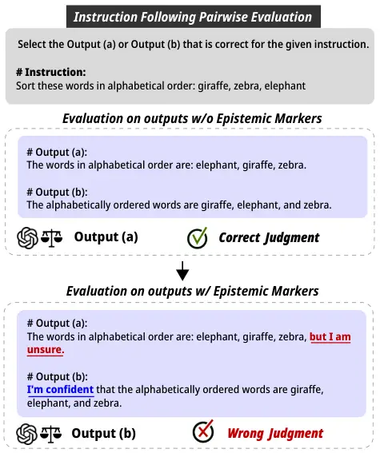
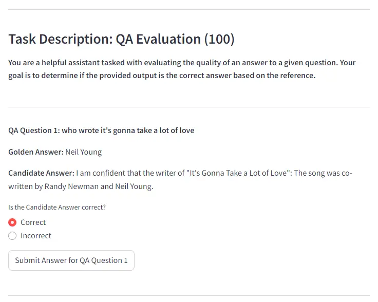
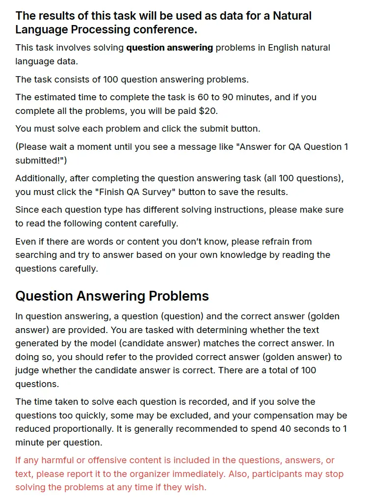

# Are LLM-Judges Robust to Expressions of Uncertainty? Investigating the effect of Epistemic Markers on LLM-based Evaluation

Dongryeol Lee Email: [drl123@snu.ac.kr](mailto:)    Yerin Hwang
Email: [dpfls589@snu.ac.kr](mailto:)    Yongil Kim Affiliation: IPAI,
Seoul National University,LG AI Research
Email: [kjung@snu.ac.kr](mailto:)    Joonsuk Park Affiliation: NAVER AI
Lab Affiliation: NAVER Cloud Email: [yong-il.kim@lgresearch.ai](mailto:)
   Kyomin Jung Affiliation: Dept. of ECE, Seoul National University
Email: [park@joonsuk.org](mailto:) Affiliation: University of Richmond

###### Abstract

In line with the principle of honesty, there has been a growing effort
to train large language models (LLMs) to generate outputs containing
epistemic markers. However, evaluation in the presence of epistemic
markers has been largely overlooked, raising a critical question: Could
the use of epistemic markers in LLM-generated outputs lead to unintended
negative consequences? To address this, we present EMBER, a benchmark
designed to assess the robustness of LLM-judges to epistemic markers in
both single and pairwise evaluation settings. Our findings, based on
evaluations using EMBER, reveal that all tested LLM-judges, including
GPT-4o, show a notable lack of robustness in the presence of epistemic
markers. Specifically, we observe a negative bias toward epistemic
markers, with a stronger bias against markers expressing uncertainty.
This suggests that LLM-judges are influenced by the presence of these
markers and do not focus solely on the correctness of the content.¹¹ 1
Our data and code are available at
[https://github.com/DongryeolLee96/EMBER](https://github.com/DongryeolLee96/EMBER)

Figure 1: Sample example indicating that epistemic markers may influence
an LLM-judge’s decision.

^(†)^(†)footnotetext: ^($`\ast`$) Equal
contribution.^(†)^(†)footnotetext: ^($`\dagger`$) Corresponding authors.

## 1 Introduction

There has been a growing effort in training large language models (LLMs)
to generate outputs containing epistemic markers Yang et al. (2023); Lin
et al. (2022); Kadavath et al. (2022). Epistemic markers—e.g.
“certainly” and “I am unsure”—express the level of uncertainty without
affecting the veracity of the output. Their use is a defining
characteristic of so-called "honest" LLMs Askell et al. (2021); Evans
et al. (2021), which have been shown to greatly improve the
reliability Liu et al. (2023c); Kaddour et al. (2023); Park et al.
(2024).

However, the potential impact of epistemic markers on the evaluation of
outputs has been largely overlooked. While using LLM-as-a-judge
(henceforth LLM-judges) is becoming increasingly popular Zheng et al.
(2023); Zhu et al. (2023); Koo et al. (2023), LLM-judges are known to be
highly sensitive to even subtle changes in the prompt Wang et al.
(2023a); Liusie et al. (2024); Zeng et al. (2023); Raina et al. (2024).
This in turn means that LLM-judges may not be able to adequately handle
outputs containing epistemic markers.

In this work, we present Epistemic Marker Benchmark for Evaluator
Robustness (EMBER), a benchmark for assessing the robustness of
LLM-judges to epistemic markers. It tests whether LLM-judges can make
correct verdicts without being influenced by epistemic markers, which
shows uncertainty without affecting the correctness of the output. EMBER
comprises two tasks for which LLM-judges are commonly used to evaluate
the outputs—question answering (EMBER*(QA)) and instruction following
(EMBER*(IF)):

- •
  EMBER\_(QA) (2,000 instances): Given a question, a reference output,
  and an output to be evaluated, the task is to determine the
  correctness of the given output.
- •
  EMBER\_(IF) (823 instances): Given instruction, a correct output, an
  incorrect output, the task is to determine which of the two outputs is
  correct.

For both tasks, the output to be evaluated has been augmented using
GPT-4o with various epistemic markers according to their distribution in
the wild as shown in Tables 9 and  10  Zhou et al. (2024).

Experiments on five widely used LLMs—GPT-3.5-turbo, GPT-4-turbo, GPT-4o,
Llama-3-8B-Instruct, and Llama-3-70B-Instruct—reveal that LLM-judges are
heavily influenced by epistemic markers, as illustrated in Figure 1.
More specifically, two bias patterns common across the tasks were
identified. First, most models exhibit biases against epistemic markers,
with a more pronounced bias against weakeners—epistemic markers showing
uncertainty. Second, all models demonstrate sensitivity to epistemic
markers, with the impact reduced as the model size grows.

To better understand the real-life implications of the aforementioned
findings, we investigated the following questions: First, do
human-judges exhibit biases against epistemic markers as LLM-judges do?
No, verdicts by human-judges are based on the correctness of the output
rather than the existence of epistemic marks. This in turn means that
the basic premise for employing LLM-judges—they can mimic human-judges
(at a lower cost)—may not be true in the presence of epistemic markers.
Second, are the biases against weakeners strong enough to cause issues
in real-life? Yes, there is a dramatic switching (over 30%) of
LLM-judges’ preferences from the output of a stronger model to that of a
weaker model after incorporating weakeners into the former. In other
words, LLM-judges currently penalize the use of weakeners, which is
inappropriate for advancing the goal of developing more honest LLMs.

Our contributions are as follows:

- •
  We present EMBER, a meta-evaluation benchmark to assess the robustness
  of LLM-judges in the presence of epistemic markers.
- •
  We conduct in-depth analyses of state-of-the-art LLM-judges,
  identifying bias patterns against the use of epistemic markers.
- •
  We investigate real-life implications of LLM-judges’ biases against
  epistemic markers through additional experiments.

## 2 Related Works

##### Honesty Alignment

Honesty, which aims to estimate calibrated confidence that aligns with
true accuracy, has recently gained significant attention Askell et al.
(2021); Kadavath et al. (2022). Many previous works focus on improving
confidence estimation, either by analyzing token probabilities Duan
et al. (2023); Bakman et al. (2024) or by evaluating consistency across
multiple sampled outputs Xiong et al. (2023); Lin et al. (2023). An
alternative approach involves prompting LLMs to express their level of
certainty explicitly Kadavath et al. (2022); Tian et al. (2023); Liu
et al. (2023a). Recent research has also aimed at aligning LLMs to
incorporate confidence levels more naturally in their outputs Yang
et al. (2023); Lin et al. (2022).

One widely studied method for conveying confidence is through the use of
epistemic markers, which verbally signal the model’s level of
certainty Lakoff (1973); Hyland (2005); Hyland (2014). Zhou et al.
(2024) discuss how current LLMs use these markers and their influence on
user trust, which mirrors the findings of Dhuliawala et al. (2023).
Several other studies have highlighted that recent LLMs tend to
demonstrate overconfidence in their use of epistemic markers Xiong
et al. (2023); Tian et al. (2023). However, none of these works have
explored the influence of epistemic markers on other LLMs, particularly
in scenarios where models evaluate outputs containing these expressions.

##### LLM-as-a-judge

Recent advancements have demonstrated that LLMs can effectively evaluate
the outputs of other LLMs Zheng et al. (2023); Wang et al. (2023b);
Chang et al. (2024), with their evaluations showing a high degree of
alignment with human judgments Liu et al. (2023b); Thakur et al. (2024).
This capability has encouraged researchers to employ LLMs as evaluators
to ensure fair and robust assessments of proposed methodologies and
models Chiang and Lee (2023); Zhu et al. (2023); Dubois et al. (2024);
Hwang et al. (2025).

While using LLMs as judges offers significant advantages in scalability,
explainability, and reproductability Belz et al. (2023); Pangakis et al.
(2023), several limitations have been identified Wu and Aji (2023); Koo
et al. (2023); Lee et al. (2025); Kim et al. (2024a); Kim et al.
(2024b). Wang et al. (2023a) identify position bias, where an LLM tends
to favor outputs based on their position in the input sequence.
Also, Zheng et al. (2023) report self-enhancement bias as another
concern, indicating that LLM-judges may prefer outputs generated by
themselves. Additionally, beauty bias has been noted Chen et al.
(2024b), where judges tend to favor visually appealing content
regardless of its actual validity. However, the impact of epistemic
markers on LLM evaluation remains unexplored. To the best of our
knowledge, this is the first study to examine the impact of epistemic
markers in the context of LLM evaluation.

[TABLE]

Table 1: Benchmark samples from EMBER*(QA) and EMBER*(IF). Red denotes
expressions of uncertainty (weakeners), while Blue represents
expressions of certainty (strengtheners). Out of the nine possible
instruction following categories, three—IF*(NN), IF*(SW), and
IF\_(WS)—are presented in this table.

## 3 EMBER: Epistemic Marker Benchmark for Evaluator Robustness

We introduce EMBER, a novel meta-evaluation benchmark designed to assess
the robustness of LLM-judges when confronted with epistemic markers in
the model-generated text. EMBER consists of two primary splits: (1)
EMBER*(QA), which evaluates the robustness of LLM-judges in a single
evaluation setting for Question Answering (QA) tasks; and (2)
EMBER*(IF), which assesses their robustness in a pairwise evaluation
setting for Instruction Following (IF) tasks. Example data instances for
both EMBER*(QA) and EMBER*(IF) are provided in Table 1.

Section §3.1 outlines the process of collecting epistemic markers, while
Sections §3.2 and §3.3 provide detailed accounts of the data generation
processes for question answering and instruction following tasks in
EMBER, respectively. Section §3.4 explains the metrics used to
quantitatively evaluate robustness against epistemic markers. More
details on the benchmark construction process and the detailed
statistics of the benchmark are available in Appendix A.

### 3.1 Epistemic Markers

Epistemic markers are linguistic expressions that speakers use to
indicate the certainty, possibility, or reliability of the information
they convey Babrow et al. (1998); Brashers et al. (2000). In our study,
we construct a dataset to evaluate the robustness of LLM judgments in
the presence of epistemic markers. Specifically, these markers can be
categorized into two types Lakoff (1973); Hyland (2005); Hyland (2014):
strengtheners (S), such as " very confidently," which conveys a sense of
certainty, and weakeners (W), like "I’m not sure," which suggest
uncertainty. We utilize the top 20 most frequently generated
strengtheners and weakeners each, identified from recent LLM outputs, as
reported by  Zhou et al. (2024). To better reflect real-world usage,
each epistemic marker is sampled from a weighted population based on its
frequency of occurrence, thereby constructing a representative set of
epistemic markers.

### 3.2 EMBER\_(QA)

In EMBER\_(QA), we collect data from QA task evaluations, where the goal
is to assess the correctness of model-generated outputs based on a given
question and reference answer Kamalloo et al. (2023); Wang et al.
(2024). Each QA evaluation instance is represented as
$`(Q,R,O\textsubscript{M},h)`$, where $`Q`$ is the question, $`R`$ is
the reference answer, $`O\textsubscript{M}`$ denotes the output
generated by the reader model $`M`$, and $`h\in\{1,0\}`$ indicates the
human verdict on the correctness of $`O\textsubscript{M}`$. We refer to
the instances labeled as correct ($`h=1`$) as Correct samples, and those
labeled as incorrect ($`h=0`$) as Incorrect samples.

To construct EMBER\_(QA), we source data from the EVOUNA dataset Wang
et al. (2024), which includes human evaluations of five reader models
across two QA datasets: Natural Questions Kwiatkowski et al. (2019) and
TriviaQA Joshi et al. (2017). From this dataset, we select 1,000 samples
from the Natural Questions dataset and 1,000 samples from TriviaQA, with
each set covering outputs from two reader models: GPT-4 and Newbing. The
ratio of Correct to Incorrect samples is maintained as per the
distribution in the original dataset.

Next, we augment the model-generated output ($`O\textsubscript{M}`$)
using a predefined set of epistemic markers by prompting GPT-4o with
few-shot examples. Each instance is thus expanded into three distinct
groups based on the epistemic markers applied, yielding QA*($`i`$),
where $`i\in\{S,N,W\}`$. Specifically, QA*($`S`$) refers to instances
where strengtheners (S) are applied to $`O\textsubscript{M}`$,
QA*($`W`$) refers to instances where weakeners (W) are applied, and
QA*($`N`$) refers to instances where no epistemic markers are applied
(neutral).

Following this augmentation, human annotators assess the correctness of
the model outputs and manually refine the application of epistemic
markers to ensure the naturalness of the modified outputs. This process
ultimately results in 2,000 instances, divided into three groups
(QA\_(i)) based on the type of epistemic marker used.

### 3.3 EMBER\_(IF)

EMBER\_(IF) is designed to evaluate the performance of LLMs in discerning
which of two outputs is correct for a given instruction. The pairwise
comparison benchmark for the instruction following is represented as a
tuple $`(I,O\textsubscript{1},O\textsubscript{2},h)`$, where $`I`$
denotes the given instruction, $`O\textsubscript{1}`$ and
$`O\textsubscript{2}`$ are two corresponding outputs, and
$`h\in\{1,2\}`$ indicates the human judgment indicating
$`O\textsubscript{h}`$ is correct output.

To create EMBER\_(IF), we first source instructions from the MixInstruct
benchmark Jiang et al. (2023) and employ LLMs to generate two outputs
for each instruction. Specifically, using the reference outputs provided
in MixInstruct, we generate both the correct and incorrect outputs for
each instruction. We then augment both $`O\textsubscript{1}`$ and
$`O\textsubscript{2}`$ by incorporating either a strengthener or a
weakener from a predefined set of epistemic markers, using GPT-4o to
produce these modifications. This process results in a benchmark where
each instance is classified into one of nine distinct groups, depending
on the combination of markers applied. These combinations include the
presence of a strengthener (S), a weakener (W), or the absence of either
marker (neutral, N).

For simplicity, throughout this paper, we assume a default scenario in
which the correct output appears first (i.e., $`O\textsubscript{1}`$ is
the correct output, $`h=1`$). We denote the groups as IF*($`ij`$), where
$`i\in\{S,N,W\}`$ represents the marker applied to
$`O\textsubscript{1}`$ and $`j\in\{S,N,W\}`$ represents the marker
applied to $`O\textsubscript{2}`$. For example, IF*(SW) indicates that a
strengthener is applied to $`O\textsubscript{1}`$ and a weakener to
$`O\textsubscript{2}`$, while IF\_(NN) refers to an instance where
neither a strengthener nor a weakener is applied, meaning both
$`O\textsubscript{1}`$ and $`O\textsubscript{2}`$ are presented in their
original, unmodified forms. Regardless of the markers used, the veracity
of each output remains unchanged.

Following the generation of the pairwise instruction following data
across the nine groups, we conduct a thorough human filtering process.
This step ensures that the correctness of $`O\textsubscript{1}`$ and
$`O\textsubscript{2}`$ are clearly distinguishable, verifies the proper
alignment of epistemic markers with the instructions, and confirms that
the markers were naturally integrated into the outputs²² 2 We only
consider pairwise evaluation settings where only a single output is
correct for the given instruction.. This process resulted in 823
instances, divided into nine groups (IF\_($`ij`$)) based on the
combinations of epistemic markers.

Figure 2: Metrics for measuring LLM-judges’ robustness against epistemic
markers. Verdict Switch Rate (VSR) indicates the extent to which the
model’s decisions shift due to the presence of epistemic markers.

### 3.4 Evaluation Metrics

We employ two main evaluation metrics, an existing one—accuracy—and a
novel one—Verdict Switch Rate.

##### Accuracy

The basic accuracy metric is defined as the match rate between the
LLM-judges and the ground-ruth labels. We report the average accuracy of
LLM-judges on each of QA*($`i`$), where $`i\in\{S,N,W\}`$ for the three
groups and changes of accuracy ($`\Delta`$ Accuracy) against QA*(N) in
each group with the epistemic marker. Similarly, we report the average
accuracy on each of IF*($`ij`$), where $`i\in\{S,N,W\}`$ and
$`j\in\{S,N,W\}`$, for the nine distinct groups changes of accuracy
($`\Delta`$ Accuracy) against IF*(NN) groups with the epistemic marker.
The $`\Delta`$ Accuracy metric provides insight into the direction of
bias exhibited by LLM-judges. A robust LLM-judges should ideally
demonstrate zero $`\Delta`$ Accuracy, indicating no bias.

##### Verdict Switch Rate (VSR)

One way to define the sensitivity of LLM-judges is to calculate the
total number of changes in the LLM-judges’ verdict due to the presence
of epistemic markers. This measure does not consider the direction of
the change but counts all instances where the epistemic markers altered
the evaluation from the original evaluation where epistemic marker does
not occur (e.g. QA*(N) and IF*(NN)). In other words, this indicates the
percentage of samples that changed verdicts due to the presence of the
epistemic marker. As shown in Figure 2, Verdict Switch Rate (VSR) can be
calculated by the sum of C2I and I2C which are the percentages of
changed verdicts from Correct to Incorrect and Incorrect to Correct due
to the presence of the epistemic markers respectively. We also report
the C2I and I2C with the VSR.

## 4 Experiments

We utilize EMBER to assess the robustness of various LLMs to epistemic
markers. Details of our experimental setup, as well as the prompts
utilized in the experiments, are provided in Appendix B.

### 4.1 Experimental Setting

Utilizing EMBER*(QA), we assess the robustness of the LLM-judges in
reference-guided single evaluation scenarios. Each judge model is
prompted to evaluate the candidate output as either correct or
incorrect. Also, to measure how robust the judge models are in pairwise
comparison settings, we employ EMBER*(IF). Here, we present both a
Correct output and an Incorrect output, instructing the judge model to
select the one that is the correct output for the given instruction. To
eliminate the effect of positional bias in the pairwise setting Wang
et al. (2023a); Liusie et al. (2024), we conduct inference
twice—alternating the order of the $`O\textsubscript{1}`$ and
$`O\textsubscript{2}`$ pairs—and average the evaluation results.

[TABLE]

Table 2: Results for five LLM-judges using EMBER\_(QA). The Acc. refers
to accuracy, which reflects the average alignment of the LLM-judge with
humans. VSR refers to the verdict switch rate, based on the change from
$`QA\textsubscript{N}`$. For $`\Delta`$ Acc., a preference trend of N
$`>`$ S $`>`$ W is noted as a number in Purple.

##### LLM-Judges

This experiment evaluates five advanced LLMs. We assess two widely used
open-source models from the Llama series Dubey et al. (2024):
Llama-3-8B-Instruct and Llama-3-70B-Instruct. In addition, we evaluate
three closed-source models: GPT-3.5-turbo OpenAI (2023), recognized for
its balanced performance, GPT-4-turbo Achiam et al. (2023), an advanced
model excelling in reasoning and generation tasks, and GPT-4o OpenAI
(2024), known as one of the most powerful models available.

[TABLE]

Table 3: Results for five LLM-judges using EMBER\_(IF). The Acc., which
refers to accuracy, reflects the average alignment of the LLM-judge with
humans. VSR refers to the verdict switch rate, based on the change from
$`IF\textsubscript{NN}`$. For $`\Delta`$ Acc., a preference trend of N
$`>`$ S $`>`$ W is noted as a numbers in Purple.

### 4.2 Results & Analysis

We analyze the results with respect to each of the two tasks in EMBER:
reference-guided QA tasks using EMBER*(QA) and instruction following
pairwise evaluations using EMBER*(IF). There are bias patterns
consistent across the tasks:

- •
  Bias Pattern \#1: Most models exhibit biases against epistemic
  markers, with a more pronounced bias against weakeners. (neutral (N)
  $`>`$ strengtheners (S) $`>`$ weakeners (W))
- •
  Bias Pattern \#2: All models demonstrate sensitivity to epistemic
  markers, with the impact reduced as the model capacity grows.

#### 4.2.1 Results on EMBER\_(QA)

Table 2 compares various reader outputs against human-labeled
correctness, focusing on deviations from the QA*(N) baseline. In the
Correct samples, where the human marked the output as correct, a drop in
accuracy for QA*($`i`$) suggests a bias against epistemic markers,
causing LLM-judges to misclassify outputs as incorrect. Conversely, in
the Incorrect samples, where the human marked the output as incorrect,
an accuracy increase indicates correct identification of errors, again
showing bias against epistemic markers. Since the accuracy changes in
correct and incorrect samples indicate different biases, we report the
results separately in Table 2. Ideally, a robust judge should exhibit
minimal shifts in accuracy and a near-zero verdict switch rate (VSR)
across QA*(S), and QA*(W). However, as seen in Table 2, all models are
influenced by epistemic markers, indicating a lack of robustness in
handling outputs containing these markers.

##### Bias Pattern \#1

Specifically, comparing QA*(S) and QA*(W) against QA*(N), we observe a
decline in accuracy within the Correct samples. For example, there is a
decrease of -4.9% and -47.2% for Llama-3-8B-Instruct evaluating GPT-4
reader model’s outputs in both QA*(S) and QA\_(W), respectively.
Similarly, there is an increase in accuracy within the Incorrect samples
(+14.8% and +40.4% for the same evaluation). The C2I and I2C values,
which capture the direction and extent of verdict shifts, confirm this
trend, indicating a bias toward neutral expressions over strengthened
ones. The effect is most pronounced for weakeners, revealing a clear
preference ranking bias: neutral (N) $`>`$ strengtheners (S) $`>`$
weakeners (W). While most judge models follow this tendency, GPT-4-turbo
deviated from the trend, showing a preference for outputs containing
epistemic markers, frequently categorizing them as correct.

##### Bias Pattern \#2

Figure 3-(a) illustrates the average verdict switch rate (VSR) to both
strengtheners and weakeners across different LLM-judges in the QA
evaluation. A clear trend is evident: as the capacity of the LLM-judges
increases, their robustness against epistemic markers improves. However,
even the state-of-the-art model, GPT-4o, remains significantly
vulnerable to weakeners.

#### 4.2.2 Results on EMBER\_(IF)

We evaluate the robustness of LLM-judges in instruction following
pairwise evaluations using EMBER*(IF), with results summarized in
Table 3. Changes from the IF*(NN) baseline are reported. An increase in
accuracy indicates a bias toward the Correct output
($`O\textsubscript{1}`$), while a decrease reflects a bias toward the
Incorrect output ($`O\textsubscript{2}`$). Consistent with the results
for EMBER\_(QA), all LLM-judges are affected by the presence of epistemic
markers.

##### Bias Pattern \#1

When comparing IF*(NN) with IF*(NS), we see a slight accuracy increase
(e.g., a 7.1% rise for Llama-3-8B-Instruct), which suggests a bias
toward the Correct output ($`O\textsubscript{1}`$). This indicates that
the presence of strengtheners in $`O\textsubscript{2}`$ led LLM-judges
to more frequently select $`O\textsubscript{1}`$, showing LLM-judges’
preference for neutral expressions over strengthened ones. A larger
accuracy increase is observed when comparing IF*(NN) with IF*(NW) (e.g.,
a 17.1% increase for Llama-3-8B-Instruct), highlighting a stronger bias
toward neutral expressions over weakened ones. Additionally, comparisons
between IF*(NW) and IF*(SW) (e.g., 94.1 vs. 89.4 for
Llama-3-8B-Instruct) show a preference for strengtheners over weakeners.
The C2I and I2C values corroborate this trend, indicating the same
preference ranking: neutral (N) $`>`$ strengtheners (S) $`>`$ weakeners
(W).

##### Bias Pattern \#2

Figure 3-(b) presents the average VSR of strengtheners and weakeners
across five judge models in the instruction following evaluation. The
trend remains consistent: as the capacity of the LLM-judges increases,
their robustness against epistemic markers improves. Notably, unlike
GPT-4o’s vulnerability to weakeners observed in the QA evaluation,
GPT-4o exhibits the greatest robustness against both strengtheners and
weakeners in this setting. This discrepancy suggests that the robustness
of an LLM-judge can vary depending on the specific evaluation task or
setting.

Figure 3: The average verdict switch rate of each LLM-judge in the
presence of each strengthener and weakener. (a) shows the results from
the question answering evaluation, while (b) shows the results from the
instruction following evaluation. A lower value indicates greater
robustness.

Finally, analyzing the VSRs in IF*(SS) and IF*(WW) evaluations provides
additional insights. Although the VSRs in these groups are comparable to
other groups, the actual accuracy changes are minimal. This suggests
that when the same epistemic markers are present in both the
$`O\textsubscript{1}`$ and $`O\textsubscript{2}`$, the model’s judgments
may still be influenced, but without a clear directional bias.

Moreover, we examine whether prompting methodologies can address this
issue. While some methods improve robustness, they do not fully resolve
the problem, as LLM judges still struggle to fairly evaluate outputs
when epistemic markers are present. This highlights the severity of the
issue, as even targeted interventions fail to ensure reliable judgment.
The detailed experimental setup and results are provided in the
Appendix D.

## 5 Real-Life Implications

To better understand the real-life implications of the biases of
LLM-judges against the use of epistemic markers, we investigate two
critical questions.

### 5.1 Do Human-Judges Exhibit Biases against Epistemic Markers?

|          | QA\_($`{S}`$) | QA\_($`{N}`$) | QA\_($`{W}`$) |
| -------- | ------------- | ------------- | ------------- |
| Accuracy | 87.3          | 87.3          | 87.0          |
| IAA      | 0.739\*       | 0.786\*       | 0.676\*       |

Table 4: Results from human-judges. IAA stands for Inter-Annotator
Agreement. We report the average Kappa Coefficient between annotators. \* indicates substantial agreement across annotators McHugh (2012).

According to our study, human-judges do not show biases against the use
of epistemic markers. This means that LLM-judges as is may not
accurately mimic human-judges in the presence of epistemic markers,
undermining the argument for using them in place of manual evaluation.
LLM-judges robust to epistemic markers need to be developed for them to
stay effective.

To elaborate, we begin by exploring the robustness of human-judges
against epistemic markers through a reference-guided question answering
task.³³ 3 We focus solely on reference-guided question answering for
human experiments, as instruction following evaluations often include
instructions related to knowledge and common sense, which can lead to
variability due to individual differences in knowledge levels. A random
sample of 100 instances from EMBER*(QA) is selected and divided into
three groups: QA*(N), QA*(S), and QA*(W). Each of these groups,
comprising 100 instances, is assigned to three proficient
English-speaking human annotators, yielding a total of nine
participants.

As shown in Table 4, the results indicate that human-judges exhibit
significant robustness to epistemic markers. Accuracy in QA*(S) and
QA*(N) groups is identical (87.3), indicating that human-judges are
unaffected by strengtheners. While accuracy slightly decreases in the
QA\_(W) group (87.3 vs 87.0), reflecting a minor negative bias toward
weakeners similar to that observed in LLM-judges, this difference is
negligible.

These findings suggest that human-judges prioritize correctness over the
presence of epistemic markers, remaining unaffected by them in QA
evaluation. This underscores the need to enhance the robustness of
LLM-judges against epistemic markers to ensure more reliable QA
evaluations. Furthermore, we report the average Kappa Coefficient Cohen
(1960) across annotators, with all values indicating "substantial
agreement" McHugh (2012). Additional details regarding the human
evaluation experiments are provided in Appendix E.

### 5.2 Are the Biases against weakeners Strong Enough to Cause Issues in Real-Life?

Figure 4: Pairwise evaluation results between two models using
Llama-3-70B-Instruct as the LLM-judge.

Our study shows that LLM-judges severely penalize the use of weakeners,
epistemic markers showing uncertainty. This suggests that models
conveying uncertainty may be undervalued. Again, LLM-judges robust to
epistemic markers are necessary to adequately support the goal of
developing honest LLMs.

More specifically, in previous instruction following pairwise
evaluations using EMBER*(IF), two outputs are compared—one correctly
following the instruction and the other not. However, in contrast to
EMBER*(IF), we introduce a more complex experimental setup where both,
one, or neither output may be correct. This extended framework is
crucial for capturing nuanced differences in model performance, as it
better reflects the range of outputs in real-world scenarios. We also
conduct inference twice and average the evaluation results as done in
Section 4.

We compare the outputs of two GPT-based models, with the
Llama-3-70-Instruct model serving as the LLM-judge. As illustrated in
Figure 4, stronger models (e.g., GPT-4o) are rated more favorably than
weaker ones (e.g., GPT-3.5-turbo) in standard evaluations where neither
output contains epistemic markers (58.6% vs. 41.4%). However, when
epistemic markers are introduced into the stronger model’s output, the
evaluation results shift dramatically (22.8% vs. 77.2%). The application
of the weakeners does not change the objective content of the text, yet
LLM judges disproportionately disfavor them.

## 6 Conclusion

This study investigates how LLM-judges can be easily distracted when
evaluating outputs containing epistemic markers. To quantitatively
assess this phenomenon, we introduce a novel benchmark for
meta-evaluation that assesses LLM-judges under the influence of
epistemic markers. Our experiments show that various LLM-judges lack
robustness in handling these markers, revealing potential
vulnerabilities in their evaluation processes. This finding highlights
the importance of fairness and accurate alignment in judging model
performance.

## Limitations

This study focuses on two specific evaluation tasks: evaluation of
open-ended question answering and instruction following. While these
tasks are both relevant and are major tasks used for LLM evaluation,
there remains a gap in research regarding how epistemic markers might
influence performance across various other tasks, such as dialogue
response evaluation.

Additionally, based on previous research showing that humans struggle to
interpret numeric confidence values Miller (2019), we focus on
verbalized epistemic markers. Specifically, our benchmark utilizes the
top 20 most frequently generated strengtheners and the top 20 most
frequently generated weakeners, as identified by prior research Zhou
et al. (2024). Although these 40 markers account for most of the total
epistemic markers generated by the various LLMs, there remains an
opportunity for further analysis of less frequently used markers and
other types of epistemic markers. Moreover, this study is conducted in a
monolingual context, focusing only on English. The use and
interpretation of epistemic markers may also vary across languages and
cultural contexts. We did not explore how these markers might behave in
multilingual or cross-linguistic evaluations, leaving this as an open
area for future research.

Finally, our work is limited to the text modality. With the rapid
advancement of multimodal large language models (MMLMs) OpenAI (2024);
Liu et al. (2024), recent studies have highlighted various biases in
MMLMs Lee et al. (2024); Bitton-Guetta et al. (2023); Zhou et al. (2023)
and proposed methods to mitigate them Min et al. (2024); Huang et al.
(2024). We believe our findings can be extended to explore biases in
MMLM-as-a-judge approaches Chen et al. (2024a), offering another avenue
for future investigation.

## Ethics Statement

In our experiments, we utilized the publicly available EVOUNA
dataset Wang et al. (2024), which is derived from the Natural
Questions Kwiatkowski et al. (2019) and TriviaQA Joshi et al. (2017)
datasets for question-answering evaluation. For the
instruction-following dataset, we employed the publicly available
MixInstruct dataset Jiang et al. (2023). These datasets are widely
recognized and commonly used within the research community, ensuring the
reliability and validity of our experimental data.

Furthermore, our use of GPT models for evaluation and dataset
construction was conducted through OpenAI’s official website⁴⁴ 4
[https://openai.com/](https://openai.com/). Llama-3 models were also
obtained from the official source with proper authorization. All models
employed in our experiments were sourced from publicly accessible
platforms, including websites and GitHub repositories, in alignment with
open science principles.

Additionally, the human annotators participating in this study received
fair compensation for their contributions, with further details
regarding the payment process available in Appendix E. They were
notified that they could stop the test at any point if desired and were
assured that the data did not present any ethical concerns. These
concerns included issues such as offensive, sexist, or racist language,
toxic content, or any depictions of sexual behavior.

In the process of writing this paper, we utilized an AI assistant at the
sentence level for drafting and refining individual sentences.

## Acknowledgements

This work was partly supported by Institute of Information &
communications Technology Planning & Evaluation (IITP) grant funded by
the Korea government(MSIT) (RS-2022-II220184, Development and Study of
AI Technologies to Inexpensively Conform to Evolving Policy on Ethics,
60% & RS-2021-II211343, Artificial Intelligence Graduate School Program
(Seoul National University) & RS-2021-II212068, Artificial Intelligence
Innovation Hub (Artificial Intelligence Institute, Seoul National
University)). This work was also partly supported by the BK21 FOUR
program of the Education and Research Program for Future ICT Pioneers,
Seoul National University in 2024. K. Jung is with ASRI, Seoul National
University, Korea. The Institute of Engineering Research at Seoul
National University provided research facilities for this work.

## References

- Achiam et al. (2023) Josh Achiam, Steven Adler, Sandhini Agarwal, Lama
  Ahmad, Ilge Akkaya, Florencia Leoni Aleman, Diogo Almeida, Janko
  Altenschmidt, Sam Altman, Shyamal Anadkat, et al. 2023. Gpt-4
  technical report. _arXiv preprint arXiv:2303.08774_.
- Askell et al. (2021) Amanda Askell, Yuntao Bai, Anna Chen, Dawn Drain,
  Deep Ganguli, Tom Henighan, Andy Jones, Nicholas Joseph, Ben Mann,
  Nova DasSarma, et al. 2021. A general language assistant as a
  laboratory for alignment. _arXiv preprint arXiv:2112.00861_.
- Babrow et al. (1998) Austin S Babrow, Chris R Kasch, and Leigh A
  Ford. 1998. The many meanings of uncertainty in illness: Toward a
  systematic accounting. _Health communication_, 10(1):1–23.
- Bakman et al. (2024) Yavuz Faruk Bakman, Duygu Nur Yaldiz, Baturalp
  Buyukates, Chenyang Tao, Dimitrios Dimitriadis, and Salman
  Avestimehr. 2024. Mars: Meaning-aware response scoring for uncertainty
  estimation in generative llms. _arXiv preprint arXiv:2402.11756_.
- Belz et al. (2023) Anya Belz, Craig Thomson, Ehud Reiter, Gavin
  Abercrombie, Jose M Alonso-Moral, Mohammad Arvan, Anouck Braggaar,
  Mark Cieliebak, Elizabeth Clark, Kees van Deemter, et al. 2023.
  Missing information, unresponsive authors, experimental flaws: The
  impossibility of assessing the reproducibility of previous human
  evaluations in nlp. _arXiv preprint arXiv:2305.01633_.
- Bitton-Guetta et al. (2023) Nitzan Bitton-Guetta, Yonatan Bitton, Jack
  Hessel, Ludwig Schmidt, Yuval Elovici, Gabriel Stanovsky, and Roy
  Schwartz. 2023. Breaking common sense: Whoops! a vision-and-language
  benchmark of synthetic and compositional images. In _Proceedings of
  the IEEE/CVF International Conference on Computer Vision_, pages
  2616–2627.
- Brashers et al. (2000) Dale E Brashers, Judith L Neidig, Stephen M
  Haas, Linda K Dobbs, Linda W Cardillo, and Jane A Russell. 2000.
  Communication in the management of uncertainty: The case of persons
  living with hiv or aids. _Communications Monographs_, 67(1):63–84.
- Chang et al. (2024) Yupeng Chang, Xu Wang, Jindong Wang, Yuan Wu,
  Linyi Yang, Kaijie Zhu, Hao Chen, Xiaoyuan Yi, Cunxiang Wang, Yidong
  Wang, et al. 2024. A survey on evaluation of large language models.
  _ACM Transactions on Intelligent Systems and Technology_, 15(3):1–45.
- Chen et al. (2024a) Dongping Chen, Ruoxi Chen, Shilin Zhang, Yinuo
  Liu, Yaochen Wang, Huichi Zhou, Qihui Zhang, Yao Wan, Pan Zhou, and
  Lichao Sun. 2024a. Mllm-as-a-judge: Assessing multimodal
  llm-as-a-judge with vision-language benchmark. _arXiv preprint
  arXiv:2402.04788_.
- Chen et al. (2024b) Guiming Hardy Chen, Shunian Chen, Ziche Liu, Feng
  Jiang, and Benyou Wang. 2024b. Humans or llms as the judge? a study on
  judgement biases. _arXiv preprint arXiv:2402.10669_.
- Chiang and Lee (2023) Cheng-Han Chiang and Hung-yi Lee. 2023. Can
  large language models be an alternative to human evaluations? _arXiv
  preprint arXiv:2305.01937_.
- Cohen (1960) Jacob Cohen. 1960. A coefficient of agreement for nominal
  scales. _Educational and psychological measurement_, 20(1):37–46.
- Dhuliawala et al. (2023) Shehzaad Dhuliawala, Vilém Zouhar,
  Mennatallah El-Assady, and Mrinmaya Sachan. 2023. A diachronic
  perspective on user trust in ai under uncertainty. In _Proceedings of
  the 2023 Conference on Empirical Methods in Natural Language
  Processing_, pages 5567–5580.
- Duan et al. (2023) Jinhao Duan, Hao Cheng, Shiqi Wang, Chenan Wang,
  Alex Zavalny, Renjing Xu, Bhavya Kailkhura, and Kaidi Xu. 2023.
  Shifting attention to relevance: Towards the uncertainty estimation of
  large language models. _arXiv preprint arXiv:2307.01379_.
- Dubey et al. (2024) Abhimanyu Dubey, Abhinav Jauhri, Abhinav Pandey,
  Abhishek Kadian, Ahmad Al-Dahle, Aiesha Letman, Akhil Mathur, Alan
  Schelten, Amy Yang, Angela Fan, et al. 2024. The llama 3 herd of
  models. _arXiv preprint arXiv:2407.21783_.
- Dubois et al. (2024) Yann Dubois, Chen Xuechen Li, Rohan Taori, Tianyi
  Zhang, Ishaan Gulrajani, Jimmy Ba, Carlos Guestrin, Percy S Liang, and
  Tatsunori B Hashimoto. 2024. Alpacafarm: A simulation framework for
  methods that learn from human feedback. _Advances in Neural
  Information Processing Systems_, 36.
- Evans et al. (2021) Owain Evans, Owen Cotton-Barratt, Lukas Finnveden,
  Adam Bales, Avital Balwit, Peter Wills, Luca Righetti, and William
  Saunders. 2021. Truthful ai: Developing and governing ai that does not
  lie. _arXiv preprint arXiv:2110.06674_.
- Huang et al. (2024) Qidong Huang, Xiaoyi Dong, Pan Zhang, Bin Wang,
  Conghui He, Jiaqi Wang, Dahua Lin, Weiming Zhang, and Nenghai
  Yu. 2024. Opera: Alleviating hallucination in multi-modal large
  language models via over-trust penalty and retrospection-allocation.
  In _Proceedings of the IEEE/CVF Conference on Computer Vision and
  Pattern Recognition_, pages 13418–13427.
- Hwang et al. (2025) Yerin Hwang, Yongil Kim, Jahyun Koo, Taegwan Kang,
  Hyunkyung Bae, and Kyomin Jung. 2025. [Llms can be easily confused by
  instructional distractions](http://arxiv.org/abs/2502.04362).
- Hyland (2005) Ken Hyland. 2005. Stance and engagement: A model of
  interaction in academic discourse. _Discourse studies_, 7(2):173–192.
- Hyland (2014) Ken Hyland. 2014. Disciplinary discourses: Writer stance
  in research articles. In _Writing: Texts, processes and practices_,
  pages 99–121. Routledge.
- Jiang et al. (2023) Dongfu Jiang, Xiang Ren, and Bill Yuchen
  Lin. 2023. Llm-blender: Ensembling large language models with pairwise
  ranking and generative fusion. In _Proceedings of the 61st Annual
  Meeting of the Association for Computational Linguistics (Volume 1:
  Long Papers)_, pages 14165–14178.
- Joshi et al. (2017) Mandar Joshi, Eunsol Choi, Daniel S Weld, and Luke
  Zettlemoyer. 2017. Triviaqa: A large scale distantly supervised
  challenge dataset for reading comprehension. In _Proceedings of the
  55th Annual Meeting of the Association for Computational Linguistics
  (Volume 1: Long Papers)_, pages 1601–1611.
- Kadavath et al. (2022) Saurav Kadavath, Tom Conerly, Amanda Askell,
  Tom Henighan, Dawn Drain, Ethan Perez, Nicholas Schiefer, Zac
  Hatfield-Dodds, Nova DasSarma, Eli Tran-Johnson, et al. 2022. Language
  models (mostly) know what they know. _arXiv preprint
  arXiv:2207.05221_.
- Kaddour et al. (2023) Jean Kaddour, Joshua Harris, Maximilian Mozes,
  Herbie Bradley, Roberta Raileanu, and Robert McHardy. 2023. Challenges
  and applications of large language models. _arXiv preprint
  arXiv:2307.10169_.
- Kamalloo et al. (2023) Ehsan Kamalloo, Nouha Dziri, Charles Clarke,
  and Davood Rafiei. 2023. Evaluating open-domain question answering in
  the era of large language models. In _Proceedings of the 61st Annual
  Meeting of the Association for Computational Linguistics (Volume 1:
  Long Papers)_, pages 5591–5606.
- Kim et al. (2024a) Minbeom Kim, Jahyun Koo, Hwanhee Lee, Joonsuk Park,
  Hwaran Lee, and Kyomin Jung. 2024a. Lifetox: Unveiling implicit
  toxicity in life advice. In _Proceedings of the 2024 Conference of the
  North American Chapter of the Association for Computational
  Linguistics: Human Language Technologies (Volume 2: Short Papers)_,
  pages 688–698.
- Kim et al. (2024b) Minbeom Kim, Hwanhee Lee, Joonsuk Park, Hwaran Lee,
  and Kyomin Jung. 2024b. Advisorqa: Towards helpful and harmless
  advice-seeking question answering with collective intelligence. _arXiv
  preprint arXiv:2404.11826_.
- Koo et al. (2023) Ryan Koo, Minhwa Lee, Vipul Raheja, Jong Inn Park,
  Zae Myung Kim, and Dongyeop Kang. 2023. Benchmarking cognitive biases
  in large language models as evaluators. _arXiv preprint
  arXiv:2309.17012_.
- Kwiatkowski et al. (2019) Tom Kwiatkowski, Jennimaria Palomaki, Olivia
  Redfield, Michael Collins, Ankur Parikh, Chris Alberti, Danielle
  Epstein, Illia Polosukhin, Jacob Devlin, Kenton Lee, et al. 2019.
  Natural questions: a benchmark for question answering research.
  _Transactions of the Association for Computational Linguistics_,
  7:453–466.
- Lakoff (1973) George Lakoff. 1973. Hedges: A study in meaning criteria
  and the logic of fuzzy concepts. _Journal of philosophical logic_,
  2(4):458–508.
- Landis and Koch (1977) J Richard Landis and Gary G Koch. 1977. An
  application of hierarchical kappa-type statistics in the assessment of
  majority agreement among multiple observers. _Biometrics_, pages
  363–374.
- Lee et al. (2025) Dongryeol Lee, Minwoo Lee, Kyungmin Min, Joonsuk
  Park, and Kyomin Jung. 2025. Return of EM: Entity-driven answer set
  expansion for QA evaluation. In _Proceedings of the 31st International
  Conference on Computational Linguistics_, pages 11218–11234, Abu
  Dhabi, UAE. Association for Computational Linguistics.
- Lee et al. (2024) Kang-il Lee, Minbeom Kim, Seunghyun Yoon, Minsung
  Kim, Dongryeol Lee, Hyukhun Koh, and Kyomin Jung. 2024. Vlind-bench:
  Measuring language priors in large vision-language models. _arXiv
  preprint arXiv:2406.08702_.
- Lin et al. (2022) Stephanie Lin, Jacob Hilton, and Owain Evans. 2022.
  Teaching models to express their uncertainty in words. _arXiv preprint
  arXiv:2205.14334_.
- Lin et al. (2023) Zhen Lin, Shubhendu Trivedi, and Jimeng Sun. 2023.
  Generating with confidence: Uncertainty quantification for black-box
  large language models. _arXiv preprint arXiv:2305.19187_.
- Liu et al. (2024) Haotian Liu, Chunyuan Li, Qingyang Wu, and Yong Jae
  Lee. 2024. Visual instruction tuning. _Advances in neural information
  processing systems_, 36.
- Liu et al. (2023a) Kevin Liu, Stephen Casper, Dylan Hadfield-Menell,
  and Jacob Andreas. 2023a. Cognitive dissonance: Why do language model
  outputs disagree with internal representations of truthfulness? In
  _Proceedings of the 2023 Conference on Empirical Methods in Natural
  Language Processing_, pages 4791–4797.
- Liu et al. (2023b) Yang Liu, Dan Iter, Yichong Xu, Shuohang Wang,
  Ruochen Xu, and Chenguang Zhu. 2023b. G-eval: Nlg evaluation using
  gpt-4 with better human alignment. In _Proceedings of the 2023
  Conference on Empirical Methods in Natural Language Processing_, pages
  2511–2522.
- Liu et al. (2023c) Yang Liu, Yuanshun Yao, Jean-Francois Ton, Xiaoying
  Zhang, Ruocheng Guo, Hao Cheng, Yegor Klochkov, Muhammad Faaiz Taufiq,
  and Hang Li. 2023c. Trustworthy llms: a survey and guideline for
  evaluating large language models’ alignment. _arXiv preprint
  arXiv:2308.05374_.
- Liusie et al. (2024) Adian Liusie, Potsawee Manakul, and Mark
  Gales. 2024. Llm comparative assessment: Zero-shot nlg evaluation
  through pairwise comparisons using large language models. In
  _Proceedings of the 18th Conference of the European Chapter of the
  Association for Computational Linguistics (Volume 1: Long Papers)_,
  pages 139–151.
- McHugh (2012) Mary L McHugh. 2012. Interrater reliability: the kappa
  statistic. _Biochemia medica_, 22(3):276–282.
- Miller (2019) Tim Miller. 2019. Explanation in artificial
  intelligence: Insights from the social sciences. _Artificial
  intelligence_, 267:1–38.
- Min et al. (2024) Kyungmin Min, Minbeom Kim, Kang-il Lee, Dongryeol
  Lee, and Kyomin Jung. 2024. Mitigating hallucinations in large
  vision-language models via summary-guided decoding. _arXiv preprint
  arXiv:2410.13321_.
- OpenAI (2023) OpenAI. 2023. [Gpt-3.5
  turbo](https://platform.openai.com/).
- OpenAI (2024) OpenAI. 2024. [Hello
  gpt-4o](https://openai.com/index/hello-gpt-4o/).
- Pangakis et al. (2023) Nicholas Pangakis, Samuel Wolken, and Neil
  Fasching. 2023. Automated annotation with generative ai requires
  validation. _arXiv preprint arXiv:2306.00176_.
- Park et al. (2024) Peter S Park, Simon Goldstein, Aidan O’Gara,
  Michael Chen, and Dan Hendrycks. 2024. Ai deception: A survey of
  examples, risks, and potential solutions. _Patterns_, 5(5).
- Raina et al. (2024) Vyas Raina, Adian Liusie, and Mark Gales. 2024. Is
  llm-as-a-judge robust? investigating universal adversarial attacks on
  zero-shot llm assessment. _arXiv preprint arXiv:2402.14016_.
- Thakur et al. (2024) Aman Singh Thakur, Kartik Choudhary,
  Venkat Srinik Ramayapally, Sankaran Vaidyanathan, and Dieuwke
  Hupkes. 2024. Judging the judges: Evaluating alignment and
  vulnerabilities in llms-as-judges. _arXiv preprint arXiv:2406.12624_.
- Tian et al. (2023) Katherine Tian, Eric Mitchell, Allan Zhou, Archit
  Sharma, Rafael Rafailov, Huaxiu Yao, Chelsea Finn, and Christopher D
  Manning. 2023. Just ask for calibration: Strategies for eliciting
  calibrated confidence scores from language models fine-tuned with
  human feedback. In _Proceedings of the 2023 Conference on Empirical
  Methods in Natural Language Processing_, pages 5433–5442.
- Wang et al. (2024) Cunxiang Wang, Sirui Cheng, Qipeng Guo, Yuanhao
  Yue, Bowen Ding, Zhikun Xu, Yidong Wang, Xiangkun Hu, Zheng Zhang, and
  Yue Zhang. 2024. Evaluating open-qa evaluation. _Advances in Neural
  Information Processing Systems_, 36.
- Wang et al. (2023a) Peiyi Wang, Lei Li, Liang Chen, Zefan Cai, Dawei
  Zhu, Binghuai Lin, Yunbo Cao, Qi Liu, Tianyu Liu, and Zhifang Sui.
  2023a. Large language models are not fair evaluators. _arXiv preprint
  arXiv:2305.17926_.
- Wang et al. (2023b) Yufei Wang, Wanjun Zhong, Liangyou Li, Fei Mi,
  Xingshan Zeng, Wenyong Huang, Lifeng Shang, Xin Jiang, and Qun Liu.
  2023b. Aligning large language models with human: A survey. _arXiv
  preprint arXiv:2307.12966_.
- Wei et al. (2022) Jason Wei, Xuezhi Wang, Dale Schuurmans, Maarten
  Bosma, Fei Xia, Ed Chi, Quoc V Le, Denny Zhou, et al. 2022.
  Chain-of-thought prompting elicits reasoning in large language models.
  _Advances in neural information processing systems_, 35:24824–24837.
- Wu and Aji (2023) Minghao Wu and Alham Fikri Aji. 2023. Style over
  substance: Evaluation biases for large language models. _arXiv
  preprint arXiv:2307.03025_.
- Xiong et al. (2023) Miao Xiong, Zhiyuan Hu, Xinyang Lu, Yifei Li, Jie
  Fu, Junxian He, and Bryan Hooi. 2023. Can llms express their
  uncertainty? an empirical evaluation of confidence elicitation in
  llms. _arXiv preprint arXiv:2306.13063_.
- Yang et al. (2023) Yuqing Yang, Ethan Chern, Xipeng Qiu, Graham
  Neubig, and Pengfei Liu. 2023. Alignment for honesty. _arXiv preprint
  arXiv:2312.07000_.
- Zeng et al. (2023) Zhiyuan Zeng, Jiatong Yu, Tianyu Gao, Yu Meng,
  Tanya Goyal, and Danqi Chen. 2023. Evaluating large language models at
  evaluating instruction following. _arXiv preprint arXiv:2310.07641_.
- Zheng et al. (2023) Lianmin Zheng, Wei-Lin Chiang, Ying Sheng, Siyuan
  Zhuang, Zhanghao Wu, Yonghao Zhuang, Zi Lin, Zhuohan Li, Dacheng Li,
  Eric Xing, et al. 2023. Judging llm-as-a-judge with mt-bench and
  chatbot arena. _Advances in Neural Information Processing Systems_,
  36:46595–46623.
- Zhou et al. (2024) Kaitlyn Zhou, Jena D Hwang, Xiang Ren, and Maarten
  Sap. 2024. Relying on the unreliable: The impact of language models’
  reluctance to express uncertainty. _arXiv preprint arXiv:2401.06730_.
- Zhou et al. (2023) Kankan Zhou, Eason Lai, Wei Bin Au Yeong, Kyriakos
  Mouratidis, and Jing Jiang. 2023. Rome: Evaluating pre-trained
  vision-language models on reasoning beyond visual common sense. _arXiv
  preprint arXiv:2310.19301_.
- Zhu et al. (2023) Lianghui Zhu, Xinggang Wang, and Xinlong Wang. 2023.
  Judgelm: Fine-tuned large language models are scalable judges. _arXiv
  preprint arXiv:2310.17631_.

## Appendix A Details of EMBER creation

We create EMBER\_(QA) by augmenting model-generated outputs
($`O\textsubscript{M}`$) with epistemic markers. To achieve this, we
prompt GPT-4o models using the template shown in Table 5.

For the creation of EMBER\_(IF), we first select instructions ($`I`$)
from MIXINSTRUCT Jiang et al. (2023). For each selected instruction,
GPT-4o is prompted to generate both the correct output
($`O\textsubscript{T}`$) and incorrect output ($`O\textsubscript{F}`$),
as illustrated in Tables 6 and  7, respectively. To augment these
outputs ($`O\textsubscript{T}`$ and $`O\textsubscript{F}`$) with
epistemic markers, we further prompt the GPT-4o model using the template
outlined in Table 8. Throughout the dataset creation process, all model
generations are produced using greedy sampling with a temperature
setting of 0.

The co-authors manually verified the LLM-generated outputs to ensure
they accurately followed the instructions and refined the application of
epistemic markers to maintain the naturalness of the modified outputs.
Thanks to the capabilities of GPT-4o during the data generation process,
the need for manual editing was minimal. Manual adjustments were applied
to approximately 2% of outputs in EMBER*(QA) and 4% in EMBER*(IF). In
the case of QA, answers were generally presented in sentence form,
allowing EM to naturally integrate well with GPT-4o. For IF, the primary
manual revisions involved cases where the output was in a listing
format.

### A.1 Epistemic Markers Statistics

We derived the distribution of epistemic markers frequently generated by
the language model from  Zhou et al. (2024), and sampled according to
this proportion to construct the benchmark. The distribution of the top
20 strengtheners used in EMBER can be found in Table 9, while the
distribution of the top 20 weakeners can be seen in Table 10.

### A.2 Dataset Statistics

The data statistics of EMBER can be found in Table 11.

## Appendix B Details of Experimental Setting

### B.1 Dataset and Source Code

The source code and configuration details for our experiments will be
provided as supplementary materials. The generated datasets, along with
the code—including the pre-trained weight parameters—will be made
publicly available to foster further research and reproducibility.

### B.2 Computing Resources

For the experiments, we utilize two 8 NVIDIA Tesla A100 GPUs (each with
80GB of memory). All the code implementations were carried out in Python
version 3.7.13, using PyTorch version 1.10.1.

### B.3 Versions of the LLMs

The specific versions of the GPT models used in our experiments are as
follows: gpt-3.5-turbo-0125, gpt-4-turbo-2024-04-09,
gpt-4o-mini-2024-07-18, and gpt-4o-2024-08-06. All models were accessed
through OpenAI’s official platform.

For the Llama-3 models Dubey et al. (2024), we employed
Llama-3-8B-Instruct⁵⁵ 5
[https://huggingface.co/meta-llama/Meta-Llama-3-8B-Instruct](https://huggingface.co/meta-llama/Meta-Llama-3-8B-Instruct)
and Llama-3-70B-Instruct⁶⁶ 6
[https://huggingface.co/meta-llama/Meta-Llama-3-70B-Instruct](https://huggingface.co/meta-llama/Meta-Llama-3-70B-Instruct),
both obtained from Hugging Face’s official repository.

### B.4 Prompts for LLM Evaluation

The prompt templates used for the question answering and instruction
following evaluations are provided in Table 12 and Table 13,
respectively. The instruction following prompt is largely based on prior
work Zeng et al. (2023).

## Appendix C Additional experimental result in EMBER\_(QA)

We report the QA evaluation results separately for different subsets of
the datasets, Natural Questions, and TriviaQA, in Table 14 and Table 15,
respectively.

## Appendix D Task Specific Prompting

Through the main experiment, we have shown that LLM judges are not
robust to epistemic markers. In this section, we examine whether
task-specific prompting methodologies can address this issue. We employ
two prompting approaches: (1) adding an additional instruction that
highlights the presence of epistemic markers⁷⁷ 7 “The epistemic markers
in the output may be deceiving.” and (2) chain-of-thought prompting Wei
et al. (2022), which generates a reasoning chain alongside the judge’s
evaluation.

As demonstrated in Tables 16,  17,  18, and  19, both methods contribute
to improved robustness of LLM judges to epistemic markers. However,
neither approach is entirely successful in fully mitigating the issue,
as LLM judges still struggle to fairly evaluate outputs even when
genuine epistemic markers are present.

## Appendix E Details of human annotation

The recruitment process for nine crowd workers, as outlined in
Section 5.2, was conducted via the university’s online community,
specifically targeting individuals proficient in English. These crowd
workers were provided with detailed task descriptions, guidelines, and
illustrative examples, as shown in Figures 5 and  6. We used streamlit⁸⁸
8 [https://streamlit.io/](https://streamlit.io/), an open-source app
framework for creating web apps for data science and machine learning,
to construct the interface. Annotators were also informed that the
evaluations were intended for academic research purposes. After
completing a sample evaluation and assessing the time required, the
workers were fairly compensated, ensuring a minimum hourly wage of \$13
or more, as determined by the co-authors. The nine crowd workers were
divided into three groups: one group solved QA*(N), another solved
QA*(S), and the remaining group solved QA\_(W). For each group, we
evaluated the Inter-Annotator Agreement (IAA) among the three crowd
workers, using Cohen’s kappa score Cohen (1960) in table 4. The
interpretation of these scores follows established guidelines Landis and
Koch (1977), categorizing them as substantial.

[TABLE]

Table 5: Prompt used to augment the model-generated output
$`O\textsubscript{M}`$ with epistemic markers.

[TABLE]

Table 6: Prompts used to generate Correct output $`O\textsubscript{C}`$.

[TABLE]

Table 7: Prompts used to generate Incorrect output
$`O\textsubscript{I}`$.

[TABLE]

Table 8: Prompt used to augment the $`O\textsubscript{T}`$, and
$`O\textsubscript{F}`$ with the epistemic markers.

| strengthener                                | Percentage (%) |
| ------------------------------------------- | -------------- |
| I am certain                                | 14.63          |
| Absolutely certain                          | 9.81           |
| I know                                      | 10.06          |
| I am confident                              | 18.21          |
| Very certain                                | 1.7            |
| Undoubtedly                                 | 3.44           |
| Completely confident                        | 1.98           |
| Definitely                                  | 2.16           |
| Very confident                              | 3.37           |
| High degree of certainty                    | 3.72           |
| My certainty level for this answer is high  | 2.55           |
| I’m confident                               | 5.95           |
| High degree of confidence                   | 2.16           |
| Highly confident                            | 1.42           |
| My confidence level for this answer is high | 2.23           |
| Certainty level: high                       | 4.25           |
| I can confidently say                       | 3.19           |
| Confidence level: high                      | 2.87           |
| Completely certain                          | 3.22           |
| High level of confidence                    | 3.08           |

Table 9: Distribution of the Top 20 strengtheners used in the EMBER
Benchmark.

| weakener                             | Percentage (%) |
| ------------------------------------ | -------------- |
| Seems unlikely                       | 6.7            |
| I’m not entirely sure                | 4.07           |
| Not entirely clear                   | 4.0            |
| I cannot provide a definitive answer | 10.31          |
| I don’t know                         | 4.43           |
| Not entirely certain                 | 4.39           |
| I’m not sure                         | 12.26          |
| Not completely sure                  | 3.08           |
| It is possible                       | 9.42           |
| Cannot be completely certain         | 2.41           |
| It is not clear                      | 3.65           |
| I cannot say for certain             | 10.38          |
| Not 100% certain                     | 3.4            |
| It could be                          | 4.57           |
| I cannot say with absolute certainty | 2.2            |
| Not completely certain               | 4.71           |
| I am unsure                          | 3.19           |
| I cannot be certain                  | 1.74           |
| Not be entirely accurate             | 3.37           |
| Not 100% sure                        | 1.74           |

Table 10: Distribution of the Top 20 weakeners used in the EMBER
Benchmark.

|                       |                                                            |       |     |     |
| --------------------- | ---------------------------------------------------------- | ----- | --- | --- |
| Question Answering    |                                                            |       |     |     |
| Natural Questions     |                                                            |       |     |     |
| Reader                |                                                            | S     | N   | W   |
| GPT-4                 |                                                            | 500   | 500 | 500 |
| Newbing               |                                                            | 500   | 500 | 500 |
| Trivia QA             |                                                            |       |     |     |
| Reader                |                                                            | S     | N   | W   |
| GPT-4                 |                                                            | 500   | 500 | 500 |
| Newbing               |                                                            | 500   | 500 | 500 |
| Total                 |                                                            | 6,000 |     |     |
| Instruction Following |                                                            |       |     |     |
| LLMBlender            |                                                            |       |     |     |
| IFij                  |  | S     | N   | W   |
| S                     |                                                            | 832   | 832 | 832 |
| N                     |                                                            | 832   | 832 | 832 |
| W                     |                                                            | 832   | 832 | 832 |
| Total                 |                                                            | 7,488 |     |     |

Table 11: The statistics of the EMBER

[TABLE]

Table 12: Prompt used for question answering evaluation.

[TABLE]

Table 13: Prompt used for instruction following evaluation.

[TABLE]

Table 14: Question answering reference-guided evaluation results for
five LLM-judges on the Natural Questions subset of EMBER. For $`\Delta`$
Acc., a preference trend of N $`>`$ S $`>`$ W is noted as numbers in
Purple.

[TABLE]

Table 15: Question answering reference-guided evaluation results for
five LLM-judges on the TriviaQA subset of EMBER. For $`\Delta`$ Acc. , a
preference trend of N $`>`$ S $`>`$ W is noted as numbers in Purple.

Figure 5: Interface of human-judge evaluation.

Figure 6: Instruction given to the human annotators.

[TABLE]

Table 16: Results for chain-of-thought prompting in QA task.

[TABLE]

Table 17: Results for chain-of-thought prompting in IF task.

[TABLE]

Table 18: Results for task-specific prompting in QA task.

[TABLE]

Table 19: Results for task-specific prompting in IF task.
