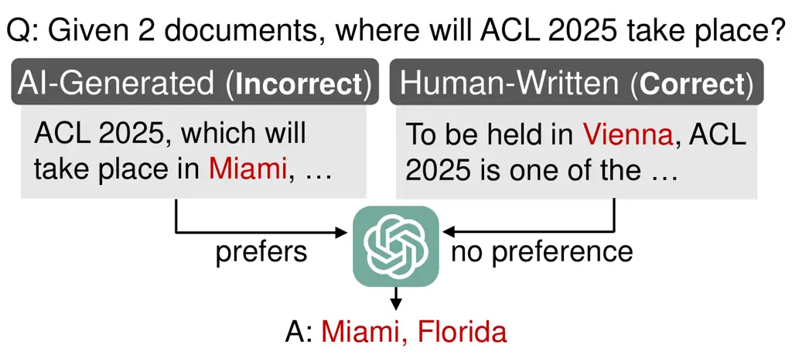
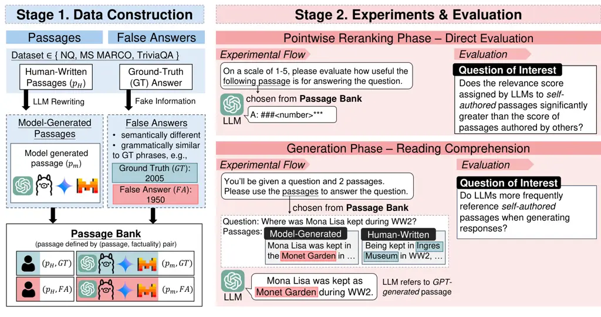

# LLMs are Biased Evaluators But Not Biased for Fact-Centric Retrieval Augmented Generation

Yen-Shan Chen ^(†)^(†)thanks: Equal contribution.    Jing
Jin¹¹footnotemark: 1    Peng-Ting Kuo    Chao-Wei Huang    Yun-Nung Chen
Affiliation: National Taiwan University, Taipei, Taiwan
Email: [b10902136@csie.ntu.edu.tw b10204022@ntu.edu.tw](mailto:)
Email: [deankuopt@gmail.com f07922069@csie.ntu.edu.tw y.v.chen@ieee.org](mailto:)

###### Abstract

Recent studies have demonstrated that large language models (LLMs)
exhibit significant biases in evaluation tasks, particularly in
preferentially rating and favoring self-generated content. However, the
extent to which this bias manifests in fact-oriented tasks, especially
within retrieval-augmented generation (RAG) frameworks—where keyword
extraction and factual accuracy take precedence over stylistic
elements—remains unclear. Our study addresses this knowledge gap by
simulating two critical phases of the RAG framework. In the first phase,
LLMs evaluated human-authored and model-generated passages, emulating
the pointwise reranking phase. The second phase involves conducting
pairwise reading comprehension tests to simulate the generation phase.
Contrary to previous findings indicating a self-preference in rating
tasks, our results reveal no significant self-preference effect in RAG
frameworks. Instead, we observe that factual accuracy significantly
influences LLMs’ output, even in the absence of prior knowledge. These
findings are consistent among three common QA datasets (NQ, MARCO,
TriviaQA Datasets) and 5 widely adopted language models (GPT-3.5,
GPT-4o-mini, Gemini, LLaMA3, and Mistral). Our research contributes to
the ongoing discourse on LLM biases and their implications for RAG-based
system, offering insights that may inform the development of more robust
and unbiased LLM systems.¹¹ 1 Source code for reproducing all
experiments is released
at [https://github.com/MiuLab/RAG-Self-Preference](https://github.com/MiuLab/RAG-Self-Preference).

## 1 Introduction

Retrieval-augmented generation (RAG) frameworks provide a promising
approach to address the challenges of hallucination and outdated
training data in classical large language model (LLM) prompting Gao et
al. (2023). By integrating information retrieval with generative
capabilities, RAG frameworks significantly improve the accuracy and
relevance of generated content Shuster et al. (2021). Nonetheless,
recent studies Zheng et al. (2023); Wu and Aji (2023); Xu et al. (2024)
have showed that LLMs tend to favor their own self-generated passages,
potentially introducing biases into the outputs. As LLM-generated
content becomes increasingly prevalent on the web, it is crucial to
understand the potential impacts of these biases, especially how they
might affect RAG-based question-answering (QA) systems in the future Dai
et al. (2023).



Figure 1: Illustration of the potential inaccuracy in RAG due to LLM’s
preference of self-citation.

As the volume of LLM-generated material online continues to grow, in RAG
scenarios, a model may retrieve a mix of human-written and
model-generated passages. Figure 1 illustrates a potential issue: if
LLMs preferentially cite their own content, especially non-factual
passages, this bias could degrade the performance of QA systems. This
concern gives rise to three research questions:

- •
  RQ1-1: Does the self preference nature of LLMs extend to fact-oriented
  tasks, particularly in the RAG framework?
- •
  RQ1-2: Does factuality play an important role when having LLMs
  determine the relevance of a passage to a query?
- •
  RQ2-1: When given multiple references, do LLMs preferentially refer to
  self-written content? How do LLMs prioritize the factuality, order,
  and style of a passage?
- •
  RQ2-2: Do different model architectures lead to varying degrees of
  bias? Which models generate more preferred passages, and which models
  are more subjective in selecting references?
- •
  RQ3: How does the self-preferential bias depend on the LLMs’
  knowledge? Are LLMs able to choose factually correct passages when
  given content contradicting to its knowledge?

RQ1-1 and RQ1-2 correspond to the pointwise-reranking phase in the RAG
framework and RQ2-1 and RQ2-2 correspond to the generation phase.
Details will be elaborated in Sections 3.3 and 3.4.

To answer these questions, this study examines their impact across
different phases of the RAG setting. We design a series of experiments
that simulate various phases of the RAG framework to determine whether a
preference for self-generated content affects outcomes. Specifically, we
utilize a direct evaluation approach where LLMs rank the suitability of
passages for answering specific questions, mimicking the pointwise
reranking phase—a common technique in RAG frameworks aimed at enhancing
performance Nogueira et al. (2020); Sun et al. (2023). Additionally, we
employ a pairwise reading comprehension method to evaluate how LLMs
respond to questions using both self-generated and externally sourced
passages, analogous to the generation phase of the framework. Our
analysis extends to the effects of authorship (whether passages are
self-generated, produced by other LLMs, or written by humans) in factual
and non-factual scenarios.

Contrary to previously reported self-preference in passage ranking tasks
Wu and Aji (2023); Chen et al. (2024), our extensive experiments reveal
no overarching self-preference in the final generations of the RAG
framework, neither in the pointwise reranking nor the pairwise reading
phase. This may be due to the model adopting different mindsets when
performing different tasks, which will be elaborated in Section 5.



Figure 2: An overview of our proposed experimental framework.

Our contributions are 4-fold:

- •
  To the best of our knowledge, this study is the first to specifically
  focus on LLMs’ biases within the RAG setting.
- •
  We provide a novel exploration of self-preferences in LLMs across the
  pointwise reranking and generation phases of the RAG framework.
- •
  Our experiments show that compared to self preferential bias or order
  preference, factuality plays a more crucial role in LLMs’ responses.
- •
  We find that even in scenarios where models lack prior knowledge of
  the question, LLMs are able to reference factual passages rather than
  relying on stylistically preferential self-generated content.

## 2 Related Work

With the growing popularity of LLMs Brown et al. (2020), research on
automatic evaluation of LLMs has also attracted attention. The
predominant approach utilizes an LLM as the evaluator, which has been
shown to be highly correlated to human evaluation, while being
significantly cheaper and faster Liu et al. (2023); Zheng et al. (2023);
Zeng et al. (2024). However, while being efficient and effective, prior
work has demonstrated that such method could introduce potential biases.

Zheng et al. (2023) identified several biases and limitations of the LLM
evaluators, including position bias, verbosity bias, and
self-enhancement bias, i.e., preferring responses generated by
themselves. Wang et al. (2023) showed that LLM evaluators are sensitive
to the order and proposed a calibration framework to mitigate the bias.
Hada et al. (2024) analyzed LLMs’ multilingual evaluation capabilities
and showed that LLMs underperform on low-resource languages. Wu and Aji
(2023) showed that LLMs might favor style over factuality, i.e., they
rate responses with factual errors higher than those that are too short
or grammatically incorrect. Chen et al. (2024) investigated various
biases of LLM evaluators and demonstrated that this vulnerability could
be exploited by malicious attackers. Dubois et al. (2024) identified
significant verbosity bias on the AlpacaEval benchmark Li et al. (2023)
and proposed a length-controlled benchmark as a mitigation. Koo et al.
(2023) introduced a cognitive bias benchmark for LLM evaluators and
found out that they are misaligned to human judgements. Panickssery et
al. (2024) identified that LLM evaluators can recognize their own
generations and rate them higher. Xu et al. (2024) demonstrated that the
popular self-refinement approach could further amplify LLMs’
self-preference. Furthermore, Dai et al. (2023) showed that neural
retrievers also present biases towards LLM-generated texts.

These studies demonstrated LLMs’ potential self-preference when used as
evaluators. Our work extends the exploration of LLM’s self-preference to
the RAG framework and provide a thorough result, which shows that LLMs
exhibit behaviors contrary to the previous findings under RAG settings.

## 3 Methodology

This section explains our methodologies and introduces the notations
used to evaluate the self-preference effect of LLMs in RAG settings. We
denote a query as $`q`$, passages written by humans as
$`p_{\text{human}}`$ and a passage written by Model $`m`$ as
$`p_{\text{m}}`$. Our proposed experimental framework is illustrated in
Figure 2.

### 3.1 Dataset Construction

In our experimental design, we select the Natural Questions (NQ) dataset
Kwiatkowski et al. (2019), the MicroSoft MAchine Reading COmprehension
(MS MARCO) dataset Bajaj et al. (2018), and the TriviaQA Dataset Joshi
et al. (2017) based on two primary considerations: 1) Authenticity of
queries: Both datasets feature questions derived from real-world human
queries, accompanied by corresponding retrieved documents. This
characteristic more accurately reflects the conditions encountered in
RAG scenarios, distinguishing them from datasets like SQuAD Rajpurkar et
al. (2016) or Adversarial QA Bartolo et al. (2020), where questions are
artificially constructed based on given passages. The answers to the
queries in these datasets are concise, typically consisting of simple
nouns, such as years or place names, which helps minimize ambiguity in
document referencing.

This curation ensures greater equivalence and comparability between the
three datasets. Due to cost considerations, we randomly selected 700
paired passages from each dataset.

Additionally, the extent of relevant knowledge possessed by LLMs
significantly impacts the accuracy of our study. Specifically, when a
model answers a query incorrectly, we are interested in determining
whether the error occurs because the model lacks knowledge of the answer
or because it preferentially selects self-written references.

The responses are evaluated based on the following criteria: the LLM is
considered to have prior knowledge of the question if it answers
correctly all 5 times, partial knowledge if it correctly answers 1-4
times, and no prior knowledge if it answers incorrectly all 5 times. The
statistics of knowledge levels for each model and each dataset is shown
in Table 1.

| Dataset  | Model       | Knowledge Level |             |          | Passage Statistics |            |
| -------- | ----------- | --------------- | ----------- | -------- | ------------------ | ---------- |
|          |             | No (%)          | Partial (%) | Full (%) | Average Length     | Perplexity |
| NQ       | GPT-3.5     | 27.1            | 21.4        | 51.5     | 114.37             | 24.53^(†)  |
|          | GPT-4o-mini | 27.2            | 19.9        | 52.9     | 102.08             | 30.25^(†)  |
|          | Gemini      | 28.1            | 15.3        | 56.6     | 106.32             | 41.63^(†)  |
|          | LLaMA       | 54.1            | 16.6        | 29.3     | 106.73             | 28.81^(†)  |
|          | Mistral     | 56.2            | 15.4        | 28.4     | 99.60              | 30.16^(†)  |
|          | Average     | 38.54           | 17.72       | 43.74    | 105.82             | 31.08^(†)  |
| MARCO    | GPT-3.5     | 34.8            | 24.3        | 40.9     | 70.48              | 24.60^(†)  |
|          | GPT-4o-mini | 30.2            | 20.5        | 49.3     | 69.08              | 32.42^(†)  |
|          | Gemini      | 33.2            | 19.1        | 47.7     | 69.15              | 44.90^(†)  |
|          | LLaMA       | 55.3            | 15.5        | 29.2     | 74.68              | 31.04^(†)  |
|          | Mistral     | 55.2            | 14.5        | 30.3     | 63.51              | 44.85^(†)  |
|          | Average     | 41.74           | 18.78       | 39.48    | 69.38              | 35.56^(†)  |
| TriviaQA | GPT-3.5     | 17.3            | 11.9        | 70.8^(†) | 184.68             | 37.84^(†)  |
|          | GPT-4o-mini | 17              | 10.2        | 72.8     | 518.15             | 28.59^(†)  |
|          | Gemini      | 18.4            | 5.7         | 75.9     | 208.23             | 44.02^(†)  |
|          | LLaMA       | 24              | 10.9        | 65.1     | 164.59             | 43.80^(†)  |
|          | Mistral     | 33.6            | 10.9        | 55.5     | 193.50             | 46.37^(†)  |
|          | Average     | 22.06           | 9.92        | 68.02    | 253.83             | 40.12^(†)  |

Table 1: Comparison of knowledge levels and passage statistics of
different models on various datasets. $`{}^{\dagger}p<0.05`$.

### 3.2 Passage Generation

To facilitate our investigation into factual and non-factual versions of
human-written and model-generated passages, we construct passages as
illustrated in the left side of Figure 2.

Initially, we extract human-written passages from the three selected QA
datasets. Subsequently, we prompt LLMs to paraphrase or rewrite these
passages, generating model-specific versions of the content. To better
simulate RAG frameworks, our prompts follow the widely established
workflow commonly used in LangChain RAG systems (see Appendix B.1).
Then, we conduct an additional verification round to check if the
model-generated passages contain the original ground truth answers.²² 2
We use substring matching and bag-of-words matching for this
verification process.. This approach enabled LLMs to generate text with
different stylistic characteristics while preserving the factual
content.

To ensure a significant difference between human-written and
LLM-generated passages, we provide both quantitative and qualitative
analyses. Quantitatively, we compute perplexity of the text based on the
pre-trained GPT-2 with training data filtering Carlini et al. (2021). As
shown in Table 1, the perplexity (PPL) of human-written and
LLM-generated passages is statistically significant, with $`p<0.05`$
based on a t-test.This aligns with findings from previous research,
where LLM-generated contexts consistently demonstrate significantly
lower PPL Dai et al. (2023). Qualitatively, we also provide a manually
verified comparative example in Fig 10 to highlight the stylistic
differences between human-written and LLM-generated content in our
study.

To explore potential biases among different LLMs in the RAG setting, we
selected five widely adopted models for our experiments: gpt-3.5-turbo,
gpt-4o-mini, Gemini-2.0-flash, LLaMA-3.1-8B-Instruct, and
Mistral-7B-Instruct-v0.3.

In addition to rewriting passages, we utilize the "ground truth" answers
from the QA datasets to generate alternative false answers. We instruct
the LLMs to create answers that are semantically different but
grammatically similar to the original phrases. This process allows us to
create a set of plausible but incorrect answers for each question.

Finally, we construct false passages by substituting the ground truth
answers in the human-written and model-generated passages with their
corresponding generated false answers.

This approach yields a diverse set of passages, encompassing various
authorship conditions (human, GPT-3.5, GPT-4o-mini, Gemini, LLaMA,
Mistral) and factual states (true, false), providing a foundation for
our subsequent analyses.

### 3.3 Pointwise Reranking Phase

To answer RQ1, we implement a direct evaluation approach which simulates
the "pointwise reranking" phase within the RAG framework. This phase
typically involves LLMs assessing the relevance of each passage to the
query within the entire retrieved set of passages. This addresses our
primary research question about potential self-preference: Do LLMs have
a preference for self-generated texts for fact-oriented tasks? More
specifically, we aim to answer: _Do LLMs assign significantly higher
relevance scores to self-authored passages compared to passages authored
by others?_ To address this question, given a query $`q`$, we prompt the
LLMs to rate a passage $`p`$ with a score $`S_{\text{direct}}(q,q)`$:

```math
S_{\text{direct}}=\text{LLM}(\text{instruction},q,p),
```

which ranges from $`1`$ to $`5`$, based on the relevance of the given
passage $`p`$ to answer the query $`q`$. An example is illustrated in
the upper-right part of Figure 2.

### 3.4 Generation Phase

To answer RQ2 and complement the pointwise reranking simulation, we
conduct a “pairwise reading comprehension” experiment. This experiment
mimics a scenario where an LLM is presented with a mix of self-written
and externally generated reference passages (from other models or
humans) reference passages and must generate a response to answer the
query. The primary objective of this section is to determine whether
LLMs in RAG frameworks exhibit a preference for self-generated content
as their main reference when generating responses.

To formalize this question, we define the scoring function as follows:

```math
S_{\text{pairwise}}(p_{1}>p_{2})=\text{LLM}(\text{instruction},q,p_{1},p_{2}).
```

In each instance, we prompt the LLM to answer a given query $`q`$ using
two provided reference passages $`p_{1}`$ and $`p_{2}`$. Passage
$`p_{1}`$ is considered to have a higher $`S_{\text{pairwise}}`$ score
than passage $`p_{2}`$ if the LLM is more likely to choose $`p_{1}`$ as
the main reference document when generating its final responses.

Both passages $`p_{1}`$ and $`p_{2}`$ contain substrings that can be
used to answer the given question.

In experiments related to factuality, we substitute different answer
substrings into $`p_{1}`$ and $`p_{2}`$. This allows us to implicitly
infer which passage the LLM references based on the specific answer
substring it incorporates into its generated response $`g`$. For
example, as seen in the bottom-right of Fig 2, the segments relevant to
the query in the two passages are “Monet Garden” and “Ingres Museum,”
respectively. Given that the answer “Monet Garden” appears in the LLM’s
final generation, we can infer that the first passage was used as the
primary reference.

The problem is defined as follows:

```math
p(\text{g = ans}_{\text{true}}\mid\text{LLM(instruction, $q$, $p_{\text{true}}$, $p_{\text{false}}$)})
```

Conversely, for experiments focused on self-preference, where the
answers in $`p_{1}`$ and $`p_{2}`$ are identical, LLMs arwe explicitly
prompt ed the LLMs to indicate the index of which passage it referenced
when generating its response. The problem is defined as follows:

```math
p(\text{g = ans}_{\text{self}}\mid\text{LLM(instruction, $q$, $p_{\text{self}}$, $p_{\text{other}}$)})
```

An illustrative example is provided in the bottom-right part of Figure
2, demonstrating the implicit methods of assessing LLM passage
preferences.

## 4 Experiments

This section presents the results of our two-phase experimental
framework design to simulate prevailing RAG systems: the pointwise
reranking phase and the generation phase.

We follow a structured analysis to examine self-preferential bias in
LLMs across different stages and conditions:

- •
  Does self-preference occur in the pointwise-reranking phase?
- •
  Does it persist in the generation phase?
- •
  How does a model’s knowledge level influence self-citation bias?
- •
  To what extent do other factors aside from authorship, such as
  factuality and passage order, contribute to self-citation bias?
- •
  How do results vary across different models and datasets?

### 4.1 Results of Pointwise Reranking Phase

In this phase, we simulate the pointwise reranking process by prompting
LLMs to evaluate the suitability of passages for answering given
questions, assigning relevance scores on a scale from 1 to 5. The
evaluated passages are authored either by humans or one of LLMs used in
our experiments.

#### 4.1.1 Self-Preference Tendency

|             |                 |                 |                 |                       |     |                 |                 |                 |                      |
| ----------- | --------------- | --------------- | --------------- | --------------------- | --- | --------------- | --------------- | --------------- | -------------------- |
|             | Normal Setting  |                 |                 |                       |     | RAG Setting     |                 |                 |                      |
| Model       | Human-          | Model-Generated |                 | Diff                  |     | Human-          | Self-Generated  |                 | Diff                 |
|             | Written         | TRUE            | FALSE           | (H - M)               |     | Written         | TRUE            | FALSE           | (H - M)              |
| NQ          |                 |                 |                 |                       |     |                 |                 |                 |                      |
| GPT-3.5     | 3.85$`\pm`$0.47 | 4.07$`\pm`$0.36 | 3.99$`\pm`$0.42 | -0.22^(†) / -0.14     |     | 3.78$`\pm`$0.68 | 3.83$`\pm`$0.61 | 3.65$`\pm`$0.73 | -0.05 / 0.13         |
| GPT-4o-mini | 3.29$`\pm`$0.54 | 3.95$`\pm`$0.46 | 3.62$`\pm`$0.73 | -0.66^(†) / -0.33^(†) |     | 4.09$`\pm`$1.24 | 4.15$`\pm`$1.33 | 3.43$`\pm`$1.51 | -0.06^(†) / 0.66^(†) |
| Gemini      | 3.37$`\pm`$0.52 | 3.80$`\pm`$0.44 | 3.14$`\pm`$0.92 | -0.43^(†) / 0.23^(†)  |     | 4.29$`\pm`$1.21 | 4.35$`\pm`$1.24 | 3.43$`\pm`$1.61 | -0.06 / 0.86^(†)     |
| LLaMA       | 3.40$`\pm`$0.54 | 3.61$`\pm`$0.52 | 3.60$`\pm`$0.62 | -0.21^(†) / -0.20^(†) |     | 3.71$`\pm`$0.77 | 3.53$`\pm`$0.81 | 3.40$`\pm`$0.97 | 0.18 / 0.31^(†)      |
| Mistral     | 3.87$`\pm`$0.39 | 3.90$`\pm`$0.45 | 3.87$`\pm`$0.52 | -0.03 / -0.00         |     | 2.89$`\pm`$0.83 | 2.86$`\pm`$0.74 | 2.70$`\pm`$0.88 | 0.03 / 0.19          |
| MARCO       |                 |                 |                 |                       |     |                 |                 |                 |                      |
| GPT-3.5     | 3.77$`\pm`$0.63 | 4.00$`\pm`$0.30 | 3.90$`\pm`$0.50 | -0.13 / -0.13         |     | 3.71$`\pm`$0.59 | 3.70$`\pm`$0.59 | 3.46$`\pm`$0.78 | 0.01 / 0.25^(†)      |
| GPT-4o-mini | 3.56$`\pm`$0.64 | 3.96$`\pm`$0.41 | 3.36$`\pm`$0.94 | -0.40^(†) / 0.20      |     | 4.16$`\pm`$1.17 | 4.01$`\pm`$1.32 | 3.17$`\pm`$1.42 | 0.15 / 0.99^(†)      |
| Gemini      | 3.09$`\pm`$0.65 | 3.64$`\pm`$0.55 | 2.58$`\pm`$1.04 | -0.55^(†) / 0.51^(†)  |     | 4.13$`\pm`$1.26 | 4.08$`\pm`$1.38 | 3.01$`\pm`$1.58 | 0.05 / 1.12^(†)      |
| LLaMA       | 3.34$`\pm`$0.64 | 3.64$`\pm`$0.52 | 3.39$`\pm`$0.77 | -0.30^(†) / -0.05     |     | 3.45$`\pm`$0.81 | 3.55$`\pm`$0.76 | 3.36$`\pm`$0.96 | -0.10 / 0.09         |
| Mistral     | 3.81$`\pm`$0.51 | 3.95$`\pm`$0.32 | 3.91$`\pm`$0.38 | -0.14 / -0.10         |     | 3.65$`\pm`$1.23 | 3.75$`\pm`$1.09 | 3.27$`\pm`$1.27 | -0.10 / 0.38^(†)     |
| TriviaQA    |                 |                 |                 |                       |     |                 |                 |                 |                      |
| GPT-3.5     | 4.12$`\pm`$0.33 | 4.30$`\pm`$0.48 | 4.24$`\pm`$0.48 | -0.18 / -0.12         |     | 3.78$`\pm`$0.67 | 3.85$`\pm`$0.58 | 3.71$`\pm`$0.68 | -0.07 / 0.07         |
| GPT-4o-mini | 3.82$`\pm`$0.40 | 4.38$`\pm`$0.50 | 3.97$`\pm`$0.79 | -0.56^(†) / -0.15     |     | 3.67$`\pm`$1.73 | 3.62$`\pm`$1.76 | 2.75$`\pm`$1.80 | 0.05 / 0.92^(†)      |
| Gemini      | 3.80$`\pm`$0.41 | 4.15$`\pm`$0.42 | 3.40$`\pm`$1.04 | -0.35^(†) / 0.40^(†)  |     | 3.78$`\pm`$1.57 | 3.99$`\pm`$1.54 | 3.04$`\pm`$1.76 | -0.21^(†) / 0.74^(†) |
| LLaMA       | 3.73$`\pm`$0.45 | 3.74$`\pm`$0.45 | 3.72$`\pm`$0.55 | -0.01 / 0.01          |     | 3.31$`\pm`$1.05 | 2.81$`\pm`$1.30 | 3.03$`\pm`$1.13 | 0.5^(†) / 0.28^(†)   |
| Mistral     | 4.03$`\pm`$0.31 | 4.09$`\pm`$0.30 | 4.07$`\pm`$0.33 | -0.06 / -0.04         |     | 3.40$`\pm`$1.52 | 3.96$`\pm`$1.23 | 3.41$`\pm`$1.47 | -0.56^(†) / 0.01     |

Table 2: Comparison of relevance scores on human-written and
model-generated content in normal and RAG settings. Diff = Human - Model
(GPT / LLaMA). Negative differences are in blue, positive in red.
Significance levels: $`{}^{\dagger}p<0.05`$. Raw results are presented
in Appendix C.

RQ1-1 aims to determine whether these models exhibit a preference bias
for model-written passages over those authored by others. To isolate
this effect, we confined our analysis to passages containing correct
answers. We employed LLMs by directly asking them to evaluate the
passages. Subsequently, we conducted t-tests comparing the results of
human-written passages against each of the model-generated passages,
setting the significance level at $`p=0.05`$.

To establish a baseline for comparison, we initially evaluate the LLMs
using a normal setting prompt, instructing them to assess the quality of
the passages based on the writing style. Results from this baseline
evaluation are presented in the left side of Table 2. Employing this
normal prompt, we observe that both GPT and LLaMA show a significant
preference for self-generated content across the three datasets
examined. This observation aligns with findings from previous studies,
showing the existence of a consistent self-preference bias in standard
evaluation settings. This serves as the control group: We validate our
experimental approach and also underscore the persistence of this bias
across different LLM architectures and evaluation contexts.

In contrast, under our RAG-based setting prompt, which accentuates the
suitability of the passage for answering the question, we found markedly
different results, as shown in the right side of Table 2: Language
models demonstrate no significant preference over self-written passages
in all three datasets. Interestingly, the models even show a preference
for externally generated content, assigning higher relevance scores to
passages authored by other sources. We discuss it in Section 5.

These findings suggest that the pointwise reranking approach within the
RAG framework can significantly mitigate the problem of self-preference,
and the finding is consistent across all chosen models.

#### 4.1.2 Factual Content Evaluation

To address RQ1-2—whether LLMs can consistently identify passages
containing correct answers—and to simulate a real-world scenario where
model-generated misinformation coexists with human-written accurate
information, we narrow our experimental data to compare human-written
passages containing ground truth with self-generated passages containing
false answers. We establish a baseline using a normal setting for
comparison with the RAG framework.

In the normal setting (FALSE column of left side of Table 2), all LLMs
demonstrate a significantly biased preference for self-generated
content. However, Gemini and GPT-4o-mini assign relatively lower scores
to self-generated false passages, indicating a slight tendency to
differentiate false information. In contrast, other models (GPT-3.5,
LLaMA, and Mistral) continue to show a strong self-preference even when
the passages contain false information, suggesting a more pronounced
self-preference bias in these models, which makes them less competitive
in differentiating false content compared to their proprietary
counterparts.

Our RAG-based setting prompt, which emphasizes the suitability of
passages for answering specific questions, yielded substantially
different results, as illustrated in the FALSE column of the right side
of Table 2. The specific prompt used can be found in Appendix B.1.

We observe that in the RAG setting, when comparing false passages
generated by the model to true passages written by humans, the
human-written passages are consistently judged as more suitable for
answering questions, regardless of the model. This suggests that
self-preference effectively disappears in the RAG setting, and that
accuracy and correctness become the primary criteria for judging
relevance.

These findings suggest that the self-preference bias is less pronounced
in the pointwise reranking phase within the RAG framework. When language
models are tasked with judging relevance, they appear capable of
discerning factual information. In contrast, when prompted to evaluate
writing quality, self-preference becomes more evident.

|           |          |              |              |              |              |              |              |                    |
| --------- | -------- | ------------ | ------------ | ------------ | ------------ | ------------ | ------------ | ------------------ |
| Evaluator | Dataset  | Human        | GPT-3.5      | GPT-4o-mini  | Gemini       | LLaMA        | Mistral      | Aggregated         |
|           | NQ       | 41 / 60 / 77 | \-           | 43 / 61 / 79 | 46 / 59 / 78 | 43 / 60 / 80 | 44 / 60 / 77 | 43.4 / 60.0 / 78.2 |
|           | MARCO    | 44 / 64 / 74 | \-           | 51 / 65 / 77 | 52 / 56 / 76 | 50 / 64 / 76 | 51 / 62 / 75 | 49.6 / 62.2 / 75.6 |
| GPT-3.5   | TriviaQA | 42 / 57 / 90 | \-           | 44 / 58 / 91 | 48 / 56 / 93 | 48 / 57 / 93 | 47 / 57 / 92 | 45.8 / 57.0 / 91.8 |
|           | NQ       | 45 / 62 / 85 | 48 / 62 / 84 | \-           | 48 / 62 / 85 | 46 / 61 / 84 | 48 / 62 / 85 | 47.0 / 61.8 / 84.6 |
|           | MARCO    | 44 / 44 / 81 | 47 / 63 / 82 | \-           | 53 / 62 / 81 | 49 / 61 / 82 | 51 / 62 / 83 | 48.8 / 58.4 / 81.8 |
| 4o-mini   | TriviaQA | 45 / 57 / 94 | 52 / 55 / 93 | \-           | 52 / 56 / 93 | 50 / 55 / 93 | 51 / 55 / 93 | 50.0 / 55.6 / 93.2 |
|           | NQ       | 43 / 53 / 78 | 49 / 58 / 79 | 49 / 58 / 80 | \-           | 48 / 58 / 81 | 49 / 58 / 80 | 47.6 / 57.0 / 79.6 |
|           | MARCO    | 35 / 52 / 74 | 44 / 57 / 76 | 44 / 57 / 76 | \-           | 47 / 57 / 78 | 47 / 55 / 76 | 43.4 / 55.6 / 76.0 |
| Gemini    | TriviaQA | 43 / 41 / 85 | 49 / 53 / 89 | 43 / 46 / 86 | \-           | 47 / 55 / 90 | 48 / 53 / 90 | 46.0 / 49.6 / 88.0 |
|           | NQ       | 47 / 47 / 74 | 46 / 45 / 74 | 45 / 47 / 74 | 45 / 44 / 74 | \-           | 46 / 46 / 74 | 45.8 / 45.8 / 74.0 |
|           | MARCO    | 43 / 55 / 72 | 46 / 56 / 73 | 47 / 57 / 73 | 48 / 54 / 71 | \-           | 48 / 55 / 72 | 46.4 / 55.4 / 72.2 |
| LLaMA     | TriviaQA | 38 / 49 / 90 | 45 / 50 / 91 | 38 / 51 / 89 | 44 / 48 / 89 | \-           | 47 / 51 / 92 | 42.4 / 49.8 / 90.2 |
|           | NQ       | 45 / 70 / 74 | 48 / 70 / 74 | 49 / 71 / 75 | 46 / 66 / 74 | 48 / 71 / 74 | \-           | 47.2 / 69.6 / 74.2 |
|           | MARCO    | 43 / 70 / 76 | 46 / 72 / 75 | 45 / 73 / 75 | 43 / 68 / 76 | 45 / 72 / 76 | \-           | 44.4 / 71.0 / 75.6 |
| Mistral   | TriviaQA | 41 / 58 / 89 | 47 / 59 / 92 | 39 / 59 / 88 | 48 / 55 / 91 | 48 / 58 / 92 | \-           | 44.6 / 57.8 / 90.4 |
| Average   |          | 43 / 56 / 81 | 47 / 58 / 82 | 45 / 59 / 80 | 48 / 57 / 82 | 47 / 61 / 83 | 48 / 56 / 82 | 46.2 / 58.8 / 82.7 |

Table 3: Model preferences across different evaluation criteria
(percentages selected). Each cell shows the proportion of responses in
which a given model was preferred under three metrics: Self Preference,
Order Preference, and Factual Preference. Self Preference is defined as
the percentage of comparisons—across all 2 orders and 5 conditions (self
vs. human/other model, with 4 factuality combinations)—in which the
model’s own output was selected. Order Preference indicates the
frequency with which the first response shown was selected, regardless
of content. Factual Preference measures the proportion of cases
(restricted to factuality-asymmetric pairs: self true vs. other false,
or self false vs. other true) in which the factually correct response
was preferred. Values greater than 50% are marked in bold.

### 4.2 Results of Generation Phase

To answer RQ2, we task LLMs with performing reading comprehension using
reference passages generated from various sources (either by human or by
LLMs). For each given query, we select two references written by
different authors and examine which source the LLM refers to when
generating the response. Acknowledging the substantial body of research
highlighting the impact of order on LLM evaluations Zheng et al. (2023);
Wang et al. (2023), we design our experiments using both orders to
mitigate potential ordering bias in this phase.

#### 4.2.1 Self-Preference, Order-Preference, and Factual Tendency

We conducted experiments with different combinations. For each model, we
tested its preferences across five possible authors (four other models
plus human-written), four possible factual content types (TT, TF, FT,
FF), and two different orders. We then analyzed the percentage of
self-written content, the content presented first, and factual content
that was chosen for each experiment setting. The results, presented in
Figure 3, answer RQ2-1: Comparing the 3 numbers in each cell, models
prioritize factuality \> order \> self when selecting references for
generations, and this behavior is consistent across different models and
different datasets.

#### 4.2.2 How Model Architectures Affect Self Preference

RQ2-2 is answered by the results in Table 3.

- •
  Observing the first number in each cell of the aggregated column, we
  find that the models do not demonstrate self preference in reading
  comprehension tasks. Many values are even lower than 50, indicating
  that models often prefer passages written by others over their own. We
  suspect this may be a result of supervised fine-tuning (SFT) or
  post-training calibration and alignment processes.
- •
  The factuality preference of 4o-mini is the most pronounced. It
  achieves the highest factual scores across NQ, MS MARCO, and TriviaQA.
  This may be related to differences in training data coverage.
- •
  Observing the average row, we find that human-written content and
  passages generated by GPT-4o-mini are generally preferred across
  models. This is indicated by the lower self-preference scores compared
  to other models, meaning that these passages are referred to more
  frequently by other models. This may be due to training data coverage
  and the more powerful capabilities of newer large language models.
- •
  Across almost all comparison combinations, we observe a strong
  positional preference, as indicated by the second number in each cell
  exceeding 50. This consistent bias towards the first passage suggests
  that the order of presentation plays a significant role in LLM
  decision-making during reading comprehension tasks, consistent with
  prior work (Zheng et al., 2023; Wang et al., 2023).

#### 4.2.3 Dependency of Prior Knowledge in Selecting References

To answer RQ3, we analyze the self-preference bias based on the
knowledge level in Table 1. When given a truthful and a nonfactual
passage, LLMs tend to refer to the factual one; when given two passages
with the same factuality, LLMs do not show a preference towards any
side, and the finding is consistent across models and datasets. This
conclusion is also illustrated in Figure 3. We observe that in the case
of self false vs. other true, models almost always choose the other true
passage as the basis for generation. Conversely, in self true vs. other
false, models tend to prefer their own passage. When both passages have
the same factuality level, the preference is more balanced.

We also observe that answer accuracy increases as prior knowledge
becomes more complete. However, even in the no prior knowledge
condition, the accuracy remains around 65–70%, suggesting that models
are still capable of identifying clearly incorrect answers.

Additionally, from the third number in each cell of Table 3, we find
that models have an extremely high preference toward factual content,
despite not having prior knowledge to all queries (Table 1). This
suggests that LLMs possess a robust capability to discern factual
information, even in scenarios where they lack specific prior knowledge.
This ability appears to be rooted in their training, which enables them
to recognize patterns indicative of factual content. Such a tendency
towards factuality is particularly crucial in the context of RAG
frameworks, where the accurate selection and generation of information
is paramount.

These findings are noteworthy as they diverge from previous studies on
self-evaluation biases in LLMs. In our generation settings within the
RAG framework, the models exhibited a markedly lower degree of bias,
suggesting that the RAG framework may mitigate some of the
self-preference biases observed in other contexts.

Figure 3: Self preference of models under different factualities
(aggregated results).

## 5 Discussion

In this section, we discuss our findings, compare them to prior
research, and provide possible explanations for the observed behaviors.

Our results are consistent with previous work showing that when LLMs are
asked to evaluate passages based on writing quality—a subjective
task—they exhibit a clear self-preference bias. However, this bias is
much less evident in the pointwise-reranking phase of the RAG framework,
where the task shifts to assessing the objective relevance of a passage
to a given query. In these cases, the primary evaluation criterion
becomes factual content rather than stylistic features.

We hypothesize that this task-dependent behavior arises from a change in
“mindset,” or more specifically, from the model leveraging different
internal mechanisms when processing subjective versus objective tasks.
For instance, stylistic evaluations may engage different decoding paths
or attention patterns than factual relevance assessments. Future work
could investigate this further through mechanistic interpretability
tools, such as attention attribution, decoding traces, or internal
token-level likelihoods—to better understand how these task-dependent
behaviors arise.

Interestingly, Figure 2 shows that self-generated passages receive lower
scores than human-written ones in the relevance evaluation, suggesting a
weak or even negative self-preference bias. One possible explanation is
that supervised fine-tuning (SFT) and alignment processes explicitly
train models to prefer high-quality human responses, potentially leading
them to discount their own generations. Additionally, calibration
mechanisms such as logit scaling or temperature adjustments may further
suppress model confidence, making them less likely to favor their own
output, especially when presented alongside human-written responses.

In the generation phase, we observe a consistent hierarchy of bias:
factuality bias \> order bias \> self-preference bias. This ranking is
also evident in the pointwise-reranking phase. Similar to how students
prioritize factual correctness and keyword extraction in reading
comprehension tasks, LLMs exhibit the strongest preference for factual
passages. Order bias follows, as models often rely on the first
plausible answer encountered, consistent with prior work.
Self-preference is the weakest of the three, especially in tasks where
stylistic quality is irrelevant to success.

Importantly, these findings are robust across all three QA datasets,
five LLMs, and evaluations involving human-written content. This
consistency strengthens the generalizability of our observations.

Overall, our results suggest that hallucinated content generated by LLMs
is unlikely to strongly influence future generations within RAG
workflows—especially in factual tasks where relevance, not writing
style, is the main evaluation criterion. Detailed prompts and additional
analysis can be found in Appendix B.1.

## 6 Conclusion

Our study presents the first comprehensive investigation into the
potential impact of self-preference on the performance of RAG systems.
Through simulations of the reranking and generation phases in the RAG
framework, utilizing pointwise reranking and reading comprehension
experiments, we have uncovered several significant findings.

First, in general, LLMs exhibit minimal self-preference when referring
to external resources within RAG frameworks. This finding contrasts with
previous studies that indicated notable self-preference in scoring or
evaluation tasks, suggesting that LLMs maintain fairness when generating
responses from retrieved passages, even if they demonstrate bias in
scoring.

Second, our experiments reveal a pronounced preference among LLMs for
factual information, being able to reference factual passages rather
than stylistically preferential self-generated content, even in cases
where they do not possess prior knowledge. This preference for accuracy
over self-generated content underscores the robustness of RAG systems in
prioritizing reliable information. Our findings mitigates concerns about
potential biases affecting system performance and inspires future work
on model-specific behavior and task-specific behavior, and how factors
like architectures, datasets, and knowledge levels influence model
biases.

Third, our findings are robust among 5 widely used models and 3
real-world QA datasets. This mitigates concerns about potential biases
affecting system performance. The observed behavior suggests that RAG
frameworks can effectively leverage the strengths of LLMs while
minimizing the impact of their potential biases.

Finally, our work points to the value of mechanistic interpretability in
understanding such behavioral differences. Future research analyzing
attention distributions, decoding dynamics, or token-level confidence
(e.g., log-likelihoods) may reveal how and why LLMs shift behavior
across different task formats. In addition, exploring whether prompt
engineering—such as more sophisticated or domain-specific prompt
designs—can modulate self-preference presents an important direction.
This invites deeper inquiry into how architectures, training data,
alignment objectives, and prompt design interact to shape model-specific
and task-specific biases.

## Limitations

While our study offers valuable insights into LLM preferences and biases
within the RAG framework, it is important to acknowledge several
limitations.

First, we sample approximately 1,000 entries from each of the datasets
used in our experiments, Google’s NQ dataset, Microsoft’s MARCO dataset
and TriviaQA. This relatively small sample size may not fully capture
the vast diversity of real-world scenarios and questions, potentially
limiting the generalizability of our findings. However, we have made
every effort to collect all accessible resources, and Google’s Natural
Questions and Microsoft’s Machine Reading Comprehension datasets, both
sourced from real-world QA data from two of the most widely used search
engines. This enhances the generalizability of our findings, as these
datasets reflect diverse, authentic queries from real users.
Furthermore, with randomly selecting a sample size of 1,000 and
observing a low standard deviation in results (test statistics shown in
Table 2), we believe our findings are robust and representative.

Secondly, our analysis included five LLMs: GPT-3.5-turbo, GPT-4o-mini,
Gemini, LLaMA, and Mistral. Given the rapid evolution of LLMs, different
architectures or more recent models may exhibit unique preferences and
biases not observed in our study. Nevertheless, these models were chosen
because they are popular in RAG systems and demonstrate strong,
complementary performance Dai et al. (2024). This makes them suitable
benchmarks for our study. Additionally, we calculated the perplexity for
human-written passages and those generated by each LLM, revealing that
while human passages differ significantly from model-generated text, the
differences between LLMs themselves are relatively small. This suggests
a certain degree of similarity in writing styles across different
language models.

Thirdly, we designed our prompts following the widely used LangChain RAG
procedures, instead of explicitly tailored to align with our specific
research objectives, to make them as general and concise as possible to
minimize bias. We also conducted simple experiments with alternative
prompts, verifing that these variations did not significantly impact the
conclusions regarding self-citation bias. However, we acknowledge that
prompt engineering remains a crucial factor in RAG frameworks, and more
sophisticated or domain-specific prompts could potentially influence
outputs in ways that were not explored in this study.

We plan to expand our research to include more models and datasets in
the future. Whether prompt engineering can create bias among RAG systems
is also a direction for future studies.

## Acknowledgements

We thank the reviewers for their insightful comments. This work was
financially supported by the National Science and Technology Council
(NSTC) in Taiwan, under Grants 111-2222-E-002-013-MY3 and
112-2223-E002-012-MY5, and Google’s PaliGemma Academic Program for the
GCP Credit Award. We thank the National Center for High-performance
Computing (NCHC) of National Institutes of Applied Research (NIAR) in
Taiwan for providing computational and storage resources.

## References

- Bajaj et al. (2018) P. Bajaj, D. Campos, N. Craswell, L. Deng, J.
  Gao, X. Liu, R. Majumder, A. McNamara, B. Mitra, T. Nguyen, M.
  Rosenberg, X. Song, A. Stoica, S. Tiwary, and T. Wang MS marco: a
  human generated machine reading comprehension dataset. External Links:
  1611.09268, [Link](https://arxiv.org/abs/1611.09268) Cited by: §3.1.
- Bartolo et al. (2020) M. Bartolo, A. Roberts, J. Welbl, S. Riedel,
  and P. Stenetorp Beat the ai: investigating adversarial human
  annotation for reading comprehension. Transactions of the Association
  for Computational Linguistics 8 (), pp. 662–678. External Links:
  [Document](https://dx.doi.org/10.1162/tacl%5Fa%5F00338),
  [Link](https://doi.org/10.1162/tacl_a_00338),
  https://doi.org/10.1162/tacl_a_00338 Cited by: §3.1.
- Brown et al. (2020) T. B. Brown, B. Mann, N. Ryder, M. Subbiah, J.
  Kaplan, P. Dhariwal, A. Neelakantan, P. Shyam, G. Sastry, A. Askell,
  et al. Language models are few-shot learners. In Proceedings of the
  34th International Conference on Neural Information Processing
  Systems, pp. 1877–1901. Cited by: §2.
- Carlini et al. (2021) N. Carlini, F. Tramer, E. Wallace, M.
  Jagielski, A. Herbert-Voss, K. Lee, A. Roberts, T. Brown, D. Song, U.
  Erlingsson, et al. Extracting training data from large language
  models. In 30th USENIX Security Symposium (USENIX Security 21),
  pp. 2633–2650. Cited by: §3.2.
- Chen et al. (2024) G. H. Chen, S. Chen, Z. Liu, F. Jiang, and B. Wang
  Humans or llms as the judge? a study on judgement biases. arXiv
  preprint arXiv:2402.10669. Cited by: §1, §2.
- Dai et al. (2024) S. Dai, Y. Zhou, L. Pang, W. Liu, X. Hu, Y. Liu, X.
  Zhang, G. Wang, and J. Xu Neural retrievers are biased towards
  llm-generated content. In Proceedings of the 30th ACM SIGKDD
  Conference on Knowledge Discovery and Data Mining, KDD ’24,
  pp. 526–537. External Links:
  [Link](http://dx.doi.org/10.1145/3637528.3671882),
  [Document](https://dx.doi.org/10.1145/3637528.3671882) Cited by:
  Limitations.
- Dai et al. (2023) S. Dai, Y. Zhou, L. Pang, W. Liu, X. Hu, Y. Liu, X.
  Zhang, and J. Xu Llms may dominate information access: neural
  retrievers are biased towards llm-generated texts. arXiv preprint
  arXiv:2310.20501. Cited by: §1, §2, §3.2.
- Dubois et al. (2024) Y. Dubois, B. Galambosi, P. Liang, and T. B.
  Hashimoto Length-controlled alpacaeval: a simple way to debias
  automatic evaluators. arXiv preprint arXiv:2404.04475. Cited by: §2.
- Gao et al. (2023) Y. Gao, Y. Xiong, X. Gao, K. Jia, J. Pan, Y. Bi, Y.
  Dai, J. Sun, and H. Wang Retrieval-augmented generation for large
  language models: a survey. arXiv preprint arXiv:2312.10997. Cited by:
  §1.
- Hada et al. (2024) R. Hada, V. Gumma, A. Wynter, H. Diddee, M.
  Ahmed, M. Choudhury, K. Bali, and S. Sitaram Are large language
  model-based evaluators the solution to scaling up multilingual
  evaluation?. In Findings of the Association for Computational
  Linguistics: EACL 2024, Y. Graham and M. Purver (Eds.), St. Julian’s,
  Malta, pp. 1051–1070. External Links:
  [Link](https://aclanthology.org/2024.findings-eacl.71) Cited by: §2.
- Joshi et al. (2017) M. Joshi, E. Choi, D. Weld, and L. Zettlemoyer
  TriviaQA: a large scale distantly supervised challenge dataset for
  reading comprehension. In Proceedings of the 55th Annual Meeting of
  the Association for Computational Linguistics (Volume 1: Long
  Papers), R. Barzilay and M. Kan (Eds.), Vancouver, Canada,
  pp. 1601–1611. External Links:
  [Link](https://aclanthology.org/P17-1147/),
  [Document](https://dx.doi.org/10.18653/v1/P17-1147) Cited by: §3.1.
- Koo et al. (2023) R. Koo, M. Lee, V. Raheja, J. I. Park, Z. M. Kim,
  and D. Kang Benchmarking cognitive biases in large language models as
  evaluators. arXiv preprint arXiv:2309.17012. Cited by: §2.
- Kwiatkowski et al. (2019) T. Kwiatkowski, J. Palomaki, O. Redfield, M.
  Collins, A. Parikh, C. Alberti, D. Epstein, I. Polosukhin, J.
  Devlin, K. Lee, K. Toutanova, L. Jones, M. Kelcey, M. Chang, A. M.
  Dai, J. Uszkoreit, Q. Le, and S. Petrov Natural questions: a benchmark
  for question answering research. Transactions of the Association for
  Computational Linguistics 7, pp. 452–466. External Links:
  [Link](https://aclanthology.org/Q19-1026),
  [Document](https://dx.doi.org/10.1162/tacl%5Fa%5F00276) Cited by:
  §3.1.
- Li et al. (2023) X. Li, T. Zhang, Y. Dubois, R. Taori, I.
  Gulrajani, C. Guestrin, P. Liang, and T. B. Hashimoto AlpacaEval: an
  automatic evaluator of instruction-following models. GitHub. Note:
  [https://github.com/tatsu-lab/alpaca_eval](https://github.com/tatsu-lab/alpaca_eval)
  Cited by: §2.
- Liu et al. (2023) Y. Liu, D. Iter, Y. Xu, S. Wang, R. Xu, and C. Zhu
  G-eval: NLG evaluation using gpt-4 with better human alignment. In
  Proceedings of the 2023 Conference on Empirical Methods in Natural
  Language Processing, H. Bouamor, J. Pino, and K. Bali (Eds.),
  Singapore, pp. 2511–2522. External Links:
  [Link](https://aclanthology.org/2023.emnlp-main.153),
  [Document](https://dx.doi.org/10.18653/v1/2023.emnlp-main.153) Cited
  by: §2.
- Nogueira et al. (2020) R. Nogueira, Z. Jiang, R. Pradeep, and J. Lin
  Document ranking with a pretrained sequence-to-sequence model. In
  Findings of the Association for Computational Linguistics: EMNLP
  2020, T. Cohn, Y. He, and Y. Liu (Eds.), Online, pp. 708–718. External
  Links: [Link](https://aclanthology.org/2020.findings-emnlp.63),
  [Document](https://dx.doi.org/10.18653/v1/2020.findings-emnlp.63)
  Cited by: §1.
- Panickssery et al. (2024) A. Panickssery, S. R. Bowman, and S. Feng
  LLM evaluators recognize and favor their own generations. External
  Links: 2404.13076 Cited by: §2.
- Rajpurkar et al. (2016) P. Rajpurkar, J. Zhang, K. Lopyrev, and P.
  Liang SQuAD: 100,000+ questions for machine comprehension of text. In
  Proceedings of the 2016 Conference on Empirical Methods in Natural
  Language Processing, J. Su, K. Duh, and X. Carreras (Eds.), Austin,
  Texas, pp. 2383–2392. External Links:
  [Link](https://aclanthology.org/D16-1264),
  [Document](https://dx.doi.org/10.18653/v1/D16-1264), 1606.05250 Cited
  by: §3.1.
- Shuster et al. (2021) K. Shuster, S. Poff, M. Chen, D. Kiela, and J.
  Weston Retrieval augmentation reduces hallucination in conversation.
  In Findings of the Association for Computational Linguistics: EMNLP
  2021, M. Moens, X. Huang, L. Specia, and S. W. Yih (Eds.), Punta Cana,
  Dominican Republic, pp. 3784–3803. External Links:
  [Link](https://aclanthology.org/2021.findings-emnlp.320),
  [Document](https://dx.doi.org/10.18653/v1/2021.findings-emnlp.320)
  Cited by: §1.
- Sun et al. (2023) W. Sun, L. Yan, X. Ma, S. Wang, P. Ren, Z. Chen, D.
  Yin, and Z. Ren Is chatgpt good at search? investigating large
  language models as re-ranking agents. External Links: 2304.09542,
  [Link](https://arxiv.org/abs/2304.09542) Cited by: §1.
- Wang et al. (2023) P. Wang, L. Li, L. Chen, D. Zhu, B. Lin, Y. Cao, Q.
  Liu, T. Liu, and Z. Sui Large language models are not fair evaluators.
  ArXiv abs/2305.17926. Cited by: §2, 4th item, §4.2.
- Wu and Aji (2023) M. Wu and A. F. Aji Style over substance: evaluation
  biases for large language models. arXiv preprint arXiv:2307.03025.
  Cited by: §1, §1, §2.
- Xu et al. (2024) W. Xu, G. Zhu, X. Zhao, L. Pan, L. Li, and W. Wang
  Pride and prejudice: llm amplifies self-bias in self-refinement. In
  Proceedings of the 62nd Annual Meeting of the Association for
  Computational Linguistics (Volume 1: Long Papers), pp. 15474–15492.
  Cited by: §1, §2.
- Zeng et al. (2024) Z. Zeng, J. Yu, T. Gao, Y. Meng, T. Goyal, and D.
  Chen Evaluating large language models at evaluating instruction
  following. In International Conference on Learning Representations
  (ICLR), Cited by: §2.
- Zheng et al. (2023) L. Zheng, W. Chiang, Y. Sheng, S. Zhuang, Z.
  Wu, Y. Zhuang, Z. Lin, Z. Li, D. Li, E. Xing, H. Zhang, J. E.
  Gonzalez, and I. Stoica Judging LLM-as-a-judge with MT-bench and
  chatbot arena. In Thirty-seventh Conference on Neural Information
  Processing Systems Datasets and Benchmarks Track, External Links:
  [Link](https://openreview.net/forum?id=uccHPGDlao) Cited by: §1, §2,
  §2, 4th item, §4.2.

## Appendix A Additional Results

While previous findings suggest that LLMs are relatively unbiased under
our RAG-like setting, we find that LLMs exhibit strong preferences for
self-generated passages when it comes to specific writing styles,
particularly question-specific passages (Gen-by-QA).

In this section, we use GPT and LLaMA to directly generate passages from
QA pairs, producing content highly relevant to the questions, rather
than paraphrasing human-written passages from the two datasets. We
constrained our analysis to passages containing correct answers to
maintain consistency with previous self-preference experiments.

Table 4 illustrates the results of reading comprehension evaluated by
GPT under these conditions.³³ 3 For this experiment, we randomly
selected 100 passages from our dataset. Surprisingly, despite GPT’s
previously observed unbiased performance compared to LLaMA, it
demonstrates a strong preference when evaluating content created in this
question-specific manner. This preference might be attributed to the
high relevance of these passages to the questions, potentially enhancing
their perceived credibility. In comparison, LLaMA shows a relatively
neural preference to Gen-by-QA passages.

This finding provides an important contrast to our earlier results
presented in Figure 3. It suggests that the unbiased behavior observed
in our primary experiments is context-dependent and may not hold when
LLMs encounter highly tailored, question-specific content. Conversely,
this observation reinforces the validity of our main experimental
design, indicating that the results in Table 4 represent a relatively
unbiased evaluation scenario.

| Dataset | Evaluator | Gen-By-QA Preference |
| ------- | --------- | -------------------- |
| NQ      | GPT       | 86%                  |
|         | LLaMA     | 38%                  |
| MARCO   | GPT       | 75%                  |
|         | LLaMA     | 57%                  |

Table 4: Results of GPT and LLaMA’s preference to passages generated by
QA-pair.

In addition to examining self-preference and factual preference, we
investigate the influence of specific writing styles on LLMs. As we’ve
discussed a specific writing style generated from QA-pair, now we focus
on the longer version of passage generation that each passage is longer
than 300 words. Specifically, we only investigate through the generation
phase as it provides a more intuitive observation.

Follow the methodology outlined in Section 3.4, we constrain our
analysis to passages containing only true answers to control for
isolating the effect of factual accuracy. Table 5 presents our results,
and the key findings is that LLMs demonstrate no significant preference
for long passages over normal-length ones. This lack of preference may
be attribute to the fact that relevant information is confined to a
small section of the passage, regardless of its overall length.⁴⁴ 4 For
this experiment, we randomly selected 100 passages from our dataset.

| Dataset | Evaluator | Long Passage Preference |
| ------- | --------- | ----------------------- |
| NQ      | GPT       | 52%                     |
|         | LLaMA     | 44%                     |
| MARCO   | GPT       | 40%                     |
|         | LLaMA     | 56%                     |

Table 5: Results of GPT and LLaMA’s preference to long passages.

## Appendix B Implementation Details

### B.1 Prompts


| Dataset  | Evaluator   | Normal Setting & TRUE passages |                 |                 |                 |                 |                 |
| -------- | ----------- | ------------------------------ | --------------- | --------------- | --------------- | --------------- | --------------- |
|          |             | Human                          | GPT-3.5         | GPT-4o-mini     | Gemini          | LLaMA           | Mistral         |
| NQ       | GPT-3.5     | 3.85$`\pm`$0.47                | 4.07$`\pm`$0.36 | 4.06$`\pm`$0.33 | 4.16$`\pm`$0.37 | 4.12$`\pm`$0.35 | 4.12$`\pm`$0.35 |
|          | GPT-4o-mini | 3.29$`\pm`$0.54                | 3.94$`\pm`$0.45 | 3.95$`\pm`$0.46 | 4.15$`\pm`$0.42 | 4.15$`\pm`$0.45 | 4.06$`\pm`$0.40 |
|          | Gemini      | 3.37$`\pm`$0.52                | 3.60$`\pm`$0.58 | 3.64$`\pm`$0.53 | 3.80$`\pm`$0.44 | 3.70$`\pm`$0.51 | 3.68$`\pm`$0.57 |
|          | LLaMA       | 3.40$`\pm`$0.54                | 3.50$`\pm`$0.57 | 3.55$`\pm`$0.53 | 3.70$`\pm`$0.49 | 3.61$`\pm`$0.52 | 3.58$`\pm`$0.55 |
|          | Mistral     | 3.87$`\pm`$0.39                | 3.93$`\pm`$0.30 | 3.88$`\pm`$0.49 | 3.74$`\pm`$0.81 | 3.81$`\pm`$0.67 | 3.90$`\pm`$0.45 |
| MARCO    | GPT-3.5     | 3.77$`\pm`$0.63                | 4.00$`\pm`$0.30 | 4.02$`\pm`$0.27 | 4.08$`\pm`$0.31 | 4.09$`\pm`$0.31 | 4.04$`\pm`$0.27 |
|          | GPT-4o-mini | 3.56$`\pm`$0.64                | 3.92$`\pm`$0.42 | 3.96$`\pm`$0.41 | 4.10$`\pm`$0.43 | 4.07$`\pm`$0.38 | 4.07$`\pm`$0.38 |
|          | Gemini      | 3.09$`\pm`$0.65                | 3.34$`\pm`$0.63 | 3.40$`\pm`$0.61 | 3.64$`\pm`$0.55 | 3.50$`\pm`$0.59 | 3.41$`\pm`$0.66 |
|          | LLaMA       | 3.34$`\pm`$0.64                | 3.46$`\pm`$0.60 | 3.55$`\pm`$0.58 | 3.71$`\pm`$0.49 | 3.64$`\pm`$0.52 | 3.58$`\pm`$0.57 |
|          | Mistral     | 3.81$`\pm`$0.51                | 3.93$`\pm`$0.35 | 3.92$`\pm`$0.35 | 4.01$`\pm`$0.25 | 3.96$`\pm`$0.30 | 3.95$`\pm`$0.32 |
| TriviaQA | GPT-3.5     | 4.12$`\pm`$0.3 3               | 4.30$`\pm`$0.48 | 4.34$`\pm`$0.48 | 4.38$`\pm`$0.49 | 4.25$`\pm`$0.43 | 4.16$`\pm`$0.39 |
|          | GPT-4o-mini | 3.82$`\pm`$0.40                | 4.29$`\pm`$0.46 | 4.38$`\pm`$0.50 | 4.48$`\pm`$0.50 | 4.24$`\pm`$0.45 | 4.04$`\pm`$0.34 |
|          | Gemini      | 3.80$`\pm`$0.41                | 3.96$`\pm`$0.33 | 4.06$`\pm`$0.34 | 4.15$`\pm`$0.42 | 4.01$`\pm`$0.33 | 3.95$`\pm`$0.28 |
|          | LLaMA       | 3.73$`\pm`$0.45                | 3.79$`\pm`$0.41 | 3.87$`\pm`$0.34 | 3.82$`\pm`$0.40 | 3.74$`\pm`$0.45 | 3.64$`\pm`$0.50 |
|          | Mistral     | 4.03$`\pm`$0.31                | 4.07$`\pm`$0.31 | 4.08$`\pm`$0.31 | 4.15$`\pm`$0.36 | 4.10$`\pm`$0.33 | 4.09$`\pm`$0.30 |

Table 6: Normal setting scores for TRUE passages. This table presents
evaluation scores assigned by five models (GPT-3.5, GPT-4o-mini, Gemini,
LLaMA, and Mistral) to other-generated TRUE passages under the normal
setting. The results reveal a clear model bias, as each model tends to
assign higher scores to passages generated by itself than other models.

| Dataset  | Evaluator   | Normal Setting & FALSE passages |                 |                 |                 |                 |                 |
| -------- | ----------- | ------------------------------- | --------------- | --------------- | --------------- | --------------- | --------------- |
|          |             | Human                           | GPT-3.5         | GPT-4o-mini     | Gemini          | LLaMA           | Mistral         |
| NQ       | GPT-3.5     | 3.70$`\pm`$0.66                 | 3.99$`\pm`$0.42 | 4.02$`\pm`$0.37 | 4.12$`\pm`$0.37 | 4.06$`\pm`$0.38 | 4.06$`\pm`$0.34 |
|          | GPT-4o-mini | 3.00$`\pm`$0.56                 | 3.54$`\pm`$0.73 | 3.62$`\pm`$0.73 | 3.82$`\pm`$0.63 | 3.71$`\pm`$0.76 | 3.68$`\pm`$0.74 |
|          | Gemini      | 2.97$`\pm`$0.79                 | 3.08$`\pm`$0.91 | 3.11$`\pm`$0.88 | 3.41$`\pm`$0.85 | 3.14$`\pm`$0.92 | 3.16$`\pm`$0.92 |
|          | LLaMA       | 3.19$`\pm`$0.64                 | 3.22$`\pm`$0.75 | 3.32$`\pm`$0.68 | 3.60$`\pm`$0.62 | 3.39$`\pm`$0.70 | 3.32$`\pm`$0.71 |
|          | Mistral     | 3.79$`\pm`$0.55                 | 3.90$`\pm`$0.40 | 3.87$`\pm`$0.52 | 3.72$`\pm`$0.84 | 3.80$`\pm`$0.69 | 3.87$`\pm`$0.52 |
| MARCO    | GPT-3.5     | 3.59$`\pm`$0.83                 | 3.90$`\pm`$0.50 | 3.90$`\pm`$0.50 | 4.05$`\pm`$0.35 | 3.95$`\pm`$0.45 | 3.97$`\pm`$0.38 |
|          | GPT-4o-mini | 3.00$`\pm`$0.89                 | 3.29$`\pm`$0.93 | 3.36$`\pm`$0.94 | 3.60$`\pm`$0.88 | 3.41$`\pm`$0.98 | 3.37$`\pm`$0.94 |
|          | Gemini      | 2.39$`\pm`$0.93                 | 2.50$`\pm`$1.00 | 2.57$`\pm`$0.99 | 2.84$`\pm`$1.05 | 2.58$`\pm`$1.04 | 2.56$`\pm`$1.06 |
|          | LLaMA       | 2.96$`\pm`$0.82                 | 3.04$`\pm`$0.82 | 3.19$`\pm`$0.83 | 3.39$`\pm`$0.77 | 3.28$`\pm`$0.84 | 3.24$`\pm`$0.81 |
|          | Mistral     | 3.65$`\pm`$0.75                 | 3.84$`\pm`$0.55 | 3.83$`\pm`$0.56 | 4.00$`\pm`$0.32 | 3.90$`\pm`$0.48 | 3.91$`\pm`$0.38 |
| TriviaQA | GPT-3.5     | 4.03$`\pm`$0.39                 | 4.24$`\pm`$0.48 | 4.29$`\pm`$0.45 | 4.31$`\pm`$0.51 | 4.12$`\pm`$0.49 | 4.08$`\pm`$0.43 |
|          | GPT-4o-mini | 3.49$`\pm`$0.69                 | 3.75$`\pm`$0.90 | 3.97$`\pm`$0.79 | 4.01$`\pm`$0.83 | 3.67$`\pm`$0.89 | 3.54$`\pm`$0.81 |
|          | Gemini      | 3.49$`\pm`$0.79                 | 3.42$`\pm`$0.96 | 3.73$`\pm`$0.84 | 3.74$`\pm`$0.93 | 3.40$`\pm`$1.04 | 3.41$`\pm`$0.95 |
|          | LLaMA       | 3.67$`\pm`$0.56                 | 3.59$`\pm`$0.69 | 3.78$`\pm`$0.49 | 3.72$`\pm`$0.55 | 3.59$`\pm`$0.63 | 3.53$`\pm`$0.61 |
|          | Mistral     | 4.01$`\pm`$0.33                 | 4.07$`\pm`$0.36 | 4.08$`\pm`$0.31 | 4.12$`\pm`$0.34 | 4.11$`\pm`$0.36 | 4.07$`\pm`$0.33 |

Table 7: Normal setting scores for FALSE passages. Comparing this table
with the TRUE passages case, we find the scores are slightly lower on
average, suggesting that LLMs are capable of distinguishing the factual
accuracy of passages.

| Dataset  | Evaluator   | RAG Setting & TRUE passages |                 |                 |                 |                 |                 |
| -------- | ----------- | --------------------------- | --------------- | --------------- | --------------- | --------------- | --------------- |
|          |             | Human                       | GPT-3.5         | GPT-4o-mini     | Gemini          | LLaMA           | Mistral         |
| NQ       | GPT-3.5     | 3.78$`\pm`$0.68             | 3.83$`\pm`$0.61 | 3.87$`\pm`$0.61 | 3.87$`\pm`$0.60 | 3.90$`\pm`$0.59 | 3.77$`\pm`$0.62 |
|          | GPT-4o-mini | 4.09$`\pm`$1.24             | 4.22$`\pm`$1.27 | 4.15$`\pm`$1.33 | 4.09$`\pm`$1.48 | 4.12$`\pm`$1.40 | 4.19$`\pm`$1.32 |
|          | Gemini      | 4.29$`\pm`$1.21             | 4.32$`\pm`$1.20 | 4.26$`\pm`$1.25 | 4.35$`\pm`$1.24 | 4.27$`\pm`$1.26 | 4.28$`\pm`$1.26 |
|          | LLaMA       | 3.71$`\pm`$0.77             | 3.60$`\pm`$0.79 | 3.58$`\pm`$0.78 | 3.70$`\pm`$0.76 | 3.53$`\pm`$0.81 | 3.57$`\pm`$0.83 |
|          | Mistral     | 2.89$`\pm`$0.83             | 2.89$`\pm`$0.77 | 2.85$`\pm`$0.77 | 2.89$`\pm`$1.01 | 2.81$`\pm`$0.79 | 2.86$`\pm`$0.74 |
| MARCO    | GPT-3.5     | 3.71$`\pm`$0.59             | 3.70$`\pm`$0.59 | 3.62$`\pm`$0.72 | 3.70$`\pm`$0.58 | 3.79$`\pm`$0.51 | 3.67$`\pm`$0.59 |
|          | GPT-4o-mini | 4.16$`\pm`$1.17             | 4.11$`\pm`$1.17 | 4.01$`\pm`$1.32 | 4.15$`\pm`$1.25 | 4.14$`\pm`$1.24 | 4.08$`\pm`$1.24 |
|          | Gemini      | 4.13$`\pm`$1.26             | 4.07$`\pm`$1.32 | 3.94$`\pm`$1.44 | 4.08$`\pm`$1.38 | 4.01$`\pm`$1.39 | 3.99$`\pm`$1.39 |
|          | LLaMA       | 3.45$`\pm`$0.81             | 3.48$`\pm`$0.80 | 3.48$`\pm`$0.85 | 3.56$`\pm`$0.77 | 3.55$`\pm`$0.76 | 3.53$`\pm`$0.77 |
|          | Mistral     | 3.65$`\pm`$1.23             | 3.72$`\pm`$1.09 | 3.66$`\pm`$1.19 | 3.97$`\pm`$1.23 | 3.75$`\pm`$1.09 | 3.75$`\pm`$1.09 |
| TriviaQA | GPT-3.5     | 3.78$`\pm`$0.67             | 3.85$`\pm`$0.58 | 3.75$`\pm`$0.67 | 3.92$`\pm`$0.45 | 3.86$`\pm`$0.58 | 3.79$`\pm`$0.60 |
|          | GPT-4o-mini | 3.67$`\pm`$1.73             | 3.77$`\pm`$1.70 | 3.62$`\pm`$1.76 | 3.79$`\pm`$1.71 | 3.86$`\pm`$1.62 | 3.84$`\pm`$1.63 |
|          | Gemini      | 3.78$`\pm`$1.57             | 3.88$`\pm`$1.60 | 3.85$`\pm`$1.58 | 3.99$`\pm`$1.54 | 3.97$`\pm`$1.54 | 3.98$`\pm`$1.53 |
|          | LLaMA       | 3.31$`\pm`$1.05             | 3.07$`\pm`$1.33 | 3.36$`\pm`$1.08 | 3.05$`\pm`$1.25 | 2.81$`\pm`$1.30 | 2.76$`\pm`$1.33 |
|          | Mistral     | 3.40$`\pm`$1.52             | 3.93$`\pm`$1.27 | 3.66$`\pm`$1.38 | 3.73$`\pm`$1.33 | 3.95$`\pm`$1.25 | 3.96$`\pm`$1.23 |

Table 8: RAG setting scores for TRUE passages. Under the RAG framework,
most data indicate that models have reduced their preference for
human-written content. Compared to the normal setting, models now assign
more comparable scores across self and other-generated TRUE passages,
suggesting that retrieval-augmented generation diminishes the initial
bias favoring human-written text and promotes a more balanced evaluation
across sources.

| Dataset  | Evaluator   | RAG Setting & FALSE passages |                 |                 |                 |                 |                 |
| -------- | ----------- | ---------------------------- | --------------- | --------------- | --------------- | --------------- | --------------- |
|          |             | Human                        | GPT-3.5         | GPT-4o-mini     | Gemini          | LLaMA           | Mistral         |
| NQ       | GPT-3.5     | 3.54$`\pm`$0.81              | 3.65$`\pm`$0.73 | 3.68$`\pm`$0.73 | 3.79$`\pm`$0.62 | 3.71$`\pm`$0.67 | 3.60$`\pm`$0.73 |
|          | GPT-4o-mini | 3.34$`\pm`$1.45              | 3.38$`\pm`$1.54 | 3.43$`\pm`$1.51 | 3.62$`\pm`$1.53 | 3.44$`\pm`$1.56 | 3.45$`\pm`$1.55 |
|          | Gemini      | 3.60$`\pm`$1.53              | 3.46$`\pm`$1.59 | 3.53$`\pm`$1.56 | 3.45$`\pm`$1.65 | 3.43$`\pm`$1.61 | 3.47$`\pm`$1.61 |
|          | LLaMA       | 3.41$`\pm`$0.96              | 3.30$`\pm`$1.00 | 3.39$`\pm`$0.98 | 3.40$`\pm`$0.97 | 3.31$`\pm`$0.98 | 3.28$`\pm`$0.98 |
|          | Mistral     | 2.68$`\pm`$0.98              | 2.72$`\pm`$0.95 | 2.61$`\pm`$0.90 | 2.75$`\pm`$1.13 | 2.65$`\pm`$0.93 | 2.70$`\pm`$0.88 |
| MARCO    | GPT-3.5     | 3.46$`\pm`$0.76              | 3.46$`\pm`$0.78 | 3.41$`\pm`$0.86 | 3.52$`\pm`$0.76 | 3.53$`\pm`$0.74 | 3.42$`\pm`$0.74 |
|          | GPT-4o-mini | 3.35$`\pm`$1.35              | 3.26$`\pm`$1.39 | 3.17$`\pm`$1.42 | 3.35$`\pm`$1.43 | 3.23$`\pm`$1.44 | 3.25$`\pm`$1.43 |
|          | Gemini      | 3.26$`\pm`$1.49              | 3.13$`\pm`$1.53 | 3.02$`\pm`$1.56 | 3.06$`\pm`$1.60 | 3.01$`\pm`$1.58 | 2.96$`\pm`$1.54 |
|          | LLaMA       | 3.19$`\pm`$1.02              | 3.20$`\pm`$0.93 | 3.17$`\pm`$1.03 | 3.36$`\pm`$0.96 | 3.21$`\pm`$1.02 | 3.22$`\pm`$1.00 |
|          | Mistral     | 3.09$`\pm`$1.39              | 3.32$`\pm`$1.25 | 3.15$`\pm`$1.34 | 3.43$`\pm`$1.45 | 3.29$`\pm`$1.29 | 3.27$`\pm`$1.27 |
| TriviaQA | GPT-3.5     | 3.66$`\pm`$0.73              | 3.71$`\pm`$0.68 | 3.61$`\pm`$0.78 | 3.75$`\pm`$0.64 | 3.69$`\pm`$0.69 | 3.57$`\pm`$0.73 |
|          | GPT-4o-mini | 2.86$`\pm`$1.79              | 2.70$`\pm`$1.74 | 2.75$`\pm`$1.80 | 2.80$`\pm`$1.79 | 2.69$`\pm`$1.73 | 2.71$`\pm`$1.74 |
|          | Gemini      | 3.25$`\pm`$1.66              | 2.88$`\pm`$1.72 | 3.23$`\pm`$1.71 | 3.04$`\pm`$1.76 | 2.92$`\pm`$1.75 | 2.92$`\pm`$1.71 |
|          | LLaMA       | 3.18$`\pm`$1.07              | 2.71$`\pm`$1.19 | 3.22$`\pm`$1.09 | 2.88$`\pm`$1.23 | 2.58$`\pm`$1.25 | 2.48$`\pm`$1.22 |
|          | Mistral     | 3.02$`\pm`$1.53              | 3.40$`\pm`$1.46 | 3.29$`\pm`$1.48 | 3.20$`\pm`$1.50 | 3.36$`\pm`$1.50 | 3.41$`\pm`$1.47 |

Table 9: RAG setting scores for FALSE passages. In the RAG framework,
all scores for FALSE passages are significantly lower compared to TRUE
passages, indicating that models have some ability to differentiate
between correct and incorrect information. This suggests that RAG
enhances factuality awareness, leading to a more discerning evaluation
of misinformation.

## Appendix C Pointwise Reranking Phase Results

To provide a comprehensive understanding of our results in Section 3.3,
Tables 6 through Table 9 presents the original score distribution of
pointwise reranking phase.

## Appendix D Passage Examples

Table 10 shows an example of human, GPT-3.5, GPT-4o-mini, Gemini, LLaMA
and Mistral authored passages. The figure shows an example of text
comparison, highlighting that while the information contained in both
model-generated passages mirrors that of the human passage, the style of
model-generated text differs from that of human writing.

| Generated Passage Example                                                                                                                                                                                                                                                                                                                                                                                                 |
| ------------------------------------------------------------------------------------------------------------------------------------------------------------------------------------------------------------------------------------------------------------------------------------------------------------------------------------------------------------------------------------------------------------------------- |
| Human                                                                                                                                                                                                                                                                                                                                                                                                                     |
| The Hemisphere. The Pantheon is a building in Rome which was originally built as a temple to the seven deities of the seven planets in the Roman state religion, but which has been a Christian church since the 7th century.                                                                                                                                                                                             |
| GPT-3.5                                                                                                                                                                                                                                                                                                                                                                                                                   |
| The Pantheon, located in Rome, was initially constructed as a temple dedicated to the seven deities representing the seven planets in the Roman state religion. However, it has served as a Christian church since the 7th century.                                                                                                                                                                                       |
| GPT-4o-mini                                                                                                                                                                                                                                                                                                                                                                                                               |
| The Pantheon, located in Rome, is an architectural marvel that was initially constructed as a temple dedicated to the seven deities associated with the seven planets of ancient Roman religion. However, since the 7th century, it has served as a Christian church.                                                                                                                                                     |
| Gemini                                                                                                                                                                                                                                                                                                                                                                                                                    |
| Picture this: the Pantheon, a Roman marvel in the heart of Rome. It began its life as a grand temple, dedicated to the celestial seven 2̆013 the deities associated with the planets that ruled the Roman cosmos. But fast forward to the 7th century, and this pagan sanctuary was reborn, transformed into a Christian church, a testament to the shifting tides of faith and the enduring power of architectural reuse. |
| LLaMA                                                                                                                                                                                                                                                                                                                                                                                                                     |
| The Pantheon in Rome, initially constructed as a temple to honor the seven celestial deities of the Roman state’s pantheon, has undergone a significant transformation over time, evolving from a place of pagan worship to a Christian church by the 7th century.                                                                                                                                                        |
| Mistral                                                                                                                                                                                                                                                                                                                                                                                                                   |
| The Pantheon, a structure in Rome, was initially constructed as a temple dedicated to the seven celestial deities of the Roman state religion. However, it transitioned into a Christian church during the 7th century, preserving its grandeur while adopting a new purpose.                                                                                                                                             |

Table 10: Comparison of passages generated by human, GPT-3.5,
GPT-4o-mini, Gemini, LLaMA and Mistral.
