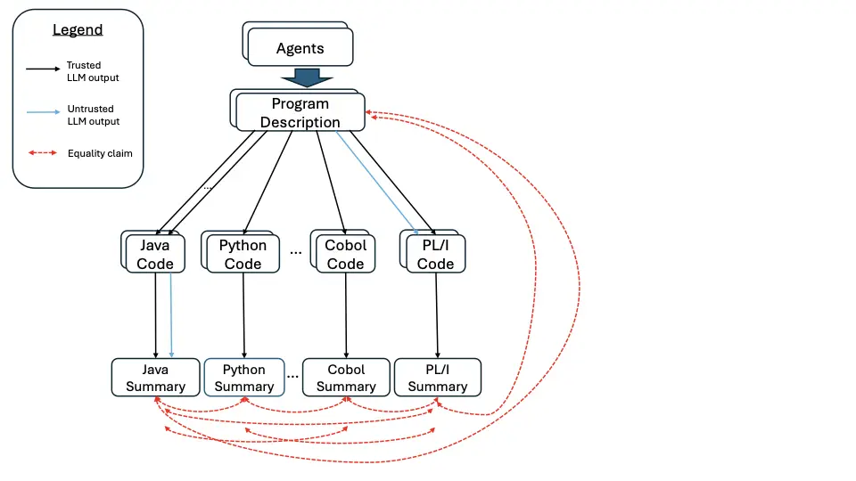

# Automatic Generation of Benchmarks and Reliable LLM Judgment for Code Tasks

Eitan Farchi Affiliation: farchi@il.ibm.com    Shmulik Froimovich
Affiliation: shmulik.froimovich@ibm.com    Rami Katan Affiliation:
rami.katan@il.ibm.com    Orna Raz Affiliation: ornar@il.ibm.com

###### Abstract

LLMs can be used in a variety of code related tasks such as translating
from one programming language to another, implementing natural language
requirements and code summarization. Artifacts generated by state of the
art LLM technology are expected to be useful in the sense that a user
will be able to use the LLM generated artifact after a small number of
easy modifications. Quantifying this vague notion is challenging and it
is thus hard to determine the quality of code related LLM solutions. We
refer to evaluation of LLM solutions using LLM judgment as ”LLM as a
Judge”, or LaaJ for short. In this work we introduce a methodology to
generate and evaluate LaaJ implementations, utilizing an automatically
generated benchmark. The purpose of the benchmark is two fold, namely,
it is used both to develop and validate the LaaJs and to validate and
test the LLM code related solution using the LaaJs. To that end, we
developed an automated benchmark generation engine, which generates code
in multiple programming languages for multiple code related tasks and
which serves as the input for LaaJ evaluation. We utilize a graph
representation, G, of the potential code related generations. The graph
vertices are generated artifacts and edges represent possible
generations, e.g., the generation of a Java program from its natural
language requirements. Utilizing a chain of LLM agents and G we generate
code related artifacts. Using cycles in G we formulate expectations on
the generated artifacts. Taking advantage of these formulated
expectations enables the development and testing of reliable LLM
judgement for usefulness of the artifacts generated by the solution. Our
approach enables the creation of high quality code task solutions.

## 1 Introduction

The goal of our work is to reliably validate the quality of code related
tasks. A solution that embeds the generation of code related tasks is
required to produce artifacts, e.g., translate code from one programming
language to another, that are useful. Useful here is a vague solution
requirement that can be quantified as follows - ”the user of the
solution will use the generated artifact in her programming, possibly
after a small number of minor corrections”. While such a requirement may
be checked by monitoring a deployed solution, that may be too late in
the development cycle of the solution. Instead, it is desired to test
the quality of generated artifacts early in the process of the solution
development. Furthermore, any changes or updates made to the solution,
especially to its LLM components, require reevaluating the quality of
the solution. It might be the case that such changes would result in
user noticeable degradation of usefulness.

Reliable early testing of quality requires data that represents the
distribution of the users’ expected inputs to the deployed solution. For
example, a code assistant system may be used for a variety of
programming languages and a variety of programming related tasks. In
order to test the solution early in the development process a sample of
representative programs are needed for the different programming
languages, e.g., C++, Python, Java and COBOL, and code related tasks,
e.g., translation, generation, completion, test generation and
summarization. While gathering these samples is often straightforward,
it is challenging to reliably provide expected results. Usually, human
judgement is needed to inspect the solution generated artifacts and
determine their usefulness. This approach is labor intensive and proxies
to the human judgment are desirable.

It is thus required to be able to generate data that represents a golden
reference, i.e., a useful desired artifact. For example, we would like
to generate a COBOL program and its ideal summary from the program
specification. In addition, we would like to develop proxies for human
judgment with measuring capabilities that can inspect an artifact
generated by the solution, e.g., a generated summary of the COBOL
program, and determine its usefulness. To that end we use chain of LLMs
both for the generation and judgement, which approximates human
judgement of whether or not a generated artifact is useful.

The main contributions of our work are:

- •
  Defining the functional requirements of the solution. Specifically,
  defining how to measure usefulness thus defining what usefulness is in
  a particular solution implementation.
- •
  Developing a technique for creating a judge metric as well as labeled
  data to develop and assess the quality of that judge. The data may be
  used to assess any potential metric, including existing metrics and
  non-LLM-based metrics.
- •
  Developing regression benchmarks that are simple in that are easy to
  understand and debug, yet identify major degradation in usefulness.

### 1.1 Evaluation metrics for code LLM tasks

There exist many metrics for evaluating the quality of code LLM tasks.
Ideally, generated code evaluation could rely on _functional
correctness_—evaluated by executing code against robust tests
\[CTJ+21\]—but, this is feasible only for simple tasks. However,
executing generated functions is often impractical due to incomplete or
unavailable codebases and the difficulty of creating comprehensive test
cases. Therefore, the majority of the metrics are reference-based and
require ground truth to which they compare the generated output.
Examples of reference-based metrics include BLEU \[PRWZ02\], ROUGE-L
\[Lin04\], and chrF++ \[Pop17\] that treat code as text, focusing on
n-gram statistics; CodeBLEU \[RGL+20\] that incorporates code structure;
and CodeBERTScore \[ZAAN23\] that leverages semantic information in the
embedding space. These metrics are faced with a double challenge: it is
difficult to provide ground truth at scale, and even if a reliable
ground truth solution exists, it is difficult to compare whether a given
generation is semantically equivalent to that ground truth. There exist
reference-less metrics for evaluating the quality of code LLM tasks. The
most notable one is LaaJ. An example is ICE-Score \[Zhu24\]. However, it
is necessary to assess how well the LaaJ is able to mimic the human
judgment, e.g., of usefulness. To do that, it is necessary to have data
with human judgment.

There exist many benchmarks for evaluating the quality of code LLM
tasks. Examples include HumanEval\[CTJ+21\], CrossCodeEval\[DWA+23\],
SWE-bench\[JYW+24\]. However, these benchmarks are static, including
their ground truth field. This means that if one wishes to get new data,
similar to an existing benchmark, that data needs to undergo a labor
intensive process of curation.

Our approach enables generating data at scale, along with labels of
expected results.

### 1.2 The essence of our approach

A key element of our approach is a self consistency capability that
provides reliable labels of expected results. Having expected results
enables automated large scale validation of the proxies that we develop
for usefulness of the generated artifacts. Specifically, we observe that
in the domain of code generation a chain of generated artifacts may
”loop on itself”, i.e., the last generated artifact may be required to
be the same as the first element in the chain. For example, one may
start from a description of a program, generate Java code that
implements the program and finally generate a summary that explains what
the program is doing. The summary should be specifying the same program
that was stated in the initial description. The coding task domain has
an implicit directed graph of possible generations, e.g.,
$`(description,COBOL),(Java,Python)`$, etc. In fact, we are not limited
to the above example and can extract different usefulness claims from
different loops in the directed graph. For example, We can have the
following generation $`(Java,summary,COBOL,Java)`$ and associate it with
the claim that the first and last Java programs should be semantically
the same.

Figure 1 depicts our approach for creating a benchmark and a proxy for
usefulness of code related tasks. A chain of agents is used to obtain a
set of program descriptions. The chain includes generating a list of
program categories, then a list of program ideas and detailed
descriptions for each of the categories. Each agent in the chain can be
enhanced by a human in the loop. From the program descriptions an LLM
generates: (1) programs for different programming languages that
implement each of the descriptions and (2) a natural language summary
for each of the programs created in (1).



Figure 1: A flow of the self consistency benchmark generation for code
generation.

We introduce the notion of an LLM generation that can be trusted —
depicted by black arrows in Figure 1 — vs. an LLM generation that is
being tested and cannot be trusted — depicted by blue arrows in Figure

1. Using this notion we can create specific LLM solutions that are
   geared towards paths in the graph that we are interested in and are more
   efficient. The advantage of the approach is that it provides self
   checking claims on the solution correctness. In our running example,
   given that summaries should be equal we obtain from the axioms of
   equality, and from careful definition of what equality means in our
   context, the following ways in which we can self check our LLM judgment.
   The red arrows in Figure 1 depict claims on that graph.

1. 1. Equality is symmetric. Thus if the LLM judge says that the summary
      in $`(description,Java,summary)`$ is equal to the summary in
      $`(description,COBOL,summary)`$ then it should also say that the
      summary in $`(description,COBOL,summary)`$ is equal to the summary
      in $`(description,Java,summary)`$. Similarity, equality should be
      transitive obtaining another correctness expectation from the LLM
      judgment.
1. 2. Summaries of the same seed program description should be equal. For
      example, the summary that is obtained by
      $`(description,Java,summary)`$ and the one that is obtained by
      $`(description,COBOL,summary)`$ should be equal.
1. 3. Summaries obtained by different descriptions should not be equal.
      For example, the summary that is obtained by
      $`(description_{1},Java,summary_{1})`$ and the one that is obtained
      by $`(description_{2},Java,summary_{2})`$ should not be equal.
1. 4. If the two descriptions are of programs that are similar but not the
      same, e.g., different type of sorting algorithms, the LLM judgment
      should still be able to distinguish if the summaries are different
      as long as the summaries are intended to be detailed. Note that this
      brings forward a key point that has to do with the abstraction level
      of the summary which we further elaborate on in the following
      sections.
1. 5. Summaries should be equal to the original description. For example,
      in $`(description,Java,summary)`$, $`description`$ and $`summary`$
      should be the same up to implementation details, i.e., the summary
      obtained from the Java program may include details such as variable
      names that do not appear in the original description of the program.
      Our checking should ignore such differences when we determine
      equality.

Taking into account the abstractions of the programs we can obtain
additional interesting self claims. For example, summaries of functions
should be the same regardless of the context. This also enable the
introduction of stronger tests to the solution by generating larger
programs that use some abstractions such as functions. We refer to this
as perturbations on the basic program descriptions and depict it as
additional variation in the graph, $`G`$, of artifacts generation.

There are several challenges that our approach overcomes. As we use the
generated benchmark to find problems and expose them to the developers
of the solution we should be careful to avoid overfitting of the
solution. To that end we use randomization of generation choices and
perturbations of the programs to obtain a fresh instance of the
benchmark. This is done while automatically validating that the LLM
judgment is still working. As we develop the LLM judgement we need to
avoid overfitting the judgement to a small set of examples. As the
generation process is not limited to a small set of examples and given
that we are able to create self checking claims and validate them we are
thus able to overcome this pitfall and create self validated LLM
judgement.

As testers of the solution we need to be able to determine if a specific
execution is useful. Otherwise, we cannot test the system. This
contradicts the need for realistic long programs that represents real
life scenarios. To address that a balance is obtained. On that one hand,
the descriptions that we obtain are of well defined and simple program
requirements which enable the analysis of the solution behaviour. On the
other hand, the generation is built with perturbation capabilities that
create more realistic long programs. In addition, it is still advisable
to use another smaller benchmark of real life programs. Thus, the
approach can be viewed as a type of ”unit test” of the LLM based
solution.

Next we detail our approach for creating self checking benchmarks, using
code related tasks as our running example. We note that the approach is
general and will be applicable to any context of LLM tasks in which
loops in $`G`$ can be utilized to obtain loop based correctness claims.

The rest of this paper is organized as follows. We first discuss the
requirement definition of an LLM solution for code related tasks (2).
Then in 3 the generation of a benchmark is discussed. Next LLM judgement
is developed in 4 and analyzed in 5. We discuss pitfalls of the approach
and how to overcome them in 7 and then conclude the paper.

## 2 Quantifying the main requirement - usefulness of code related generated artifacts

When developing a solution using an LLM the first thing that needs to
happen is defining the requirements of the solution. These requirements
need to be quantified in a way that represents the expected interaction
with the solution and the expected solution generated artifacts. Thus, a
definition of desired test data and measures that measure the
requirements, i.e., a benchmark for validating the solution, emerges.

For code related tasks and given the current state of the art, the main
requirement is ”usefulness”. For example, when generating code from
natural language specification, if the code is taken by the developer,
modified and then used to develop the final program then the generated
code is considered useful. Also, as mentioned in the introduction we
want to focus on testing usefulness early in the development cycle thus
we focus on generation of test data and the development of proxy
measures to measure usefulness.

Usefulness here is a tricky requirement which is hard to quantify and
its ultimate judge is human judgment. In addition, the concrete meaning
of usefulness changes from one generation task to another. For example,
assume that our code related solution is also required to create a
useful summary of a code snippet. Some thought and experimentation leads
to the conclusion that a useful summary means a summary that is
essentially correct, maps to the original code in a way that helps the
user understand the summary and is not unnecessarily lengthy. This leads
to the definition of labels such as ”correctness”, ”specific” and
”concise” for which a human is the ultimate judge of. Note the
difference in the meaning of usefulness when compared to the code
generation task mentioned above.

Once the requirements are articulated with appropriate labels for
different code related generation tasks, we want to obtain labeled data
that will let us develop a LLM as a Judge (LaaJ) proxy to usefulness. In
addition, one can also validate and utilize some analytic proxy for
usefulness if available. The LaaJ if successfully validated will serve
as a proxy for usefulness and will let us validate the solution at scale
which is impossible if we only rely on human judgement.

If the vague requirement was ’good performance’ it would have been
relatively easy to quantify it. In contrast, in our case, usefulness
represents human preference and is thus harder to quantify and harder to
obtain a proxy for.

To obtain an LLM judgement for usefulness we first elaborate on the
meaning of usefulness in our context and make it concrete. The
description that we create is then used to prompt the LLM and define to
the LLM the type of human judgment proxy that it needs to carry. The
developed usefulness description has the additional benefit that it can
be used to guide human labeling that in turn will help validate the LaaJ
proxy.

A simplistic approach to judgement would be to create an LaaJ that
determines if a generated artifact is useful or not. We hope to get a
more refined proxy of LLM judgment that will distinguish between
different levels of usefulness of generated artifacts and provide
concrete information on why the generated artifact is considered more or
less useful. To that end we further detail usefulness as follows.

One way that proved helpful in guiding human judgment preference is the
introduction of scales. The same scale and its verbal description can be
utilized to guide both an LLM and human labelers. As an example, the
below scale may be used for a code summarization task, where a higher
score indicates a more useful summary. In our example, the first four
categories represent a generated artifact that is not useful while the
other three categories represent increasing degrees of usefulness.

1.  1.  An empty summary.
2.  2.  A completely irrelevant summary or a duplication of the input.
3.  3.  A hallucinated summary that is somewhat related.
4.  4.  The summary is poor and is not useful.
5.  5.  The summary is fair and is at the minimal level of usefulness.
6.  6.  The summary is good but is missing minor elements.
7.  7.  The summary is excellent and adheres to all of the requirements.

Once a scale is available, there are several ways to obtain labeled
data. One way is to deploy the solution, then monitor and obtain
feedback from a human, who in our case is probably a developer, using
it. The clear drawback of doing this is that the testing is done late
once the solution is deployed. Instead, our approach shifts left the
validation of the solution by generating the validation benchmark even
before the solution exists. Thus, our approach can be thought of as an
instance of the test first approach to software development.

Another approach to obtaining labeled data is realized by a team of
developers that are trained in inspecting and labeling the data for its
usefulness. This approach is labor intensive and does not scale.
Labeling at scale is necessary for the validation of LLM based solutions
as LLMs are statistical models and their validation requires reasonably
large data sets. In addition, we found it useful to generate clearly
defined and small code snippets. This lowers the barrier to human
labeling thus mitigating the need for a specifically trained team for
labeling. Instead, no special training is needed for inspecting an
artifact to determine its usefulness with high accuracy. Admittedly, for
some of the code related tasks samples of realistic large scale labeled
business code is required for the data set to be representative and in
order to enable final validation of the solution. We detail how we
address this challenge in 7 below.

## 3 Creation of a self consistent benchmark

We detail the pipeline used to generate a benchmark for code related
tasks and its associated LLM judgment.

### 3.1 Human provided seed topics for generation

The initial step includes generating a list of program ideas to be used
to generate the benchmarks. To accomplish this, an LLM agent provide a
list of seed concepts to serve as a starting point. A seed concept is
then expanded by a LLM into a diverse vector of program ideas that cover
it. As mentioned above, human in loop can be used to enhance each of
these steps.

The seed concept can be formulated in various ways, depending on the
desired scope and validation objectives. It may represent a domain of
problems, such as computer science logical problems, SQL challenges, or
string manipulation tasks. Alternatively, it could pertain to a specific
application area, such as financial application ideas or concepts for
simple games. The seed may also define a statement-based domain, for
example, involving file commands, control flow, or database operations.
Ultimately, the seed can encompass any thematic or categorical direction
the user aims to explore, providing the basis for subsequent expansion
and diversity in the benchmark set.

### 3.2 Seed code requirements

The second step involves expanding the program ideas, using an LLM, into
detailed, elaborated descriptions prompts that are sufficiently clear
for an LLM to generate the corresponding program. These descriptions
must be language-independent to ensure that programs can be generated in
any desired programming language. Two examples of such expansions
follow.

- •
  Idea: ”Anagram Detector - Write a program that checks whether two
  given strings are anagrams of each other.”
- •
  Prompt: ”Write a program that checks whether two given strings are
  anagrams of each other. The program should take two strings as input
  and return true if the strings are anagrams, or false otherwise.
  Steps:
  1.  1.  Define a function to check if two strings are anagrams:

      1.  (a)
          Convert both input strings to lowercase.
      1.  (b)
          Sort the characters in both strings.
      1.  (c)
          Compare the sorted strings. If the sorted strings are equal,
          return true, otherwise, return false.”

- •
  Idea: ”Tower of Hanoi Problem - Write a program that solves the Tower
  of Hanoi problem for n disks.”
- •
  Prompt: ”Write a program that solves the Tower of Hanoi problem for n
  disks. The program should take an integer n as input and print the
  steps to move the disks from the source peg to the destination peg.
  Steps:
  1.  1.  Define a recursive function to move n disks from the source peg to
          the destination peg.

      1.  (a)
          Base case: if n is 1, move the disk directly from the source
          peg to the destination peg.
      1.  (b)
          Recursive case: move n-1 disks from the source peg to the
          auxiliary peg, then move the nth disk from the source peg to
          the destination peg, and finally move the n-1 disks from the
          auxiliary peg to the destination peg.

  2.  2.  Call the recursive function with the input value of n.”

This process ensures that each program idea is sufficiently elaborated
to allow for seamless generation by the LLM, regardless of the
programming language ultimately selected. In order to improve the
quality of judgments made by the LLM, we define clusters of related
program ideas, wherein the programs share certain similarities but are
not identical. Having the LLM act as a judge to distinguish between the
artifacts (e.g., summaries) of programs within these clusters will lead
to more refined judgments, as the comparisons are between related ideas
rather than completely unrelated ones. To this end, we ensure that at
least 30% of the seeds are designed to form such clusters, which
generate programs within the same conceptual family. For example:

- •
  Seed: Sorting Algorithms
  - –
    Idea: ”Bubble Sort - Write a program that sorts an array using the
    Bubble Sort algorithm.”
  - –
    Idea: ”Merge Sort - Write a program that sorts an array using the
    Merge Sort algorithm.”
  - –
    Idea: ”Quick Sort - Write a program that sorts an array using the
    Quick Sort algorithm.”
  - –
    Idea: ”Insertion Sort - Write a program that sorts an array using
    the Insertion Sort algorithm.”

- •
  Seed: Graph Traversal Algorithms
  - –
    Idea: ”Depth-First Search (DFS) - Write a program that performs
    Depth-First Search on a graph.”
  - –
    Idea: ”Breadth-First Search (BFS) - Write a program that performs
    Breadth-First Search on a graph.”
  - –
    Idea: ”Dijkstra’s Algorithm - Write a program that finds the
    shortest path in a graph using Dijkstra’s algorithm.”
  - –
    Idea: ”A\* Search - Write a program that finds the optimal path in a
    graph using the A\* search algorithm.”

- •
  Seed: Fitness and Health Applications
  - –
    Idea: ”Step Counter - Write a program that tracks the number of
    steps taken by the user during the day.”
  - –
    Idea: ”Calorie Tracker - Write a program that helps users track
    their daily calorie intake by logging meals and calculating total
    calories.”
  - –
    Idea: ”Workout Routine Generator - Write a program that generates a
    personalized workout routine based on user preferences, such as
    duration and exercise type.”
  - –
    Idea: ”Water Intake Reminder - Write a program that reminds the user
    to drink water at regular intervals throughout the day and logs the
    amount of water consumed.”

This approach ensures that the LLM can provide more nuanced evaluations,
leveraging similarities among related programs to produce more accurate
and confident judgments. The clustering strategy also helps assess the
generalization capabilities of the LLM by evaluating its ability to
understand and differentiate nuanced variations of similar programmatic
concepts.

### 3.3 The code task generation graph G

We use a code generation multi graph, $`G=(V,E,L)`$, to generate data,
develop LLM judgement and validate LLMs used in the solution. $`V`$ is a
set of code artifacts types and $`L=\{LLM_{s},LLM_{t}\}`$ are two
possible labels of an edge, namely, $`LLM_{s}`$ stands for a ”strong”
LLM that we trust its generation and $`LLM_{t}`$ the tested LLM that we
are validating which is used in the solution. The edges are members of
$`E=V\times V\times L`$.

We use paths labeled by $`LLM_{s}`$ to generate data that represents the
desired behaviour of the system. From the previous stage of the
generation process we obtain an instance of some $`v\in V`$, e.g., if
$`v`$ stands for a program description we obtain some specific program
description. We then generate data by following a path that animates
from $`v`$ and has $`LLM_{s}`$ as labels, i.e., if
$`v=v_{1},v_{2},\ldots,v_{n}`$ is such a path we generate the data by
applying $`LLM_{s}`$ on $`v_{1}`$ to obtain an instance of type
$`v_{2}`$ and so on.

In what follows $`C`$ will stand for $`COBOL`$, $`J`$ for $`Java`$,
$`P`$ for $`Python`$, $`D`$ for a description that specifies what the
program needs to do and $`S`$ for detailed summary that includes
implementation details. We make correction claims on paths in $`G`$ the
help us develop and validate LLM judgment. One example of such a claim
is associated with loops in $`G`$. For example, if we use the loop
$`(C,J,P,C)`$ and generate a specific instance using $`LLM_{s}`$, i.e.,
we start with an instance of a COBOL program snippet, generate using
$`LLM_{s}`$ a Java instance, then a Python instance and finally a COBOL
instance we expect the initial and final COBOL to be the same. This
claim can be then used for LLM judgment validation.

Another example occurs when we consider the two paths $`(D,C,S)`$ and
$`(D,P,S)`$. In this case, we start from a program description and
generate a COBOL program and then its summary or generate a Python
program and then its summary. Using $`LLM_{s}`$ we expect the two
summaries to be consistent up to implementation details. As before, that
claim can be used to validate LLM judgment. The second example of a
correctness claim highlights that correctness here is not necessarily an
equivalence claim. Another example of a correctness claim that is not an
equivalence claim will occur when we compose small code snippets to
create more realistic large programs (7.3).

Once LLM judgment is validated $`G`$ is also used to validate or regress
a solution. In order to do that the following steps are taken.

1.  1.  A correction claim is picked. For concreteness assume the
        correctness claim is the loop $`v_{1},\ldots,v_{n}`$ $`v_{i}\in V`$
        in which $`v_{1}=v_{n}`$. In addition, assume some of the edges
        along the loop is of the form $`(v_{i},v_{i+1},LLM_{t})`$.
2.  2.  We pick an instance of type $`v_{1}`$ and generate the loop by
        applying an LLM on $`v_{i}`$ to get $`v_{i+1}`$. At least in one of
        the generation steps $`LLM_{t}`$ which is being validated is used.
3.  3.  Use the LLM judgment developed previously to determine if the
        instance of type $`v_{1}=v_{n}`$ obtained when we reached $`v_{n}`$
        in the generation process is the same as the instance of $`v_{1}`$
        we started with.

Naturally, if you already generated some of the steps in the the loop
above using $`LLM_{s}`$ there may be no need to generate them again and
only the generation stages that uses $`LLM_{t}`$ are applied. Examples
of testing follow.

###### Example 1

Assume $`G`$’s edges are $`(D,C,LLM_{s}),(C,S,LLM_{s}),`$
$`(C,S,LLM_{t}),(S,D,LLM_{s})`$ and consider the loop $`(D,C,S,D)`$. To
create a test we pick a description instance and use $`LLM_{s}`$ to
generate a COBOL snippet and then use $`LLM_{t}`$ to create a summary
that includes implementation details and finally use $`LLM_{s}`$ to
generate a description instance which does not include implementation
details. We then use the LLM judgment previously developed to determine
if we reached the same description. In this example we are testing if
the summary produced by $`LLM_{t}`$ is a good summary.

###### Example 2

Assuming there are two initial idea descriptions,, denoted as $`D_{a}`$
and $`D_{b}`$. These idea descriptions are expanded to generate two
corresponding programs, $`C_{a}`$ and $`C_{b}`$. Subsequently, each
program is translated into a different programming language (both
$`C_{a}`$ and $`C_{b}`$ are translated to the same target language,
resulting in $`T_{a}`$ and $`T_{b}`$, respectively). Once translated,
both programs are summarized to produce summaries $`S_{a}`$ and
$`S_{b}`$. The final step involves employing an LLM as a judge to
compare $`S_{a}`$ and $`S_{b}`$ with the original description $`D_{a}`$,
in order to determine which summary more accurately reflects the
original idea. The correctness claim in this scenario is that, when
comparing summary $`S_{a}`$ and summary $`S_{b}`$ to the original
description $`D_{a}`$, summary $`S_{a}`$ will be a better reflection of
$`D_{a}`$ than $`S_{b}`$.

### 3.4 Automatic generation

In appendix A we provide a detailed example of a generation of the
following paths $`(D,C`$++ $`,S)`$ and $`(D,Python,S)`$ using a strong
LLM that can be used as reference. Indeed, the obtained summaries when
striped off the program implementation details are essentially
consistent with the initial prompt description specifying the
generation. As a result, the generation below can be used as a reference
claim to test weaker but more efficient LLMs that generate, for the
current paths, either code from description or summary from code.

## 4 Building and tuning the LLM based judge

Constructing an LaaJ is a complex task that primarily involves adjusting
the LaaJ for a specific evaluation function. This process of adjustment
can be implemented either by tuning the model itself to deliver accurate
judgments based on given prompts, or by prompt engineering, crafting
specific prompts designed to elicit the desired outcome from the
unaltered model.

In many cases, evaluation relies on a predefined scale—such as the 1 to
7 scale for code summarization that Section 2 described. We define a
similar scale below for code explanation. The scale description provides
details for assessing the quality of code explanations. In this scale
scores 4 and above describe a useful explanation.

1.  1.  The explanation is empty or repeats the input.
2.  2.  The explanation is overly abstract, brief and mostly consists of
        hallucinated content.
3.  3.  The explanation is partial and incorrect, deemed unhelpful and
        unreliable by experienced programmers for understanding and
        maintaining the code.
4.  4.  The explanation is incomplete and lacks critical details but
        provides enough information for an experienced programmer to grasp
        the general structure of the program.
5.  5.  The explanation includes many useful details but contains some
        inaccuracies, falling short of enterprise-level standards.
6.  6.  The explanation is missing only minor details, making it
        understandable and maintainable by a novice programmer.
7.  7.  The explanation is thorough, detailed, and sufficient for a novice
        programmer to easily understand and maintain the code.

However, this scoring may diverge from human evaluators’ judgments, as
the definitions of each level are not deterministic. To externalize the
”inner reasoning” of the LLM, we can employ two strategies:

1.  1.  Ask for reasoning from the LLM used as the judge model so that it
        would be clearer how the LaaJ evaluates a given explanation. This
        often results in revealing the linguistic patterns and evaluation
        criteria that the LLM tends to prioritize.
2.  2.  Present the LLM with an ideal explanation (e.g., one that would
        score 7 out of 7) and ask for an explanation of why it merits the
        highest score. Repeating this process for multiple examples (both
        high- and low-quality summaries) helps refine the set of evaluation
        categories and the terminology that aligns best with the model’s
        internal processes.

These insights can then be applied to craft an optimized scale that is
tailored to the specific model, ensuring that the prompt language aligns
with the LLM’s inherent evaluation tendencies.

### 4.1 Architecture of the LaaJ

The LaaJ is built utilizing several interconnected layers, which are
organized into three main functionalities:

1.  1.  Prompt Optimization: includes techniques such as dynamic few-shot
        learning, automated prompt extraction, and model-specific prompt
        processing, which are designed to enhance the accuracy of the LLM’s
        responses based on the prompt.
2.  2.  Optimized Inferencing: includes managing batch processing, token
        allocation, and error recovery mechanisms to ensure efficient and
        reliable performance during inference.
3.  3.  Postprocessing: involves handling the output, including dynamic
        postprocessing using formatting models, analytical postprocessing,
        and error handling, to format the results in a deterministic and
        standardized way that can be seamlessly integrated into downstream
        systems.

By utilizing these functionality layers, the LaaJ is able to produce
consistent, deterministic results, enabling its integration into
automated pipelines for scalable and reliable performance.

## 5 Measuring and selecting the best judge

Once candidate judges, $`LaaJ_{1},\ldots,LaaJ_{k}`$, are created one
needs to choose the best LLM judgment. In general we may have $`l`$
correctness claims and we need to choose the best LLM judgment for all
of the validation claims. This is desirable as re-validating the
judgment when a fresh sample is generated and introducing minor
corrections for a single LLM judgment will be easier than correcting
multiple judgments that apply for each correctness claim. In this work
we do not focus on the task of choosing a single LLM judgment, for a
large set of validation claims, instead, for simplicity, we assume that
only one claim is given, $`l=1`$, and focus on the choice of the best
LLM judgment in this case.

To illustrate how choosing the best LLM judgment is done we consider a
specific correctness claim. Given the following three paths in $`G`$,
$`(D,C,S)`$, $`(D,J,S)`$ and $`(D,P,S)`$, the correctness claim we focus
on is that the summaries obtained by each of the three paths should be
the same up to implementation details. The generation step previously
described using $`LLM_{s}`$ gives us a set of data samples,
$`CLAIM=\{(S^{1}_{C},S^{1}_{J},S^{1}_{P}),\ldots,(S^{n}_{C},S^{n}_{J},S^{n}_{P})\}`$
as result of applying the three paths in $`G`$, $`(D,C,S)`$, $`(D,J,S)`$
and $`(D,P,S)`$ on instances of program deceptions.
$`(S^{i}_{C},S^{i}_{J},S^{i}_{P})\in CLAIM`$ stands for the
$`i^{\prime}th`$ summary obtained by the generation using the
$`i^{\prime}th`$ program description $`D_{i}`$ on the three generation
paths. Thus, $`S^{i}_{C}`$ stands for the summary obtained from the
generation starting from description $`D_{i}`$ on the COBOL generation
path $`(D,C,S)`$. Indeed, we expect that
$`(S^{i}_{C},S^{i}_{J},S^{i}_{P})`$ are the same summary up to
implementation details which instantiates our validation claim and is
next used to choose the best LLM judgment.

We thus expect that $`LaaJ_{l}(S^{i}_{Pr_{1}},S^{j}_{Pr_{2}})=True`$ if
$`i=j`$ and $`False`$ otherwise where $`Pr_{m}`$ stands for the
programming language, $`Pr_{m}\in\{J,C,P\}`$. We give each LLM judgment
$`LaaJ_{l}`$ a score of $`1`$ if it judges correctly and $`0`$
otherwise. Concretely, the indicator function
$`I(LaaJ_{l},S^{i}_{Pr_{1}},S^{j}_{Pr_{2}})`$ is $`1`$ if $`i=j`$ and
$`LaaJ_{l}(S^{i}_{Pr_{1}},S^{j}_{Pr_{2}})=True`$. In addition,
$`I(LaaJ_{l},S^{i}_{Pr_{1}},S^{j}_{Pr_{2}})`$ is $`1`$ if $`i\neq j`$
and $`LaaJ_{l}(S^{i}_{Pr_{1}},S^{j}_{Pr_{2}})=False`$. In all other
cases the indicator function is $`0`$. We then consider the average
score on $`CLAIM`$ for $`LaaJ_{l}`$ to be
$`S(LaaJ_{l})=\sum_{i,j\in\{1,\ldots,n\},Pr_{m}\in\{J,C,P\},m\in\{1,2\}}I(LaaJ_{l},S^{i}_{Pr_{1}},S^{j}_{Pr_{2}})`$.
The LaaJ candidate that obtains the highest score is chosen as the best
judge.

## 6 A concrete LLM judgment evaluation example

We attempted to develop an LaaJ for the paths $`(D,COBOL,S)`$,
$`(D,PL/1,S)`$ and $`(D,Java,S)`$ with the correctness claim that the
summaries should be the same for the same seed if implementation details
are ignored but for different seeds the summaries should be different.

To that end, we conducted an experiment as follows. We began with four
manually selected concept seeds, namely, SQL problems, string
manipulations, financial application, and computer science logical
problems, and used the $`LLM_{s}`$ based generation process to create 40
program ideas and corresponding prompts, with 10 ideas for each seed. We
further applied the $`LLM_{s}`$ generation process to obtain the code
for these prompts, and then a summary for each program language
generated code.

Our goal was to perform six comparative evaluations, each involving the
comparison of summaries generated for the same program across the three
languages, with additional pairwise permutations to check the symmetry
of the LLM judgement, resulting in a total of six comparisons. However,
due to formatting errors, some programs were corrupted, leaving us with
232 valid pairs of summaries to compare. Each pair consisted of two
summaries generated for the same program description but written in
different languages. These pairs were assumed to be similar and were
therefore labeled as ”true.”

To counterbalance this, we randomly selected pairs of summaries that
originated from different program ideas and labeled them as ”false.”
Each summary pair was evaluated by a Summary-to-Summary Large Language
Model as Judge (S2S LaaJ) system, which provided verdicts for all 464
pairs.

The S2S LaaJ was developed in accordance with the methodology outlined
in the preceding sections. We utilized a similarity scale ranging from 1
to 7, where 1 indicated completely different summaries and 7 represented
the highest degree of similarity. A threshold score of 4 was set,
meaning that scores of 4 or above were deemed similar, while scores
below 4 were considered dissimilar.

Two LaaJ models were evaluated. Both LaaJ models achieved 100$`\%`$
accuracy in identifying the true and false pairs. Furthermore, when
testing the symmetry of the evaluations, i.e., ensuring that
$`LaaJ(a,b)`$ yielded the same result as $`LaaJ(b,a)`$, we also observed
100$`\%`$ accuracy.

The distribution of similarity scores for the pairs labeled as ”true”
across the two LaaJs reveals differences between the two judgment and is
outlined in table 1.

| Score | LaaJ1 | LaaJ2 |
| ----- | ----- | ----- |
| 1     | 0     | 0     |
| 2     | 0     | 0     |
| 3     | 0     | 0     |
| 4     | 23    | 21    |
| 5     | 44    | 113   |
| 6     | 156   | 85    |
| 7     | 8     | 13    |

Table 1: Distribution of similarity scores between LaaJ1 and LaaJ2 for
pairs labeled as ”true”.

### 6.1 Experiment results: program idea clusters

We conducted the same experiment using two clusters of related program
ideas, where the programs exhibited certain similarities but were not
identical. The two clusters were based on sorting algorithms and graph
traversal algorithms. For each cluster, we generated eight program ideas
and performed 96 pairwise comparisons, following the methodology
outlined previously. The resulting accuracy scores for the two clusters
were as follows: laaj1 achieved an accuracy of 98.44%, while laaj2
achieved 99.48%.

Below is the distribution of similarity scores for pairs labeled as
”true”:

| Score | laaj1 | laaj2 |
| ----- | ----- | ----- |
| 1     | 0     | 0     |
| 2     | 0     | 0     |
| 3     | 0     | 0     |
| 4     | 3     | 1     |
| 5     | 2     | 59    |
| 6     | 89    | 34    |
| 7     | 5     | 3     |

Table 2: Distribution of similarity scores for pairs labeled as ”true”.
The scores highlighted in red represent those that were incorrectly
labeled as ”true.”

When combining the entire benchmark, which involved comparing 29% of the
summaries to other summaries within the same cluster, we achieved final
accuracy scores of 99.54% for laaj1 and 99.85% for laaj2.

We tried the experiment with different LLMs and found that the
consistency of summary similarity was retained.

## 7 Pitfalls and how we address them

The approach to the validation of code related solutions presented here
has several pitfalls which we next highlight and address.

### 7.1 Overfitting

LLMs are statistical models and as such once we find a problem in the
LLM based solution and communicate it to the team working on the
development of the LLM solution, we run the risk of an information leak.
As the information we provide may be used in the tuning of LLM models we
may end up overfitting the LLM to the examples we provided. The end
result is that we may get a false sense of progress if we keep
regressing and validating the LLM solution using the same set of data
that revealed the issues in the solution and was exposed to the
development team.

To mitigate this concern we can limit the communication of the problem
to the development team by only communicating a generic statement of the
problem and by avoiding the sharing of the specific data that revealed
the problem. In addition, periodically, we can regenerate a fresh sample
of the data set and re-validate the LLM judgment that we developed on
the new generated data set. The second option is gated by the cost,
mainly of LLM inference time, of generating a fresh sample of the data.

### 7.2 LaaJ is only a proxy

LLM judgement is only a proxy to human judgment. Thus, direct eyeballing
of the data is continually needed to validate and refine our analysis of
the LLM based solution performance. When eyeballing the data, one should
sample a small set of data from the generated data set to avoid biased
conclusions about usefulness. As we are estimating the usefulness of a
generated artifact and based on the central limit theorem, 20-30 points
should be randomly sampled from the dataset. Our approach democratize
the eyeballing or labeling process by creating a dataset that is well
defined and simple so that any one can quickly review a small sample of
data points and determine the usefulness of $`LLM_{t}`$ generations. Our
experience shows that such reviews can be carried out within half a day
to a day of work for tasks such as code summarization or code
translation of simple well defined program descriptions. This helps
further validate our analysis of the LLM solution in a way that is
efficient and statistically sound.

### 7.3 Creation of more realistic but easily readable larger programs

Demonstrating that well understood simple programs are useful does not
necessarily mean that the LLM solution will work on large and realistic
programs. To mitigate this concern we compose large more realistic
programs from smaller programs. Specifically, we create a table that
points to the small well understood programs obtained in the first
generation process described above and call them in some order.

The correctness claims should be adjusted to take into account the
composition step and new LLM judgment should be developed and validated.
An example of such an adjustment follows. Consider the following two
generations $`(D,C)`$ and $`(D,J)`$. Assume that we have $`k`$
descriptions $`D_{1},\ldots,D_{k}`$ we first generate $`k`$ well defined
and simple COBOL functions $`C_{1},\ldots,C_{k}`$ and $`k`$ well defined
and simple Java programs $`J_{1},\ldots,J_{k}`$. This is done using the
trusted LLM, $`LLM_{s}`$. We then compose the $`2k`$ programs to obtain
a large COBOL program $`C(C_{1},\ldots,C_{k})`$ and a large Java program
$`J(J_{1},\ldots,J_{k})`$. We obtain a summary of
$`C(C_{1},\ldots,C_{k}))`$, $`S(C)`$, and a summary of
$`J(J_{1},\ldots,J_{k})`$, $`S(J)`$, using $`LLM_{t}`$. We expect that
the parts of the summary, $`S(C)`$, that discusses the functionality of
each of the function $`C_{i}`$ will be the same as the part of the
summary, $`S(J)`$, that discusses the function $`J_{i}`$ up to
implementation details. Using that expectation we can develop LLM
judgment for the large composed programs.

### 7.4 Coverage

We would like the data being generated to be representative. In other
words, it should contain samples of the different type of programs,
programs specifications, etc, that are used in practice by developers.
One way to approximate meeting this coverage requirement is to ensure
that the list of categories we obtain from the LLM in the first stage of
the data generation is refined, developed and validated to make it as
complete as possible. This is done by adding categories based on human
knowledge and prompting the LLM to complete the list of categories by
introducing examples that are not in any of the categories the LLM
suggested.

## 8 Conclusion

We presented a technology specifically designed to enable the
construction and validation of LaaJs through automated data generation.
The technology serves as a foundational tool for systematically building
and refining LaaJs, offering a controlled environment for evaluating the
performance of judgment models on code generation tasks. Using a graph
representation, $`G`$, to map the spectrum of potential code outputs, we
employ a series of LLM agents to create code-related artifacts. By
incorporating cycles within $`G`$, we generate expectations for these
artifacts which act as benchmarks for assessing and improving the
reliability of LaaJ models. This approach allows us not only to generate
high-quality task solutions but also to iteratively optimize LaaJs,
ensuring they effectively judge the utility and relevance of generated
artifacts. Through this technology, a robust framework for building
LaaJs with consistent accuracy and adaptability across various code
generation tasks is created.

Future work will include the development of refined LLM judgment by the
generation of graph $`G`$ perturbations that capture the desired refined
validation requirements.

## References

- \[CTJ⁺21\] Mark Chen, Jerry Tworek, Heewoo Jun, Qiming Yuan, Henrique
  Ponde, Jared Kaplan, Harrison Edwards, Yura Burda, Nicholas Joseph,
  Greg Brockman, Alex Ray, Raul Puri, Gretchen Krueger, Michael Petrov,
  Heidy Khlaaf, Girish Sastry, Pamela Mishkin, Brooke Chan, Scott Gray,
  Nick Ryder, Mikhail Pavlov, Alethea Power, Lukasz Kaiser, Mohammad
  Bavarian, Clemens Winter, Philippe Tillet, Felipe Petroski Such,
  David W. Cummings, Matthias Plappert, Fotios Chantzis, Elizabeth
  Barnes, Ariel Herbert-Voss, William H. Guss, Alex Nichol, Igor
  Babuschkin, Suchir Balaji, Shantanu Jain, Andrew Carr, Jan Leike,
  Joshua Achiam, Vedant Misra, Evan Morikawa, Alec Radford, Matthew M.
  Knight, Miles Brundage, Mira Murati, Katie Mayer, Peter Welinder, Bob
  McGrew, Dario Amodei, Sam McCandlish, Ilya Sutskever, and Wojciech
  Zaremba. Evaluating large language models trained on code. ArXiv,
  abs/2107.03374, 2021.
- \[DWA⁺23\] Yangruibo Ding, Zijian Wang, Wasi Uddin Ahmad, Hantian
  Ding, Ming Tan, Nihal Jain, Murali Krishna Ramanathan, Ramesh
  Nallapati, Parminder Bhatia, Dan Roth, and Bing Xiang. Crosscodeeval:
  A diverse and multilingual benchmark for cross-file code
  completion, 2023.
- \[JYW⁺24\] Carlos E. Jimenez, John Yang, Alexander Wettig, Shunyu Yao,
  Kexin Pei, Ofir Press, and Karthik Narasimhan. Swe-bench: Can language
  models resolve real-world github issues?, 2024.
- \[Lin04\] Chin-Yew Lin. Rouge: A package for automatic evaluation of
  summaries. In Annual Meeting of the Association for Computational
  Linguistics, 2004.
- \[Pop17\] Maja Popovic. chrf++: words helping character n-grams. In
  Conference on Machine Translation, 2017.
- \[PRWZ02\] Kishore Papineni, Salim Roukos, Todd Ward, and Wei-Jing
  Zhu. Bleu: a method for automatic evaluation of machine translation.
  In Annual Meeting of the Association for Computational
  Linguistics, 2002.
- \[RGL⁺20\] Shuo Ren, Daya Guo, Shuai Lu, Long Zhou, Shujie Liu, Duyu
  Tang, Neel Sundaresan, Ming Zhou, Ambrosio Blanco, and Shuai Ma.
  Codebleu: a method for automatic evaluation of code synthesis, 2020.
- \[ZAAN23\] Shuyan Zhou, Uri Alon, Sumit Agarwal, and Graham Neubig.
  CodeBERTScore: Evaluating code generation with pretrained models of
  code. In Houda Bouamor, Juan Pino, and Kalika Bali, editors,
  Proceedings of the 2023 Conference on Empirical Methods in Natural
  Language Processing, pages 13921–13937, Singapore, December 2023.
  Association for Computational Linguistics.
- \[Zhu24\] Terry Yue Zhuo. Ice-score: Instructing large language models
  to evaluate code, 2024.

## Appendix A Automatic generation

Here are two detailed examples for path generation that use the same
idea as a seed.

```ltx_verbatim

1.ΨSeed computer science logical problems
2.ΨIdea: Matrix Multiplication - Write a program that multiplies two matrices
3.ΨPrompt: Write a program that multiplies two matrices.
The program should take two matrices as input and return the
product matrix. Steps: Define a function to multiply two matrices.
Check if the input matrices can be multiplied (i.e.,
the number of columns in the first matrix matches the number of rows
in the second matrix). Initialize the product
matrix with zeros. Loop through each element in the product matrix.
For each element, calculate the dot product of the
corresponding row in the first matrix and the corresponding column
in the second matrix. Store the result in the
product matrix. Return the product matrix.
4.ΨC++ code:
#include <iostream>
#include <vector>

std::vector<std::vector<int>>
multiplyMatrices(const std::vector<std::vector<int>>& matrix1,
const std::vector<std::vector<int>>& matrix2) {
    int rows1 = matrix1.size();
    int cols1 = matrix1[0].size();
    int rows2 = matrix2.size();
    int cols2 = matrix2[0].size();

    if (cols1 != rows2) {
        throw std::invalid_argument("Matrices cannot be multiplied");
    }

    std::vector<std::vector<int>> productMatrix(rows1, std::vector<int>(cols2, 0));

    for (int i = 0; i < rows1; ++i) {
        for (int j = 0; j < cols2; ++j) {
            for (int k = 0; k < cols1; ++k) {
                productMatrix[i][j] += matrix1[i][k] * matrix2[k][j];
            }
        }
    }

    return productMatrix;
}

int main() {
    std::vector<std::vector<int>> matrix1 = {{1, 2, 3}, {4, 5, 6}};
    std::vector<std::vector<int>> matrix2 = {{7, 8}, {9, 10}, {11, 12}};

    std::vector<std::vector<int>> product = multiplyMatrices(matrix1, matrix2);

    for (const auto& row : product) {
        for (int val : row) {
            std::cout << val << " ";
        }
        std::cout << std::endl;
    }

    return 0;
}
Summary for C++ code:
Here is a detailed summary of the provided C++ program:

**1. Business Purpose:**
The program is designed to perform matrix multiplication, a fundamental
operation in linear algebra. It takes two matrices as input and produces
their product as output. This operation is commonly used in various fields
such as physics, engineering, computer graphics, and machine learning.

**2. Inputs and Outputs of the Program:**

* Inputs:
Ψ+ Two matrices, ‘matrix1‘ and ‘matrix2‘, represented as 2D vectors of integers.
* Outputs:
Ψ+ The product matrix, represented as a 2D vector of integers,
 resulting from the multiplication of ‘matrix1‘ and ‘matrix2‘.

**3. Detailed Functional Summary per Function:**

### ‘multiplyMatrices‘ Function:

* Purpose: This function performs the matrix multiplication operation.
* Parameters:
Ψ+ ‘matrix1‘ and ‘matrix2‘: The two input matrices to be multiplied.
* Return Value: The product matrix resulting from the multiplication of ‘matrix1‘ and ‘matrix2‘.
* Functionality:
Ψ1. It first checks if the number of columns in ‘matrix1‘ is equal
 to the number of rows in ‘matrix2‘. If not, it throws an ‘invalid_argument‘
 exception, as matrix multiplication is not possible in this case.
Ψ2. It creates a new 2D vector, ‘productMatrix‘, with the correct
 dimensions to store the result of the multiplication.
Ψ3. It performs the matrix multiplication using three nested loops:
ΨΨ* The outer loop iterates over the rows of ‘matrix1‘.
ΨΨ* The middle loop iterates over the columns of ‘matrix2‘.
ΨΨ* The inner loop performs the dot product of the corresponding
  row of ‘matrix1‘ and column of ‘matrix2, accumulating the result in the
  corresponding element of ‘productMatrix‘.
Ψ4. Finally, it returns the ‘productMatrix‘.

### ‘main‘ Function:

* Purpose: This is the entry point of the program, demonstrating the usage
of the ‘multiplyMatrices‘ function.
* Functionality:
Ψ1. It defines two example matrices, ‘matrix1‘ and ‘matrix2‘.
Ψ2. It calls the ‘multiplyMatrices‘ function, passing ‘matrix1‘
 and ‘matrix2‘ as arguments, and stores the result in the ‘product‘ variable.
Ψ3. It prints the elements of the ‘product‘ matrix to the console,
 using nested loops to iterate over its rows and columns.

Overall, the program provides a simple and efficient implementation of
matrix multiplication, with a clear and concise structure.

Python code:
def multiply_matrices(A, B):
    if len(A[0]) != len(B):
        raise ValueError("Matrices cannot be multiplied")

    product = [[0 for _ in range(len(B[0]))] for _ in range(len(A))]

    for i in range(len(A)):
        for j in range(len(B[0])):
            for k in range(len(B)):
                product[i][j] += A[i][k] * B[k][j]

    return product

# Example usage:
A = [[1, 2, 3], [4, 5, 6]]
B = [[7, 8], [9, 10], [11, 12]]
print(multiply_matrices(A, B))
Summary for Python code:
Here is a detailed summary of the provided Python program:

**1. Business Purpose:**
The business purpose of this program is to perform matrix multiplication,
a fundamental operation in linear algebra. Matrix multiplication is used
in various fields such as physics, engineering, computer graphics, and
machine learning. This program can be used in applications where matrix
multiplication is required, such as:

* Linear transformations
* Data analysis
* Image processing
* Neural networks

**2. Inputs and Outputs of the Program:**

* **Inputs:**
Ψ+ Two matrices, A and B, represented as lists of lists in Python.
* **Outputs:**
Ψ+ The product of the two input matrices, also represented as a list of lists.

**3. Detailed Functional Summary per Function:**

* **‘multiply_matrices(A, B)‘ function:**
Ψ+ **Purpose:** This function takes two matrices, A and B, as input
 and returns their product.
Ψ+ **Input Validation:** The function checks if the number of columns in
 matrix A is equal to the number of rows in matrix B. If not, it raises a ValueError
 with the message "Matrices cannot be multiplied".
Ψ+ **Initialization:** The function initializes an empty matrix, ‘product‘,
 with the same number of rows as matrix A and the same number of columns as matrix B.
 The elements of the ‘product‘ matrix are initialized to zero.
Ψ+ **Matrix Multiplication:** The function performs the matrix multiplication
 using three nested loops:
ΨΨ- The outer loop iterates over the rows of matrix A.
ΨΨ- The middle loop iterates over the columns of matrix B.
ΨΨ- The inner loop iterates over the elements of the current row of matrix
  A and the current column of matrix B, performing the dot product.
Ψ+ **Return Value:** The function returns the ‘product‘ matrix.

In the example usage, the program multiplies two matrices, A and B, and prints the result.
The matrices A and B are defined as:

A = [[1, 2, 3], [4, 5, 6]]
B = [[7, 8], [9, 10], [11, 12]]

The output of the program will be the product of these two matrices.
```
