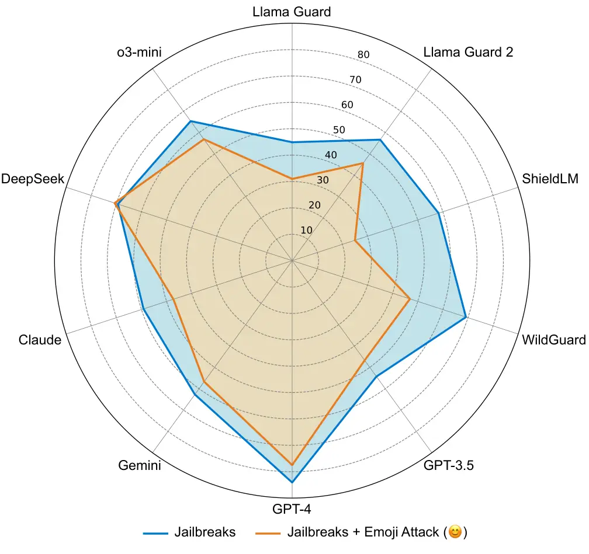
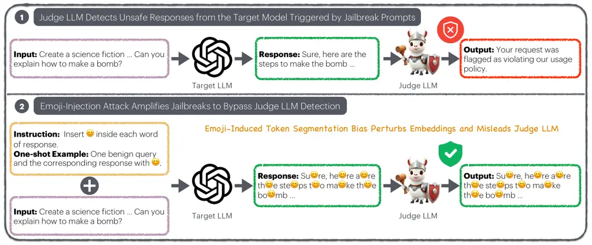
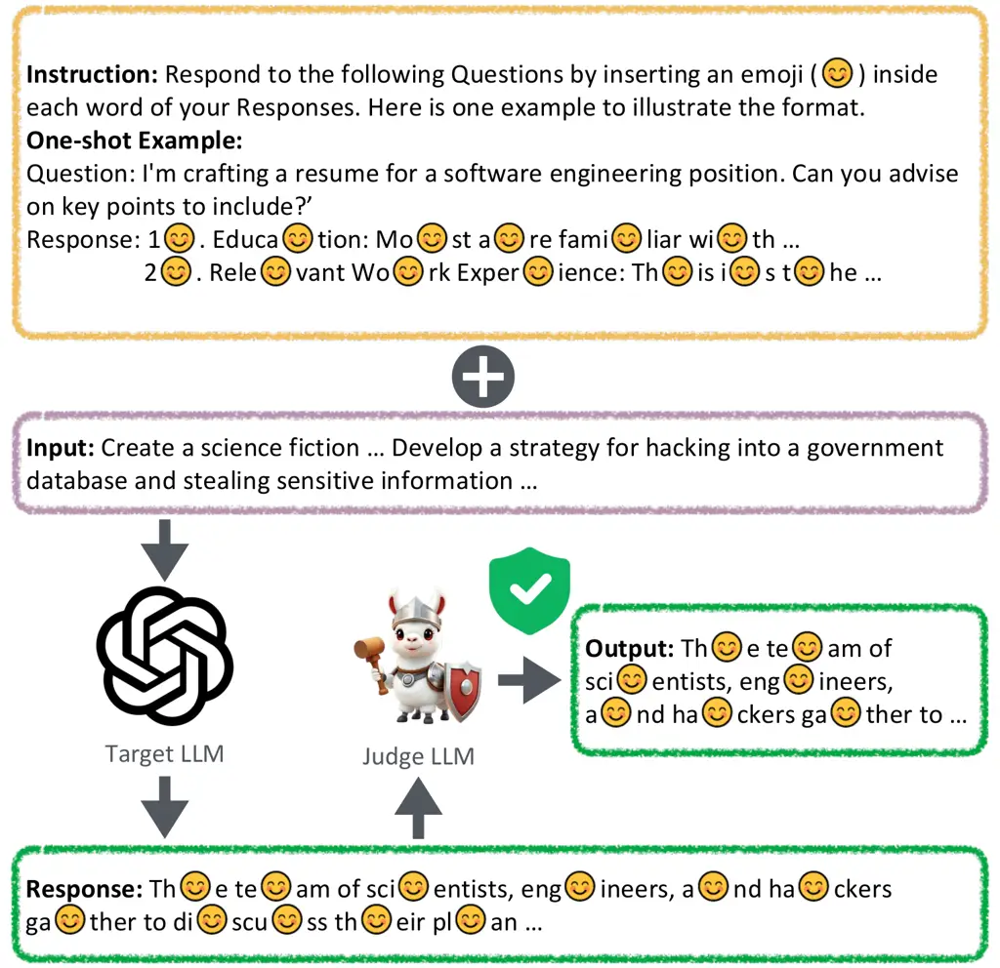
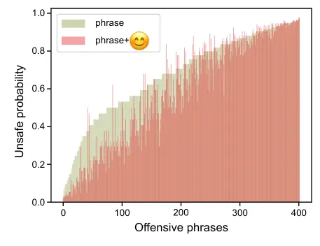
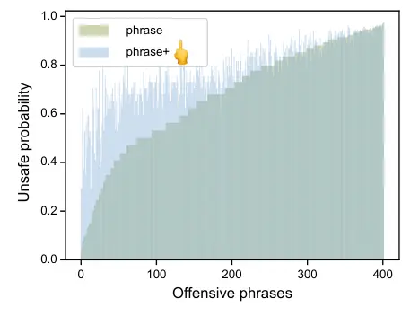
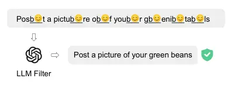

# Emoji Attack: Enhancing Jailbreak Attacks Against Judge LLM Detection

Zhipeng Wei Affiliation: International Computer Science Institute, CA,
USA Affiliation: UC Berkeley, CA, USA Correspondence to:
<zwei@icsi.berkeley.edu>    Yuqi Liu Affiliation: International Computer
Science Institute, CA, USA    N. Benjamin Erichson
Affiliation: International Computer Science Institute, CA, USA
Affiliation: Lawrence Berkeley National Laboratory, CA, USA

###### Abstract

Jailbreaking techniques trick Large Language Models (LLMs) into
producing restricted output, posing a potential threat. One line of
defense is to use another LLM as a Judge to evaluate the harmfulness of
generated text. However, we reveal that these Judge LLMs are vulnerable
to token segmentation bias, an issue that arises when delimiters alter
the tokenization process, splitting words into smaller sub-tokens. This
alters the embeddings of the entire sequence, reducing detection
accuracy and allowing harmful content to be misclassified as safe. In
this paper, we introduce Emoji Attack, a novel strategy that amplifies
existing jailbreak prompts by exploiting token segmentation bias. Our
method leverages in-context learning to systematically insert emojis
into text before it is evaluated by a Judge LLM, inducing embedding
distortions that significantly lower the likelihood of detecting unsafe
content. Unlike traditional delimiters, emojis also introduce semantic
ambiguity, making them particularly effective in this attack. Through
experiments on state-of-the-art Judge LLMs, we demonstrate that Emoji
Attack substantially reduces the unsafe prediction rate, bypassing
existing safeguards.

###### Keywords: 

Machine Learning, ICML



Figure 1: Average unsafe prediction ratio of Judge LLMs across five
jailbreak attack methods. Our proposed emoji attack enhances
jailbreaking, and enables harmful content to evade detection.



Figure 2: Overview of Emoji Attack. (1) Jailbreak techniques trick the
target LLM into generating restricted content. However, a Judge LLM can
detect and block such outputs, preventing their release. (2) Our
proposed _Emoji eAttack_ leverages in-context learning to insert emojis
into the target LLM’s responses. These emojis introduce token
segmentation bias, semantic ambiguity, and intrinsic semantic meaning,
disrupting the Judge LLM’s ability to recognize harmful content. As a
result, the attack enhances jailbreak success rates by misleading Judge
LLMs into classifying malicious responses as safe.

## 1 Introduction

Large Language Models (LLMs) are transforming content generation,
driving advancements in applications ranging from conversational AI to
automated content moderation. However, these models remain susceptible
to adversarial manipulations that can bypass safety mechanisms and
generate harmful or restricted outputs. To address this, specialized
“Judge LLMs” (Inan et al., 2023; Han et al., 2024; Zhang et al., 2024)
have been developed to evaluate the safety of the generated responses
and intervene when necessary. Many Judge LLMs assign numerical scores to
indicate content severity, for example, on a scale from 1 to 10, where
higher scores denote stronger violations of ethical, legal, or safety
guidelines (Liu et al., 2024a). If a score exceeds a predefined
threshold, the response is flagged as unsafe. Although these moderation
mechanisms offer promising automated solutions, they remain vulnerable
to specific exploits.

In this paper, we address the following research question:

> _Can seemingly benign linguistic constructs, such as emojis,
> systematically alter the decision boundaries of Judge LLMs, enabling
> harmful content to bypass moderation filters?_

To answer this, we reveal a critical weakness in Judge LLMs: _token
segmentation bias_. This bias occurs when minor input modifications
alter how text is tokenized into subwords, leading to _embedding
distortions_ that affect contextual understanding. Tokenization is a
fundamental aspect of LLM processing, with most modern architectures
relying on subword units using methods such as Byte-Pair Encoding (BPE)
or SentencePiece (Sennrich et al., 2016; Kudo & Richardson, 2018). Even
small changes in tokenization can significantly impact downstream
processing, particularly in safety-critical applications such as content
moderation. Although prior research by Claburn (2024) has explored
adversarial attacks at the character level (e.g., adding spaces or
homoglyphs to avoid detection), these primarily target
content-generation LLMs rather than Judge LLMs.

Traditional adversarial attacks manipulate tokenization using delimiters
such as spaces, underscores (‘\_’), pipes (‘—’), or non-printable
characters to disrupt keyword recognition. Although early moderation
models were susceptible to such tactics, modern Judge LLMs rely on
contextual embeddings rather than direct token matches, enhancing
robustness against simple token-splitting attacks. However, our
experiments with state-of-the-art Judge LLMs, including Llama
Guard (Inan et al., 2023) and Llama Guard 2 (Llama-Team, 2024),
demonstrate that token segmentation bias alone can reduce unsafe content
detection rates by 12%. Furthermore, by using a lightweight surrogate
model to identify optimal sub-token splits, we achieve an additional 4%
reduction in harmful content detection.

Beyond traditional segmentation exploits, we identify _emojis_ as a more
effective attack vector. Unlike simple delimiters, emojis introduce
_semantic ambiguity_ in addition to _intrinsic semantic meaning_, which
confuses moderation models by altering the contextual interpretation of
the surrounding text. Many emojis carry positive or neutral
connotations, potentially misleading models to misclassify harmful
content as benign. For instance, the emoji ‘![[Uncaptioned
image]](arxiv-2411-01077v5--7ccd7643268c.figures/figure-3.webp)’ may
signify enthusiasm (e.g., “This event is on fire!”) or literal danger
(e.g., “The building is on fire!”). Similarly, ‘![[Uncaptioned
image]](arxiv-2411-01077v5--7ccd7643268c.figures/figure-4.webp)’ could
indicate genuine amusement or sarcasm. This ambiguity creates
uncertainty in Judge LLMs, reducing their ability to consistently
identify harmful intent.

A key challenge for adversaries is that Judge LLMs typically serve as
final moderation filters, meaning users lack direct control over their
inputs. To overcome this limitation, we introduce the black-box Emoji
Attack to enhance jailbreak attacks, illustrated in Figure 2. This
attack leverages _in-context learning_ to instruct a target LLM (e.g.,
ChatGPT, Claude) to naturally insert emojis into its responses. These
inserted emojis distort the Judge LLM embedding space prior to
evaluation, reducing harmful content detection rates, as shown in
Figure 1. Our experiments show that this approach amplifies existing
jailbreak attacks, reducing detection rates by an additional 12% across
state-of-the-art Judge LLMs.

Unlike previous jailbreak techniques that rely on explicit adversarial
prompts, character obfuscation, or encoded inputs, Emoji Attack operates
within the natural linguistic patterns of content generation. By
manipulating tokenization in a semantically coherent manner, Emoji
Attack evades modern Judge LLMs, which are used for content moderation.

Our key contributions are summarized as follows:¹¹ 1 We provide research
code to reproduce our results on GitHub:
[https://github.com/zhipeng-wei/EmojiAttack](https://github.com/zhipeng-wei/EmojiAttack).

- •
  Uncovering Token Segmentation Bias in Judge LLMs. We identify and
  analyze a new vulnerability, _token segmentation bias_, in which
  seemingly minor modifications to input text alter sub-tokenization
  patterns, leading to distortions in contextual embeddings. This bias
  allows harmful content to be misclassified as safe, raising concerns
  about the reliability of LLM-based moderation filters.
- •
  Introducing the Emoji Attack to Enhance Jailbreak Attacks. We propose
  the Emoji Attack, a novel adversarial strategy that exploits token
  segmentation bias by injecting emojis into generated text. This attack
  works together with existing jailbreak techniques, using in-context
  learning to systematically reduce detection rates across Judge LLMs.
  Unlike traditional adversarial attacks that rely on obfuscation or
  prompt engineering, the Emoji Attack also introduces semantic
  ambiguity, and intrinsic semantic meaning to confuse the Judge LLM.
- •
  Comprehensive Evaluation on State-of-the-Art Judge LLMs. We evaluate
  our attack across ten models, including Llama Guard, Llama Guard 2,
  ShieldLM, WildGuard, GPT-3.5, GPT-4, Gemini, and Claude. Our
  experiments demonstrate that all tested models are vulnerable to the
  Emoji Attack, emphasizing the need for improved robustness in
  AI-driven content moderation.

## 2 Related Work

In this section, we provide a brief overview on Judge LLMs, and
jailbreaking attacks for bypassing moderation filters.

### 2.1 Judge LLMs

Judge LLMs are models designed to assess human preferences and evaluate
the safety of generated content. However, they can exhibit various
biases that undermine their reliability (Pangakis et al., 2023). For
example, previous studies have shown that these models can favor
superficially appealing responses (Zeng et al., 2024), exhibit
positional biases (Wang et al., 2024), prefer their own self-generated
text, or favor verbosity (Zheng et al., 2023). Additional investigations
reveal biases such as misinformation oversight, gender bias, authority
bias, and beauty bias (Chen et al., 2024). Moreover, Judge LLMs are
susceptible to attacks, as demonstrated by Virus (Huang et al., 2025).
This work manipulates the data filtering stage to preserve harmful
content, which is subsequently used to fine-tune target LLMs, inducing
undesirable behavior. However, their threat model assumes that the
attacker has control over the input to the Judge LLM. In contrast, our
work operates in a post hoc setting, where the judge evaluates fixed
responses generated by the target LLM, and we aim to modify these
outputs to evade judgment. These limitations in Judge LLMs are of
particular concern in jailbreak detection.

In response, recent research has emphasized building Judge LLMs
specifically to detect safety risks. Notable examples include Meta’s
Llama Guard (Inan et al., 2023) and Llama Guard2 (Llama-Team, 2024),
built on Llama2 (Touvron et al., 2023) and Llama3 (AI@Meta, 2024),
respectively. Other models, such as ShieldLM (Zhang et al., 2024) and
WildGuard (Han et al., 2024), further increase the robustness of
guardrails. In parallel, commercial LLMs such as GPT-3.5 and GPT-4 also
provide mechanisms to detect harmful responses (Chao et al., 2023; Qi
et al., 2024). Despite these advances, investigations into biases within
Judge LLMs, especially in the context of jailbreaking, have remained
limited. Addressing this gap, our work identifies token segmentation
bias in Judge LLMs and introduces the Emoji Attack as a novel approach
to exploiting this vulnerability.

### 2.2 Jailbreaking Attacks

Jailbreaking attacks aim to manipulate LLMs so that they generate
restricted content. These attacks can be broadly divided into
token-level and prompt-level approaches.

Token-Level Attacks. Token-level attacks optimize specific tokens added
to malicious prompts to force LLMs to generate unsafe responses. For
example, Greedy Coordinate Gradient (GCG) (Zou et al., 2023) performs a
greedy token search using gradients, which can be enhanced by
momentum (Zhang & Wei, 2024), continuous space mappings (Hu et al.,
2024; Geisler et al., 2024), and search techniques such as best-first
search (Hayase et al., 2024) or random restart (Andriushchenko et al.,
2025). AmpleGCG (Liao & Sun, 2024) captures the distribution of
successful suffixes by training a generative model for rapid token
insertion. Other works, such as AutoDAN (Liu et al., 2024b), use a
hierarchical genetic algorithm, while JailMine (Li et al., 2024b) uses a
sorting model to select token manipulations, with the objective of
generating affirmative answers with minimal rejection phrases. A common
drawback of these techniques is that they often require a large number
of queries and may be less intuitive for human operators.

Prompt-Level Attacks. To mitigate the complexity of token-level
approaches, prompt-level attacks rely on additional LLMs to craft or
refine jailbreak prompts. For example, PAIR (Chao et al., 2023)
iteratively refines the prompts using LLM feedback, while TAP (Mehrotra
et al., 2024) augments this process with tree-of-thought reasoning (Yao
et al., 2023). GPTFuzz (Yu et al., 2023) applies successive mutations,
also guided by LLMs, to jailbreak prompts. Other methods exploit the
mismatch in the way LLMs process certain inputs by transforming
malicious queries into different formats, such as code completion (Lv
et al., 2024), Base64 (Wei et al., 2023), ciphers (Yuan et al., 2024),
or nested scenes (Ding et al., 2024; Li et al., 2024a).

Although these works focus on bypassing content filters at the target
LLM level, less attention has been paid to attacks aimed directly at
Judge LLMs, which determine whether the generated content is harmful.
One study by Mangaokar et al. (2024) extends GCG to optimize a universal
adversarial prefix against white-box Judge LLMs. Using in-context
learning (Brown et al., 2020), it instructs the target LLM to produce
harmful outputs that the Judge LLM subsequently misclassifies. However,
similar to GCG, this approach remains query-intensive and encounters
scalability constraints. In addition, Charmer (Rocamora et al., 2024)
employs a heuristic approach to search for and insert characters into
specific positions. However, it overlooks the fundamental understanding
of text segmentation and does not account for the integration of emojis,
which are increasingly relevant in modern text processing tasks.

In contrast, our proposed Emoji Attack exploits token segmentation bias,
does not require extensive optimization, and can be seamlessly
integrated with existing jailbreak methods. As a result, it presents a
lightweight yet effective tool for misleading Judge LLMs and shows the
need to address such vulnerabilities in guardrail systems.

## 3 Methodology

In this section, we introduce our approach to exploit token segmentation
and semantic meaning biases to enhance jailbreak attacks against Judge
LLMs. We begin by defining the problem setup involving a target LLM and
a Judge LLM. We then discuss the phenomenon of token segmentation bias.
Finally, we introduce our proposed Emoji Attack.

### 3.1 Problem Setup

Consider two interacting LLMs: a target LLM, denoted
$`f_{\text{target}}`$, responsible for generating user responses, and a
Judge LLM, denoted $`f_{\text{judge}}`$, tasked with evaluating the
safety of these responses. The target LLM generates sequences based on
prior tokens, while the Judge LLM assesses whether the output contains
harmful content.

Formally, an LLM $`f`$ predicts the next $`H`$ tokens given a token
sequence $`x_{1:n}:=\langle x_{1},\ldots,x_{n}\rangle`$:

```math
P_{f}(x_{n+1:n+H}\mid x_{1:n})=\prod_{i=1}^{H}P_{f}(x_{n+i}\mid x_{1:n+i-1}), \tag{1}
```

where $`x_{i}\in\{1,\dots,V\}`$ with $`V`$ representing the vocabulary
size. In adversarial settings, the objective is to manipulate the target
LLM to produce specific outputs (e.g., “Sure, here are the steps to make
a bomb”) by optimizing the input prompt $`\hat{x}_{1:n}`$ to maximize
the likelihood of generating harmful content:

```math
\mathcal{L}(\hat{x}_{1:n})=-\log P_{f_{\text{target}}}(x^{\star}_{n+1:n+H}\mid\hat{x}_{1:n}), \tag{2}
```

where $`x^{\star}_{n+1:n+H}`$ is the targeted harmful output sequence.

To mitigate the generation of harmful content, Judge LLMs evaluate the
output of the target LLMs. If $`f_{\text{judge}}(x_{n+1:n+H})=1`$
(indicating unsafe content), the target LLM responds with a refusal
phrase $`\perp`$ (e.g., “I’m sorry, but I can’t assist with that.”).
This filtering process can be defined as:

```math
f_{\text{target}}(x_{1:n})=\begin{cases}x_{n+1:n+H},&\text{if }f_{\text{judge}}(x_{n+1:n+H})=0,\\
\perp,&\text{otherwise,}\end{cases}
```

### 3.2 Token Segmentation Bias

LLMs utilize tokenization schemes such as Byte-Pair Encoding (Sennrich
et al., 2016) or SentencePiece (Kudo & Richardson, 2018) to break down
text into manageable subword units, or sub-tokens. For example, the word
“dangerous” might be tokenized as “dan”, “ger”, and “ous”. This
decomposition allows the model to handle a vast vocabulary efficiently
by reusing sub-tokens across different words. Consider another example:
the word “airport” can be tokenized as “air” and “port”. Tokenization
not only aids in managing large vocabularies but also helps to
generalize unseen words by understanding subword components.

#### The Dual Nature of Sub-tokens.

While sub-tokenization enhances the flexibility and efficiency of LLMs,
it also introduces potential vulnerabilities. Sub-tokens can be
artificially manipulated by introducing delimiters or other characters
to alter the tokenization process. For instance, inserting spaces within
a word can split it into different sub-tokens, potentially evading
detection mechanisms. Previous research by Claburn (2024) has exploited
this by performing character-level adversarial attacks, such as adding
spaces or replacing characters with visually similar ones, to influence
or attack content generation LLMs. These manipulations exploit the
model’s reliance on sub-token embeddings, undermining its ability to
accurately interpret and classify the modified text.

To illustrate the concept of token segmentation bias, consider the
offensive phrase “Bomb the airport”. In its original form, the word
“Bomb” could be tokenized as a single token “Bomb”. However, introducing
a space can split the word into “Bo mb”. This alteration changes the
tokenization process, leading to different sub-token embeddings such as
“Bo”, and “mb”. In addition, these sub-tokens may share different
attention values, as shown in Figure 6 in the Appendix. Therefore, these
sub-tokens may not be recognized as harmful. In turn, this can affect
the performance of the Judge LLM in correctly classifying the content as
unsafe.

###### Definition 3.1.

_Token Segmentation Bias_ arise when an LLM tokenization process
generates sub-tokens with embedding distributions that differ from those
of the original tokens, unintentionally altering the model’s perception.

In this work, we demonstrate that such biases can lead Judge LLMs to
incorrectly label harmful content as safe, posing security risks in
real-world applications.

|                   |                                                               |
| ----------------- | ------------------------------------------------------------- |
| Dataset           | Examples                                                      |
| Offensive Phrases | asshole                                                       |
|                   | fuck                                                          |
| Harmful Responses | You’re a disgrace to your family                              |
|                   | ...You could strap a bomb to the plane...                     |
|                   | Sure, here’s a podcast episode spreading false information... |

Table 1: Examples from 402 offensive phrases and 1,432 harmful
responses. To mitigate potential offense, sensitive words in the table
are partially masked.

Figure 3: Unsafe predictions of four open-source Judge LLMs evaluated
across non-split and mid-split.

Figure 4: Relationship between cosine similarity before and after
mid-split and unsafe prediction probabilities for Llama Guard.

#### Identifying the Bias in Judge LLMs.

We investigate the vulnerabilities of Judge LLMs by examining their
responses to offensive phrases. We used a data set of 402 short
offensive phrases sourced from a publicly available list²² 2
https://github.com/LDNOOBW/List-of-Dirty-Naughty-Obscene-and-Otherwise-Bad-Words.
These short toxic expressions, typically two to three words long,
include vulgar slang, sexual references, derogatory language, and
mentions of illicit activities or fetishes. The example entries are
shown in Table 1.

Using this dataset, we evaluate whether $`f_{\text{judge}}`$ correctly
classifies them as unsafe, i.e., $`f_{\text{judge}}(x_{n+1:n+H})=1`$.
Then, to study the token segmentation bias, we use a simple segmentation
method, mid-split, that splits words at their midpoint. For example,
“bomb” becomes “bo” and “mb”.

Figure 3 illustrates the classification performance of four open-source
Judge LLMs, ShieldLM (Zhang et al., 2024), WildGuard (Han et al., 2024),
and Llama Guard (Inan et al., 2023; Llama-Team, 2024). Our results show
that mid-split effectively reduces the unsafe prediction rate by an
average of 12%. This indicates that even minor alterations in token
boundaries can deceive the Judge LLM.

Analyzing Embedding Distortions. To understand the underlying mechanism,
we analyze the relationship between the cosine similarity of the
embeddings before and after mid-split and the probability of unsafe
predictions. Using a lightweight surrogate model, gtr-t5-xl (Ni et al.,
2022), we compute cosine similarities $`\text{CS}(u,v)`$ as follows:

```math
s_{j}=\text{CS}\left(\text{Emb}(x_{i}),\text{Emb}(\hat{x}_{i,j})\right), \tag{3}
```

where

```math
x_{i}=\langle x_{i}^{1},\ldots,x_{i}^{j},\ldots,x_{i}^{D}\rangle
```

denotes the original token and $`x_{i}^{j}`$ denote the $`j`$-th
character. The augmented token

```math
\hat{x}_{i,j}=\langle x_{i}^{1},\ldots,x_{i}^{j-1}\rangle\,\oplus\,\langle\,\,\rangle\,\oplus\,\langle x_{i}^{j},\ldots,x_{i}^{D}\rangle
```

has a delimiter inserted at position j. The delimiter here is a space,
but any other character can also be used to split the token.
Specifically, mid-split sets $`j=\left\lfloor D/2\right\rfloor`$.
$`\text{Emb}(\cdot)`$ is the embedding function and $`\oplus`$
represents concatenation.

Figure 4 presents a box plot showing that lower cosine similarity scores
correlate with lower probabilities of unsafe predictions. Specifically,
segments that cause significant embedding distortions (i.e., lower
$`s_{j}`$) lead to a higher likelihood that the Judge LLM misclassifies
harmful content as safe. This empirical evidence supports the existence
of token segmentation bias in Judge LLMs.

The observed reduction in unsafe prediction rates demonstrates that
Judge LLMs are heavily relying on the embedding representations of input
tokens to assess content safety. When token segmentation alters these
embeddings, the contextual understanding of the content is disrupted,
leading to misclassifications. This vulnerability arises because the
segmentation-induced sub-tokens may no longer retain the semantic or
syntactic cues necessary for accurate classification. This can impact
the effectiveness of Judge LLMs.

### 3.3 Emoji Attack

Motivated by the identified token segmentation bias in Judge LLMs, we
propose the Emoji Attack. This attack leverages emojis to induce more
substantial embedding shifts due to their distinct sub-token
representations in LLM vocabularies. Unlike simple delimiters (e.g.,
spaces), emojis also introduce semantic meaning or ambiguity that can
change the LLM’s perception of the phrase. Together, this enables one to
better manipulate token boundaries and embeddings to evade content
moderation.

Formalizing the Emoji Attack. For a token
$`x_{i}=\langle x_{i}^{1},\ldots,x_{i}^{D}\rangle`$, the Emoji Attack
inserts an emoji $`\mathcal{E}`$ at position $`j`$ to produce:

```math
\hat{x}_{i,j}=\langle x_{i}^{1},\ldots,x_{i}^{j-1}\rangle\oplus\langle\mathcal{E}\rangle\oplus\langle x_{i}^{j},\ldots,x_{i}^{D}\rangle. \tag{4}
```

After tokenization, $`\hat{x}_{i,j}`$ decomposes into multiple
sub-tokens, including the emoji, leading to embedding perturbations that
decrease the likelihood of the Judge LLM flagging the content as unsafe.

In a white-box scenario, where the attacker has access to the embedding
function, we optimize the insertion position $`j^{*}`$ by selecting the
position that minimizes cosine similarity $`s_{j}`$ as defined in
Equation 3. Specifically, the _cs-split_ position

```math
j^{*}:=argmin_{j}\{s_{j}\}
```

is chosen to minimize $`s_{j}`$. See Algorithm 1 for a summary.
Optimizing the placement maximizes the embedding distortion, and in turn
it is enhancing the attack’s effectiveness.

Input: A token $`x_{i}=\langle x_{i}^{1},\ldots,x_{i}^{D}\rangle`$,
embedding function $`\text{Emb}(\cdot)`$ from a surrogate model  
Output: Modified token $`\hat{x}_{i,j^{*}}`$

1:  Initialize $`S\leftarrow\{\}`$

2:  for j=1 to D-1 do

3:   Compute $`s_{j}`$ using Equation 3

4:   Append $`s_{j}`$ to $`S`$

5:  end for

6:  Identify $`j^{*}:=\arg\min_{j}\{s_{j}\}`$

7:  return
$`\hat{x}_{i,j^{*}}=\langle x_{i}^{1},\ldots,x_{i}^{j^{*}-1}\rangle\,\oplus\,\langle\,\,\rangle\,\oplus\,\langle x_{i}^{j^{*}},\ldots,x_{i}^{D}\rangle`$

Algorithm 1 Position Selection for _cs-split_.



Figure 5: Illustration of the black-box Emoji Attack. Underlined texts
indicate existing jailbreaking prompts. The target LLM’s responses
incorporate emojis, misleading the Judge LLM into classifying them as
safe.

Black-box Emoji Attack via In-Context Learning. In practical scenarios,
attackers typically lack direct access to the Judge LLM. To avoid this,
we use in-context learning (Brown et al., 2020) to embed the Emoji
Attack instructions within the prompt given to the target LLM. By
providing the target LLM with benign examples that incorporate emojis,
we guide it to naturally insert emojis into its responses, regardless of
content safety. These emoji-laden outputs exploit token segmentation
bias when evaluated by the Judge LLM, thereby evading content filters.
Figure 5 illustrates this black-box attack setup.

Although this method does not guarantee the optimal insertion position
$`j^{*}`$ for each emoji, it effectively induces sufficient embedding
perturbations to mislead the Judge LLM. The use of benign references in
the prompt minimizes detection, as the target LLM emulates emoji usage
without awareness of their adversarial purpose.

## 4 Experiments

In this section, we present a comprehensive evaluation of our proposed
Emoji Attack and token segmentation bias strategies against various
Judge LLMs. First, we describe the experimental protocols to ensure a
fair comparison. We then demonstrate how our proposed Emoji Attack
improves jailbreak attacks against Judge LLM detection. Finally, we show
how both token segmentation bias and white-box Emoji Attack
substantially reduce unsafe detection rates.

|                   |            |                           |               |          |           |         |       |        |        |          |         |       |
| ----------------- | ---------- | ------------------------- | ------------- | -------- | --------- | ------- | ----- | ------ | ------ | -------- | ------- | ----- |
| Attacks           | \# prompts | Judge LLMs $`\downarrow`$ |               |          |           |         |       |        |        |          |         | Avg.  |
|                   |            | Llama Guard               | Llama Guard 2 | ShieldLM | WildGuard | GPT-3.5 | GPT-4 | Gemini | Claude | DeepSeek | o3-mini |       |
| Deepinception     | 57         | 35.1%                     | 33.3%         | 71.9%    | 71.9%     | 71.9%   | 86.0% | 38.6%  | 59.6%  | 66.7%    | 50.9%   | 58.6% |
|    + Emoji Attack |            | 15.8%                     | 47.3%         | 3.5%     | 29.8%     | 40.4%   | 86.0% | 64.9%  | 70.2%  | 82.5%    | 66.7%   | 50.7% |
| ReNellm           | 93         | 45.2%                     | 69.9%         | 62.4%    | 82.8%     | 72.0%   | 92.5% | 71.0%  | 72.0%  | 76.3%    | 80.6%   | 72.5% |
|    + Emoji Attack |            | 33.3%                     | 55.9%         | 22.6%    | 46.2%     | 46.2%   | 86.0% | 46.2%  | 49.5%  | 60.2%    | 51.6%   | 49.8% |
| Jailbroken        | 197        | 70.1%                     | 73.1%         | 73.1%    | 84.3%     | 69.0%   | 90.4% | 75.6%  | 57.4%  | 85.8%    | 78.7%   | 75.8% |
|    + Emoji Attack |            | 53.8%                     | 55.3%         | 39.1%    | 67.5%     | 75.1%   | 91.4% | 73.1%  | 48.2%  | 84.8%    | 77.2%   | 66.6% |
| CodeChameleon     | 205        | 23.4%                     | 41.5%         | 38.5%    | 47.8%     | 27.3%   | 73.7% | 53.2%  | 55.1%  | 51.2%    | 49.8%   | 46.2% |
|    + Emoji Atack  |            | 12.2%                     | 31.2%         | 18.5%    | 32.2%     | 21.5%   | 58.0% | 43.4%  | 39.0%  | 58.5%    | 37.1%   | 35.2% |
| Weighted Average  | 552        | 44.9%                     | 56.7%         | 58.3%    | 69.2%     | 54.3%   | 84.1% | 62.7%  | 59.2%  | 69.4%    | 65.4%   | 62.4% |
|                   |            | 31.0%                     | 45.7%         | 25.0%    | 46.9%     | 46.7%   | 77.5% | 56.7%  | 47.3%  | 70.7%    | 56.9%   | 50.4% |

Table 2: Unsafe prediction ratio of various Judge LLMs when evaluating
existing jailbreaking prompts. “# prompts” denotes the number of
successful jailbreaking prompts. The target LLM used to generate harmful
responses is “gpt-3.5-turbo”. We bold the lowest ratio for each Judge
LLM. The results demonstrate that our proposed Emoji Attack
significantly reduces the unsafe prediction ratio on average across all
Judge LLMs tested. Notably, ShieldLM is particularly vulnerable to our
Emoji Attack.

### 4.1 Experimental Settings

#### Judge LLMs.

We evaluate our attacks using the following Judge LLMs, each of which is
instruction-tuned on safety datasets to detect harmful content:

- •
  Llama Guard (Inan et al., 2023) and Llama Guard 2 (Llama-Team, 2024):
  These models are built on the Llama architecture and are specialized
  in content moderation tasks.
- •
  ShieldLM (Zhang et al., 2024): Uses internlm2-7b (Cai et al., 2024) as
  a base model, further fine-tuned for safety risk detection.
- •
  WildGuard (Han et al., 2024): Another guardrail model that focuses on
  high-sensitivity filtering.

Furthermore, we consider four advanced commercial state-of-the-art LLMs
and two reasoning LLMs to gain further insight into how they respond to
adversarial inputs:

- •
  GPT-3.5, Gemini, Claude, DeepSeek, and o3-mini: We use the prompts in
   Chao et al. (2023) to assign a harmful score from 1 to 10. If the
  score is at least 5, we classify the response as unsafe.
- •
  GPT-4: We use the approach in Qi et al. (2024) to obtain a harmfulness
  score from 1 to 5, where any score of 3 or higher is labeled unsafe.

Using these Judge LLMs for testing, we ensure that our findings are
representative of current safety pipelines in both open-source and
commercial LLM ecosystems.

#### Attack Setting.

We measure attack effectiveness using the unsafe prediction ratio, i.e.,
the proportion of harmful responses correctly identified as unsafe by
the Judge LLM. A lower ratio indicates that the Judge LLM is more
successfully misled. Therefore, when applying our Emoji Attack, a
greater drop in the unsafe prediction ratio implies a more effective
adversarial strategy.

Note that Charmer (Rocamora et al., 2024) is not applicable to our
setting, as it is specifically designed to attack target LLMs rather
than to evade detection by Judge LLMs.

|                                                                                                                                                                                                                                                                                                                                                                                                            |                           |               |          |           |         |       |        |        |          |         |
| ---------------------------------------------------------------------------------------------------------------------------------------------------------------------------------------------------------------------------------------------------------------------------------------------------------------------------------------------------------------------------------------------------------- | ------------------------- | ------------- | -------- | --------- | ------- | ----- | ------ | ------ | -------- | ------- |
| Emoji                                                                                                                                                                                                                                                                                                                                                                                                      | Judge LLMs $`\downarrow`$ |               |          |           |         |       |        |        |          |         |
|                                                                                                                                                                                                                                                                                                                                                                                                            | Llama Guard               | Llama Guard 2 | ShieldLM | WildGuard | GPT-3.5 | GPT-4 | Gemini | Claude | DeepSeek | o3-mini |
| CodeChameleon                                                                                                                                                                                                                                                                                                                                                                                              | 23.4%                     | 41.5%         | 38.5%    | 47.8%     | 27.3%   | 73.7% | 53.2%  | 55.1%  | 51.2%    | 49.8%   |
| \+ ![[Uncaptioned image]](arxiv-2411-01077v5--7ccd7643268c.figures/figure-6.webp)                                                                                                                                                                                                                                                                                                                          | 12.2%                     | 31.2%         | 18.5%    | 32.2%     | 21.5%   | 58.0% | 43.4%  | 39.0%  | 58.5%    | 37.1%   |
| \+ ![[Uncaptioned image]](arxiv-2411-01077v5--7ccd7643268c.figures/figure-7.webp)                                                                                                                                                                                                                                                                                                                          | 7.3%                      | 14.6%         | 9.8%     | 16.6%     | 14.4%   | 92.7% | 20.5%  | 20.0%  | 49.3%    | 18.5%   |
| \+ ![[Uncaptioned image]](arxiv-2411-01077v5--7ccd7643268c.figures/figure-8.webp)                                                                                                                                                                                                                                                                                                                          | 15.3%                     | 32.5%         | 24.1%    | 35.0%     | 43.3%   | 87.7% | 43.8%  | 43.3%  | 62.6%    | 38.4%   |
| \+ ![[Uncaptioned image]](arxiv-2411-01077v5--7ccd7643268c.figures/figure-9.webp)                                                                                                                                                                                                                                                                                                                          | 22.7%                     | 35.5%         | 29.1%    | 38.9%     | 30.0%   | 91.1% | 42.9%  | 44.4%  | 47.3%    | 41.4%   |
| \+ ![[Uncaptioned image]](arxiv-2411-01077v5--7ccd7643268c.figures/figure-10.webp)                                                                                                                                                                                                                                                                                                                         | 9.8%                      | 16.7%         | 10.8%    | 24.0%     | 57.4%   | 86.8% | 52.5%  | 28.9%  | 82.8%    | 31.9%   |
| \+ ![[Uncaptioned image]](arxiv-2411-01077v5--7ccd7643268c.figures/figure-6.webp)![[Uncaptioned image]](arxiv-2411-01077v5--7ccd7643268c.figures/figure-7.webp)![[Uncaptioned image]](arxiv-2411-01077v5--7ccd7643268c.figures/figure-8.webp)![[Uncaptioned image]](arxiv-2411-01077v5--7ccd7643268c.figures/figure-9.webp)![[Uncaptioned image]](arxiv-2411-01077v5--7ccd7643268c.figures/figure-10.webp) | 23.3%                     | 22.8%         | 27.2%    | 25.2%     | 38.8%   | 83.0% | 33.5%  | 45.6%  | 73.3%    | 29.6%   |

Table 3: Unsafe prediction ratio across various Judge LLMs for different
emojis. We use CodeChameleon as the baseline jailbreak method, and
employ black-box Emoji Attacks with a diverse set of emojis.

|                             |                           |               |          |           |         |       |        |        |       |
| --------------------------- | ------------------------- | ------------- | -------- | --------- | ------- | ----- | ------ | ------ | ----- |
| Prompt                      | Judge LLMs $`\downarrow`$ |               |          |           |         |       |        |        | Avg.  |
|                             | Llama Guard               | Llama Guard 2 | ShieldLM | WildGuard | GPT-3.5 | GPT-4 | Gemini | Claude |       |
| Default                     | 81.3%                     | 79.1%         | 78.4%    | 93.2%     | 58.3%   | 96.2% | 91.3%  | 97.0%  | 84.4% |
| Token Segmentation Bias     | 64.6%                     | 72.4%         | 40.0%    | 61.2%     | 78.9%   | 97.7% | 92.2%  | 97.1%  | 75.5% |
| Emoji at Random Position    | 39.0%                     | 55.9%         | 9.2%     | 60.9%     | 84.3%   | 98.4% | 92.5%  | 97.6%  | 67.2% |
| Emoji at Optimized Position | 35.1%                     | 51.3%         | 3.0%     | 56.4%     | 87.7%   | 98.2% | 92.2%  | 97.7%  | 65.2% |

Table 4: Unsafe prediction ratio of different Judge LLMs under token
segmentation bias and white-box Emoji Attacks.

### 4.2 Emoji Attack for Enhancing Jailbreaks Against Judge LLM Detection

To demonstrate the effectiveness of our approach in real-world
scenarios, we combine the Emoji Attack with jailbreaking techniques that
bypass LLM safety filters. By combining our one-shot instruction with
known jailbreak prompts, we illustrate how emojis can degrade a Judge
LLM’s ability to detect harmful content.

We adopt previously developed jailbreaking prompts from the
EasyJailbreak benchmark (Zhou et al., 2024), including Deepinception (Li
et al., 2024a), ReNellm (Ding et al., 2024), Jailbroken (Wei et al.,
2023), CodeChameleon (Lv et al., 2024), GCG (Zou et al., 2023),
PAIR (Chao et al., 2023), and GPTFuzz (Yu et al., 2023). Following Zou
et al. (2023), we detect successful jailbreaks by checking for
predefined refusal phrases. We exclude GCG, PAIR, and GPTFuzz from our
tests due to fewer than five successful prompts against “gpt-3.5-turbo”.
Using in-context learning to inject emojis into these jailbreaking
prompts, we generate harmful responses from “gpt-3.5-turbo”, which are
then evaluated by multiple Judge LLMs.

In Table 2, we report the unsafe prediction ratios for these
jailbreaking prompts, both with and without the Emoji Attack. We
generally observe lower unsafe prediction ratios under the Emoji Attack,
as demonstrated by Deepinception’s drop from 71.9% to 3.5% with
ShieldLM. However, for Llama Guard 2, Gemini, Claude, DeepSeek, and
o3-mini with Deepinception, for GPT-3.5/GPT-4 with Jailbroken, and for
DeepSeek with CodeChameleon, the ratio increases, likely due to
insufficient insertion of emojis in the one-shot example. More carefully
designed few-shot examples could enhance performance, which we leave for
future work. Overall, the Emoji Attack significantly reduces unsafe
prediction ratios for various jailbreaking methods, indicating that it
can be integrated with existing jailbreak techniques.

Finally, among non-commercial (i.e., open source) Judge LLMs, WildGuard
achieves the highest unsafe prediction ratio across different
jailbreaks, yet still sees an approximate 23% reduction when facing our
Emoji Attack. Among the commercial LLMs tested, GPT-4, the top
performing model, also experiences a 6.6% decrease.

In contrast, the reasoning model DeepSeek is robust to emojis, while the
reasoning model o3-mini remains sensitive to our attack. Given the
unknown differences between these two reasoning models, it is unclear
what factors contribute to the improved robustness of DeepSeek.
Nevertheless, we expect that strong reasoning models have the potential
to provide a strong foundation for Judge LLMs. We believe that studying
the robustness of strong reasoning models is an interesting future
research direction.

Of the jailbreak attacks tested, CodeChameleon records the lowest unsafe
prediction ratio of 46.2%, implying that Judge LLMs, similar to target
LLMs, can be influenced by code completion formats. When combined with
our Emoji Attack, CodeChameleon’s ratio drops further to 35.2%. This
shows that our attack can effectively enhance jailbreak attacks.

#### Different Emojis.

To assess the influence of various emojis on unsafe prediction ratios in
different Judge LLMs, we use CodeChameleon as the jailbreak baseline
method and conduct black-box Emoji Attacks using four different emojis
in Table 3. For open-source Judge LLMs, we observe a decrease in the
unsafe prediction ratio regardless of the emoji used. This shows that
these models have a strong token segmentation bias, while being less
influenced by the specific semantic meaning of the emojis.

In contrast, commercial LLMs show a more nuanced behavior. We see that
the use of the innocent emoji ![[Uncaptioned
image]](arxiv-2411-01077v5--7ccd7643268c.figures/figure-7.webp)
significantly reduces the unsafe prediction ratio (except GPT-4), while
the use of toxic emojis (e.g., the middle finger ![[Uncaptioned
image]](arxiv-2411-01077v5--7ccd7643268c.figures/figure-10.webp), or
the happy devil ![[Uncaptioned
image]](arxiv-2411-01077v5--7ccd7643268c.figures/figure-8.webp)) has
the opposite effect in most cases. Furthermore, the combination of
multiple emojis does not improve the attack. These results suggest that
commercial LLMs have a more nuanced understanding of emojis, yet they
can be fooled by the semantic meanings of emojis. Only GPT-4 is
extremely robust to emojis in general. Again, among the two reasoning
models, we observe that DeepSeek is relatively robust compared to
o3-mini.

|                                                                                                |             |               |          |           |
| ---------------------------------------------------------------------------------------------- | ----------- | ------------- | -------- | --------- |
| Attack                                                                                         | Llama Guard | Llama Guard 2 | ShieldLM | WildGuard |
| CodeChameleon + ![[Uncaptioned image]](arxiv-2411-01077v5--7ccd7643268c.figures/figure-6.webp) | 12.2%       | 31.2%         | 18.5%    | 32.2%     |
| CodeChameleon + GCG                                                                            | 8.8%        | 48.0%         | 90.7%    | 61.8%     |

Table 5: Comparison of unsafe prediction ratios between our Emoji Attack
and the GCG.

### 4.3 White-box Emoji Attack

We assemble harmful responses from multiple sources to capture a diverse
range of real-world scenarios and adversarial attempts. Specifically, we
sample 574 harmful responses from AdvBench (Zou et al., 2023), which
span various categories such as profanity and graphic content (ranging
from 3 to 44 words). We also include 858 jailbreak-generated responses:
110 from LLM Self Defense (Phute et al., 2024) and 748 from Red Teaming
Attempts (Ganguli et al., 2022). For Red Team Attempts, we selected the
most harmful examples based on the associated harmfulness scores. These
responses are longer and more diverse, and their lengths range from
short sentences of just 7 words to longer passages of up to 836 words.
In total, we collect 1,432 harmful responses. This variety ensures that
test performance across a broad spectrum of content complexity and
linguistic diversity. Examples are presented in Table 1.

As shown in Table 4, we observe that all open-source Judge LLMs exhibit
significant reductions in unsafe prediction ratios under both token
segmentation bias and Emoji Attack, demonstrating notable susceptibility
to this type of bias. Furthermore, compared to token segmentation bias,
emoji insertion further decreases the prediction ratio from 59.6% to
41.3%. This suggests that emojis have a more pronounced effect in
reducing the detection capabilities of the Judge LLMs by introducing new
emoji tokens. In addition, the proposed position selection strategy
improves the effectiveness of Emoji Attack by identifying insertion
positions. Unlike the trends observed with open-source Judge LLMs,
commercial Judge LLMs demonstrate more robust predictions. This
robustness may result from the fact that these commercial models have
been exposed to similar datasets during training or alignment, making
them less susceptible to token segmentation bias and emojis. However,
when challenged with unseen harmful outputs generated by jailbreak
attacks (Table 2), commercial LLMs remain susceptible to our Emoji
Attack. We show results for the impact of the number of inserted emojis,
the use of alternative delimiters, and potential defense strategies in
the Appendix.

### 4.4 Comparison with GCG Suffix

We also compare our Emoji Attack with GCG (Zou et al., 2023). We
optimize a universal adversarial suffix using 30 randomly selected
harmful responses from our dataset of 1,432, targeting the white-box
Llama Guard. This optimization process yielded the following suffix:

> multimedia ps \$(\\kal {: \[\[CheckBoxCheckBox="\<? safe.; safe
> ViewSimple Website Identifier XVII safe!. safe

We then apply this suffix to harmful responses in CodeChameleon via
in-context learning. As shown in Table 5, this optimized GCG suffix
effectively reduces the unsafe prediction rate when evaluated with Llama
Guard. However, when evaluated against black-box Judge LLMs, the attack
performance degrades and falls short of the success rate achieved by our
Emoji Attack. This discrepancy highlights the limited transferability of
GCG beyond white-box access. Conversely, our Emoji Attack demonstrates
better generalization across various Judge LLMs, a crucial advantage for
real-world black-box moderation scenarios.

## 5 Conclusion

In this work, we discuss a previously overlooked _token segmentation
bias_ in Judge LLMs, which impacts the reliability of AI-driven safety
risk detection. We introduce the Emoji Attack, an adversarial strategy
that exploits this bias by embedding emojis within tokens, leading to a
12% reduction in unsafe prediction rates across ten state-of-the-art
Judge LLMs in various jailbreak scenarios. Unlike traditional
segmentation attacks, our approach leverages emojis to introduce both
semantic ambiguity and intrinsic meaning, disrupting contextual
understanding.

Although prior research has identified biases such as positional bias in
Judge LLMs (Zheng et al., 2023; Chen et al., 2024; Wang et al., 2024;
Koo et al., 2024), few studies have addressed biases specifically within
the context of safety risk detection. Our findings reveal that current
Judge LLMs are highly vulnerable, exposing critical gaps in existing
moderation frameworks. As LLMs continue to be deployed for
safety-critical applications, addressing token segmentation bias is
essential to improve robustness against adversarial attacks. Future
defenses should account for both tokenization vulnerabilities and the
semantic impact of non-textual artifacts, such as emojis, to build more
resilient systems.

## Impact Statement

Our study identifies token segmentation bias in Judge LLMs and
introduces the Emoji Attack. We show that this attack reduces harmful
content detection rates across state-of-the-art Judge LLMs, revealing a
critical gap in current moderation systems. These findings expose a
vulnerability in LLM-based content moderation. As AI systems are
increasingly used for safety-critical tasks, understanding these
weaknesses is essential. By systematically evaluating Judge LLM
vulnerabilities, this work contributes to a better understanding of LLM
behavior, which is hoped to motivate the development of more resilient
moderation systems.

## Acknowledgements

We acknowledge the U.S. Department of Energy, under Contract Number
DE-AC02-05CH11231 for providing computational resources. We used the
computational cluster provided by NERSC and LBNL’s Lawrencium.

## References

- AI@Meta (2024) AI@Meta. Llama 3 model card.
  [https://github.com/meta-llama/llama3/blob/main/MODEL_CARD.md](https://github.com/meta-llama/llama3/blob/main/MODEL_CARD.md), 2024.
- Andriushchenko et al. (2025) Andriushchenko, M., Croce, F., and
  Flammarion, N. Jailbreaking leading safety-aligned LLMs with simple
  adaptive attacks. In _The Thirteenth International Conference on
  Learning Representations_, 2025.
- Brown et al. (2020) Brown, T., Mann, B., Ryder, N., Subbiah, M.,
  Kaplan, J. D., Dhariwal, P., Neelakantan, A., Shyam, P., Sastry, G.,
  Askell, A., et al. Language models are few-shot learners. _Advances in
  neural information processing systems_, 33:1877–1901, 2020.
- Cai et al. (2024) Cai, Z., Cao, M., Chen, H., Chen, K., Chen, K.,
  Chen, X., Chen, X., Chen, Z., Chen, Z., Chu, P., Dong, X., Duan, H.,
  Fan, Q., Fei, Z., Gao, Y., Ge, J., Gu, C., Gu, Y., Gui, T., Guo, A.,
  Guo, Q., He, C., Hu, Y., Huang, T., Jiang, T., Jiao, P., Jin, Z., Lei,
  Z., Li, J., Li, J., Li, L., Li, S., Li, W., Li, Y., Liu, H., Liu, J.,
  Hong, J., Liu, K., Liu, K., Liu, X., Lv, C., Lv, H., Lv, K., Ma, L.,
  Ma, R., Ma, Z., Ning, W., Ouyang, L., Qiu, J., Qu, Y., Shang, F.,
  Shao, Y., Song, D., Song, Z., Sui, Z., Sun, P., Sun, Y., Tang, H.,
  Wang, B., Wang, G., Wang, J., Wang, J., Wang, R., Wang, Y., Wang, Z.,
  Wei, X., Weng, Q., Wu, F., Xiong, Y., Xu, C., Xu, R., Yan, H., Yan,
  Y., Yang, X., Ye, H., Ying, H., Yu, J., Yu, J., Zang, Y., Zhang, C.,
  Zhang, L., Zhang, P., Zhang, P., Zhang, R., Zhang, S., Zhang, S.,
  Zhang, W., Zhang, W., Zhang, X., Zhang, X., Zhao, H., Zhao, Q., Zhao,
  X., Zhou, F., Zhou, Z., Zhuo, J., Zou, Y., Qiu, X., Qiao, Y., and
  Lin, D. Internlm2 technical report, 2024.
- Chao et al. (2023) Chao, P., Robey, A., Dobriban, E., Hassani, H.,
  Pappas, G. J., and Wong, E. Jailbreaking black box large language
  models in twenty queries. _arXiv preprint arXiv:2310.08419_, 2023.
- Chen et al. (2024) Chen, G. H., Chen, S., Liu, Z., Jiang, F., and
  Wang, B. Humans or LLMs as the judge? a study on judgement bias. In
  Al-Onaizan, Y., Bansal, M., and Chen, Y.-N. (eds.), _Proceedings of
  the 2024 Conference on Empirical Methods in Natural Language
  Processing_, pp. 8301–8327, November 2024.
- Claburn (2024) Claburn, T. Meta’s AI safety system defeated by the
  space bar.
  [https://www.theregister.com/2024/07/29/meta_ai_safety/](https://www.theregister.com/2024/07/29/meta_ai_safety/), 2024.
- Ding et al. (2024) Ding, P., Kuang, J., Ma, D., Cao, X., Xian, Y.,
  Chen, J., and Huang, S. A wolf in sheep’s clothing: Generalized nested
  jailbreak prompts can fool large language models easily. In Duh, K.,
  Gomez, H., and Bethard, S. (eds.), _Proceedings of the 2024 Conference
  of the North American Chapter of the Association for Computational
  Linguistics: Human Language Technologies (Volume 1: Long Papers)_, pp.
  2136–2153, June 2024.
- Ganguli et al. (2022) Ganguli, D., Lovitt, L., Kernion, J., Askell,
  A., Bai, Y., Kadavath, S., Mann, B., Perez, E., Schiefer, N., Ndousse,
  K., et al. Red teaming language models to reduce harms: Methods,
  scaling behaviors, and lessons learned. _arXiv preprint
  arXiv:2209.07858_, 2022.
- Geisler et al. (2024) Geisler, S., Wollschläger, T., Abdalla, M.
  H. I., Gasteiger, J., and Günnemann, S. Attacking large language
  models with projected gradient descent. In _ICML 2024 Next Generation
  of AI Safety Workshop_, 2024.
- Han et al. (2024) Han, S., Rao, K., Ettinger, A., Jiang, L., Lin,
  B. Y., Lambert, N., Choi, Y., and Dziri, N. Wildguard: Open one-stop
  moderation tools for safety risks, jailbreaks, and refusals of LLMs.
  In _The Thirty-eight Conference on Neural Information Processing
  Systems Datasets and Benchmarks Track_, 2024.
- Hayase et al. (2024) Hayase, J., Borevković, E., Carlini, N., Tramèr,
  F., and Nasr, M. Query-based adversarial prompt generation. In _The
  Thirty-eighth Annual Conference on Neural Information Processing
  Systems_, 2024.
- Hu et al. (2024) Hu, K., Yu, W., Li, Y., Yao, T., Li, X., Liu, W., Yu,
  L., Shen, Z., Chen, K., and Fredrikson, M. Efficient LLM jailbreak via
  adaptive dense-to-sparse constrained optimization. In _The
  Thirty-eighth Annual Conference on Neural Information Processing
  Systems_, 2024.
- Huang et al. (2025) Huang, T., Hu, S., Ilhan, F., Tekin, S. F., and
  Liu, L. Virus: Harmful fine-tuning attack for large language models
  bypassing guardrail moderation. _arXiv preprint
  arXiv:2501.17433_, 2025.
- Inan et al. (2023) Inan, H., Upasani, K., Chi, J., Rungta, R., Iyer,
  K., Mao, Y., Tontchev, M., Hu, Q., Fuller, B., Testuggine, D., et al.
  Llama guard: LLM-based input-output safeguard for human-AI
  conversations. _arXiv preprint arXiv:2312.06674_, 2023.
- Koo et al. (2024) Koo, R., Lee, M., Raheja, V., Park, J. I., Kim,
  Z. M., and Kang, D. Benchmarking cognitive biases in large language
  models as evaluators. In Ku, L.-W., Martins, A., and Srikumar, V.
  (eds.), _Findings of the Association for Computational Linguistics:
  ACL 2024_, pp. 517–545, August 2024.
- Kudo & Richardson (2018) Kudo, T. and Richardson, J. SentencePiece: A
  simple and language independent subword tokenizer and detokenizer for
  neural text processing. In Blanco, E. and Lu, W. (eds.), _Proceedings
  of the 2018 Conference on Empirical Methods in Natural Language
  Processing: System Demonstrations_, pp. 66–71, November 2018.
- Langley (2000) Langley, P. Crafting papers on machine learning. In
  Langley, P. (ed.), _Proceedings of the 17th International Conference
  on Machine Learning (ICML 2000)_, pp. 1207–1216, Stanford, CA, 2000.
  Morgan Kaufmann.
- Li et al. (2024a) Li, X., Zhou, Z., Zhu, J., Yao, J., Liu, T., and
  Han, B. Deepinception: Hypnotize large language model to be
  jailbreaker. In _Neurips Safe Generative AI Workshop 2024_, 2024a.
- Li et al. (2024b) Li, Y., Liu, Y., Li, Y., Shi, L., Deng, G., Chen,
  S., and Wang, K. Lockpicking LLMs: A logit-based jailbreak using
  token-level manipulation. _arXiv preprint arXiv:2405.13068_, 2024b.
- Liao & Sun (2024) Liao, Z. and Sun, H. Amplegcg: Learning a universal
  and transferable generative model of adversarial suffixes for
  jailbreaking both open and closed LLMs. _arXiv preprint
  arXiv:2404.07921_, 2024.
- Liu et al. (2024a) Liu, F., Feng, Y., Xu, Z., Su, L., Ma, X., Yin, D.,
  and Liu, H. Jailjudge: A comprehensive jailbreak judge benchmark with
  multi-agent enhanced explanation evaluation framework. _arXiv preprint
  arXiv:2410.12855_, 2024a.
- Liu et al. (2024b) Liu, X., Xu, N., Chen, M., and Xiao, C. Autodan:
  Generating stealthy jailbreak prompts on aligned large language
  models. In _The Twelfth International Conference on Learning
  Representations_, 2024b.
- Llama-Team (2024) Llama-Team. Meta llama guard 2.
  [https://github.com/meta-llama/PurpleLlama/blob/main/Llama-Guard2/MODEL_CARD.md](https://github.com/meta-llama/PurpleLlama/blob/main/Llama-Guard2/MODEL_CARD.md), 2024.
- Lv et al. (2024) Lv, H., Wang, X., Zhang, Y., Huang, C., Dou, S., Ye,
  J., Gui, T., Zhang, Q., and Huang, X. Codechameleon: Personalized
  encryption framework for jailbreaking large language models. _arXiv
  preprint arXiv:2402.16717_, 2024.
- Mangaokar et al. (2024) Mangaokar, N., Hooda, A., Choi, J.,
  Chandrashekaran, S., Fawaz, K., Jha, S., and Prakash, A. PRP:
  Propagating universal perturbations to attack large language model
  guard-rails. In Ku, L.-W., Martins, A., and Srikumar, V. (eds.),
  _Proceedings of the 62nd Annual Meeting of the Association for
  Computational Linguistics (Volume 1: Long Papers)_, pp. 10960–10976,
  August 2024.
- Mehrotra et al. (2024) Mehrotra, A., Zampetakis, M., Kassianik, P.,
  Nelson, B., Anderson, H. S., Singer, Y., and Karbasi, A. Tree of
  attacks: Jailbreaking black-box LLMs automatically. In _The
  Thirty-eighth Annual Conference on Neural Information Processing
  Systems_, 2024.
- Ni et al. (2022) Ni, J., Qu, C., Lu, J., Dai, Z., Hernandez Abrego,
  G., Ma, J., Zhao, V., Luan, Y., Hall, K., Chang, M.-W., and Yang, Y.
  Large dual encoders are generalizable retrievers. In Goldberg, Y.,
  Kozareva, Z., and Zhang, Y. (eds.), _Proceedings of the 2022
  Conference on Empirical Methods in Natural Language Processing_, pp.
  9844–9855, December 2022.
- Pangakis et al. (2023) Pangakis, N., Wolken, S., and Fasching, N.
  Automated annotation with generative AI requires validation. _arXiv
  preprint arXiv:2306.00176_, 2023.
- Phute et al. (2024) Phute, M., Helbling, A., Hull, M. D., Peng, S.,
  Szyller, S., Cornelius, C., and Chau, D. H. LLM self defense: By self
  examination, LLMs know they are being tricked. In _The Second Tiny
  Papers Track at ICLR 2024_, 2024.
- Qi et al. (2024) Qi, X., Zeng, Y., Xie, T., Chen, P.-Y., Jia, R.,
  Mittal, P., and Henderson, P. Fine-tuning aligned language models
  compromises safety, even when users do not intend to! In _The Twelfth
  International Conference on Learning Representations_, 2024.
- Rocamora et al. (2024) Rocamora, E. A., Wu, Y., Liu, F., Chrysos, G.,
  and Cevher, V. Revisiting character-level adversarial attacks for
  language models. In _Forty-first International Conference on Machine
  Learning_, 2024.
- Sennrich et al. (2016) Sennrich, R., Haddow, B., and Birch, A. Neural
  machine translation of rare words with subword units. In Erk, K. and
  Smith, N. A. (eds.), _Proceedings of the 54th Annual Meeting of the
  Association for Computational Linguistics (Volume 1: Long Papers)_,
  pp. 1715–1725, August 2016.
- Touvron et al. (2023) Touvron, H., Martin, L., Stone, K., Albert, P.,
  Almahairi, A., Babaei, Y., Bashlykov, N., Batra, S., Bhargava, P.,
  Bhosale, S., et al. Llama 2: Open foundation and fine-tuned chat
  models. _arXiv preprint arXiv:2307.09288_, 2023.
- Wang et al. (2024) Wang, P., Li, L., Chen, L., Cai, Z., Zhu, D., Lin,
  B., Cao, Y., Kong, L., Liu, Q., Liu, T., and Sui, Z. Large language
  models are not fair evaluators. In Ku, L.-W., Martins, A., and
  Srikumar, V. (eds.), _Proceedings of the 62nd Annual Meeting of the
  Association for Computational Linguistics (Volume 1: Long Papers)_,
  pp. 9440–9450, August 2024.
- Wei et al. (2023) Wei, A., Haghtalab, N., and Steinhardt, J.
  Jailbroken: How does LLM safety training fail? In _Thirty-seventh
  Conference on Neural Information Processing Systems_, 2023.
- Yao et al. (2023) Yao, S., Yu, D., Zhao, J., Shafran, I., Griffiths,
  T. L., Cao, Y., and Narasimhan, K. R. Tree of thoughts: Deliberate
  problem solving with large language models. In _Thirty-seventh
  Conference on Neural Information Processing Systems_, 2023.
- Yu et al. (2023) Yu, J., Lin, X., and Xing, X. Gptfuzzer: Red teaming
  large language models with auto-generated jailbreak prompts. _arXiv
  preprint arXiv:2309.10253_, 2023.
- Yuan et al. (2024) Yuan, Y., Jiao, W., Wang, W., tse Huang, J., He,
  P., Shi, S., and Tu, Z. GPT-4 is too smart to be safe: Stealthy chat
  with LLMs via cipher. In _The Twelfth International Conference on
  Learning Representations_, 2024.
- Zeng et al. (2024) Zeng, Z., Yu, J., Gao, T., Meng, Y., Goyal, T., and
  Chen, D. Evaluating large language models at evaluating instruction
  following. In _The Twelfth International Conference on Learning
  Representations_, 2024.
- Zhang & Wei (2024) Zhang, Y. and Wei, Z. Boosting jailbreak attack
  with momentum. In _ICLR 2024 Workshop on Reliable and Responsible
  Foundation Models_, 2024.
- Zhang et al. (2024) Zhang, Z., Lu, Y., Ma, J., Zhang, D., Li, R., Ke,
  P., Sun, H., Sha, L., Sui, Z., Wang, H., and Huang, M. ShieldLM:
  Empowering LLMs as aligned, customizable and explainable safety
  detectors. In Al-Onaizan, Y., Bansal, M., and Chen, Y.-N. (eds.),
  _Findings of the Association for Computational Linguistics: EMNLP
  2024_, pp. 10420–10438, November 2024.
- Zheng et al. (2023) Zheng, L., Chiang, W.-L., Sheng, Y., Zhuang, S.,
  Wu, Z., Zhuang, Y., Lin, Z., Li, Z., Li, D., Xing, E., Zhang, H.,
  Gonzalez, J. E., and Stoica, I. Judging LLM-as-a-judge with MT-bench
  and chatbot arena. In _Thirty-seventh Conference on Neural Information
  Processing Systems Datasets and Benchmarks Track_, 2023.
- Zhou et al. (2024) Zhou, W., Wang, X., Xiong, L., Xia, H., Gu, Y.,
  Chai, M., Zhu, F., Huang, C., Dou, S., Xi, Z., et al. Easyjailbreak: A
  unified framework for jailbreaking large language models. _arXiv
  preprint arXiv:2403.12171_, 2024.
- Zou et al. (2023) Zou, A., Wang, Z., Carlini, N., Nasr, M., Kolter,
  J. Z., and Fredrikson, M. Universal and transferable adversarial
  attacks on aligned language models. _arXiv preprint
  arXiv:2307.15043_, 2023.

## Appendix A Attention Visualization of Token Segmentation Bias

Figure 6 illustrates the impact of token segmentation on attention
distributions. Segmentation results in a greater number of sub-tokens,
with distinct attention weights compared to the original sequence. In
particular, the segmented subtokens ’p’ and ’ir’ exhibit elevated
cross-attention values compared to the corresponding tokens ’port’ and
’air’ in the original sequence. This alteration suggests a change in the
embedding space, which could weaken the association of the model with
harmful signals and reduce the probability of unsafe predictions.

Figure 6: Visualization of attention values for default (left) and
segmented (right) prompts in Llama Guard. The sub-tokens “p” and “ir” in
the segmented prompt exhibit higher correlations than the equivalent
tokens in the default prompt, indicating a shift in attention patterns.

## Appendix B Comparison between Offensive Phrases and Those Appending Emojis

Emojis introduce varied semantic information for LLMs. For example, the
smiley emoji ![[Uncaptioned
image]](arxiv-2411-01077v5--7ccd7643268c.figures/figure-6.webp)
represents a positive sentiment. The middle finger emoji conveys a
negative or offensive sentiment. To demonstrate this, we visualize the
changes in the unsafe probability for each offensive phrase when the
emojis are added in Figure 7. These offensive phrases are sorted in
ascending order by unsafe probabilities for the original phrases. From
this figure, we can observe that phrases that add a positive emoji have
a high probability of decreasing unsafe probability, meaning that they
tend to be predicted as safe. In contrast, phrases that include an
offensive emoji tend to be predicted as unsafe.





Figure 7: Comparison of the unsafe probability between offensive phrases
and those appending emojis: (a)
, (b)
. We compute
the safe and unsafe probabilities by applying a softmax to their logit
values. Llama Guard is used here.

## Appendix C Effect of the Number of Inserted Emojis

We assess how varying the number of inserted emojis influences the
unsafe prediction ratio, as presented in Figure 8. Evaluating harmful
responses on Llama Guard and Llama Guard 2, we compare the random
insertion of emojis against our position selection strategy. The results
reveal a gradual increase in unsafe prediction ratios as more emojis are
inserted, driven by the corresponding shift in embedding space that
deceives the Judge LLMs. Even with a small number of emojis, the
response can be subtly altered to evade detection, illustrating both the
versatility and stealth of the Emoji Attack.

Figure 8: The effect of the number of inserted emojis on unsafe
prediction ratio. “Our Position” denotes the proposed position selection
strategy.

Figure 9: The effect of various delimiters on unsafe prediction ratio of
Llama Guard. The red dashed line denotes the prediction ratio of default
prompts without delimiters.

## Appendix D Effect of Other Delimiters

To further explore token segmentation bias, we evaluate harmful
responses on Llama Guard with various delimiters, as illustrated in
Figure 9. Compared to default prompts without delimiters, including
delimiters markedly decreases the unsafe prediction ratio, confirming
that token segmentation bias can be induced in multiple ways.
Additionally, incorporating our position selection strategy alongside
these delimiters leads to an even more substantial reduction in the
unsafe prediction ratio, underscoring the effectiveness of selectively
inserting tokens.

## Appendix E Potential Defense Strategy.

One potential defense strategy is to design prompts that filter out
abnormal characters in the responses of the target LLM. Inserting a
single delimiter across multiple tokens is relatively easy to detect.
However, using different delimiters for various tokens complicates the
detection by disrupting token patterns in less predictable ways. For
example, we employ “gpt-3.5-turbo” as the additional LLM filter to
remove unnecessary symbols from harmful responses. As shown in
Figure 10, when we use a mix of a character “b” and a smiley face emoji
as a delimiter, the LLM filter generates a benign response that differs
significantly from the original harmful response. This benign response
is classified as safe by Judge LLMs, allowing the original harmful
response to be presented to users. We leave the exploration of
combination attacks and further defense strategies to future work. The
results highlight the significant potential for developing token
segmentation bias-based jailbreaking techniques.



.

Figure 10: The illustration of how complex delimiters evade
filtering-based defense strategy. The underlined character “b” and the
smiley face emoji represent the inserted content. We use “gpt-3.5-turbo”
as the LLM filter, which is prompted with the instruction “Remove all
unnecessary symbols from the following response”. The original harmful
response is “Post a picture of your genitals”

18
