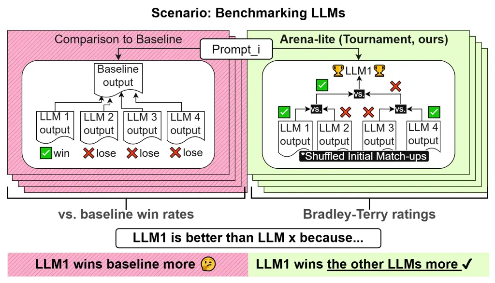
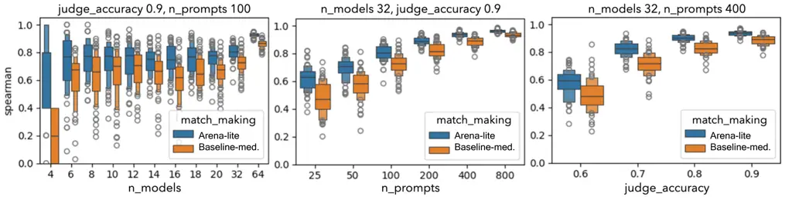
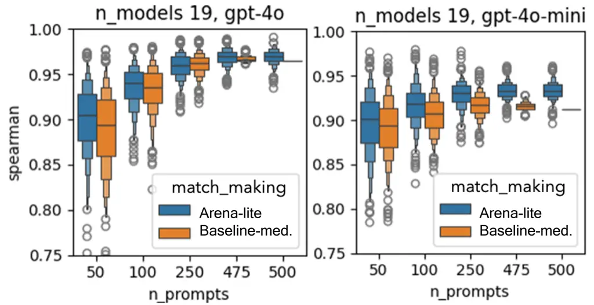
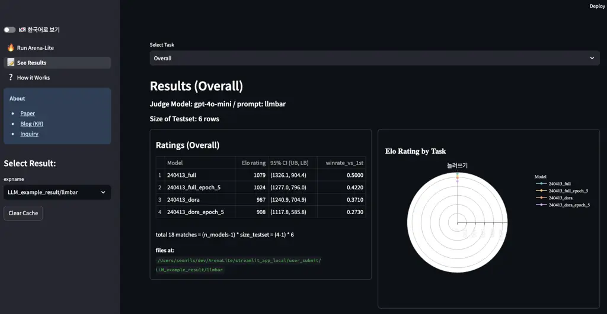
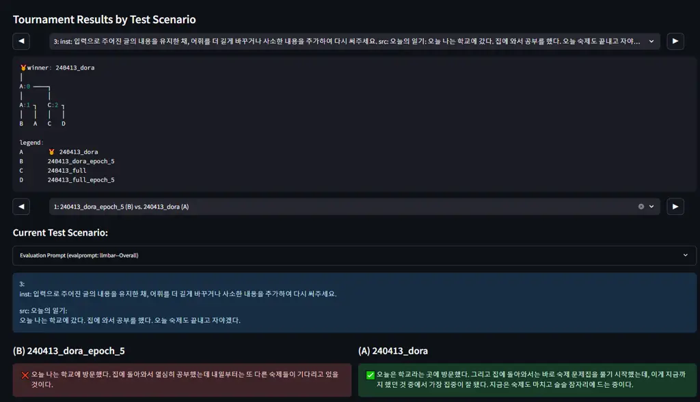
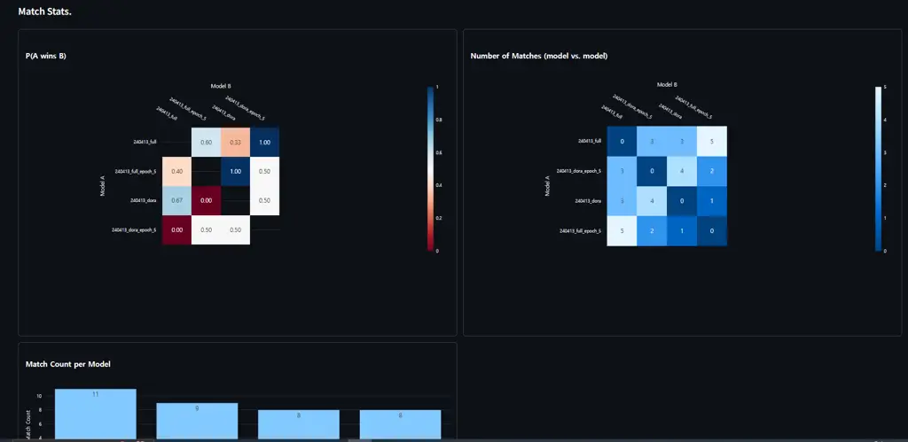
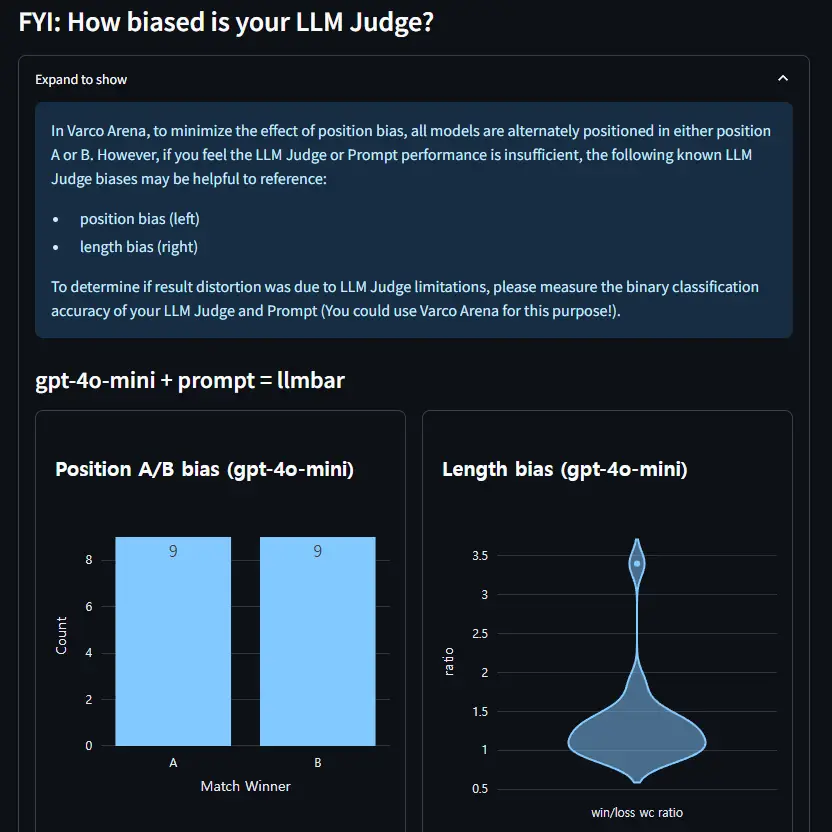
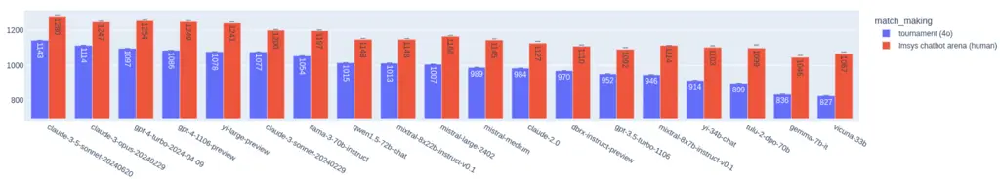
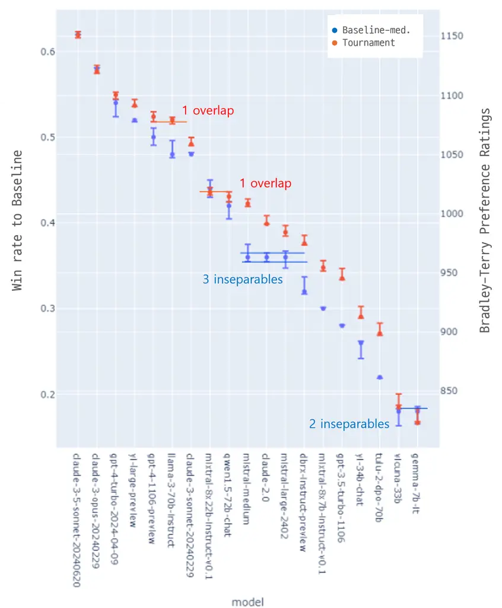
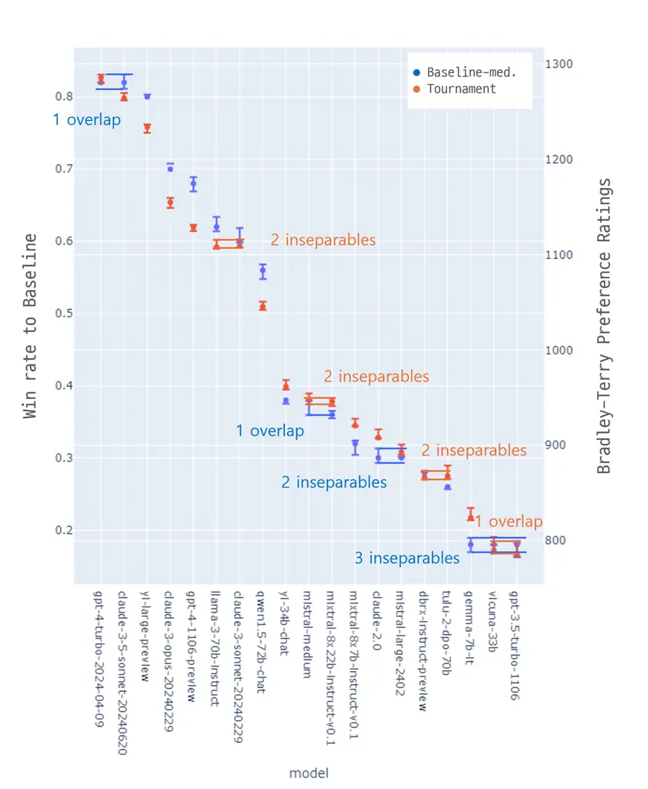

# Arena-Lite: Efficient and Reliable Large Language Model Evaluation via Tournament-Based Direct Comparisons

Seonil Son Affiliation: NC AI Affiliation: RLWRLD Inc.    Ju-Min Oh
Affiliation: NC AI Affiliation: Samsung AI Research    Heegon Jin
Affiliation: NC AI Affiliation: Global AI Platform    Cheolhun Jang
Affiliation: NC AI    Jeongbeom Jeong Affiliation: NC AI    Kuntae Kim
Affiliation: NC AI Affiliation: Samsung Life Insurance^(§)Work performed
primarily while at NC
AICorrespondence:[simon.son@rlwlrd.ai](mailto:simon.son@rlwrld.ai)

###### Abstract

As Large Language Models (LLMs) expand across domains, LLM judges have
become essential for systems evaluation. Current benchmarks typically
compare system outputs against baselines. This baseline-mediated
approach, though convenient, yields lower reliability than direct
comparison between systems. We propose Arena-Lite which integrates
tournament structure on top of head-to-head comparison. The application
of a tournament structure and direct comparison eliminates the need for
baseline outputs, reduces the number of required comparisons, and allows
higher reliability in system rankings. We conducted two experiments: (1)
controlled stochastic modeling and (2) empirical validation with a real
LLM judge. Those experiments collectively demonstrate that Arena-Lite
consistently achieves higher reliability with fewer comparisons, even
with smaller datasets or weaker judges. We release an easy-to-use web
demonstration and code to foster adoption of Arena-Lite, streamlining
model selection across research and industry communities. Arena-Lite
demo and code are available on
[https://huggingface.co/spaces/NCSOFT/ArenaLite](https://huggingface.co/spaces/NCSOFT/ArenaLite)

## 1 Introduction



Figure 1: Arena-Lite directly compares LLM response pairs over multiple
single-elimination tournaments rather than comparing responses to
baseline outputs. In terms of deciding whether a certain LLM is better
or worse compared to the other one, we suggest direct head-to-head
comparison is more intuitive and results in better separability.

|                   |                                    |                                                |
| ----------------- | ---------------------------------- | ---------------------------------------------- | --- | ---- | --- | --- | --- | ------------------------------------------ |
|                   | Total no. matches ($`\downarrow`$) | No. matches per LLM participant ($`\uparrow`$) |
| Current Practice  | $`n\_{\text{model}}\cdot           | X                                              | `$  | $`   | X   | `$  |
| Arena-Lite (ours) | $`(n\_{\text{model}}-1)\cdot       | X                                              | `$  | $`[~ | X   | ,~  | X   | \*\lceil\log*{2}n*{\text{model}}\rceil~]`$ |

Table 1: Comparison between Current practice of benchmarking (comparing
to baseline outputs) and Arena-Lite. $`|X|`$ and $`n_{\text{model}}`$
represents size of benchmark dataset, and number of candidate LLMs to
rank respectively. Arena-Lite, always save \|X\| number of comparisons
for benchmarking, while allows more matches per LLM participant thanks
to head-to-head comparison.

LLMs excel in diverse tasks, from chatbots to code generation, due to
their powerful generative capabilities Ouyang et al. (2022); Roziere
et al. (2023). As their versatility grows, accurately evaluating their
performance becomes critical. To address this, benchmarks like MMLU and
BigBench have emerged to assess LLM capabilities across various
domains Hendrycks et al. (2020); Srivastava et al. (2023). Many of these
benchmarks, such as those for arithmetic or code execution (e.g.,
GSM-Hard, HumanEval Gao et al. (2022); Chen et al. (2021)), use
automated scoring to evaluate problem-solving skills. However, their
focus is not on quality of generated content or limited to the cases
where the generated contents are automatically evaluated (e.g.
programming), which are mostly not the case for variety of generation
tasks. The Chatbot Arena, a leading platform for reliable human
evaluation of LLMs, has set a standard by collecting extensive human
annotations Chiang et al. (2024). Yet, its resource-intensive approach
has prompted efforts to replicate its rankings using LLM judges as a
cost-effective alternative Li et al. (2024); Li et al. (2023). These
methods, however, rely on baseline-mediated comparisons—comparing LLM
outputs to a leading proprietary model’s outputs—which sacrifice
reliability.

Current benchmarks relying on baseline often rank LLMs by their win rate
against baseline responses from an leading proprietary models. This
approach has two advantages: it scales linearly with the number of LLMs
and provides a consistent quality standard. However, we argue that
comparing LLMs directly against each other is inherently more reliable
than using baseline outputs, which can introduce noise coming from weak
transitivity Xu et al. (2025) of human preferences on LLM responses. To
address this, we propose Arena-Lite, a novel evaluation framework that
uses direct, head-to-head comparisons organized in a tournament
structure. By eliminating the need for baseline outputs, Arena-Lite
reduces the number of comparisons required while achieving stronger
alignment with human-established rankings, such as those from Chatbot
Arena.

Arena-Lite conducts single-elimination tournaments among participating
LLMs for each prompt. From the match results, we can compute
Bradley-Terry preference ratings for the final ranking Bradley and Terry
(1952). This results in a single scalar per model that captures relative
performance between any model counterpart, enabling accurate and
efficient ranking. We validate Arena-Lite through two experiments. The
first experiment, stochastic modeling of LLM competition (Section 4.2)
demonstrates that tournament-based direct comparison method outperforms
baseline-mediated method under various conditions, including different
numbers of LLM participants, dataset rows used, and judge accuracies.
Second, our empirical experiment (Section 4.3) shows that Arena-Lite
achieves higher correlation with Chatbot Arena’s rankings than standard
approaches using baseline outputs (Table 1) attested toward number of
LLM as judges. These results collectively highlight Arena-Lite’s ability
to deliver reliable rankings with fewer comparisons, even with smaller
datasets or weaker judges over various generation tasks.

Our contributions are threefold:

1.  1.  We introduce Arena-Lite, a tournament-based framework for direct LLM
        comparisons, offering greater reliability than baseline-mediated
        approaches.
2.  2.  We rigorously demonstrate, through both comprehensive modeling and
        empirical experiments, that Arena-Lite achieves more accurate LLM
        rankings while requiring fewer comparisons than prevalent practices,
        particularly those relying on common baseline model outputs.
3.  3.  We open-source a functional demo and the complete code for
        Arena-Lite
        ([https://huggingface.co/spaces/NCSOFT/ArenaLite](https://huggingface.co/spaces/NCSOFT/ArenaLite)),
        enabling researchers and industry practitioners to easily host and
        utilize our framework for streamlined LLM evaluation.

## 2 Preliminaries: Quantifying Generative Performance

Quantifying the generative capabilities of LLMs is an inherently
challenging task. The evaluation is complicated by the stochasticity of
model outputs and the subjectivity of human judgments. To approximate
real-world performance, a common methodology involves assessing model
outputs across a diverse range of prompts. In this context, two metrics
are widely utilized: the win rate, which measures the frequency of
preference for a model’s output over a baseline, and the Bradley-Terry
model, which is employed to infer a latent skill rating for each model
based on pairwise comparisons.

### 2.1 Measuring Win rate over baseline outputs

Benchmarks like AlpacaEval and Arena-Hard-Auto assess LLM response
quality by comparing it to baseline responses from proprietary model Li
et al. (2023); Li et al. (2024). An LLM judge evaluates whether the
candidate LLM’s response outperforms the baseline for a given prompt.
The win rate—the proportion of prompts where the LLM’s response is
preferred—serves as a measure of its generative ability. While this
approach is straightforward and scalable, it introduces noise coming
from mediated comparisons.

### 2.2 Bradley-Terry Model Preference for LLM Rating

The Bradley-Terry (BT) model Bradley and Terry (1952) is widely used to
infer baseline-mediated rankings of LLMs from pairwise comparisons.
Chatbot Arena adopts the BT model rather than the classical Elo
system Elo and Sloan (1978), but both Elo and BT models are useful for
expecting probability of match outcome based on a score difference,
though they differ in update rules and statistical assumptions.

In the BT model, each LLM is assigned a latent score representing its
procificency. Given LLMs $`i`$ and $`j`$ with scores $`R_{i}`$ and
$`R_{j}`$, respectively, the probability that LLM $`i`$ is preferred
over LLM $`j`$ is modeled as:

```math
\text{P}(i>j)=\frac{1}{1+10^{(R_{j}-R_{i})/400}}. \tag{1}
```

This formulation closely resembles the Elo win-probability function,
reinforcing the intuitive connection between the two.

Chatbot Arena uses this BT-based formulation to rank LLMs by aggregating
human preferences collected through pairwise matchups Chiang et al.
(2024). Users are shown responses from two anonymized models to the same
prompt and asked to select which response they prefer. The accumulated
judgments are then used to fit BT scores, producing a leaderboard that
reflects relative model performance.

While this approach requires a substantial number of human evaluations
to ensure reliability, it captures nuanced quality differences between
models more effectively than purely automatic benchmarks. Arena-Lite,
introduced in the next section, builds on the same BT modeling framework
but seeks to reduce the number of required comparisons by using
tournament-structured match-making.

## 3 Arena-Lite

To address the high annotation cost of Chatbot Arena while preserving
evaluation reliability, we propose Arena-Lite. Arena-Lite introduces a
tournament-based approach for efficient and reliable LLM evaluation
using a single-elimination structure. Unlike baseline-mediated
evaluations that compare model outputs to a baseline, Arena-Lite
directly compares outputs from different models through head-to-head
matchups for each prompt in benchmark datasets. Repeated tournaments
across the dataset produce consistent leaderboards reflecting models’
fundamental performance.

We first discuss limitations of baseline-mediated evaluations (Section
3.1). Next, we describe how Arena-Lite conducts tournaments to generate
ratings (Section 3.2, Algorithm 1). Finally, we highlight similarities
between the single-elimination structure and merge sort, explaining why
aggregated tournaments yield reliable LLM rankings (Section 3.3).

### 3.1 Comparing to Baseline outputs is not Always Helpful

Although baseline outputs are a standard way to evaluate and rank LLMs,
they introduce potential failure modes. Beyond the fact that a single
baseline output might not capture every dimension of appropriate
answers, relying solely on a baseline output can lead to unreliable
rankings of LLMs.

Consider an ideal scenario with a judge capable of perfectly
distinguishing the quality of any two outputs. If we choose to compare
LLM responses directly to rank them using BT preference (Equation 1),
all head-to-head comparisons are utilized. In contrast,
baseline-mediated evaluation for differentiating LLMs can exhibit
failure modes, as shown in Equation 2.

```math
\begin{array}[]{l@{\hspace{2em}}l}\begin{array}[]{l}\text{M}_{1}(X_{i})\\
\quad\text{vs.}\,\rightarrow\\
\text{M}_{2}(X_{i})\end{array}\hfil\hskip 20.00003pt&\begin{cases}\text{M}_{1}(X_{i})>Y_{i}>\text{M}_{2}(X_{i})&\text{(helpful)}\\
\text{M}_{1}(X_{i})<Y_{i}<\text{M}_{2}(X_{i})&\text{(helpful)}\\
\text{M}_{1}(X_{i}),\ \text{M}_{2}(X_{i})>Y_{i}&\text{(unhelpful)}\\
\text{M}_{1}(X_{i}),\ \text{M}_{2}(X_{i})<Y_{i}&\text{(unhelpful)}\end{cases}\end{array} \tag{2}
```

When the baseline output ($`Y_{i}`$) for a prompt ($`X_{i}`$)
successfully disambiguates the pair of LLM responses $`M_{1}(X_{i})`$
and $`M_{2}(X_{i})`$ (as in the first and second cases), comparison to
the baseline is effective for benchmarking. Otherwise, these comparisons
do not help differentiate LLM performance. Consequently, the
baseline-mediated approach provides less information for ranking when
multiple responses are either both correct or both incorrect relative to
the baseline.

### 3.2 Tournaments of LLMs over multiple prompts to preference ratings

1: Models $`M=\{m_{1},m_{2},\ldots,m_{n}\}`$, Prompts
$`X=\{x_{1},x_{2},\ldots,x_{k}\}`$

2: Bradley-Terry preference ratings

3: Initialize $`R\leftarrow\emptyset`$

4: for each $`x_{j}\in X`$ do

5:   $`\texttt{next\_power}\leftarrow 2^{\lceil\log_{2}(|M|)\rceil}`$

6:   $`\texttt{n\_byes}\leftarrow\texttt{next\_power}-|M|`$

7:   $`M^{\prime}\leftarrow M\cup\{\texttt{None}\}^{\texttt{n\_byes}}`$

8:   Randomly shuffle $`M^{\prime}`$

9:   $`\texttt{winner}\leftarrow`$ SingleElim($`M^{\prime}`$, $`x_{j}`$)

10: end for

11: return ComputeBTM($`R`$) $`\triangleright`$ Eq. (1)

12: function SingleElim($`M^{\prime}`$, $`x`$)

13:   if $`|M^{\prime}|=2`$ then

14:    $`\texttt{result}\leftarrow`$ Match($`M^{\prime}[0]`$,
$`M^{\prime}[1]`$, $`x`$)

15:    if $`\texttt{None}\notin M^{\prime}`$ then

16:      Add result to $`R`$

17:    end if

18:    if $`\texttt{result}=\texttt{None}`$ then return
$`[\texttt{None}]`$

19:    elsereturn $`[\texttt{result}[0]]`$

20:    end if

21:   else

22:    $`\texttt{mid}\leftarrow\lfloor|M^{\prime}|/2\rfloor`$

23:    $`\texttt{left}\leftarrow`$
SingleElim($`M^{\prime}[:\texttt{mid}]`$, $`x`$)

24:    $`\texttt{right}\leftarrow`$
SingleElim($`M^{\prime}[\texttt{mid}:]`$, $`x`$) return
SingleElim($`\texttt{left}\cup\texttt{right}`$, $`x`$)

25:   end if

26: end function

27: function Match($`m_{i}`$, $`m_{j}`$, $`x`$)

28:   if $`m_{i}=\texttt{None}`$ and $`m_{j}=\texttt{None}`$ then

29:    return None

30:   else if $`m_{i}=\texttt{None}`$ or $`m_{j}=\texttt{None}`$ then

31:    return $`m_{i}`$ if $`m_{j}=\texttt{None}`$ else $`m_{j}`$

32:   else

33:    $`O_{i}\leftarrow m_{i}(x)`$, $`O_{j}\leftarrow m_{j}(x)`$

34:    if $`O_{j}>O_{i}`$ then return $`(m_{j},m_{i})`$

35:    elsereturn $`(m_{i},m_{j})`$

36: $`\triangleright`$ returns (winner, loser) tuple

37:    end if

38:   end if

39: end function

Algorithm 1 Tournament-Based Model Evaluation

Figure 1 and Algorithm 1 illustrate how Arena-Lite benchmarks LLMs via a
tournament approach. Here, $`|X|`$ denotes the number of prompts in the
benchmark dataset. Running Arena-Lite hosts tournaments among
participant LLMs for every prompt in the dataset.

The use of tournament structures for LLM benchmarking offers both
benefits and challenges. A major advantage of a single-elimination
tournament is efficiency. As shown in Table 1, the number of matches
scales linearly with the number of participants and even lower compared
to using baseline outputs. However, single elimination tournament only
identifies a champion, leaving the relative ordering of other
participants unclear.

To retain tournament’s efficiency while obtaining a fine-grained
ranking, we propose aggregating tournament results over multiple prompts
with randomized initial match-ups for each prompt. Performing multiple
tournaments with random initialization offers several benefits:

1.  1.  It resolves ties among non-champion participants from previous
        tournaments.
2.  2.  It mitigates the impact of unfavorable match-ups in any single
        tournament.
3.  3.  Aggregating match results allows for precise win rate estimation via
        BT preference, resulting in a well-aligned overall ranking.
4.  4.  More matches are allocated to high-performing participants while
        ensuring every participant is evaluated at least once per prompt
        (Table 1).

In Section 3.3, we further explain how aggregating multiple tournaments
could yield reliable ranking of LLMs. We also provide further analysis
on number of comparisons performed over tournaments of Arena-Lite
comparing to merge sort, offering a comprehensive view of the method’s
efficiency and effectiveness.

### 3.3 Why Aggregating Multiple Tournaments Yields Reliable Rankings

A key challenge in LLM evaluation is to derive a reliable ranking from a
feasible number of pairwise comparisons. Our tournament-based approach,
Arena-Lite, is designed to efficiently sample these comparisons. In a
single tournament with n models, each model participates in a minimum of
one match and a maximum of $`\lceil\log_{2}n_{\text{model}}\rceil`$
matches. When conducted over a benchmark with $`|X|`$ distinct prompts,
the total number of evaluations per model is bounded within the interval
$`[|X|,~|X|*\lceil\log_{2}n_{\text{model}}\rceil]`$ as presented in
Table 1. However, the efficiency of this tournament structure raises a
critical question: how does this limited sampling produce a
statistically reliable global ranking?

To achieve reliable rankings of LLMs, our approach aggregates match
outcomes from multiple tournaments, lesser than a full grid comparisons,
but effectively approximating the complete set of pairwise comparisons
required for merge sort. We outline the rationale in four key points:

Merge Sort Baseline A single-elimination tournament mirrors the merging
steps of merge sort, which requires $`\mathcal{O}(n\log n)`$ comparisons
with no duplicate match-ups to rank $`n`$ models. However, a single
tournament omits many comparisons, covering only the minimal match-ups
needed to determine a winner.

Recovering Comparisons via Aggregation By aggregating tournaments over
diverse prompts, we can recover missed pairwise match-ups that should
have occurred. Assuming match outcomes are prompt-independent (as BT
model assumes), matches across prompts are considered equivalent. With
$`|X|`$ prompts (typically hundreds to thousands) and
$`n_{\text{model}}`$ models (tens), only random initial match-ups
totaling $`|X|\cdot\lfloor\frac{n_{\text{model}}}{2}\rfloor`$. This
exceeds the $`\binom{n_{\text{model}}}{2}`$ possible combination,
ensuring broad coverage.

Sufficiency of Comparisons The aggregated match-ups not only cover the
necessary comparisons but also surpass the $`\mathcal{O}(n\log n)`$
requirement of merge sort. Moreover, each unique model pair competes in
average $`|X|/(n_{\text{model}}-1)`$ to
$`\frac{|X|\log_{2}n_{\text{model}}}{n_{\text{model}}-1}`$ matches¹¹ 1
These estimates are computed by number of matches a model undergoes
which is $`[~|X|,~|X|*\lceil\log_{2}n_{\text{model}}\rceil~]`$, devided
by number of possible opponents for a model, $`n_{\text{model}}-1`$
across the benchmark, a frequency mostly sufficient for accurate win
rate estimation.

Refinement for Reliability The remaining matches, totaling
$`|X|\cdot(n_{\text{model}}-1)`$, further refine the ranking by
enhancing win rate estimates, especially among top-performing models,
reducing noise and ensuring robustness akin to Arena-Lite’s sampling
strategy.

In summary, aggregating multiple tournaments reconstructs the full set
of comparisons needed for a merge sort-like ranking while providing
enough repeated match-ups to ensure accurate win rate estimations. This
dual mechanism yields reliable and robust LLM rankings across the
benchmark.

## 4 Experiments

We conducted two experiments to evaluate Arena-Lite against
baseline-mediated benchmarking. The first experiment (Section 4.2)
utilized a stochastic model to simulate LLM competitions, comparing
Arena-Lite’s tournament-based direct comparison with baseline-mediated
evaluation. This controlled setup allowed us to test Arena-Lite’s design
principles, such as the effectiveness of direct versus mediated
comparison (Section 3.1) and tournament-based sampling (3.3), while
isolating variables and minimizing noise, such as LLM judge biases Park
et al. (2024). The second experiment (Section 4.3) validates Arena-Lite
empirically using various LLMs as judges and public benchmark data. We
tested models including gpt-4o, gpt-4o-mini, Claude3.5, Qwen2.5,
Llama3.1, and Gemma2 to assess Arena-Lite’s effectiveness against
standard benchmarking practices. Together, these experiments demonstrate
the superior reliability and efficiency of Arena-Lite’s tournament
approach. Section 4.1 outlines shared experimental settings, followed by
detailed descriptions of each experiment in subsequent subsections.

### 4.1 Chatbot Arena Leaderboard as Ground-Truth Rankings

We benchmark Arena-Lite and baseline-mediated evaluation against
rankings from the Chatbot Arena leaderboard, widely recognized for its
reliability due to extensive human preference annotations. With a large
volume of votes across diverse prompts, these rankings provide a robust
ground truth for model comparisons.

### 4.2 Experiment 1: Controlled Stochastic Modeling of LLM Competitions

We suggest a simple stochastic model based on the Bradley-Terry (BT)
framework to compare Arena-Lite’s approach with baseline-mediated
evaluation. This experiments simulates prompt-agnostic LLM competitions
which follows the Bradley-Terry model’s presumption, with outcomes
determined by a judge following Equation 3. The judge’s decision is
based on the BT preference difference ($`\Delta_{\text{ij}}`$) between
models $`i`$ and $`j`$, and the judge’s accuracy ($`P_{\text{judge}}`$):

```math
\begin{split}P_{\text{predict}}(i>j)&=P_{\text{judge}}\times P_{\text{gt}}(i>j)\\
&=P_{\text{judge}}\times\frac{1}{1+10^{\Delta_{\text{ij}}/400}}\end{split} \tag{3}
```

With the model of judge above (Equation 3), we simulate both
Arena-Lite’s tournament-based approach and baseline-mediated approaches
according to the following initial conditions and procedures.  
Initial conditions:

- •
  Ground-Truth BT Preference: We extracted BT preferences from the
  English category of Chatbot Arena (as of June 23), derived from
  approximately 60% of user-submitted judgments. These preferences serve
  as both the initial model parameters and the ground-truth rankings for
  evaluation.
- •
  Judge Accuracy ($`P_{\text{judge}}`$): We varied judge accuracy from
  0.6 to 0.9.
- •
  Number of LLMs ($`n_{\text{model}}`$) and Dataset Size ($`|X|`$): We
  adjusted the number of participating LLMs and benchmark dataset sizes
  to assess the robustness of both approaches in data-poor and data-rich
  settings.

Simulation Procedure:

1.  1.  Select participant LLMs and their BT preferences.
2.  2.  Compute expected win rates ($`P_{\text{gt}}`$) using Equation 3.
3.  3.  Sample match outcomes based on $`P_{\text{predict}}`$ (Equation 3),
        determined by the BT preference rating gap ($`\Delta_{\text{ij}}`$)
        and judge accuracy ($`P_{\text{judge}}`$).
4.  4.  Repeat for the specified number of test prompts ($`|X|`$).
5.  5.  Compute scores:
    - •
      Baseline-mediated: Win rate against a reference model
      (gpt-4-1106-preview, rating 1233).
    - •
      Arena-Lite: BT preference from all tournament match outcomes.

6.  6.  Rank models based on scores.
7.  7.  Calculate Spearman correlation between simulated and ground-truth
        rankings.

We conducted 50 trials per configuration to account for stochasticity in
initial tournament brackets and judging process.

### 4.3 Experiment 2: Empirical Validation of Arena-Lite with real LLM Judge

To empirically validate our proposal, we evaluated the reliability of
both Arena-Lite and baseline-mediated approach over the top 19 models
from the Chatbot Arena leaderboards. This experiment employs actual
prompt inputs and LLM outputs, distinguishing it from the earlier
simulation study.

#### 4.3.1 Dataset: Test Prompts and LLM Responses Used

Testing the benchmarking approaches requires: (1) test prompts and (2)
the corresponding responses from LLMs. For the benchmark dataset, we
selected Arena-Hard-Auto Li et al. (2024). The prompts in
Arena-Hard-Auto were carefully curated from Chatbot Arena user queries.
This dataset consists of 500 prompts—two instances for each of 250
subtopics. Although AlpacaEval Li et al. (2023), which comprises 800
prompt-reference pairs, could serve as a viable testbed, we opted for
Arena-Hard-Auto because its design aligns more closely with Chatbot
Arena. Arena-Hard-Auto uses responses from gpt-4-0314 as the baseline
outputs. For ranking, we utilized the reserved outputs of the top 20
(=19 + baseline) models from the Arena-Hard-Auto Browser.²² 2 Extracted
from the 2024 Jul 6 commit (fd42026).

#### 4.3.2 Participant LLMs

For ranking, we selected 19 LLMs from the top of the ChatBot Arena
leaderboard in the hard prompts category, as these models most closely
align with Arena-Hard-Auto.

#### 4.3.3 LLM Judges

We used several aligned LLMs as judges for testing both benchmarking
approaches. LLMs of our choice are gpt-4o family of models OpenAI et al.
(2024), Claude3.5, and a selection of open-weight models: Qwen2.5 Qwen
et al. (2025), Llama3.1 Grattafiori et al. (2024), and Gemma2 Team
et al. (2024). For pairwise comparisons of responses, we employed the
judging prompt suggested in LLMBar Zeng et al. (2024) (See Appendix
A.8.2). The same judge prompt was applied consistently across both the
tournament and baseline-mediated approaches. To mitigate position
bias Wu and Aji (2023), the order of model responses was alternated
during evaluation. Further details on the LLM-as-a-judge configuration
are provided in Appendix A.8.

The two experimental settings are summarized as follows:

Experiment 1 (Modeling Experiment): This experiment uses the ground
truth BT preference of the models to initialize the simulation. We vary
control parameters for the benchmarking approaches—including the judge’s
accuracy ($`P_{\text{judge}}`$), the number of test prompts used
($`|X|`$), and the number of participant LLMs ($`n_{\text{model}}`$)—to
determine which benchmarking approach more accurately reproduces the
participants’ ranking. For each configuration, we conduct 50 trials of
experiments.

Experiment 2 (Empirical Validation): This experiment assesses the two
benchmarking approaches using empirical runs with various LLM judges. We
select the top 19 LLMs from Chatbot Arena and used their reserved
outputs on Arena-Hard-Auto test prompts. For both the tournament and
baseline-mediated approaches, we employ the Spearman correlation
coefficient to measure how well the results align with the ground truth
leaderboard rankings. In our empirical study, we conduct 500 trials for
each experimental setting.



Figure 2: Comparison of LLM ranking reliability between Arena-Lite and a
baseline method in a stochastic simulation (Experiment 1, Sec. 4.2).
Ranking reliability is measured by the Spearman correlation
($`\uparrow`$) between the competition-derived ranking and the
ground-truth ranking. Each box plot summarizes the results from 50
trials. The subplots analyze the effect of varying (from left to right)
the number of competing models ($`n_{\text{models}}`$), the number of
prompts ($`n_{\text{prompts}}`$), and the accuracy of the judge
($`P_{\text{judge}}`$). The single-elimination structure of Arena-Lite
results in consistently higher correlation scores.

## 5 Results and Discussion

We assess the reliability and robustness of Arena-Lite as a means for
LLM benchmarking, comparing it against the current baseline-mediated
approach. Our results from both simulation study and empirical runs
indicate that the tournament approach of Arena-Lite yields rankings that
align more closely with the ground-truth Chatbot Arena leaderboards. We
present our findings using whisker plots and tables in the following
sections.

### 5.1 Experiment 1: Modeling Experiment Results

Figure 2 illustrates noticeable differences in Spearman correlation,
indicating that the tournament approach is more reliable than the
baseline-mediated method. The consistent performance gap across various
conditions—namely, the number of participants, the number of test
prompts, and judge accuracy ($`n_{\text{model}}`$, $`|X|`$, and
$`P_{\text{judge}}`$)—demonstrates the robustness of the tournament
approach. Although the simulation simplifies real-world complexity, a
similar performance gap was observed in the empirical findings
(Experiment 2, Figure 3). This consistency suggests that the robust
performance of Arena-Lite is not coincidental or limited to a specific
empirical setting of ours.

### 5.2 Experiment 2: Empirical Validation Results



Figure 3: Ranking reliability of Arena-Lite vs. utilizing baseline
outputs. Arena-Lite consistently demonstrates higher Spearman’s rank
correlation across numbers of benchmark prompts ($`|X|`$), indicating
more reliable ranking. The evaluation was performed using gpt-4o (left)
and gpt-4o-mini (right) as judge models, with a fixed number of models
($`n_{\text{models}}`$=19). Each box plot summarizes the results of 50
runs. (Experiment 2, Sec. 4.3).

As hinted in the previous section, the empirical results in Figure 3
show that Arena-Lite consistently outperforms the baseline-mediated
approach. Although the performance gaps are less pronounced than in the
simulation, the same trend persists. In Table 2, we report the median
values for Arena-Lite and the baseline-mediated approach using the
gpt-4o family of judges while varying the number of test prompts
($`|X|`$). These results consistently demonstrate that Arena-Lite
outperforms the baseline-mediated method. Note that Arena-Lite shows
similar or superior reliability even in extreme data-poor benchmark
condition ($`|X|=50`$).

Table 3 presents the outcomes when using other LLMs as judges, with a
fixed number of prompts ($`|X|=500`$). The results for Claude3.5-sonnet,
Llama3.1-8b, and Qwen2.5-7b follow a similar trend. However, smaller
models (Gemma2-2b and Qwen2.5-0.5b) appears to be less reliable as an
LLM judge. Hence, we recommend using evaluation-specialized judge LLMs
or, at least, generative judge models with around 7B parameters
regardless of using Arena-Lite or considering baseline-mediated
approach.

|                               |       |       |         |       |       |
| ----------------------------- | ----- | ----- | ------- | ----- | ----- | --- | --- |
| Spearman corr. ($`\uparrow`$) | $`    | X     | `$ = 50 | 100   | 250   | 475 | 500 |
| baseline-mediated (4o)        | 0.895 | 0.935 | 0.963   | 0.966 | 0.964 |
| Arena-Lite (4o)               | 0.905 | 0.940 | 0.960   | 0.970 | 0.970 |
| baseline-mediated (4o-mini)   | 0.895 | 0.908 | 0.917   | 0.916 | 0.912 |
| Arena-Lite (4o-mini)          | 0.901 | 0.919 | 0.931   | 0.933 | 0.933 |

Table 2: Robustness of ranking methods to benchmark set size, $`|X|`$
(Experiment 2, Sec. 4.3). The table shows the median Spearman
correlation ($`\uparrow`$) from 500 trials. Arena-Lite consistently
achieves higher correlation than the baseline-mediated approach across
all dataset sizes ($`|X|`$), demonstrating its superior reliability and
robustness for ranking LLMs.

|                   |       |          |                  |                |               |
| ----------------- | ----- | -------- | ---------------- | -------------- | ------------- | --------------- | ------------ |
| $`                | X     | `$ = 500 | claude3.5 sonnet | llama3.1 8b-it | qwen2.5 7b-it | qwen2.5 0.5b-it | gemma2 2b-it |
| baseline-mediated | 0.924 | 0.820    | 0.756            | 0.089          | 0.592         |
| Arena-Lite        | 0.930 | 0.850    | 0.811            | -0.124         | 0.552         |

Table 3: Robustness of ranking methods to the choice of judge LLM
(Experiment 2, Sec. 4.3). The table shows the Spearman correlation
($`\uparrow`$) between ground-truth LLM rankings and the results from
each method. The values are medians from 500 trials. The results suggest
that around 7B parameters-large LLMs is a viable minimum threshold for a
reliable judge. Full results for other benchmark sizes are available in
Appendix, Table 4.

### 5.3 Incorporating a New LLM into an Existing Leaderboard

While our main focus has been on ranking multiple LLMs at once, it is
also useful to consider the common scenario of adding a single new model
to an existing leaderboard, which is also frequent use-case. We explored
two approaches: (1) a binary search-like placement method, and (2) using
the top-performing model response as a baseline. Our findings indicate
that the later approach is more reliable (Table 5, Appendix). Further
details and discussions are provided in Appendix A.6.

## 6 Related Works

### 6.1 LLM-as-a-Judge for Systems Ranking

Utilizing LLM-as-a-Judge as a building block for systems ranking has
become a common practice in the LLM benchmarking community. Several
studies have investigated how LLM judges compare to human evaluators,
examining their similarities and differences Park et al. (2024), as well
as how these differences impact system rankings (e.g., JuStRank Gera
et al. (2024), Gao et al. (2025)). Our research extends these approaches
by proposing a method that orchestrates LLM-as-a-Judge through a
well-established tournament structure to derive rankings among systems.

### 6.2 Efficient and Reliable Evaluation

There is a growing body of research focused on optimizing the number of
evaluations while maintaining reliability when using LLM-as-a-Judge for
system ranking. Perlitz et al. proposed a metric called DIoR to quantify
the relationship between computational costs and system ranking
reliability. UniCBE Yuan et al. (2025) introduced a method to analyze
the relationship between reliability and the number of judge evaluations
based on uncertainty. BenchBench Perlitz et al. (2024b) systematically
analyzed consistency across benchmarks and provided a package to
facilitate this analysis. tinyBenchmarks Maia Polo et al. (2024)
explored strategies to minimize the number of evaluations across various
established benchmarks. Arena-Lite relates to these studies in that it
leverages the properties of tournament structures and direct comparisons
to achieve more reliable results with fewer judge evaluations.

## 7 Conclusion

We introduced Arena-Lite, an efficient and reliable framework for
evaluating Large Language Models (LLMs) through tournament-based direct
comparisons. By eliminating the need for baseline outputs and adopting
head-to-head comparison, Arena-Lite achieves higher reliability in
system rankings with reduced number of comparisons. Our experiments,
encompassing controlled stochastic modeling and empirical validation
with various LLM judges, confirm that Arena-Lite consistently
outperforms standard baseline-mediated evaluation methods, even with
smaller datasets or weaker judges. The release of an accessible web
demonstration and code supports the adoption of Arena-Lite to help
streamlining model development cycle across research and industry.
Future work will extend Arena-Lite’s application to diverse domains,
including multi-modal LLM evaluation involving visual or audio inputs
and outputs.

## Limitations

While we conducted extensive testing to assess the robustness of
Arena-Lite tournaments—including 50 and 500 trials for Experiment 1 and
Experiment 2, respectively—some inherent sources of randomness remain,
such as variation due to initial match bracket assignments. The
randomness in bracket assignment is added for adopting tournament
structure of Arena-Lite and may influence outcome stability. Future work
could explore more informative or adaptive matchmaking strategies that
improve ranking fidelity beyond what is achievable with
single-elimination formats, potentially within the same or even fewer
number of matches.

## References

- Bradley and Terry (1952) Ralph Allan Bradley and Milton E.
  Terry. 1952. [Rank analysis of incomplete block designs: I. the method
  of paired comparisons](https://doi.org/10.2307/2334029). _Biometrika_,
  39(3/4):324–345.
- Chen et al. (2021) Mark Chen, Jerry Tworek, Heewoo Jun, Qiming Yuan,
  Henrique Ponde de Oliveira Pinto, Jared Kaplan, Harri Edwards, Yuri
  Burda, Nicholas Joseph, Greg Brockman, Alex Ray, Raul Puri, Gretchen
  Krueger, Michael Petrov, Heidy Khlaaf, Girish Sastry, Pamela Mishkin,
  Brooke Chan, Scott Gray, Nick Ryder, Mikhail Pavlov, Alethea Power,
  Lukasz Kaiser, Mohammad Bavarian, Clemens Winter, Philippe Tillet,
  Felipe Petroski Such, Dave Cummings, Matthias Plappert, Fotios
  Chantzis, Elizabeth Barnes, Ariel Herbert-Voss, William Hebgen Guss,
  Alex Nichol, Alex Paino, Nikolas Tezak, Jie Tang, Igor Babuschkin,
  Suchir Balaji, Shantanu Jain, William Saunders, Christopher Hesse,
  Andrew N. Carr, Jan Leike, Josh Achiam, Vedant Misra, Evan Morikawa,
  Alec Radford, Matthew Knight, Miles Brundage, Mira Murati, Katie
  Mayer, Peter Welinder, Bob McGrew, Dario Amodei, Sam McCandlish, Ilya
  Sutskever, and Wojciech Zaremba. 2021. Evaluating large language
  models trained on code. _arXiv preprint arXiv:2107.03374_.
- Chiang et al. (2024) Wei-Lin Chiang, Lianmin Zheng, Ying Sheng,
  Anastasios Nikolas Angelopoulos, Tianle Li, Dacheng Li, Hao Zhang,
  Banghua Zhu, Michael Jordan, Joseph E. Gonzalez, and Ion Stoica. 2024.
  [Chatbot arena: An open platform for evaluating llms by human
  preference](https://arxiv.org/abs/2403.04132). _Preprint_,
  arXiv:2403.04132.
- Elo and Sloan (1978) Arpad E Elo and Sam Sloan. 1978. The rating of
  chessplayers: Past and present. _(No Title)_.
- Gao et al. (2022) Luyu Gao, Aman Madaan, Shuyan Zhou, Uri Alon,
  Pengfei Liu, Yiming Yang, Jamie Callan, and Graham Neubig. 2022. Pal:
  Program-aided language models. _arXiv preprint arXiv:2211.10435_.
- Gao et al. (2025) Mingqi Gao, Yixin Liu, Xinyu Hu, Xiaojun Wan,
  Jonathan Bragg, and Arman Cohan. 2025. [Re-evaluating automatic LLM
  system ranking for alignment with human
  preference](https://aclanthology.org/2025.findings-naacl.260/). In
  _Findings of the Association for Computational Linguistics: NAACL
  2025_, pages 4605–4629, Albuquerque, New Mexico. Association for
  Computational Linguistics.
- Gera et al. (2024) Ariel Gera, Odellia Boni, Yotam Perlitz, Roy
  Bar-Haim, Lilach Eden, and Asaf Yehudai. 2024. Justrank: Benchmarking
  llm judges for system ranking. _arXiv preprint arXiv:2412.09569_.
- Grattafiori et al. (2024) Aaron Grattafiori, Abhimanyu Dubey, Abhinav
  Jauhri, Abhinav Pandey, Abhishek Kadian, Ahmad Al-Dahle, Aiesha
  Letman, Akhil Mathur, Alan Schelten, Alex Vaughan, Amy Yang, Angela
  Fan, Anirudh Goyal, Anthony Hartshorn, Aobo Yang, Archi Mitra, Archie
  Sravankumar, Artem Korenev, Arthur Hinsvark, Arun Rao, Aston Zhang,
  Aurelien Rodriguez, Austen Gregerson, Ava Spataru, Baptiste Roziere,
  Bethany Biron, Binh Tang, Bobbie Chern, Charlotte Caucheteux, Chaya
  Nayak, Chloe Bi, Chris Marra, Chris McConnell, Christian Keller,
  Christophe Touret, Chunyang Wu, Corinne Wong, Cristian Canton Ferrer,
  Cyrus Nikolaidis, Damien Allonsius, Daniel Song, Danielle Pintz, Danny
  Livshits, Danny Wyatt, David Esiobu, Dhruv Choudhary, Dhruv Mahajan,
  Diego Garcia-Olano, Diego Perino, Dieuwke Hupkes, Egor Lakomkin, Ehab
  AlBadawy, Elina Lobanova, Emily Dinan, Eric Michael Smith, Filip
  Radenovic, Francisco Guzmán, Frank Zhang, Gabriel Synnaeve, Gabrielle
  Lee, Georgia Lewis Anderson, Govind Thattai, Graeme Nail, Gregoire
  Mialon, Guan Pang, Guillem Cucurell, Hailey Nguyen, Hannah Korevaar,
  Hu Xu, Hugo Touvron, Iliyan Zarov, Imanol Arrieta Ibarra, Isabel
  Kloumann, Ishan Misra, Ivan Evtimov, Jack Zhang, Jade Copet, Jaewon
  Lee, Jan Geffert, Jana Vranes, Jason Park, Jay Mahadeokar, Jeet Shah,
  Jelmer van der Linde, Jennifer Billock, Jenny Hong, Jenya Lee, Jeremy
  Fu, Jianfeng Chi, Jianyu Huang, Jiawen Liu, Jie Wang, Jiecao Yu,
  Joanna Bitton, Joe Spisak, Jongsoo Park, Joseph Rocca, Joshua
  Johnstun, Joshua Saxe, Junteng Jia, Kalyan Vasuden Alwala, Karthik
  Prasad, Kartikeya Upasani, Kate Plawiak, Ke Li, Kenneth Heafield,
  Kevin Stone, Khalid El-Arini, Krithika Iyer, Kshitiz Malik, Kuenley
  Chiu, Kunal Bhalla, Kushal Lakhotia, Lauren Rantala-Yeary, Laurens
  van der Maaten, Lawrence Chen, Liang Tan, Liz Jenkins, Louis Martin,
  Lovish Madaan, Lubo Malo, Lukas Blecher, Lukas Landzaat, Luke
  de Oliveira, Madeline Muzzi, Mahesh Pasupuleti, Mannat Singh, Manohar
  Paluri, Marcin Kardas, Maria Tsimpoukelli, Mathew Oldham, Mathieu
  Rita, Maya Pavlova, Melanie Kambadur, Mike Lewis, Min Si, Mitesh Kumar
  Singh, Mona Hassan, Naman Goyal, Narjes Torabi, Nikolay Bashlykov,
  Nikolay Bogoychev, Niladri Chatterji, Ning Zhang, Olivier Duchenne,
  Onur Çelebi, Patrick Alrassy, Pengchuan Zhang, Pengwei Li, Petar
  Vasic, Peter Weng, Prajjwal Bhargava, Pratik Dubal, Praveen Krishnan,
  Punit Singh Koura, Puxin Xu, Qing He, Qingxiao Dong, Ragavan
  Srinivasan, Raj Ganapathy, Ramon Calderer, Ricardo Silveira Cabral,
  Robert Stojnic, Roberta Raileanu, Rohan Maheswari, Rohit Girdhar,
  Rohit Patel, Romain Sauvestre, Ronnie Polidoro, Roshan Sumbaly, Ross
  Taylor, Ruan Silva, Rui Hou, Rui Wang, Saghar Hosseini, Sahana
  Chennabasappa, Sanjay Singh, Sean Bell, Seohyun Sonia Kim, Sergey
  Edunov, Shaoliang Nie, Sharan Narang, Sharath Raparthy, Sheng Shen,
  Shengye Wan, Shruti Bhosale, Shun Zhang, Simon Vandenhende, Soumya
  Batra, Spencer Whitman, Sten Sootla, Stephane Collot, Suchin
  Gururangan, Sydney Borodinsky, Tamar Herman, Tara Fowler, Tarek
  Sheasha, Thomas Georgiou, Thomas Scialom, Tobias Speckbacher, Todor
  Mihaylov, Tong Xiao, Ujjwal Karn, Vedanuj Goswami, Vibhor Gupta,
  Vignesh Ramanathan, Viktor Kerkez, Vincent Gonguet, Virginie Do, Vish
  Vogeti, Vítor Albiero, Vladan Petrovic, Weiwei Chu, Wenhan Xiong,
  Wenyin Fu, Whitney Meers, Xavier Martinet, Xiaodong Wang, Xiaofang
  Wang, Xiaoqing Ellen Tan, Xide Xia, Xinfeng Xie, Xuchao Jia, Xuewei
  Wang, Yaelle Goldschlag, Yashesh Gaur, Yasmine Babaei, Yi Wen, Yiwen
  Song, Yuchen Zhang, Yue Li, Yuning Mao, Zacharie Delpierre Coudert,
  Zheng Yan, Zhengxing Chen, Zoe Papakipos, Aaditya Singh, Aayushi
  Srivastava, Abha Jain, Adam Kelsey, Adam Shajnfeld, Adithya Gangidi,
  Adolfo Victoria, Ahuva Goldstand, Ajay Menon, Ajay Sharma, Alex
  Boesenberg, Alexei Baevski, Allie Feinstein, Amanda Kallet, Amit
  Sangani, Amos Teo, Anam Yunus, Andrei Lupu, Andres Alvarado, Andrew
  Caples, Andrew Gu, Andrew Ho, Andrew Poulton, Andrew Ryan, Ankit
  Ramchandani, Annie Dong, Annie Franco, Anuj Goyal, Aparajita Saraf,
  Arkabandhu Chowdhury, Ashley Gabriel, Ashwin Bharambe, Assaf Eisenman,
  Azadeh Yazdan, Beau James, Ben Maurer, Benjamin Leonhardi, Bernie
  Huang, Beth Loyd, Beto De Paola, Bhargavi Paranjape, Bing Liu, Bo Wu,
  Boyu Ni, Braden Hancock, Bram Wasti, Brandon Spence, Brani Stojkovic,
  Brian Gamido, Britt Montalvo, Carl Parker, Carly Burton, Catalina
  Mejia, Ce Liu, Changhan Wang, Changkyu Kim, Chao Zhou, Chester Hu,
  Ching-Hsiang Chu, Chris Cai, Chris Tindal, Christoph Feichtenhofer,
  Cynthia Gao, Damon Civin, Dana Beaty, Daniel Kreymer, Daniel Li, David
  Adkins, David Xu, Davide Testuggine, Delia David, Devi Parikh, Diana
  Liskovich, Didem Foss, Dingkang Wang, Duc Le, Dustin Holland, Edward
  Dowling, Eissa Jamil, Elaine Montgomery, Eleonora Presani, Emily Hahn,
  Emily Wood, Eric-Tuan Le, Erik Brinkman, Esteban Arcaute, Evan Dunbar,
  Evan Smothers, Fei Sun, Felix Kreuk, Feng Tian, Filippos Kokkinos,
  Firat Ozgenel, Francesco Caggioni, Frank Kanayet, Frank Seide,
  Gabriela Medina Florez, Gabriella Schwarz, Gada Badeer, Georgia Swee,
  Gil Halpern, Grant Herman, Grigory Sizov, Guangyi, Zhang, Guna
  Lakshminarayanan, Hakan Inan, Hamid Shojanazeri, Han Zou, Hannah Wang,
  Hanwen Zha, Haroun Habeeb, Harrison Rudolph, Helen Suk, Henry
  Aspegren, Hunter Goldman, Hongyuan Zhan, Ibrahim Damlaj, Igor Molybog,
  Igor Tufanov, Ilias Leontiadis, Irina-Elena Veliche, Itai Gat, Jake
  Weissman, James Geboski, James Kohli, Janice Lam, Japhet Asher,
  Jean-Baptiste Gaya, Jeff Marcus, Jeff Tang, Jennifer Chan, Jenny Zhen,
  Jeremy Reizenstein, Jeremy Teboul, Jessica Zhong, Jian Jin, Jingyi
  Yang, Joe Cummings, Jon Carvill, Jon Shepard, Jonathan McPhie,
  Jonathan Torres, Josh Ginsburg, Junjie Wang, Kai Wu, Kam Hou U, Karan
  Saxena, Kartikay Khandelwal, Katayoun Zand, Kathy Matosich, Kaushik
  Veeraraghavan, Kelly Michelena, Keqian Li, Kiran Jagadeesh, Kun Huang,
  Kunal Chawla, Kyle Huang, Lailin Chen, Lakshya Garg, Lavender A,
  Leandro Silva, Lee Bell, Lei Zhang, Liangpeng Guo, Licheng Yu, Liron
  Moshkovich, Luca Wehrstedt, Madian Khabsa, Manav Avalani, Manish
  Bhatt, Martynas Mankus, Matan Hasson, Matthew Lennie, Matthias Reso,
  Maxim Groshev, Maxim Naumov, Maya Lathi, Meghan Keneally, Miao Liu,
  Michael L. Seltzer, Michal Valko, Michelle Restrepo, Mihir Patel, Mik
  Vyatskov, Mikayel Samvelyan, Mike Clark, Mike Macey, Mike Wang,
  Miquel Jubert Hermoso, Mo Metanat, Mohammad Rastegari, Munish Bansal,
  Nandhini Santhanam, Natascha Parks, Natasha White, Navyata Bawa, Nayan
  Singhal, Nick Egebo, Nicolas Usunier, Nikhil Mehta, Nikolay Pavlovich
  Laptev, Ning Dong, Norman Cheng, Oleg Chernoguz, Olivia Hart, Omkar
  Salpekar, Ozlem Kalinli, Parkin Kent, Parth Parekh, Paul Saab, Pavan
  Balaji, Pedro Rittner, Philip Bontrager, Pierre Roux, Piotr Dollar,
  Polina Zvyagina, Prashant Ratanchandani, Pritish Yuvraj, Qian Liang,
  Rachad Alao, Rachel Rodriguez, Rafi Ayub, Raghotham Murthy, Raghu
  Nayani, Rahul Mitra, Rangaprabhu Parthasarathy, Raymond Li, Rebekkah
  Hogan, Robin Battey, Rocky Wang, Russ Howes, Ruty Rinott, Sachin
  Mehta, Sachin Siby, Sai Jayesh Bondu, Samyak Datta, Sara Chugh, Sara
  Hunt, Sargun Dhillon, Sasha Sidorov, Satadru Pan, Saurabh Mahajan,
  Saurabh Verma, Seiji Yamamoto, Sharadh Ramaswamy, Shaun Lindsay, Shaun
  Lindsay, Sheng Feng, Shenghao Lin, Shengxin Cindy Zha, Shishir Patil,
  Shiva Shankar, Shuqiang Zhang, Shuqiang Zhang, Sinong Wang, Sneha
  Agarwal, Soji Sajuyigbe, Soumith Chintala, Stephanie Max, Stephen
  Chen, Steve Kehoe, Steve Satterfield, Sudarshan Govindaprasad, Sumit
  Gupta, Summer Deng, Sungmin Cho, Sunny Virk, Suraj Subramanian,
  Sy Choudhury, Sydney Goldman, Tal Remez, Tamar Glaser, Tamara Best,
  Thilo Koehler, Thomas Robinson, Tianhe Li, Tianjun Zhang, Tim
  Matthews, Timothy Chou, Tzook Shaked, Varun Vontimitta, Victoria
  Ajayi, Victoria Montanez, Vijai Mohan, Vinay Satish Kumar, Vishal
  Mangla, Vlad Ionescu, Vlad Poenaru, Vlad Tiberiu Mihailescu, Vladimir
  Ivanov, Wei Li, Wenchen Wang, Wenwen Jiang, Wes Bouaziz, Will
  Constable, Xiaocheng Tang, Xiaojian Wu, Xiaolan Wang, Xilun Wu, Xinbo
  Gao, Yaniv Kleinman, Yanjun Chen, Ye Hu, Ye Jia, Ye Qi, Yenda Li,
  Yilin Zhang, Ying Zhang, Yossi Adi, Youngjin Nam, Yu, Wang, Yu Zhao,
  Yuchen Hao, Yundi Qian, Yunlu Li, Yuzi He, Zach Rait, Zachary DeVito,
  Zef Rosnbrick, Zhaoduo Wen, Zhenyu Yang, Zhiwei Zhao, and Zhiyu
  Ma. 2024. [The llama 3 herd of
  models](https://arxiv.org/abs/2407.21783). _Preprint_,
  arXiv:2407.21783.
- Hendrycks et al. (2020) Dan Hendrycks, Collin Burns, Steven Basart,
  Andy Zou, Mantas Mazeika, Dawn Song, and Jacob Steinhardt. 2020.
  Measuring massive multitask language understanding. In _International
  Conference on Learning Representations_.
- Li et al. (2024) Tianle Li, Wei-Lin Chiang, Evan Frick, Lisa Dunlap,
  Banghua Zhu, Joseph E. Gonzalez, and Ion Stoica. 2024. [From live data
  to high-quality benchmarks: The arena-hard
  pipeline](https://lmsys.org/blog/2024-04-19-arena-hard/).
- Li et al. (2023) Xuechen Li, Tianyi Zhang, Yann Dubois, Rohan Taori,
  Ishaan Gulrajani, Carlos Guestrin, Percy Liang, and Tatsunori B.
  Hashimoto. 2023. Alpacaeval: An automatic evaluator of
  instruction-following models.
  [https://github.com/tatsu-lab/alpaca_eval](https://github.com/tatsu-lab/alpaca_eval).
- Maia Polo et al. (2024) Felipe Maia Polo, Lucas Weber, Leshem Choshen,
  Yuekai Sun, Gongjun Xu, and Mikhail Yurochkin. 2024. tinybenchmarks:
  evaluating llms with fewer examples. _arXiv preprint
  arXiv:2402.14992_.
- OpenAI et al. (2024) OpenAI, :, Aaron Hurst, Adam Lerer, Adam P.
  Goucher, Adam Perelman, Aditya Ramesh, Aidan Clark, AJ Ostrow, Akila
  Welihinda, Alan Hayes, Alec Radford, Aleksander Mądry, Alex
  Baker-Whitcomb, Alex Beutel, Alex Borzunov, Alex Carney, Alex Chow,
  Alex Kirillov, Alex Nichol, Alex Paino, Alex Renzin, Alex Tachard
  Passos, Alexander Kirillov, Alexi Christakis, Alexis Conneau, Ali
  Kamali, Allan Jabri, Allison Moyer, Allison Tam, Amadou Crookes, Amin
  Tootoochian, Amin Tootoonchian, Ananya Kumar, Andrea Vallone, Andrej
  Karpathy, Andrew Braunstein, Andrew Cann, Andrew Codispoti, Andrew
  Galu, Andrew Kondrich, Andrew Tulloch, Andrey Mishchenko, Angela Baek,
  Angela Jiang, Antoine Pelisse, Antonia Woodford, Anuj Gosalia, Arka
  Dhar, Ashley Pantuliano, Avi Nayak, Avital Oliver, Barret Zoph,
  Behrooz Ghorbani, Ben Leimberger, Ben Rossen, Ben Sokolowsky, Ben
  Wang, Benjamin Zweig, Beth Hoover, Blake Samic, Bob McGrew, Bobby
  Spero, Bogo Giertler, Bowen Cheng, Brad Lightcap, Brandon Walkin,
  Brendan Quinn, Brian Guarraci, Brian Hsu, Bright Kellogg, Brydon
  Eastman, Camillo Lugaresi, Carroll Wainwright, Cary Bassin, Cary
  Hudson, Casey Chu, Chad Nelson, Chak Li, Chan Jun Shern, Channing
  Conger, Charlotte Barette, Chelsea Voss, Chen Ding, Cheng Lu, Chong
  Zhang, Chris Beaumont, Chris Hallacy, Chris Koch, Christian Gibson,
  Christina Kim, Christine Choi, Christine McLeavey, Christopher Hesse,
  Claudia Fischer, Clemens Winter, Coley Czarnecki, Colin Jarvis, Colin
  Wei, Constantin Koumouzelis, Dane Sherburn, Daniel Kappler, Daniel
  Levin, Daniel Levy, David Carr, David Farhi, David Mely, David
  Robinson, David Sasaki, Denny Jin, Dev Valladares, Dimitris Tsipras,
  Doug Li, Duc Phong Nguyen, Duncan Findlay, Edede Oiwoh, Edmund Wong,
  Ehsan Asdar, Elizabeth Proehl, Elizabeth Yang, Eric Antonow, Eric
  Kramer, Eric Peterson, Eric Sigler, Eric Wallace, Eugene Brevdo, Evan
  Mays, Farzad Khorasani, Felipe Petroski Such, Filippo Raso, Francis
  Zhang, Fred von Lohmann, Freddie Sulit, Gabriel Goh, Gene Oden, Geoff
  Salmon, Giulio Starace, Greg Brockman, Hadi Salman, Haiming Bao,
  Haitang Hu, Hannah Wong, Haoyu Wang, Heather Schmidt, Heather Whitney,
  Heewoo Jun, Hendrik Kirchner, Henrique Ponde de Oliveira Pinto, Hongyu
  Ren, Huiwen Chang, Hyung Won Chung, Ian Kivlichan, Ian O’Connell, Ian
  O’Connell, Ian Osband, Ian Silber, Ian Sohl, Ibrahim Okuyucu, Ikai
  Lan, Ilya Kostrikov, Ilya Sutskever, Ingmar Kanitscheider, Ishaan
  Gulrajani, Jacob Coxon, Jacob Menick, Jakub Pachocki, James Aung,
  James Betker, James Crooks, James Lennon, Jamie Kiros, Jan Leike, Jane
  Park, Jason Kwon, Jason Phang, Jason Teplitz, Jason Wei, Jason Wolfe,
  Jay Chen, Jeff Harris, Jenia Varavva, Jessica Gan Lee, Jessica Shieh,
  Ji Lin, Jiahui Yu, Jiayi Weng, Jie Tang, Jieqi Yu, Joanne Jang,
  Joaquin Quinonero Candela, Joe Beutler, Joe Landers, Joel Parish,
  Johannes Heidecke, John Schulman, Jonathan Lachman, Jonathan McKay,
  Jonathan Uesato, Jonathan Ward, Jong Wook Kim, Joost Huizinga, Jordan
  Sitkin, Jos Kraaijeveld, Josh Gross, Josh Kaplan, Josh Snyder, Joshua
  Achiam, Joy Jiao, Joyce Lee, Juntang Zhuang, Justyn Harriman, Kai
  Fricke, Kai Hayashi, Karan Singhal, Katy Shi, Kavin Karthik, Kayla
  Wood, Kendra Rimbach, Kenny Hsu, Kenny Nguyen, Keren Gu-Lemberg, Kevin
  Button, Kevin Liu, Kiel Howe, Krithika Muthukumar, Kyle Luther, Lama
  Ahmad, Larry Kai, Lauren Itow, Lauren Workman, Leher Pathak, Leo Chen,
  Li Jing, Lia Guy, Liam Fedus, Liang Zhou, Lien Mamitsuka, Lilian Weng,
  Lindsay McCallum, Lindsey Held, Long Ouyang, Louis Feuvrier, Lu Zhang,
  Lukas Kondraciuk, Lukasz Kaiser, Luke Hewitt, Luke Metz, Lyric Doshi,
  Mada Aflak, Maddie Simens, Madelaine Boyd, Madeleine Thompson, Marat
  Dukhan, Mark Chen, Mark Gray, Mark Hudnall, Marvin Zhang, Marwan
  Aljubeh, Mateusz Litwin, Matthew Zeng, Max Johnson, Maya Shetty,
  Mayank Gupta, Meghan Shah, Mehmet Yatbaz, Meng Jia Yang, Mengchao
  Zhong, Mia Glaese, Mianna Chen, Michael Janner, Michael Lampe, Michael
  Petrov, Michael Wu, Michele Wang, Michelle Fradin, Michelle Pokrass,
  Miguel Castro, Miguel Oom Temudo de Castro, Mikhail Pavlov, Miles
  Brundage, Miles Wang, Minal Khan, Mira Murati, Mo Bavarian, Molly Lin,
  Murat Yesildal, Nacho Soto, Natalia Gimelshein, Natalie Cone, Natalie
  Staudacher, Natalie Summers, Natan LaFontaine, Neil Chowdhury, Nick
  Ryder, Nick Stathas, Nick Turley, Nik Tezak, Niko Felix, Nithanth
  Kudige, Nitish Keskar, Noah Deutsch, Noel Bundick, Nora Puckett, Ofir
  Nachum, Ola Okelola, Oleg Boiko, Oleg Murk, Oliver Jaffe, Olivia
  Watkins, Olivier Godement, Owen Campbell-Moore, Patrick Chao, Paul
  McMillan, Pavel Belov, Peng Su, Peter Bak, Peter Bakkum, Peter Deng,
  Peter Dolan, Peter Hoeschele, Peter Welinder, Phil Tillet, Philip
  Pronin, Philippe Tillet, Prafulla Dhariwal, Qiming Yuan, Rachel Dias,
  Rachel Lim, Rahul Arora, Rajan Troll, Randall Lin, Rapha Gontijo
  Lopes, Raul Puri, Reah Miyara, Reimar Leike, Renaud Gaubert, Reza
  Zamani, Ricky Wang, Rob Donnelly, Rob Honsby, Rocky Smith, Rohan
  Sahai, Rohit Ramchandani, Romain Huet, Rory Carmichael, Rowan Zellers,
  Roy Chen, Ruby Chen, Ruslan Nigmatullin, Ryan Cheu, Saachi Jain, Sam
  Altman, Sam Schoenholz, Sam Toizer, Samuel Miserendino, Sandhini
  Agarwal, Sara Culver, Scott Ethersmith, Scott Gray, Sean Grove, Sean
  Metzger, Shamez Hermani, Shantanu Jain, Shengjia Zhao, Sherwin Wu,
  Shino Jomoto, Shirong Wu, Shuaiqi, Xia, Sonia Phene, Spencer Papay,
  Srinivas Narayanan, Steve Coffey, Steve Lee, Stewart Hall, Suchir
  Balaji, Tal Broda, Tal Stramer, Tao Xu, Tarun Gogineni, Taya
  Christianson, Ted Sanders, Tejal Patwardhan, Thomas Cunninghman,
  Thomas Degry, Thomas Dimson, Thomas Raoux, Thomas Shadwell, Tianhao
  Zheng, Todd Underwood, Todor Markov, Toki Sherbakov, Tom Rubin, Tom
  Stasi, Tomer Kaftan, Tristan Heywood, Troy Peterson, Tyce Walters,
  Tyna Eloundou, Valerie Qi, Veit Moeller, Vinnie Monaco, Vishal Kuo,
  Vlad Fomenko, Wayne Chang, Weiyi Zheng, Wenda Zhou, Wesam Manassra,
  Will Sheu, Wojciech Zaremba, Yash Patil, Yilei Qian, Yongjik Kim,
  Youlong Cheng, Yu Zhang, Yuchen He, Yuchen Zhang, Yujia Jin, Yunxing
  Dai, and Yury Malkov. 2024. [Gpt-4o system
  card](https://arxiv.org/abs/2410.21276). _Preprint_, arXiv:2410.21276.
- Ouyang et al. (2022) Long Ouyang, Jeffrey Wu, Xu Jiang, Diogo Almeida,
  Carroll Wainwright, Pamela Mishkin, Chong Zhang, Sandhini Agarwal,
  Katarina Slama, Alex Ray, et al. 2022. Training language models to
  follow instructions with human feedback. _Advances in neural
  information processing systems_, 35:27730–27744.
- Park et al. (2024) Junsoo Park, Seungyeon Jwa, Meiying Ren, Daeyoung
  Kim, and Sanghyuk Choi. 2024. [Offsetbias: Leveraging debiased data
  for tuning evaluators](https://arxiv.org/abs/2407.06551). _Preprint_,
  arXiv:2407.06551.
- Perlitz et al. (2024a) Yotam Perlitz, Elron Bandel, Ariel Gera, Ofir
  Arviv, Liat Ein-Dor, Eyal Shnarch, Noam Slonim, Michal
  Shmueli-Scheuer, and Leshem Choshen. 2024a. [Efficient benchmarking
  (of language
  models)](https://doi.org/10.18653/v1/2024.naacl-long.139). In
  _Proceedings of the 2024 Conference of the North American Chapter of
  the Association for Computational Linguistics: Human Language
  Technologies (Volume 1: Long Papers)_, pages 2519–2536, Mexico City,
  Mexico. Association for Computational Linguistics.
- Perlitz et al. (2024b) Yotam Perlitz, Ariel Gera, Ofir Arviv, Asaf
  Yehudai, Elron Bandel, Eyal Shnarch, Michal Shmueli-Scheuer, and
  Leshem Choshen. 2024b. [Do these llm benchmarks agree? fixing
  benchmark evaluation with
  benchbench](https://arxiv.org/abs/2407.13696). _Preprint_,
  arXiv:2407.13696.
- Qwen et al. (2025) Qwen, :, An Yang, Baosong Yang, Beichen Zhang,
  Binyuan Hui, Bo Zheng, Bowen Yu, Chengyuan Li, Dayiheng Liu, Fei
  Huang, Haoran Wei, Huan Lin, Jian Yang, Jianhong Tu, Jianwei Zhang,
  Jianxin Yang, Jiaxi Yang, Jingren Zhou, Junyang Lin, Kai Dang, Keming
  Lu, Keqin Bao, Kexin Yang, Le Yu, Mei Li, Mingfeng Xue, Pei Zhang, Qin
  Zhu, Rui Men, Runji Lin, Tianhao Li, Tianyi Tang, Tingyu Xia,
  Xingzhang Ren, Xuancheng Ren, Yang Fan, Yang Su, Yichang Zhang,
  Yu Wan, Yuqiong Liu, Zeyu Cui, Zhenru Zhang, and Zihan Qiu. 2025.
  [Qwen2.5 technical report](https://arxiv.org/abs/2412.15115).
  _Preprint_, arXiv:2412.15115.
- Roziere et al. (2023) Baptiste Roziere, Jonas Gehring, Fabian
  Gloeckle, Sten Sootla, Itai Gat, Xiaoqing Ellen Tan, Yossi Adi, Jingyu
  Liu, Tal Remez, Jérémy Rapin, et al. 2023. Code llama: Open foundation
  models for code. _arXiv preprint arXiv:2308.12950_.
- Srivastava et al. (2023) Aarohi Srivastava, Abhinav Rastogi, Abhishek
  Rao, Abu Awal Md Shoeb, Abubakar Abid, Adam Fisch, Adam R Brown, Adam
  Santoro, Aditya Gupta, Adrià Garriga-Alonso, et al. 2023. Beyond the
  imitation game: Quantifying and extrapolating the capabilities of
  language models. _Transactions on Machine Learning Research_.
- Team et al. (2024) Gemma Team, Morgane Riviere, Shreya Pathak,
  Pier Giuseppe Sessa, Cassidy Hardin, Surya Bhupatiraju, Léonard
  Hussenot, Thomas Mesnard, Bobak Shahriari, Alexandre Ramé, Johan
  Ferret, Peter Liu, Pouya Tafti, Abe Friesen, Michelle Casbon, Sabela
  Ramos, Ravin Kumar, Charline Le Lan, Sammy Jerome, Anton Tsitsulin,
  Nino Vieillard, Piotr Stanczyk, Sertan Girgin, Nikola Momchev, Matt
  Hoffman, Shantanu Thakoor, Jean-Bastien Grill, Behnam Neyshabur,
  Olivier Bachem, Alanna Walton, Aliaksei Severyn, Alicia Parrish, Aliya
  Ahmad, Allen Hutchison, Alvin Abdagic, Amanda Carl, Amy Shen, Andy
  Brock, Andy Coenen, Anthony Laforge, Antonia Paterson, Ben Bastian,
  Bilal Piot, Bo Wu, Brandon Royal, Charlie Chen, Chintu Kumar, Chris
  Perry, Chris Welty, Christopher A. Choquette-Choo, Danila
  Sinopalnikov, David Weinberger, Dimple Vijaykumar, Dominika
  Rogozińska, Dustin Herbison, Elisa Bandy, Emma Wang, Eric Noland,
  Erica Moreira, Evan Senter, Evgenii Eltyshev, Francesco Visin, Gabriel
  Rasskin, Gary Wei, Glenn Cameron, Gus Martins, Hadi Hashemi, Hanna
  Klimczak-Plucińska, Harleen Batra, Harsh Dhand, Ivan Nardini, Jacinda
  Mein, Jack Zhou, James Svensson, Jeff Stanway, Jetha Chan, Jin Peng
  Zhou, Joana Carrasqueira, Joana Iljazi, Jocelyn Becker, Joe Fernandez,
  Joost van Amersfoort, Josh Gordon, Josh Lipschultz, Josh Newlan,
  Ju yeong Ji, Kareem Mohamed, Kartikeya Badola, Kat Black, Katie
  Millican, Keelin McDonell, Kelvin Nguyen, Kiranbir Sodhia, Kish
  Greene, Lars Lowe Sjoesund, Lauren Usui, Laurent Sifre, Lena
  Heuermann, Leticia Lago, Lilly McNealus, Livio Baldini Soares, Logan
  Kilpatrick, Lucas Dixon, Luciano Martins, Machel Reid, Manvinder
  Singh, Mark Iverson, Martin Görner, Mat Velloso, Mateo Wirth, Matt
  Davidow, Matt Miller, Matthew Rahtz, Matthew Watson, Meg Risdal,
  Mehran Kazemi, Michael Moynihan, Ming Zhang, Minsuk Kahng, Minwoo
  Park, Mofi Rahman, Mohit Khatwani, Natalie Dao, Nenshad Bardoliwalla,
  Nesh Devanathan, Neta Dumai, Nilay Chauhan, Oscar Wahltinez, Pankil
  Botarda, Parker Barnes, Paul Barham, Paul Michel, Pengchong Jin, Petko
  Georgiev, Phil Culliton, Pradeep Kuppala, Ramona Comanescu, Ramona
  Merhej, Reena Jana, Reza Ardeshir Rokni, Rishabh Agarwal, Ryan
  Mullins, Samaneh Saadat, Sara Mc Carthy, Sarah Cogan, Sarah Perrin,
  Sébastien M. R. Arnold, Sebastian Krause, Shengyang Dai, Shruti Garg,
  Shruti Sheth, Sue Ronstrom, Susan Chan, Timothy Jordan, Ting Yu, Tom
  Eccles, Tom Hennigan, Tomas Kocisky, Tulsee Doshi, Vihan Jain, Vikas
  Yadav, Vilobh Meshram, Vishal Dharmadhikari, Warren Barkley, Wei Wei,
  Wenming Ye, Woohyun Han, Woosuk Kwon, Xiang Xu, Zhe Shen, Zhitao Gong,
  Zichuan Wei, Victor Cotruta, Phoebe Kirk, Anand Rao, Minh Giang,
  Ludovic Peran, Tris Warkentin, Eli Collins, Joelle Barral, Zoubin
  Ghahramani, Raia Hadsell, D. Sculley, Jeanine Banks, Anca Dragan, Slav
  Petrov, Oriol Vinyals, Jeff Dean, Demis Hassabis, Koray Kavukcuoglu,
  Clement Farabet, Elena Buchatskaya, Sebastian Borgeaud, Noah Fiedel,
  Armand Joulin, Kathleen Kenealy, Robert Dadashi, and Alek
  Andreev. 2024. [Gemma 2: Improving open language models at a practical
  size](https://arxiv.org/abs/2408.00118). _Preprint_, arXiv:2408.00118.
- Wu and Aji (2023) Minghao Wu and Alham Fikri Aji. 2023. [Style over
  substance: Evaluation biases for large language
  models](https://arxiv.org/abs/2307.03025). _Preprint_,
  arXiv:2307.03025.
- Xu et al. (2025) Yi Xu, Laura Ruis, Tim Rocktäschel, and Robert
  Kirk. 2025. [Investigating non-transitivity in
  llm-as-a-judge](https://arxiv.org/abs/2502.14074). _Preprint_,
  arXiv:2502.14074.
- Yuan et al. (2025) Peiwen Yuan, Shaoxiong Feng, Yiwei Li, Xinglin
  Wang, Yueqi Zhang, Jiayi Shi, Chuyi Tan, Boyuan Pan, Yao Hu, and Kan
  Li. 2025. [Unicbe: An uniformity-driven comparing based evaluation
  framework with unified multi-objective
  optimization](https://arxiv.org/abs/2502.11454). _Preprint_,
  arXiv:2502.11454.
- Zeng et al. (2024) Zhiyuan Zeng, Jiatong Yu, Tianyu Gao, Yu Meng,
  Tanya Goyal, and Danqi Chen. 2024. Evaluating large language models at
  evaluating instruction following. In _International Conference on
  Learning Representations (ICLR)_.

## Appendix A Appendix

### A.1 Arena-Lite Web Demo

We provide screenshots of Arena-Lite web demo here ([link to Huggingface
Space](https://huggingface.co/spaces/NCSOFT/ArenaLite)). You could try
or locally host Arena-Lite according to its documentation. It is quite
easy to use and do not require much of resources to host.

Arena-Lite provides the benchmark result (Figure 4) with helpful
visualization interface that enables walking through the matches and
tournaments one by one (Figure 5) and match statistics between LLMs
(Figure 6). We also provide visualization that helps examining potential
bias of LLM Judge being used (Figure 7).



Figure 4: Arena-Lite web screenshot 1: At the top of the result page,
one can see the leaderboard of LLMs with their BT preference. If the
benchmark dataset has subcategories, radar chart (right) is also
visible.



Figure 5: Arena-Lite web screenshot 2: User can walk through the matches
and tournaments one by one. Match brackets is visualized briefly with
text UI and user can select any specific match to see the details (e.g.
match result, prompt, and model outputs).



Figure 6: Arena-Lite web screenshot 3: User can see the match statistics
between LLMs (i.e. win rate between model pairs, number of matches per
pair and per model).



Figure 7: Arena-Lite web screenshot 4: User can see the LLM Judge’s
examine how biased the LLM judge being used. The demo provides clues for
potential bias toward response length and position.

#### A.1.1 Starter Prompt Set

We provide several judge prompts that we have used for specific target
tasks. Some of those are for quite specialized tasks, and some might
work for evaluating general instruction following. You could customize
your own judge prompt based on your evaluation needs according to the
documentation. The list of the judge prompts we provide is as follows,
and one could see the detailed prompts at yaml files
[here](https://huggingface.co/spaces/NCSOFT/ArenaLite/tree/main/varco_arena/varco_arena_core/prompts).

1.  1.  llmbar prompt (Figure A.8.2) and conciser version of the prompt,
        llmbar_brief. Those are for evaluating instruction following.
2.  2.  translation_pair prompt for selecting translation models trained on
        game-specialized parallel corpora,
3.  3.  rag_pair_kr prompt for evaluating knowledge groundedness of korean
        RAG models over chatting scenario,
4.  4.  translation_fortunecookie prompt which was crafted for evaluating
        translation models specialized for translating fortune-tellings, and
5.  5.  post_edit prompt for evaluating conversation revision based on given
        persona of a speakers given in a instruction, which is quite
        specialized use case.

### A.2 Full table for Experiment 2

Here is the extended results of Experiment 2 (Section 4.3) presented in
Table 3. Aligned LLMs smaller than 7B parameters struggles to work as a
proper Judge. Otherwise, Arena-Lite method excels over common practice
of using outputs from proprietary as baselines.

|              |                   |            |          |         |         |        |
| ------------ | ----------------- | ---------- | -------- | ------- | ------- | ------ |
| Dataset size | method            | claude 3.5 | llama3.1 | qwen2.5 | qwen2.5 | gemma2 |
|              |                   | sonnet     | 8b-it    | 7b-it   | 0.5b-it | 2b-it  |
| 50           | baseline-mediated | .896       | .656     | .492    | .010    | .064   |
|              | Arena-Lite (ours) | .897       | .715     | .544    | -0.051  | -0.088 |
| 100          | baseline-mediated | .912       | .732     | .596    | .002    | .079   |
|              | Arena-Lite (ours) | .918       | .780     | .656    | -0.068  | -0.090 |
| 250          | baseline-mediated | .924       | .801     | .700    | .045    | .560   |
|              | Arena-Lite (ours) | .929       | .830     | .760    | -0.131  | .551   |
| 475          | baseline-mediated | .924       | .819     | .708    | .083    | .112   |
|              | Arena-Lite (ours) | .930       | .845     | .810    | -0.131  | -0.009 |
| 500          | baseline-mediated | .924       | .820     | .756    | .089    | .592   |
|              | Arena-Lite (ours) | .930       | .850     | .811    | -0.124  | .551   |

Table 4: Extended results for comparing Arena-Lite to baseline-mediated
method of using outputs from proprietary models as an baseline. We
tested other LLMs as judge over various size of benchmark datasets.

### A.3 Machine Requirements for Experiments

Except the part we inferenced open-weight models such as Llama, Qwen and
Gemma, our experiments are mostly do not require GPU usage. Inference
are done on one A100 GPU, but T4 would be enough for reproducing our
experiments. Otherwise, our experiments require querying API and
post-processing those with CPU. Experiments could be run on personal
desktops. The lowest specification of the machine we deployed had
i5-8400 CPU, 16 GiB RAM.

### A.4 Assuring Statistical Significance of the Results within Budget for proprietary models

To ensure a statistically significant number of trials for each
experiment while staying within budget, we utilize OpenAI’s Batch API to
prepare full-grid match outcomes (i.e., all-play-all matches for every
prompt) in a cache file, allowing us to reuse these outcomes. Each
empirical experiment consists of 500 trials per setting, with results
represented using whisker plots or summary statistics such as median
values. When experimenting with a subset of the Arena-Hard-Auto
benchmark ($`|X|<500`$), we sample a stratified subset of the benchmark
dataset for each new trial.



Figure 8: BT preference of the model with gpt-4o judge on the full set
of Arena-Hard-Auto Li et al. (2024) prompts. Arena-Lite result
(bootstrapped median over 1000 samples of 500 trials) is in blue,
plotted alongside the ratings from the ground truth leaderboard in red
(Chatbot Arena, Hard prompts category). Error bars are 95% confidence
intervals.

### A.5 BT preference from Arena-Lite compared to Human Annotations

Figure 8 shows the BT preference computed out of Arena-Lite. For judge,
we used gpt-4o. As mentioned in the caption, the BT preference are
bootstrapped median value from 500 trials. 95% confidence intervals also
plotted as an error bar, which look negligible in scale compared to
observed values. Matches are performed over Arena-Hard-Auto benchmark
dataset (500 prompts).

### A.6 Binary search vs. Win rate over baseline

1: Leaderboard $`L`$, new model $`m_{\text{new}}`$, test prompts $`X`$,
outputs $`O_{ij}`$, assumes $`|X|>|L|>n_{\text{comparisons}}`$

2: Updated leaderboard $`L^{\prime}`$ with $`m_{\text{new}}`$ placed

3: $`n_{\text{comparisons}}\leftarrow\lfloor\log_{2}(|L|)\rfloor`$

4:
$`n_{\text{matches}}\leftarrow\lfloor|X|/n_{\text{comparisons}}\rfloor`$

5: function BinarySearchPlacement($`L,m_{\text{new}}`$)

6:   X $`\leftarrow`$ Shuffle(X)

7:   X $`\leftarrow`$ concat(X;X)

8:   low $`\leftarrow 0`$

9:   high $`\leftarrow|L|-1`$

10:   while low $`\leq`$ high do

11:    mid $`\leftarrow\lfloor(\text{low}+\text{high})/2\rfloor`$

12:    wins $`\leftarrow 0`$

13:    for $`i\leftarrow 1`$ to $`n_{\text{matches}}`$ do

14:      $`x\leftarrow`$ $`X`$.pop()

15:      if Match($`m_{\text{new}},L[\text{mid}],x)=m_{\text{new}}`$
then

16:       wins $`\leftarrow`$ wins $`+1`$

17:      end if

18:    end for

19:    if wins $`>n_{\text{matches}}/2`$ then

20:      high $`\leftarrow`$ mid $`-1`$

21:    else if wins $`<n_{\text{matches}}/2`$ then

22:      low $`\leftarrow`$ mid $`+1`$

23:    else if $`|X|>`$0 then

24:      continue $`\triangleright`$ Ensure tie

25:    else

26:      return mid, tie $`\triangleright`$ Tie

27:    end if

28:   end while

29:   return low, non-tie $`\triangleright`$ Position found

30: end function

31: function UpdateLeaderboard($`L,m_{\text{new}}`$)

32:   position, istie $`\leftarrow`$
BinarySearchPlacement($`L,m_{\text{new}}`$)

33:   $`L^{\prime}\leftarrow L`$.insert(position, $`m_{\text{new}}`$,
istie)

34:   return $`L^{\prime}`$

35: end function

Algorithm 2 Binary Search for Enlisting new LLM to a leaderboard

#### A.6.1 Binary Search

We tried binary search placement of a newly added LLM to the leaderboard
without baseline output in Table 6. Details of how we implemented binary
search are attached in Algorithm 2, Appendix. It turns out that binary
search based on already built leaderboard ranks is not as reliable
compared to utilizing the best model’s outputs as a baseline. Therefore,
when adding a newcomer LLM to pre-existent leaderboard, we could utilize
the already submitted responses as a baseline from the 1st placed LLM.

|                         |                       |                      |        |      |
| ----------------------- | --------------------- | -------------------- | ------ | ---- | ---------- | ---------- |
| $`\bar{                 | \Delta\_{\text{rank}} | }`$ ($`\downarrow`$) | gt=1-6 | 7-13 | 14-19 (20) | total avg. |
| binary search (4o)      | 0.92                  | 1.84                 | 2.13   | 1.72 |
| comp. to 1st (4o)       | 1.98                  | 1.55                 | 1.57   | 1.39 |
| binary search (4o-mini) | 1.27                  | 1.82                 | 1.21   | 1.5  |
| comp. to 1st (4o-mini)  | 1.00                  | 1.43                 | 1.43   | 1.37 |

Table 5: Comparison of the binary search method versus using the
top-performing model’s response as a baseline (comp. to 1st) for
inserting a new LLM into the leaderboard. We report the mean rank
deviation ($`\bar{|\Delta_{\text{rank}}|}`$) from the ground-truth
leaderboard as an additional error metric. For further details, see
Algorithm 2 in Appendix.

#### A.6.2 Comparing to the most Performant Model so far: Converting Ratings Table back to Win Rates

Assuming we preserved a set of match results and model outputs from the
last benchmarking, we could benefit from those to perform insertion. One
could pick an appropriate anchor LLM as a baseline in a leaderboard to
estimate the skill of a newcomer. Using previous matches from the
tournaments that built the leaderboard could be used for estimating win
rates over the baseline. This is the same as converting the preference
ratings table into a win rate leaderboard. Since the leaderboard is not
built with full-grid matches but with tournaments, there would be some
missing matches against the baseline regardless we have picked. There
are two ways to estimate the win rate over the baseline model. We could
just count the matches given are enough in amount, or we could also
convert BT preference back to $`P(i>a)`$ to use it directly for scoring
for the model ranks in the leaderboard. Reminding that BT preference
rating is for expecting a likely outcome of the match, this should work.
After this win rate of the newcomer model
$`P^{*}(n>a)=\frac{\text{count(n wins)}}{|X|}`$ could be directly
compared for enlisting.

|               |                       |                     |              |             |              |              |      |
| ------------- | --------------------- | ------------------- | ------------ | ----------- | ------------ | ------------ | ---- | --- | ---- |
| $`            | \Delta\_{\text{rank}} | `$ ($`\downarrow`$) | gt=1         | 2           | 3            | 4            | 5    | 6   | avg. |
| binary search | 0.09                  | 1.24                | 1.75         | 1.55        | 1.26         | 1.10         | 0.92 |
| (4o)          | (.04/-.03)            | (.14/-.14)          | (.09/-.09)   | (.07/-.06)  | (.08/-.08)   | (.10/-.09)   |      |
| anchored      | 0.00                  | 1.01                | 1.95         | 2.00        | 0.96         | 0.30         | 1.98 |
| (4o)          | (0.00/0.00)           | (0.01/-0.01)        | (0.02/-0.02) | (0.00/0.00) | (0.02/-0.02) | (0.04/-0.04) |      |
| binary search | 0.52                  | 0.85                | 0.59         | 2.03        | 1.20         | 2.45         | 1.27 |
| (4o-mini)     | (.09/-.07)            | (.12/-.11)          | (.10/-.09)   | (.02/-.02)  | (.05/-.05)   | (.07/-.06)   |      |
| anchored      | 0.00                  | 0.00                | 1.00         | 2.00        | 2.00         | 1.00         | 1.00 |
| (4o-mini)     | (0.00/0.00)           | (0.00/0.00)         | (0.00/0.00)  | (0.00/0.00) | (0.00/0.00)  | (0.00/0.00)  |      |

|              |              |              |              |              |              |              |      |
| ------------ | ------------ | ------------ | ------------ | ------------ | ------------ | ------------ | ---- |
| 7            | 8            | 9            | 10           | 11           | 12           | 13           | avg. |
| 1.31         | 1.27         | 2.22         | 1.74         | 2.27         | 2.23         | 1.86         | 1.84 |
| (.10/-.10)   | (.11/-.11)   | (.14/-.12)   | (.09/-.09)   | (.12/-.11)   | (.12/-.12)   | (.07/-.07)   |      |
| 0.30         | 3.68         | 1.09         | 1.03         | 2.97         | 0.78         | 1.00         | 1.55 |
| (0.04/-0.04) | (0.04/-0.04) | (0.03/-0.03) | (0.02/-0.01) | (0.02/-0.02) | (0.05/-0.05) | (0.00/0.00)  |      |
| 0.69         | 0.85         | 3.89         | 1.95         | 2.10         | 2.37         | 0.88         | 1.82 |
| (.07/-.06)   | (.09/-.09)   | (.12/-.11)   | (.06/-.05)   | (.03/-.03)   | (.10/-.11)   | (.12/-.11)   |      |
| 0.51         | 0.52         | 3.50         | 1.00         | 1.00         | 3.00         | 0.50         | 1.43 |
| (0.49/-0.51) | (0.48/-0.52) | (0.49/-0.51) | (0.00/0.00)  | (0.00/0.00)  | (0.00/0.00)  | (0.50/-0.50) |      |

|             |             |             |              |             |              |             |      |
| ----------- | ----------- | ----------- | ------------ | ----------- | ------------ | ----------- | ---- |
| 14          | 15          | 16          | 17           | 18          | 19           | 20          | avg. |
| 1.40        | 3.07        | 0.80        | 1.47         | 5.00        | 0.96         | \-          | 2.13 |
| (.04/-.05)  | (.11/-.11)  | (.08/-.09)  | (.05/-.04)   | (.11/-.11)  | (.08/-.09)   |             |      |
| 2.00        | 2.00        | 1.00        | 1.21         | 3.00        | 0.21         | \-          | 1.57 |
| (0.00/0.00) | (0.00/0.00) | (0.00/0.00) | (0.03/-0.04) | (0.00/0.00) | (0.04/-0.03) |             |      |
| 1.45        | 4.20        | 0.19        | 0.08         | 1.09        | 1.08         | 0.40        | 1.21 |
| (.07/-.08)  | (.17/-.17)  | (.07/-.06)  | (.03/-.02)   | (.05/-.05)  | (.05/-.05)   | (.07/-.07)  |      |
| 1.00        | 2.00        | 2.00        | 1.00         | 1.00        | 3.00         | 0.00        | 1.43 |
| (0.00/0.00) | (0.00/0.00) | (0.00/0.00) | (0.00/0.00)  | (0.00/0.00) | (0.00/0.00)  | (0.00/0.00) |      |

Table 6: Binary search vs. Anchored comparison: Mean rank deviation
($`|\Delta_{\text{rank}}|`$) from ground-truth leaderboard. Result of
binary search placement and anchored comparison insert by
gpt-4o\[-mini\] judge are provided with bootstrapped 95% confidence
interval (500 trials, 1000 samples, $`|X|`$=500, Arena-Hard-Auto Li
et al. (2024)).

### A.7 Separability In terms of Confidence Interval

To see how well the two benchmarking approach (anchored comparison and
tournament approach) separates LLMs in adjacent ranks, we provide
scatter plot of Elo rating and win rate paired with error bar (95%
confidence interval). We present the both results of using gpt-4o
(Figure 9) and gpt-4o-mini (Figure 9) as a judge. Inside the each plot,
inseparables indicates the cases where any pair of datapoint co-includes
each other within their range of error bars, and overlap means a certain
datapoint is within some other’s range of error, when it is one-sided.



Figure 9: gpt-4o result of anchored comparison and tournament approach.
1000 bootstrapped median from 500 observations used for confidence
interval estimation.



Figure 10: gpt-4o result of anchored comparison and tournament approach.
1000 bootstrapped median from 500 observations used for confidence
interval estimation.

### A.8 Judge configuration

#### A.8.1 Evaluation Prompt

We use the prompt from LLMBar. The prompt depicted in Figure A.8.2. We
added 4 questions for criteria of our own to Metrics.txt prompt of Zeng
et al. (2024). You can refer to the original prompt in LLMBar github.

#### A.8.2 Decoding Parameters

We did not configure decoding parameters of judge LLMs
(gpt-4o\[-mini\]), which its temperature defaults to 1. The only
parameter we have adjusted is maximum number of tokens to be generated,
which for our prompt is less than 6 (i.e. The output of our prompt is
(a) or (b)). To avoid position bias, we alternated the position of the
responses from a certain model across the benchmark prompt.

PROMPTS = \[ \# metrics.txt from LLMBar  
{  
"role": "system", "content": "You are a helpful assistant in evaluating
the quality of the outputs for a given instruction. Your goal is to
select the best output for the given instruction.",  
},  
{  
"role": "user", "content": """Select the Output (a) or Output (b) that
is better for the given instruction. The two outputs are generated by
two different AI chatbots respectively.

Here are some rules of the evaluation:  
(1) You should prioritize evaluating whether the output
honestly/precisely/closely executes the instruction, then consider its
helpfulness, accuracy, level of detail, harmlessness, etc.  
(2) Outputs should NOT contain more/less than what the instruction asks
for, as such outputs do NOT precisely execute the instruction.  
(3) You should avoid any potential bias and your judgment should be as
objective as possible. For example, the order in which the outputs were
presented should NOT affect your judgment, as Output (a) and Output (b)
are \*\*equally likely\*\* to be the better.

Do NOT provide any explanation for your choice.  
Do NOT say both / neither are good.  
You should answer using ONLY "Output (a)" or "Output (b)". Do NOT output
any other words.

\# Instruction:  
instruction

\# Output (a):  
response_a

\# Output (b):  
response_b

\# Questions about Outputs:  
Here are at most three questions about the outputs, which are presented
from most important to least important. You can do the evaluation based
on thinking about all the questions.

- Does the output well satisfy the intent of the user request?
- If applicable, is the output well-grounded in the given context
  information?
- Does the output itself satisfy the requirements of good writing in
  terms of:

1. Coherence
2. Logicality
3. Plausibility
4. Interestingness

\# Which is better, Output (a) or Output (b)? Your response should be
either "Output (a)" or "Output (b)":""",  
},  
\] \# prompt ends here

LLMBar prompt of our use. We used metric variant suggested in original
LLMBar paper. More preset prompts are in our Arena-Lite Demo and source
([https://huggingface.co/spaces/NCSOFT/ArenaLite](https://huggingface.co/spaces/NCSOFT/ArenaLite))
