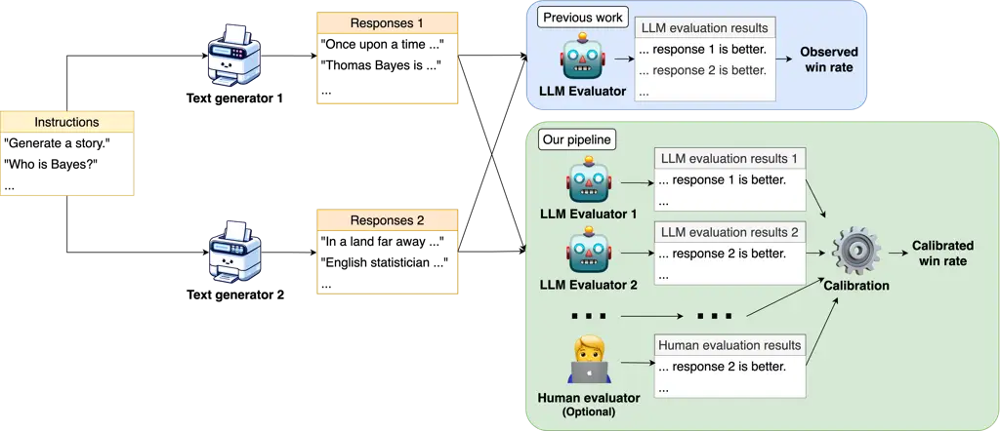
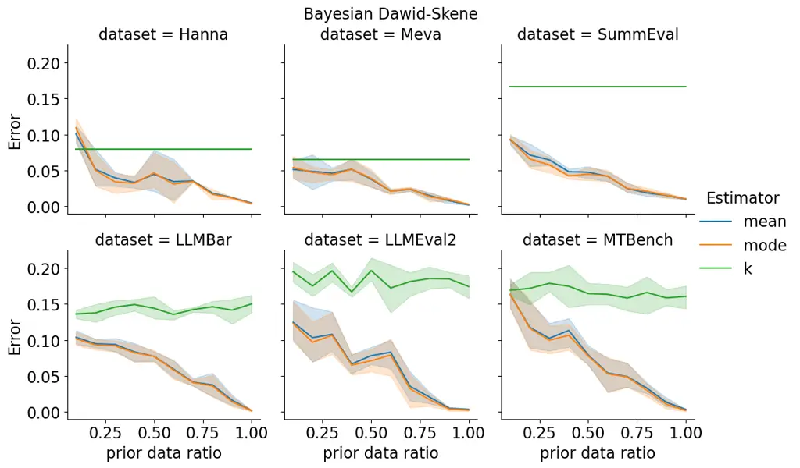
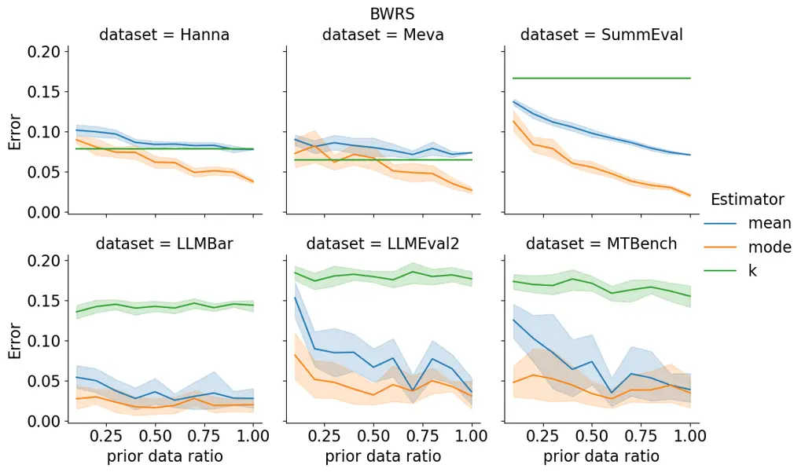

# Bayesian Calibration of Win Rate Estimation with LLM Evaluators

Yicheng Gao ^(†)^(†)thanks: Equal contribution Affiliation: Yale
University Email: [charlie.gao@yale.edu](mailto:)    Gonghan Xu
Email: [gonghan.xu@yale.edu](mailto:)    Zhe Wang Affiliation: Yale
University Email: [zhe.wang.zw439@yale.edu](mailto:)    Arman Cohan
Affiliation: Yale University Email: [arman.cohan@yale.edu](mailto:)

###### Abstract

Recent advances in large language models (LLMs) show the potential of
using LLMs as evaluators for assessing the quality of text generations
from LLMs. However, applying LLM evaluators naively to compare or judge
between different systems can lead to unreliable results due to the
intrinsic win rate estimation bias of LLM evaluators. In order to
mitigate this problem, we propose two calibration methods, Bayesian Win
Rate Sampling (BWRS) and Bayesian Dawid-Skene, both of which leverage
Bayesian inference to more accurately infer the true win rate of
generative language models. We empirically validate our methods on six
datasets covering story generation, summarization, and instruction
following tasks. We show that both our methods are effective in
improving the accuracy of win rate estimation using LLMs as evaluators,
offering a promising direction for reliable automatic text quality
evaluation.

## 1 Introduction



Figure 1: Illustration of our pipeline and previous work. The
“calibration” part of our pipeline indicates one of BWRS or Bayesian
Dawid-Skene.

Evaluating the quality of AI-generated text has been a longstanding and
evolving challenge in NLP. In recent years, this challenge has become
increasingly crucial due to the growing interest in the field of
generative AI. While human judgment is still considered the most
reliable form of assessment, common automatic approaches to evaluating
quality of AI-generated text include heuristic-based evaluation metrics
Papineni et al. (2002); Lin (2004); Pillutla et al. (2021), model-based
evaluation metrics Zhang et al. (2019); Fabbri et al. (2022); Zha et al.
(2023); Chen and Eger (2023), and recently, LLM-based evaluations Kim
et al. (2024a); Kim et al. (2024b); Wang et al. (2024). Due to their
relative low cost and high correlation with human preferences, LLM-based
evaluations (aka LLM-as-a-judge) are receiving increasing attention.
Most previous studies that apply LLM evaluators Chiang and Lee (2023a);
Chiang and Lee (2023b); Dubois et al. (2024); Kim et al. (2024a); Kim
et al. (2024b); Wang et al. (2024); Liu et al. (2024) attempt to improve
the agreement between LLM evaluators and human preference by training
expert models for evaluation or improving prompting strategies. However,
such methods often either require compute-expensive finetuning, or
suffer from common problems of LLM evaluators such as position bias Wang
et al. (2023b), self-preference, and more Koo et al. (2023). Besides, as
we will discuss in Section 3.2, directly applying a non-perfect LLM
evaluator will result in a bias problem in the estimation of win rate.

In this paper, we attempt to address these challenges by proposing two
methods, Bayesian Win Rate Sampling (BWRS) and Bayesian Dawid-Skene. A
general illustration of our pipeline is shown in Figure 1. Our
approaches leverage Bayesian inference to enhance the accuracy of win
rate estimations between competing text generators using evaluation
results of LLM evaluators and sparse or no human evaluation data. By
employing these methods, we observe a closer alignment between LLM and
human judgment in terms of win rate between two text generator models.
Our results on six diverse datasets demonstrate that both BWRS and
Bayesian Dawid-Skene effectively reduce win rate estimation bias of LLM
evaluators, marking a promising step toward more trustworthy automatic
evaluations in NLP. ¹¹ 1 The code and data used in our experiments are
available at
[https://github.com/yale-nlp/bay-calibration-llm-evaluators](https://github.com/yale-nlp/bay-calibration-llm-evaluators)
under Apache 2.0 license. The contribution of this paper is threefold:

- •
  We identify and formulate the win rate estimation bias problem
  associated with LLM evaluators.
- •
  We conduct exploratory study on mitigating this bias with Bayesian
  inference. Specifically, we propose BWRS and Bayesian Dawid-Skene,
  both of which are shown effective in calibrating win rate estimation
  given LLM evaluation results, and optionally, some human evaluation
  results.
- •
  We publish our LLM evaluation annotations to facilitate future study
  in LLM-based evaluation.

## 2 Related work

##### LLM as evaluators

A line of research in LLM-based evaluation evaluated the performance of
LLM evaluators and proposed methods to improve them. Some works applied
various prompting techniques to improve the accuracy of LLM evaluation,
including chain of thought Liu et al. (2023a), evaluation with
explanation Chiang and Lee (2023b), multi-LLM discussion Chan et al.
(2023); Li et al. (2023), calibration with human expert Liu et al.
(2023b) and active optimization of evaluation protocol Xu et al. (2024).
Some other works Wang et al. (2024); Kim et al. (2024a); Kim et al.
(2024b) trained expert models in evaluation. As for evaluating the
general capability of LLM evaluators, most previous studies Liu et al.
(2023a); Chiang and Lee (2023a); Chiang and Lee (2023b); Dubois et al.
(2024); Liu et al. (2024); Liusie et al. (2024); Thakur et al. (2024)
used correlation coefficients such as Pearson’s correlation and
Kendall’s tau or annotator agreement coefficients such as Cohen’s kappa
and Scott’s pi to measure the preference of different LLM evaluators
compared with human evaluators.

On the application side, LLM evaluators are often applied to build LLM
rankings. AlpacaFarm Dubois et al. (2024) proposed a simple LLM
evaluation framework by looking at the win rate decided by a strong LLM
evaluator (i.e., GPT-4) on a large number of texts generated by the two
generators under the same generation prompts. Auto-Arena Zhao et al.
(2024) used LLM judge agents to determine the winner of each LLM pair.
However, as we’ll discuss in Section 3.2, these methods can lead to
biased win rate estimations, especially when the LLM evaluators do not
align well enough with human preferences.

##### Annotation models

In the field of crowdsourced annotations, a line of research focuses on
simultaneously modeling the accuracy of individual annotators and
determining the true labels of tasks. These works mostly target
aggregating crowdsourced data and improving data quality in case of
non-expert or adversarial annotators. Dawid-Skene Dawid and Skene (1979)
was the first model proposed to consider individual annotator error
rates by using maximum likelihood estimation to infer true labels from
annotators with different accuracies. Since then, many other models
Albert and Dodd (2004); Carpenter (2008); Whitehill et al. (2009); Kim
and Ghahramani (2012); Hovy et al. (2013); Passonneau and Carpenter
(2014); Zhang et al. (2016) were developed to improve performance and
efficiency. These methods were originally proposed to model the accuracy
of human annotators, in our paper we instead apply them to model LLM
evaluators.

Some concurrent works also explored methods for aggregating annotations
from multiple LLMs. Nguyen et al. (2024) used majority voting and the
Dawid-Skene model to aggregate judgment results from multiple LLMs on
the Legal Textual Entailment task. LLM-Ensemble Fang et al. (2024)
proposed an ensemble method based on the Dawid-Skene model for attribute
value extraction with multiple LLMs. Yao et al. (2024) extended the
Dawid-Skene model to estimate uncertainty and aggregate final answers
from multiple LLMs in question-answering tasks. However, all these
concurrent works focus on aggregating LLM evaluation results on specific
tasks. To the best of our knowledge, our work is the first providing an
analysis and solution on improving win rate estimation using LLM
evaluators under a general text generation task scenario.

## 3 Methods

In this section, we first formalize the win rate estimation bias problem
associated with directly applying LLM evaluator results, and then
propose our methods to address this problem. In general, our methods
attempt to derive more accurate estimators of the relative win rate
between text generators by statistical calibration techniques and
integrating optional human-based prior knowledge. Ultimately, we are
able to improve win rate estimation accuracy without the need for
costly, large-scale human annotations.

### 3.1 Problem formalization

#### 3.1.1 True win rate and observed win rate

Consider two LLMs as text generators (LLM generators) $`G_{0}`$ and
$`G_{1}`$. Let $`\Sigma`$ be the set of all possible inputs to the text
generators, and let $`\Omega`$ be the set of all possible outputs given
the inputs from $`\Sigma`$. We can then define the LLMs as two functions
$`G_{0}:\Sigma\rightarrow\Omega`$ and $`G_{1}:\Sigma\rightarrow\Omega`$.
Additionally, let $`P_{\Sigma}`$ be a probability distribution on
$`\Sigma`$ that denotes the probability of each input to appear, let
$`\sigma\sim P_{\Sigma}`$ be a random input.

Let $`H:\Omega\times\Omega\rightarrow\{0,1\}`$ be the average human
evaluator function, which assesses the relative quality of two outputs.
$`H(y_{0},y_{1})=0`$ indicates that the output $`y_{0}`$ is preferred
over $`y_{1}`$ by an average human expert (we assume that “average human
expert" exists), and $`H(y_{0},y_{1})=1`$ indicates the opposite. Let
$`T_{e}:\Omega\times\Omega\rightarrow\{0,1\}`$ be the LLM evaluator
function, which represents the preference of a certain LLM evaluator
$`e`$. Let $`P`$ be a probability measure that encapsulates the
stochastic nature of $`\sigma`$, $`G_{0}`$, $`G_{1}`$, $`H`$, and
$`T_{e}`$.

Given the notations above, we define the following variables:

###### Definition 1 (True win rate).

The true win rate $`p`$ is defined as:

```math
p\triangleq P\left(H(G_{0}(\sigma),G_{1}(\sigma))=0\right) \tag{1}
```

###### Definition 2 (Observed win rate).

The observed win rate $`k`$ of an LLM evaluator $`e`$ is defined as:

```math
k_{e}\triangleq P\left(T_{e}(G_{0}(\sigma),G_{1}(\sigma))=0\right) \tag{2}
```

Intuitively, the true win rate $`p`$ is the probability that $`G_{0}`$
will generate a “truly better” output than $`G_{1}`$ when they are given
the same, arbitrary input, where “truly better” means being regarded as
“better” by a human expert on average. Similarly, the observed win rate
$`k`$ is the probability that $`G_{0}`$ will be evaluated by an LLM
evaluator as generating a better output than $`G_{1}`$ when they are
given the same, arbitrary input.

Due to the complexity of the stochasticity in $`p`$ and $`k_{e}`$, it is
unrealistic to derive them analytically. However, given a large number
of input-output pairs evaluated by human and LLM evaluators, we can
approximate $`p`$ and $`k_{e}`$ empirically. We formalize it as follows.

Assume $`n`$ is a large number. Then for $`n`$ outputs
$`y^{(0)}_{i}\,(i\in[n])`$ generated by $`G_{0}`$ and $`n`$ outputs
$`y^{(1)}_{i}\,(i\in[n])`$ generated by $`G_{1}`$ given the same set of
$`n`$ inputs of interest, we let a human evaluator $`h`$ and the LLM
evaluator $`e`$ carry out $`n`$ comparison tasks, where the $`i`$-th
comparison task is between $`y^{(0)}_{i}`$ and $`y^{(1)}_{i}`$. Then the
true win rate $`p`$ and the observed win rate $`k_{e}`$ can be
empirically approximated with

```math
\hat{p}=\frac{1}{n}\sum_{i=1}^{n}\left[1-H_{h}(y^{(0)}_{i},y^{(1)}_{i})\right] \tag{3}
```

```math
\hat{k}_{e}=\frac{1}{n}\sum_{i=1}^{n}\left[1-T_{e}(y^{(0)}_{i},y^{(1)}_{i})\right] \tag{4}
```

where $`H_{h}:\Omega\times\Omega\rightarrow\{0,1\}`$ is the human
evaluator function of a specific human evaluator $`h`$ (or an
aggregation of multiple human evaluators). Note that in our experiments,
in order to make sure that $`\hat{p}`$ is an accurate estimator of
$`p`$, we assume that the preference of $`h`$ is representative of an
average human expert evaluator.

#### 3.1.2 Evaluator accuracy

We also define two variables $`q_{0}^{e}`$ (true positive evaluation
accuracy) and $`q_{1}^{e}`$ (true negative evaluation accuracy)
associated with an LLM evaluator $`e`$²² 2 For simplicity, we will use
“evaluator accuracies” when we refer to $`q_{0}^{e}`$ and $`q_{1}^{e}`$
together. . Given two arbitrary outputs generated under the same
arbitrary input where the first output is evaluated as “better” than the
second one by an average human expert, $`q_{0}^{e}`$ is defined as the
conditional probability that $`e`$ will give the same evaluation as an
average human expert. In other words, we have

```math
\displaystyle q_{0}^{e}\triangleq P( \displaystyle T_{e}(G_{0}(\sigma),G_{1}(\sigma))=0\mid
```

```math
\displaystyle H(G_{0}(\sigma),G_{1}(\sigma))=0) \tag{5}
```

where the random element $`\sigma\in\Sigma`$ and probability measure
$`P`$ follow the same notions as in the definitions of $`p`$ and $`k`$.
Similarly, we have

```math
\displaystyle q_{1}^{e}\triangleq P( \displaystyle T_{e}(G_{0}(\sigma),G_{1}(\sigma))=1\mid
```

```math
\displaystyle H(G_{0}(\sigma),G_{1}(\sigma))=1) \tag{6}
```

Empirically, we can approximate $`q_{0}^{e}`$ and $`q_{1}^{e}`$ with

```math
\hat{q_{0}^{e}}=\frac{\sum\limits_{i=1}^{n}\mathbbm{1}\left[T_{e}(y^{(0)}_{i},y^{(1)}_{i})=H_{h}(y^{(0)}_{i},y^{(1)}_{i})=0\right]}{\sum_{i=1}^{n}\mathbbm{1}(H_{h}(y^{(0)}_{i},y^{(1)}_{i})=0)} \tag{7}
```

where $`\mathbbm{1}(\cdot)`$ is the indicator function. Similarly, we
have

```math
\hat{q_{1}^{e}}=\frac{\sum\limits_{i=1}^{n}\mathbbm{1}\left[T_{e}(y^{(0)}_{i},y^{(1)}_{i})=H_{h}(y^{(0)}_{i},y^{(1)}_{i})=1\right]}{\sum_{i=1}^{n}\mathbbm{1}(H_{h}(y^{(0)}_{i},y^{(1)}_{i})=1)} \tag{8}
```

1: Input: Target dataset without human annotation:
$`D=\{(y^{(0)}_{i},y^{(1)}_{i}),i\in[n]\}`$; reference dataset along
with human annotation: $`F=\{(z^{(0)}_{i},z^{(1)}_{i}),i\in[m]\}`$;
annotation by a set of LLM evaluators
$`E=\{e_{1},e_{2},\ldots,e_{|E|}\}`$ on $`D`$:
$`D_{E}=\{T_{e}(y^{(0)}_{i},y^{(1)}_{i}),i\in[n],e\in E\}`$; annotation
by LLM evaluators $`E`$ on $`F`$:
$`F_{E}=\{T_{e}(z^{(0)}_{i},z^{(1)}_{i}),i\in[m],e\in E\}`$; annotation
by human evaluator $`h`$ on $`F`$:
$`F_{h}=\{H_{h}(z^{(0)}_{i},z^{(1)}_{i}),i\in[m]\}`$; number of samples
drawn for each evaluator: $`N`$

2: Output: An estimation of the true win rate $`p`$

3: $`\triangleright`$ Number of data points on $`F`$ with the same human
evaluation result (0 or 1)

4:
$`n_{0}=|\{(z^{(0)}_{i},z^{(1)}_{i})\in F:\,H_{h}(z^{(0)}_{i},z^{(1)}_{i})=0\}|`$

5:
$`n_{1}=|\{(z^{(0)}_{i},z^{(1)}_{i})\in F:\,H_{h}(z^{(0)}_{i},z^{(1)}_{i})=1\}|`$

6: $`\triangleright`$ Number of correct judgments by each $`e\in E`$ on
$`F`$

7: for $`e\in E`$ do

8:
  $`s_{0}^{e}=|\{(z^{(0)}_{i},z^{(1)}_{i})\in F:\,H_{h}(z^{(0)}_{i},z^{(1)}_{i})=T_{e}(z^{(0)}_{i},z^{(1)}_{i})=0\}|`$

9:
  $`s_{1}^{e}=|\{(z^{(0)}_{i},z^{(1)}_{i})\in F:\,H_{h}(z^{(0)}_{i},z^{(1)}_{i})=T_{e}(z^{(0)}_{i},z^{(1)}_{i})=1\}|`$

10:   $`n_{k}^{e}=|D|`$

11:
  $`s_{k}^{e}=|\{(y^{(0)}_{i},y^{(1)}_{i})\in D:\,T_{e}(y^{(0)}_{i},y^{(1)}_{i})=0\}|`$

12: end for

13: sample list = $`\emptyset`$

14: for $`i=1,2,...,N`$ do

15:   for $`e\in E`$ do

16:    $`\triangleright`$ Estimated evaluator accuracies for $`e`$

17:    Draw $`q_{0}^{e}\sim\text{Beta}(s_{0}^{e}+1,n_{0}-s_{0}^{e}+1)`$

18:    Draw $`q_{1}^{e}\sim\text{Beta}(s_{1}^{e}+1,n_{1}-s_{1}^{e}+1)`$

19:    $`\triangleright`$ Observed win rate for $`e`$

20:    Draw $`k_{e}\sim\text{Beta}(s_{k}^{e}+1,n_{k}^{e}-s_{k}^{e}+1)`$

21:    Derive sample
$`\hat{p}_{e}=\frac{k_{e}+q_{1}^{e}-1}{q_{0}^{e}+q_{1}^{e}-1}`$, append
to sample list

22:   end for

23: end for

24: return mean ($`\hat{p}_{mean}`$) or mode ($`\hat{p}_{mode}`$) of
KDE(sample list)

Algorithm 1 Bayesian Win Rate Sampling (BWRS) algorithm

#### 3.1.3 Win rate estimation

As we discussed in Section 2, the true win rate $`p`$ can be used as a
metric to compare various generative LLMs. Specifically, for two
generative LLMs $`G_{0}`$ and $`G_{1}`$, $`G_{0}`$ outperforms $`G_{1}`$
when $`p>0.5`$. Conversely, $`G_{1}`$ outperforms $`G_{0}`$ when
$`p<0.5`$. Furthermore, the absolute value of $`p`$ signifies the degree
of superiority of one LLM to another. Given a list of LLMs
$`\Gamma=[G_{a},G_{b},...]`$ of interest and a certain baseline
generative LLM $`G`$, we can use the $`p`$ values of $`G`$ with respect
to each generator in $`\Gamma`$ to compare the LLMs in $`\Gamma`$ (1 vs.
n comparison). Therefore, it is a meaningful question to derive an
accurate estimation of $`p`$. This is the essential goal of this paper.

### 3.2 Estimation by observed win rate

A simple approach employed by prior work Dubois et al. (2024) to
approximate $`p`$ is to directly apply the observed win rate $`k_{e}`$.
Here we show that this approach suffers from a win rate estimation bias
problem when the evaluator accuracies are not high enough.

By the Law of Total Probability we have

```math
\displaystyle k_{e}= \displaystyle P\left(T_{e}(G_{0}(\sigma),G_{1}(\sigma))=0\right)
```

```math
\displaystyle= \displaystyle P(H(G_{0}(\sigma),G_{1}(\sigma))=0)\cdot q_{0}^{e}+
```

```math
\displaystyle P(H(G_{0}(\sigma),G_{1}(\sigma))=1)\cdot(1-q_{1}^{e})
```

```math
\displaystyle= \displaystyle pq_{0}^{e}+(1-p)(1-q_{1}^{e}) \tag{9}
```

Therefore, using $`k_{e}`$ to approximate $`p`$ will result in the
following win rate estimation error:

```math
\displaystyle|k_{e}-p|= \displaystyle|pq_{0}^{e}+(1-p)(1-q_{1}^{e})-p|
```

```math
\displaystyle= \displaystyle|pq_{0}^{e}+pq_{1}^{e}-2p-q_{1}^{e}+1| \tag{10}
```

We can see that $`k_{e}=p`$ only under very special conditions such as
$`q_{0}^{e}=q_{1}^{e}=1`$, which is typically not the case for LLM
evaluators. In order to fix this win rate estimation bias problem, we
propose the following two methods to improve the accuracy in the
estimation of $`p`$.

### 3.3 Bayesian Win Rate Sampling

First, we propose a sampling-based algorithm, Bayesian Win Rate Sampling
(BWRS), which is shown in Algorithm 1. The intuition of the BWRS
algorithm is that, given an LLM evaluator $`e`$ and a dataset
$`D=\{(y^{(0)}_{i},y^{(1)}_{i}),i\in[n]\}`$ containing outputs generated
by $`G_{0}`$ and $`G_{1}`$ with respect to the same set of inputs, we
first apply the LLM evaluator $`e`$ to generate its annotations
$`\{T_{e}(y^{(0)}_{i},y^{(1)}_{i}),i\in[n]\}`$ on $`D`$ and then apply
Equation 4 to approximate the observed win rate, $`k_{e}`$. Next, assume
we have access to some human annotations, either on a small fraction of
$`D`$ or on a similar reference dataset $`F`$, then we are able to
approximate $`q_{0}^{e}`$ and $`q_{1}^{e}`$ using Equation 7 and 8.
Finally, we apply the following equation rearranged from Equation 9:

```math
p=\frac{k_{e}+q_{1}^{e}-1}{q_{0}^{e}+q_{1}^{e}-1} \tag{11}
```

given the assumption that $`q_{0}^{e}+q_{1}^{e}\neq 1`$. ³³ 3 In
practice, though this assumption is satisfied under most cases, some
values of evaluator accuracies might cause sampling failure. Please
refer to Limitations for details. We can use the approximated values of
$`k_{e}`$, $`q_{0}^{e}`$, and $`q_{1}^{e}`$ to derive one sample of
$`p`$, which characterizes the relative performance between $`G_{0}`$
and $`G_{1}`$.

Note that there are still two key differences between the intuition
above and our actual implementation described in Algorithm 1. First, in
our implementation, instead of estimating $`k_{e},q_{0}^{e},q_{1}^{e}`$
directly using Equations 4, 7, 8, we use Bayesian inference and apply
the Beta-Bernoulli model to estimate the posterior distributions for
$`k_{e}`$, $`q_{0}^{e}`$, and $`q_{1}^{e}`$. Second, instead of using
one evaluator model $`e`$, we use a set of LLM evaluators
$`E=\{e_{1},e_{2},...,e_{|E|}\}`$. We aggregate the results by
aggregating all the samples obtained using each LLM evaluator.
Concretely, we obtain $`N`$ (10000 in our case) samples of $`p`$ for
each LLM evaluator by sampling from the posterior distributions of
$`k_{e}`$, $`q_{0}^{e}`$, $`q_{1}^{e}`$ and applying Equation 11. Then,
we apply Kernel Density Estimation (KDE) on all the $`p`$ samples to
approximate the distribution of $`p`$. Finally, we estimate the value of
$`p`$ using the mean $`\hat{p}_{mean}`$ or mode $`\hat{p}_{mode}`$ of
this distribution. The purpose of applying a Bayesian setting is to
incorporate the uncertainty of $`k_{e},q_{0}^{e},q_{1}^{e}`$ into
consideration, and also facilitate the usage of prior knowledge on
evaluator accuracies, which will be discussed in Section 4.3. The
purpose of using multiple LLM evaluators is to mitigate the effect of
potential inaccurate estimation of individual LLM evaluators’ evaluation
accuracy.

1: $`\triangleright`$ Prior class prevalence

2: Draw $`p\sim\text{Beta}(\alpha_{p},\beta_{p})`$

3: for $`e\in E`$ do

4:   $`\triangleright`$ Evaluator accuracies

5:   Draw $`q_{0}^{e}\sim\text{Beta}(\alpha_{q_{0}},\beta_{q_{0}})`$

6:   Draw $`q_{1}^{e}\sim\text{Beta}(\alpha_{q_{1}},\beta_{q_{1}})`$

7: end for

8: for $`i=1`$ to $`n`$ do

9:   $`\triangleright`$ Ground truth labels

10:   Draw $`h_{i}\sim\text{Bernoulli}(p)`$

11:   for $`e\in E`$ do

12:    $`\triangleright`$ Predicted labels

13:    if $`h_{i}=1`$ then

14:      Draw $`t^{e}_{i}\sim\text{Bernoulli}(q_{1}^{e})`$

15:    else

16:      Draw $`t^{e}_{i}\sim\text{Bernoulli}(1-q_{0}^{e})`$

17:    end if

18:   end for

19: end for

Model 1 Bayesian Dawid-Skene model

### 3.4 Bayesian Dawid-Skene model

The vanilla Dawid-Skene model Dawid and Skene (1979) is optimized with
the Expectation-Maximization (EM) algorithm. Following Paun et al.
(2018), we instead use a Bayesian Dawid-Skene model. The pseudocode of
our model is shown in Model 1. The parameters in this model include
$`\alpha_{p},\beta_{p},\alpha_{q_{0}},\beta_{q_{0}},\alpha_{q_{1}},\text{and}\beta_{q_{1}}`$.
We initialize the distribution of $`p`$ with a uniform distribution, and
thus $`\alpha_{p},\beta_{p}`$ are initialized as 1. The initialization
of the other parameters will be discussed in Section 4.3. We apply the
evaluation results of each LLM evaluator $`e`$ as observations
$`t^{e}_{i}`$, and use Hamiltonian Monte Carlo (HMC) sampling to fit the
model and sample from the posterior distribution of $`p`$. Similar to
BWRS, we use the posterior mean ($`\hat{p}_{mean}`$) and posterior mode
($`\hat{p}_{mode}`$) as two estimators of $`p`$. In order to improve
sampling efficiency, we employ NUTS sampler Hoffman and Gelman (2011)
and the Binary Gibbs-Metropolis sampler implemented in PyMC Oriol et al.
(2023). We tune and sample from the model with 4 chains, with 10000
tuning steps and 10000 sampling steps on each chain. On an AMD EPYC 7763
processor, comparing each generator pair takes around 10 minutes.

## 4 Experiment Settings

### 4.1 Datasets

The datasets we use in the experiments are HANNA Chhun et al. (2022),
OpenMEVA-MANS Guan et al. (2021), SummEval Fabbri et al. (2021), LLMBar
Zeng et al. (2024), MT-Bench Zheng et al. (2023), and LLMEval² Zhang
et al. (2023), covering tasks of story generation (HANNA,
OpenMEVA-MANS), summarization (SummEval), and instruction following (the
other three). All of them provide machine-generated content with human
annotations. For MT-Bench and LLMEval², we used the smaller, curated
versions prepared by the authors of the LLMBar paper Zeng et al. (2024).
For the three instruction following datasets, since they are presented
as a list of (input, output1, output2, human preference) tuples without
specifying which LLM generated each of the outputs, we simulate two LLM
generators based on these datasets by randomly attributing 80% of the
human-preferred outputs to the (simulative) generator A and the rest 20%
to the (simulative) generator B such that the true win rate between them
is 80%. We chose the 80%-20% ratio to represent a substantial yet
realistic performance difference between two models.

A detailed description about each dataset can be found in Appendix A.

### 4.2 Evaluator settings

For HANNA, OpenMEVA-MANS, and SummEval, we prompt a set of LLM
evaluators to compare the outputs of generator models in the datasets.
Specifically, we employ GPT-3.5-turbo-0125 OpenAI (2023) and
Gemini-1.0-Pro Team (2024) as the evaluator models for our experiments.
GPT-3.5 has been proved to have positive correlation with human
annotations Chiang and Lee (2023a); Wang et al. (2023a), while
Gemini-1.0-Pro’s performance on LLM evaluation have not yet been widely
studied in previous works. For each output pair, we prompted each LLM
evaluator to rate the two outputs that are based on the same input and
generated by two different generator models. For each LLM evaluator, we
used three prompting strategies including Score-only, Rate-explain, and
Analyze-rate following Chiang and Lee (2023b). For LLMBar, MT-Bench,
LLMEval², the LLM evaluation work has already been carried out by Zeng
et al. (2024). For these three datasets, we selected the best LLM
evaluators (GPT-4, PaLM 2, etc.) from the many ones used. More details
regarding the specific LLM evaluator modes used for these datasets can
be found in Appendix B.

### 4.3 Win rate estimation

After obtaining the human evaluation and LLM evaluation data, we apply
BWRS (Section 3.3) and Bayesian Dawid-Skene (Section 3.4) to each
dataset described above. We conduct “1 vs. n” experiment on each
dataset, where we select a baseline model (GPT-2) and compare its
outputs to all the other text generators in the dataset. We employ this
“1 vs. n” comparison strategy because the corresponding “n vs. n”
strategy is much more costly in terms of computation time and budget.
Additionally, we calculate the observed win rate $`k`$ by using Equation
4 and averaging over the results of all LLM evaluators combined. The
error of estimating $`p`$ with the observed win rate (i.e., $`|k-p|`$)
acts as a baseline that shows the aggregated performance of all the LLM
evaluators applied without any calibration.

In order to further study the effectiveness of each estimation method,
we also explore their performance given the following three different
sources of human evaluation results. For simplicity, we refer to these
human evaluation results as priors, since they act as prior knowledge of
human preferences in our methods.

No prior⁴⁴ 4 The no prior setting is not applicable for BWRS, since BWRS
requires informative priors of evaluator accuracies to be accurate.. We
assume no prior knowledge of evaluator accuracies, and only depend on
the Dawid-Skene model to estimate the accuracy of each evaluator. In
this case, we initialize the parameters of evaluator accuracies in
Model 1 with
$`\alpha_{q_{0}}=\alpha_{q_{1}}=2,\beta_{q_{0}}=\beta_{q_{1}}=1`$, which
is a beta distribution skewed towards higher $`q_{0}`$ and $`q_{1}`$
values, because we expect our evaluators to generally perform better
than random guessing such that $`q_{0}>0.5`$ and $`q_{1}>0.5`$.

In-distribution prior. We assume that we have access to human
evaluations on a subset of all output pairs generated by the two
generators of interest. Then in Algorithm 1 for BWRS, the reference
dataset $`F`$ becomes a subset of $`D`$ and the human evaluation results
are used as $`F_{h}`$ to obtain an estimate of each LLM evaluator’s
accuracies $`q_{0}`$, $`q_{1}`$. In the Bayesian Dawid-Skene model, the
human evaluation results are instead used as observations ($`h_{i}`$ in
Model 1), while $`\alpha_{q_{0}}`$, $`\beta_{q_{0}}`$,
$`\alpha_{q_{1}}`$, and $`\beta_{q_{1}}`$ are initialized in the same
way as in the no prior setting. We refer to the ratio of human-evaluated
output pairs over the entire dataset as prior data ratio. In our
experiments, we try 10 different values of prior data ratio (0.1, 0.2,
…, 1.0) and compare the results.

Out-of-distribution (OOD) prior. We assume that we have access to human
evaluations on some other reference dataset beyond the outputs generated
by the two generators of interest. These human evaluation results are
also used to calculate priors for $`q_{0}`$ and $`q_{1}`$. In our
experiments, we use the generator pair in the reference dataset that has
the closest observed win rate with the compared generators. For BWRS,
these priors are used as $`F_{e}`$ and $`F_{h}`$ in Algorithm 1. For the
Bayesian Dawid-Skene model, with the in-distribution prior setting,
recall that the human evaluation priors are used as observations of
ground truth labels $`h_{i}`$ in Model 1. For the OOD prior setting,
they are instead only used to derive a prior distribution of the
evaluator accuracies so that the model won’t be affected as much by the
distribution shift of evaluator accuracies on different generator
models. Specifically, we use a Beta-Bernoulli model similar to the ones
we used in BWRS. The only difference is that we normalize the Beta
distribution parameters such that their average is 1 in order to prevent
over-confident priors. Concretely, we initialize the distributions of
$`q_{0}^{e}`$ and $`q_{1}^{e}`$ in Model 1 for each evaluator $`e`$ as
follows:

```math
\displaystyle n_{0}= \displaystyle|\{(z^{(0)}_{i},z^{(1)}_{i})\in\text{OOD}:\,H_{h}(z^{(0)}_{i},z^{(1)}_{i})=0\}|
```

```math
\displaystyle n_{1}= \displaystyle|\{(z^{(0)}_{i},z^{(1)}_{i})\in\text{OOD}:\,H_{h}(z^{(0)}_{i},z^{(1)}_{i})=1\}|
```

```math
\displaystyle s_{0}= \displaystyle|\{(z^{(0)}_{i},z^{(1)}_{i})\in\text{OOD}:\,
```

```math
\displaystyle H_{h}(z^{(0)}_{i},z^{(1)}_{i})=T_{e}(z^{(0)}_{i},z^{(1)}_{i})=0\}|
```

```math
\displaystyle s_{1}= \displaystyle|\{(z^{(0)}_{i},z^{(1)}_{i})\in\text{OOD}:\,
```

```math
\displaystyle H_{h}(z^{(0)}_{i},z^{(1)}_{i})=T_{e}(z^{(0)}_{i},z^{(1)}_{i})=1\}|
```

```math
\displaystyle q_{0}^{e}\sim \displaystyle\text{Beta}(\frac{2s_{0}+2}{n_{0}+2},\frac{2n_{0}-2s_{0}+2}{n_{0}+2}) \tag{12}
```

```math
\displaystyle q_{1}^{e}\sim \displaystyle\text{Beta}(\frac{2s_{1}+2}{n_{1}+2},\frac{2n_{1}-2s_{1}+2}{n_{1}+2}) \tag{13}
```

where OOD is the OOD set (dataset $`F`$) we use, the term $`n_{0}+2`$
and $`n_{1}+2`$ on the denominator of Equation 12 and 13 are both
normalization terms as described above. We repeat the experiment ten
times on each dataset for each prior setting.

## 5 Results

| Evaluator model | Prompt template | $`q_{0}\uparrow`$ | $`q_{1}\uparrow`$ | $`    | q*{0}-q*{1} | `$  | Overall Accuracy $`\uparrow`$ |
| --------------- | --------------- | ----------------- | ----------------- | ----- | ----------- | --- | ----------------------------- |
| Gemini-1.0-Pro  | Score-only      | 0.782             | 0.526             | 0.256 | 0.649       |
|                 | Analyze-rate    | 0.802             | 0.428             | 0.374 | 0.607       |
|                 | Rate-explain    | 0.760             | 0.512             | 0.248 | 0.631       |
| GPT-3.5         | Score-only      | 0.700             | 0.653             | 0.047 | 0.676       |
|                 | Analyze-rate    | 0.657             | 0.677             | 0.020 | 0.667       |
|                 | Rate-explain    | 0.699             | 0.655             | 0.044 | 0.676       |

Table 1: LLM evaluator accuracy with respect to human preferences when
human preference is $`0`$ ($`q_{0}`$) or $`1`$ ($`q_{1}`$) across all
pair-wise generator comparisons on HANNA, OpenMEVA-MANS, and SummEval.
Best performance on each column is marked with bold font.

| Dataset       | Method                       | Prior setting | $`    | \hat{p}\_{mean}-p | \downarrow`$ | $`  | \hat{p}\_{mode}-p | \downarrow`$ |
| ------------- | ---------------------------- | ------------- | ----- | ----------------- | ------------ | --- | ----------------- | ------------ |
| HANNA         | Observed win rate (baseline) | /             | 0.079 | 0.079             |
|               | Bayesian Dawid-Skene         | No prior      | 0.129 | 0.132             |
|               | Bayesian Dawid-Skene         | OOD prior     | 0.084 | 0.081             |
|               | BWRS                         | OOD prior     | 0.129 | 0.095             |
| OpenMEVA-MANS | Observed win rate (baseline) | /             | 0.065 | 0.065             |
|               | Bayesian Dawid-Skene         | No prior      | 0.065 | 0.065             |
|               | Bayesian Dawid-Skene         | OOD prior     | 0.034 | 0.033             |
|               | BWRS                         | OOD prior     | 0.064 | 0.102             |
| SummEval      | Observed win rate (baseline) | /             | 0.167 | 0.167             |
|               | Bayesian Dawid-Skene         | No prior      | 0.125 | 0.123             |
|               | Bayesian Dawid-Skene         | OOD prior     | 0.115 | 0.110             |
|               | BWRS                         | OOD prior     | 0.112 | 0.112             |

Table 2: Results of win rate estimation with no prior and OOD prior on
HANNA, OpenMEVA-MANS, and SummEval. Lower estimation bias
($`|\hat{p}_{mean}-p|`$ or $`|\hat{p}_{mode}-p|`$) is better. All
results are averaged over all compared generator pairs in ten repetitive
runs. The best estimator for each dataset is marked with bold font.

| Dataset  | Method                       | Prior setting | $`    | \hat{p}\_{mean}-p | \downarrow`$ | $`  | \hat{p}\_{mode}-p | \downarrow`$ |
| -------- | ---------------------------- | ------------- | ----- | ----------------- | ------------ | --- | ----------------- | ------------ |
| LLMBar   | Observed win rate (baseline) | /             | 0.142 | 0.142             |
|          | Bayesian Dawid-Skene         | No prior      | 0.140 | 0.138             |
| LLMEval² | Observed win rate (baseline) | /             | 0.178 | 0.178             |
|          | Bayesian Dawid-Skene         | No prior      | 0.157 | 0.156             |
| MT-Bench | Observed win rate (baseline) | /             | 0.162 | 0.162             |
|          | Bayesian Dawid-Skene         | No prior      | 0.190 | 0.188             |

Table 3: Results of win rate estimation with no prior on the three
instruction following datasets. Lower estimation bias
($`|\hat{p}_{mean}-p|`$ or $`|\hat{p}_{mode}-p|`$) is better. All
results are averaged over all compared generator pairs in ten repetitive
runs. The best estimator for each dataset is marked with bold font.



(a) Bayesian Dawid-Skene



(b) BWRS

Figure 2: Win rate estimation error with various proportions of the
original data used as in-distribution prior. The results are averaged
over all compared generator pairs. The mean and variance of all results
are calculated over ten repetitive runs. The variance of $`k`$ values in
the three instruction following datasets results from randomly assigning
outputs to two simulative generators, as described in Section 4.1

In this section, we first analyze the evaluator accuracies on our
datasets, and then list the results of our experiments, including win
rate estimation with no prior, OOD prior, and in-distribution prior. We
show that both our methods are able to effectively calibrate the
estimation of win rate given good estimations of evaluator accuracies.
We also show that even with no or OOD knowledge of human preference, our
methods are still able to perform well overall.

### 5.1 Evaluator accuracies

For the three non-instruction following datasets (HANNA, OpenMEVA-MANS,
SummEval) on which we carry out LLM evaluation by ourselves, the average
accuracies of the LLM evaluators are shown in Table 1. The overall
accuracy is defined as the proportion of all pair-wise output
comparisons where the LLM evaluation aligns with human evaluation. We
can see that:

- •
  In terms of overall accuracy, there is not a significant difference
  (\>5%) between the three prompt templates.
- •
  There is a significant difference between $`q_{0}`$ and $`q_{1}`$ even
  though we applied the swap-and-sum strategy (see Appendix A). This can
  be attributed to the correlation between evaluator accuracy and the
  difference between the generators’ capabilities. When one generator is
  significantly better than the other, it is easier for the LLM
  evaluator to identify cases where the better generator does better,
  and harder when the better generator does worse. Also, Gemini-1.0-Pro
  evaluators suffer from this problem more significantly than GPT-3.5
  evaluators. This shows the necessity of modeling $`q_{0}`$ and
  $`q_{1}`$ separately for each evaluator when comparing two generators.

For the instruction following datasets (LLMBar, LLMEval², MT-Bench), the
overall evaluator accuracies are given in the LLMBar paper Zeng et al.
(2024), where the overall evaluation accuracies are generally above 70%
for the evaluator modes we use.

### 5.2 Win rate estimation results

The results of win rate estimation with no prior and OOD prior on HANNA,
OpenMEVA-MANS, and SummEval are shown in Table 2. We can observe that:

- •
  The mode estimator in Bayesian Dawid-Skene with OOD prior is the
  overall best estimator. In this setting, estimation of $`p`$ is more
  accurate than baseline ($`k`$) in all datasets except HANNA.
- •
  The Bayesian Dawid-Skene model with OOD prior is more accurate than
  the model with no prior. This shows that the OOD prior is able to
  provide some useful information on the accuracy of each evaluator,
  which helps the Bayesian model converge to a better result.

The results of win rate estimation with no prior on LLMBar, LLMEval²,
and MT-Bench are shown in Table 3. Note that OOD prior is not applicable
for these instruction following datasets due to the absence of relevant
data to act as the OOD set. We can see that the mode estimator in
Bayesian Dawid-Skene with no prior outperforms the baseline in all
datasets except MT-Bench.

The results of BWRS and Bayesian Dawid-Skene with in-distribution prior
are shown in Figure 2. We can observe the following:

- •
  As prior data ratio increases, win rate estimation accuracy of both
  BWRS and Bayesian Dawid-Skene improves. This enhancement arises
  because having more human annotations for in-distribution data allows
  for a more precise assessment of evaluator accuracies and consequently
  leads to a more accurate estimation of the true win rate $`p`$. This
  shows that our methods will indeed offer a more accurate estimation of
  the true win rate $`p`$ if we have good estimations of $`q_{0}`$ and
  $`q_{1}`$.
- •
  The mode estimator shows consistently better performance compared with
  the mean estimator and $`k`$.
- •
  The proportion of human evaluation data needed to ensure improvement
  of the true win rate estimation varies for each dataset due to the
  internal variance of evaluator accuracies. Generally, a prior data
  ratio of 30% would be sufficient for both Bayesian Dawid-Skene and
  BWRS, with one exception (BWRS for OpenMEVA-MANS).

## 6 Conclusion

In this paper, we identified and formulated the win rate estimation bias
problem in using LLMs as evaluators to compare text generators, where
discrepancies between non-perfect LLM evaluators and human preferences
could lead to errors in win rate estimation. We proposed two methods,
Bayesian Win Rate Sampling (BWRS) and Bayesian Dawid-Skene, in order to
address this issue. We then obtained LLM evaluation results on six
diverse datasets, and used these results to examine the effectiveness of
our methods empirically. Our results showed that both BWRS and Bayesian
Dawid-Skene can effectively mitigate the LLM evaluators’ win rate
estimation bias, especially given good approximations on evaluator
accuracies. Our results also showed that even without in-distribution
prior knowledge of human preferences, our methods are still able to
effectively calibrate win rate estimation under most cases. The
effectiveness of our methods manifests the possibility to calibrate win
rate estimation in a post-hoc manner after LLM evaluations are
completed, and also enlightens future study on applying annotation
models for accurate win rate estimation using LLM evaluators.

## Limitations

There are some limitations of our work. First, due to budget limit, for
the non-instruction following datasets, we only examined our methods
with GPT-3.5 and Gemini-1.0-Pro as LLM evaluators. Although we did
incorporate more advanced LLM evaluators such as GPT-4 and PaLM 2 on the
instruction following datasets, it would be illuminating to examine how
more advanced evaluator models would affect our methods’ performance on
the non-instruction following datasets.

Second, the performance of both methods with OOD prior largely depends
on the quality of OOD data. Specifically, when there is a large
difference between evaluator accuracies on the OOD set and on the
original dataset, our methods may produce highly-biased results.
Therefore, in cases where human evaluation results on datasets with
similar observed win-rates are absent, we would recommend against using
OOD prior.

This paper is an exploratory study on adjusting the win rate estimation
bias of LLM evaluators. Besides resolving the limitations above, the
exploration in this field could also be extended in the following
aspects:

- •
  Applying more complex annotator models. As discussed in Section 2, the
  Dawid-Skene model is the earliest annotator model proposed, and
  several improvements have been proposed since then. These improved
  methods can potentially lead to more accurate win rate estimation.
- •
  Introducing more robust methods. The performance of our proposed
  methods is contingent upon the accuracy of LLM evaluators. Concretely,
  from Equation 11 we know that

  ```math
  \displaystyle 0<p<1\Leftrightarrow\begin{cases}1-q_{1}^{e}<k_{e}<q_{0}^{e},&q_{0}^{e}+q_{1}^{e}>1\\
  q_{0}^{e}<k_{e}<1-q_{1}^{e},&q_{0}^{e}+q_{1}^{e}<1\end{cases} \tag{14}
  ```

  We can see that, in order to make sure $`p\in[0,1]`$, the evaluator
  accuracies $`q_{0}^{e}`$ and $`q_{1}^{e}`$ must satisfy one of the
  conditions in Equation 14. In cases where neither condition is
  satisfied, our methods can become unstable, and is prone to produce
  $`p`$ distributions with high bias and/or variance. We leave it for
  future research to propose methods that work well for LLM evaluators
  with low or unstable accuracies.

## References

- Albert and Dodd (2004) Paul S Albert and Lori E Dodd. 2004. A
  cautionary note on the robustness of latent class models for
  estimating diagnostic error without a gold standard. _Biometrics_,
  60(2):427–435.
- Carpenter (2008) Bob Carpenter. 2008. Multilevel bayesian models of
  categorical data annotation. _Unpublished manuscript_, 17(122):45–50.
- Chan et al. (2023) Chi-Min Chan, Weize Chen, Yusheng Su, Jianxuan Yu,
  Wei Xue, Shanghang Zhang, Jie Fu, and Zhiyuan Liu. 2023. [Chateval:
  Towards better llm-based evaluators through multi-agent
  debate](http://arxiv.org/abs/2308.07201).
- Chen and Eger (2023) Yanran Chen and Steffen Eger. 2023. [Menli:
  Robust evaluation metrics from natural language
  inference](http://arxiv.org/abs/2208.07316).
- Chhun et al. (2022) Cyril Chhun, Pierre Colombo, Fabian M. Suchanek,
  and Chloé Clavel. 2022. [Of human criteria and automatic metrics: A
  benchmark of the evaluation of story
  generation](https://aclanthology.org/2022.coling-1.509). In
  _Proceedings of the 29th International Conference on Computational
  Linguistics_, pages 5794–5836, Gyeongju, Republic of Korea.
  International Committee on Computational Linguistics.
- Chiang and Lee (2023a) Cheng-Han Chiang and Hung-yi Lee. 2023a. [Can
  large language models be an alternative to human
  evaluations?](https://doi.org/10.18653/v1/2023.acl-long.870) In
  _Proceedings of the 61st Annual Meeting of the Association for
  Computational Linguistics (Volume 1: Long Papers)_, pages 15607–15631,
  Toronto, Canada. Association for Computational Linguistics.
- Chiang and Lee (2023b) Cheng-Han Chiang and Hung-yi Lee. 2023b. [A
  closer look into using large language models for automatic
  evaluation](https://doi.org/10.18653/v1/2023.findings-emnlp.599). In
  _Findings of the Association for Computational Linguistics: EMNLP
  2023_, pages 8928–8942, Singapore. Association for Computational
  Linguistics.
- Dawid and Skene (1979) Alexander Philip Dawid and Allan M Skene. 1979.
  Maximum likelihood estimation of observer error-rates using the em
  algorithm. _Journal of the Royal Statistical Society: Series C
  (Applied Statistics)_, 28(1):20–28.
- Dubois et al. (2024) Yann Dubois, Xuechen Li, Rohan Taori, Tianyi
  Zhang, Ishaan Gulrajani, Jimmy Ba, Carlos Guestrin, Percy Liang, and
  Tatsunori B. Hashimoto. 2024. [Alpacafarm: A simulation framework for
  methods that learn from human
  feedback](http://arxiv.org/abs/2305.14387).
- Fabbri et al. (2022) Alexander Fabbri, Chien-Sheng Wu, Wenhao Liu, and
  Caiming Xiong. 2022. [QAFactEval: Improved QA-based factual
  consistency evaluation for
  summarization](https://doi.org/10.18653/v1/2022.naacl-main.187). In
  _Proceedings of the 2022 Conference of the North American Chapter of
  the Association for Computational Linguistics: Human Language
  Technologies_, pages 2587–2601, Seattle, United States. Association
  for Computational Linguistics.
- Fabbri et al. (2021) Alexander R. Fabbri, Wojciech Kryściński, Bryan
  McCann, Caiming Xiong, Richard Socher, and Dragomir Radev. 2021.
  [SummEval: Re-evaluating Summarization
  Evaluation](https://doi.org/10.1162/tacl_a_00373). _Transactions of
  the Association for Computational Linguistics_, 9:391–409.
- Fan et al. (2018) Angela Fan, Mike Lewis, and Yann Dauphin. 2018.
  [Hierarchical neural story
  generation](https://doi.org/10.18653/v1/P18-1082). In _Proceedings of
  the 56th Annual Meeting of the Association for Computational
  Linguistics (Volume 1: Long Papers)_, pages 889–898, Melbourne,
  Australia. Association for Computational Linguistics.
- Fang et al. (2024) Chenhao Fang, Xiaohan Li, Zezhong Fan, Jianpeng Xu,
  Kaushiki Nag, Evren Korpeoglu, Sushant Kumar, and Kannan Achan. 2024.
  [Llm-ensemble: Optimal large language model ensemble method for
  e-commerce product attribute value
  extraction](https://doi.org/10.1145/3626772.3661357). In _Proceedings
  of the 47th International ACM SIGIR Conference on Research and
  Development in Information Retrieval_, SIGIR ’24, page 2910–2914, New
  York, NY, USA. Association for Computing Machinery.
- Guan et al. (2021) Jian Guan, Zhexin Zhang, Zhuoer Feng, Zitao Liu,
  Wenbiao Ding, Xiaoxi Mao, Changjie Fan, and Minlie Huang. 2021.
  [OpenMEVA: A benchmark for evaluating open-ended story generation
  metrics](https://doi.org/10.18653/v1/2021.acl-long.500). In
  _Proceedings of the 59th Annual Meeting of the Association for
  Computational Linguistics and the 11th International Joint Conference
  on Natural Language Processing (Volume 1: Long Papers)_, pages
  6394–6407, Online. Association for Computational Linguistics.
- Hermann et al. (2015) Karl Moritz Hermann, Tomáš Kočiský, Edward
  Grefenstette, Lasse Espeholt, Will Kay, Mustafa Suleyman, and Phil
  Blunsom. 2015. Teaching machines to read and comprehend. In
  _Proceedings of the 28th International Conference on Neural
  Information Processing Systems - Volume 1_, NIPS’15, page 1693–1701,
  Cambridge, MA, USA. MIT Press.
- Hoffman and Gelman (2011) Matthew D. Hoffman and Andrew Gelman. 2011.
  [The no-u-turn sampler: Adaptively setting path lengths in hamiltonian
  monte carlo](http://arxiv.org/abs/1111.4246).
- Hovy et al. (2013) Dirk Hovy, Taylor Berg-Kirkpatrick, Ashish Vaswani,
  and Eduard Hovy. 2013. [Learning whom to trust with
  MACE](https://aclanthology.org/N13-1132). In _Proceedings of the 2013
  Conference of the North American Chapter of the Association for
  Computational Linguistics: Human Language Technologies_, pages
  1120–1130, Atlanta, Georgia. Association for Computational
  Linguistics.
- Kim and Ghahramani (2012) Hyun-Chul Kim and Zoubin Ghahramani. 2012.
  [Bayesian classifier
  combination](https://proceedings.mlr.press/v22/kim12.html). In
  _Proceedings of the Fifteenth International Conference on Artificial
  Intelligence and Statistics_, volume 22 of _Proceedings of Machine
  Learning Research_, pages 619–627, La Palma, Canary Islands. PMLR.
- Kim et al. (2024a) Seungone Kim, Jamin Shin, Yejin Cho, Joel Jang,
  Shayne Longpre, Hwaran Lee, Sangdoo Yun, Seongjin Shin, Sungdong Kim,
  James Thorne, and Minjoon Seo. 2024a. [Prometheus: Inducing
  fine-grained evaluation capability in language
  models](http://arxiv.org/abs/2310.08491).
- Kim et al. (2024b) Seungone Kim, Juyoung Suk, Shayne Longpre,
  Bill Yuchen Lin, Jamin Shin, Sean Welleck, Graham Neubig, Moontae Lee,
  Kyungjae Lee, and Minjoon Seo. 2024b. [Prometheus 2: An open source
  language model specialized in evaluating other language
  models](http://arxiv.org/abs/2405.01535).
- Koo et al. (2023) Ryan Koo, Minhwa Lee, Vipul Raheja, Jong Inn Park,
  Zae Myung Kim, and Dongyeop Kang. 2023. [Benchmarking cognitive biases
  in large language models as
  evaluators](http://arxiv.org/abs/2309.17012).
- Li et al. (2023) Ruosen Li, Teerth Patel, and Xinya Du. 2023. [Prd:
  Peer rank and discussion improve large language model based
  evaluations](http://arxiv.org/abs/2307.02762).
- Lin (2004) Chin-Yew Lin. 2004. [ROUGE: A package for automatic
  evaluation of summaries](https://aclanthology.org/W04-1013). In _Text
  Summarization Branches Out_, pages 74–81, Barcelona, Spain.
  Association for Computational Linguistics.
- Liu et al. (2023a) Yang Liu, Dan Iter, Yichong Xu, Shuohang Wang,
  Ruochen Xu, and Chenguang Zhu. 2023a. [G-eval: NLG evaluation using
  gpt-4 with better human
  alignment](https://doi.org/10.18653/v1/2023.emnlp-main.153). In
  _Proceedings of the 2023 Conference on Empirical Methods in Natural
  Language Processing_, pages 2511–2522, Singapore. Association for
  Computational Linguistics.
- Liu et al. (2024) Yixin Liu, Kejian Shi, Alexander R. Fabbri, Yilun
  Zhao, Peifeng Wang, Chien-Sheng Wu, Shafiq Joty, and Arman
  Cohan. 2024. [Reife: Re-evaluating instruction-following
  evaluation](http://arxiv.org/abs/2410.07069).
- Liu et al. (2023b) Yuxuan Liu, Tianchi Yang, Shaohan Huang, Zihan
  Zhang, Haizhen Huang, Furu Wei, Weiwei Deng, Feng Sun, and Qi Zhang.
  2023b. [Calibrating llm-based
  evaluator](http://arxiv.org/abs/2309.13308).
- Liusie et al. (2024) Adian Liusie, Potsawee Manakul, and Mark
  Gales. 2024. [LLM comparative assessment: Zero-shot NLG evaluation
  through pairwise comparisons using large language
  models](https://aclanthology.org/2024.eacl-long.8). In _Proceedings of
  the 18th Conference of the European Chapter of the Association for
  Computational Linguistics (Volume 1: Long Papers)_, pages 139–151, St.
  Julian’s, Malta. Association for Computational Linguistics.
- Nguyen et al. (2024) Chau Nguyen, Thanh Tran, Khang Le, Hien Nguyen,
  Truong Do, Trang Pham, Son T. Luu, Trung Vo, and Le-Minh Nguyen. 2024.
  Pushing the boundaries of legal information processing
  with integration of large language models. In _New Frontiers in
  Artificial Intelligence_, pages 167–182, Singapore. Springer Nature
  Singapore.
- OpenAI (2023) OpenAI. 2023. [Chatgpt](https://chat.openai.com/chat).
  Large language model.
- Oriol et al. (2023) Abril-Pla Oriol, Andreani Virgile, Carroll Colin,
  Dong Larry, Fonnesbeck Christopher J., Kochurov Maxim, Kumar Ravin,
  Lao Jupeng, Luhmann Christian C., Martin Osvaldo A., Osthege Michael,
  Vieira Ricardo, Wiecki Thomas, and Zinkov Robert. 2023. [Pymc: A
  modern and comprehensive probabilistic programming framework in
  python](https://doi.org/10.7717/peerj-cs.1516). _PeerJ Computer
  Science_, 9:e1516.
- Papineni et al. (2002) Kishore Papineni, Salim Roukos, Todd Ward, and
  Wei-Jing Zhu. 2002. [Bleu: a method for automatic evaluation of
  machine translation](https://doi.org/10.3115/1073083.1073135). In
  _Proceedings of the 40th Annual Meeting on Association for
  Computational Linguistics_, ACL ’02, page 311–318, USA. Association
  for Computational Linguistics.
- Passonneau and Carpenter (2014) Rebecca J. Passonneau and Bob
  Carpenter. 2014. [The benefits of a model of
  annotation](https://doi.org/10.1162/tacl_a_00185). _Transactions of
  the Association for Computational Linguistics_, 2:311–326.
- Paun et al. (2018) Silviu Paun, Bob Carpenter, Jon Chamberlain, Dirk
  Hovy, Udo Kruschwitz, and Massimo Poesio. 2018. [Comparing Bayesian
  models of annotation](https://doi.org/10.1162/tacl_a_00040).
  _Transactions of the Association for Computational Linguistics_,
  6:571–585.
- Pillutla et al. (2021) Krishna Pillutla, Swabha Swayamdipta, Rowan
  Zellers, John Thickstun, Sean Welleck, Yejin Choi, and Zaid
  Harchaoui. 2021. [Mauve: Measuring the gap between neural text and
  human text using divergence
  frontiers](https://proceedings.neurips.cc/paper_files/paper/2021/file/260c2432a0eecc28ce03c10dadc078a4-Paper.pdf).
  In _Advances in Neural Information Processing Systems_, volume 34,
  pages 4816–4828. Curran Associates, Inc.
- Team (2024) Gemini Team. 2024. [Gemini: A family of highly capable
  multimodal models](http://arxiv.org/abs/2312.11805).
- Thakur et al. (2024) Aman Singh Thakur, Kartik Choudhary,
  Venkat Srinik Ramayapally, Sankaran Vaidyanathan, and Dieuwke
  Hupkes. 2024. [Judging the judges: Evaluating alignment and
  vulnerabilities in llms-as-judges](http://arxiv.org/abs/2406.12624).
- Wang et al. (2023a) Jiaan Wang, Yunlong Liang, Fandong Meng, Zengkui
  Sun, Haoxiang Shi, Zhixu Li, Jinan Xu, Jianfeng Qu, and Jie Zhou.
  2023a. [Is ChatGPT a good NLG evaluator? a preliminary
  study](https://doi.org/10.18653/v1/2023.newsum-1.1). In _Proceedings
  of the 4th New Frontiers in Summarization Workshop_, pages 1–11,
  Singapore. Association for Computational Linguistics.
- Wang et al. (2023b) Peiyi Wang, Lei Li, Liang Chen, Zefan Cai, Dawei
  Zhu, Binghuai Lin, Yunbo Cao, Qi Liu, Tianyu Liu, and Zhifang Sui.
  2023b. [Large language models are not fair
  evaluators](http://arxiv.org/abs/2305.17926).
- Wang et al. (2024) Yidong Wang, Zhuohao Yu, Zhengran Zeng, Linyi Yang,
  Cunxiang Wang, Hao Chen, Chaoya Jiang, Rui Xie, Jindong Wang, Xing
  Xie, Wei Ye, Shikun Zhang, and Yue Zhang. 2024. [Pandalm: An automatic
  evaluation benchmark for llm instruction tuning
  optimization](http://arxiv.org/abs/2306.05087).
- Whitehill et al. (2009) Jacob Whitehill, Ting-fan Wu, Jacob Bergsma,
  Javier Movellan, and Paul Ruvolo. 2009. [Whose vote should count more:
  Optimal integration of labels from labelers of unknown
  expertise](https://proceedings.neurips.cc/paper_files/paper/2009/file/f899139df5e1059396431415e770c6dd-Paper.pdf).
  In _Advances in Neural Information Processing Systems_, volume 22.
  Curran Associates, Inc.
- Xu et al. (2024) Shuying Xu, Junjie Hu, and Ming Jiang. 2024. [Large
  language models are active critics in nlg
  evaluation](http://arxiv.org/abs/2410.10724).
- Yao et al. (2024) Peiran Yao, Jerin George Mathew, Shehraj Singh,
  Donatella Firmani, and Denilson Barbosa. 2024. [A bayesian approach
  towards crowdsourcing the truths from
  LLMs](https://openreview.net/forum?id=oRW8i4EF0Z). In _NeurIPS 2024
  Workshop on Bayesian Decision-making and Uncertainty_.
- Zeng et al. (2024) Zhiyuan Zeng, Jiatong Yu, Tianyu Gao, Yu Meng,
  Tanya Goyal, and Danqi Chen. 2024. [Evaluating large language models
  at evaluating instruction following](http://arxiv.org/abs/2310.07641).
- Zha et al. (2023) Yuheng Zha, Yichi Yang, Ruichen Li, and Zhiting
  Hu. 2023. [AlignScore: Evaluating factual consistency with a unified
  alignment function](https://doi.org/10.18653/v1/2023.acl-long.634). In
  _Proceedings of the 61st Annual Meeting of the Association for
  Computational Linguistics (Volume 1: Long Papers)_, pages 11328–11348,
  Toronto, Canada. Association for Computational Linguistics.
- Zhang et al. (2019) Tianyi Zhang, Varsha Kishore, Felix Wu, Kilian Q.
  Weinberger, and Yoav Artzi. 2019. [Bertscore: Evaluating text
  generation with
  bert](https://api.semanticscholar.org/CorpusID:127986044). _ArXiv_,
  abs/1904.09675.
- Zhang et al. (2023) Xinghua Zhang, Bowen Yu, Haiyang Yu, Yangyu Lv,
  Tingwen Liu, Fei Huang, Hongbo Xu, and Yongbin Li. 2023. [Wider and
  deeper llm networks are fairer llm
  evaluators](http://arxiv.org/abs/2308.01862).
- Zhang et al. (2016) Yuchen Zhang, Xi Chen, Dengyong Zhou, and
  Michael I Jordan. 2016. Spectral methods meet em: A provably optimal
  algorithm for crowdsourcing. _Journal of Machine Learning Research_,
  17(102):1–44.
- Zhao et al. (2024) Ruochen Zhao, Wenxuan Zhang, Yew Ken Chia, Deli
  Zhao, and Lidong Bing. 2024. [Auto arena of llms: Automating llm
  evaluations with agent peer-battles and committee
  discussions](http://arxiv.org/abs/2405.20267).
- Zheng et al. (2023) Lianmin Zheng, Wei-Lin Chiang, Ying Sheng, Siyuan
  Zhuang, Zhanghao Wu, Yonghao Zhuang, Zi Lin, Zhuohan Li, Dacheng Li,
  Eric P. Xing, Hao Zhang, Joseph E. Gonzalez, and Ion Stoica. 2023.
  [Judging llm-as-a-judge with mt-bench and chatbot
  arena](http://arxiv.org/abs/2306.05685).

## Appendix A Dataset details

HANNA Chhun et al. (2022) includes 1056 stories annotated by human
raters with a 5-point Likert scale on 6 criteria: Relevance, Coherence,
Empathy, Surprise, Engagement, and Complexity. These 1056 stories are
based on 96 story prompts from the WritingPrompts Fan et al. (2018)
dataset. For each story prompt, HANNA collects 11 stories generated by
10 different generation models and a human, respectively. For our
purpose of comparing automatic text generation systems, we did not use
the stories written by humans in our experiments.

OpenMEVA-MANS Guan et al. (2021) is a sub-dataset within the OpenMEVA
dataset. It contains 1000 stories generated by 5 generation models based
on 200 prompts from WritingPrompts Fan et al. (2018). The overall
quality of each story is rated by five humans on a 5-point Likert scale.

SummEval Fabbri et al. (2021) includes 1600 summaries annotated by human
expert annotators with a 5-point Likert scale on 4 criteria: coherence,
consistency, fluency, and relevance. These 1600 summaries are based on
100 source articles from the CNN/DailyMail dataset Hermann et al.
(2015). For each source article, SummEval collects 16 summaries
generated respectively by 16 different automatic summary generation
systems. Each summary is scored by three human expert annotators.

LLMBar Zeng et al. (2024) consists of 419 instances, each containing an
instruction paired with two outputs: one that faithfully follows the
instruction and another that deviates from it but may possess
superficially appealing qualities. The dataset is divided into two main
parts: the Natural set, which includes instances from existing
human-preference datasets that have been filtered and modified to ensure
objective preferences, and the Adversarial set, which contains outputs
crafted to mislead evaluators by emphasizing superficial qualities.
LLMBar aims to provide a more rigorous and objective evaluation of LLM
evaluators compared to previous benchmarks, achieving a high
inter-annotator agreement rate of 94% Zeng et al. (2024).

MT-Bench Zheng et al. (2023) comprises 80 questions as well as answers
to these questions generated by six models. For each question and each
pair of models, an evaluation task was constructed, totaling 1200 tasks.
The actual dataset that we used is a subset of the original MT-Bench
dataset curated by Zeng et al. (2024), to construct which they labelled
a human-preferred answer for each task using majority vote, removed all
the “tie” instances, and then randomly sampled 200 instances. We found
that five instances of this curated subset repeated themselves once, so
we further removed the repeated ones and used the remaining 195
instances for our experiments.

LLMEval² Zhang et al. (2023), similar to MT-Bench, is a question
answering dataset where each instance comprises a question and two
answers to that question. It consists of 2553 instances, each annotated
with human preferences. The actual dataset that we used is a subset of
the original LLMEval² dataset Zhang et al. (2023) curated by Zeng et al.
(2024), to construct which they removed all the “tie” instances and then
randomly sampled 200 instances.

For each dataset with multiple human evaluations on each piece of
generated text, we averaged the human evaluation scores as the final
human evaluation score for each piece of text.

## Appendix B Evaluator setup details

We prepared prompt templates into which the input and the two outputs
would be inserted. Specifically, we used the following three prompting
strategies following Chiang and Lee (2023b).

The Score-only prompting strategy asks the LLM evaluator to only output
the attribute scores of the generated texts without any further
explanations.

The Rate-explain prompting strategy asks the LLM evaluator to rate the
generated texts first and then provide an explanation for its ratings.

The Analyze-rate prompting strategy asks the LLM evaluator to first
analyze the generated texts and then give the ratings for them.

Additionally, it has been reported that LLM evaluators suffer from
position bias Wang et al. (2023b), meaning that their decisions are
often falsely correlated with the order of presenting the compared
texts. In order to address this problem, we employ a straightforward
swap-and-sum strategy inspired by the LLMBar paper Zeng et al. (2024).
For each pair of outputs to be compared, we query the LLM evaluator
twice with the original and swapped ordering of the outputs. We then sum
the scores given by the LLM evaluator in the two queries and choose the
generated text with the higher total score as the LLM-evaluated winner.
In cases where the total score is even for both outputs, we consider
their quality to be equal, and randomly select one as the winner.

The details of the LLM evaluator modes used by our experiments can be
found in Tables 4 and 5. For the prompting templates used for the three
instruction following datasets shown in Table 5, please refer to the
LLMBar paper Zeng et al. (2024) for detailed explanations.

| Dataset       | Evaluator model | Prompt template |
| ------------- | --------------- | --------------- |
| HANNA         | GPT-3.5 Turbo   | Score-only      |
|               |                 | Rate-explain    |
|               |                 | Analyze-rate    |
|               | Gemini-1.0-Pro  | Score-only      |
|               |                 | Rate-explain    |
|               |                 | Analyze-rate    |
| OpenMEVA-MANS | GPT-3.5 Turbo   | Score-only      |
|               |                 | Rate-explain    |
|               |                 | Analyze-rate    |
|               | Gemini-1.0-Pro  | Score-only      |
|               |                 | Rate-explain    |
|               |                 | Analyze-rate    |
| SummEval      | GPT-3.5 Turbo   | Score-only      |
|               |                 | Rate-explain    |
|               |                 | Analyze-rate    |
|               | Gemini-1.0-Pro  | Score-only      |
|               |                 | Rate-explain    |
|               |                 | Analyze-rate    |

Table 4: LLM evaluator modes used for the story generation and
summarization datasets in our experiments.

|          |                 |                   |
| -------- | --------------- | ----------------- |
| Dataset  | Evaluator model | Prompt template   |
| LLMBar   | GPT-4           | CoT               |
|          |                 | Metrics           |
|          |                 | Metrics Reference |
|          |                 | Reference         |
|          |                 | Swap              |
|          |                 | Swap CoT          |
|          |                 | Vanilla           |
|          |                 | Vanilla NoRules   |
|          | PaLM 2          | Metrics Reference |
|          |                 | Reference         |
|          |                 | Swap              |
|          |                 | Swap CoT          |
|          |                 | Vanilla           |
|          |                 | Vanilla NoRules   |
| LLMEval² | ChatGPT         | Metrics Reference |
|          |                 | Vanilla NoRules   |
|          | GPT-4           | Metrics Reference |
|          |                 | Vanilla NoRules   |
|          | Llama 2         | Metrics Reference |
|          |                 | Vanilla NoRules   |
|          | PaLM 2          | Metrics Reference |
|          |                 | Vanilla NoRules   |
| MT-Bench | ChatGPT         | Metrics Reference |
|          |                 | Vanilla NoRules   |
|          | GPT-4           | Metrics Reference |
|          |                 | Vanilla NoRules   |
|          | Llama 2         | Metrics Reference |
|          |                 | Vanilla NoRules   |
|          | PaLM 2          | Metrics Reference |
|          |                 | Vanilla NoRules   |

Table 5: LLM evaluator modes used for the instruction following datasets
in our experiments.
