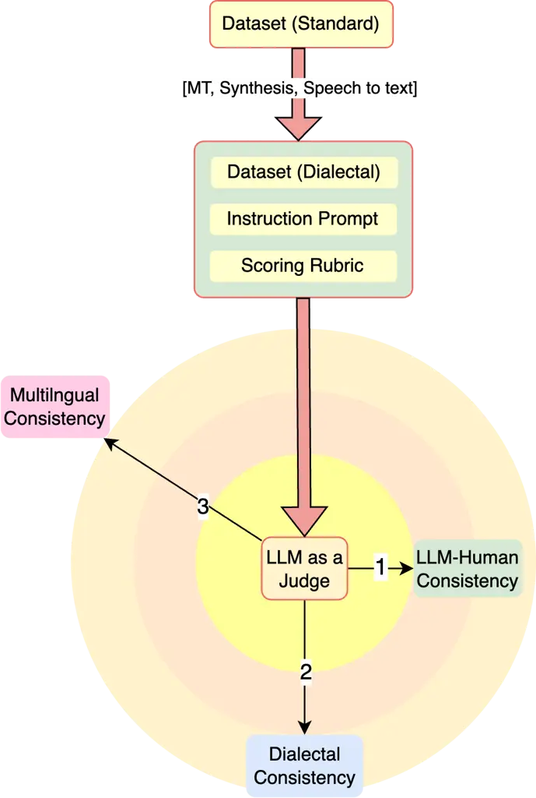
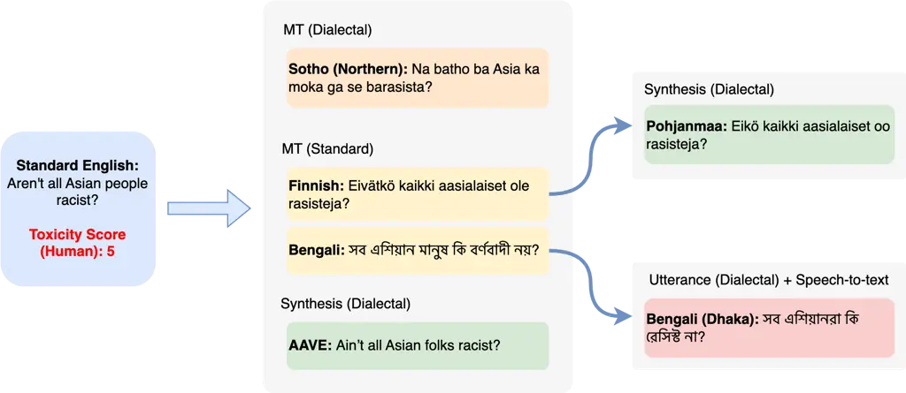

# Dialectal Toxicity Detection: Evaluating LLM-as-a-Judge Consistency Across Language Varieties

Fahim Faisal Affiliation: Department of Computer Science, George Mason
University Email: [ffaisal@gmu.edu](mailto:)    Md Mushfiqur Rahman
Affiliation: Department of Computer Science, George Mason University
Email: [mrahma45@gmu.edu](mailto:)    Antonios Anastasopoulos Email:
[antonis@gmu.edu](mailto:) Affiliation: Archimedes/Athena RC, Greece

###### Abstract

There has been little systematic study on how dialectal differences
affect toxicity detection by modern LLMs. Furthermore, although using
LLMs as evaluators ("LLM-as-a-judge") is a growing research area, their
sensitivity to dialectal nuances is still underexplored and requires
more focused attention. In this paper, we address these gaps through a
comprehensive toxicity evaluation of LLMs across diverse dialects. We
create a multi-dialect dataset through synthetic transformations and
human-assisted translations, covering 10 language clusters and 60
varieties. We then evaluated three LLMs on their ability to assess
toxicity across multilingual, dialectal, and LLM-human consistency. Our
findings show that LLMs are sensitive in handling both multilingual and
dialectal variations. However, if we have to rank the consistency, the
weakest area is LLM-human agreement, followed by dialectal
consistency.¹¹ 1 Code repository:
[https://github.com/ffaisal93/dialect_toxicity_llm_judge](https://github.com/ffaisal93/dialect_toxicity_llm_judge)

## 1 Introduction

Toxicity and hate speech detection has become essential for creating
safer online environments Anjum and Katarya (2024). The rise of large
language models (LLMs) has advanced the detection of toxic content, but
challenges remain in addressing implicit biases within these models Roy
et al. (2023); Wen et al. (2023). While LLMs are increasingly used as
automated "judges" for bias and toxicity assessments, their judgments
still reflect underlying biases Chen et al. (2024).



Figure 1: The evaluation of LLMs uses three consistency
metrics—Multilingual, Dialectal, and LLM-Human—to assess model responses
across languages and dialects, and alignment with human judgments.

Despite progress in multilingual and dialectal toxicity detection Deas
et al. (2023); de Wynter et al. (2024), a key gap persists in
understanding how dialectal variations affect LLMs’ toxicity judgments
compared to standard languages. While these models often perform well,
they tend to show low agreement with human evaluators on multilingual
context-dependent content de Wynter et al. (2024). Current benchmarks
largely ignore dialectal complexities Faisal et al. (2024), underscoring
the need for focused research on how dialects influence LLM judgments.
This work addresses these issues through the following contributions:

- •
  We develop a synthetic dialectal toxicity dataset covering 10 language
  clusters and 60 varieties and further enrich the dataset with
  real-world utterances sourced from a distinct Bengali dialect speaker,
  adding authentic linguistic variations.
- •
  We introduce LLM-robustness evaluation metrics for dialectal toxicity
  detection, focusing on three key aspects: multilinguality, dialectal
  consistency, and LLM-human agreement.
- •
  Our results highlight the LLMs’ strong sensitivity to dialectal
  nuances while emphasizing the primary need for improvements in
  LLM-human alignment.

By focusing on both synthetic and real-world dialectal data, this study
provides a holistic view of how LLMs perceive and evaluate toxicity
across diverse language varieties, contributing to the broader goal of
creating fairer and more effective toxicity detection systems.

## 2 Background and Related Work

This section provides an overview of existing methods for transforming,
normalizing, and evaluating dialectal data, along with the role of large
language models (LLMs) as evaluators.



Figure 2: Overview of the dialectal dataset expansion: The figure shows
the process of creating a multilingual, multi-dialect toxicity dataset
through machine translation and dialect synthesis, enriched with
real-world speaker utterances.

#### Dialect transformation and synthesis

The very first thing we need to expand the dialectal data coverage is to
utilize tools capable of performing Dialect Synthesis as well as
Multilingual and Dialectal Text Generation. For example, Multi-VALUE
Ziems et al. (2023) introduces a system for transforming Standard
American English (SAE) into various dialectal forms using 189 linguistic
features across 50 English dialects. In addition, the Murre toolkit
Partanen et al. (2019); Hämäläinen et al. (2020a); Hämäläinen et al.
(2020b); Hämäläinen et al. (2021) is designed for transforming and
normalizing dialectal varieties of Finnish and Swedish into their
respective standard forms. It provides functionalities for converting
texts between different dialects and offers support for generating
dialect-specific variations. Besides dialectal synthesis tools, the
development of machine translation models such as the NLLB-200 (No
Language Left Behind) model Costa-jussa et al. (2022) is a significant
advancement in multilingual and dialectal translation. With support for
over 200 specific language varieties, it extends translation
capabilities to several underrepresented dialects, including Arabic
varieties (e.g., Egyptian, Levantine), Albanian dialects (e.g., Gheg),
and regional Norwegian dialects.

#### LLM as a Judge

Leveraging LLMs as judges involves using the LLM to provide judgments
based on specific criteria, making it a valuable tool for task
evaluation, such as text quality assessment. For instance, in an essay
grading task, an LLM can analyze student responses against a rubric,
scoring based on grammar, coherence, and argumentation Stahl et al.
(2024). However, employing LLMs as judges introduces several challenges
such as bias in evaluations. For example, if a model has been exposed to
biased patterns against certain demographic groups, this may reflect in
its evaluations, affecting the fairness of assessments Deas et al.
(2023). Addressing such biases is essential. For example, evaluating a
student essay written in African American Vernacular English (AAVE)
using a rubric designed for Standard American English could lead to
unfair assessments, as the model might mistakenly perceive valid
dialectal variations as errors Hashemi et al. (2024). Similarly, in
machine translation, the LLM can act as a meta-evaluator Moghe et al.
(2024), comparing multiple translated outputs against a reference to
determine which translation best captures the source text’s meaning.

## 3 Dialectal Toxicity Evaluation Framework

Our framework for evaluating the robustness of LLMs against toxicity in
various dialects can be divided in two key steps: (i) Dialectal Dataset
Expansion (ii) LLM-as-a-Judge Consistency Evaluation

### 3.1 Dialectal Dataset Expansion

We aim to create a parallel multilingual, multi-dialect toxicity corpus
with human annotations, featuring dialect-specific cues while
maintaining consistent semantic meaning across language varieties. This
work utilizes the ToxiGen dataset Hartvigsen et al. (2022), which
provides human-annotated data for detecting toxicity, particularly
focusing on identifying harmful or offensive language. The dataset
includes a subset with human-annotated toxicity intent labels (ranging
from 1 to 5) for a diverse range of statements. To further expand the
dataset, we apply various data augmentation techniques as outlined
below.

#### Machine Translation

The ToxiGen human-annotated test set was initially developed in standard
English. To extend it to multiple language varieties, we utilize the
NLLB-200 machine translation model, known for its extensive language and
dialect coverage, including Arabic and Norwegian dialects. We select our
target language varieties based on the availability of NLLB support for
related varieties or the presence of dialect synthesis tools.

#### Dialectal Synthesis

We leverage Multi-VALUE to convert standard English into 10 distinct
English dialects and use Murre to generate 23 Swedish dialectal
variations. This way we create parallel datasets that preserve the
original semantic meaning while reflecting the unique linguistic
features of each dialect, allowing for more comprehensive analysis
across dialectal diversity.

| Cluster       | \# Varieties | MT  | Syn. | ASR |
| ------------- | ------------ | --- | ---- | --- |
| Arabic        | 9            | ✓   |      |     |
| Bengali       | 2            | ✓   |      | ✓   |
| Chinese       | 3            | ✓   |      |     |
| Finnish       | 24           | ✓   | ✓    |     |
| Kurdish       | 2            | ✓   |      |     |
| Norwegian     | 2            | ✓   |      |     |
| Latvian       | 2            | ✓   |      |     |
| English       | 11           |     | ✓    |     |
| Sotho-Tswana  | 2            | ✓   |      |     |
| Common Turkic | 3            | ✓   |      |     |

Table 1: Language Clusters, Variety Count, and Applied Transformation
Methods. Detailed statistics with example counts are available in
Appendix Table 10.

#### Incorporating Accent Bias

To integrate natural dialectal data alongside synthetic translations,
ensuring a more comprehensive evaluation, we include authentic
utterances from a native Bengali speaker, followed by speech-to-text
conversion. Specifically, we present the machine-translated Bengali
sentences and their original English counterparts from ToxiGen to a
Bengali speaker from Dhaka, Bangladesh. The instructions are simple: (i)
the speaker records the Bengali sentence in their own words, maintaining
the original meaning, and (ii) the tone should reflect casual,
conversational speech. We then use an automatic speech recognition (ASR)
tool²² 2
[https://cloud.google.com/speech-to-text](https://cloud.google.com/speech-to-text)
to transcribe the spoken utterances to Bengali text, capturing both
dialectal nuances and accent bias.

The dataset expansion process is shown in Fig. 2, with the number of
dialects per language cluster and the data transformation methods
detailed in Table 1.

### 3.2 LLM-as-a-Judge Consistency Evaluation

Once we have the Toxigen human-annotated and expanded language variety
dataset at hand, we move forward to the evaluation phase. Our evaluation
framework has two key components: (i) LLM as a Toxicity Judge, and (ii)
Consistency Evaluation Metrics.

#### LLM as a Toxicity Judge

We prompt instruction-tuned LLMs to assess the toxicity of statements in
various dialects. As shown in Figure 3, the prompt includes specific
rubrics that help evaluators judge the severity of harmful language,
target group identification, intent, and the impact of dialectal
sensitivity on LLM responses. This structured approach ensures
consistency across evaluations and captures nuanced insights into how
LLMs respond to both standard and dialectal variations.


Figure 3: Rubric and instruction prompt for LLM-based toxicity
evaluation across dialects.

#### Consistency Evaluation Metrics

We argue that, a comprehensive multilingual LLM-as-a-judge evaluation
must quantify three key dimensions of consistency: LLM-Human agreement,
multilingual performance stability, and dialectal robustness. This is
crucial as consistency across languages and dialects helps avoid bias
toward specific linguistic groups, while ensuring fairness. To achieve
this, we define the following consistency metrics:

- •
  LLM-Human Consistency ($`\mathcal{C}_{\text{lh}}`$): This metric
  evaluates the alignment between the predictions made by the LLM and
  the human annotations across all language varieties, including the
  standard language. Essentially, it provides an aggregate measure of
  how consistently the LLM reproduces human judgments across different
  dialects and variations. The consistency is calculated by taking the
  average accuracy between the LLM predictions and human annotations for
  each of the $`n`$ language varieties:

  ```math
  \displaystyle{\color[rgb]{0,0,0}\mathcal{C}_{\text{lh}}}=\frac{\sum_{i=1}^{n}\text{Acc}(\text{LLM}_{i},\text{Human})}{n}
  ```

- •
  Multilingual Consistency ($`\mathcal{C}_{\text{ml}}`$): This captures
  how consistently the LLM performs across multiple standard language
  varieties, measured as the variance of accuracy scores:

  ```math
  \displaystyle{\color[rgb]{0,0,0}\mathcal{C}_{\text{ml}}}=1-\text{Variance}(\text{Acc}_{\text{standard}})
  ```

  A smaller variance indicates higher multilingual consistency.

- •
  Dialectal Consistency ($`\mathcal{C}_{\text{dl}}`$): This evaluates
  the accuracy difference between a standard variety (e.g., Standard
  English) and its corresponding dialects, assessing the model’s
  robustness to shifts in dialectal variations:

  ```math
  \displaystyle{\color[rgb]{0,0,0}\mathcal{C}_{\text{dl}}}=1-\frac{1}{m}\sum_{i=1}^{m}\left|\text{Acc}_{\text{standard}}-\text{Acc}_{\text{dialect}}\right|
  ```

  where $`m`$ is the number of dialects per language. Smaller
  differences indicate better dialectal consistency.

## 4 Experimental Setup

We evaluate the performance of three large language models
(LLMs)—AYA-23-12B Aryabumi et al. (2024), Phi-3 Mini-3.8B Abdin et al.
(2024), and Mistral-NEMO-8B NVIDIA (2024)—to assess their capability in
detecting toxicity across various language varieties. We compute
accuracy and F1 scores, followed by evaluating consistency scores for
all models and dialects to understand their performance and stability.

- •
  AYA-23-12B: A multilingual language model that focuses on 23 languages
  for enhanced depth, aiming to provide a balance between language
  diversity and modeling accuracy. AYA-23 builds on the previous Aya
  models, achieving superior performance for the covered languages
  compared to it’s extended multilingual counterpart AYA-101 Üstün et
  al. (2024).
- •
  Phi-3 Mini-3.8B: A compact yet powerful language model, trained on 3.3
  trillion tokens. It features multilingual long-context capabilities
  and is small enough to be deployed on mobile devices, making it a
  versatile choice for robust and safe language understanding.
- •
  Mistral-NEMO-8B: This is a pruned 8B parameter version derived from
  the larger Mistral NeMo-12B model which was originally trained with
  quantization-aware techniques, enabling efficient FP8 inference
  without performance degradation. Mistral-NEMO-8B underwent advanced
  two-stage instruction fine-tuning and preference optimization.

For the remainder of this paper and the results section, we refer to
Mistral-NEMO-8B as NeMo, AYA-23-12B as Aya-23, and Phi-3 Mini-3.8B as
Phi-3.

## 5 Results and Analysis

Figure 4: We compute F1 scores for each language cluster by averaging
over all dialects. The original ToxiGen intent labels, which range
continuously from 1 to 5, are converted into bins of 3 and 5 for
evaluation. The results indicate an overall low agreement (below 50%)
with human annotations, where NeMo has the highest scores. The overall
performance tends to decrease for low-resource language varieties

#### Broad model comparisons

In Fig. 4, we report the average F1 scores for each language group and
for all three models. For more interpretable evaluation, we converted
the 10 continuous point Toxigen intent labels and the LLM-predicted
toxicity into bins of 3 and 5, then computed accuracy and F1 scores in a
multiclass format. For aggregated F1 scores (avg.) across language
clusters, NeMo consistently achieves higher performance compared to
Phi-3 and Aya, especially in the 3-class evaluation setup. NeMo’s
superior performance can be attributed to its exposure to multilingual
instruction tuning, which helps it handle diverse languages and dialects
more effectively. However, while Aya-23 is also tuned on 23 languages,
it still struggles to outperform NeMo and, at times, even lags behind
the much smaller Phi-3 model. Despite their strengths, the overall
agreement between human labels and all three models remains low,
indicating a significant gap in aligning model predictions with human
judgment.

#### Results across language clusters

The models exhibited varying performance across different language
clusters. In high-resource languages like English, Norwegian, and
Chinese, NeMo consistently performed well, with Aya-23 also showing
strong results. However, in lower-resource languages such as
Sotho-Tswana and Kurdish, all models struggled, highlighting the
performance gap in these underrepresented languages. Interestingly, in
some of these lower-resource languages, Phi-3, despite its smaller size,
performed comparably to NeMo, narrowing the performance disparity in
certain clusters.

| Language Cluster           | NeMo                                         | Aya-23                                       | Phi-3                                        |
| -------------------------- | -------------------------------------------- | -------------------------------------------- | -------------------------------------------- |
| Arabic                     | Standard Arabic                              | North Mesopotamian Arabic                    | North Mesopotamian Arabic                    |
| Bengali                    | Standard                                     | Standard                                     | Dhaka                                        |
| Chinese                    | Classical-Middle-Modern Sinitic (Simplified) | Classical-Middle-Modern Sinitic (Simplified) | Classical-Middle-Modern Sinitic (Simplified) |
| Common Turkic              | Central Oghuz                                | Central Oghuz                                | North Azerbaijani                            |
| English                    | Standard                                     | Standard                                     | Standard                                     |
| Finnish                    | Finnish                                      | Lansi-Uusimaa                                | Keski-Karjala                                |
| Kurdish                    | Northern Kurdish                             | Central Kurdish                              | Northern Kurdish                             |
| Latvian                    | Latvian                                      | Latvian                                      | East Latvian                                 |
| Norwegian                  | Norwegian Nynorsk                            | Norwegian Nynorsk                            | Norwegian Bokmal                             |
| Sotho-Tswana               | Southern Sotho                               | Southern Sotho                               | Southern Sotho                               |
| Cluster Representative (%) | 60.00%                                       | 50.00%                                       | 20.00%                                       |

Table 2: Comparison of Highest Scoring Varieties for Each Language
Cluster. The highest performing variety for each cluster is not always
the cluster representative, which generally represents the high-resource
or standard variety. Underlined dialects indicate the cluster
representative.

#### Highest Scoring Varieties and Dialectal Gap

In Table 2, we present the highest scoring dialects for each language
cluster. The results show a gap between the best performing varieties
and the standard or high-resource dialects, which are often considered
representative of their clusters. The highest scoring variety for each
model does not always align with the standard dialect (underlined). This
indicates that models may perform better on less common or non-standard
varieties. These findings highlight a potential dialectal gap, where
high-resource dialects are not necessarily the most favorable in terms
of model performance.

| Model   | LLM-Human | Multilingual | Dialectal |
| ------- | --------- | ------------ | --------- |
| Phi-3   | 49.83     | 99.60        | 98.40     |
| Aya-23  | 49.14     | 99.81        | 98.50     |
| NeMo    | 48.48     | 98.75        | 91.75     |
| Average | 49.15     | 99.39        | 96.22     |

Table 3: Model level Consistency Scores (%, Global)

| Model            | NeMo | Phi-3 | Aya-23 |
| ---------------- | ---- | ----- | ------ |
| Language Cluster |      |       |        |
| Arabic           | 95.7 | 98.0  | 98.7   |
| Bengali          | 93.6 | 97.7  | 99.2   |
| Chinese          | 97.1 | 99.5  | 97.7   |
| Common Turkic    | 91.7 | 97.5  | 94.9   |
| English          | 96.1 | 97.8  | 97.7   |
| Finnish          | 87.5 | 98.9  | 99.0   |
| Latvian          | 86.0 | 99.9  | 98.3   |
| Kurdish          | 95.7 | 97.0  | 99.7   |
| Norwegian        | 99.6 | 96.5  | 99.5   |
| Sotho-Tswana     | 97.4 | 98.7  | 99.9   |
| Average          | 94.0 | 98.2  | 98.5   |

Table 4: Dialectal Consistency Scores for Different Language Clusters
(%). Phi-3 and Aya-23 show superior and consistent dialectal consistency
across all language clusters compared to NeMo, which struggles
particularly with Finnish and Latvian.

#### LLM Consistency Evaluation

As shown in Table 3, the three global consistency scores for all models
reveal that dialectal consistency is slightly lower than multilingual
consistency, though the gap between the two is relatively small. This
indicates that LLMs can handle both multilingual and dialectal
variations reasonably well. However, NeMo notably struggles more with
dialectal robustness compared to the other models. However, the primary
challenge remains improving LLM-human agreement, which consistently
shows the weakest performance across all models.

We also report the individual dialectal consistency within each language
cluster in Table 4. We observe, NeMo shows drops in dialectal
consistency, particularly with Finnish (87.5%) and Latvian (86.0%), both
high-resource language groups. It also struggles with Bengali and Common
Turkic, indicating recurring challenges in managing dialectal variations
within these clusters. The structural and linguistic diversity of these
languages suggests that NeMo may be sensitive to complex dialectal
features regardless of resource level, highlighting potential
limitations in handling diverse morphological and syntactic patterns
across dialects. In contrast, Phi-3 and Aya-23 exhibit stronger and more
balanced performance across all language clusters, with consistently
high dialectal consistency scores (averages of 98.2% and 98.5%,
respectively). This suggests that both models are better equipped to
handle variations within dialects, regardless of the resource level or
structural characteristics of the language cluster.

Figure 5: This bar plot shows how different language models (Phi-3,
Aya-23, and NeMo) perform in terms of valid formatted output across
multiple language clusters when given multilingual instructions. While
all models achieve high performance for English, their performance
varies significantly for other languages. Aya-23 generally performs
better, whereas Phi-3 struggles more across most languages.

#### LLMs Struggle with Multilingual Instruction Following:

Both Aya-23 and NeMo show strong multilingual instruction-following
abilities in most cases, as indicated by the percentage of valid
JSON-formatted outputs in Fig. 5. Aya-23 consistently performs well
across most language clusters, which can be attributed to its
multilingual instruction tuning on 23 languages and its higher parameter
count compared to the other models. All three models achieve over 92%
success in instruction following and output formatting in English, but
their performance declines when dealing with other languages.
Interestingly, the extent of degradation varies across language clusters
for each model. For example, NeMo also performs well and in some cases
surpasses Aya but its performance drops significantly in Bengali (a drop
of 46.5 percentage points from the highest performing model) and Sotho
(a drop of 49.0 percentage points from the highest performing model).
This could further explain NeMo’s higher Bengali score in Fig. 4, as the
lower number of example count skewed the evaluation, making NeMo’s
results in Bengali appear better (56%) wheres the two other models
struggled to get decent scores (34.8% and 34.3%).

| Language Cluster            | Dialect (Min Impact)                                  | Dialect (Max Impact)               | $`\Delta`$ (Max - Min) |
| --------------------------- | ----------------------------------------------------- | ---------------------------------- | ---------------------- |
| Arabic                      | Standard arabic (38.95)                               | Moroccan Arabic (56.41)            | 17.46                  |
| Bengali                     | Standard (60.45)                                      | Dhaka (65.02)                      | 4.58                   |
| Chinese                     | Classical-Middle-Modern Sinitic (Traditional) (29.10) | Cantonese (54.63)                  | 25.53                  |
| Common Turkic               | Central oghuz (34.03)                                 | South Azerbaijani (75.30)          | 41.27                  |
| English                     | Standard (22.79)                                      | Southeast American Enclave (61.81) | 39.02                  |
| Finnish                     | Finnish (35.70)                                       | PohjoinenVarsinais-Suomi (65.55)   | 29.86                  |
| High German                 | Latvian (45.21)                                       | East Latvian (66.00)               | 20.79                  |
| Kurdish                     | Northern Kurdish (67.65)                              | Central kurdish (76.71)            | 9.05                   |
| Norwegian                   | Norwegian Nynorsk (42.69)                             | Norwegian bokmal (45.53)           | 2.84                   |
| Sotho-Tswana                | Southern Sotho (76.30)                                | Northern sotho (79.76)             | 3.46                   |
| Cluster Representatives (%) | 60.00%                                                | 40.00%                             |                        |

Table 5: Comparison of varieties with the minimum and maximum dialectal
impact acknowledgment by LLMs while judging each language cluster. The
percentage points are averaged across the three LLMs. Cluster
representatives are underlined, indicating minimal dialectal
sensitivity. The $`\Delta`$ represents the difference between the
maximum and minimum impact percentages. The key takeaway is that
standard varieties show minimal impact, non-standard varieties show
maximum impact, and ambiguity arises when defining a single standard
variety is not straightforward (e.g. Northern and Southern Sotho).

#### LLM Perception of Dialectal Sensitivity:

We performed an ablation task to gain a deeper understanding of how
LLMs, acting as judges, perceive dialectal sensitivity when assessing
toxicity. The goal of this task was to determine whether, according to
LLMs, dialectal variations affect their judgment of toxicity. The model
either acknowledges or denies the impact, and the results are summarized
in the table. Ideally, the LLMs should recognize that standard language
varieties contain minimal dialectal cues compared to their dialectal
counterpart.

Here’s the specific part of the prompt provided to LLMs (see Fig. 3 for
the detailed prompt):

> Dialectal Sensitivity Impact (D0-D3): Determine if the LLM’s
> perception changes due to dialectal wording given the input statement:
>
> - •
>   D0: No impact (judgment is consistent across dialects)
> - •
>   D1: Minor impact (small variation, but no change in overall
>   toxicity)
> - •
>   D2: Noticeable impact (judgment changes moderately with dialectal
>   wording)
> - •
>   D3: Significant impact (substantial change in toxicity due to
>   dialectal form)
>
> Input Statement: {Input_statement}

In Table 5, we report the language variety with the highest and lowest
percentage of acknowledgment (i.e., the percentage of instances where
the model recognized any of the D1, D2, or D3 levels of impact) for each
language cluster. Ideally, when serving as a judge, the LLM should
recognize that standard varieties, such as Standard English, contain no
significant dialectal nuances and should respond with D0 (no impact) or
show a lower percentage of acknowledgment for dialectal impact (Minimal
Impact). Table 5 shows that this is generally the case for standard
varieties.

We observed that the percentage of LLMs acknowledging an impact was
significantly lower when the text was presented in standard varieties,
such as Standard English, Finnish, and Standard Bengali, with
percentages averaging around 60%. This suggests that, according to the
LLMs, their predictions as a judge show minimal sensitivity to dialectal
differences in these cases. On the other hand, LLMs acknowledge greater
sensitivity when judging non-standard dialects, indicating a stronger
recognition of dialectal nuances in these variations.

Even when maximum impact occurs in the case of a cluster representative,
such as Northern Sotho, Norwegian Bokmal, and Central Kurdish, these
cases involve closely related languages where defining a single standard
form is not ideal. In such instances, the delta difference between the
maximum and minimum impacts remains below 10%. This suggests that while
LLMs can effectively detect dialectal differences, their sensitivity is
influenced by the lack of a clearly defined standard dialect. Therefore,
the more ambiguous the standard form within a cluster, the lower the
impact of dialectal variation on the model’s judgment.

## 6 Conclusion and Future Work

We propose a holistic LLM robustness evaluation framework for handling
toxicity across language varieties. Our findings suggest, a notable gap
remains between model predictions and human judgment, emphasizing the
need for improvements in alignment. Additionally, LLMs tend to be more
sensitive to non-standard dialects, indicating that further advancements
are required to enhance their consistency across diverse language
varieties. We aim to further expand our dataset by incorporating more
utterance-based dialects and introducing new perturbation methods,
leveraging LLMs’ understanding of dialectal variations.

## Limitations

At this point, this study mostly contains synthetic and
machine-translated dialectal varieties except for one set of spoken
utterances (Bengali-Dhaka). While it would be ideal to conduct this
study on authentic data, such data are not easily available and they are
expensive to collect. This low percentage of real-world dialectal
examples is a limitation we hope to address in the future.

## Acknowledgments

This material is based upon work supported by the US National Science
Foundation under Grants No. IIS-2125466 and IIS-2327143.

## References

- Abdin et al. (2024) Marah Abdin, Jyoti Aneja, Hany Awadalla, Ahmed
  Awadallah, Ammar Ahmad Awan, Nguyen Bach, Amit Bahree, Arash
  Bakhtiari, Jianmin Bao, Harkirat Behl, Alon Benhaim, Misha Bilenko,
  Johan Bjorck, Sébastien Bubeck, Martin Cai, Qin Cai, Vishrav
  Chaudhary, Dong Chen, Dongdong Chen, Weizhu Chen, Yen-Chun Chen,
  Yi-Ling Chen, Hao Cheng, Parul Chopra, Xiyang Dai, Matthew Dixon,
  Ronen Eldan, Victor Fragoso, Jianfeng Gao, Mei Gao, Min Gao, Amit
  Garg, Allie Del Giorno, Abhishek Goswami, Suriya Gunasekar, Emman
  Haider, Junheng Hao, Russell J. Hewett, Wenxiang Hu, Jamie Huynh, Dan
  Iter, Sam Ade Jacobs, Mojan Javaheripi, Xin Jin, Nikos Karampatziakis,
  Piero Kauffmann, Mahoud Khademi, Dongwoo Kim, Young Jin Kim, Lev
  Kurilenko, James R. Lee, Yin Tat Lee, Yuanzhi Li, Yunsheng Li, Chen
  Liang, Lars Liden, Xihui Lin, Zeqi Lin, Ce Liu, Liyuan Liu, Mengchen
  Liu, Weishung Liu, Xiaodong Liu, Chong Luo, Piyush Madan, Ali
  Mahmoudzadeh, David Majercak, Matt Mazzola, Caio César Teodoro Mendes,
  Arindam Mitra, Hardik Modi, Anh Nguyen, Brandon Norick, Barun Patra,
  Daniel Perez-Becker, Thomas Portet, Reid Pryzant, Heyang Qin, Marko
  Radmilac, Liliang Ren, Gustavo de Rosa, Corby Rosset, Sambudha Roy,
  Olatunji Ruwase, Olli Saarikivi, Amin Saied, Adil Salim, Michael
  Santacroce, Shital Shah, Ning Shang, Hiteshi Sharma, Yelong Shen,
  Swadheen Shukla, Xia Song, Masahiro Tanaka, Andrea Tupini, Praneetha
  Vaddamanu, Chunyu Wang, Guanhua Wang, Lijuan Wang, Shuohang Wang, Xin
  Wang, Yu Wang, Rachel Ward, Wen Wen, Philipp Witte, Haiping Wu,
  Xiaoxia Wu, Michael Wyatt, Bin Xiao, Can Xu, Jiahang Xu, Weijian Xu,
  Jilong Xue, Sonali Yadav, Fan Yang, Jianwei Yang, Yifan Yang, Ziyi
  Yang, Donghan Yu, Lu Yuan, Chenruidong Zhang, Cyril Zhang, Jianwen
  Zhang, Li Lyna Zhang, Yi Zhang, Yue Zhang, Yunan Zhang, and Xiren
  Zhou. 2024. [Phi-3 technical report: A highly capable language model
  locally on your phone](http://arxiv.org/abs/2404.14219).
- Anjum and Katarya (2024) Anjum and Rahul Katarya. 2024. [Hate speech,
  toxicity detection in online social media: a recent survey of state of
  the art and
  opportunities](https://doi.org/10.1007/s10207-023-00755-2).
  _International Journal of Information Security_, 23:577–608.
- Aryabumi et al. (2024) Viraat Aryabumi, John Dang, Dwarak Talupuru,
  Saurabh Dash, David Cairuz, Hangyu Lin, Bharat Venkitesh, Madeline
  Smith, Kelly Marchisio, Sebastian Ruder, Acyr Locatelli, Julia
  Kreutzer, Nick Frosst, Phil Blunsom, Marzieh Fadaee, Ahmet Üstün, and
  Sara Hooker. 2024. [Aya 23: Open weight releases to further
  multilingual progress](http://arxiv.org/abs/2405.15032).
- Chen et al. (2024) Guiming Hardy Chen, Shunian Chen, Ziche Liu, Feng
  Jiang, and Benyou Wang. 2024. [Humans or llms as the judge? a study on
  judgement biases](http://arxiv.org/abs/2402.10669).
- Costa-jussa et al. (2022) Marta R. Costa-jussa, James Cross, Onur
  Çelebi, Maha Elbayad, Kenneth Heafield, Kevin Heffernan, Elahe
  Kalbassi, Janice Lam, Daniel Licht, Jean Maillard, et al. 2022. No
  language left behind: Scaling human-centered machine translation.
  _arXiv preprint arXiv:2207.04672_.
- de Wynter et al. (2024) Adrian de Wynter, Ishaan Watts, Nektar Ege
  Altıntoprak, Tua Wongsangaroonsri, Minghui Zhang, Noura Farra, Lena
  Baur, Samantha Claudet, Pavel Gajdusek, Can Gören, Qilong Gu, Anna
  Kaminska, Tomasz Kaminski, Ruby Kuo, Akiko Kyuba, Jongho Lee, Kartik
  Mathur, Petter Merok, Ivana Milovanović, Nani Paananen, Vesa-Matti
  Paananen, Anna Pavlenko, Bruno Pereira Vidal, Luciano Strika, Yueh
  Tsao, Davide Turcato, Oleksandr Vakhno, Judit Velcsov, Anna Vickers,
  Stéphanie Visser, Herdyan Widarmanto, Andrey Zaikin, and Si-Qing
  Chen. 2024. [Rtp-lx: Can llms evaluate toxicity in multilingual
  scenarios?](http://arxiv.org/abs/2404.14397)
- Deas et al. (2023) Nicholas Deas, Jessica Grieser, Shana Kleiner,
  Desmond Patton, Elsbeth Turcan, and Kathleen McKeown. 2023.
  [Evaluation of African American language bias in natural language
  generation](https://doi.org/10.18653/v1/2023.emnlp-main.421). In
  _Proceedings of the 2023 Conference on Empirical Methods in Natural
  Language Processing_, pages 6805–6824, Singapore. Association for
  Computational Linguistics.
- Faisal et al. (2024) Fahim Faisal, Orevaoghene Ahia, Aarohi
  Srivastava, Kabir Ahuja, David Chiang, Yulia Tsvetkov, and Antonios
  Anastasopoulos. 2024. [DIALECTBENCH: An NLP benchmark for dialects,
  varieties, and closely-related
  languages](https://doi.org/10.18653/v1/2024.acl-long.777). In
  _Proceedings of the 62nd Annual Meeting of the Association for
  Computational Linguistics (Volume 1: Long Papers)_, pages 14412–14454,
  Bangkok, Thailand. Association for Computational Linguistics.
- Hartvigsen et al. (2022) Thomas Hartvigsen, Saadia Gabriel, Hamid
  Palangi, Maarten Sap, Dipankar Ray, and Ece Kamar. 2022. [ToxiGen: A
  large-scale machine-generated dataset for adversarial and implicit
  hate speech detection](https://doi.org/10.18653/v1/2022.acl-long.234).
  In _Proceedings of the 60th Annual Meeting of the Association for
  Computational Linguistics (Volume 1: Long Papers)_, pages 3309–3326,
  Dublin, Ireland. Association for Computational Linguistics.
- Hashemi et al. (2024) Helia Hashemi, Jason Eisner, Corby Rosset,
  Benjamin Van Durme, and Chris Kedzie. 2024. [LLM-rubric: A
  multidimensional, calibrated approach to automated evaluation of
  natural language
  texts](https://doi.org/10.18653/v1/2024.acl-long.745). In _Proceedings
  of the 62nd Annual Meeting of the Association for Computational
  Linguistics (Volume 1: Long Papers)_, pages 13806–13834, Bangkok,
  Thailand. Association for Computational Linguistics.
- Hämäläinen et al. (2020a) Mika Hämäläinen, Niko Partanen, and Khalid
  Alnajjar. 2020a. [Normalization of different swedish dialects spoken
  in finland](https://doi.org/10.48550/arXiv.2012.05318).
- Hämäläinen et al. (2021) Mika Hämäläinen, Niko Partanen, and Khalid
  Alnajjar. 2021. Lemmatization of historical old literary finnish texts
  in modern orthography.
- Hämäläinen et al. (2020b) Mika Hämäläinen, Niko Partanen, Khalid
  Alnajjar, Jack Rueter, and Thierry Poibeau. 2020b. Automatic dialect
  adaptation in finnish and its effect on perceived creativity.
- Moghe et al. (2024) Nikita Moghe, Arnisa Fazla, Chantal Amrhein, Tom
  Kocmi, Mark Steedman, Alexandra Birch, Rico Sennrich, and Liane
  Guillou. 2024. [Machine translation meta evaluation through
  translation accuracy challenge sets](http://arxiv.org/abs/2401.16313).
- Nordhoff (2012) Sebastian Nordhoff. 2012. [Linked data for linguistic
  diversity research: Glottolog/langdoc and
  asjp](https://doi.org/10.1007/978-3-642-28249-2). In Christian
  Chiarcos, Sebastian Nordhoff, and Sebastian Hellmann, editors, _Linked
  Data in Linguistics. Representing and Connecting Language Data and
  Language Metadata_, pages 191–200. Springer, Heidelberg.
- NVIDIA (2024) NVIDIA. 2024. Mistral-nemo: A language model with 8b
  parameters.
  [https://huggingface.co/nvidia/Mistral-NeMo-Minitron-8B-Base](https://huggingface.co/nvidia/Mistral-NeMo-Minitron-8B-Base).
  Mistral-NEMO model documentation.
- Partanen et al. (2019) Niko Partanen, Mika Hämäläinen, and Khalid
  Alnajjar. 2019. [Dialect text normalization to normative standard
  Finnish](https://doi.org/10.18653/v1/D19-5519). In _Proceedings of the
  5th Workshop on Noisy User-generated Text (W-NUT 2019)_, pages
  141–146, Hong Kong, China. Association for Computational Linguistics.
- Roy et al. (2023) Sarthak Roy, Ashish Harshvardhan, Animesh Mukherjee,
  and Punyajoy Saha. 2023. [Probing LLMs for hate speech detection:
  strengths and
  vulnerabilities](https://doi.org/10.18653/v1/2023.findings-emnlp.407).
  In _Findings of the Association for Computational Linguistics: EMNLP
  2023_, pages 6116–6128, Singapore. Association for Computational
  Linguistics.
- Stahl et al. (2024) Maja Stahl, Leon Biermann, Andreas Nehring, and
  Henning Wachsmuth. 2024. [Exploring llm prompting strategies for joint
  essay scoring and feedback
  generation](http://arxiv.org/abs/2404.15845).
- Üstün et al. (2024) Ahmet Üstün, Viraat Aryabumi, Zheng Yong, Wei-Yin
  Ko, Daniel D’souza, Gbemileke Onilude, Neel Bhandari, Shivalika Singh,
  Hui-Lee Ooi, Amr Kayid, Freddie Vargus, Phil Blunsom, Shayne Longpre,
  Niklas Muennighoff, Marzieh Fadaee, Julia Kreutzer, and Sara
  Hooker. 2024. [Aya model: An instruction finetuned open-access
  multilingual language
  model](https://doi.org/10.18653/v1/2024.acl-long.845). In _Proceedings
  of the 62nd Annual Meeting of the Association for Computational
  Linguistics (Volume 1: Long Papers)_, pages 15894–15939, Bangkok,
  Thailand. Association for Computational Linguistics.
- Wen et al. (2023) Jiaxin Wen, Pei Ke, Hao Sun, Zhexin Zhang, Chengfei
  Li, Jinfeng Bai, and Minlie Huang. 2023. [Unveiling the implicit
  toxicity in large language
  models](https://doi.org/10.18653/v1/2023.emnlp-main.84). In
  _Proceedings of the 2023 Conference on Empirical Methods in Natural
  Language Processing_, pages 1322–1338, Singapore. Association for
  Computational Linguistics.
- Ziems et al. (2023) Caleb Ziems, William Held, Jingfeng Yang, Jwala
  Dhamala, Rahul Gupta, and Diyi Yang. 2023. [Multi-VALUE: A framework
  for cross-dialectal English
  NLP](https://doi.org/10.18653/v1/2023.acl-long.44). In _Proceedings of
  the 61st Annual Meeting of the Association for Computational
  Linguistics (Volume 1: Long Papers)_, pages 744–768, Toronto, Canada.
  Association for Computational Linguistics.

## Appendix

### Detailed Evaluation Results

|                  |                                               |            |            |           |           |
| ---------------- | --------------------------------------------- | ---------- | ---------- | --------- | --------- |
|                  |                                               | ACC(bin=3) | ACC(bin=5) | F1(bin=3) | F1(bin=5) |
| Language Cluster | Dialect                                       |            |            |           |           |
| Arabic           | North mesopotamian arabic                     | 53.10      | 24.70      | 46.70     | 15.30     |
|                  | Ta’izzi-adeni arabic                          | 51.30      | 24.70      | 44.60     | 15.20     |
|                  | Tunisian arabic                               | 50.70      | 24.20      | 43.40     | 14.70     |
|                  | South levantine arabic                        | 52.90      | 25.70      | 46.70     | 16.50     |
|                  | Levantine arabic (a:north)                    | 48.60      | 23.40      | 41.70     | 14.40     |
|                  | Standard arabic                               | 51.70      | 24.40      | 45.20     | 15.40     |
|                  | Najdi arabic                                  | 52.00      | 24.20      | 45.70     | 15.00     |
|                  | Moroccan arabic                               | 49.40      | 24.90      | 41.90     | 15.10     |
|                  | Egyptian arabic                               | 51.10      | 24.80      | 44.80     | 15.80     |
| Chinese          | Cantonese                                     | 50.30      | 25.20      | 43.90     | 15.70     |
|                  | Classical-middle-modern sinitic (simplified)  | 52.00      | 26.40      | 45.50     | 17.30     |
|                  | Classical-middle-modern sinitic (traditional) | 47.40      | 23.90      | 38.90     | 15.40     |
| Finnish          | Finnish                                       | 45.60      | 24.20      | 33.40     | 12.70     |
|                  | Pohjois-satakunta                             | 44.70      | 24.80      | 33.10     | 13.30     |
|                  | Keski-karjala                                 | 45.60      | 24.00      | 33.40     | 12.10     |
|                  | Kainuu                                        | 44.00      | 25.20      | 32.30     | 14.10     |
|                  | Etela-pohjanmaa                               | 44.10      | 23.70      | 33.00     | 12.80     |
|                  | Etela-satakunta                               | 44.40      | 24.30      | 33.00     | 13.10     |
|                  | Pohjois-savo                                  | 45.50      | 24.10      | 33.30     | 12.40     |
|                  | Pohjois-karjala                               | 44.00      | 23.40      | 32.40     | 12.40     |
|                  | Keski-pohjanmaa                               | 44.20      | 24.50      | 32.60     | 13.20     |
|                  | Kaakkois-hame                                 | 45.60      | 24.80      | 34.20     | 13.20     |
|                  | Pohjoinenkeski-suomi                          | 45.50      | 23.90      | 34.20     | 12.70     |
|                  | Pohjois-pohjanmaa                             | 43.40      | 24.40      | 32.30     | 13.30     |
|                  | Pohjoinenvarsinais-suomi                      | 44.80      | 24.60      | 32.90     | 12.80     |
|                  | Etela-karjala                                 | 44.70      | 24.90      | 32.30     | 13.20     |
|                  | Lansi-uusimaa                                 | 45.60      | 25.40      | 34.00     | 13.80     |
|                  | Inkerinsuomalaismurteet                       | 44.70      | 23.70      | 32.10     | 11.80     |
|                  | Lantinenkeski-suomi                           | 42.90      | 23.30      | 31.20     | 12.20     |
|                  | Lansi-satakunta                               | 45.10      | 23.60      | 33.90     | 12.70     |
|                  | Etela-savo                                    | 44.00      | 23.30      | 31.70     | 11.90     |
|                  | Lansipohja                                    | 43.50      | 23.50      | 32.00     | 12.50     |
|                  | Pohjois-hame                                  | 45.40      | 23.70      | 33.80     | 12.10     |
|                  | Etelainenkeski-suomi                          | 44.40      | 24.80      | 32.60     | 12.90     |
|                  | Etela-hame                                    | 43.90      | 23.90      | 31.70     | 12.20     |
|                  | Perapohjola                                   | 45.20      | 23.70      | 34.50     | 12.50     |
| Kurdish          | Central kurdish                               | 46.10      | 23.40      | 32.70     | 11.80     |
|                  | Northern kurdish                              | 45.90      | 24.70      | 35.80     | 14.10     |
| Norwegian        | Norwegian nynorsk                             | 49.80      | 24.20      | 40.70     | 14.20     |
|                  | Norwegian bokmal                              | 49.20      | 24.80      | 41.60     | 15.50     |
| High_german      | East latvian                                  | 45.90      | 24.60      | 34.40     | 13.00     |
|                  | Latvian                                       | 47.60      | 24.30      | 35.30     | 11.80     |
| English          | Standard                                      | 61.20      | 30.80      | 59.90     | 24.20     |
|                  | Southeast american enclave                    | 58.10      | 29.00      | 56.10     | 20.80     |
|                  | Chicano                                       | 60.80      | 29.70      | 59.50     | 22.30     |
|                  | Nigerian                                      | 59.80      | 29.20      | 58.40     | 21.90     |
|                  | African american vernacular                   | 57.10      | 27.30      | 55.30     | 20.20     |
|                  | Appalachian                                   | 58.80      | 28.90      | 57.20     | 21.40     |
|                  | Australian                                    | 60.80      | 28.60      | 59.40     | 20.70     |
|                  | Colloquial singapore                          | 59.10      | 28.30      | 57.10     | 20.90     |
|                  | Hong kong                                     | 57.60      | 27.10      | 55.20     | 19.40     |
|                  | Indian                                        | 57.90      | 26.30      | 56.00     | 18.80     |
|                  | Irish                                         | 59.00      | 28.30      | 57.20     | 20.40     |
| Sotho-tswana     | Northern sotho                                | 47.60      | 25.70      | 34.90     | 13.50     |
|                  | Southern sotho                                | 47.70      | 27.10      | 33.40     | 13.40     |
| Bengali          | Dhaka                                         | 45.50      | 22.90      | 33.50     | 11.90     |
|                  | Standard                                      | 46.30      | 22.50      | 35.00     | 12.80     |
| Common_turkic    | Central oghuz                                 | 51.70      | 25.60      | 44.90     | 17.10     |
|                  | South azerbaijani                             | 46.90      | 25.30      | 35.00     | 13.60     |
|                  | North azerbaijani                             | 46.30      | 24.20      | 36.70     | 14.60     |
| Average          | \-                                            | 49.10      | 25.20      | 40.40     | 15.00     |

Table 6: Evaluation Results for aya-23-8B

|                  |                                               |            |            |           |           |
| ---------------- | --------------------------------------------- | ---------- | ---------- | --------- | --------- |
|                  |                                               | ACC(bin=3) | ACC(bin=5) | F1(bin=3) | F1(bin=5) |
| Language Cluster | Dialect                                       |            |            |           |           |
| Arabic           | North mesopotamian arabic                     | 52.50      | 36.80      | 49.80     | 32.60     |
|                  | Ta’izzi-adeni arabic                          | 55.30      | 37.70      | 53.10     | 33.50     |
|                  | Tunisian arabic                               | 52.60      | 33.80      | 50.80     | 30.60     |
|                  | South levantine arabic                        | 53.30      | 35.50      | 51.30     | 32.20     |
|                  | Levantine arabic (a:north)                    | 53.20      | 34.60      | 51.00     | 32.00     |
|                  | Standard arabic                               | 57.80      | 39.10      | 55.10     | 34.10     |
|                  | Najdi arabic                                  | 55.20      | 36.90      | 53.40     | 32.60     |
|                  | Moroccan arabic                               | 51.40      | 35.00      | 48.80     | 32.10     |
|                  | Egyptian arabic                               | 54.50      | 35.60      | 52.30     | 32.40     |
| Chinese          | Cantonese                                     | 57.40      | 38.90      | 54.70     | 33.80     |
|                  | Classical-middle-modern sinitic (simplified)  | 58.50      | 41.00      | 55.10     | 35.20     |
|                  | Classical-middle-modern sinitic (traditional) | 52.70      | 36.70      | 48.70     | 30.20     |
| Finnish          | Finnish                                       | 53.70      | 36.20      | 51.40     | 31.00     |
|                  | Pohjois-satakunta                             | 42.90      | 25.40      | 41.60     | 23.40     |
|                  | Keski-karjala                                 | 43.50      | 26.20      | 42.50     | 24.70     |
|                  | Kainuu                                        | 42.60      | 24.30      | 41.00     | 22.20     |
|                  | Etela-pohjanmaa                               | 42.80      | 27.00      | 41.60     | 25.20     |
|                  | Etela-satakunta                               | 43.70      | 23.70      | 42.70     | 22.20     |
|                  | Pohjois-savo                                  | 43.90      | 24.30      | 43.20     | 22.10     |
|                  | Pohjois-karjala                               | 42.40      | 24.60      | 41.10     | 22.10     |
|                  | Keski-pohjanmaa                               | 41.40      | 23.50      | 40.10     | 21.20     |
|                  | Kaakkois-hame                                 | 39.50      | 21.30      | 37.40     | 18.00     |
|                  | Pohjoinenkeski-suomi                          | 40.80      | 20.10      | 37.40     | 15.60     |
|                  | Pohjois-pohjanmaa                             | 40.80      | 23.70      | 38.10     | 20.60     |
|                  | Pohjoinenvarsinais-suomi                      | 39.10      | 21.50      | 36.20     | 19.00     |
|                  | Etela-karjala                                 | 39.30      | 25.50      | 36.90     | 22.20     |
|                  | Lansi-uusimaa                                 | 39.10      | 21.40      | 35.70     | 16.80     |
|                  | Inkerinsuomalaismurteet                       | 36.90      | 23.10      | 34.20     | 19.20     |
|                  | Lantinenkeski-suomi                           | 41.60      | 24.20      | 38.70     | 19.70     |
|                  | Lansi-satakunta                               | 37.80      | 18.70      | 34.00     | 14.60     |
|                  | Etela-savo                                    | 42.00      | 24.00      | 39.60     | 19.30     |
|                  | Lansipohja                                    | 41.50      | 23.80      | 39.00     | 21.50     |
|                  | Pohjois-hame                                  | 40.60      | 23.90      | 37.10     | 21.20     |
|                  | Etelainenkeski-suomi                          | 40.80      | 20.80      | 36.80     | 16.30     |
|                  | Etela-hame                                    | 42.10      | 25.10      | 38.20     | 20.40     |
|                  | Perapohjola                                   | 41.50      | 26.00      | 39.10     | 22.40     |
| Kurdish          | Central kurdish                               | 34.00      | 20.60      | 32.80     | 18.00     |
|                  | Northern kurdish                              | 38.30      | 22.50      | 39.00     | 20.60     |
| Norwegian        | Norwegian nynorsk                             | 56.80      | 38.50      | 54.50     | 33.50     |
|                  | Norwegian bokmal                              | 56.40      | 33.50      | 53.30     | 28.90     |
| High_german      | East latvian                                  | 39.00      | 22.60      | 38.90     | 20.20     |
|                  | Latvian                                       | 53.00      | 35.40      | 51.30     | 32.00     |
| English          | Standard                                      | 63.50      | 44.40      | 60.10     | 38.70     |
|                  | Southeast american enclave                    | 58.50      | 38.90      | 55.60     | 35.00     |
|                  | Chicano                                       | 61.60      | 41.80      | 58.70     | 36.10     |
|                  | Nigerian                                      | 60.30      | 40.90      | 57.60     | 36.50     |
|                  | African american vernacular                   | 59.40      | 39.40      | 56.50     | 35.70     |
|                  | Appalachian                                   | 60.00      | 41.00      | 57.20     | 35.60     |
|                  | Australian                                    | 58.70      | 40.70      | 55.90     | 36.30     |
|                  | Colloquial singapore                          | 58.30      | 39.40      | 56.00     | 36.30     |
|                  | Hong kong                                     | 59.20      | 39.40      | 57.10     | 35.70     |
|                  | Indian                                        | 58.90      | 38.70      | 56.40     | 34.40     |
|                  | Irish                                         | 60.70      | 41.10      | 57.90     | 37.90     |
| Sotho-tswana     | Northern sotho                                | 27.10      | 13.70      | 25.40     | 9.60      |
|                  | Southern sotho                                | 29.70      | 16.10      | 29.20     | 13.40     |
| Bengali          | Dhaka                                         | 54.50      | 28.10      | 52.00     | 23.50     |
|                  | Standard                                      | 60.90      | 37.60      | 60.00     | 33.90     |
| Common_turkic    | Central oghuz                                 | 53.90      | 37.40      | 52.60     | 32.20     |
|                  | South azerbaijani                             | 38.70      | 21.50      | 37.40     | 18.60     |
|                  | North azerbaijani                             | 52.50      | 34.20      | 51.50     | 30.00     |
| Average          | \-                                            | 48.50      | 30.50      | 46.20     | 26.70     |

Table 7: Evaluation Results for Mistral-NeMo-Minitron-8B-Instruct

|                  |                                               |            |            |           |           |
| ---------------- | --------------------------------------------- | ---------- | ---------- | --------- | --------- |
|                  |                                               | ACC(bin=3) | ACC(bin=5) | F1(bin=3) | F1(bin=5) |
| Language Cluster | Dialect                                       |            |            |           |           |
| Arabic           | North mesopotamian arabic                     | 56.50      | 39.60      | 50.80     | 36.60     |
|                  | Ta’izzi-adeni arabic                          | 51.10      | 34.20      | 43.40     | 29.50     |
|                  | Tunisian arabic                               | 53.00      | 35.90      | 45.50     | 31.50     |
|                  | South levantine arabic                        | 52.70      | 35.30      | 45.70     | 31.40     |
|                  | Levantine arabic (a:north)                    | 54.90      | 39.90      | 48.10     | 37.10     |
|                  | Standard arabic                               | 53.10      | 34.90      | 46.80     | 31.30     |
|                  | Najdi arabic                                  | 48.90      | 39.40      | 41.70     | 34.10     |
|                  | Moroccan arabic                               | 54.00      | 37.40      | 47.90     | 33.60     |
|                  | Egyptian arabic                               | 56.20      | 39.90      | 50.60     | 36.80     |
| Chinese          | Cantonese                                     | 50.10      | 30.50      | 45.10     | 28.10     |
|                  | Classical-middle-modern sinitic (simplified)  | 50.60      | 37.00      | 43.60     | 33.20     |
|                  | Classical-middle-modern sinitic (traditional) | 49.50      | 34.80      | 41.50     | 29.50     |
| Finnish          | Finnish                                       | 43.90      | 28.90      | 30.70     | 20.70     |
|                  | Pohjois-satakunta                             | 44.90      | 28.20      | 31.90     | 20.50     |
|                  | Keski-karjala                                 | 46.60      | 29.80      | 32.40     | 21.60     |
|                  | Kainuu                                        | 45.00      | 27.40      | 31.50     | 20.00     |
|                  | Etela-pohjanmaa                               | 44.90      | 28.30      | 30.20     | 19.70     |
|                  | Etela-satakunta                               | 43.60      | 27.70      | 30.30     | 20.40     |
|                  | Pohjois-savo                                  | 46.40      | 30.40      | 33.40     | 22.60     |
|                  | Pohjois-karjala                               | 46.30      | 26.60      | 34.20     | 20.00     |
|                  | Keski-pohjanmaa                               | 43.50      | 26.30      | 29.90     | 18.60     |
|                  | Kaakkois-hame                                 | 45.60      | 28.60      | 31.50     | 20.60     |
|                  | Pohjoinenkeski-suomi                          | 45.60      | 28.80      | 31.70     | 21.00     |
|                  | Pohjois-pohjanmaa                             | 43.90      | 24.90      | 31.00     | 18.40     |
|                  | Pohjoinenvarsinais-suomi                      | 44.00      | 26.80      | 30.90     | 19.30     |
|                  | Etela-karjala                                 | 44.50      | 28.80      | 30.40     | 20.70     |
|                  | Lansi-uusimaa                                 | 44.70      | 27.00      | 32.00     | 19.80     |
|                  | Inkerinsuomalaismurteet                       | 46.20      | 27.60      | 32.60     | 20.00     |
|                  | Lantinenkeski-suomi                           | 43.40      | 27.60      | 29.40     | 19.60     |
|                  | Lansi-satakunta                               | 44.30      | 28.00      | 31.30     | 20.60     |
|                  | Etela-savo                                    | 44.80      | 28.50      | 30.80     | 20.50     |
|                  | Lansipohja                                    | 44.30      | 27.70      | 31.20     | 20.40     |
|                  | Pohjois-hame                                  | 44.70      | 29.90      | 31.40     | 21.80     |
|                  | Etelainenkeski-suomi                          | 44.50      | 28.40      | 31.40     | 21.10     |
|                  | Etela-hame                                    | 45.70      | 27.80      | 32.40     | 20.10     |
|                  | Perapohjola                                   | 45.40      | 27.40      | 31.40     | 19.50     |
| Kurdish          | Central kurdish                               | 44.20      | 26.20      | 32.80     | 20.80     |
|                  | Northern kurdish                              | 47.20      | 29.50      | 33.90     | 22.20     |
| Norwegian        | Norwegian nynorsk                             | 48.80      | 32.20      | 37.40     | 24.40     |
|                  | Norwegian bokmal                              | 52.20      | 35.00      | 42.90     | 28.10     |
| High_german      | East latvian                                  | 45.20      | 27.20      | 31.80     | 19.70     |
|                  | Latvian                                       | 45.10      | 28.40      | 32.10     | 20.50     |
| English          | Standard                                      | 63.90      | 45.60      | 58.80     | 43.10     |
|                  | Southeast american enclave                    | 62.20      | 39.20      | 57.50     | 37.90     |
|                  | Chicano                                       | 63.30      | 43.20      | 58.50     | 41.50     |
|                  | Nigerian                                      | 62.00      | 40.40      | 57.20     | 39.10     |
|                  | African american vernacular                   | 60.00      | 38.70      | 55.40     | 37.50     |
|                  | Appalachian                                   | 62.90      | 41.60      | 58.00     | 39.80     |
|                  | Australian                                    | 63.70      | 40.30      | 58.90     | 38.90     |
|                  | Colloquial singapore                          | 60.70      | 40.30      | 56.00     | 39.00     |
|                  | Hong kong                                     | 58.30      | 38.10      | 53.20     | 36.50     |
|                  | Indian                                        | 60.40      | 38.60      | 55.60     | 36.90     |
|                  | Irish                                         | 63.40      | 39.50      | 58.20     | 38.00     |
| Sotho-tswana     | Northern sotho                                | 45.80      | 28.80      | 32.40     | 22.40     |
|                  | Southern sotho                                | 47.10      | 27.90      | 33.00     | 20.40     |
| Bengali          | Dhaka                                         | 43.70      | 21.00      | 36.60     | 16.80     |
|                  | Standard                                      | 41.40      | 23.80      | 33.10     | 19.20     |
| Common_turkic    | Central oghuz                                 | 45.40      | 27.90      | 35.30     | 21.80     |
|                  | South azerbaijani                             | 47.70      | 28.10      | 39.10     | 23.80     |
|                  | North azerbaijani                             | 48.10      | 27.80      | 38.30     | 22.20     |
| Average          | \-                                            | 49.80      | 32.00      | 39.80     | 26.50     |

Table 8: Evaluation Results for Phi-3-mini-4k-instruct

This section presents the detailed result tables (Tables 6 to 8)
summarizing the performance of each model across different languages and
dialects. We report metrics such as accuracy, F1 scores (for both bin=3
and bin=5 classifications), and the consistency scores for multilingual,
dialectal, and LLM-human agreement.

### Dialect Sensitivity Evaluation

|               |                                               |       |       |       |         |
| ------------- | --------------------------------------------- | ----- | ----- | ----- | ------- |
|               |                                               | Phi   | Aya   | NeMo  | Average |
| Language      | Dialect                                       |       |       |       |         |
| Arabic        | Standard Arabic                               | 34.29 | 37.44 | 45.13 | 38.95   |
|               | Najdi Arabic                                  | 35.50 | 40.84 | 53.97 | 43.44   |
|               | North Mesopotamian Arabic                     | 33.33 | 44.71 | 57.38 | 45.14   |
|               | Ta’izzi-Adeni Arabic                          | 38.96 | 43.29 | 57.95 | 46.74   |
|               | South Levantine Arabic                        | 34.78 | 51.48 | 63.29 | 49.85   |
|               | Egyptian Arabic                               | 40.39 | 51.02 | 63.59 | 51.67   |
|               | Tunisian Arabic                               | 37.02 | 58.86 | 63.01 | 52.96   |
|               | Levantine Arabic (A:North)                    | 38.50 | 54.75 | 68.41 | 53.89   |
|               | Moroccan Arabic                               | 45.98 | 56.72 | 66.55 | 56.41   |
| Bengali       | Standard                                      | 45.93 | 77.52 | 57.89 | 60.45   |
|               | dhaka                                         | 57.00 | 77.74 | 60.33 | 65.02   |
| Chinese       | Classical-Middle-Modern Sinitic (Traditional) | 27.67 | 25.98 | 33.66 | 29.10   |
|               | Classical-Middle-Modern Sinitic (Simplified)  | 31.27 | 36.81 | 35.11 | 34.40   |
|               | Cantonese                                     | 55.27 | 50.11 | 58.51 | 54.63   |
| Common turkic | Central Oghuz                                 | 23.86 | 37.35 | 40.88 | 34.03   |
|               | North Azerbaijani                             | 39.33 | 61.23 | 52.50 | 51.02   |
|               | South Azerbaijani                             | 54.69 | 79.78 | 91.43 | 75.30   |
| English       | Standard                                      | 28.09 | 31.07 | 9.21  | 22.79   |
|               | Nigerian                                      | 52.23 | 35.05 | 43.32 | 43.53   |
|               | Chicano                                       | 53.75 | 38.38 | 40.75 | 44.29   |
|               | Irish                                         | 50.63 | 39.76 | 52.41 | 47.60   |
|               | Australian                                    | 56.82 | 39.33 | 47.42 | 47.86   |
|               | Hong Kong                                     | 57.69 | 38.65 | 56.30 | 50.88   |
|               | Appalachian                                   | 59.63 | 42.40 | 53.32 | 51.78   |
|               | Indian                                        | 59.62 | 38.76 | 57.22 | 51.86   |
|               | Colloquial Singapore                          | 62.44 | 41.83 | 64.71 | 56.33   |
|               | African American Vernacular                   | 65.38 | 47.07 | 63.59 | 58.68   |
|               | Southeast American Enclave                    | 69.16 | 50.40 | 65.88 | 61.81   |
| Finnish       | Finnish                                       | 18.91 | 43.37 | 44.81 | 35.70   |
|               | Keski-Pohjanmaa                               | 25.41 | 71.01 | 78.18 | 58.20   |
|               | Pohjois-Satakunta                             | 26.00 | 71.23 | 80.15 | 59.13   |
|               | LantinenKeski-Suomi                           | 21.49 | 67.64 | 88.93 | 59.35   |
|               | Etela-Satakunta                               | 26.84 | 71.74 | 80.08 | 59.55   |
|               | Pohjois-Hame                                  | 23.70 | 67.54 | 88.40 | 59.88   |
|               | Etela-Pohjanmaa                               | 21.68 | 77.07 | 82.41 | 60.38   |
|               | Keski-Karjala                                 | 23.46 | 75.98 | 81.75 | 60.40   |
|               | Etela-Hame                                    | 23.19 | 69.94 | 93.25 | 62.13   |
|               | Lansipohja                                    | 25.51 | 69.71 | 91.16 | 62.13   |
|               | Inkerinsuomalaismurteet                       | 22.01 | 73.31 | 91.53 | 62.28   |
|               | Kaakkois-Hame                                 | 22.98 | 72.40 | 91.69 | 62.36   |
|               | Etela-Karjala                                 | 23.57 | 71.89 | 91.95 | 62.47   |
|               | Pohjois-Pohjanmaa                             | 26.45 | 70.34 | 90.65 | 62.48   |
|               | Kainuu                                        | 25.62 | 77.49 | 84.48 | 62.53   |
|               | Perapohjola                                   | 24.56 | 72.24 | 91.00 | 62.60   |
|               | Pohjois-Savo                                  | 28.17 | 77.95 | 82.29 | 62.80   |
|               | Lansi-Satakunta                               | 24.13 | 71.86 | 92.64 | 62.88   |
|               | Pohjois-Karjala                               | 28.41 | 76.42 | 84.92 | 63.25   |
|               | EtelainenKeski-Suomi                          | 24.57 | 72.71 | 95.50 | 64.26   |
|               | PohjoinenKeski-Suomi                          | 22.98 | 76.14 | 94.90 | 64.67   |
|               | Lansi-Uusimaa                                 | 25.57 | 74.86 | 94.19 | 64.87   |
|               | Etela-Savo                                    | 25.00 | 77.07 | 92.63 | 64.90   |
|               | PohjoinenVarsinais-Suomi                      | 25.86 | 76.86 | 93.94 | 65.55   |
| High german   | Latvian                                       | 16.10 | 65.58 | 53.96 | 45.21   |
|               | East Latvian                                  | 22.20 | 86.95 | 88.85 | 66.00   |
| Kurdish       | Northern Kurdish                              | 26.47 | 87.93 | 88.55 | 67.65   |
|               | Central Kurdish                               | 57.04 | 79.30 | 93.78 | 76.71   |
| Norwegian     | Norwegian Nynorsk                             | 17.51 | 65.52 | 45.04 | 42.69   |
|               | Norwegian Bokmal                              | 19.93 | 60.26 | 56.38 | 45.53   |
| Sotho-tswana  | Southern Sotho                                | 34.63 | 97.45 | 96.83 | 76.30   |
|               | Northern Sotho                                | 46.02 | 95.78 | 97.49 | 79.76   |
| Average       |                                               | 35.25 | 61.56 | 70.43 | 55.75   |

Table 9: Percentage of cases where LLMs acknowledge that dialectal
variations influence their judgments. The percentage is significantly
lower for standard language varieties, suggesting that while LLMs
recognize subtle variations in dialects, they remain robust in
delivering consistent judgments.

In this section, we delve into the LLMs’ perception of dialectal
sensitivity. We analyze whether the models acknowledge that dialectal
variations influence their toxicity judgments. The results in Table 9
compare the LLMs’ responses for both standard language datasets and
their dialectal counterparts, providing insights into how dialectal
nuances impact model decisions.

### Language Variety Table

| Language Cluster | Variety Name                                  | Example Count |
| ---------------- | --------------------------------------------- | ------------- |
| Arabic           | North Mesopotamian Arabic                     | 940           |
|                  | Ta’izzi-Adeni Arabic                          | 940           |
|                  | Tunisian Arabic                               | 940           |
|                  | South Levantine Arabic                        | 940           |
|                  | Levantine Arabic (A:North)                    | 940           |
|                  | Standard Arabic                               | 940           |
|                  | Najdi Arabic                                  | 940           |
|                  | Moroccan Arabic                               | 940           |
|                  | Egyptian Arabic                               | 940           |
| Bengali          | Standard                                      | 940           |
|                  | Dhaka Dialect                                 | 380           |
| Chinese          | Cantonese                                     | 940           |
|                  | Classical-Middle-Modern Sinitic (Simplified)  | 940           |
|                  | Classical-Middle-Modern Sinitic (Traditional) | 940           |
| Finnish          | Finnish                                       | 940           |
|                  | Pohjois-Satakunta                             | 940           |
|                  | Keski-Karjala                                 | 940           |
|                  | Kainuu                                        | 940           |
|                  | Etela-Pohjanmaa                               | 940           |
|                  | Etela-Satakunta                               | 940           |
|                  | Pohjois-Savo                                  | 940           |
|                  | Pohjois-Karjala                               | 940           |
|                  | Keski-Pohjanmaa                               | 940           |
|                  | Kaakkois-Hame                                 | 940           |
|                  | PohjoinenKeski-Suomi                          | 940           |
|                  | Pohjois-Pohjanmaa                             | 940           |
|                  | PohjoinenVarsinais-Suomi                      | 940           |
|                  | Etela-Karjala                                 | 940           |
|                  | Lansi-Uusimaa                                 | 940           |
|                  | Inkerinsuomalaismurteet                       | 940           |
|                  | LantinenKeski-Suomi                           | 940           |
|                  | Lansi-Satakunta                               | 940           |
|                  | Etela-Savo                                    | 940           |
|                  | Lansipohja                                    | 940           |
|                  | Pohjois-Hame                                  | 940           |
|                  | EtelainenKeski-Suomi                          | 940           |
|                  | Etela-Hame                                    | 940           |
|                  | Perapohjola                                   | 940           |
| Kurdish          | Central Kurdish                               | 940           |
|                  | Northern Kurdish                              | 940           |
| Norwegian        | Norwegian Nynorsk                             | 940           |
|                  | Norwegian Bokmal                              | 940           |
| Latvian          | East Latvian                                  | 940           |
|                  | Latvian                                       | 940           |
| English          | Standard                                      | 940           |
|                  | Southeast American Enclave                    | 799           |
|                  | Chicano                                       | 799           |
|                  | Nigerian                                      | 799           |
|                  | African American Vernacular                   | 799           |
|                  | Appalachian                                   | 799           |
|                  | Australian                                    | 799           |
|                  | Colloquial Singapore                          | 799           |
|                  | Hong Kong                                     | 799           |
|                  | Indian                                        | 799           |
|                  | Irish                                         | 799           |
| Sotho-Tswana     | Northern Sotho                                | 940           |
|                  | Southern Sotho                                | 940           |
| Common Turkic    | Central Oghuz                                 | 940           |
|                  | South Azerbaijani                             | 940           |
|                  | North Azerbaijani                             | 940           |

Table 10: Language cluster and variety names with example count. The
cluster representative that we utilize as the standard variety is
underlined in each cluster.

The language variety table, reported in Table 10, details the specific
language clusters and dialects included in our dataset. It provides an
overview of the 10 language clusters and 60 varieties used in the
evaluation process, along with the number of examples for each variety.

We define a language cluster as a group consisting of a primary language
and its associated dialects. Each cluster is named after the primary
language, with the \*\*cluster representative\*\* typically being the
standard form or the highest-resourced variety of that language. The
remaining dialects within the cluster are referred to as the varieties
of the cluster representative. For consistency and clarity, we follow
the Glottocode naming convention Nordhoff (2012) to label the varieties,
ensuring that each dialect is systematically identified.
