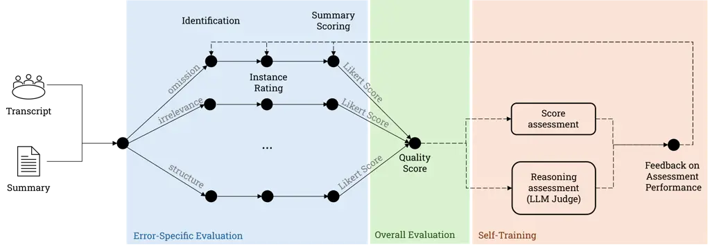
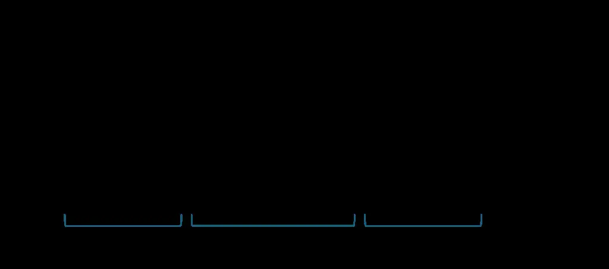

# Is my Meeting Summary Good? Estimating Quality with a Multi-LLM Evaluator

Frederic Kirstein Affiliation: University of Göttingen, Germany
Email: <*kirstein@gipplab.org>    Terry Ruas Affiliation: University of
Göttingen, Germany    Bela Gipp Affiliation: University of Göttingen,
Germany

###### Abstract

The quality of meeting summaries generated by natural language
generation (NLG) systems is hard to measure automatically. Established
metrics such as ROUGE and BERTScore have a relatively low correlation
with human judgments and fail to capture nuanced errors. Recent studies
suggest using large language models (LLMs), which have the benefit of
better context understanding and adaption of error definitions without
training on a large number of human preference judgments. However,
current LLM-based evaluators risk masking errors and can only serve as a
weak proxy, leaving human evaluation the gold standard despite being
costly and hard to compare across studies. In this work, we present
MESA, an LLM-based framework employing a three-step assessment of
individual error types, multi-agent discussion for decision refinement,
and feedback-based self-training to refine error definition
understanding and alignment with human judgment. We show that MESA’s
components enable thorough error detection, consistent rating, and
adaptability to custom error guidelines. Using GPT-4o as its backbone,
MESA achieves mid to high Point-Biserial correlation with human judgment
in error detection and mid Spearman and Kendall correlation in
reflecting error impact on summary quality, on average 0.25 higher than
previous methods. The framework’s flexibility in adapting to custom
error guidelines makes it suitable for various tasks with limited
human-labeled data.


## 1 Introduction



Figure 1: Architecture of MESA displaying the singel-aspect assessment
using three stages and the self-training mechanic for feedback-based
alignment improvement with available human data.

Meeting summaries have become integral to professional environments
Zhong et al. (2021); Hu et al. (2023); Laskar et al. (2023), serving as
references, updates for absentees, and reinforcements of key topics
discussed. The integration of summarization services into established
digital meeting platforms (e.g., Zoom¹¹ 1
[https://www.zoom.com/en/ai-assistant](https://www.zoom.com/en/ai-assistant),
Microsoft Teams²² 2
[https://copilot.cloud.microsoft](https://copilot.cloud.microsoft),
Google Meet³³ 3
[https://support.google.com/meet/](https://support.google.com/meet/answer/14754931))
further underscores their growing relevance. The evaluation of generated
summaries remains an ongoing problem Kirstein et al. (2024b) and is
typically solved through costly, time-consuming human assessment.
Consequently, an automatic evaluator is necessary, which would, if
providing insights along the scoring, also enable sophisticated
techniques such as feedback-based summary refinement Kirstein et al.
(2024a) and reinforcement learning from AI feedback Lee et al. (2023).

Established automatic metrics such as ROUGE Lin (2004), BERTScore Zhang
et al. (2020), and BARTScore Yuan et al. (2021) exhibit a relatively low
correlation with human judgment. These count- and model-based metrics
often fail to reliably detect errors, leading to error masking Kirstein
et al. (2024c), and lack sensitivity to error impact, resulting in
inaccurate reflection of summary quality in score Kirstein et al.
(2024a).

Recently, Large language models (LLMs) have been proposed as evaluators
for text summarization Liu et al. (2023a); Liu et al. (2023b); Wang
et al. (2024), assigning Likert scores based on predefined guidelines.
However, these approaches face limitations in meeting summarization
contexts. Current annotation guidelines do not cover typical errors in
meeting summaries, e.g., structure presentation, coreference issues
Kirstein et al. (2024c), resulting in oversight and insufficient quality
assessment. Moreover, the subjective nature of existing guidelines,
e.g., ’informativeness’ Liu et al. (2023b) may lead to inconsistent
interpretations by LLMs, resulting in unreliable evaluations Kirstein
et al. (2024a).

We introduce the meeting summary assessor (MESA), a multi-stage
LLM-based framework that mimics the human evaluation approach (see
Figure 1). MESA operates on three levels: error-specific evaluation,
overall evaluation, and self-training. For each error type to be
considered, an error-specific evaluation is performed that employs a
three-step process to identify potential errors, assess their impact,
and assign Likert scores (0-5) Likert (1932), utilizing chain-of-thought
(CoT) prompting Wei et al. (2024b) and verbose confidence scores (0-10)
Tian et al. (2023) to boost performance. The three-step assessment can
be carried out using a multi-agent discussion protocol Liang et al.
(2023) where one agent generates a draft challenged and refined by other
agents, allowing for a dynamic refinement step considering different
perspectives Li et al. (2024). The overall evaluation synthesizes the
individual Likert scores into an overall rating of the error impact
(0-5) and a corresponding quality score (1-10). The self-training
mechanism, inspired by Wang et al. (2024)’s self-teaching and Kirstein
et al. (2024a)’s feedback approach, influences the evaluation behavior
by comparing MESA’s assessments with available human annotations. We
employ an LLM judge Zheng et al. (2024) to evaluate reasoning quality
and predefined categories for labeling Likert score discrepancies. The
comparisons are processed by a second LLM that generates a feedback
report pointing out how MESA should change behavior to better align with
human judgment in scoring and reasoning. This feedback is appended to
the prompts of the error-specific evaluation.

We evaluate MESA using available error definitions and a modified
version of QMSum Mistake Kirstein et al. (2024a), combining total and
partial omission errors. Experiments with GPT-4o⁴⁴ 4 We will refer to
this as GPT4 throughout the paper. as the backbone model demonstrate
MESA’s strong performance across all error types, outperforming existing
evaluators in error existence correlation (avg. gap: $`\sim`$0.2) and
severity representation (avg. gap: $`\sim`$0.25). We observe that the
self-training step helps align with human judgment, mitigating overly
harsh scoring tendencies and reducing the false-positive detection of
error instances. The three-step error-specific evaluation allows for a
thorough analysis, reducing false-negative detection. Our contributions
are summarized as follows:

- •
  A multi-agent-based, self-training evaluation framework, MESA, that
  outperforms baseline metrics on meeting summary assessment.
- •
  A thorough analysis of the components (i.e., three-step evaluation,
  single-aspect processing, multi-agent discussion, self-training).
- •
  We introduce multi-agent discussion to the meeting summarization
  domain and propose a three-step evaluation to boost performance.

## 2 Methodology

Key weaknesses of meeting summarization evaluators include error type
confusion Kirstein et al. (2024a), oversight of error instances Kirstein
et al. (2024c), and risk of self-inconsistency Wei et al. (2024a). To
address these, we develop MESA through comparative experiments between
traditional approaches and promising alternatives. Our findings indicate
that the most reliable, self-consistent, and thorough setup combines
error-type specific single-aspect evaluators with multi-agent discussion
in a three-stage scoring process (see Figure 1). Experiments use GPT4
backbones, generating verbose confidence scores (0-10) Geng et al.
(2024) and chain-of-thought (CoT) Wei et al. (2024b) reasoning traces
for qualitative analysis. The prompts and example outputs are provided
in Appendices A and B.

### 2.1 Error types and dataset

We assess the error types redundancy (RED), incoherence (INC), language
(LAN), omission (OM), coreference (COR), hallucination (HAL), structure
(STR), and irrelevance (IRR). The definitions (see Appendix C) are based
on Kirstein et al. (2024a), combining total and partial omission into
one.

We use the QMSum Mistake dataset Kirstein et al. (2024a), comprising 170
samples from academic (ICSI Janin et al. (2003)), business (AMI Mccowan
et al. (2005)), and parliament meetings, summarized by language models
(LED Beltagy et al. (2020), DialogLED Zhong et al. (2022), Pegasus-X
Phang et al. (2022), GPT-3.5, and Phi-3 Abdin et al. (2024)) and
human-annotated for errors. Four annotators update the human annotation
scores (Likert scale, 0 to 5) and reasoning traces to align with our
modified definitions, following the annotation process detailed in
Section D.2. We achieve a high inter-annotator agreement of 0.793
(Krippendorff’s alpha Krippendorff (1970), complete agreement stated in
Section D.3), indicating strong reliability. Statistics on the QMSum
Mistake dataset are listed in Section D.1.

### 2.2 Challenge I: error type confusion

Error-type definitions are nuanced (Appendix C), requiring careful
consideration during detection. Prompting models to consider multiple
error types simultaneously (multi-aspect) risks definition confusion
Kamoi et al. (2024). Literature suggests restricting detection to one
error type at a time (single aspect), using multiple model instances for
comprehensive coverage Kirstein et al. (2024a).

#### Single-aspect error-type assessment leads to a more reliable and comprehensive evaluation.

Multi-aspect approaches often assign uniform scores across error types,
provide superficial reasoning (e.g., "it misses details about decision
making"), and occasionally confuse error definitions, leading to false
detections. In contrast, single-aspect approaches demonstrate a more
thorough understanding of individual error types, identifying a broader
range of errors. However, the single-aspect approach may become
oversensitive, assigning overly bad scores to minor errors, aligning
with recent findings Kirstein et al. (2024a).

### 2.3 Chalenge II: error instance oversight

A direct assessment of error types may miss critical instances,
affecting scoring accuracy Kamoi et al. (2024). We propose a three-step
evaluation pipeline to address the risk of oversight and have a more
thorough assessment process consisting of identifying potential error
instances, rating the error severity for each instance, and assigning a
score based on the observations for the currently assessed error type
(see Figure 1). Each step is carried out by an LLM instance informed by
the result of the previous step.

#### Three-step assessment offers more thorough error instance identification and sensitive scoring.

Comparing single-step and three-step evaluation approaches reveals
notable improvements in error detection and scoring with the three-step
method. Using the single-aspect setup as the backbone, we observe that
the three-step approach more effectively detects non-obvious error
instances, such as paraphrased repetitions. Balanced accuracy scores
(Table 1, definition in Appendix E) show an improvement in detecting all
error types with an average improvement of $`\sim`$3.5% on average.

However, this increased sensitivity and larger number of detections can
lead to overly strict assessments, particularly for subjective error
types (e.g., irrelevance). We conclude that the three-step approach
offers a more comprehensive evaluation but requires adjustment, e.g.,
through in-context samples, to better align with human judgment. While
offering more comprehensive evaluations, the three-step approach
requires fine-tuning, potentially through in-context samples, to better
align with human judgment.

|        |      |      |      |      |      |      |      |      |
| ------ | ---- | ---- | ---- | ---- | ---- | ---- | ---- | ---- |
| Step   | OM   | REP  | INC  | COR  | HAL  | LAN  | STR  | IRR  |
| single | 93.0 | 93.7 | 88.5 | 85.3 | 71.0 | 85.9 | 87.0 | 81.0 |
| three  | 95.3 | 94.1 | 90.1 | 89.0 | 77.6 | 90.4 | 89.2 | 87.4 |

Table 1: Balanced accuracy of the error type identification compared
against human judgments using the single-step (single) and three-step
(three) approach on the modified QMSum Mistake dataset. Error type
abbreviations follow the definition in Appendix C.

### 2.4 Challenge III: inconsistent scoring



Figure 2: Multi-agent discussion protocol used, consisting of an initial
draft generator, three synchronously acting challengers, and a moderator
summarizing the individual statements into a final task solution.

To address score fluctuations in LLM-based assessments Wei et al.
(2024a), we explore a multi-agent debate protocol (MADP) Liang et al.
(2023). In MADP, different models (agents) collaborate through a natural
language exchange to solve a task. We use MADP to challenge and refine
an initial draft (e.g., collection of potential error instances). First,
a moderator model provides a draft solution, followed by multiple model
instances independently challenging the draft from different
perspectives and refining the solution. Finally, a moderator synthesizes
the refinements into a final output. Through this approach, we embed an
additional layer to identify and mitigate false positive or false
negative detection, contributing to a more robust and consistent
evaluation.

#### MADP enhances evaluation depth and nuance, improving the overall assessment quality.

We compare three setups: single-model without MADP (Single), MADP with
multiple GPT4 instances (MADP-S), and MADP with diverse models,
including GPT4, Phi-3-medium-128k Abdin et al. (2024), Llama 3.2 11b AI
(2024), and Gemini 1.5 Flash Team et al. (2024) (MADP-M). All setups use
a single-aspect three-step architecture as base. Both MADP approaches
demonstrate improved error impact sensitivity with more fine-grained
explanations and ratings. The MADP-M offers slightly more diverse
perspectives but broadly aligns with MADP-S results. Table 2 shows that
score variance can be notably reduced with MADP, with slightly less
variance when using only GPT4 instances.

|        |        |        |        |        |        |        |        |        |
| ------ | ------ | ------ | ------ | ------ | ------ | ------ | ------ | ------ |
| Setup  | OM     | REP    | INC    | COR    | HAL    | LAN    | STR    | IRR    |
| single | 4.08   | 3.74   | 4.03   | 3.39   | 3.81   | 3.76   | 3.83   | 3.38   |
|        | (0.01) | (0.07) | (0.07) | (0.26) | (0.29) | (0.06) | (0.11) | (0.08) |
| MADP-S | 4.30   | 3.93   | 4.05   | 3.96   | 3.94   | 3.80   | 4.03   | 3.74   |
|        | (0.03) | (0.00) | (0.04) | (0.11) | (0.23) | (0.07) | (0.01) | (0.04) |
| MADP-M | 4.31   | 3.95   | 3.98   | 3.91   | 3.98   | 3.78   | 4.05   | 3.76   |
|        | (0.04) | (0.05) | (0.05) | (0.14) | (0.22) | (0.03) | (0.09) | (0.07) |

Table 2: Mean Likert scores and standard deviation in parentheses below
across three iterations. Error type abbreviations follow definition in
Appendix C. Single refers to single LLM setup, MADP-S is MADP with only
GPT4 instances, MADP-M is MADP with multi-model instances.

|           |           |           |           |           |           |           |           |           |
| --------- | --------- | --------- | --------- | --------- | --------- | --------- | --------- | --------- |
| Step      | OM        | REP       | INC       | COR       | HAL       | LAN       | STR       | IRR       |
| ROUGE-1   | 0.01      | 0.13      | -0.02     | 0.06      | 0.13      | 0.02      | 0.09      | -0.23\*   |
| ROUGE-2   | -0.00     | 0.20\*    | 0.08      | 0.15      | 0.15      | 0.12      | 0.17      | -0.11     |
| ROUGE-LS  | 0.07      | 0.26\*\*  | 0.08      | 0.19\*    | 0.19\*    | 0.05      | 0.23\*    | -0.20\*   |
| BERTScore | -0.10     | -0.04     | -0.15     | 0.08      | 0.01      | -0.24\*   | 0.08      | -0.32\*\* |
| G-Eval-4  | -0.13     | -0.49\*\* | -0.24     | -0.21\*   | -0.26\*   | -0.21\*   | -0.21     | -0.16     |
| Single-0  | -0.25\*   | -0.48\*\* | -0.39\*\* | -0.22\*   | -0.14     | -0.23\*   | -0.35\*\* | -0.12     |
| Single-1  | -0.26\*   | -0.53\*\* | -0.42\*\* | -0.25     | -0.27\*   | -0.28\*   | -0.41\*\* | -0.13     |
| Multi-0   | -0.30\*\* | -0.45\*\* | -0.38\*\* | -0.30\*\* | -0.18     | -0.46\*\* | -0.35\*\* | -0.16     |
| Multi-1   | -0.27\*\* | -0.69\*\* | -0.63\*\* | -0.35     | -0.33\*\* | -0.52\*\* | -0.43\*\* | -0.21\*   |

Table 3: Point-Biserial correlation between metric scores and human
annotation. Significant values: \* (p $`\leq`$ 0.05) and \*\* (p
$`\leq`$ 0.01). Negative correlation means error presence leads to
metric score decrease. Bold means best value.

### 2.5 Resulting MESA architecture

The derived MESAarchitecture combines single-aspect, three-step
evaluation using single-model MADP for thorough assessment. Individual
error-type Likert scores are combined using a weighted sum, following
the idea of Liu et al. (2023a):

```math
impact=\frac{\sum_{n}s_{n}\cdot(c_{n}\cdot i_{n})}{\sum_{n}(c_{n}\cdot i_{n})} \tag{1}
```

where $`s_{n}`$ is the Likert score, $`c_{n}`$ the scaled confidence
score (0-1) reported by the LLM, and $`i_{n}`$ an importance parameter
(default: 1.0; OM, HAL, IRR: 1.1; REP, INC, LAN: 0.9). Errors such as
OM, HAL, and IRR are prioritized as they significantly affect summary
accuracy and introduce biases, undermining the summary’s
trustworthiness. REP, INC, and LAN primarily influence readability and
occur less frequently in LLM-generated summaries Kirstein et al.
(2024c), warranting a slightly lower weight. The $`impact`$ score,
describing how large the impact of all errors is on the summary quality
(none: 0 to highly impacted: 5), is converted to a quality score (1 to 10) using:

```math
quality=1+\left(\frac{5-impact}{5}\cdot 9\right) \tag{2}
```

An optional self-training mechanism inspired by self-teaching Wang
et al. (2024) and feedback techniques Kirstein et al. (2024a) is
introduced to address overly harsh scoring. This mechanism uses GPT4 as
a judge Zheng et al. (2024) to evaluate the quality of the reasoning
traces on completeness, overlap with human reasoning, and logic. For the
score differences, we report labels ranging from "no difference" to
"major difference" for score discrepancies, with "critical disagreement"
for conflicting error observations. A second GPT4 judge is tasked to
detect patterns in the per-sample feedback and provides a consolidated
report for each error type on what should be considered or treated
differently during evaluation. This report is then used in the following
three-step assessment, being appended to the original task describing
prompt to steer the detection and evaluation behavior.

## 3 Experiments

### 3.1 Setup

We compare MESA with established metrics using the modified QMSum
Mistake dataset and the eight error types: omission (OM), repetition
(REP), incoherence (INC), coreference (COR), hallucination (HAL),
language (LAN), structure (STR), and irrelevance (IRR). We use the MESA
setup described in Section 2.5 with and without MADP (Multi-n,
Single-n), with n iterations of self-training (0, 1).

Baseline metrics include:

- •
  ROUGE Lin (2004), the most common, count-based metric, assessing
  n-gram overlap between generated and reference summaries. We report
  unigrams, bigrams, and the longest common sequence.
- •
  BERTScore Zhang et al. (2020), a model-based metric measuring the
  contextual similarity between generated and reference texts,
  reflecting semantic and syntactic similarity. We report the rescaled F
  score⁵⁵ 5 [https://github.com/Tiiiger/bert
  score/blob/master/journal/rescale
  baseline.md](https://github.com/Tiiiger/bert_score/blob/master/journal/rescale_baseline.md).
- •
  A modified version of the LLM-based G-Eval-4 Liu et al. (2023a)
  prompted with our eight evaluation criteria and access to the
  transcript.

|           |           |           |           |           |           |           |           |           |          |          |           |           |           |           |           |           |
| --------- | --------- | --------- | --------- | --------- | --------- | --------- | --------- | --------- | -------- | -------- | --------- | --------- | --------- | --------- | --------- | --------- |
|           | OM        |           | REP       |           | INC       |           | COR       |           | HAL      |          | LAN       |           | STR       |           | IRR       |           |
| Step      | $`\rho`$  | $`\tau`$  | $`\rho`$  | $`\tau`$  | $`\rho`$  | $`\tau`$  | $`\rho`$  | $`\tau`$  | $`\rho`$ | $`\tau`$ | $`\rho`$  | $`\tau`$  | $`\rho`$  | $`\tau`$  | $`\rho`$  | $`\tau`$  |
| ROUGE-1   | -0.03     | -0.03     | 0.11      | 0.08      | 0.00      | 0.00      | 0.08      | 0.06      | 0.22\*   | 0.15\*   | 0.01      | 0.01      | 0.08      | 0.07      | -0.24\*\* | -0.18\*\* |
| ROUGE-2   | -0.03     | -0.02     | 0.16      | 0.12      | 0.03      | 0.03      | 0.12      | 0.10      | 0.18\*   | 0.13     | 0.06      | 0.05      | 0.12      | 0.10      | -0.15     | -0.11     |
| ROUGE-LS  | -0.06     | -0.04     | 0.10      | 0.07      | 0.03      | 0.02      | 0.07      | 0.06      | 0.18     | 0.13     | -0.01     | -0.01     | 0.06      | 0.05      | -0.21\*   | -0.16\*   |
| BERTScore | 0.07      | -0.01     | 0.22\*    | 0.17\*    | -0.20\*   | -0.15\*   | 0.03      | 0.02      | -0.05    | 0.04     | 0.05      | 0.02      | 0.02      | 0.02      | -0.44\*\* | -0.34\*\* |
| G-Eval-4  | -0.24\*   | -0.18\*   | -0.44\*\* | -0.34\*\* | -0.36\*\* | -0.28\*\* | -0.15     | -0.12     | -0.18\*  | -0.14\*  | -0.22\*   | -0.18\*   | -0.15     | -0.13     | -0.17     | -0.13     |
| Single-0  | -0.27\*   | -0.20\*   | -0.47\*\* | -0.36\*\* | -0.42\*\* | -0.32\*\* | -0.24\*   | -0.19\*   | -0.22\*  | -0.16\*  | -0.25\*   | -0.19\*   | -0.37\*\* | -0.29\*\* | -0.22\*   | -0.16\*   |
| Single-1  | -0.42\*\* | -0.32\*\* | -0.53\*\* | -0.41\*\* | -0.46\*\* | -0.35\*\* | -0.27\*\* | -0.22\*\* | -0.26\*  | -0.19\*  | -0.30\*   | -0.23\*\* | -0.40\*\* | -0.31\*\* | -0.21\*   | -0.16\*   |
| Multi-0   | -0.31     | -0.22     | -0.52\*\* | -0.41\*\* | -0.34     | -0.24     | -0.35\*   | -0.29\*   | -0.19    | -0.13    | -0.49\*\* | -0.37\*\* | -0.34\*\* | -0.27\*\* | -0.25     | -0.20     |
| Multi-1   | -0.58\*\* | -0.46\*\* | -0.57\*\* | -0.46\*\* | -0.58\*\* | -0.45\*\* | -0.33\*\* | -0.27\*\* | -0.22\*  | -0.16\*  | -0.49\*\* | -0.40\*\* | -0.37\*\* | -0.29\*\* | -0.34\*\* | -0.26\*\* |

Table 4: Kendall ($`\tau`$) and Spearman ($`\rho`$) correlation between
metric scores and human annotation. Significant values: \* (p $`\leq`$
0.05) and \*\* (p $`\leq`$ 0.01). Negative correlation: high impact
leads to metric score decrease. Bold: best value.

### 3.2 Analysis and discussion

Our analysis focuses on three aspects of evaluation: error masking,
sensitivity to error impact, and closeness to human ratings. We conclude
that the three-stage detection in MESA demonstrates significant
improvements over the best current approach, G-Eval-4, showing the
highest correlation with human judgment on both pure error detection
(avg. gap: 0.1) and error sensitivity (avg. gap: 0.15). The
self-teaching loop further enhances MESA’s performance, increasing
correlation (avg. gap increase: 0.1) and notably closing the gap to
human judgment (up to 1.4 points reduction). Multi-1 exhibits the best
assessment performance, while Single-1 offers a faster, less
computationally expensive alternative with a slight performance
decrease.

#### MESA demonstrates a high correlation on error existence, indicating a low error masking tendency.

Table 3 shows the Point-Biserial correlation Tate (1954) analysis
between considered automatic metrics and human annotation. Traditional
count- and model-based metrics (ROUGE, BERTScore) perform poorly across
most dimensions as expected Kirstein et al. (2024c). LLM-based methods
show higher, desired negative correlations with human judgment,
suggesting them as a preferred choice. G-Eval-4 exhibits mostly weak
correlations, with stronger reactions for REP, INC, and STR. We
hypothesize that not all error instances are detected by G-Eval-4,
leading to erroneous evaluation behavior.

MESA’s Multi-n and Single-n setups surpass previous state-of-the-art
evaluators in correlation across all error types (avg. -0.13 compared to
G-Eval-4), indicating the benefit of splitting assessment into dedicated
detection and scoring. INC, LANG, and IRR benefit most, while OM and HAL
remain challenging, aligning with recent findings on LLMs’ struggle with
contextualization Kirstein et al. (2024a). As qualitative analysis
reveals, self-training further provides a slight boost by asking the
model to prioritize identified error instances explicitly. MADP-based
variants achieve greater correlation, indicating that the refinement
process helps eliminate falsely detected instances and consider
overlooked ones.

|          |      |      |      |      |      |      |      |      |
| -------- | ---- | ---- | ---- | ---- | ---- | ---- | ---- | ---- |
| Step     | OM   | REP  | INC  | COR  | HAL  | LAN  | STR  | IRR  |
| G-Eval-4 | 0.56 | 1.97 | 2.30 | 2.60 | 1.10 | 2.07 | 2.53 | 1.68 |
| Single-0 | 0.73 | 2.36 | 2.92 | 2.77 | 1.50 | 2.73 | 2.79 | 1.91 |
| Single-1 | 0.31 | 1.87 | 2.15 | 2.70 | 1.17 | 2.02 | 2.34 | 1.70 |
| Multi-0  | 0.92 | 2.60 | 2.96 | 3.24 | 2.03 | 2.87 | 3.06 | 2.39 |
| Multi-1  | 0.22 | 1.71 | 1.53 | 2.46 | 1.06 | 2.13 | 2.33 | 1.83 |

Table 5: Gap of the mean LLM-assigned Likert scores to the mean
human-assigned Likert scores for the individual error types.

#### MESA’s rating of individual error instances helps capture error type severity in scores.

Table 4 shows Kendall Kendall (1938) and Spearman Spearman (1904)
correlations between automatic metrics and human annotations on error
type impact. ROUGE and BERTScore correlate well for IRR errors but
struggle elsewhere, with BERTScore rewarding severe REP instances and
ROUGE tending to reward HAL. LLM-based metrics demonstrate weak to
mid-negative correlations, indicating a capability to understand and
reflect varying impact severities in score.

MESA’s multi-step approach outperforms current methods, suggesting that
previous limitations may stem from overlooking score-influencing error
instances, leading to a weaker reflection of error impacts in scores.

The improvement through MADP indicates that reflective discussion
enhances the categorization of error instance impacts and promotes a
more thorough score reassessment. Self-training further boosts
performance (average improvement of -0.1), demonstrating that feedback
on reasoning traces and scoring behavior aids in error categorization.

#### Self-teaching addresses the initial overestimation of error impact.

Table 5 shows that the gap between MESA-assigned and human-annotated
Likert scores is initially greater than for LLM-based metrics relying on
a single-step assessment. This greater gap may be due to the more
thorough error detection with the three-step assessment pipeline,
leading the framework to assign higher scores than humans. However,
self-teaching feedback drastically narrows this gap by up to 1.4 points,
lowering it below baseline gaps.

## 4 Related Work

Meeting summarization evaluation faces significant challenges with
traditional metrics like ROUGE Lin (2004) and BERTScore Zhang et al.
(2020). These metrics correlate relatively poorly with human judgment,
potentially masking or rewarding certain error types (e.g., QuestEval
Scialom et al. (2021) favors missing information). LLM-generated
summaries expose these limitations further, leading to minimal metric
score differences despite substantial qualitative variations Kirstein
et al. (2024a). Our work formalizes the error-type focused evaluation
concepts by Kirstein et al. (2024a) into a thorough detection framework.

LLMs as summary evaluators have shown promising results, with approaches
like GPTScore Fu et al. (2024), G-EVAL Liu et al. (2023a), and
self-taught evaluators Wang et al. (2024) demonstrating positive
correlation with human judgments. For meeting summarization
specifically, single-evaluator metrics such as AUTOCALIBRATE Liu et al.
(2023b) and FACTSCORE Min et al. (2023) are recently explored but still
lag in reliability and alignment with human judgment Kirstein et al.
(2024a). Persistent challenges include difficulty detecting specific
error types (e.g., omission) and handling subjective assessments
Kirstein et al. (2024a). Our work continues research of LLM-based
metrics by further developing existing objective error definitions
Kirstein et al. (2024a), implementing an LLM-based single-aspect
evaluator, and incorporating a refinement process inspired by the
self-teaching technique Wang et al. (2024).

## 5 Final Considerations

In this paper, we introduced MESA, an LLM-based single-aspect evaluation
framework for meeting summarization using a three-step evaluation
pipeline and multi-agent discussion paradigm. We conducted extensive
experiments on the influence of the individual components and assessment
performance of the framework using a modified version of the QMSum
Mistake dataset annotated by humans on eight error types. Experiments
revealed that MESA identifies error instances more thoroughly and better
captures impact than established metrics, achieving a higher correlation
with human judgment. The self-training approach enhances alignment with
human assessments and reduces oversensitive detections. The framework’s
flexibility in allowing for custom error guidelines and adapting to
human scoring behavior with minimal samples makes it applicable beyond
meeting summarization for tasks with similar limitations. We will
release the codebase and updated dataset to encourage research on
LLM-based evaluation.

## Acknowledgements

This work was supported by the Lower Saxony Ministry of Science and
Culture and the VW Foundation. Frederic Kirstein was supported by the
Mercedes-Benz AG Research and Development.

## Limitations

We have used large LLMs in this work (GPT4) and have not explicitly
studied whether the approach works on smaller models. As we used smaller
models while exploring multi-agent discussions, we could observe a
similar level of detail generated by the smaller models. This
observation indicates that the approach can also be successful with
models from the 10B to 30B parameter category.

Another possible weakness of our work could be that we carry our
experiments on a dataset that might seem small (i.e., 170 samples).
However, its size is comparable to that of the original, established
QMSum dataset (232 samples) and the original QMSum Mistake dataset (200
samples). We contribute to refining the original datasets by carefully
annotating human errors, curating reasoning traces, and defining new
error types. As there are no large, high-quality datasets available with
diverse meeting types due to data security and intellectual property
constraints, a method to generate synthetic meetings on a human-like
level would be required to mitigate this data scarcity.

Further, we only investigate and report metric performance measured as
accuracy or correlation, leaving out computational requirement concerns.
We do so as the LLM-based approaches will be more costly than the
established count-based and model-based metrics. We include in our
experiments a more lightweight version of MESA to demonstrate that a
weaker, less expensive variant yields similar results as our
best-performing option.

## Ethics Statement

#### Licenses:

We adhered to licensing requirements for all tools used (OpenAI,
Microsoft, Google, Meta, Huggingface).

#### Privacy:

User privacy was protected by screening the dataset for personally
identifiable information during quality assessment.

#### Intended Use:

Our pipelines are intended for organizations to quickly and efficiently
assess the quality of summaries and extend their summarization systems
with a feedback-generating mid-layer. While poor summary quality
assessment may affect user experience and the performance of depending
systems, it should not raise ethical concerns as the evaluation is based
solely on given transcripts and summaries. Production LLMs will only
perform inference, not re-training on live transcripts. Assessments will
be accessible only to meeting participants, ensuring information from
other meetings remains confidential.

## References

- Abdin et al. (2024) Marah Abdin, Sam Ade Jacobs, and Ammar Ahmad
  Awan. 2024. [Phi-3 Technical Report: A Highly Capable Language Model
  Locally on Your Phone](https://doi.org/10.48550/arXiv.2404.14219).
  _Preprint_, arXiv:2404.14219.
- AI (2024) Meta AI. 2024. Llama 3.2: Revolutionizing edge AI and vision
  with open, customizable models.
  https://ai.meta.com/blog/llama-3-2-connect-2024-vision-edge-mobile-devices/.
- Beltagy et al. (2020) Iz Beltagy, Matthew E. Peters, and Arman
  Cohan. 2020. [Longformer: The Long-Document
  Transformer](https://arxiv.org/abs/2004.05150). _Preprint_,
  arXiv:2004.05150.
- Chang et al. (2024) Yapei Chang, Kyle Lo, Tanya Goyal, and Mohit
  Iyyer. 2024. [BooookScore: A systematic exploration of book-length
  summarization in the era of
  LLMs](https://doi.org/10.48550/arXiv.2310.00785). _Preprint_,
  arXiv:2310.00785.
- Fu et al. (2024) Jinlan Fu, See-Kiong Ng, Zhengbao Jiang, and Pengfei
  Liu. 2024. [GPTScore: Evaluate as You
  Desire](https://doi.org/10.18653/v1/2024.naacl-long.365). In
  _Proceedings of the 2024 Conference of the North American Chapter of
  the Association for Computational Linguistics: Human Language
  Technologies (Volume 1: Long Papers)_, pages 6556–6576, Mexico City,
  Mexico. Association for Computational Linguistics.
- Geng et al. (2024) Jiahui Geng, Fengyu Cai, Yuxia Wang, Heinz Koeppl,
  Preslav Nakov, and Iryna Gurevych. 2024. [A Survey of Confidence
  Estimation and Calibration in Large Language
  Models](https://doi.org/10.18653/v1/2024.naacl-long.366). In
  _Proceedings of the 2024 Conference of the North American Chapter of
  the Association for Computational Linguistics: Human Language
  Technologies (Volume 1: Long Papers)_, pages 6577–6595, Mexico City,
  Mexico. Association for Computational Linguistics.
- Hu et al. (2023) Yebowen Hu, Timothy Ganter, Hanieh Deilamsalehy,
  Franck Dernoncourt, Hassan Foroosh, and Fei Liu. 2023. [MeetingBank: A
  Benchmark Dataset for Meeting
  Summarization](https://doi.org/10.18653/v1/2023.acl-long.906). In
  _Proceedings of the 61st Annual Meeting of the Association for
  Computational Linguistics (Volume 1: Long Papers)_, pages 16409–16423,
  Toronto, Canada. Association for Computational Linguistics.
- Ivgi et al. (2022) Maor Ivgi, Uri Shaham, and Jonathan Berant. 2022.
  [Efficient Long-Text Understanding with Short-Text
  Models](https://doi.org/10.48550/arXiv.2208.00748). _Preprint_,
  arXiv:2208.00748.
- Janin et al. (2003) A. Janin, D. Baron, J. Edwards, D. Ellis,
  D. Gelbart, N. Morgan, B. Peskin, T. Pfau, E. Shriberg, A. Stolcke,
  and C. Wooters. 2003. [The ICSI Meeting
  Corpus](https://doi.org/10.1109/ICASSP.2003.1198793). In _2003 IEEE
  International Conference on Acoustics, Speech, and Signal
  Processing, 2003. Proceedings. (ICASSP ’03)._, volume 1, pages I–I.
- Kamoi et al. (2024) Ryo Kamoi, Sarkar Snigdha Sarathi Das, Renze Lou,
  Jihyun Janice Ahn, Yilun Zhao, Xiaoxin Lu, Nan Zhang, Yusen Zhang,
  Ranran Haoran Zhang, Sujeeth Reddy Vummanthala, Salika Dave, Shaobo
  Qin, Arman Cohan, Wenpeng Yin, and Rui Zhang. 2024. Evaluating LLMs at
  Detecting Errors in LLM Responses. https://arxiv.org/abs/2404.03602v2.
- Kendall (1938) M. G. Kendall. 1938. [A New Measure of Rank
  Correlation](https://arxiv.org/abs/2332226). _Biometrika_,
  30(1/2):81–93.
- Kirstein et al. (2024a) Frederic Kirstein, Terry Ruas, and Bela Gipp.
  2024a. [What’s Wrong? Refining Meeting Summaries with LLM
  Feedback](https://doi.org/10.48550/arXiv.2407.11919). _Preprint_,
  arXiv:2407.11919.
- Kirstein et al. (2024b) Frederic Kirstein, Jan Philip Wahle, Bela
  Gipp, and Terry Ruas. 2024b. [CADS: A Systematic Literature Review on
  the Challenges of Abstractive Dialogue
  Summarization](https://doi.org/10.48550/arXiv.2406.07494). _Preprint_,
  arXiv:2406.07494.
- Kirstein et al. (2024c) Frederic Kirstein, Jan Philip Wahle, Terry
  Ruas, and Bela Gipp. 2024c. [What’s under the hood: Investigating
  Automatic Metrics on Meeting
  Summarization](https://doi.org/10.48550/arXiv.2404.11124). _Preprint_,
  arXiv:2404.11124.
- Krippendorff (1970) Klaus Krippendorff. 1970. [Bivariate Agreement
  Coefficients for Reliability of Data](https://doi.org/10.2307/270787).
  _Sociological Methodology_, 2:139–150.
- Laskar et al. (2023) Md Tahmid Rahman Laskar, Xue-Yong Fu, Cheng Chen,
  and Shashi Bhushan TN. 2023. [Building Real-World Meeting
  Summarization Systems using Large Language Models: A Practical
  Perspective](https://doi.org/10.18653/v1/2023.emnlp-industry.33). In
  _Proceedings of the 2023 Conference on Empirical Methods in Natural
  Language Processing: Industry Track_, pages 343–352, Singapore.
  Association for Computational Linguistics.
- Lee et al. (2023) Harrison Lee, Samrat Phatale, Hassan Mansoor, Thomas
  Mesnard, Johan Ferret, Kellie Lu, Colton Bishop, Ethan Hall, Victor
  Carbune, Abhinav Rastogi, and Sushant Prakash. 2023. RLAIF vs. RLHF:
  Scaling Reinforcement Learning from Human Feedback with AI Feedback.
  https://arxiv.org/abs/2309.00267v3.
- Li et al. (2024) Yu Li, Shenyu Zhang, Rui Wu, Xiutian Huang, Yongrui
  Chen, Wenhao Xu, Guilin Qi, and Dehai Min. 2024. [MATEval: A
  Multi-Agent Discussion Framework for Advancing Open-Ended Text
  Evaluation](https://arxiv.org/abs/2403.19305). _Preprint_,
  arXiv:2403.19305.
- Liang et al. (2023) Tian Liang, Zhiwei He, Wenxiang Jiao, Xing Wang,
  Rui Wang, Yujiu Yang, Zhaopeng Tu, and Shuming Shi. 2023. Encouraging
  Divergent Thinking in Large Language Models through Multi-Agent
  Debate. https://arxiv.org/abs/2305.19118v3.
- Likert (1932) R. Likert. 1932. A technique for the measurement of
  attitudes. _Archives of Psychology_, 22 140:55–55.
- Lin (2004) Chin-Yew Lin. 2004. ROUGE: A Package for Automatic
  Evaluation of Summaries. In _Text Summarization Branches Out_, pages
  74–81, Barcelona, Spain. Association for Computational Linguistics.
- Liu et al. (2023a) Yang Liu, Dan Iter, Yichong Xu, Shuohang Wang,
  Ruochen Xu, and Chenguang Zhu. 2023a. [G-Eval: NLG Evaluation using
  Gpt-4 with Better Human
  Alignment](https://doi.org/10.18653/v1/2023.emnlp-main.153). In
  _Proceedings of the 2023 Conference on Empirical Methods in Natural
  Language Processing_, pages 2511–2522, Singapore. Association for
  Computational Linguistics.
- Liu et al. (2023b) Yuxuan Liu, Tianchi Yang, Shaohan Huang, Zihan
  Zhang, Haizhen Huang, Furu Wei, Weiwei Deng, Feng Sun, and Qi Zhang.
  2023b. [Calibrating LLM-Based
  Evaluator](https://arxiv.org/abs/2309.13308). _Preprint_,
  arXiv:2309.13308.
- Mccowan et al. (2005) Iain Mccowan, J Carletta, Wessel Kraaij, Simone
  Ashby, S Bourban, M Flynn, M Guillemot, Thomas Hain, J Kadlec,
  V Karaiskos, M Kronenthal, Guillaume Lathoud, Mike Lincoln, Agnes
  Lisowska Masson, Wilfried Post, Dennis Reidsma, and P Wellner. 2005.
  The AMI meeting corpus. _Int’l. Conf. on Methods and Techniques in
  Behavioral Research_.
- Min et al. (2023) Sewon Min, Kalpesh Krishna, Xinxi Lyu, Mike Lewis,
  Wen-tau Yih, Pang Wei Koh, Mohit Iyyer, Luke Zettlemoyer, and Hannaneh
  Hajishirzi. 2023. [FActScore: Fine-grained Atomic Evaluation of
  Factual Precision in Long Form Text
  Generation](https://doi.org/10.48550/arXiv.2305.14251). _Preprint_,
  arXiv:2305.14251.
- Phang et al. (2022) Jason Phang, Yao Zhao, and Peter J. Liu. 2022.
  [Investigating Efficiently Extending Transformers for Long Input
  Summarization](https://arxiv.org/abs/2208.04347). _Preprint_,
  arXiv:2208.04347.
- Scialom et al. (2021) Thomas Scialom, Paul-Alexis Dray, Sylvain
  Lamprier, Benjamin Piwowarski, Jacopo Staiano, Alex Wang, and Patrick
  Gallinari. 2021. [QuestEval: Summarization Asks for Fact-based
  Evaluation](https://doi.org/10.18653/v1/2021.emnlp-main.529). In
  _Proceedings of the 2021 Conference on Empirical Methods in Natural
  Language Processing_, pages 6594–6604, Online and Punta Cana,
  Dominican Republic. Association for Computational Linguistics.
- Spearman (1904) C. Spearman. 1904. [The Proof and Measurement of
  Association between Two Things](https://doi.org/10.2307/1412159). _The
  American Journal of Psychology_, 15(1):72–101.
- Tate (1954) Robert F. Tate. 1954. [Correlation Between a Discrete and
  a Continuous Variable. Point-Biserial
  Correlation](https://doi.org/10.1214/aoms/1177728730). _The Annals of
  Mathematical Statistics_, 25(3):603–607.
- Team et al. (2024) Gemini Team, Machel Reid, Nikolay Savinov, Denis
  Teplyashin, Dmitry, Lepikhin, and Timothy Lillicrap. 2024. [Gemini
  1.5: Unlocking multimodal understanding across millions of tokens of
  context](https://doi.org/10.48550/arXiv.2403.05530). _Preprint_,
  arXiv:2403.05530.
- Tian et al. (2023) Katherine Tian, Eric Mitchell, Allan Zhou, Archit
  Sharma, Rafael Rafailov, Huaxiu Yao, Chelsea Finn, and Christopher D.
  Manning. 2023. [Just Ask for Calibration: Strategies for Eliciting
  Calibrated Confidence Scores from Language Models Fine-Tuned with
  Human Feedback](https://arxiv.org/abs/2305.14975). _Preprint_,
  arXiv:2305.14975.
- Wang et al. (2024) Tianlu Wang, Ilia Kulikov, Olga Golovneva, Ping Yu,
  Weizhe Yuan, Jane Dwivedi-Yu, Richard Yuanzhe Pang, Maryam
  Fazel-Zarandi, Jason Weston, and Xian Li. 2024. [Self-Taught
  Evaluators](https://arxiv.org/abs/2408.02666). _Preprint_,
  arXiv:2408.02666.
- Wei et al. (2024a) Hui Wei, Shenghua He, Tian Xia, Andy Wong, Jingyang
  Lin, and Mei Han. 2024a. [Systematic Evaluation of LLM-as-a-Judge in
  LLM Alignment Tasks: Explainable Metrics and Diverse Prompt
  Templates](https://arxiv.org/abs/2408.13006). _Preprint_,
  arXiv:2408.13006.
- Wei et al. (2024b) Jason Wei, Xuezhi Wang, Dale Schuurmans, Maarten
  Bosma, Brian Ichter, Fei Xia, Ed H. Chi, Quoc V. Le, and Denny Zhou.
  2024b. Chain-of-thought prompting elicits reasoning in large language
  models. In _Proceedings of the 36th International Conference on Neural
  Information Processing Systems_, NIPS ’22, pages 24824–24837, Red
  Hook, NY, USA. Curran Associates Inc.
- Yuan et al. (2021) Weizhe Yuan, Graham Neubig, and Pengfei Liu. 2021.
  BARTScore: Evaluating Generated Text as Text Generation.
  https://arxiv.org/abs/2106.11520v2.
- Zhang et al. (2020) Tianyi Zhang, Varsha Kishore, Felix Wu, Kilian Q.
  Weinberger, and Yoav Artzi. 2020. [BERTScore: Evaluating Text
  Generation with BERT](https://doi.org/10.48550/arXiv.1904.09675).
  _Preprint_, arXiv:1904.09675.
- Zheng et al. (2024) Lianmin Zheng, Wei-Lin Chiang, Ying Sheng, Siyuan
  Zhuang, Zhanghao Wu, Yonghao Zhuang, Zi Lin, Zhuohan Li, Dacheng Li,
  Eric P. Xing, Hao Zhang, Joseph E. Gonzalez, and Ion Stoica. 2024.
  Judging LLM-as-a-judge with MT-bench and Chatbot Arena. In
  _Proceedings of the 37th International Conference on Neural
  Information Processing Systems_, NIPS ’23, Red Hook, NY, USA. Curran
  Associates Inc.
- Zhong et al. (2022) Ming Zhong, Yang Liu, Yichong Xu, Chenguang Zhu,
  and Michael Zeng. 2022. [DialogLM: Pre-trained Model for Long Dialogue
  Understanding and
  Summarization](https://doi.org/10.48550/arXiv.2109.02492). _Preprint_,
  arXiv:2109.02492.
- Zhong et al. (2021) Ming Zhong, Da Yin, Tao Yu, Ahmad Zaidi, Mutethia
  Mutuma, Rahul Jha, Ahmed Hassan Awadallah, Asli Celikyilmaz, Yang Liu,
  Xipeng Qiu, and Dragomir Radev. 2021. [QMSum: A New Benchmark for
  Query-based Multi-domain Meeting
  Summarization](https://arxiv.org/abs/2104.05938). _Preprint_,
  arXiv:2104.05938.

## Appendix A Prompts

In the following, we present the prompts used to identify errors
(Figure 3), rate the severity of these instances (Figure 4), and to
assign the impact score (Figure 5).


Figure 3: The prompt template used to task an LLM instance to identify
potential error instances.


Figure 4: The prompt template used to task an LLM instance to rate
detected error instance.


Figure 5: The prompt template used to task an LLM instance to perform
the scoring.

## Appendix B Example Outputs

In Table 6, we show the output differences between the multi- and
single-aspect setups from Section 2.2. Table 7 shows the difference when
using the three-split identification and assessment approach detailed in
Section 2.3. The influence of MADP (Section 2.4) and the usage of a
single or multiple model families is shown in Table 8.

|               |                                                                                                                                                                                                                                                                                                                                                                                                                                                                                    |
| ------------- | ---------------------------------------------------------------------------------------------------------------------------------------------------------------------------------------------------------------------------------------------------------------------------------------------------------------------------------------------------------------------------------------------------------------------------------------------------------------------------------- |
| Setup         | Evaluator Output                                                                                                                                                                                                                                                                                                                                                                                                                                                                   |
| multi-aspect  | The summary captures the main points of the discussion, such as the challenges in creating a database format, the pros and cons of different formats, and the need for flexibility and ease of use. However, it omits specific details about the decisions made, the exact formats discussed (like ATLAS and P-files), and the nuances of the arguments presented. This leads to an incomplete understanding of the meeting’s outcomes.                                            |
| single-aspect | The summary captures the main points of the discussion, including the challenges of creating a database format for linking transcriptions, the pros and cons of different formats, and the need for compactness, ease of use, and flexibility. However, it omits some specific details such as the mention of specific tools like ATLAS, and the discussion about the potential use of relational databases. These omissions slightly reduce the comprehensiveness of the summary. |

Table 6: Outputted reasoning of the multi- and single-aspect setups
shown in Section 2.2. Single-aspect is taken from the omission error
type while multi-aspect considerat all error types.

|             |                                                                                                                                                                                                                                                                                                                                                                                                                                                                                                                                                |
| ----------- | ---------------------------------------------------------------------------------------------------------------------------------------------------------------------------------------------------------------------------------------------------------------------------------------------------------------------------------------------------------------------------------------------------------------------------------------------------------------------------------------------------------------------------------------------- |
| Setup       | Evaluator Output                                                                                                                                                                                                                                                                                                                                                                                                                                                                                                                               |
| single-step | The summary captures the main points of the discussion, including the challenges of creating a database format for linking transcriptions, the pros and cons of different formats, and the need for compactness, ease of use, and flexibility. However, it omits some specific details such as the mention of specific tools like ATLAS, and the discussion about the potential use of relational databases. These omissions slightly reduce the comprehensiveness of the summary.                                                             |
| three-step  | The summary omits critical details about the specific pros and cons of different formats discussed, the detailed arguments about how each format meets the needs of compactness, ease of use, and handling multiple speakers, the compatibility and features of NIST’s format, the long-term implications and flexibility concerns, and the specific challenges and considerations in creating a database format. These omissions significantly impact the understanding of the decision-making process and the depth of the group’s concerns. |

Table 7: Outputted reasoning of the single-step and three-step setups
shown in Section 2.3 on the omission error type.

|               |                                                                                                                                                                                                                                                                                                                                                                                                                                                                                                                                                                                                                                                                                                                                                                                                                                                                                                                                          |
| ------------- | ---------------------------------------------------------------------------------------------------------------------------------------------------------------------------------------------------------------------------------------------------------------------------------------------------------------------------------------------------------------------------------------------------------------------------------------------------------------------------------------------------------------------------------------------------------------------------------------------------------------------------------------------------------------------------------------------------------------------------------------------------------------------------------------------------------------------------------------------------------------------------------------------------------------------------------------- |
| Setup         | Evaluator Output                                                                                                                                                                                                                                                                                                                                                                                                                                                                                                                                                                                                                                                                                                                                                                                                                                                                                                                         |
| no MADP       | The summary omits critical details about the specific pros and cons of different formats discussed, the detailed arguments about how each format meets the needs of compactness, ease of use, and handling multiple speakers, the compatibility and features of NIST’s format, the long-term implications and flexibility concerns, and the specific challenges and considerations in creating a database format. These omissions significantly impact the understanding of the decision-making process and the depth of the group’s concerns.                                                                                                                                                                                                                                                                                                                                                                                           |
| MADP + single | The summary omits several critical details discussed in the meeting, such as the specific pros and cons of different formats (XML, P-files, Transcriber), the detailed comparison with NIST’s format, and the specific challenges and considerations for long-term implications and flexibility. These omissions lead to an incomplete understanding of the meeting’s discussions and decisions, which could result in misinformed actions based on the summary. For instance, the lack of detail on the compactness of P-files versus XML, or the handling of multiple speakers, could lead to choosing an inefficient format. Similarly, not mentioning the potential need for translation between formats or the scalability issues could result in future technical debt. The severity of these omissions is high because they directly affect the core objectives of the meeting, which is to decide on a suitable database format. |
| MADP + multi  | The summary omits several critical aspects of the discussions, such as the detailed pros and cons of different formats (XML, P-files, Transcriber format), specific technical details and arguments for and against each format, the detailed comparison between NIST’s ATLAS format and other formats, and specific challenges like issues with frame-level data, the need for binary encoding for large datasets, and potential problems with merging different annotations. These omissions lead to an incomplete representation of the meeting, which could result in misinformed decisions or actions based on the summary.                                                                                                                                                                                                                                                                                                         |

Table 8: Outputted reasoning of the additional usage of MADP with onle a
single backbone model (MADP + single) or models from different model
families (MADP + multi), as described in Section 2.4.

## Appendix C Error Types

We show the short error type definitions in Table 9. The full-length
definitions used for prompting will be made available in the project
accompanying GitHub repository.

[TABLE]

Table 9: Definition of the eight error types annotated in QMSum Mistake
based on existing error types Kirstein et al. (2024a); Chang et al.
(2024)

## Appendix D Dataset

### D.1 QMSum Mistake Statistics

In Table 10 we show the statistics of our modified QMSum Mistake
variant.

|               |             |          |             |                  |                      |                      |
| ------------- | ----------- | -------- | ----------- | ---------------- | -------------------- | -------------------- |
| Dataset       | \# Meetings | \# Turns | \# Speakers | \# Len. of Meet. | \# Len. of Gold Sum. | \# Len. of Aut. Sum. |
| QMSum Mistake | 200 (169)   | 556.8    | 9.2         | 9069.8           | 109.1                | 116.9                |

Table 10: Statistics for the QMSum Mistake dataset. Values are averages
of the respective categories. Lengths (Len.) are in number of words. In
\# Meetings, values in parentheses are the number of erroneous samples.

### D.2 Annotation Process

#### Annotator selection:

Our annotation team consisted of four graduate students, officially
employed as interns or doctoral candidates through standardized
contracts. We selected them from a pool of volunteers based on their
availability to complete the task without time pressure and their
English proficiency (native speakers or C1-C2 certified). By that, we
ensured they could comprehend meeting transcripts, human-written gold
summaries from QMSum, and all model-generated summaries. We aimed for
gender balance (1 male, 3 female) and diverse backgrounds, resulting in
a team of one computer science student, two psychology students, and one
communication science student, aged 22-28.

#### Preparation:

We prepared a comprehensive handbook for our annotators, detailing the
project context and defining challenges and error types (a short version
as presented in Section 3 and a long version with more details). Each
definition included two examples: one with minimal impact (e.g., slight
information redundancy) and one with high impact (e.g., repeated
information throughout). The handbook explained the binary yes/no rating
for the existence of an error. Annotators were further tasked to provide
reasoning for each decision. The handbook did not specify an order for
processing errors. We provided the handbook in English and in the
annotators’ native languages, using professional translations.

We further elaborated a three-week timeline for the annotation process,
preceded by a one-week onboarding period. The first week featured
twice-weekly check-ins with annotators, which were reduced to weekly
meetings for the following two weeks. Separate quality checks without
the annotators were scheduled weekly. (Note: week refers to a regular
working week)

#### Onboarding:

The onboarding week was dedicated to getting to know the project and
familiarization with the definitions and data. We began with a kick-off
meeting to introduce the project and explain the handbook, particularly
focusing on each definition. We noted initial questions to potentially
revise the handbook. Annotators were provided with 35 samples generated
by SLED+BART Ivgi et al. (2022), chosen for their balance of
identifiable errors and good-quality summaries while capable of
processing the whole meeting. After the first 15 samples, we held
individual meetings to clarify any confusion and updated the guidelines
accordingly, mainly focusing on our new omission definition. The
remaining 20 samples were then annotated using these updated guidelines.
A second group meeting this week addressed any new issues with
definitions. We then met individually with annotators after the group
meeting to review their work, ensuring quality and understanding of the
task and samples. All four annotators demonstrated reliable performance
and good comprehension of the task and definitions judging from the
reasoning they provided for each decision and annotation. We computed an
inter-annotator agreement score using Krippendorff’s alpha, achieving
0.793, indicating sufficiently high overlap.

#### Annotation Process:

Each week, we distribute all samples generated by one model/source (on
average 33 samples) to one of the annotators. Consequently, one
annotator worked through all samples of one model/source in one week. On
average, one annotator processes summaries from three models/sources
(depending on other commitments, some annotators could only annotate two
datasets, and others four or more). Each sample is annotated by three
annotators. Annotators were unaware of the summary-generating model and
were given a week to complete their set at their own pace and break
times. Quiet working rooms were provided if needed for concentration. To
mitigate position bias, the sample order was randomized for each
annotator. Annotators could choose their annotation order for each
sample and were allowed to revisit previous samples. To simplify the
process, we framed each error type as a question, such as "Does the
summary contain repetition?".

Regular meetings were held to address any emerging issues or questions
on definitions. During the quality checks performed by the authors, we
looked for incomplete annotations, missing explanations, and signs of
misunderstanding judging from the provided reasoning. In case we would
have found such a quality lack, the respective annotator would have been
notified to re-do the annotation. After the three-week period, we
computed inter-annotator agreement scores on the error types (shown in
Table 11). In case we had observed a significant difference across
annotators, we had planned a dedicated meeting to discuss such cases
with all annotators and a senior annotator. On average, annotators spent
37 minutes per sample, completing about 7 samples daily.

#### Handling of unexpected cases:

Given that our annotators had other commitments, we anticipated
potential scheduling conflicts. We allowed flexibility for annotators to
complete their samples beyond the week limit if needed, reserving a
fourth week as a buffer. Despite these provisions, all annotators
successfully completed their assigned samples within the original weekly
timeframes. We further allowed faster annotators to continue with an
additional sample set. This additional work was voluntary.

### D.3 Inter annotator agreement

Table 11 shows the inter-annotator agreement scores (Krippendorff’s
alpha) for our modified version of QMSum Mistake.

|                         |                           |
| ----------------------- | ------------------------- |
| Assessed Characteristic | Krippendorff’s $`\alpha`$ |
| Omission                | 0.832                     |
| Repetition              | 0.811                     |
| Incoherence             | 0.824                     |
| Coreference             | 0.793                     |
| Hallucination           | 0.820                     |
| Language                | 0.725                     |
| Structure               | 0.745                     |
| Irrelevance             | 0.793                     |

Table 11: Inter-rater reliability for the human annotations, measured by
Krippendorff’s alpha. Scores $`\geq`$ 0.667 mean moderate agreement and
scores $`\geq`$ 0.8 mean strong agreement.

## Appendix E Balanced Accuracy Definition

Accuracy (ACC) is a natural choice to measure the proportion of
correctly predicted labels out of the total number of labels:

```math
ACC=\frac{(TP+TN)}{(TP+FN+FP+TN)} \tag{3}
```

with

- •
  TP - true positive
- •
  TN - true negative
- •
  FP - false positive
- •
  FN - false negative

In our scenario for assessing the error identification capabilities,
accuracy itself is not suitable, as some error types have a notable data
imbalance, e.g., omission errors. Therefore, we report the balanced
accuracy (B-ACC), i.e., the arithmetic mean of sensitivity (SEN) and
specificity (SPE):

```math
SEN=\frac{TP}{(TP+FN} \tag{4}
```

```math
SPE=\frac{TN}{(TN+FP)} \tag{5}
```

```math
\text{B-ACC}=\frac{1}{2}(SEN+SPE) \tag{6}
```

Citation for this Paper

author={Kirstein, Frederic and Ruas, Terry and Gipp, Bela},

title={Is my Meeting Summary Good? Estimating Quality with a Multi-LLM
Evaluator},

booktitle={Proceedings of the 31th International Conference on
Computational Linguistics: Industry Track},

pages={14},

publisher={International Committee on Computational Linguistics},

year={2025},

month={01}

}
