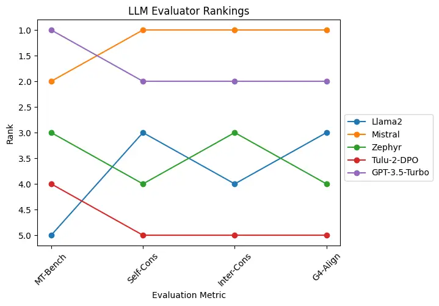

# Evaluating the Consistency of LLM Evaluators

Noah Lee ^(†)^(†)thanks: Equal contribution. Affiliation: KAIST AI  
{noah.lee, jiwoo_hong, thorne}@kaist.ac.kr    Jiwoo Hong⁰⁰footnotemark:
0 Affiliation: KAIST AI  
{noah.lee, jiwoo_hong, thorne}@kaist.ac.kr    James Thorne
Affiliation: KAIST AI  
{noah.lee, jiwoo_hong, thorne}@kaist.ac.kr

###### Abstract

Large language models (LLMs) have shown potential as general evaluators
along with the evident benefits of speed and cost. While their
correlation against human annotators has been widely studied,
_consistency_ as evaluators is still understudied, raising concerns
about the reliability of LLM evaluators. In this paper, we conduct
extensive studies on the two aspects of consistency in LLM evaluations,
_Self-Consistency_ (SC) and _Inter-scale Consistency_ (IC), on different
scoring scales and criterion granularity with open-source and
proprietary models. Our comprehensive analysis demonstrates that strong
proprietary models are _not_ necessarily consistent evaluators,
highlighting the importance of considering consistency in assessing the
capability of LLM evaluators.

## 1 Introduction

Large language models (LLMs) with instruction-following abilities
(Touvron et al., 2023; Jiang et al., 2023; OpenAI, 2023) are widely
adopted as an alternative to human labor in diverse tasks, including
evaluators (Liu et al., 2022; Gilardi et al., 2023; Kim et al., 2024a;
Liu et al., 2023). The sensitivity of models to input prompts (_i.e.,_
prompt sensitivity) has become a major issue in natural language
generation (NLG) (Liang et al., 2023; Sun et al., 2024), questioning
their reliability.

There are several unique challenges for LLM evaluators due to the
multitude of evaluation metrics and choices for scoring scales (_e.g.,_
5-Point or 10-Point interval scales) (Zheng et al., 2023; Kim et al.,
2024a), thus raising concerns about the reliability of LLMs as a
mechanism for automated judgment (Jang and Lukasiewicz, 2023; Stureborg
et al., 2024). Previous works study the reliability of LLM evaluators
through the lens of _performance_, their ability to predict judgments
that a human annotator might make (Li et al., 2023; Dubois et al., 2024;
Li et al., 2024). However, the _consistency_ of LLMs as evaluators is
understudied, where design questions such as the impact of different
scoring scales or sampling when decoding.

We study consistency in LLM evaluators by categorizing evaluation with
two aspects: firstly, _inter-scale consistency_ over different scoring
scales, and secondly, _self-consistency_ in sampling decoding. We
compare four state-of-the-art instruction-following LLMs and a
proprietary model (GPT-3.5-Turbo) in four different aspects of the text:
harmlessness, helpfulness, factuality, and conciseness. We also compare
the alignment of the LLM evaluators on top-performing proprietary
models. Our extensive analysis highlights the significance of
considering evaluation consistency to assess the reliability of LLM
evaluators by showing that consistency is not necessarily intertwined
with the model’s performance.

Figure 1: Self-Consistency evaluation results by five sampled
evaluations for varying criterion granularity and rating scales. The
evaluation is conducted on seven different models and four criteria of
interest. Higher Krippendorff’s $`\alpha`$ indicates the sampled
responses to be more consistently similar.

## 2 Consistency of LLM Evaluators

With improvements in the natural language understanding and generation
abilities of LLMs, LLMs are widely utilized as evaluators (Gilardi
et al., 2023; Chiang and Lee, 2023a; Liu et al., 2023; Kim et al.,
2024a). In the context for LLM evaluators, Gilardi et al., 2023 solely
exploits LLM’s zero-shot capability in data annotation in criteria of
relevance, stance, etc. Chiang and Lee, 2023a points to the stability of
using LLM evaluations on grammaticality, cohesiveness, and other text
properties, assessing LLM evaluations to be reproducible and economical.
Liu et al., 2023 and Fu et al., 2024 perform NLG evaluations on
task-specific criteria, well showing the benefits of model zero-shot
competence. Chiang and Lee, 2023b discusses the guidelines for LLM
evaluations but only for text quality of natural language generation. Ye
et al., 2024 suggests a protocol to produce fine-grained LLM evaluations
on a skill set level. Kim et al., 2024a fine-tunes a language model to
specialize in evaluating. Kim et al., 2024b introduces weight merging of
separate LLM evaluators for a stronger, robust evaluator.

### 2.1 Aspects of Consistency

Given the LLM evaluator $`P_{\theta}`$, evaluation instruction $`c`$,
and scoring scale $`\lambda_{j}`$, the evaluation score $`s`$ is
generated by sampling from the model or the API.

#### Self-Consistency (SC)

is defined as a state of how consistent is the $`K`$ scores sampled from
$`P_{\theta}`$ with a fixed scoring scale $`\lambda_{j}`$:

```math
\left\{s_{i}\right\}_{i=1}^{K}\overset{\text{iid}}{\sim}P_{\theta}\left(s|c,\lambda_{j}\right) \tag{1}
```

#### Inter-scale Consistency (IC)

is defined as the consistency over $`M`$ scores sampled from different
scoring scales (_e.g.,_ 5-P interval and Likert scale):

```math
\left\{s_{j}|s_{j}\sim P_{\theta}\left(s|c,\lambda_{j}\right)\right\}_{j=1}^{M} \tag{2}
```

For the score set $`\left\{s_{i}\right\}_{i=1}^{K}`$ and
$`\left\{s_{i}\right\}_{i=1}^{M}`$ of SC and IC, we adopt Krippendorff’s
$`\alpha`$ (Hayes and Krippendorff, 2007) as a consistency metric
regarding its applicability in varying types of variables (_e.g.,_
interval, nominal).

Figure 2: Inter-scale Consistency evaluation results for varying
criterion granularity and rating scales. The detailed comparison sets of
Cases 1, 2, and 3 are in Table 2. Higher Krippendorff’s $`\alpha`$
indicates the sampled responses to be more consistently similar.

### 2.2 Experimental Design

#### Evaluation instruction

To facilitate a more controlled setting for assessing the consistency of
responses, we use a common set of evaluation instructions $`c`$ with
minor changes between models and the variables of interest, as shown in
Appendix A.1.

#### Models

We test five instruction-following models. We first include four 7B
scale state-of-the-art open-source models: Llama-2-Chat (Touvron et al.,
2023), Tulu-2-DPO (Ivison et al., 2023), Zephyr-$`\beta`$ (Tunstall
et al., 2023), and Mistral-Instruct-v0.2 (Jiang et al., 2023).
Additionally, we include GPT-3.5-Turbo¹¹ 1
[https://platform.openai.com/docs/models/gpt-3-5](https://platform.openai.com/docs/models/gpt-3-5)
as a cost-efficient proprietary model.

#### Datasets

We test on four criteria by selecting the most representative and
relatable datasets: Harmlessness (Bai et al., 2022), Helpfulness (Zhou
et al., 2023), Factuality (Lin et al., 2022) and Conciseness. We sample
1,000 instances for each criterion’s representative dataset(s). The
details of the sampling process of the dataset can be found in
Appendix B.

|          |            |                                      |
| -------- | ---------- | ------------------------------------ |
| Scale    | Notation   | Range                                |
| Interval | 5-P        | \[1, 5\]                             |
|          | 10-P       | \[1, 10\]                            |
| Ordinal  | 5-P Likert | {Strongly Disagree,…,Strongly Agree} |
| Nominal  | Binary     | {No, Yes}                            |

Table 1: Scoring scales used for the consistency assessment in Figure 1.
‘Range’ denotes a continuous (\[\]) or discrete ({}) range of scores
given to the LLM evaluator.

#### Scoring Scale

We study four categorical and numerical scales, including two interval
scales, an ordinal Likert scale, and a binary scale (Table 1).

#### Criterion Granularity

We incorporate varying thoroughness of the criterion definitions. While
assessing the evaluation consistency of models on five different
criteria, we define each criterion with three different levels of
granularity: no definition (None), single phrase definition (Short), and
paragraphed definition (Long). The detailed definitions of each
criterion can be found in Appendix C.

## 3 Experimental Results

### 3.1 Self-Consistency

#### Setup

We assess the Self-Consistency (SC) by setting $`K=5`$ with a sampling
temperature of 1.0 for every granularity and scoring scale.

#### Results

Across all criteria and scales in Figure 1, Mistral-Instruct is highly
self-confident in its evaluation compared to other evaluators. The
effect of criterion granularity does not have a clear pattern, but
generally, there is an upward slope with increasing granularity,
suggesting a more detailed definition of an evaluation can assist in
more consistent evaluations. Additionally, compared to the interval
scales, the 5-P Likert scale and the binary scale had a negative impact
on Self-Consistency with the exception of Mistral-Instruct. This
demonstrates robustness to the choice of scale.

### 3.2 Inter-scale Consistency

|        |        |            |                      |
| ------ | ------ | ---------- | -------------------- |
|        | Item 1 | Item 2     | Detail               |
| Case 1 | 5-P    | 10-P       | Interval vs Interval |
| Case 2 | 5-P    | 5-P Likert | Interval vs Ordinal  |
| Case 3 | Binary | 10-P       | Nominal vs Interval  |

Table 2: Inter-scale Consistency comparison cases mapped to each row in
Figure 2. The ’Detail’ column describes the actual data type of
evaluation scores that are being compared in each case.

#### Setup

Inter-scale Consistency (IC) is measured by setting $`M=2`$ for the
scales of interest. As shown in Table 2, we test with three settings to
evaluate IC testing the consistency between: 1) two positive interval
scales (5-P and 10-P) of different ranges, 2) a 5-P interval scale with
a 5-P Likert scale and 3) binary scale to a 10-P interval scale.

#### Results

Similar to the Self-Consistency results, Mistral-Instruct outperforms
other language models in terms of Inter-scale Consistency except for
Helpfulness, where GPT-3.5 is on par or a bit excelling. Comparing Cases
1 and 2, while the models were better aligned between giving 5-P and
10-P interval evaluations (Case 1), the models had a lower alignment
between the 5-P interval scale and the 5-P Likert scale where minimal
descriptions (_e.g.,_ Strongly Agree) of the scores were given (Case 2).
For Case 3, the models show poor alignment between the binary and 10-P
interval scales across all criteria.

### 3.3 Correlation with GPT-4

#### Setup

To further support the significance of consistency in assessing the
reliability of LLM evaluators, we also check the _alignment_ of the
evaluators through Pearson correlation $`r`$ with the scores of
GPT-4-Turbo²² 2
[https://platform.openai.com/docs/models/gpt-4-and-gpt-4-turbo](https://platform.openai.com/docs/models/gpt-4-and-gpt-4-turbo)
in Table 3. Due to cost considerations, we only compare the 5-P interval
scale evaluations.

|            |      |      |      |      |      |
| ---------- | ---- | ---- | ---- | ---- | ---- |
| Model      | Size | HARM | HELP | FACT | CONC |
| Llama      | 7B   | 0.42 | 0.20 | 0.37 | 0.40 |
| Mistral    | 7B   | 0.64 | 0.48 | 0.56 | 0.53 |
| Zephyr     | 7B   | 0.30 | 0.22 | 0.47 | 0.20 |
| Tulu-2-DPO | 7B   | 0.23 | 0.22 | 0.25 | 0.23 |
| GPT-3.5    | \-   | 0.44 | 0.52 | 0.54 | 0.42 |

Table 3: Pearson Correlation between selected LLM Evaluators and GPT-4
on Interval Scale 1 to 5.

#### Results

According to Table 3, other than Helpfulness, Mistral-Instruct aligns
the most with GPT-4 in other criteria. While GPT-3.5 is on par with
Mistral-Instruct in GPT-4 alignment, it is notable how its consistency
scores were low in terms of Self-Consistency and Inter-scale Consistency
for criteria other than Helpfulness (Figures 1 and 2). This highlights
the importance of considering consistency as an independent rubric to
understand the reliability of LLM evaluators, apart from
performance-driven research.

#### Self-Consistency Evaluation

Resembling Wang et al. (2023), we further exploit Self-Consistency as an
evaluation technique that can potentially assist in evaluating smaller
evaluators. We sample five scores with a temperature of 1.0 and average
them to form a single score. Adopting this simple technique increased
the alignment towards GPT-4 throughout most settings, especially for
Llama and Tulu-2-DPO. However, Zephyr did not benefit much from the
technique which is likely attributed to its low Self-Consistency scores
highlighted in Figure 1. We report the ablation study over different
sampling temperatures in Appendix D.

|            |      |      |      |      |      |
| ---------- | ---- | ---- | ---- | ---- | ---- |
| Model      | Size | HARM | HELP | FACT | CONC |
| Llama      | 7B   | 0.52 | 0.29 | 0.39 | 0.46 |
| Mistral    | 7B   | 0.65 | 0.53 | 0.56 | 0.55 |
| Zephyr     | 7B   | 0.36 | 0.24 | 0.49 | 0.22 |
| Tulu-2-DPO | 7B   | 0.33 | 0.31 | 0.31 | 0.35 |
| GPT-3.5    | \-   | 0.51 | 0.57 | 0.60 | 0.47 |

Table 4: Pearson Correlation between selected LLM Evaluators decoded
with Self-Consistency and GPT-4 on Interval Scale 1 to 5.

## 4 Alignment with MT-Bench



Figure 3: Ranking of the five selected LLM evaluators across MT-Bench,
Self-Consistency, Inter-scale Consistency, and GPT-4 alignment.

Multi-Turn Benchmark (MT-Bench) (Zheng et al., 2023) is a popular LLM
evaluation benchmark to assess a model’s instruction-following ability
in single and multi-turn conversation settings. To compare the MT-Bench
rankings of the models to the results in Section 3, we average the
consistency scores of each model to obtain a single figure.

Figure 3 shows a major mismatch between the MT-Bench rankings and the
Self-Consistency, Inter-scale Consistency, and GPT-4 Alignment scores.
While GPT-3.5 ranks highest in MT-Bench, it falls behind
Mistral-Instruct in our consistency evaluations. Although Llama ranks
last in MT-Bench, it outperforms Tulu-2-DPO all the time and is on par
with Zephyr. Surprisingly, the averaged GPT-3.5 scores for both
consistency scores were marginally better than those of Llama, which has
a vast MT-Bench score difference³³ 3 MT-Bench score for Llama-2-7B is
6.27 while GPT-3.5-Turbo scores 8.40.

## 5 Conclusion

We evaluate the _consistency_ of LLMs as evaluators, which is an
understudied aspect of LLM evaluations with respect to
_self-consistency_ and _inter-scale consistency_. Our analyses of five
state-of-the-art instruction-following LLMs as evaluators demonstrate
that sampling decoding could introduce variant evaluations, being less
confident about their evaluations. Different scoring scales can result
in divergent evaluation results, especially using non-numerical scoring
scales, underscoring the significance of _consistency_ of LLM
evaluators. Expanding such observations to the broader applications of
LLMs as evaluators, we open a discussion highlighting the need for
clarity and caution in using LLM evaluators, especially for the
proprietary models that are widely used.

## Limitations

This work assesses the consistency of LLM evaluations across variables
of interest. Although we are trying to control other effective
variables, as we are not directly mitigating the prompt sensitivity of
the language models, minor prompt shifting may impact the results.
Additionally, though many papers present top proprietary LLMs such as
GPT-4 as oracles and sufficient alternatives to human evaluations, an
in-depth human evaluation process will benefit the research proposed.

## References

- Bai et al. (2022) Yuntao Bai, Andy Jones, Kamal Ndousse, Amanda
  Askell, Anna Chen, Nova DasSarma, Dawn Drain, Stanislav Fort, Deep
  Ganguli, Tom Henighan, et al. 2022. Training a helpful and harmless
  assistant with reinforcement learning from human feedback. _arXiv
  preprint arXiv:2204.05862_.
- Chiang and Lee (2023a) Cheng-Han Chiang and Hung-yi Lee. 2023a. [Can
  large language models be an alternative to human
  evaluations?](https://doi.org/10.18653/v1/2023.acl-long.870) In
  _Proceedings of the 61st Annual Meeting of the Association for
  Computational Linguistics (Volume 1: Long Papers)_, pages 15607–15631,
  Toronto, Canada. Association for Computational Linguistics.
- Chiang and Lee (2023b) Cheng-Han Chiang and Hung-yi Lee. 2023b. [A
  closer look into using large language models for automatic
  evaluation](https://doi.org/10.18653/v1/2023.findings-emnlp.599). In
  _Findings of the Association for Computational Linguistics: EMNLP
  2023_, pages 8928–8942, Singapore. Association for Computational
  Linguistics.
- Dubois et al. (2024) Yann Dubois, Percy Liang, and Tatsunori
  Hashimoto. 2024. [Length-controlled alpacaeval: A simple debiasing of
  automatic evaluators](https://openreview.net/forum?id=CybBmzWBX0). In
  _First Conference on Language Modeling_.
- Fu et al. (2024) Jinlan Fu, See-Kiong Ng, Zhengbao Jiang, and Pengfei
  Liu. 2024. [GPTScore: Evaluate as you
  desire](https://doi.org/10.18653/v1/2024.naacl-long.365). In
  _Proceedings of the 2024 Conference of the North American Chapter of
  the Association for Computational Linguistics: Human Language
  Technologies (Volume 1: Long Papers)_, pages 6556–6576, Mexico City,
  Mexico. Association for Computational Linguistics.
- Gilardi et al. (2023) Fabrizio Gilardi, Meysam Alizadeh, and Maël
  Kubli. 2023. Chatgpt outperforms crowd workers for text-annotation
  tasks. _Proceedings of the National Academy of Sciences_,
  120(30):e2305016120.
- Hayes and Krippendorff (2007) Andrew F Hayes and Klaus
  Krippendorff. 2007. Answering the call for a standard reliability
  measure for coding data. _Communication methods and measures_,
  1(1):77–89.
- Ivison et al. (2023) Hamish Ivison, Yizhong Wang, Valentina Pyatkin,
  Nathan Lambert, Matthew Peters, Pradeep Dasigi, Joel Jang, David
  Wadden, Noah A. Smith, Iz Beltagy, and Hannaneh Hajishirzi. 2023.
  [Camels in a changing climate: Enhancing lm adaptation with tulu
  2](http://arxiv.org/abs/2311.10702).
- Jang and Lukasiewicz (2023) Myeongjun Erik Jang and Thomas
  Lukasiewicz. 2023. [Consistency analysis of
  chatgpt](http://arxiv.org/abs/2303.06273).
- Jiang et al. (2023) Albert Q. Jiang, Alexandre Sablayrolles, Arthur
  Mensch, Chris Bamford, Devendra Singh Chaplot, Diego de las Casas,
  Florian Bressand, Gianna Lengyel, Guillaume Lample, Lucile Saulnier,
  Lélio Renard Lavaud, Marie-Anne Lachaux, Pierre Stock, Teven Le Scao,
  Thibaut Lavril, Thomas Wang, Timothée Lacroix, and William El
  Sayed. 2023. [Mistral 7b](http://arxiv.org/abs/2310.06825).
- Kim et al. (2024a) Seungone Kim, Jamin Shin, Yejin Cho, Joel Jang,
  Shayne Longpre, Hwaran Lee, Sangdoo Yun, Seongjin Shin, Sungdong Kim,
  James Thorne, and Minjoon Seo. 2024a. [Prometheus: Inducing
  fine-grained evaluation capability in language
  models](https://openreview.net/forum?id=8euJaTveKw). In _The Twelfth
  International Conference on Learning Representations_.
- Kim et al. (2024b) Seungone Kim, Juyoung Suk, Shayne Longpre,
  Bill Yuchen Lin, Jamin Shin, Sean Welleck, Graham Neubig, Moontae Lee,
  Kyungjae Lee, and Minjoon Seo. 2024b. [Prometheus 2: An open source
  language model specialized in evaluating other language
  models](https://aclanthology.org/2024.emnlp-main.248). In _Proceedings
  of the 2024 Conference on Empirical Methods in Natural Language
  Processing_, pages 4334–4353, Miami, Florida, USA. Association for
  Computational Linguistics.
- Li et al. (2024) Tianle Li, Wei-Lin Chiang, Evan Frick, Lisa Dunlap,
  Banghua Zhu, Joseph E. Gonzalez, and Ion Stoica. 2024. [From live data
  to high-quality benchmarks: The arena-hard
  pipeline](https://lmsys.org/blog/2024-04-19-arena-hard/).
- Li et al. (2023) Xuechen Li, Tianyi Zhang, Yann Dubois, Rohan Taori,
  Ishaan Gulrajani, Carlos Guestrin, Percy Liang, and Tatsunori B.
  Hashimoto. 2023. Alpacaeval: An automatic evaluator of
  instruction-following models.
  [https://github.com/tatsu-lab/alpaca_eval](https://github.com/tatsu-lab/alpaca_eval).
- Liang et al. (2023) Percy Liang, Rishi Bommasani, Tony Lee, Dimitris
  Tsipras, Dilara Soylu, Michihiro Yasunaga, Yian Zhang, Deepak
  Narayanan, Yuhuai Wu, Ananya Kumar, Benjamin Newman, Binhang Yuan,
  Bobby Yan, Ce Zhang, Christian Alexander Cosgrove, Christopher D
  Manning, Christopher Re, Diana Acosta-Navas, Drew Arad Hudson, Eric
  Zelikman, Esin Durmus, Faisal Ladhak, Frieda Rong, Hongyu Ren, Huaxiu
  Yao, Jue WANG, Keshav Santhanam, Laurel Orr, Lucia Zheng, Mert
  Yuksekgonul, Mirac Suzgun, Nathan Kim, Neel Guha, Niladri S.
  Chatterji, Omar Khattab, Peter Henderson, Qian Huang, Ryan Andrew Chi,
  Sang Michael Xie, Shibani Santurkar, Surya Ganguli, Tatsunori
  Hashimoto, Thomas Icard, Tianyi Zhang, Vishrav Chaudhary, William
  Wang, Xuechen Li, Yifan Mai, Yuhui Zhang, and Yuta Koreeda. 2023.
  [Holistic evaluation of language
  models](https://openreview.net/forum?id=iO4LZibEqW). _Transactions on
  Machine Learning Research_. Featured Certification, Expert
  Certification.
- Lin et al. (2022) Stephanie Lin, Jacob Hilton, and Owain Evans. 2022.
  [TruthfulQA: Measuring how models mimic human
  falsehoods](https://doi.org/10.18653/v1/2022.acl-long.229). In
  _Proceedings of the 60th Annual Meeting of the Association for
  Computational Linguistics (Volume 1: Long Papers)_, pages 3214–3252,
  Dublin, Ireland. Association for Computational Linguistics.
- Liu et al. (2022) Alisa Liu, Swabha Swayamdipta, Noah A. Smith, and
  Yejin Choi. 2022. [WANLI: Worker and AI collaboration for natural
  language inference dataset
  creation](https://doi.org/10.18653/v1/2022.findings-emnlp.508). In
  _Findings of the Association for Computational Linguistics: EMNLP
  2022_, pages 6826–6847, Abu Dhabi, United Arab Emirates. Association
  for Computational Linguistics.
- Liu et al. (2023) Yang Liu, Dan Iter, Yichong Xu, Shuohang Wang,
  Ruochen Xu, and Chenguang Zhu. 2023. [G-eval: Nlg evaluation using
  gpt-4 with better human alignment](http://arxiv.org/abs/2303.16634).
- OpenAI (2023) OpenAI. 2023. [Gpt-4 technical
  report](http://arxiv.org/abs/2303.08774).
- Stureborg et al. (2024) Rickard Stureborg, Dimitris Alikaniotis, and
  Yoshi Suhara. 2024. [Large language models are inconsistent and biased
  evaluators](http://arxiv.org/abs/2405.01724).
- Sun et al. (2024) Jiuding Sun, Chantal Shaib, and Byron C
  Wallace. 2024. [Evaluating the zero-shot robustness of
  instruction-tuned language
  models](https://openreview.net/forum?id=g9diuvxN6D). In _The Twelfth
  International Conference on Learning Representations_.
- Touvron et al. (2023) Hugo Touvron, Louis Martin, Kevin Stone, Peter
  Albert, Amjad Almahairi, Yasmine Babaei, Nikolay Bashlykov, Soumya
  Batra, Prajjwal Bhargava, Shruti Bhosale, Dan Bikel, Lukas Blecher,
  Cristian Canton Ferrer, Moya Chen, Guillem Cucurull, David Esiobu,
  Jude Fernandes, Jeremy Fu, Wenyin Fu, Brian Fuller, Cynthia Gao,
  Vedanuj Goswami, Naman Goyal, Anthony Hartshorn, Saghar Hosseini, Rui
  Hou, Hakan Inan, Marcin Kardas, Viktor Kerkez, Madian Khabsa, Isabel
  Kloumann, Artem Korenev, Punit Singh Koura, Marie-Anne Lachaux,
  Thibaut Lavril, Jenya Lee, Diana Liskovich, Yinghai Lu, Yuning Mao,
  Xavier Martinet, Todor Mihaylov, Pushkar Mishra, Igor Molybog, Yixin
  Nie, Andrew Poulton, Jeremy Reizenstein, Rashi Rungta, Kalyan Saladi,
  Alan Schelten, Ruan Silva, Eric Michael Smith, Ranjan Subramanian,
  Xiaoqing Ellen Tan, Binh Tang, Ross Taylor, Adina Williams, Jian Xiang
  Kuan, Puxin Xu, Zheng Yan, Iliyan Zarov, Yuchen Zhang, Angela Fan,
  Melanie Kambadur, Sharan Narang, Aurelien Rodriguez, Robert Stojnic,
  Sergey Edunov, and Thomas Scialom. 2023. [Llama 2: Open foundation and
  fine-tuned chat models](http://arxiv.org/abs/2307.09288).
- Tunstall et al. (2023) Lewis Tunstall, Edward Beeching, Nathan
  Lambert, Nazneen Rajani, Kashif Rasul, Younes Belkada, Shengyi Huang,
  Leandro von Werra, Clémentine Fourrier, Nathan Habib, Nathan Sarrazin,
  Omar Sanseviero, Alexander M. Rush, and Thomas Wolf. 2023. [Zephyr:
  Direct distillation of lm alignment](http://arxiv.org/abs/2310.16944).
- Wang et al. (2023) Xuezhi Wang, Jason Wei, Dale Schuurmans, Quoc V Le,
  Ed H. Chi, Sharan Narang, Aakanksha Chowdhery, and Denny Zhou. 2023.
  [Self-consistency improves chain of thought reasoning in language
  models](https://openreview.net/forum?id=1PL1NIMMrw). In _The Eleventh
  International Conference on Learning Representations_.
- Ye et al. (2024) Seonghyeon Ye, Doyoung Kim, Sungdong Kim, Hyeonbin
  Hwang, Seungone Kim, Yongrae Jo, James Thorne, Juho Kim, and Minjoon
  Seo. 2024. [FLASK: Fine-grained language model evaluation based on
  alignment skill sets](https://openreview.net/forum?id=CYmF38ysDa). In
  _The Twelfth International Conference on Learning Representations_.
- Zheng et al. (2023) Lianmin Zheng, Wei-Lin Chiang, Ying Sheng, Siyuan
  Zhuang, Zhanghao Wu, Yonghao Zhuang, Zi Lin, Zhuohan Li, Dacheng Li,
  Eric Xing, Hao Zhang, Joseph E. Gonzalez, and Ion Stoica. 2023.
  [Judging LLM-as-a-judge with MT-bench and chatbot
  arena](https://openreview.net/forum?id=uccHPGDlao). In _Thirty-seventh
  Conference on Neural Information Processing Systems Datasets and
  Benchmarks Track_.
- Zhou et al. (2023) Chunting Zhou, Pengfei Liu, Puxin Xu, Srini Iyer,
  Jiao Sun, Yuning Mao, Xuezhe Ma, Avia Efrat, Ping Yu, LILI YU, Susan
  Zhang, Gargi Ghosh, Mike Lewis, Luke Zettlemoyer, and Omer Levy. 2023.
  [LIMA: Less is more for
  alignment](https://openreview.net/forum?id=KBMOKmX2he). In
  _Thirty-seventh Conference on Neural Information Processing Systems_.

## Appendix A Supplimentaries for Experimental Design

### A.1 Evaluation Instruction

To control the different levels of prompt sensitivity over the tested
language models, we fix the evaluation instruction given to the models
as Table 5.


Table 5: The default prompt template with only minor changes across
different settings. {options} refers to the option of a range of the
scale for scoring (e.g., 1-5, 1-10) or specific nominal options.
{criterion} and {detail} are the criterion and the detailed definition
for the selected criterion (e.g. Logicality, "correct and valid
reasoning").

## Appendix B Details on Dataset

As mentioned in the paper, we manually select relevant dataset(s) and
sample out instances in the following manner:

#### Harmlessness

We sample out from 500 instances Anthropic’s HH-RLHF Dataset (Bai
et al., 2022) in which a assistant response is either chosen or
rejected. We use both of the chosen and rejected responses to sum to a
total of 1000 instances.

#### Helpfulness

(Zhou et al., 2023)’s training set is composed of exactly 1000 high
quality instances to train human alignment. We use the entire training
set for evaluation.

#### Factuality

The factuality dataset in evenly sampled from the TruthfulQA (Lin
et al., 2022) dataset. From the original TruthfulQA dataset, we sample
out 500 questions and select the correct and a sampled incorrect answer
choice to add up to 1000 instances.

#### Conciseness

We find conciseness a central characteristic that is favored for most
cases of LLM generations. Thus, we evenly sample from the four datasets
above (250 instances each) to sample a total of 1000 instances to
evaluate.

## Appendix C Instruction Granularity: Thoroughness of definition

This section provides the details of three different definitions used
for elaborating each evaluation metric to the language model. The
definition of each skill is generated with GPT-3.5.

We prompted "You are a word dictionary. Please tell me the definition of
{skill_name} in a short phrase." and "Please tell me the definition of
{skill_name} within 100 words." to acquire the short and long definition
of each skill respectively.


## Appendix D Effect of Sampling Temperature in Evaluation

Throughout the paper, we adhere to a sampling temperature of 1.0 the to
utilize unchanged logit distribution of the model’s evaluation score. We
carry out a small-scale experiment on a subset of Harmlessness.

From Table 6, it is shown how a lower temperature for Llama-2 gradually
boosts its SC score. Contrarily, in Table 6, there aren’t any notable
patterns with IC scores with sampling temperature. We also include the
newly run experiments for GPT-4-Turbo with temperature 1.0 and show how,
ideally, the scores should be consistent both in SC and IC regardless of
its sampling temperature.

|            |       |              |               |            |        |
| ---------- | ----- | ------------ | ------------- | ---------- | ------ |
| Model      | Temp. | Interval 5-P | Interval 10-P | Likert 5-P | Binary |
| Llama (7B) | 0.1   | 0.951        | 0.997         | 0.854      | 0.957  |
| Llama (7B) | 0.4   | 0.841        | 0.954         | 0.582      | 0.777  |
| Llama (7B) | 0.7   | 0.710        | 0.905         | 0.351      | 0.669  |
| Llama (7B) | 1.0   | 0.683        | 0.801         | 0.366      | 0.532  |
| GPT-4      | 1.0   | 0.954        | 0.961         | 0.835      | 0.881  |

Table 6: Self-Consistency Evaluation results of Llama 7B on Harmlessness
on four scales across different sampling temperatures.

|            |       |        |        |        |
| ---------- | ----- | ------ | ------ | ------ |
| Model      | Temp. | Case 1 | Case 1 | Case 3 |
| Llama (7B) | 0.1   | 0.688  | 0.254  | 0.213  |
| Llama (7B) | 0.4   | 0.579  | 0.176  | 0.148  |
| Llama (7B) | 0.7   | 0.587  | 0.236  | 0.148  |
| Llama (7B) | 1.0   | 0.678  | 0.054  | 0.059  |
| GPT-4      | 1.0   | 0.942  | 0.908  | 0.788  |

Table 7: Inter-scale Consistency Scores of Llama 7B on Harmlessness
across different sampling temperatures. (Case 1 - Interval 5-P vs
Interval 10-P, Case 2 - Interval 5-P vs 5-P Likert, Case 3 - Binary vs
Interval 10-P Binarized) Refer to Table 2 for details of the cases.
