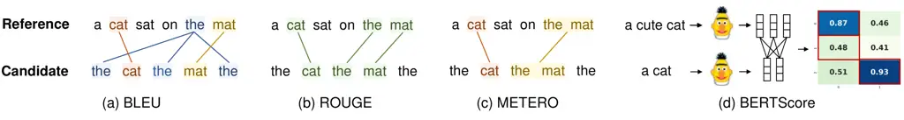
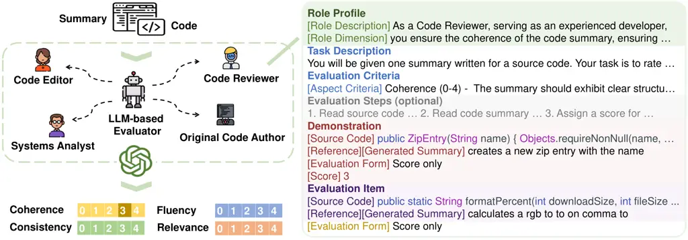
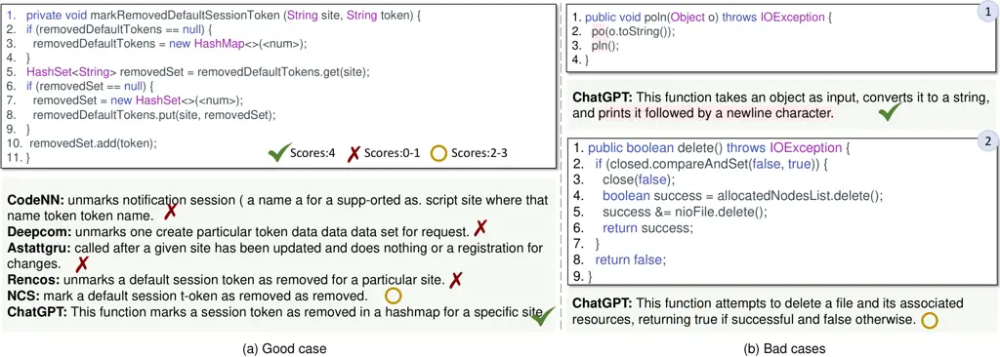

# Can Large Language Models Serve as Evaluators for Code Summarization?Thanks: Yang Wu, Yao Wan and Zhaoyang Chu are with the Services Computing Technology and System Lab, Cluster and Grid Computing Lab, School of Computer Science and Technology, Huazhong University of Science and Technology, Wuhan, China, 430074. Email: {wuyang_emily,wanyao,chuzhaoyang,xhshi}@hust.edu.cn. Wenting Zhao and Philip S. Yu are with the Big Data and Social Computing Lab, University of Illinois Chicago, Chicago, USA. Email: {wzhao41,psyu}@uic.edu. Ye Liu is with Salesforce Research, Palo Alto, USA. Email: yeliu@salesforce.com. Hongyu Zhang is with the School of Big Data and Software Engineering, Chongqing University, Chongqing, China. Email: hyzhang@cqu.edu.cn. Thanks: \*Yao Wan is the corresponding author.Thanks: Manuscript received November, 2024.

Yang Wu    Yao Wan\*    Zhaoyang Chu    Wenting Zhao    Ye Liu    Hongyu
Zhang    Xuanhua Shi Affiliation: Philip S. Yu

###### Abstract

Code summarization facilitates program comprehension and software
maintenance by converting code snippets into natural-language
descriptions. Over the years, numerous methods have been developed for
this task, but a key challenge remains: effectively evaluating the
quality of generated summaries. While human evaluation is effective for
assessing code summary quality, it is labor-intensive and difficult to
scale. Commonly used automatic metrics, such as BLEU, ROUGE-L, METEOR,
and BERTScore, often fail to align closely with human judgments. In this
paper, we explore the potential of Large Language Models (LLMs) for
evaluating code summarization. We propose CodeRPE (Role-Player for Code
Summarization Evaluation), a novel method that leverages role-player
prompting to assess the quality of generated summaries. Specifically, we
prompt an LLM agent to play diverse roles, such as code reviewer, code
author, code editor, and system analyst. Each role evaluates the quality
of code summaries across key dimensions, including coherence,
consistency, fluency, and relevance. We further explore the robustness
of LLMs as evaluators by employing various prompting strategies,
including chain-of-thought reasoning, in-context learning, and tailored
rating form designs. The results demonstrate that LLMs serve as
effective evaluators for code summarization methods. Notably, our
LLM-based evaluator, CodeRPE , achieves an 81.59% Spearman correlation
with human evaluations, outperforming the existing BERTScore metric by
17.27%.

###### Index Terms:

Code Summarization, Large Language Models, Role Player, Model Evaluation

## I Introduction

Code summarization, which summarizes code snippets into natural-language
descriptions, plays an important role in program comprehension and
software maintenance \[1, 2\]. Current approaches to code summarization
heavily leverage techniques from Natural Language Processing (NLP), with
the aim of translating code snippets from one linguistic representation
to another. Recently, this trend has been further bolstered by the
emergence of Large Language Models (LLMs) \[3\], e.g., GPT-4 \[4\],
Gemini \[5\], and Llama \[6\], owing to their remarkable capabilities in
NLP.

Despite significant advancements in generating code summaries, methods
for evaluating their quality have not kept pace. Human evaluation
remains the gold standard for assessing code summaries; however, it is
labor-intensive and difficult to scale. Previously, in alignment with
the NLP research trajectory, numerous automatic metrics, such as BLEU
\[7\], ROUGE \[8\], METEOR \[9\], and BERTScore \[10\], have been widely
adopted for evaluating code summarization models. These metrics assess
model performance by automatically measuring the similarity between
generated summaries and reference (or gold-standard) summaries, which
are typically derived from comments provided by developers. However,
studies have shown that these automated metrics exhibit a relatively low
correlation with human evaluations \[11, 12\].

Inspired by the remarkable capabilities of LLMs in understanding and
generating natural language, recent studies propose leveraging LLMs
directly as reference-free evaluators \[13, 14, 15, 16, 17, 18, 19,
20\]. This research rests on the premise that LLMs can assess candidate
outputs based on their generation probabilities without requiring a
reference summary, positing that LLMs can assign higher probabilities to
outputs that are both fluent and of high quality. Building on these
insights, this paper aims to investigate the following question: Can
LLMs effectively serve as evaluators for code summarization?

Fig. 1: A code snippet with reference and generated summaries, along
with scores from existing metrics, human evaluation, and LLMs.

A Motivating Example. Figure 1 illustrates an example aimed at providing
motivation for our introduced LLM-based evaluator by comparing it with
current automatic metrics. In this example, a code snippet accompanied
by its corresponding comment, alongside the summary generated by ChatGPT
\[21\], is presented. Upon employing automatic metrics such as BLEU,
ROUGE, METEOR, and BERTScore, it is evident that the scores are
relatively low, suggesting subpar quality in the generated summary.
Nevertheless, upon manual inspection, the quality of the summary
generated by ChatGPT is actually high. Specifically, the phrase “a 10%
discount for members” in the generated summary correlates directly to
the variable “isMember” at line 2 and “0.9” at line 3 in the provided
code. This can also reveal the strong understanding and reasoning
capabilities of LLMs over source code. We attribute the low scores from
automatic metrics to the differences in textual structure and phrasing
between the generated summary and the reference summary. Conversely, our
LLM-based evaluator showcases its ability to effectively assess the
quality of generated summarizations, demonstrating significant alignment
with human evaluation metrics.

Our Work. In this paper, we present a pioneering empirical study aiming
at investigating the capabilities of LLMs in evaluating code
summarization models. In particular, we introduce an evaluation method,
termed CodeRPE (Role-Player for Code Summarization Evaluation), designed
to quantify the quality of generated code summaries. We prompt an LLM
agent to perform a range of roles, including code reviewer, code author,
code editor, and system analyst. Each role is tasked with evaluating the
quality of generated code summaries along individual dimensions such as
coherence, consistency, fluency, and relevance. By analyzing the
outcomes, we determine the most proficient role for each dimension to
ensure a more precise and specialized evaluation. In our experiments, we
concentrate on three specific LLMs: text-davinci-003 \[22\],
gpt-3.5-turbo \[22\], and gpt-4 \[23\]. We assess the performance of six
code summarization models, namely CodeNN \[1\], Deepcom \[24\],
Astattgru \[2\], Rencos \[25\], NCS \[26\], and ChatGPT \[27\]. We
structure our empirical study around the following three Research
Questions (RQs).

RQ1: How does LLM-based evaluator CodeRPE align with human evaluation
compared to traditional metrics? We explore LLMs’ capabilities in
assessing code summarization, both with and without reference summaries,
by examining their alignment with human evaluation alongside
conventional metrics such as BLEU, ROUGE, METEOR, and BERTScore.

RQ2: How does the LLM-based evaluator CodeRPE perform under varying
evaluation settings? We analyze different prompting strategies that may
affect the performance of LLMs in evaluating code summarization,
including the role-player design, rating form design, chain-of-thought
prompting, and in-context example selection. Our analysis provides clear
guidelines for employing LLMs to automate the evaluation of code
summarization.

RQ3: How do existing neural models for code summarization perform using
our proposed CodeRPE? We re-evaluate the effectiveness of six prominent
neural models for code summarization tasks, namely CodeNN, Deepcom,
Astattgru, Rencos, NCS, and ChatGPT, utilizing our LLM-based evaluator,
CodeRPE.

Takeaway Implications. In this paper, we outline several important
implications to be noted: (1) Overall, our CodeRPE demonstrates notable
effectiveness in serving as evaluators for code summarization,
exhibiting a correlation of 81.59% to human assessment, even in the
absence of reference summaries. (2) The effectiveness of LLMs in
assessing code summarization relies heavily on carefully crafted
role-player engagement and prompting strategies. We recommend
integrating a balanced selection of in-context learning examples and
increasing evaluation iteration frequency. Additionally, employing
chain-of-thought processes can significantly enhance fluency assessment.
(3) With our LLM-based evaluator CodeRPE, ChatGPT outperforms other
models by producing summaries that maintain semantic accuracy while
offering diverse phrasing, closely aligning with human evaluations.

Contributions. This paper makes the following contributions.

- •
  To the best of our knowledge, we perform a pioneering investigation
  into the ability of LLMs to assess code summarization. Furthermore, we
  introduce a novel evaluation approach called CodeRPE which leverages a
  roleplayer-based prompting strategy to evaluate the coherence and
  effectiveness of generated summaries, based on an understanding of the
  code itself, rather than relying on reference ground truth.
- •
  We extensively conduct experiments to compare CodeRPE with existing
  metrics in evaluating neural code summarization, employing various
  prompting strategies. Our experimental findings demonstrate that the
  LLM-based evaluator substantially enhances the correlation with human
  judgement across multiple criteria.
- •
  We reassess the efficacy of six prominent neural models (i.e., CodeNN,
  Deepcom, Astattgru, Rencos, NCS, and ChatGPT) in the realm of code
  summarization, leveraging our novel LLM-based evaluation framework,
  CodeRPE.

## II Background



Fig. 2: An illustration of existing evaluation metrics for code
summarization.

### II-A Existing Code Summarization Evaluation Metrics

We classify prevailing evaluation metrics for code summarization into
three categories: $`n`$-gram-based metrics, embedding-based metrics, and
human evaluation metrics.

#### II-A1 $`N`$-gram-based Metrics

The objective of $`n`$-gram-based metrics is to calculate the similarity
between the generated summary and the reference summary through the
counting of shared $`n`$-grams. Examples include BLEU \[7\], ROUGE-L
\[8\], and METEOR \[9\].

BLEU \[7\]. BLEU (Bilingual Evaluation Understudy) is a traditional
neural machine translation metric that calculates average $`n`$-gram
precision with reference sentences and penalizes overly short
translations.

```math
p_{n}=\frac{\sum_{w_{n}\in c}\min\left(C_{c}(w_{n}),\underset{j=1,\cdots,n}{\max}C_{r_{j}}(w_{n})\right)}{\sum_{w_{n}\in c}C_{c}(w_{n})}\,, \tag{1}
```

where $`c`$ and $`r`$ represent a candidate and its reference sentence,
respectively. $`w_{n}`$ is an $`n`$-gram, and $`C_{c}(w_{n})`$ denotes
its frequency in $`c`$. The BLEU score is then computed as:

```math
\operatorname{BLEU}=\operatorname{BP}*\exp\left(\sum_{n=1}^{N}\alpha_{n}\log p_{n}\right)\,, \tag{2}
```

where $`N=4`$, $`p_{n}`$ denotes the precision for $`n`$-grams up to
$`N`$, and $`\alpha_{n}`$ represents the positive weighting assigned to
each $`n`$-gram, and a brevity penalty BP penalizes the short sentences.

In practice, various implementations of the BLEU exist, each with
specific modifications to handle $`n`$-gram precision differently.
BLEU-CN is a sentence BLEU metric applying the Laplace-like smoothing
\[28\] to the precision scores $`p_{n}`$ for $`n\geqslant 2`$, by both
the numerator and denominator by 1. BLEU-DM and BLEU-DC are two metrics
that apply another smoothing method which has been implemented in the
NLTK toolkit¹¹ 1 https://pypi.org/project/nltk/3.2.4/ as “method 0”, and
“method 4”, respectively. Similar to BLEU-CN, BLEU-NCS \[26\] applies a
Laplace-like smoothing method, incrementing the numerator and
denominator of all precision values $`p_{n}`$ by 1. BLEU-RC \[25\] is
another unsmoothed sentence BLEU variant designed specifically to
prevent division-by-zero errors. Instead of traditional smoothing, it
adds between 10 and 15 to the numerator, and between 9 and 10 to the
denominator of $`p_{n}`$. BLEU-FC is an unsmoothed corpus-level BLEU
metric based on NLTK, which aggregates n-gram matches across all
hypothesis-reference pairs \[2, 29\].

Example 1. In the example illustrated in Figure 2(a) for calculating
BLEU, the candidate sentence yields unigram counts of “the”, “cat”, and
“mat” as 3, 1, and 1, respectively, with a total count of 5. For
reference, the relevant unigrams “the,” “cat,” and “mat” each have a
count of 1. By taking the minimum counts between the candidate and
reference, we sum to 3. Thus, with $`n=1`$, we have $`p_{1}=0.6`$,
yielding a BLEU score of 0.49.

ROUGE-L \[8\]. ROUGE-L \[30, 31, 32\] quantifies the similarity between
a candidate summary and a reference summary by identifying their Longest
Common Subsequence (LCS). This metric emphasizes the importance of
maintaining the sequential order of information. The calculation of the
ROUGE-L score and its components is defined as follows:

```math
\begin{split}&P=\frac{LCS(c,r)}{len(c)},R=\frac{LCS(c,r)}{len(r)}\\
&\operatorname{ROUGE-L}=\frac{(1+\beta^{2})\cdot P\cdot R}{R+\beta^{2}\cdot P}\,.\end{split} \tag{3}
```

Here, $`c`$ and $`r`$ denote the generated candidate and reference
summaries, respectively, and $`\beta`$ is a parameter that adjusts the
balance between precision and recall.

Example 2. As the example shown in Figure 2 (b), with consideration of
the longest common sequence of words is “cat the mat”, we can get
$`LCS(c,r)=3,\ \text{then}\ P=0.6,\ \text{and}\ R=0.5`$. When
$`\beta=1`$, ROUGE-L equals to 0.54.

METEOR. METEOR, a recall-oriented metric, evaluates how well the model
captures reference content by matching words between candidate and
reference sentences and computing the harmonic mean of precision and
recall, calculated as follows:

```math
\operatorname{METEOR}=\underset{j=1,\cdots,n}{\max}\left(\frac{10PR}{R+9P}\right)\left(1-\frac{1}{2}(\frac{c}{u})^{3}\right)\,, \tag{4}
```

where $`P`$ and $`R`$ denote unigram precision and recall, $`c`$ is the
count of matched chunks, and $`u`$ represents matched unigrams.

Example 3. As illustrated in Figure 2 (c), the alignment between the
candidate and reference sentences produces two coherent chunks: “cat”
and “the mat”, resulting in a total of three matched unigrams. With a
precision ($`P`$) of 0.6 and recall ($`R`$) of 0.5, the METEOR score is
calculated as 0.5.

#### II-A2 Embedding-based Metrics

While $`n`$-gram-based metrics assess semantic similarity through
overlapping tokens, embedding-based metrics like BERTScore \[10\]
compare the embeddings of generated and reference summaries.

BERTScore \[10\]. BERTScore measures sentence similarity using BERT
embeddings \[10\], matching each token in the candidate sentence to
tokens in the reference. It tokenizes sentences into words or subwords
and represents tokens as embeddings using a pre-trained BERT model,
e.g., RoBERTa \[33\]. Specifically, BERTScore computes a pairwise
similarity matrix by taking the inner product of these embeddings,
yielding a pre-normalized cosine similarity. Precision is defined as the
average of the highest similarity scores for tokens in the candidate
sentence, while recall is the average of the highest scores for tokens
in the reference sentence. The final BERTScore is computed as the
harmonic mean of precision and recall.

Example 4. In Figure 2(d), using the RoBERTa model, we compute a cosine
similarity matrix between the words of the candidate and reference
sentences. Precision is computed by averaging the maximum similarity
scores for each word in the candidate, yielding a value of
$`(0.87+0.93)/2=0.90`$. Recall is calculated by averaging the maximum
similarity scores for each word in the reference, resulting in
$`(0.87+0.48+0.93)/3=0.76`$. The BERTScore, computed as the harmonic
mean of a precision of 0.9 and a recall of 0.76, yields a value of 0.82.

Fig. 3: An example of the prompt design to elicit LLMs as a code
evaluator taking a “code reviewer” role.



Fig. 4: An overview of our proposed framework for prompting LLMs as
diverse evaluators for code summarization.

#### II-A3 Human Evaluation Metrics

In human evaluation, human assessors are typically presented with pairs
of references and model-generated outputs. The assessors then evaluate
the outputs based on predefined criteria such as fluency, coherence, and
overall understanding. Often, a 5-point scale, ranging from 1 to 5 with
options like “Strongly Disagree”, “Disagree”, “Neutral”, “Agree”, and
“Strongly Agree” is employed, allowing assessors to express their
judgments on a numerical scale. Aggregating these human judgments yields
scores that reflect the perceived quality of the generated text.
However, the expense associated with hiring professional evaluators
makes human evaluation difficult to scale. Furthermore, human evaluation
metrics introduce subjectivity, necessitating efforts to mitigate bias
and ensure consistency in the evaluation process.

### II-B Large Language Models

Prompting. The advent of LLMs is shifting the learning paradigm from the
traditional “pre-train and fine-tune” to a novel “pre-train, prompt, and
predict” approach. In this framework, downstream tasks are reformulated
using textual prompts to align with the original LLM training, rather
than through full fine-tuning. In our specific scenario, involving a
summary and a code snippet, we can construct a prompt as follows:
“\[SUMMARY\], \[SOURCE CODE\], Please rate the coherence of the
generated summary based on the source code”, where \[SUMMARY\] signifies
the model-generated summary, and \[SOURCE CODE\] represents the code
snippet.

In-Context Learning (ICL). ICL is a special form of prompt-based
learning that leverages demonstration examples in prompts to promote the
model’s performance. Specifically, given a test question $`x_{t}`$, ICL
retrieves $`k`$ examples related to $`x_{t}`$ from the task dataset as
demonstrations and uses the prompt function $`f`$ to transform these
examples, creating a set of demonstration examples
$`D_{k}=\{f(x_{i},y_{i}),\ldots,f(x_{k},y_{k})\}`$. Then, the LLMs
predict $`\hat{y}_{t}`$ based on the task description $`I`$ and example
set $`D_{k}`$.

Chain-of-Thought (CoT). CoT \[34\] is a prompting technique that
enhances LLM performance on complex reasoning tasks by incorporating
intermediate reasoning steps into ICL prompts to guide the model toward
the final output. Specifically, the CoT prompting strategy augments each
demonstration example $`\langle x,y\rangle`$ in ICL with a
chain-of-thought prompt $`CoT`$, constructing a triplet prompt
$`\langle x,CoT,y\rangle`$.

Multi-Role Player. LLMs have demonstrated the capability to simulate
human behavior through role-playing, adapting to diverse roles across
contexts. Recent studies leverage this versatility, from simulating
character personalities in gaming \[35\] to aiding consensus-building in
robotics \[36\], and facilitating debate evaluations in multi-agent
systems \[17\]. In this work, we engage LLMs in expert roles to elicit
their ability in code summary evaluation.

Example 5. Figure 3 showcases a prompt design that casts an LLM in the
role of a “code reviewer”. The figure details five key components of
LLMs: 1) a role, which assigns the expected identity and function of the
LLM during the task, 2) a task description that clearly articulates the
goal, 3) evaluation steps that segment the task into manageable parts, 4) $`k`$ demonstration examples that provide a model for performing the
task, and 5) a test example for the LLM to assess.

## III LLMs as Code Summarization Evaluators

This section presents CodeRPE, a novel evaluation method that employs a
role-player prompting strategy to assess the quality of generated
summaries, accommodating both reference-based and reference-free
scenarios, as shown in Figure 4.

### III-A Multi-Role Player Design

The core idea of CodeRPE is designing a multi-role player prompting
strategy. Specifically, we prompt an LLM agent to play diverse roles
such as code reviewer, code author, code editor, and system analyst.
Each role is required to evaluate the quality of generated code
summaries, focusing on one dimension at a time, such as coherence,
consistency, fluency, and relevance. The schema of role profile prompt
is presented as $`\langle role\ description,\ role\ dimension\rangle`$.
We replace the role description slot with a variety of roles (e.g., code
reviewer, original code author, code editor, and system analyst) and
investigate their performance on the specific role dimension. The slot
of role dimension could be filled with descriptions of various
dimensions (e.g., coherence, consistency, fluency, and relevance) to
guide the roles to behave. The specific descriptions are as follows.


### III-B Prompting Strategies

To clarify the evaluation task for LLMs, we provide a task description
stating, “you will be given one summary written for a source code and
your task is to rate the summary on one metric”. Subsequently, we
investigate various prompt strategies to enhance the performance of
LLMs.


#### III-B1 CoT

Considering the evaluation task, detailed evaluation instructions can
guide the annotator in inferring the rating score. We follow the CoT
strategies \[14\] to prompt LLM to generate detailed evaluation steps on
its own. Specifically, we incorporate the evaluation step illustrated in
Figure 4, detailing the reasoning process to derive the final score. The
specific stages within the evaluation step are outlined above.

#### III-B2 ICL

To enhance LLMs’ performance in the evaluation task, we provide them
with selected annotated examples. As illustrated in Figure 4, we employ
a demonstration prompt, which can be extended by adjusting the number of
examples, denoted as $`K`$. Each example is meticulously linked to a
specific evaluation dimension and rated on a scale of 0 to 4. These
examples comprise a code snippet, an optional reference summary, a
generated summary, a specific rating form, and an associated
human-assigned score.

#### III-B3 Rating Forms

Lastly, we feed LLMs the generated summary for evaluation, along with
its source code and an optional reference summary, ending with a
evaluation form slot in the evaluation item prompt. We explore diverse
scoring formats to guide LLMs to output ratings. In addition to the
traditional score-only form, where LLMs output only a numerical score,
we introduce two more nuanced approaches based on the evaluation
guidelines detailed in \[16\]: the analyze-rate form and the
rate-explain form. The analyze-rate form requires LLMs to process the
reasoning behind their assessment before giving a score, whereas the
rate-explain form prompts LLMs to score first and then justify their
evaluation. Specifically, we replace the evaluation form slot with
diverse form descriptions as follows.


|                      |           |          |             |          |          |          |           |          |          |          |
| -------------------- | --------- | -------- | ----------- | -------- | -------- | -------- | --------- | -------- | -------- | -------- |
| Metric               | Coherence |          | Consistency |          | Fluency  |          | Relevance |          | Average  |          |
|                      | $`\tau`$  | $`\rho`$ | $`\tau`$    | $`\rho`$ | $`\tau`$ | $`\rho`$ | $`\tau`$  | $`\rho`$ | $`\tau`$ | $`\rho`$ |
| Existing Metrics     |           |          |             |          |          |          |           |          |          |          |
| BLEU-DM              | 25.58%    | 53.85%   | 30.3%       | 63.06%   | 24.41%   | 51.67%   | 30.40%    | 63.26%   | 27.67%   | 57.96%   |
| BLEU-FC              | 25.56%    | 53.85%   | 30.30%      | 63.06%   | 24.41%   | 51.67%   | 30.40%    | 63.26%   | 27.67%   | 57.96%   |
| BLEU-DC              | 42.21%    | 59.50%   | 51.24%      | 70.40%   | 39.70%   | 56.50%   | 51.54%    | 70.63%   | 46.17%   | 64.26%   |
| BLEU-CN              | 38.08%    | 53.83%   | 45.58%      | 62.00%   | 36.76%   | 52.21%   | 45.40%    | 62.52%   | 41.46%   | 57.64%   |
| BLEU-NCS             | 32.86%    | 46.93%   | 34.56%      | 48.83%   | 32.43%   | 46.68%   | 34.51%    | 48.78%   | 33.59%   | 47.81%   |
| BLEU-RC              | 25.56%    | 53.85%   | 30.30%      | 63.06%   | 24.41%   | 51.67%   | 30.40%    | 63.26%   | 27.67%   | 57.96%   |
| ROUGE-L              | 33.80%    | 46.58%   | 47.39%      | 62.72%   | 30.65%   | 42.71%   | 47.86%    | 63.30%   | 39.93%   | 53.83%   |
| METEOR               | 38.10%    | 53.29%   | 52.11%      | 69.32%   | 34.44%   | 48.70%   | 53.16%    | 70.26%   | 44.45%   | 60.39%   |
| BERTScore            | 44.61%    | 59.52%   | 55.10%      | 70.59%   | 41.38%   | 56.03%   | 55.72%    | 71.14%   | 49.20%   | 64.32%   |
| LLM-based Evaluators |           |          |             |          |          |          |           |          |          |          |
| Reference-based      |           |          |             |          |          |          |           |          |          |          |
| Code Reviewer        | 58.51%    | 80.86%   | 60.29%      | 83.39%   | 52.19%   | 80.29%   | 60.85%    | 84.38%   | 57.96%   | 82.23%   |
| Original Code Author | 55.19%    | 77.92%   | 59.37%      | 82.71%   | 51.07%   | 80.79%   | 59.76%    | 83.23%   | 56.35%   | 81.16%   |
| Code Editor          | 57.07%    | 79.46%   | 59.26%      | 83.17%   | 52.02%   | 81.8%    | 60.54%    | 83.06%   | 57.22%   | 81.87%   |
| Systems Analyst      | 57.17%    | 79.71%   | 58.68%      | 82.01%   | 49.88%   | 77.98%   | 61.69%    | 84.95%   | 56.86%   | 81.16%   |
| Reference-Free       |           |          |             |          |          |          |           |          |          |          |
| Code Reviewer        | 59.34%    | 82.31%   | 58.63%      | 82.68%   | 50.98%   | 80.48%   | 56.96%    | 80.89%   | 56.48%   | 81.59%   |
| Original Code Author | 57.49%    | 81.03%   | 57.88%      | 82.16%   | 49.83%   | 78.56%   | 55.78%    | 80.07%   | 55.25%   | 80.46%   |
| Code Editor          | 60.77%    | 83.38%   | 56.74%      | 80.38%   | 51.34%   | 80.40%   | 55.84%    | 79.22%   | 56.17%   | 80.85%   |
| System Analyst       | 60.24%    | 83.09%   | 57.97%      | 81.54%   | 49.98%   | 78.54%   | 55.31%    | 78.61%   | 55.88%   | 80.45%   |

TABLE I: The overall performance of code summarization by employing
CodeRPE backend by gpt-4 across various role players, compared with
conventional metrics.

## IV Experiments

We assess the performance of LLMs as evaluators for the code
summarization task by addressing the following Research Questions (RQs):

- •
  RQ1: Performance of CodeRPE Evaluator. To what extent does the
  LLM-based evaluator CodeRPE align with human evaluation compared to
  traditional metrics?
- •
  RQ2: Influence of Evaluator Settings. How does the LLM-based evaluator
  CodeRPE perform across different settings, such as evaluator types,
  number of demonstration examples, turns, and prompt strategies?
- •
  RQ3: Re-Evaluation of Current Models. How do existing neural models
  for code summarization perform when evaluated using our proposed
  LLM-based CodeRPE?

### IV-A Datasets and Models to Re-Evaluate

#### IV-A1 Datasets

We conduct experiments using TL-CodeSum \[37\], a widely used dataset
for code summarization, following \[11\]. The dataset contains 87,136
Java code-summary pairs from 9,732 GitHub projects (2015–2016) with at
least 20 stars and is split into training, validation, and test sets in
an 8:1:1 ratio. To evaluate the correlation between automated metrics
and human judgments, we utilize the 300 annotated summaries provided by
\[11\] as the ground-truth labels.

#### IV-A2 Models to Re-Evaluate

In our experiments, we re-evaluate the following six code summarization
models: CodeNN \[1\] is an early neural model for code summarization,
which encodes source code into context vectors and then generates
summaries using an attention mechanism. Deepcom \[24\] linearizes source
code by traversing its abstract syntax tree and employs an LSTM-based
model to translate the traversal into a summary. Astattgru \[2\] employs
two recurrent neural networks to encode both the lexical and syntactic
information of source code. NCS \[26\] utilizes a Transformer-based
model to generate summaries for code. Rencos \[25\] incorporates similar
code snippets retrieved from the training dataset to enhance the code
summarization model. ChatGPT (e.g., gpt-3.5-turbo) \[27\] denotes the
ChatGPT-based model for code summarization via prompting. The
re-evaluation results are shown in Sec. IV-E.

\]\[c\].19

(a) Coherence

\]\[c\].19

(b) Consistency

\]\[c\].19

(c) Fluency

\]\[c\].19

(d) Relevance

\]\[c\].19

(e) Average

Fig. 5: Performance of evaluators across various LLMs in the
reference-free scenario. Here, “davinci” stands for “text-davinci-003”,
“turbo” represents “gpt-3.5-turbo”, and “gpt-4” remains unchanged.

\]\[c\].19

(a) Coherence

\]\[c\].19

(b) Consistency

\]\[c\].19

(c) Fluency

\]\[c\].19

(d) Relevance

\]\[c\].19

(e) Average

Fig. 6: Impact of demonstrations in LLM-based evaluator by
text-davinci-003 in the reference-free scenario.

\]\[c\].19

(a) Coherence

\]\[c\].19

(b) Consistency

\]\[c\].19

(c) Fluency

\]\[c\].19

(d) Relevance

\]\[c\].19

(e) Average

Fig. 7: Impact of turns in LLM-based evaluator by text-davinci-003 in
the reference-free scenario.

### IV-B Evaluation Criteria

#### IV-B1 Dimensions to Assess a Code Summary

We evaluate generated code summaries across four key dimensions \[38\]:

- •
  Coherence (0-4). The summary should be logically organized, with a
  clear flow of ideas from sentence to sentence, forming a coherent
  description of the source code.
- •
  Consistency (0-4). The summary must align with the facts within the
  source code, e.g., specific statements, avoiding unsupported or
  hallucinated content.
- •
  Fluency (0-4). The summary should be grammatically correct,
  well-structured, and free from repetition, formatting issues, and
  capitalization errors that impede readability.
- •
  Relevance (0-4). The summary should capture the essential information
  from the source code, with penalties for redundancies and excessive
  details.

Following \[12\], we engage 15 annotators—9 senior undergraduates and 6
graduate students, all with advanced English proficiency and 5+ years of
software development experience—to ensure stable and reproducible
evaluation scores. Each annotator rates 300 samples on a 0-4 scale for
coherence, consistency, fluency, and relevance of generated summaries
based on the corresponding code snippets. We calculate Kendall’s Tau to
verify agreement among the 15 annotators. Then, we average their scores
for each generated summary.

#### IV-B2 Metrics to Assess the Alignment with Human

We calculate the correlation between automatic evaluation metrics with
human scores employing Kendall-Tau correlation coefficient \[39\] and
Spearman correlation coefficient \[40\].

Kendall-Tau Correlation Coefficient ($`\tau`$). This metric evaluates
the ordinal association between the datasets. It provides a robust
measure of the ordinal association between two measured quantities. For
two datasets X and Y each with n data points, the Kendall-Tau
correlation is defined as:

```math
\tau=\frac{2}{n(n-1)}\sum_{i<j}\text{sgn}(x_{i}-x_{j})\cdot\text{sgn}(y_{i}-y_{j})\,, \tag{5}
```

where $`n`$ is the number of pairs, and $`x_{i},x_{j},y_{i},y_{j}`$ are
the ranks of the data points in the two datasets, X and Y, respectively.

Spearman Correlation Coefficient ($`\rho`$). It is particularly useful
when the data does not conform to a normal distribution or when the
relationship between variables is non-linear but monotonic. Spearman
correlation $`\rho`$ is given by:

```math
\rho=1-\frac{6\sum_{i=1}^{n}d_{i}^{2}}{n(n^{2}-1)}\,, \tag{6}
```

where $`d_{i}`$ is the difference between the ranks of corresponding
variables, and $`n`$ is the total number of observations.

### IV-C RQ1: Performance of CodeRPE Evaluator

We investigate LLM-based evaluators by assigning diverse role-players,
such as code reviewers, original code authors, code editors, and systems
analysts, to assess code summarization across four dimensions:
coherence, consistency, fluency, and relevance. We evaluate the
performance of CodeRPE in its basic mode. This mode includes role
profiles, task descriptions, evaluation criteria, demonstrations, and
evaluation items. The default setting uses four demonstration examples.
It then proceeds with a single rating round in a score-only format. We
employ gpt-4 as the backbone model and conduct experiments using the
same dataset and summarization models—CodeNN, Deepcom, Astattgru, NCS,
and Rencos—utilized in previous work \[11\]. To ensure a fair
comparison, we adhere to the methodology of prior work \[11\] and
evaluate 300 randomly sampled summaries generated by these models on the
TL-CodeSum dataset. Table I presents the results of experiments
employing LLM-based evaluators across various role players, compared
with conventional metrics. The results demonstrate a notable superiority
of our proposed LLM-based evaluators in aligning with human assessments
from different aspects (i.e., coherence, consistency, fluency, and
relevance), significantly outperforming conventional metrics (i.e.,
BLEU, ROUGE, METEOR, and BERTScore). Significantly, it is crucial to
observe that these exceptional performances are achieved under both
conditions, with and without the necessity of reference summaries, a
requirement intrinsic to conventional metrics. Notably, on average, our
proposed CodeRPE, acting in the capacity of a code reviewer, surpasses
the state-of-the-art BERTScore metric. This enhancement is evident in
the increase of the Spearman correlation score from 64.32% to 82.23%
with references, and to 81.59% without references, affirming the
efficacy of the LLM-based evaluator in the context of code
summarization. Additionally, we can see that reference-based evaluations
outperform reference-free evaluations with minimal differences. This
indicates that reference-free assessments are effective, as the scores
are not strongly dependent on the reference, showing that LLMs can
objectively evaluate code summaries under our framework.


|                |              |           |          |             |          |          |          |           |          |          |          |
| -------------- | ------------ | --------- | -------- | ----------- | -------- | -------- | -------- | --------- | -------- | -------- | -------- |
| Ablations      |              | Coherence |          | Consistency |          | Fluency  |          | Relevance |          | Average  |          |
| CoT            | Forms        | $`\tau`$  | $`\rho`$ | $`\tau`$    | $`\rho`$ | $`\tau`$ | $`\rho`$ | $`\tau`$  | $`\rho`$ | $`\tau`$ | $`\rho`$ |
| $`\checkmark`$ | Score only   | 48.61%    | 72.48%   | 43.76%      | 67.89%   | 44.11%   | 71.78%   | 50.12%    | 71.44%   | 46.65%   | 70.89%   |
| $`\times`$     | Score only   | 50.08%    | 73.63%   | 47.39%      | 70.91%   | 43.13%   | 69.83%   | 52.31%    | 75.31%   | 48.23%   | 72.42%   |
| $`\times`$     | Rate-explain | 41.37%    | 66.02%   | 46.13%      | 70.29%   | 38.18%   | 63.71%   | 45.95%    | 70.98%   | 42.90%   | 67.75%   |
| $`\times`$     | Analyze-rate | 50.27%    | 71.2%    | 46.84%      | 69.46%   | 45.68%   | 66.16%   | 53.89%    | 75.9%    | 49.17%   | 70.68%   |

TABLE II: The correlation of different prompting strategies on LLM-based
evaluator backend by text-davinci-003 with human evaluation.

### IV-D RQ2: Influence of Evaluator Settings

#### IV-D1 Influence of Evaluator Types

We examine the impact of using different LLMs for evaluating code
summarization, specifically the GPT-3.5 series models (i.e.,
text-davinci-003 and gpt-3.5-turbo) and GPT-4 (i.e., gpt-4).
text-davinci-003^(†)^(†)footnotemark: ¹¹footnotetext: Note that as of
January 2024, the text-davinci-003 has been upgraded to
gpt-3.5-turbo-instruct. More details are referred to OpenAI
documentation: https://platform.openai.com/docs/deprecations. provides
high-quality outputs with reliable instruction-following ability, while
gpt-3.5-turbo offers extended context length suitable for conversational
applications. gpt-4 demonstrates high accuracy in complex
problem-solving, making it effective for both interactive and
traditional tasks. Experimental results across various LLMs in the
reference-free scenario are presented in Figure 5. Obviously, the gpt-4
model exhibits a superior performance over the gpt-3.5 series of models.
Moreover, the text-davinci-003 demonstrates well-rounded performance
across overall evaluations. While gpt-4 outperforms the gpt-3.5 series,
its higher API cost should be considered. Thus, we recommend choosing
different LLMs as evaluators based on performance needs and budget
considerations.

#### IV-D2 Influence of Number of Demonstration Examples

To analyze the impact of demonstration examples on our proposed
LLM-based evaluator for code summarization, we target the
text-davinci-003 model and vary the number of demonstration examples
used: 0, 4, and 8. Figure 6 presents the results for varying numbers of
demonstration examples. Notably, using 4 demonstration examples
generally yields superior performance, with an average improvement of
3.59% in Spearman correlation compared to evaluations without
demonstration examples. Thus, we recommend this configuration for
enhanced evaluation performance.

#### IV-D3 Influence of Turns

We examine rating generability and robustness by varying the number of
turns and averaging scores across rounds. Specifically, we explore the
impact of turns on text-davinci-003 evaluators when assessing code
summarization by varying the number of turns from 1 to 3. From Figure 7,
it is evident that a higher number of turns generally correlates with
improved performance for LLM-based evaluators. Specifically, the average
scores derived from three turns approximate human scores, with a
Kendall-Tau correlation of 55.54% and a Spearman correlation of 77.51%.

#### IV-D4 Influence of Prompt Settings

We conduct an ablation study to analyze the impact of evaluation steps
prompt and rating forms prompt, as introduced in Sec. III-B. Table II
shows the correlation between different prompting strategies with human
evaluation results. From this table, it is evident that the guidance
provided by CoT in the evaluation steps is not universally beneficial.
The findings indicate its effectiveness primarily in appraising fluency,
showcasing a noteworthy improvement of 0.98% in Kendall-Tau correlation
($`\tau`$) and 1.95% in Spearman correlation ($`\rho`$). Interestingly,
we find the analyze-rate form consistently outperforms the rate-explain
form across all aspects. It is important to highlight that employing
these form-based strategies does not necessarily result in improved
performance when compared to a simplistic score only approach, where
LLMs are simply tasked with providing a numerical score.


### IV-E RQ3: Re-Evaluation of Current Models

|           |           |             |         |           |
| --------- | --------- | ----------- | ------- | --------- |
| Model     | Coherence | Consistency | Fluency | Relevance |
| CodeNN    | 24.00%    | 22.50%      | 29.50%  | 27.50%    |
| Deepcom   | 16.50%    | 21.25%      | 18.25%  | 18.25%    |
| Astattgru | 36.25%    | 28.25%      | 49.75%  | 38.00%    |
| Rencos    | 54.00%    | 48.50%      | 66.25%  | 51.50%    |
| NCS       | 56.25%    | 54.75%      | 69.50%  | 58.25%    |
| ChatGPT   | 89.50%    | 95.00%      | 91.75%  | 90.75%    |

TABLE III: Reevaluation of code summarization models with CodeRPE (with
text-davinci-003), normalizing the average scores to a range of 0% to
100%.



Fig. 8: Case studies to investigate when CodeRPE works and fails.

We systematically re-evaluate established code summarization models,
e.g., CodeNN, Deepcom, Astattgru, Rencos, NCS, and ChatGPT, employing
LLM-based evaluators CodeRPE equipped by text-davinci-003. Our analysis
utilizes the TL-CodeSum dataset, from which we randomly choose 100
summaries for evaluation.

Table III shows the evaluation results. From this table, we can observe
a notable superiority of ChatGPT across various dimensions, including
coherence, consistency, fluency, and relevance, as assessed by our newly
proposed LLM-based evaluators, when compared to conventional baselines.
In particular, code summaries generated by ChatGPT exhibit a remarkable
achievement of approximately 90% across all four specified dimensions,
surpassing significantly other neural models designed for code
summarization. For instance, concerning coherence, ChatGPT demonstrates
notable improvement over the state-of-the-art NCS model, elevating
performance from 56.25% to 89.50%. Interestingly, this finding contrasts
with a prior research work \[27\], which indicated ChatGPT’s lower
performance compared to specialized code summarization models (e.g. NCS)
using BLEU, METEOR, and ROUGE-L metrics. Our research demonstrates
ChatGPT’s effectiveness through LLM evaluators, emphasizing the
importance of developing robust evaluation methods for code
summarization performance assessment.


## V Discussion

### V-A When do LLM-based Evaluators Work and Fail?

To enhance our comprehension of the conditions under which LLM-based
evaluators succeed or encounter challenges, we conduct an exhaustive
case study, encompassing both a good case and a case characterized by
errors. In Figure 8 (a), a good case is presented, wherein both a code
snippet and its corresponding summaries generated by various neural
models are provided. In analyzing this instance, it becomes apparent
that the code summary produced by ChatGPT exhibits notable differences
compared to other summaries. However, employing our proposed LLM-based
evaluator reveals that the code summary generated by ChatGPT attains the
highest score of 4, signifying superior quality. Upon manual inspection
of the quality of generated summaries, we acknowledge that the summaries
produced by ChatGPT exhibit superior quality compared to those generated
by other models, showcasing a remarkable alignment with human judgments.
This superiority can be attributed to the impressive summarization
capabilities inherent in LLMs.

Moreover, we present two scenarios to illustrate instances where
LLM-based evaluators may fail to assess code summarization models, as
depicted in Figure 8 (b). In the first error case, the LLM evaluator
gives the consistency of the summary a score of 4. However, from our
manual inspection, we can see a hallucination content “prints it
followed by a newline character”, which is extended from the words “po”
and “pln”. The LLM-based evaluator is unaware of the fact that “po” and
“pln” functions are defined outside the scope of the provided code. This
oversight might originate from pre-training biases, where LLMs
prematurely learned to associate these abbreviations with common
methods. In the second error case, we can see that the code summary
generated by ChatGPT receives a score of 2, despite being deemed concise
and effective by human annotators. This could be due to the model’s
subjective interpretation of an ideal summary, leading it to perceive
the provided summary as lacking in detail.

It is important to recognize that similar subjective preferences could
be held by human evaluators as well, influencing their judgments and
introducing variability into the evaluation process. Our work advocates
for a balanced approach, where LLM evaluation serves as a complementary
tool rather than a replacement for human evaluation. Both human and LLM
evaluation have their own strengths and weaknesses and can be
effectively combined. We encourage future researchers and practitioners
in the field of code summarization to consider the dual use of LLM and
human evaluations.

### V-B Implications

In this study, we have obtained several significant implications that
offer valuable insights for further study.

Implication 1. Our comprehensive investigations demonstrate that LLMs
can indeed serve as effective evaluators for code summarization,
surpassing established evaluation metrics (i.e., BLEU-R, ROUGE-L,
METEOR, and BERTScore) in their alignment with human judgments. This can
inspire our research community to develop enhanced LLMs for assessing
the efficacy of code intelligence tasks, encompassing code generation,
vulnerability detection, and many others.

Implication 2. Our comprehensive ablation studies underscore the
importance of meticulous attention to designing effective prompting
strategies, careful selection of the LLM as the backbone, and
thoughtfully setting the roles for each LLM agent. This can provide
valuable insights for the research community to enhance the design of
LLMs, thereby improving their effectiveness in evaluating code
intelligence tasks.

Implication 3. Our LLM-based evaluators reveal that ChatGPT outperforms
other neural models in code summarization, providing strong evidence for
the efficacy of LLMs in understanding code and generating precise
summaries.

### V-C Threats to Validity

Limited Roles and Agents. In this paper, we assign distinct roles to an
LLM agent, encompassing functions as code reviewers, original code
authors, code editors, and systems analysts in the design of prompt
strategies. Additional player roles, including software tester and
software project manager, merit further exploration. The investigation
of these roles is deferred to our future work. Furthermore, in this
paper, we initially utilize a single LLM agent to act in multiple roles.
However, recognizing the importance of multi-agent collaboration, we
encourage a multi-agent setting, where each LLM agent serves an
individual role. Within this framework, an essential focus needs to be
placed on investigating collaboration and communication dynamics among
multiple agents.

Prompt Engineering. As described in Section III-B, our LLM-based
evaluators depend on the prompts we craft. Typically, these prompts are
manually designed, necessitating substantial human effort. This will
pose a challenge to the broad applicability of our LLM-based evaluators
for diverse code intelligence tasks, limiting their potential for
effective generalization.

Limited Ground-Truth Summary. Our evaluation relies significantly on
ground-truth code summaries, which we obtain through human annotation.
In this study, we adopt prior work \[11\] amassing a dataset comprising
300 code summaries. We treat these human annotations as the ground truth
for our evaluation and recognize the need to expand the dataset in both
size and diversity of code types. Note that we do not consider the LLMs’
prior exposure to these datasets as a source of data leakage or bias,
since the model’s evaluation focuses on understanding the code and
assessing its alignment with the summaries, rather than generating
ground-truth-like summaries. As part of our future work, we intend to
expand our assessor pool and collect additional ground-truth summaries
to enhance the comprehensiveness of our evaluation.

## VI Related Work

### VI-A Code Summarization

Source code summarization plays a critical role in improving program
comprehension and maintenance. This task, traditionally labor-intensive
and time-consuming, often results in descriptions that are incomplete,
incorrect, or outdated \[41, 42, 43\]. Recently, deep learning-based
techniques have driven the development of automated approaches to code
summarization \[44, 45, 46, 47, 48\], such as DeepCom \[24\], NCS
\[26\], and SIT \[49\], utilizing large-scale code-summaries corpora for
training generative models to translate code into natural language
summaries \[50, 51, 1, 2, 11\]. Furthermore, pre-trained models have
been adapted to enhance code summarization, as evidenced in works like
CodeBERT \[52\] and CodeT5 \[53\]. More recently, the emergence of LLMs
has garnered significant interest, prompting numerous studies to
investigate its potential for code summarization \[27, 54, 55, 56, 57,
58\]. For example, Su et al. \[58\] investigated diverse prompting
techniques, including zero-shot, few-shot, chain-of-thought, critique,
and expert methods, to adapt LLMs for code summarization. Complementary
to these studies, this paper focuses on evaluating the quality of
generated code summaries.

### VI-B Code Summarization Evaluation

Evaluating code summarization is challenging due to the inherently
open-ended nature of the task. Existing evaluation approaches can be
generally divided into two categories: automatic and human evaluations.
Automatic methods typically rely on metrics such as BLEU, METEOR, and
ROUGE-L to compare generated summaries against reference summaries. When
reference summaries are unavailable, human-generated summaries are
sometimes used as benchmarks. An in-depth analysis of these metrics,
particularly BLEU, investigated their correlation with human perception
\[11\]. However, as Stapleton et al. \[59\] argued, these metrics often
focused more on syntactic rather than semantic aspects, and did not
fully capture the impact of machine-generated code summaries on human
comprehension or productivity. Moreover, this gap is evident in the work
that highlights the limitations of these metrics in evaluating the
creative and diverse outputs from models like ChatGPT \[54\]. On the
other hand, human evaluations, which entail participants’ assessment of
the summarization quality, can mitigate some of these shortcomings.
However, these evaluations are often labor-intensive and infrequently
conducted in practice.

### VI-C Natural Language Generation Evaluators

Recently, various works have been proposed to evaluate the capabilities
of LLMs in generative tasks \[15, 60, 13, 61\]. DRPE \[62\] introduced a
roleplayer-based prompting strategy, enabling LLMs to evaluate generated
text against golden references with human-like proficiency. Contemporary
research advocates for using LLMs as reference-free evaluators. For
instance, GEMBA \[18\] demonstrated the state-of-the-art capability of
GPT-based translation quality assessment. Wang et al. \[13\] conducted a
meta-evaluation on ChatGPT, showcasing its reliability in various
task-specific and aspect-specific evaluations, correlating closely with
human judgment. Similarly, G-EVAL \[14\] employed LLMs with CoT to
achieve higher human correspondence in tasks like text summarization and
dialogue generation. Further, Chiang and Lee \[15\] explored LLMs as
alternatives to human evaluators, with subsequent analysis in \[16\]
offering guidelines for using ChatGPT as an automatic evaluation tool.
Moreover, Chan et al. \[17\] proposed a framework involving multiple
evaluator agents to simulate the process of reaching consensus among
human annotators. Furthermore, the exploration of LLMs has extended into
code-related tasks. ICE-Score \[20\] leveraged LLMs to assess the
quality of code without the need for oracles or references, setting a
new benchmark for the evaluation of code generation. To assess these
LLM-based evaluators, Zeng et al. \[19\] introduced a robust
meta-evaluation benchmark for selecting evaluators knowledgeably, while
Doostmohammadi et al. \[63\] delved into the reliability of automatic
evaluation methods. Furthermore, Shankar et al. \[64\] presented a
mixed-initiative approach to validate LLM-assisted evaluations,
demonstrating that LLM evaluation functions can indeed be aligned and
validated against human preferences, thus reinforcing the feasibility of
reliable LLM evaluation.

## VII Conclusion

In this paper, we have explored the capability of LLMs to evaluate code
summarization models. We propose CodeRPE, a novel LLM-based metric for
assessing the quality of code summaries in four dimensions: coherence,
consistency, fluency, and relevance. Particularly, we focus on the
role-playing ability of LLMs, simulating various personas such as code
reviewers, original code authors, code editors, and systems analysts.
Moreover, we investigate the effects of prompt strategies and assess the
robustness of the metrics. Experimental results reveal that our approach
aligns more closely with human evaluations, presenting a promising
alternative to traditional metrics.

Data Availability. All the source code and experimental data referenced
in this paper can be accessed at:
https://github.com/CGCL-codes/naturalcc/tree/main/examples/CodeSum-Eval
\[65\].

## References

- \[1\] S. Iyer, I. Konstas, A. Cheung, and L. Zettlemoyer,
  “Summarizing source code using a neural attention model,” in _54th
  Annual Meeting of the Association for Computational Linguistics
  2016_. Association for Computational Linguistics, 2016, pp. 2073–2083.
- \[2\] A. LeClair, S. Jiang, and C. McMillan, “A neural model for
  generating natural language summaries of program subroutines,” in
  _2019 IEEE/ACM 41st International Conference on Software Engineering
  (ICSE)_. IEEE, 2019, pp. 795–806.
- \[3\] M. Geng, S. Wang, D. Dong, H. Wang, G. Li, Z. Jin, X. Mao,
  and X. Liao, “Large language models are few-shot summarizers:
  Multi-intent comment generation via in-context learning,” in
  _Proceedings of the 46th IEEE/ACM International Conference on Software
  Engineering_, 2024, pp. 1–13.
- \[4\] OpenAI, “Gpt-4 technical report,” 2023.
- \[5\] G. Team, R. Anil, S. Borgeaud, Y. Wu, J.-B. Alayrac, J. Yu, R.
  Soricut, J. Schalkwyk, A. M. Dai, A. Hauth _et al._, “Gemini: a family
  of highly capable multimodal models,” _arXiv preprint
  arXiv:2312.11805_, 2023.
- \[6\] H. Touvron, T. Lavril, G. Izacard, X. Martinet, M.-A.
  Lachaux, T. Lacroix, B. Rozière, N. Goyal, E. Hambro, F. Azhar _et
  al._, “Llama: Open and efficient foundation language models,” _arXiv
  preprint arXiv:2302.13971_, 2023.
- \[7\] K. Papineni, S. Roukos, T. Ward, and W.-J. Zhu, “Bleu: a method
  for automatic evaluation of machine translation,” in _Proceedings of
  the 40th annual meeting of the Association for Computational
  Linguistics_, 2002, pp. 311–318.
- \[8\] C.-Y. Lin, “Rouge: A package for automatic evaluation of
  summaries,” in _Text summarization branches out_, 2004, pp. 74–81.
- \[9\] S. Banerjee and A. Lavie, “Meteor: An automatic metric for mt
  evaluation with improved correlation with human judgments,” in
  _Proceedings of the acl workshop on intrinsic and extrinsic evaluation
  measures for machine translation and/or summarization_, 2005, pp.
  65–72.
- \[10\] T. Zhang, V. Kishore, F. Wu, K. Q. Weinberger, and Y. Artzi,
  “Bertscore: Evaluating text generation with bert,” _arXiv preprint
  arXiv:1904.09675_, 2019.
- \[11\] E. Shi, Y. Wang, L. Du, J. Chen, S. Han, H. Zhang, D. Zhang,
  and H. Sun, “On the evaluation of neural code summarization,” in
  _Proceedings of the 44th International Conference on Software
  Engineering_, 2022, pp. 1597–1608.
- \[12\] D. Roy, S. Fakhoury, and V. Arnaoudova, “Reassessing automatic
  evaluation metrics for code summarization tasks,” in _Proceedings of
  the 29th ACM Joint Meeting on European Software Engineering Conference
  and Symposium on the Foundations of Software Engineering_, 2021, pp.
  1105–1116.
- \[13\] J. Wang, Y. Liang, F. Meng, H. Shi, Z. Li, J. Xu, J. Qu,
  and J. Zhou, “Is chatgpt a good nlg evaluator? a preliminary study,”
  _arXiv preprint arXiv:2303.04048_, 2023.
- \[14\] Y. Liu, D. Iter, Y. Xu, S. Wang, R. Xu, and C. Zhu, “G-eval:
  Nlg evaluation using gpt-4 with better human alignment, may 2023,”
  _arXiv preprint arXiv:2303.16634_.
- \[15\] C.-H. Chiang and H.-y. Lee, “Can large language models be an
  alternative to human evaluations?” _arXiv preprint
  arXiv:2305.01937_, 2023.
- \[16\] C. Chiang and H. Lee, “A closer look into automatic evaluation
  using large language models,” _arXiv preprint arXiv:2310.05657_, 2023.
- \[17\] C.-M. Chan, W. Chen, Y. Su, J. Yu, W. Xue, S. Zhang, J. Fu,
  and Z. Liu, “Chateval: Towards better llm-based evaluators through
  multi-agent debate,” _arXiv preprint arXiv:2308.07201_, 2023.
- \[18\] T. Kocmi and C. Federmann, “Large language models are
  state-of-the-art evaluators of translation quality,” _arXiv preprint
  arXiv:2302.14520_, 2023.
- \[19\] Z. Zeng, J. Yu, T. Gao, Y. Meng, T. Goyal, and D. Chen,
  “Evaluating large language models at evaluating instruction
  following,” _arXiv preprint arXiv:2310.07641_, 2023.
- \[20\] T. Y. Zhuo, “Ice-score: Instructing large language models to
  evaluate code,” in _Findings of the Association for Computational
  Linguistics: EACL 2024_, 2024, pp. 2232–2242.
- \[21\] ChatGPT, “Chatgpt,” https://openai.com/blog/chatgpt, 2022.
- \[22\] GPT3.5, “Gpt3.5,” 2023. \[Online\]. Available:
  https://platform.openai.com/docs/models/gpt-3-5
- \[23\] GPT4, “Gpt4,” 2023. \[Online\]. Available:
  https://openai.com/research/gpt-4
- \[24\] X. Hu, G. Li, X. Xia, D. Lo, and Z. Jin, “Deep code comment
  generation,” in _Proceedings of the 26th conference on program
  comprehension_, 2018, pp. 200–210.
- \[25\] J. Zhang, X. Wang, H. Zhang, H. Sun, and X. Liu,
  “Retrieval-based neural source code summarization,” in _Proceedings of
  the ACM/IEEE 42nd International Conference on Software Engineering_,
  2020, pp. 1385–1397.
- \[26\] W. U. Ahmad, S. Chakraborty, B. Ray, and K.-W. Chang, “A
  transformer-based approach for source code summarization,” _arXiv
  preprint arXiv:2005.00653_, 2020.
- \[27\] W. Sun, C. Fang, Y. You, Y. Miao, Y. Liu, Y. Li, G. Deng, S.
  Huang, Y. Chen, Q. Zhang _et al._, “Automatic code summarization via
  chatgpt: How far are we?” _arXiv preprint arXiv:2305.12865_, 2023.
- \[28\] S. F. Chen and J. Goodman, “An empirical study of smoothing
  techniques for language modeling,” _Computer Speech & Language_, vol.
  13, no. 4, pp. 359–394, 1999.
- \[29\] B. Wei, Y. Li, G. Li, X. Xia, and Z. Jin, “Retrieve and
  refine: exemplar-based neural comment generation,” in _Proceedings of
  the 35th IEEE/ACM International Conference on Automated Software
  Engineering_, 2020, pp. 349–360.
- \[30\] A. Bansal, S. Haque, and C. McMillan, “Project-level encoding
  for neural source code summarization of subroutines,” in _2021
  IEEE/ACM 29th International Conference on Program Comprehension
  (ICPC)_. IEEE, 2021, pp. 253–264.
- \[31\] C. Lin, Z. Ouyang, J. Zhuang, J. Chen, H. Li, and R. Wu,
  “Improving code summarization with block-wise abstract syntax tree
  splitting,” in _2021 IEEE/ACM 29th International Conference on Program
  Comprehension (ICPC)_. IEEE, 2021, pp. 184–195.
- \[32\] R. Shahbazi, R. Sharma, and F. H. Fard, “Api2com: On the
  improvement of automatically generated code comments using api
  documentations,” in _2021 IEEE/ACM 29th International Conference on
  Program Comprehension (ICPC)_. IEEE, 2021, pp. 411–421.
- \[33\] Y. Liu, M. Ott, N. Goyal, J. Du, M. Joshi, D. Chen, O.
  Levy, M. Lewis, L. Zettlemoyer, and V. Stoyanov, “Roberta: A robustly
  optimized bert pretraining approach,” _arXiv preprint
  arXiv:1907.11692_, 2019.
- \[34\] J. Wei, X. Wang, D. Schuurmans, M. Bosma, F. Xia, E.
  Chi, Q. V. Le, D. Zhou _et al._, “Chain-of-thought prompting elicits
  reasoning in large language models,” _Advances in Neural Information
  Processing Systems_, vol. 35, pp. 24 824–24 837, 2022.
- \[35\] J. S. Park, J. O’Brien, C. J. Cai, M. R. Morris, P. Liang,
  and M. S. Bernstein, “Generative agents: Interactive simulacra of
  human behavior,” in _Proceedings of the 36th Annual ACM Symposium on
  User Interface Software and Technology_, 2023, pp. 1–22.
- \[36\] H. Chen, W. Ji, L. Xu, and S. Zhao, “Multi-agent consensus
  seeking via large language models,” _arXiv preprint
  arXiv:2310.20151_, 2023.
- \[37\] X. Hu, G. Li, X. Xia, D. Lo, S. Lu, and Z. Jin, “Summarizing
  source code with transferred api knowledge,” 2018.
- \[38\] A. R. Fabbri, W. Kryściński, B. McCann, C. Xiong, R. Socher,
  and D. Radev, “Summeval: Re-evaluating summarization evaluation,”
  _Transactions of the Association for Computational Linguistics_, vol.
  9, pp. 391–409, 2021.
- \[39\] M. G. Kendall, “The treatment of ties in ranking problems,”
  _Biometrika_, vol. 33, no. 3, pp. 239–251, 1945.
- \[40\] E. R. Ziegel, “Standard probability and statistics tables and
  formulae,” _Technometrics_, vol. 43, no. 2, p. 249, 2001.
- \[41\] L. C. Briand, “Software documentation: how much is enough?” in
  *Seventh European Conference onSoftware Maintenance and
  Reengineering, 2003. Proceedings.* IEEE, 2003, pp. 13–15.
- \[42\] A. Forward and T. C. Lethbridge, “The relevance of software
  documentation, tools and technologies: a survey,” in _Proceedings of
  the 2002 ACM symposium on Document engineering_, 2002, pp. 26–33.
- \[43\] S. R. Tilley, H. A. Müller, and M. A. Orgun, “Documenting
  software systems with views,” in _Proceedings of the 10th annual
  international conference on Systems documentation_, 1992, pp. 211–219.
- \[44\] W. Wang, Y. Zhang, Y. Sui, Y. Wan, Z. Zhao, J. Wu, S. Y.
  Philip, and G. Xu, “Reinforcement-learning-guided source code
  summarization using hierarchical attention,” _IEEE Transactions on
  software Engineering_, vol. 48, no. 1, pp. 102–119, 2020.
- \[45\] J. Guo, J. Liu, Y. Wan, L. Li, and P. Zhou, “Modeling
  hierarchical syntax structure with triplet position for source code
  summarization,” in _Proceedings of the 60th Annual Meeting of the
  Association for Computational Linguistics (Volume 1: Long Papers)_,
  2022, pp. 486–500.
- \[46\] Y. Wan, Z. Zhao, M. Yang, G. Xu, H. Ying, J. Wu, and P. S. Yu,
  “Improving automatic source code summarization via deep reinforcement
  learning,” in _Proceedings of the 33rd ACM/IEEE international
  conference on automated software engineering_, 2018, pp. 397–407.
- \[47\] Y. Wan, Z. Bi, Y. He, J. Zhang, H. Zhang, Y. Sui, G. Xu, H.
  Jin, and P. Yu, “Deep learning for code intelligence: Survey,
  benchmark and toolkit,” _ACM Comput. Surv._, vol. 56, no. 12,
  Oct. 2024. \[Online\]. Available: https://doi.org/10.1145/3664597
- \[48\] Z. Huangzhao, Z. Kechi, L. Zhuo, L. Jia, L. Yongmin, Z.
  Yunfei, Z. Yuqi, L. Fang, L. Ge, and J. Zhi, “Deep learning for code
  generation: A survey,” _SCIENCE CHINA Information Sciences_, vol. ISSN
  1674-733X, 2024.
- \[49\] H. Wu, H. Zhao, and M. Zhang, “Code summarization with
  structure-induced transformer,” _arXiv preprint
  arXiv:2012.14710_, 2020.
- \[50\] U. Alon, S. Brody, O. Levy, and E. Yahav, “code2seq:
  Generating sequences from structured representations of code,” _arXiv
  preprint arXiv:1808.01400_, 2018.
- \[51\] D. Gros, H. Sezhiyan, P. Devanbu, and Z. Yu, “Code to comment”
  translation” data, metrics, baselining & evaluation,” in _Proceedings
  of the 35th IEEE/ACM International Conference on Automated Software
  Engineering_, 2020, pp. 746–757.
- \[52\] Z. Feng, D. Guo, D. Tang, N. Duan, X. Feng, M. Gong, L.
  Shou, B. Qin, T. Liu, D. Jiang _et al._, “Codebert: A pre-trained
  model for programming and natural languages,” _arXiv preprint
  arXiv:2002.08155_, 2020.
- \[53\] Y. Wang, W. Wang, S. Joty, and S. C. Hoi, “Codet5:
  Identifier-aware unified pre-trained encoder-decoder models for code
  understanding and generation,” _arXiv preprint
  arXiv:2109.00859_, 2021.
- \[54\] J. Y. Khan and G. Uddin, “Automatic code documentation
  generation using gpt-3,” in _Proceedings of the 37th IEEE/ACM
  International Conference on Automated Software Engineering_, 2022, pp.
  1–6.
- \[55\] T. Ahmed, K. S. Pai, P. Devanbu, and E. Barr, “Automatic
  semantic augmentation of language model prompts (for code
  summarization),” in _Proceedings of the IEEE/ACM 46th International
  Conference on Software Engineering_, 2024, pp. 1–13.
- \[56\] Y. Cai, Y. Lin, C. Liu, J. Wu, Y. Zhang, Y. Liu, Y. Gong,
  and J. S. Dong, “On-the-fly adapting code summarization on trainable
  cost-effective language models,” _Advances in Neural Information
  Processing Systems_, vol. 36, 2024.
- \[57\] C.-Y. Su and C. McMillan, “Distilled gpt for source code
  summarization,” _Automated Software Engineering_, vol. 31, no. 1, p.
  22, 2024.
- \[58\] W. Sun, Y. Miao, Y. Li, H. Zhang, C. Fang, Y. Liu, G. Deng, Y.
  Liu, and Z. Chen, “Source code summarization in the era of large
  language models,” in _2025 IEEE/ACM 47th International Conference on
  Software Engineering (ICSE)_. IEEE Computer Society, 2024, pp.
  419–431.
- \[59\] S. Stapleton, Y. Gambhir, A. LeClair, Z. Eberhart, W.
  Weimer, K. Leach, and Y. Huang, “A human study of comprehension and
  code summarization,” in _Proceedings of the 28th International
  Conference on Program Comprehension_, 2020, pp. 2–13.
- \[60\] J. Fu, S.-K. Ng, Z. Jiang, and P. Liu, “Gptscore: Evaluate as
  you desire,” _arXiv preprint arXiv:2302.04166_, 2023.
- \[61\] D. Chen, R. Chen, S. Zhang, Y. Wang, Y. Liu, H. Zhou, Q.
  Zhang, Y. Wan, P. Zhou, and L. Sun, “Mllm-as-a-judge: Assessing
  multimodal llm-as-a-judge with vision-language benchmark,” in
  _Forty-first International Conference on Machine Learning_.
- \[62\] N. Wu, M. Gong, L. Shou, S. Liang, and D. Jiang, “Large
  language models are diverse role-players for summarization
  evaluation,” _arXiv preprint arXiv:2303.15078_, 2023.
- \[63\] E. Doostmohammadi, O. Holmström, and M. Kuhlmann, “How
  reliable are automatic evaluation methods for instruction-tuned llms?”
  _arXiv preprint arXiv:2402.10770_, 2024.
- \[64\] S. Shankar, J. Zamfirescu-Pereira, B. Hartmann, A.
  Parameswaran, and I. Arawjo, “Who validates the validators? aligning
  llm-assisted evaluation of llm outputs with human preferences,” in
  _Proceedings of the 37th Annual ACM Symposium on User Interface
  Software and Technology_, ser. UIST ’24. New York, NY, USA:
  Association for Computing Machinery, 2024. \[Online\]. Available:
  https://doi.org/10.1145/3654777.3676450
- \[65\] Y. Wan, Y. He, Z. Bi, J. Zhang, Y. Sui, H. Zhang, K.
  Hashimoto, H. Jin, G. Xu, C. Xiong _et al._, “Naturalcc: an
  open-source toolkit for code intelligence,” in _Proceedings of the
  ACM/IEEE 44th International Conference on Software Engineering:
  Companion Proceedings_, 2022, pp. 149–153.
