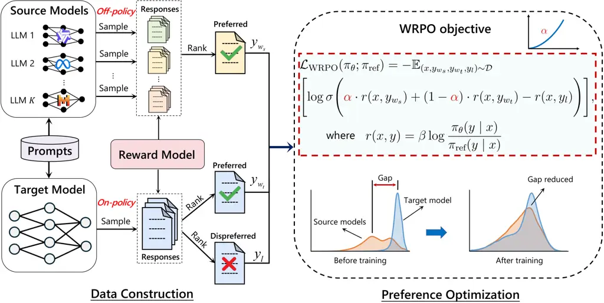

# Weighted-Reward Preference Optimization for Implicit Model Fusion

Ziyi Yang^(\*)    Fanqi Wan ^(†)^(†)thanks: \$ \$Contributed equally.   
Longguang Zhong    Tianyuan Shi    Xiaojun Quan ^(†)^(†)thanks:
\$ \$Corresponding author. Affiliation: School of Computer Science and
Engineering, Sun Yat-sen University, China
Affiliation: yangzy39@mail2.sysu.edu.cn, quanxj3@mail.sysu.edu.cn

###### Abstract

While fusing heterogeneous open-source LLMs with varying architectures
and sizes can potentially integrate the strengths of different models,
existing fusion methods face significant challenges, such as vocabulary
alignment and merging distribution matrices. These procedures are not
only complex but also prone to introducing noise and errors. In this
paper, we propose an implicit fusion method, Weighted-Reward Preference
Optimization (WRPO), which leverages preference optimization between the
source LLMs and the target LLM to transfer their capabilities
effectively. WRPO eliminates the need for vocabulary alignment and
matrix fusion and can be efficiently scaled to accommodate various LLMs.
To address distributional deviations between the source and target LLMs,
WRPO introduces a progressive adaptation strategy that gradually shifts
reliance on preferred examples from the target LLM to the source LLMs.
Extensive experiments on the MT-Bench, AlpacaEval-2, and Arena-Hard
benchmarks demonstrate that WRPO consistently outperforms existing
knowledge fusion methods and various fine-tuning baselines. When applied
to LLaMA3-8B-Instruct as the target model, WRPO achieves a
length-controlled win rate of 55.9% against GPT-4-Preview-1106 on
AlpacaEval-2 and a win rate of 46.2% against GPT-4-0314 on Arena-Hard.
Our code is available at
[https://github.com/SLIT-AI/WRPO](https://github.com/SLIT-AI/WRPO).

|     |
| --- |
|     |

## 1 Introduction

Combining the strengths of multiple Large Language Models (LLMs) can
potentially enhance the capabilities of individual models. Model
ensemble techniques (Jiang et al., 2023b; Wang et al., 2024b) aggregate
predictions from several models to improve overall performance and
robustness over a single model. However, this approach requires
substantial computational resources, as all models must remain active
during inference. The Mixture of Experts (MoE) (Komatsuzaki et al.,
2023; Feng et al., 2024; Sukhbaatar et al., 2024) leverages sparse
expert networks to boost capacity by activating only a subset of
parameters. Despite reduced activation, MoEs still incur significant
memory overhead, as all parameters must be maintained. Model
merging (Wortsman et al., 2022; Matena & Raffel, 2022; Yadav et al.,
2023), which combines independently trained instances of the same model
through arithmetic operations, allows a single model to be maintained
during inference. While more efficient, this method is restricted to
models with identical architectures and sizes.

Another approach is to fuse these LLMs into a target model through
multi-teacher knowledge distillation (Wan et al., 2024a; Wan et al.,
2024b; Shi et al., 2024). Unlike traditional knowledge distillation (Gou
et al., 2021), which usually leverages diverse sources (e.g., logits,
features, and relations) of knowledge from teacher models, this method
relies exclusively on the probabilistic distribution matrices generated
by source LLMs to transfer knowledge to the target model. We refer to
this method as _explicit model fusion_ (EMF) because it involves a
well-defined knowledge transfer process. While applicable to models with
varying architectures and sizes, and without increasing memory overhead
during inference, this approach presents notable challenges such as
vocabulary alignment and the merging of distribution matrices from
different LLMs. These issues complicate model fusion, reduce its
efficiency, and may introduce noise and errors and affect the fusion
results.

This work aims to enhance the capabilities of a single LLM by implicitly
learning from robust open-source LLMs, a process we term _implicit model
fusion_ (IMF). The concept of IMF has been widely utilized to improve
the performance of weaker models. For instance, a weak model can be
boosted through fine-tuning with outputs from stronger LLMs (Ranaldi &
Freitas, 2024; Tian et al., 2024; Kang et al., 2023). Moreover, a reward
model can be trained using outputs from various LLMs (Cui et al., 2024;
Zhu et al., 2024), enabling it to learn and capture the differences in
capabilities between the LLMs. Zephyr (Tunstall et al., 2023) further
collects responses from multiple LLMs and ranks them with GPT-4 to
obtain preference data for training the policy using DPO. One advantage
of IMF over EMF (Wan et al., 2024a; Wan et al., 2024b; Shi et al., 2024)
is that it eliminates the need for challenging alignment of vocabularies
and fusion of distributions among different LLMs. Inspired by recent
alignment techniques such as Direct Preference Optimization
(DPO) (Rafailov et al., 2023) and Simple Preference Optimization
(SimPO) (Meng et al., 2024), we propose a novel IMF method to transfer
the capabilities of source LLMs to a target LLM through preference
optimization. However, directly applying preference learning to outputs
from heterogeneous LLMs presents challenges. Previous works have shown
that DPO is highly sensitive to distribution shifts between the policy
model and the preference data (Xu et al., 2024b; Tajwar et al., 2024;
Zhou et al., 2024), and training a policy model on this preference data
can lead to sub-optimal performance.

To demonstrate this, we conduct a preliminary experiment on the
Ultrafeedback dataset (Cui et al., 2024), using
LLaMA3-8B-Instruct (Dubey et al., 2024) as the target model and 10
strong open-source LLMs as source models.¹¹ 1 Refer to Section 4.1 for
more details. For each prompt, we first ask each source model to
generate several responses and use the ArmoRM reward model (Wang et al.,
2024a) to select the highest-reward response among all source LLMs as
the _preferred_ response, with the _dispreferred_ response coming from
the target LLM’s completions. Figure 1(a) visualizes the average
log-probability distribution of the target LLM $`\pi_{\theta}`$ for both
response types, which reveals a significant deviation between the
distributions of the source and target models. Although applying DPO
directly on this deviated dataset marginally enhances the
log-probabilities of source LLMs’ responses relative to those of the
target LLM, as shown in Figure 1(b), this results in sub-optimal
performance compared to sampling both response types exclusively from
the target LLM, as illustrated in Figure 1(c).

Figure 1: Distribution deviations between responses from heterogeneous
source LLMs and the LLaMA3-8B-Instruct target LLM before (a) and after
(b) DPO fine-tuning, with the prompts from Ultrafeedback (Cui et al., 2024) as input. Subfigure (c) shows the results
($`\pi_{\text{DPO-off}}`$) of preference optimization with this deviated
preference dataset, compared to the results ($`\pi_{\theta}`$) from
directly applying the target model and those ($`\pi_{\text{DPO-on}}`$)
from DPO fine-tuning on un-deviated preference data sampled from the
target model.

To address the distributional deviations during implicit model fusion,
we introduce a novel approach called Weighted-Reward Preference
Optimization (WRPO). Instead of directly relying on the source LLMs to
provide preferred responses, we propose a progressive adaptation
strategy that begins with the target LLM providing preferred responses
and gradually shifts this responsibility to source LLMs. Specifically,
this progressive adaptation is implemented in two stages. First, for
each prompt $`x`$, we construct a preference quadruple
$`(x,y_{w_{s}},y_{w_{t}},y_{l})`$, where $`y_{w_{s}}`$ is a preferred
response generated by the source LLMs, and $`y_{w_{t}}`$ and $`y_{l}`$
are preferred and dispreferred responses, respectively, from the target
LLM. Second, we gradually decrease the weight of internal rewards²² 2 We
use “internal reward” to refer to the reward generated during preference
optimization for preferred or dispreferred responses, in contrast to the
reward provided by an external reward model. for $`y_{w_{t}}`$ and
increase the weight for $`y_{w_{s}}`$ during preference optimization.
This smoothing process facilitates the integration of strengths from the
source models into the target model while mitigating the distributional
discrepancies.

To assess the effectiveness of WRPO in implicit model fusion, we select
10 prominent open-source LLMs as the source models, with parameter sizes
ranging from 9B to 236B. We chose LLaMA3-8B-Instruct (Dubey et al., 2024) as the target model due to its strong performance relative to its
size. Our experiments are conducted on three widely-used
instruction-following benchmarks, namely, MT-Bench (Zheng et al., 2023),
AlpacaEval-2 (Li et al., 2023), and Arena-Hard (Li et al., 2024). The
results show that WRPO consistently outperforms existing fusion methods
and various baselines. This highlights its ability to allow a model to
implicitly learn from the diverse capabilities of heterogeneous LLMs
while also addressing distributional shifts. Notably, the fused model,
LLaMA3-8B-Instruct-WRPO, surpasses all source models on AlpacaEval-2
with a length-controlled win rate of 55.9%.

## 2 Related Work

#### Collective LLMs

Given that LLMs are trained with various architectures and sizes on
different datasets, it is reasonable to assume they possess unique
capabilities and strengths. Therefore, leveraging the distinct
advantages of different LLMs becomes a natural approach to developing
more robust and high-capable models. Recent studies have increasingly
emphasized the development of collective LLMs through the integration of
diverse heterogeneous models.

LLM-Blender (Jiang et al., 2023b) presents an ensemble framework that
first employs a pairwise ranking mechanism to identify the top-$`K`$
outputs generated by different LLMs. These selected outputs are then
refined by a seq2seq model to produce enhanced results.
Mixture-of-Agents (MoA) (Wang et al., 2024b) utilizes a hierarchical
structure where each layer consists of multiple LLM agents. The outputs
from a previous layer are concatenated and refined by each agent in the
subsequent layer. However, this approach significantly increases the
number of LLMs needed during inference. In addition to the
sequence-level ensemble, Xu et al. (2024c) explored a token-level
ensemble method that aggregates the distributions of LLMs at each
decoding step through a global alignment matrix. Similarly,
PackLLMs (Mavromatis et al., 2024) conducts distribution ensembling
during inference utilizing sequence-level weights derived from the
perplexity of each LLM on the input.

FuseLLM (Wan et al., 2024a) and FuseChat (Wan et al., 2024b) aim to fuse
LLMs of various architectures and sizes into a more robust model through
multi-teacher knowledge distillation. They start by aligning the
vocabularies and probabilistic distributions of the source LLMs,
followed by merging their distributions and continuously fine-tuning the
target LLM. ProFuser (Shi et al., 2024) goes further by integrating both
training mode (through cross-entropy loss) and inference mode (via model
outputs), which provides a more comprehensive understanding of the
capabilities of source LLMs. Although applicable to models with varying
architectures and sizes, these methods face challenges such as
vocabulary alignment and merging distribution matrices from different
LLMs, which are complex and may also introduce noise and errors that
affect the fusion results.

#### Direct Preference Optimization

Aligning LLMs with human preferences is crucial for their success.
Reinforcement Learning from Human Feedback (RLHF) (Christiano et al.,
2017; Schulman et al., 2017; Ziegler et al., 2019) is a widely used
approach to achieve this alignment. However, RLHF depends on complex
reinforcement learning techniques such as Proximal Policy Optimization
(PPO), which are challenging to implement and often unstable during
training. To address these challenges, approaches such as SLiC-HF (Zhao
et al., 2023) and RRHF (Yuan et al., 2023) replace reinforcement
learning with a ranking loss on preference pairs to better align LLMs
with human preferences, while also incorporating a regularization term
based on reference responses. Similarly, DPO (Rafailov et al., 2023)
directly optimizes the policy model by training the reward model on
human preference data. In addition to providing more stable training,
lower computational costs, and easier implementation, this approach
ensures high-quality alignment with human preferences.

Subsequent research aims to address the potential limitations of DPO.
For example, IPO (Azar et al., 2024) tackles the risk of overfitting by
optimizing a nonlinear preference function, thus avoiding the
transformation of pairwise preferences into pointwise rewards.
KTO (Ethayarajh et al., 2024) is based on a new alignment objective of
human-aware loss (HALO), which maximizes the utility of generated
outputs directly from a binary signal indicating whether the output is
desirable, rather than maximizing the likelihood of preferences. CPO (Xu
et al., 2024a) and ORPO (Hong et al., 2024) aim to eliminate the need
for a reference model by streamlining the optimization process,
combining supervised fine-tuning (SFT) and preference alignment into a
single step. R-DPO (Park et al., 2024) introduces a
length-regularization term into the DPO objective to mitigate length
biases that may be exploited by DPO. Similarly, SimPO (Meng et al., 2024) revises the reward component in DPO to use the average log
probability of positive or negative responses from the policy model.
Another motivation for this method is that the training process aligns
more closely with inference.

However, none of the above works consider the hybrid scenario where one
response is generated by the policy itself while the other comes from a
different LLM. This situation may introduce serious distribution shifts
relative to the policy, which in turn affects the policy’s optimization.
The work closely related to our setup is WPO (Zhou et al., 2024), which
assigns weights to off-policy preference pairs based on their likelihood
under the policy model. These weights indicate the degree of deviation
from the policy’s distribution and mitigate the influence of preference
pairs with notable deviations.

## 3 Method

In this section, we begin with a problem statement for implicit model
fusion, followed by the preliminaries of direct preference optimization
(DPO) (Rafailov et al., 2023). Finally, we provide a detailed
explanation of our proposed method, Weighted-Reward Preference
Optimization (WRPO).

### 3.1 Problem Statement

Previous works on model fusion primarily focus on transferring knowledge
from various heterogeneous LLMs into a unified model via multi-teacher
knowledge distillation (Wan et al., 2024a; Wan et al., 2024b; Shi
et al., 2024). We refer to this method as _explicit model fusion_ (EMF)
because it involves a well-defined knowledge transfer process. As
mentioned earlier, this approach requires complex alignment of
vocabularies and merging of distribution matrices across different LLMs.
In contrast, this work proposes _implicit model fusion_ (IMF) to enhance
the capabilities of a target LLM by implicitly learning from the outputs
of robust source LLMs, thereby bypassing the difficulties of vocabulary
alignment and distribution fusion. Another advantage of IMF is that the
source LLMs can be either open-source or proprietary; however, for
comparison with previous fusion approaches, we focus on open-source
LLMs. Inspired by recent alignment techniques like DPO (Rafailov et al., 2023) and SimPO (Meng et al., 2024), we propose implementing IMF through
preference optimization.

For each prompt $`x_{i}`$ in the training dataset $`\mathcal{D}`$, we
first sample $`N`$ (e.g., $`N`$=5) responses from each of the source
LLMs. Then, an external reward model is employed to identify the
response with the highest reward score among all source models as
_preferred_, denoted as $`y_{w_{s}}`$. Next, a _dispreferred_ response
can be sampled from the target LLM. However, as illustrated in Figure 1,
significant deviations may exist between the distributions of the
preferred and dispreferred responses, and directly applying preference
optimization under these conditions could yield problematic results.

To address this issue, we propose a progressive adaptation strategy.
Specifically, we sample $`N`$ responses from the target model and
evaluate them using the reward model. The response with the highest
score is labeled as another _preferred_ response $`y_{w_{t}}`$, while
the lowest-scoring response is regarded as the _dispreferred_ response
$`y_{l}`$. To tackle the challenges of distributional discrepancies and
effectively utilize data from the source models, we introduce a novel
optimization objective called Weighted-Reward Preference Optimization
(WRPO). As shown in Figure 2, this objective introduces a fusion
coefficient $`\alpha`$ that dynamically balances the internal reward of
the preferred response $`y_{w_{s}}`$ from source models and that of
$`y_{w_{t}}`$ from the target during training. This approach enables the
target LLM to transition smoothly from its distribution to align with
that of the source LLMs.



Figure 2: Overview of our proposed WRPO for implicit model fusion.

### 3.2 Preliminaries: Direct Preference Optimization

Conventional alignment methods such as Reinforcement Learning from Human
Feedback (RLHF) (Christiano et al., 2017; Schulman et al., 2017; Ziegler
et al., 2019) often involve complex training pipelines that are unstable
and resource-intensive. In contrast, Direct Preference Optimization
(DPO) (Rafailov et al., 2023) provides a more efficient alternative by
fine-tuning LLMs to align with human preferences through a
straightforward supervised learning objective using human-labeled
preference data. DPO optimizes the policy to generate outputs that match
human preferences without requiring explicit reward functions or
trial-and-error updates. Specifically, DPO reformulates the reward
function to yield a closed-form solution for the optimal policy. Given
the optimal policy $`\pi^{*}`$, the reparameterized form of the optimal
reward function $`r^{*}(x,y)`$ is expressed as follows:

```math
r^{*}(x,y)=\beta\log\frac{\pi^{*}(y\mid x)}{\pi_{\text{ref}}(y\mid x)}+\beta\log Z(x), \tag{1}
```

where $`Z(x)`$ is the partition function, $`\pi_{\text{ref}}`$ denotes
the reference policy, typically a supervised fine-tuned (SFT) model,
which also serves as the starting point for the policy. Given a human
preference dataset
$`\mathcal{D}=\bigl\{(x,y_{w},y_{l})^{i}\bigr\}_{i=1}^{N}`$, where
$`y_{w}`$ and $`y_{l}`$ represent the preferred and dispreferred
completions for prompt $`x`$, the reparameterized reward function
$`r^{*}(x,y)`$ is incorporated into the Bradley-Terry model (Bradley &
Terry, 1952), which yields the probability of preference between
$`y_{w}`$ and $`y_{l}`$ as:

```math
p^{*}(y_{w}\succ y_{l}\mid x)=\sigma\Biggl(\beta\log\frac{\pi^{*}(y_{w}\mid x)}{\pi_{\text{ref}}(y_{w}\mid x)}-\beta\log\frac{\pi^{*}(y_{l}\mid x)}{\pi_{\text{ref}}(y_{l}\mid x)}\Biggr). \tag{2}
```

The maximum likelihood objective for a parameterized policy
$`\pi_{\theta}`$ is then:

```math
\mathcal{L}_{\text{DPO}}(\pi_{\theta};\pi_{\text{ref}})=-\mathbb{E}_{(x,y_{w},y_{l})\sim\mathcal{D}}\Biggl[\log\sigma\Biggl(\beta\log\frac{\pi_{\theta}(y_{w}\mid x)}{\pi_{\text{ref}}(y_{w}\mid x)}-\beta\log\frac{\pi_{\theta}(y_{l}\mid x)}{\pi_{\text{ref}}(y_{l}\mid x)}\Biggr)\Biggr]. \tag{3}
```

The preference dataset for DPO training can be sampled from the
reference model or sourced from publicly available data. In the latter
case, a supervised fine-tuning process is typically required for the
reference model to mitigate the distribution shift between the true
reference distribution and the dataset used for DPO.

### 3.3 WRPO: Weighted-Reward Preference Optimization

While fine-tuning the target LLM with high-reward responses from source
LLMs can alleviate the distribution issue in implicit model fusion,
empirical results suggest that the distribution deviation remains,
particularly when compared to preference data fully sampled from the
target model. Therefore, we propose a progressive adaptation strategy
with a new optimization objective called Weighted-Reward Preference
Optimization (WRPO), which enables the target LLM to smoothly transition
and align its distribution with that of the source LLMs.

#### Derivation of the WRPO objective

The preference dataset for WRPO consists of a set of quadruples
$`(x,y_{w_{s}},y_{w_{t}},y_{l})`$, where $`y_{w_{s}}`$ is the
highest-reward response from the source LLMs for prompt $`x`$, and
$`y_{w_{t}}`$ and $`y_{l}`$ are the responses with the highest and
lowest reward from the target LLM, respectively. Based on this setup, we
define a new pair of preferred completions
$`\mathtt{y}_{w}=\{y_{w_{s}},y_{w_{t}}\}`$ and an updated preference
triple $`(x,\mathtt{y}_{w},y_{l})`$. We then extend the DPO framework by
introducing a weighted-reward mechanism. In particular, the
Bradley-Terry (BT) model is reformulated as:

```math
p(\mathtt{y}_{w}\succ y_{l}\mid x)=\sigma(r(x,\mathtt{y}_{w})-r(x,y_{l})), \tag{4}
```

where $`r(x,\mathtt{y}_{w})`$ is a compound reward calculated as a
weighted average of $`r(x,y_{w_{s}})`$ and $`r(x,y_{w_{t}})`$:

```math
r(x,\mathtt{y}_{w})=\alpha\cdot r(x,y_{w_{s}})+(1-\alpha)\cdot r(x,y_{w_{t}}), \tag{5}
```

where $`\alpha`$ represents the fusion coefficient that dynamically
balances the internal reward of the preferred response $`y_{w_{s}}`$
from source models and that of $`y_{w_{t}}`$ from the target model
during training. Next, by substituting $`r^{*}(x,y)`$ from Eq. (1) into
Eq. (4) and Eq. (5), we derive the WRPO training objective:

```math
\mathcal{L}_{\text{WRPO}}(\pi_{\theta};\pi_{\text{ref}})=-\mathbb{E}{(x,y_{w_{s}},y_{w_{t}},y_{l})\sim\mathcal{D}}\\
\Biggl[\log\sigma\Biggl(\alpha\cdot\beta\log\frac{\pi_{\theta}(y_{w_{s}}\mid x)}{\pi_{\text{ref}}(y_{w_{s}}\mid x)}+(1-\alpha)\cdot\beta\log\frac{\pi_{\theta}(y_{w_{t}}\mid x)}{\pi_{\text{ref}}(y_{w_{t}}\mid x)}-\beta\log\frac{\pi_{\theta}(y_{l}\mid x)}{\pi_{\text{ref}}(y_{l}\mid x)}\Biggr)\Biggr], \tag{6}
```

which can be reformulated as:

```math
\mathcal{L}_{\text{WRPO}}(\pi_{\theta};\pi_{\text{ref}})=-\mathbb{E}{(x,y_{w_{s}},y_{w_{t}},y_{l})\sim\mathcal{D}}\\
\Biggl[\log\sigma\Biggl(\alpha\cdot\Bigl(\underbrace{\beta\log\frac{\pi_{\theta}(y_{w_{s}}\mid x)}{\pi_{\text{ref}}(y_{w_{s}}\mid x)}-\beta\log\frac{\pi_{\theta}(y_{l}\mid x)}{\pi_{\text{ref}}(y_{l}\mid x)}}_{\text{hybrid-policy internal reward margin}}\Bigr)+(1-\alpha)\cdot\Bigl(\underbrace{\beta\log\frac{\pi_{\theta}(y_{w_{t}}\mid x)}{\pi_{\text{ref}}(y_{w_{t}}\mid x)}-\beta\log\frac{\pi_{\theta}(y_{l}\mid x)}{\pi_{\text{ref}}(y_{l}\mid x)}}_{\text{on-policy internal reward margin}}\Bigr)\Biggr)\Biggr]. \tag{7}
```

The above process seeks to maximize the margin of internal rewards
between preference responses, utilizing both on-policy sampling from the
target model and hybrid-policy sampling from the source and target
models. Initially, it emphasizes on-policy sampling and gradually
transitions to hybrid-policy sampling. This process helps mitigate
distributional deviations and ensures a smoother optimization process.

#### Gradient analysis

We examine the gradient of WRPO to understand the impact of the
weighted-reward mechanism on the training process. The gradient of loss
function $`\mathcal{L}_{\text{WRPO}}`$ in Eq. (6) with respect to the
policy model $`\pi_{\theta}`$ can be expressed as:

```math
\nabla_{\theta}\mathcal{L}_{\text{WRPO}}(\pi_{\theta};\pi_{\text{ref}})=-\beta\mathbb{E}_{(x,y_{w_{s}},y_{w_{t}},y_{l},)\sim\mathcal{D}}\Biggl[\sigma\Biggl(\underbrace{\hat{r}_{\theta}(x,y_{l})-\alpha\cdot\hat{r}_{\theta}(x,y_{w_{s}})-(1-\alpha)\cdot\hat{r}_{\theta}(x,y_{w_{t}})}_{\text{higher weight when reward estimation is wrong}}\Biggr)\cdot\\
\Biggl(\alpha\cdot\underbrace{\nabla_{\theta}\log\pi_{\theta}(y_{w_{s}}|x)}_{\text{increase likelihood on $y_{w_{s}}$}}+(1-\alpha)\cdot\underbrace{\nabla_{\theta}\log\pi_{\theta}(y_{w_{t}}|x)}_{\text{increase likelihood on $y_{w_{t}}$}}-\underbrace{\nabla_{\theta}\log\pi_{\theta}(y_{l}|x)}_{\text{decrease likelihood on $y_{l}$}}\Biggr)\Biggr], \tag{8}
```

where
$`\hat{r}_{\theta}(x,y)=\beta\log\frac{\pi_{\theta}(y|x)}{\pi_{\text{ref}}(y|x)}`$
represents the internal reward function. Intuitively, the gradient flow
of $`\mathcal{L}_{\text{WRPO}}`$ tends to increase the likelihood of
preferred responses $`y_{w_{s}}`$ and $`y_{w_{t}}`$ while decreasing the
likelihood of dispreferred $`y_{l}`$. The function $`\sigma(.)`$
represents the reward estimation error that controls the rate of
increasing or decreasing the likelihood of preferred or dispreferred
completions in WRPO. When the reward estimation is incorrect, WRPO will
accelerate the gradient flow for updates. To further analyze the impact
of $`y_{w_{s}}`$ and hyperparameter $`\alpha`$ on gradient update, we
can reformat the $`\sigma(.)`$ term as
$`\sigma\left(\alpha\cdot\left(\hat{r}_{\theta}(x,y_{l})-\hat{r}_{\theta}(x,y_{w_{s}})\right)+(1-\alpha)\cdot\left(\hat{r}_{\theta}(x,y_{l})-\hat{r}_{\theta}(x,y_{w_{t}})\right)\right)`$.
We can see that $`\alpha`$ serves as a constraint term on the gradient
update for the policy model learning from $`y_{w_{s}}`$. A larger
$`\alpha`$ means the policy will absorb more gradient information from
$`y_{w_{s}}`$. At the beginning of training process, since there exists
a distributional gap between $`y_{w_{s}}`$ from source models and
$`y_{l}`$ from target model, we assign a relatively low $`\alpha`$ to
the estimation term
$`\left(\hat{r}_{\theta}(x,y_{l})-\hat{r}_{\theta}(x,y_{w_{s}})\right)`$
and progressively increase $`\alpha`$ during the training process. In
this way, we smoothly shift the target model $`\pi_{\theta}`$ from the
distribution of $`y_{w_{t}}`$ to that of $`y_{w_{s}}`$.

Therefore, WRPO balances the contributions of diverse responses from
heterogeneous LLMs and provides richer preference signals for preference
optimization. Moreover, this weighted approach reduces distribution
mismatches and enhances the fusion process by leveraging the strengths
of both target and source models.

## 4 Experiments

In our experiments, we use LLaMA3-8B-Instruct (Dubey et al., 2024) as
the target LLM. As for the source LLMs, we include ten advanced
open-source models of varying architectures and sizes, as detailed in
Table 1.

### 4.1 Experimental Setup

#### Training Dataset

Following prior work (Meng et al., 2024; Zhou et al., 2024), we chose
UltraFeedback (Cui et al., 2024) to construct our training dataset.
UltraFeedback includes approximately 64K prompts gathered from six
established datasets that emphasize instruction-following, truthfulness,
honesty, and helpfulness. However, the original dataset comprises
preference data derived from old versions of LLMs, which are often less
capable than our target model. Therefore, we discarded the original
responses and instead used their

|                                                       |            |
| ----------------------------------------------------- | ---------- |
| Source LLMs                                           | Percentage |
| Mistral-Large-Instruct-2407 (Jiang et al., 2023a)     | 28.24%     |
| Gemma2-27B-IT (Riviere et al., 2024)                  | 15.45%     |
| Qwen2-72B-Instruct (Yang et al., 2024)                | 12.38%     |
| LLaMA3-70B-Instruct (Dubey et al., 2024)              | 9.92%      |
| Gemma2-9B-IT (Riviere et al., 2024)                   | 9.91%      |
| Internlm2.5-20B-Chat (Cai et al., 2024)               | 7.54%      |
| DeepSeek-V2-Chat (Shao et al., 2024)                  | 6.20%      |
| DeepSeek-Coder-V2-Instruct (DeepSeek-AI et al., 2024) | 4.01%      |
| Yi-1.5-34B-Chat (Young et al., 2024)                  | 3.86%      |
| Phi-3-medium-4k-instruct (Abdin et al., 2024)         | 2.49%      |

Table 1: Details of the source LLMs used in our experiments along with
the percentage of the highest-scoring responses from each source LLM.

prompts to construct a new preference dataset $`\mathcal{D}`$ for our
implicit model fusion, as described in Section 3.1. Specifically, for
each prompt in the dataset, we sampled $`N=5`$ responses from each
source model using top-$`p`$ sampling ($`p=0.95`$) with a temperature of
0.8. This approach aims to ensure that the sampled outputs capture the
capabilities of the source LLMs to the greatest extent possible.
ArmoRM-LLaMA3-8B-v0.1 (Wang et al., 2024a) is then employed as the
reward model to score and rank these responses. We selected the
highest-scoring response across all source models as $`y_{w_{s}}`$, with
the percentage contribution from each source LLM detailed in Table 1.

#### Training Details

We conducted experiments with a batch size of 128 and a maximum length
of 2048 tokens on 8x80GB NVIDIA A800 GPUs. The training was performed on
a single epoch for our method. A cosine learning rate schedule with a
warmup ratio of 0.1 is employed. The training process is divided into
two stages. In the first stage, we applied supervised fine-tuning (SFT)
on the set of $`y_{w_{s}}`$ with one-third of the dataset, with the
learning rate empirically set to 7e-6. The resulting fine-tuned model,
Target-SFT, is the foundation for subsequent preference optimization. In
the next stage, the remaining dataset is used for preference
optimization, during which $`y_{w_{t}}`$ and $`{y_{l}}`$ are generated
from the SFT model, i.e., Target-SFT. For WRPO, we used a learning rate
of 3e-7 and set $`\beta=0.01`$, with the weight $`\alpha`$ assigned to
$`y_{w_{s}}`$ linearly increasing from 0 to 0.1. Further details on
hyperparameter tuning can be found in Appendix A.

#### Evaluation Benchmarks

We assess the performance of our models on three representative
instruction-following benchmarks: MT-Bench (Zheng et al., 2023),
AlpacaEval-2 (Li et al., 2023), and Arena-Hard (Li et al., 2024). These
benchmarks are well-regarded for their comprehensive coverage of diverse
tasks and their effectiveness in providing robust evaluations of the
instruction-following capabilities of LLMs.

- •
  MT-Bench contains 80 multi-turn dialogues with 160 questions across
  eight categories, including writing, roleplay, reasoning, math,
  coding, extraction, STEM, and humanities. Each response is evaluated
  by GPT-4 on a scale from 1 to 10, with the average score reported for
  each dialogue turn across the 80 dialogues. Different from the
  official setting, we follow the latest works (Wang et al., 2024c; Wan
  et al., 2024b) to adopt GPT-4-0125-Preview as the evaluator and
  baseline.
- •
  AlpacaEval-2 comprises 805 instructions from five different datasets
  and assesses models using two metrics: length-controlled (LC) win rate
  and raw win rate (WR) (Dubois et al., 2024). In this benchmark,
  GPT-4-Preview-1106 serves as both the baseline model and the evaluator
  for the other models.
- •
  Arena-Hard is a more challenging benchmark that closely aligns with
  the human preference ranking from Chatbot Arena (Chiang et al., 2024),
  a crowd-sourced platform for evaluating LLMs. It spans 250
  high-quality topic clusters including 500 well-defined technical
  problem-solving queries. We report the Win Rate against GPT-4-0314
  using GPT-4-Preview-1106 as the judge model.

#### Baselines

We compare WRPO with three categories of baselines, including
source&target LLMs, collective LLMs, and preference optimization
methods. For source&target LLMs, the results are obtained from official
leaderboards or our local tests if unavailable. For collective LLMs, we
include PackLLM-Top1-PPL (Mavromatis et al., 2024),
LLM-Blender-Top1 (Jiang et al., 2023b), MoA (Wang et al., 2024b),
FuseLLM (Wan et al., 2024a), and FuseChat (Wan et al., 2024b). For
PackLLM-Top1-PPL, we select the response from the source or target LLMs
with the lowest perplexity on the test instruction. For
LLM-Blender-Top1, we rank LLM outputs via pairwise comparisons and
select the top response.³³ 3 Due to the _fuser_ model’s limited input
length, we only use the _ranker_ model to select the 1st-ranked output.
For MoA (Wang et al., 2024b), we select Mistral-Large-Instruct-2407 as
the aggregator LLM to combine input responses into a single response.
For FuseLLM (Wan et al., 2024a) and FuseChat (Wan et al., 2024b),
limited by the complex vocabulary alignment and distribution merging
process, we only include Gemma2-27B-IT, Gemma2-9B-IT,
Qwen2-72B-Instruct, LLaMA3-70B-Instruct, and Yi-1.5-34B-Chat as source
LLMs, with LLaMA3-8B-Instruct serving as the target/pivot LLM to
reimplement their methods. For a fair comparison, we select the same 5
source LLMs to implement WRPO and obtain Target-SFT-WRPO-Medium. For
preference optimization methods, we include DPO (Rafailov et al., 2023),
SimPO (Meng et al., 2024), and IPO (Azar et al., 2024). The results on
AlpacaEval-2 and Arena-Hard are referenced from (Meng et al., 2024),
while the results on MT-Bench are obtained by running the checkpoints
released by Meng et al. (2024). In the following experimental results,
these baselines are denoted as Target-DPO, Target-SimPO, and Target-IPO,
respectively.

### 4.2 Overall Results

In Table 2, we present the overall results of our WRPO method compared
to various baseline methods of different categories, architectures, and
scales on AlpacaEval-2, Arena-Hard, and MT-Bench benchmarks. These
results offer valuable insights into WRPO’s performance and efficiency
as detailed below.

|                                 |      |                      |       |                      |                      |      |         |
| ------------------------------- | ---- | -------------------- | ----- | -------------------- | -------------------- | ---- | ------- |
| Model                           | Size | AlpacaEval-2         |       | Arena-Hard           | MT-Bench             |      |         |
|                                 |      | (GPT-4-1106-Preview) |       | (GPT-4-1106-Preview) | (GPT-4-0125-Preview) |      |         |
|                                 |      | LC(%)                | WR(%) | WR(%)                | T1                   | T2   | Overall |
| Source&Target LLMs              |      |                      |       |                      |                      |      |         |
| Target                          | 8B   | 26.0                 | 25.3  | 20.6                 | 7.41                 | 7.04 | 7.23    |
| Mistral-Large-Instruct-2407     | 123B | 54.3                 | 46.8  | 70.4                 | 8.83                 | 8.31 | 8.57    |
| Gemma2-27B-IT                   | 27B  | 55.5                 | 41.0  | 57.5                 | 8.34                 | 8.03 | 8.19    |
| Qwen2-72B-Instruct              | 72B  | 38.1                 | 29.9  | 46.9                 | 8.44                 | 7.84 | 8.15    |
| LLaMA3-70B-Instruct             | 70B  | 34.4                 | 33.2  | 46.6                 | 8.61                 | 7.77 | 8.19    |
| Gemma2-9B-IT                    | 9B   | 51.1                 | 38.1  | 40.8                 | 8.27                 | 7.44 | 7.86    |
| Internlm2.5-20B-Chat            | 20B  | 37.4                 | 45.3  | 31.2                 | 8.03                 | 7.23 | 7.64    |
| DeepSeek-V2-Chat                | 236B | 51.4                 | 51.3  | 68.3                 | 8.65                 | 7.96 | 8.31    |
| DeepSeek-Coder-V2-Instruct      | 236B | 50.7                 | 54.0  | 66.3                 | 8.80                 | 7.42 | 8.13    |
| Yi-1.5-34B-Chat                 | 34B  | 37.5                 | 44.5  | 42.6                 | 7.99                 | 7.64 | 7.81    |
| Phi-3-Medium-4K-Instruct        | 14B  | 29.8                 | 24.2  | 33.4                 | 8.63                 | 7.46 | 8.04    |
| Collective LLMs                 |      |                      |       |                      |                      |      |         |
| PackLLM-Top1-PPL                | 849B | 49.1                 | 48.0  | 64.8                 | 8.29                 | 8.20 | 8.25    |
| LLM-Blender-Top1                | 849B | 46.2                 | 44.3  | 58.2                 | 8.69                 | 8.06 | 8.38    |
| MoA                             | 849B | 61.3                 | 77.2  | 83.1                 | 9.04                 | 8.03 | 8.54    |
| Target-FuseLLM                  | 8B   | 36.0                 | 33.8  | 32.1                 | 7.53                 | 7.13 | 7.33    |
| Target-FuseChat                 | 8B   | 38.1                 | 35.2  | 32.7                 | 7.68                 | 7.07 | 7.38    |
| Preference Optimization Methods |      |                      |       |                      |                      |      |         |
| Target-DPO                      | 8B   | 48.2                 | 47.5  | 35.2                 | 7.68                 | 7.23 | 7.46    |
| Target-SimPO                    | 8B   | 53.7                 | 47.5  | 36.5                 | 7.73                 | 7.00 | 7.38    |
| Target-IPO                      | 8B   | 46.8                 | 42.4  | 36.6                 | 7.89                 | 7.19 | 7.54    |
| Our Methods                     |      |                      |       |                      |                      |      |         |
| Target-SFT                      | 8B   | 27.2                 | 26.0  | 24.7                 | 7.69                 | 7.03 | 7.36    |
| Target-SFT-DPO                  | 8B   | 50.7                 | 53.1  | 40.2                 | 7.98                 | 7.23 | 7.61    |
| Target-SFT-WRPO-Medium          | 8B   | 53.5                 | 53.8  | 41.6                 | 7.80                 | 7.03 | 7.42    |
| Target-SFT-WRPO                 | 8B   | 55.9                 | 57.6  | 46.2                 | 7.95                 | 7.31 | 7.63    |

Table 2: Overall results of our proposed WRPO method with
LLaMA3-8B-Instruct as the target model, compared against various
baseline categories on AlpacaEval-2, Arena-Hard, and MT-Bench. “T1” and
“T2” represent the average scores for the first and second turns,
respectively. Bold indicates the best performance in 8B models.

#### WRPO strikes a balance between effectiveness and efficiency compared to collective LLMs.

Starting with the same target LLM and involving the same source LLMs,
Target-SFT-WRPO-Medium outperforms existing model fusion techniques such
as FuseLLM and FuseChat by notable margins. It achieves improvements of
17.5 and 15.4 points in the length-controlled (LC) win rate on
AlpacaEval-2, and 9.5 and 8.9 points in the win rate (WR) on Arena-Hard,
respectively. This highlights the superior effectiveness of WRPO for
implicit model fusion (IMF) compared to previous explicit model fusion
(EMF) methods. Particularly, our fused model, Target-SFT-WRPO, surpasses
all larger source LLMs on AlpacaEval-2, showcasing WRPO’s potential to
enable a target model to outperform much larger models. Furthermore,
compared to collective LLM fusion architectures that are 106 times
larger in scale, WRPO outperforms most of these models, only falling
short of MoA on AlpacaEval-2, while incurring substantially lower
computational costs. While WRPO may not exceed the absolute performance
of larger ensemble systems across all evaluation metrics, its ability to
achieve comparable results with far lower computational demands presents
an elegant solution to the ongoing efficiency-effectiveness trade-off in
language model deployment.

#### WRPO consistently outperforms preference optimization baselines.

In terms of preference optimization, WRPO delivers notable improvements
over prior methods. After fine-tuning $`y_{w_{s}}`$ using one-third of
the data, Target-SFT performs slightly better than the target model.
Following further optimization on the remaining two-thirds of the
dataset, WRPO consistently outperforms all preference optimization
baselines. Specifically, WRPO outperforms the best-performing preference
optimization baseline on three benchmarks by 2.2, 9.6, and 0.09 points,
respectively. Besides, starting from Target-SFT, WRPO achieves 5.2
points improvement over DPO in the length-controlled win rate on
AlpacaEval-2, and a 6.0 points increase in win rate on Arena-Hard.
Compared to these approaches which utilize responses exclusively from
the target LLM, the proposed WRPO method effectively incorporates
responses sampled from various source LLMs for preference optimization,
thus facilitating the integration of diverse knowledge and capabilities
through implicit model fusion.

### 4.3 Adaptability of WRPO to Varied Objectives and Source LLM Scaling

In this section, we examine how WRPO adapts to diverse preference
optimization objectives and scales with varying numbers of source LLMs,
demonstrating its flexibility in both dimensions.

#### Adaptation to different preference optimization objectives

|                                |              |       |          |
| ------------------------------ | ------------ | ----- | -------- |
| Method                         | AlpacaEval-2 |       | MT-Bench |
|                                | LC(%)        | WR(%) | Overall  |
| SimPO                          | 53.9         | 49.9  | 7.39     |
| IPO                            | 51.1         | 52.4  | 7.67     |
| $`\text{WRPO}_{\text{SimPO}}`$ | 55.8         | 51.8  | 7.42     |
| $`\text{WRPO}_{\text{IPO}}`$   | 53.3         | 57.7  | 7.72     |

Table 3: Results of WRPO combined with different preference optimization
objectives.

Beyond DPO, we also investigate integrating our WRPO mechanism with
alternative preference optimization objectives, utilizing the same SFT
target model as the above experiments for DPO. Specifically, we
experiment with IPO, which employs a similar internal reward formulation
to DPO but optimizes a nonlinear objective, as well as SimPO, which
defines its reward function based on the average log-likelihood of a
response, thereby eliminating the need for a reference model. Detailed
descriptions of the training objectives and the hyperparameter search
ranges for these methods are provided in Appendix A. We refer to the
methods combining WRPO with SimPO and IPO as
$`\text{WRPO}_{\text{SimPO}}`$ and $`\text{WRPO}_{\text{IPO}}`$,
respectively. The performance of these methods on AlpacaEval-2 and
MT-Bench is summarized in Table 3. We note that combining WRPO with IPO
and SimPO consistently improves their performance, highlighting our
WRPO’s generalizability and efficacy in integrating preference signals
from heterogeneous LLMs into the target LLM across various preference
optimization objectives.

#### Scaling with different numbers of source LLMs

|     |              |       |          |
| --- | ------------ | ----- | -------- |
| Num | AlpacaEval-2 |       | MT-Bench |
|     | LC(%)        | WR(%) | Overall  |
| 1   | 48.9         | 50.3  | 7.29     |
| 2   | 52.3         | 50.4  | 7.54     |
| 5   | 53.5         | 53.8  | 7.42     |
| 10  | 55.9         | 58.0  | 7.63     |

Table 4: Results of our WRPO implemented with varying numbers of source
LLMs on AlpacaEval-2 and MT-Bench.

We conduct experiments with varying numbers of source LLMs to implement
the WRPO framework. For the five source LLMs configuration, we select
Gemma2-27B-IT, Gemma2-9B-IT, Qwen2-72B-Instruct, LLaMA3-70B-Instruct,
and Yi-1.5-34B-Chat, aligning our setup with the comparisons made in
FuseLLM and FuseChat. Moreover, we utilize two subsets of these five
source LLMs for experiments involving fewer source LLMs. One subset
includes a single LLM, Gemma2-27B-IT, while the other consists of two
LLMs: Gemma2-27B-IT and Qwen2-72B-Instruct. The results in Table 4 show
that the performance of WRPO exhibits an overall upward trend as the
number of source LLMs increases on AlpacaEval-2 and MT-Bench. This trend
demonstrates the potential effectiveness of scaling up the number of
source LLMs to enhance our method.

### 4.4 Analysis of the Weighted-Reward Mechanism in WRPO

In this section, we conduct an in-depth analysis of the weighted-reward
mechanism in our implicit model fusion framework, focusing on three
distinctive views.

#### Balancing internal reward dynamics

Figure 3 demonstrates the evolution of internal reward dynamics during
preference optimization in the Target-SFT model across various
preference pairs, with consistent learning rate and $`\beta`$
parameters. The internal reward margin, as defined in Eq. (7), comprises
an on-policy reward margin $`r(x,y_{w_{t}})-r(x,y_{l})`$ weighted by
$`1-\alpha`$, and a hybrid-policy reward margin
$`r(x,y_{w_{s}})-r(x,y_{l})`$ weighted by $`\alpha`$. Figure 3(a)
presents the analysis of solely utilizing the on-policy reward margin
($`\alpha=0`$). The observed reward margin approximates 0.2, indicating
a relatively conservative optimization approach. This modest margin
growth can be attributed to the model’s limited exploration capability
due to its exclusive reliance on on-policy samples. In contrast,
Figure 3(b) illustrates the effect of employing only the hybrid-policy
reward margin ($`\alpha=1`$). This configuration exhibits more
aggressive optimization behavior, yielding reward margins exceeding 1.0.
While this suggests enhanced discriminative capability between positive
and negative samples, the substantial distribution shift inherent in the
hybrid setting may compromise training stability and ultimately yield
suboptimal results. Figure 3(c) showcases our proposed weighted-reward
mechanism, which synthesizes both on-policy and hybrid-policy reward
margins through dynamic weighting. This approach achieves an optimal
balance between the aforementioned extremes, generating moderate reward
margins of approximately 0.5 and facilitating smooth margin transitions
throughout the training process. The harmonious integration of on-policy
and hybrid-policy components, as evidenced by the balanced optimization
process, appears to be instrumental in the superior performance of our
weighted-reward mechanism.

#### Effectiveness of weighted-reward mechanism

Figure 5 illustrates the ablation studies on the effectiveness of
incorporating preferred responses from both source and target LLMs. We
conduct these studies on two configurations: the baseline target model
(Target) and its fine-tuned version (Target-SFT) to ensure a
comprehensive evaluation. The analysis involves systematically removing
either the source model’s chosen response $`y_{w_{s}}`$ or the target
model’s chosen response $`y_{w_{t}}`$ from the optimization objective in
Eq. (6) by setting $`\alpha=0`$ or $`\alpha=1`$, respectively. In the
Target setting, the removal of $`y_{w_{t}}`$ leads to a substantial
decline of 25.8 points in the length-controlled win rate, indicating
that the distribution shift between $`y_{w_{s}}`$ and $`y_{l}`$ creates
challenges in directly utilizing source model responses for preference
optimization. Moreover, this finding emphasizes the crucial role of
$`y_{w_{t}}`$ in bridging this distribution gap. In the Target-SFT
setting, although SFT helps mitigate the performance deterioration
caused by removing $`y_{w_{t}}`$, its performance still lags behind our
WRPO by 6.3 points, which combines both $`y_{w_{s}}`$ and $`y_{w_{t}}`$.
On the other hand, removing $`y_{w_{s}}`$ reduces WRPO to DPO based
solely on self-sampled on-policy data. Notably, the exclusion of source
model responses leads to performance declines of 3.5 points and 5.2
points in the Target and Target-SFT settings, respectively, highlighting
the important role of $`y_{w_{s}}`$ in providing valuable preference
signals through the weighted-reward mechanism.

#### Influence of fusion coefficient

We evaluate the impact of varying the fusion coefficient $`\alpha`$ in
the weighted-reward mechanism, with $`\alpha\in[0.1,0.3,0.5,0.7,0.9]`$,
by recording the length-controlled (LC) win rate on AlpacaEval-2 and the
hybrid-policy internal reward accuracy on a held-out set of the
Ultrafeedback dataset. Hybrid-policy internal reward accuracy is defined
as the percentage of instances where the internal reward
$`r(x,y_{w_{s}})`$ from source LLMs surpasses $`r(x,y_{l})`$ from the
target LLM. As shown in Figure 5, hybrid-policy internal reward accuracy
improves as $`\alpha`$ increases, indicating that progressively
increasing $`\alpha`$ over a wide range leads to higher hybrid-policy
internal reward accuracy. However, the LC win rate on AlpacaEval-2 shows
an initial decline followed by an improvement. This suggests that high
hybrid-policy internal reward accuracy on the Ultrafeedback held-out set
does not always correlate with real-world benchmark performance.
Nonetheless, WRPO consistently outperforms the DPO baseline (50.7)
across all $`\alpha`$ settings.

Figure 3: Internal reward dynamics on Target-SFT model under different
preference optimization setups. (a) DPO-on: DPO training on on-policy
preference pairs $`(x,y_{w_{t}},y_{l})`$. (b) DPO-hybrid: DPO training
on hybrid-policy preference pairs $`(x,y_{w_{s}},y_{l})`$. (c) WRPO
$`\alpha=0.5`$: WRPO training with $`\alpha`$ increasing from 0 to 0.5.

Figure 4: Results of ablation studies for our WRPO method on
AlpacaEval-2, utilizing the length-controlled win rate metric.

Figure 5: AlpacaEval-2 length-controlled win rate and hybrid-policy
internal reward accuracy under different fusion coefficient $`\alpha`$
settings.

## 5 Conclusion

In this work, we introduce Weighted-Reward Preference Optimization
(WRPO) for the implicit model fusion of heterogeneous open-source LLMs
with diverse architectures and sizes, aiming to create a more capable
and robust target LLM. To address distributional deviations between
source and target LLMs, WRPO utilizes a progressive adaptation strategy
that gradually shifts reliance on preferred responses from the target
LLM to the source LLMs. Extensive experiments on three public benchmarks
demonstrate that WRPO consistently outperforms existing knowledge fusion
methods and various fine-tuning baselines.

This study concludes with three notable findings. First, implicit model
fusion presents a promising approach to enhancing the capabilities of
LLMs by eliminating the need for vocabulary alignment and distribution
merging. Second, the fusion of LLMs can be redefined as a preference
optimization task, distinguishing it from conventional methods such as
knowledge distillation and fine-tuning. Finally, our WRPO effectively
addresses challenges related to hybrid-policy sampling, enabling
efficient scaling to accommodate various LLMs.

## 6 Acknowledgements

This work was supported by the National Natural Science Foundation of
China (No. 62176270) and the Guangdong Basic and Applied Basic Research
Foundation (No. 2023A1515012832).

## References

- Abdin et al. (2024) Marah Abdin, Sam Ade Jacobs, Ammar Ahmad Awan,
  Jyoti Aneja, Ahmed Awadallah, Hany Hassan Awadalla, et al. Phi-3
  technical report: A highly capable language model locally on your
  phone. _ArXiv_, abs/2404.14219, 2024.
- Azar et al. (2024) Mohammad Gheshlaghi Azar, Zhaohan Daniel Guo, Bilal
  Piot, Remi Munos, Mark Rowland, Michal Valko, and Daniele
  Calandriello. A general theoretical paradigm to understand learning
  from human preferences. In _International Conference on Artificial
  Intelligence and Statistics_, 2024.
- Beeching et al. (2023) Edward Beeching, Clémentine Fourrier, Nathan
  Habib, Sheon Han, Nathan Lambert, Nazneen Rajani, Omar Sanseviero,
  Lewis Tunstall, and Thomas Wolf. Open LLM leaderboard, 2023.
- Bradley & Terry (1952) Ralph Allan Bradley and Milton E. Terry. Rank
  analysis of incomplete block designs: I. the method of paired
  comparisons. _Biometrika_, 39:324, 1952.
- Cai et al. (2024) Zheng Cai, Maosong Cao, et al. InternLM2 technical
  report. _ArXiv_, abs/2403.17297, 2024.
- Chiang et al. (2024) Wei-Lin Chiang, Lianmin Zheng, Ying Sheng,
  Anastasios Nikolas Angelopoulos, Tianle Li, Dacheng Li, Hao Zhang,
  Banghua Zhu, Michael Jordan, Joseph E Gonzalez, et al. Chatbot arena:
  An open platform for evaluating llms by human preference. In
  _Proceedings of the 41st International Conference on Machine
  Learning_, 2024.
- Christiano et al. (2017) Paul F Christiano, Jan Leike, Tom Brown,
  Miljan Martic, Shane Legg, and Dario Amodei. Deep reinforcement
  learning from human preferences. _Advances in Neural Information
  Processing Systems_, 2017.
- Clark et al. (2019) Kevin Clark, Minh-Thang Luong, Urvashi Khandelwal,
  Christopher D Manning, and Quoc Le. Bam! born-again multi-task
  networks for natural language understanding. In _Proceedings of the
  57th Annual Meeting of the Association for Computational Linguistics_,
  pp. 5931–5937, 2019.
- Clark et al. (2018) Peter Clark, Isaac Cowhey, Oren Etzioni, Tushar
  Khot, Ashish Sabharwal, Carissa Schoenick, and Oyvind Tafjord. Think
  you have solved question answering? try arc, the ai2 reasoning
  challenge. _ArXiv_, abs/1803.05457, 2018.
- Cobbe et al. (2021) Karl Cobbe, Vineet Kosaraju, Mohammad Bavarian,
  Mark Chen, Heewoo Jun, Lukasz Kaiser, Matthias Plappert, Jerry Tworek,
  Jacob Hilton, Reiichiro Nakano, Christopher Hesse, and John Schulman.
  Training verifiers to solve math word problems. _ArXiv_,
  abs/2110.14168, 2021.
- Cui et al. (2024) Ganqu Cui, Lifan Yuan, Ning Ding, Guanming Yao, Wei
  Zhu, Yuan Ni, Guotong Xie, Zhiyuan Liu, and Maosong Sun.
  UltraFeedback: Boosting language models with high-quality feedback. In
  _Proceedings of the 41st International Conference on Machine
  Learning_, 2024.
- DeepSeek-AI et al. (2024) DeepSeek-AI, Qihao Zhu, Daya Guo, Zhihong
  Shao, Dejian Yang, et al. DeepSeek-Coder-V2: Breaking the barrier of
  closed-source models in code intelligence. _ArXiv_,
  abs/2406.11931, 2024.
- Dubey et al. (2024) Abhimanyu Dubey, Abhinav Jauhri, Abhinav Pandey,
  Abhishek Kadian, Ahmad Al-Dahle, Aiesha Letman, et al. The llama 3
  herd of models. _ArXiv_, abs/2407.21783, 2024.
- Dubois et al. (2024) Yann Dubois, Percy Liang, and Tatsunori
  Hashimoto. Length-controlled alpacaeval: A simple debiasing of
  automatic evaluators. In _First Conference on Language
  Modeling_, 2024.
- Ethayarajh et al. (2024) Kawin Ethayarajh, Winnie Xu, Niklas
  Muennighoff, Dan Jurafsky, and Douwe Kiela. KTO: Model alignment as
  prospect theoretic optimization. In _Proceedings of the 41st
  International Conference on Machine Learning_, 2024.
- Feng et al. (2024) Wenfeng Feng, Chuzhan Hao, Yuewei Zhang, Yu Han,
  and Hao Wang. Mixture-of-LoRAs: An efficient multitask tuning method
  for large language models. In _Proceedings of the 2024 Joint
  International Conference on Computational Linguistics, Language
  Resources and Evaluation (LREC-COLING 2024)_, pp. 11371–11380, 2024.
- Gou et al. (2021) Jianping Gou, Baosheng Yu, Stephen J Maybank, and
  Dacheng Tao. Knowledge distillation: A survey. _International Journal
  of Computer Vision_, 129(6):1789–1819, 2021.
- Hendrycks et al. (2021) Dan Hendrycks, Collin Burns, Steven Basart,
  Andy Zou, Mantas Mazeika, Dawn Song, and Jacob Steinhardt. Measuring
  massive multitask language understanding. In _International Conference
  on Learning Representations_, 2021.
- Hong et al. (2024) Jiwoo Hong, Noah Lee, and James Thorne. ORPO:
  Monolithic preference optimization without reference model. In
  _Proceedings of the 2024 Conference on Empirical Methods in Natural
  Language Processing_, 2024.
- Jiang et al. (2023a) Albert Qiaochu Jiang, Alexandre Sablayrolles,
  Arthur Mensch, Chris Bamford, Devendra Singh Chaplot, Diego
  de Las Casas, Florian Bressand, Gianna Lengyel, Guillaume Lample,
  Lucile Saulnier, L’elio Renard Lavaud, Marie-Anne Lachaux, Pierre
  Stock, Teven Le Scao, Thibaut Lavril, Thomas Wang, Timothée Lacroix,
  and William El Sayed. Mistral 7B. _ArXiv_, abs/2310.06825, 2023a.
- Jiang et al. (2023b) Dongfu Jiang, Xiang Ren, and Bill Yuchen Lin.
  LLM-Blender: Ensembling large language models with pairwise ranking
  and generative fusion. In _Proceedings of the 61st Annual Meeting of
  the Association for Computational Linguistics (Volume 1: Long
  Papers)_, pp. 14165–14178, 2023b.
- Kang et al. (2023) Minki Kang, Seanie Lee, Jinheon Baek, Kenji
  Kawaguchi, and Sung Ju Hwang. Knowledge-augmented reasoning
  distillation for small language models in knowledge-intensive tasks.
  _Advances in Neural Information Processing Systems_, 2023.
- Komatsuzaki et al. (2023) Aran Komatsuzaki, Joan Puigcerver, James
  Lee-Thorp, Carlos Riquelme Ruiz, Basil Mustafa, Joshua Ainslie,
  Yi Tay, Mostafa Dehghani, and Neil Houlsby. Sparse upcycling: Training
  mixture-of-experts from dense checkpoints. In _The Eleventh
  International Conference on Learning Representations_, 2023.
- Levesque et al. (2012) Hector Levesque, Ernest Davis, and Leora
  Morgenstern. The Winograd schema challenge. In _Thirteenth
  international conference on the principles of knowledge representation
  and reasoning_, 2012.
- Li et al. (2024) Tianle Li, Wei-Lin Chiang, Evan Frick, Lisa Dunlap,
  Tianhao Wu, Banghua Zhu, Joseph E Gonzalez, and Ion Stoica. From
  crowdsourced data to high-quality benchmarks: Arena-hard and
  benchbuilder pipeline. _arXiv preprint arXiv:2406.11939_, 2024.
- Li et al. (2023) Xuechen Li, Tianyi Zhang, Yann Dubois, Rohan Taori,
  Ishaan Gulrajani, Carlos Guestrin, Percy Liang, and Tatsunori B.
  Hashimoto. AlpacaEval: An automatic evaluator of instruction-following
  models, 2023.
- Lin et al. (2022) Stephanie Lin, Jacob Hilton, and Owain Evans.
  TruthfulQA: Measuring how models mimic human falsehoods. In
  _Proceedings of the 60th Annual Meeting of the Association for
  Computational Linguistics (Volume 1: Long Papers)_, pp.
  3214–3252, 2022.
- Matena & Raffel (2022) Michael S Matena and Colin A Raffel. Merging
  models with fisher-weighted averaging. _Advances in Neural Information
  Processing Systems_, 2022.
- Mavromatis et al. (2024) Costas Mavromatis, Petros Karypis, and George
  Karypis. Pack of LLMs: Model fusion at test-time via perplexity
  optimization. In _First Conference on Language Modeling_, 2024.
- Meng et al. (2024) Yu Meng, Mengzhou Xia, and Danqi Chen. SimPO:
  Simple preference optimization with a reference-free reward. In
  _Advances in Neural Information Processing Systems_, 2024.
- Park et al. (2024) Ryan Park, Rafael Rafailov, Stefano Ermon, and
  Chelsea Finn. Disentangling length from quality in direct preference
  optimization. _ArXiv_, abs/2403.19159, 2024.
- Rafailov et al. (2023) Rafael Rafailov, Archit Sharma, Eric Mitchell,
  Stefano Ermon, Christopher D. Manning, and Chelsea Finn. Direct
  Preference Optimization: Your language model is secretly a reward
  model. In _Advances in Neural Information Processing Systems_, 2023.
- Ranaldi & Freitas (2024) Leonardo Ranaldi and Andre Freitas. Aligning
  large and small language models via chain-of-thought reasoning. In
  _Proceedings of the 18th Conference of the European Chapter of the
  Association for Computational Linguistics (Volume 1: Long Papers)_,
  pp. 1812–1827, 2024.
- Riviere et al. (2024) Gemma Team Morgane Riviere, Shreya Pathak,
  Pier Giuseppe Sessa, Cassidy Hardin, Surya Bhupatiraju, et al. Gemma
  2: Improving open language models at a practical size. _ArXiv_,
  abs/2408.00118, 2024.
- Schulman et al. (2017) John Schulman, Filip Wolski, Prafulla Dhariwal,
  Alec Radford, and Oleg Klimov. Proximal policy optimization
  algorithms. _ArXiv_, abs/1707.06347, 2017.
- Shao et al. (2024) Zhihong Shao, Damai Dai, Daya Guo, Bo Liu (Benjamin
  Liu), and Zihan Wang. DeepSeek-V2: A strong, economical, and efficient
  mixture-of-experts language model. _ArXiv_, abs/2405.04434, 2024.
- Shi et al. (2024) Tianyuan Shi, Fanqi Wan, Canbin Huang, Xiaojun Quan,
  Chenliang Li, Ming Yan, and Ji Zhang. ProFuser: Progressive fusion of
  large language models. _ArXiv_, abs/2408.04998, 2024.
- Sukhbaatar et al. (2024) Sainbayar Sukhbaatar, Olga Golovneva, Vasu
  Sharma, Hu Xu, Xi Victoria Lin, Baptiste Roziere, Jacob Kahn,
  Shang-Wen Li, Wen tau Yih, Jason E Weston, and Xian Li.
  Branch-Train-MiX: Mixing expert LLMs into a mixture-of-experts LLM. In
  _First Conference on Language Modeling_, 2024.
- Tajwar et al. (2024) Fahim Tajwar, Anikait Singh, Archit Sharma,
  Rafael Rafailov, Jeff Schneider, Tengyang Xie, Stefano Ermon, Chelsea
  Finn, and Aviral Kumar. Preference fine-tuning of LLMs should leverage
  suboptimal, on-policy data. In _Proceedings of the 41st International
  Conference on Machine Learning_, 2024.
- Tian et al. (2024) Yijun Tian, Yikun Han, Xiusi Chen, Wei Wang, and
  N. Chawla. TinyLLM: Learning a small student from multiple large
  language models. _ArXiv_, abs/2402.04616, 2024.
- Tunstall et al. (2023) Lewis Tunstall, Edward Beeching, Nathan
  Lambert, Nazneen Rajani, Kashif Rasul, Younes Belkada, Shengyi Huang,
  Leandro von Werra, Clémentine Fourrier, Nathan Habib, Nathan Sarrazin,
  Omar Sanseviero, Alexander M. Rush, and Thomas Wolf. Zephyr: Direct
  distillation of LM alignment. _ArXiv_, abs/2310.16944, 2023.
- Wan et al. (2024a) Fanqi Wan, Xinting Huang, Deng Cai, Xiaojun Quan,
  Wei Bi, and Shuming Shi. Knowledge fusion of large language models. In
  _The Twelfth International Conference on Learning Representations_,
  2024a.
- Wan et al. (2024b) Fanqi Wan, Ziyi Yang, Longguang Zhong, Xiaojun
  Quan, Xinting Huang, and Wei Bi. FuseChat: Knowledge fusion of chat
  models. _ArXiv_, abs/2402.16107, 2024b.
- Wang et al. (2024a) Haoxiang Wang, Wei Xiong, Tengyang Xie, Han Zhao,
  and Tong Zhang. Interpretable preferences via multi-objective reward
  modeling and mixture-of-experts. In Yaser Al-Onaizan, Mohit Bansal,
  and Yun-Nung Chen (eds.), _Findings of the Association for
  Computational Linguistics: EMNLP 2024_, pp. 10582–10592, 2024a.
- Wang et al. (2024b) Junlin Wang, Jue Wang, Ben Athiwaratkun, Ce Zhang,
  and James Zou. Mixture-of-Agents enhances large language model
  capabilities. _ArXiv_, abs/2406.04692, 2024b.
- Wang et al. (2024c) Zhilin Wang, Yi Dong, Olivier Delalleau, et al.
  HelpSteer2: Open-source dataset for training top-performing reward
  models. _ArXiv_, abs/2406.08673, 2024c.
- Wortsman et al. (2022) Mitchell Wortsman, Gabriel Ilharco, Samir Ya
  Gadre, Rebecca Roelofs, Raphael Gontijo-Lopes, Ari S Morcos, Hongseok
  Namkoong, Ali Farhadi, Yair Carmon, Simon Kornblith, et al. Model
  soups: averaging weights of multiple fine-tuned models improves
  accuracy without increasing inference time. In _Proceedings of the
  39th International Conference on Machine Learning_, 2022.
- Xu et al. (2024a) Haoran Xu, Amr Sharaf, Yunmo Chen, Weiting Tan,
  Lingfeng Shen, Benjamin Van Durme, Kenton Murray, and Young Jin Kim.
  Contrastive preference optimization: Pushing the boundaries of LLM
  performance in machine translation. In _Proceedings of the 41st
  International Conference on Machine Learning_, 2024a.
- Xu et al. (2024b) Shusheng Xu, Wei Fu, Jiaxuan Gao, Wenjie Ye, Weilin
  Liu, Zhiyu Mei, Guangju Wang, Chao Yu, and Yi Wu. Is DPO superior to
  PPO for LLM alignment? A comprehensive study. In _Proceedings of the
  41st International Conference on Machine Learning_, 2024b.
- Xu et al. (2024c) Yangyifan Xu, Jinliang Lu, and Jiajun Zhang.
  Bridging the gap between different vocabularies for llm ensemble. In
  _Proceedings of the 2024 Conference of the North American Chapter of
  the Association for Computational Linguistics: Human Language
  Technologies (Volume 1: Long Papers)_, pp. 7133–7145, 2024c.
- Yadav et al. (2023) Prateek Yadav, Derek Tam, Leshem Choshen, Colin A
  Raffel, and Mohit Bansal. Ties-merging: Resolving interference when
  merging models. _Advances in Neural Information Processing
  Systems_, 2023.
- Yang et al. (2024) An Yang, Baosong Yang, Binyuan Hui, Bo Zheng, Bowen
  Yu, Chang Zhou, Chengpeng Li, et al. Qwen2 technical report. _ArXiv_,
  abs/2407.10671, 2024.
- Young et al. (2024) 01.AI Alex Young, Bei Chen, Chao Li, Chengen
  Huang, et al. Yi: Open foundation models by 01.ai. _ArXiv_,
  abs/2403.04652, 2024.
- Yuan et al. (2023) Hongyi Yuan, Zheng Yuan, Chuanqi Tan, Wei Wang,
  Songfang Huang, and Fei Huang. RRHF: Rank responses to align language
  models with human feedback. In _Advances in Neural Information
  Processing Systems_, 2023.
- Zellers et al. (2019) Rowan Zellers, Ari Holtzman, Yonatan Bisk, Ali
  Farhadi, and Yejin Choi. HellaSwag: Can a machine really finish your
  sentence? In _Proceedings of the 57th Annual Meeting of the
  Association for Computational Linguistics_, pp. 4791–4800, 2019.
- Zhao et al. (2023) Yao Zhao, Rishabh Joshi, Tianqi Liu, Misha Khalman,
  Mohammad Saleh, and Peter J. Liu. SLiC-HF: Sequence likelihood
  calibration with human feedback. _ArXiv_, abs/2305.10425, 2023.
- Zheng et al. (2023) Lianmin Zheng, Wei-Lin Chiang, Ying Sheng, Siyuan
  Zhuang, Zhanghao Wu, Yonghao Zhuang, Zi Lin, Zhuohan Li, Dacheng Li,
  Eric Xing, et al. Judging LLM-as-a-judge with MT-Bench and Chatbot
  Arena. In _NeurIPS Datasets and Benchmarks Track_, 2023.
- Zhou et al. (2024) Wenxuan Zhou, Ravi Agrawal, Shujian Zhang,
  Sathish Reddy Indurthi, Sanqiang Zhao, Kaiqiang Song, Silei Xu, and
  Chenguang Zhu. WPO: Enhancing RLHF with weighted preference
  optimization. In _Proceedings of the 2024 Conference on Empirical
  Methods in Natural Language Processing_, pp. 8328–8340, 2024.
- Zhu et al. (2024) Banghua Zhu, Evan Frick, Tianhao Wu, Hanlin Zhu,
  Karthik Ganesan, Wei-Lin Chiang, Jian Zhang, and Jiantao Jiao.
  Starling-7B: Improving helpfulness and harmlessness with RLAIF. In
  _First Conference on Language Modeling_, 2024.
- Ziegler et al. (2019) Daniel M. Ziegler, Nisan Stiennon, Jeff Wu,
  Tom B. Brown, Alec Radford, Dario Amodei, Paul Christiano, and
  Geoffrey Irving. Fine-tuning language models from human preferences.
  _ArXiv_, abs/1909.08593, 2019.

## Appendix A Hyperparameter Tuning

|                                |                                                                                                                                                                                                                                                                                                  |                                    |
| ------------------------------ | ------------------------------------------------------------------------------------------------------------------------------------------------------------------------------------------------------------------------------------------------------------------------------------------------ | ---------------------------------- | ------------------------------------- | ------------------------------- | -------------------------------- | ---------------------------- | ------------------ | ---------------------- | ----------------------- | ------------------ | ----------------------- |
| Method                         | Objective                                                                                                                                                                                                                                                                                        | Hyperparameter                     |
| DPO (Rafailov et al., 2023)    | $`-\log\sigma\left(\beta\log\frac{\pi*{\theta}(y*{w}                                                                                                                                                                                                                                             | x)}{\pi*{\text{ref}}(y*{w}         | x)}-\beta\log\frac{\pi*{\theta}(y*{l} | x)}{\pi*{\text{ref}}(y*{l}      | x)}\right)`$                     | $`\beta\in[0.01,0.05,0.1]`$  |
| IPO (Azar et al., 2024)        | $`\left(\log\frac{\pi*{\theta}(y*{w}                                                                                                                                                                                                                                                             | x)}{\pi*{\text{ref}}(y*{w}         | x)}-\log\frac{\pi*{\theta}(y*{l}      | x)}{\pi*{\text{ref}}(y*{l}      | x)}-\frac{1}{2\tau}\right)^{2}`$ | $`\tau\in[0.01,0.1,1.0]`$    |
| SimPO (Meng et al., 2024)      | $`-\log\sigma\left(\frac{\beta}{                                                                                                                                                                                                                                                                 | y\_{w}                             | }\log\pi*{\theta}(y*{w}               | x)-\frac{\beta}{                | y\_{l}                           | }\log\pi*{\theta}(y*{l}      | x)-\gamma\right)`$ | $`\beta\in[5.0,10.0]`$ |
|                                |                                                                                                                                                                                                                                                                                                  | $`\gamma\in[0,1.0,2.0]`$           |
| $`\text{WRPO}_{\text{DPO}}`$   | $`-\log\sigma\left(\alpha\cdot\beta\log\frac{\pi_{\theta}(y_{w_{s}}\mid x)}{\pi_{\text{ref}}(y_{w_{s}}\mid x)}+(1-\alpha)\cdot\beta\log\frac{\pi_{\theta}(y_{w_{t}}\mid x)}{\pi_{\text{ref}}(y_{w_{t}}\mid x)}-\beta\log\frac{\pi_{\theta}(y_{l}\mid x)}{\pi_{\text{ref}}(y_{l}\mid x)}\right)`$ | $`\beta=0.01`$                     |
|                                |                                                                                                                                                                                                                                                                                                  | $`\alpha\in[0.1,0.3,0.5,0.7,0.9]`$ |
| $`\text{WRPO}_{\text{SimPO}}`$ | $`-\log\sigma\left(\alpha\cdot\frac{\beta}{                                                                                                                                                                                                                                                      | y*{w*{s}}                          | }\log\pi*{\theta}(y*{w\_{s}}          | x)+(1-\alpha)\cdot\frac{\beta}{ | y*{w*{t}}                        | }\log\pi*{\theta}(y*{w\_{t}} | x)-\frac{\beta}{   | y\_{l}                 | }\log\pi*{\theta}(y*{l} | x)-\gamma\right)`$ | $`\beta=10.0,\gamma=0`$ |
|                                |                                                                                                                                                                                                                                                                                                  | $`\alpha\in[0.1,0.3,0.5]`$         |
| $`\text{WRPO}_{\text{IPO}}`$   | $`\left(\alpha\cdot\log\frac{\pi_{\theta}(y_{w_{s}}\mid x)}{\pi_{\text{ref}}(y_{w_{s}}\mid x)}+(1-\alpha)\cdot\log\frac{\pi_{\theta}(y_{w_{t}}\mid x)}{\pi_{\text{ref}}(y_{w_{t}}\mid x)}-\log\frac{\pi_{\theta}(y_{l}\mid x)}{\pi_{\text{ref}}(y_{l}\mid x)}-\frac{1}{2\tau}\right)^{2}`$       | $`\tau\in[0.01,0.1]`$              |
|                                |                                                                                                                                                                                                                                                                                                  | $`\alpha\in[0.1,0.3,0.5]`$         |

Table 5: Various preference optimization objectives and hyperparameter
search range.

|                                |           |            |            |      |
| ------------------------------ | --------- | ---------- | ---------- | ---- |
| Method                         | $`\beta`$ | $`\gamma`$ | $`\alpha`$ | LR   |
| DPO                            | 0.01      | \-         | \-         | 3e-7 |
| IPO                            | \-        | \-         | 0.01       | 1e-6 |
| SimPO                          | 10        | 1.0        | \-         | 6e-7 |
| $`\text{WRPO}_{\text{DPO}}`$   | 0.01      | \-         | 0.1        | 3e-7 |
| $`\text{WRPO}_{\text{IPO}}`$   | \-        | 0.01       | 0.1        | 1e-6 |
| $`\text{WRPO}_{\text{SimPO}}`$ | 10        | 0          | 0.5        | 6e-7 |

Table 6: Hyperparameter settings for preference optimization methods
using Target-SFT as the policy model. “LR” denotes the learning rate.

Prior works such as SimPO (Meng et al., 2024) suggest that
hyperparameter tuning is crucial for achieving optimal performance of
preference optimization methods. To avoid getting suboptimal baseline
results, we followed the recommendation by Meng et al. (2024) to apply
hyperparameter tuning for all preference optimization methods, including
DPO (Rafailov et al., 2023), IPO (Azar et al., 2024), and SimPO (Meng
et al., 2024). Specifically, we individually search the learning rates
in the range of \[3e-7, 5e-7, 6e-7, 1e-6\] for each preference
optimization method. The specific training objectives and hyperparameter
search ranges for these preference optimization baselines, along with
our method, are outlined in Table 5. We used a batch size of 128 and
trained these methods for a single epoch. The best hyperparameter values
under the Target-SFT setting are summarized in Table 6. Besides, a
learning rate of 7e-6 was used with a single epoch for supervised
fine-tuning (SFT). For the model fusion methods, including FuseLLM (Wan
et al., 2024a) and FuseChat (Wan et al., 2024b), we used a learning of
7e-6 and conducted training over three epochs, with the parameter
$`\lambda`$ empirically set to 0.9.

## Appendix B Evaluation on Additional Benchmarks

To further investigate the impact of WRPO on downstream tasks, we
evaluate the models we trained using six tasks from the Huggingface Open
LLM Leaderboard (Beeching et al., 2023). These tasks include:

AI2 Reasoning Challenge (ARC) (Clark et al., 2018): A collection of
grade-school science questions in a 25-shot setting.

HellaSwag (Zellers et al., 2019): A commonsense inference task in a
10-shot setting.

MMLU (Hendrycks et al., 2021): A set of 57 diverse tasks spanning
high-school and college subjects, social sciences, STEM, and others, in
a 5-shot setting.

TruthfulQA (Lin et al., 2022): A set of measuring how language models
mimic human falsehoods with 6-shot setting⁴⁴ 4 Although TruthfulQA is
traditionally regarded as 0-shot, it is technically a 6-shot task
because each example is associated with 6 Q&A pairs..

Winogrande (Levesque et al., 2012): A set of adversarial and difficult
Winograd benchmarks for commonsense reasoning in a 5-shot setting.

GSM8K (Cobbe et al., 2021): A set of grade-school math word questions
evaluates mathematical reasoning capabilities in a 5-shot setting.

We followed the established evaluation pipelines by using the
_lm-evaluation-harness_ tool⁵⁵ 5 We used an updated version of v0.4.3 at
[https://github.com/EleutherAI/lm-evaluation-harness/tree/v0.4.3](https://github.com/EleutherAI/lm-evaluation-harness/tree/v0.4.3)
for more accurate evaluation. for our evaluation. The results are
presented in Table 7, from which we draw several key observations.
Firstly, after undergoing SFT with one-third of the data entries,
Target-SFT shows a significant performance decline compared to Target,
particularly on ARC and GSM8K, likely due to catastrophic forgetting
during training. Next, all preference optimization methods display
varying performance drops on MMLU and GSM8K, which may stem from the
UltraFeedback dataset’s focus on alignment over general knowledge and
mathematics. In contrast, these preference optimization methods
consistently improve performance on HellaSwag and Winogrande, suggesting
the presence of relevant prompts for commonsense inference in
UltraFeedback. Similarly, all preference optimization methods show
consistent gains on TruthfulQA, except for Target-SFT-DPO. Lastly, the
performance of ARC demonstrates only minor improvements or declines
across all methods. In summary, while not explicitly designed for these
tasks, our fused model, Target-SFT-WRPO, surpasses the initial Target
model while preserving general knowledge and mathematical abilities with
minimal decline. This illustrates the generalization potential of our
WRPO method.

|                                           |       |           |       |            |            |       |       |
| ----------------------------------------- | ----- | --------- | ----- | ---------- | ---------- | ----- | ----- |
| Model                                     | ARC   | HellaSwag | MMLU  | TruthfulQA | Winogrande | GSM8K | Avg.  |
| Target                                    | 61.43 | 78.48     | 65.71 | 51.64      | 75.61      | 75.21 | 68.01 |
| Target-SFT                                | 51.19 | 79.83     | 64.56 | 45.93      | 76.87      | 62.77 | 63.53 |
| Target-SFT-DPO                            | 60.67 | 81.7      | 64.98 | 50.3       | 76.95      | 68.76 | 67.23 |
| Target-SFT-IPO                            | 60.58 | 81.68     | 65.5  | 53.93      | 77.9       | 69.67 | 68.21 |
| Target-SFT-SimPO                          | 61.77 | 82.23     | 65.13 | 54.76      | 78.45      | 69.6  | 68.66 |
| Target-SFT-WRPO                           | 62.63 | 82.38     | 64.91 | 54.72      | 78.53      | 71.57 | 69.12 |
| Target-SFT-$`\text{WRPO}_{\text{IPO}}`$   | 59.98 | 81.53     | 65.35 | 53.48      | 78.14      | 69.83 | 68.05 |
| Target-SFT-$`\text{WRPO}_{\text{SimPO}}`$ | 61.69 | 81.95     | 65.08 | 57.11      | 78.69      | 68.69 | 68.87 |

Table 7: Results of evaluations on Huggingface Open LLM Leaderboard.
“Target” denotes LLaMA3-8B-Instruct.

## Appendix C Training Cost Analysis

Increasing the number of source LLMs does not affect the time complexity
of our method during training. First, the interaction with source LLMs
occurs exclusively during the data collection phase before training,
where we conduct offline sampling from the source LLMs and utilize
ArmoRM as a reward model to evaluate the responses and select one
response with the highest reward score for each prompt. This step
constitutes a fixed, one-time computational cost that is independent of
the training process. Importantly, the source LLMs do not participate in
the actual training phase. Therefore, the inclusion of additional source
LLMs does not introduce additional computational costs during WRPO
training. Furthermore, our comparative analysis in Table 8 shows that
WRPO maintains consistent computational efficiency across different
numbers of source LLMs. Notably, WRPO incurs only a modest overhead of
approximately 16% in training time compared to DPO (which does not
involve source LLMs) on 8×A800 GPUs, regardless of the number of source
LLMs involved.

|      |                      |                       |              |
| ---- | -------------------- | --------------------- | ------------ |
| Num. | Runtime of DPO (min) | Runtime of WRPO (min) | Increase (%) |
| 1    | 183                  | 212                   | 15.88%       |
| 2    | 185                  | 215                   | 16.22%       |
| 5    | 186                  | 216                   | 16.13%       |
| 10   | 185                  | 215                   | 16.22%       |

Table 8: Runtime comparisons for DPO and WRPO across different numbers
of source LLMs.

## Appendix D Different Combinations of Source LLMs

|        |              |       |        |
| ------ | ------------ | ----- | ------ |
| Method | AlpacaEval-2 |       |        |
|        | LC(%)        | WR(%) | Length |
| Rank1  | 55.9         | 57.6  | 2159   |
| Rank2  | 53.7         | 55.4  | 2143   |
| Group1 | 53.5         | 53.8  | 2098   |
| Group2 | 53.7         | 60.7  | 2440   |

Table 9: Results of our WRPO implemented with varying combinations of
source LLMs on AlpacaEval-2.

To explore the impact of different source model combinations, we
conducted additional experiments using the AlpacaEval-2 benchmark.
Specifically, we examined the influence of the response quality from
source LLMs by comparing responses with different reward rankings. The
experimental results in Table 9 indicate that responses from top-ranked
source models consistently outperform those from second-ranked models.
This reinforces the importance of selecting high-quality responses to
achieve optimal performance. In addition, we investigated the impact of
model composition by dividing our ten source models into two balanced
groups, each comprising five models with strong performance
characteristics. The first group includes Gemma2-27B-IT, Gemma2-9B-IT,
Qwen2-72B-Instruct, LLaMA3-70B-Instruct, and Yi-1.5-34B-Chat. The second
group comprises Mistral-Large-Instruct-2407, Internlm2.5-20B-Chat,
DeepSeek-V2-Chat, DeepSeek-Coder-V2-Instruct, and
Phi-3-Medium-4K-Instruct. The experimental results in Table 9 show that
various combinations of source models achieve comparable
length-controlled win rates (LC). These findings demonstrate the robust
performance of WRPO across a range of source model configurations.

## Appendix E Tuning Strategies for Fusion Coefficient

Figure 6: Comparisons of dynamic and static tuning strategies for the
fusion coefficient on AlpacaEval-2, utilizing the length-controlled win
rate metric.

In WPRO, we implement a dynamic adjustment mechanism for the fusion
coefficient $`\alpha`$ to facilitate a gradual transition of the target
model’s distribution toward that of the source models. In practice, the
fusion coefficient $`\alpha`$ is initialized at 0.0 and increases
linearly throughout the training process until it reaches a
predetermined target value (Clark et al., 2019). To determine the
optimal target value, we employ a simple greedy search over the range
\[0.1, 0.3, 0.5, 0.7, 0.9\]. This dynamic adjustment strategy
effectively balances the contributions from both source and target
models while addressing potential distribution discrepancies, making it
suitable for various tasks and eliminating the need for complex
parameter configurations or exhaustive optimization procedures.
Moreover, we conducted ablation experiments comparing static and dynamic
tuning strategies. In the static strategy, $`\alpha`$ remains fixed at a
target value throughout training, while in the dynamic strategy,
$`\alpha`$ linearly increases from 0 to the target value. The
experimental results in Figure 6 show that the dynamic tuning strategy
generally outperforms the static strategy, except for setting
$`\alpha=0.7`$, further demonstrating the effectiveness of the dynamic
tuning approach.

## Appendix F Including Dispreferred Responses from Source Models

We conducted additional experiments to investigate the impact of
incorporating extra dispreferred responses from the source models.
Specifically, we use an extension of WRPO loss in Eq. (9), where
$`y_{l_{t}}`$ denotes the dispreferred response from the target model,
and $`y_{l_{s}}`$ denotes the dispreferred response from the same source
model corresponding to preferred response $`y_{w_{s}}`$.

```math
\mathcal{L}_{\text{WRPO}_{w/y_{l_{s}}}}(\pi_{\theta};\pi_{\text{ref}})=-\mathbb{E}{(x,y_{w_{s}},y_{w_{t}},y_{l_{s}},y_{l_{t}})\sim\mathcal{D}}\Biggl[\log\sigma\Biggl(\alpha\cdot\beta\log\frac{\pi_{\theta}(y_{w_{s}}\mid x)}{\pi_{\text{ref}}(y_{w_{s}}\mid x)}\\
+(1-\alpha)\cdot\beta\log\frac{\pi_{\theta}(y_{w_{t}}\mid x)}{\pi_{\text{ref}}(y_{w_{t}}\mid x)}-\alpha\cdot\beta\log\frac{\pi_{\theta}(y_{l_{s}}\mid x)}{\pi_{\text{ref}}(y_{l_{s}}\mid x)}-(1-\alpha)\cdot\beta\log\frac{\pi_{\theta}(y_{l_{t}}\mid x)}{\pi_{\text{ref}}(y_{l_{t}}\mid x)}\Biggr)\Biggr]. \tag{9}
```

|                               |              |       |          |
| ----------------------------- | ------------ | ----- | -------- |
| Method                        | AlpacaEval-2 |       | MT-Bench |
|                               | LC(%)        | WR(%) | Overall  |
| WRPO                          | 55.9         | 57.6  | 7.63     |
| $`\text{WRPO}_{w/y_{l_{s}}}`$ | 54.0         | 56.0  | 7.52     |

Table 10: Results of WRPO combined with additional dispreferred
responses from source models.

First, we performed a comparative analysis of the reward scores across
four categories of responses. The average reward scores for
$`y_{w_{s}}`$, $`y_{w_{t}}`$, $`y_{l_{s}}`$, and $`y_{l_{t}}`$ were
0.180, 0.152, 0.158, and 0.132, respectively. We observed that the
source model’s dispreferred responses $`y_{l_{s}}`$ had higher average
scores than the target model’s preferred responses $`y_{w_{t}}`$. This
finding indicates that incorporating dispreferred responses from source
models into the training objective could potentially lead to an
undesirable reduction in the probability of higher-scoring responses.
Such results would contradict our optimization objectives and
potentially compromise the overall training effectiveness. Furthermore,
the results in Table 10 show that the inclusion of rejected responses
from the source model leads to a decrease in performance on AlpacaEval-2
and MT-Bench. Moreover, this approach increases computational costs due
to the need for extra forward passes during training.

## Appendix G Details of Open-Source Models and the Dataset

The selection of source models and the dataset is primarily determined
by specific objectives. When a target model exhibits limitations in
particular domains, domain-specific source models and datasets can be
strategically used to enhance its capabilities. In our study, we focus
on instruction-following tasks to align with prior preference
optimization research. Therefore, we selected ten prominent open-source
LLMs with parameter sizes ranging from 9B to 236B, all of which exhibit
strong performance on relevant benchmarks. Moreover, we chose one of the
most popular instruction-following datasets, the UltraFeedback (Cui
et al., 2024), as our training dataset. In Table 11, we provide the
Huggingface repository names of the target LLM, source LLMs, reward
model, and preference optimization baseline checkpoints used in our
experiments. For the UltraFeedback (Cui et al., 2024) dataset, we select
the same prompts as provided by Meng et al. (2024) in
[princeton-nlp/llama3-ultrafeedback-armorm](https://huggingface.co/datasets/princeton-nlp/llama3-ultrafeedback-armorm)
for fair comparison to baselines.

|                             |                                                                                                                     |
| --------------------------- | ------------------------------------------------------------------------------------------------------------------- |
| Model                       | Huggingface ID                                                                                                      |
| Target                      | [meta-llama/Meta-Llama-3-8B-Instruct](https://huggingface.co/meta-llama/Meta-Llama-3-8B-Instruct)                   |
| Mistral-Large-Instruct-2407 | [Mistral-Large-Instruct-2407](https://huggingface.co/mistralai/Mistral-Large-Instruct-2407)                         |
| Gemma2-27B-IT               | [google/gemma-2-27b-it](https://huggingface.co/google/gemma-2-27b-it)                                               |
| Qwen2-72B-Instruct          | [Qwen/Qwen2-72B-Instruct](https://huggingface.co/Qwen/Qwen2-72B-Instruct)                                           |
| LLaMA3-70B-Instruct         | [meta-llama/Meta-Llama-3-70B-Instruct](https://huggingface.co/meta-llama/Meta-Llama-3-70B-Instruct)                 |
| Gemma2-9B-IT                | [google/gemma-2-9b-it](https://huggingface.co/google/gemma-2-9b-it)                                                 |
| Internlm2.5-20B-Chat        | [internlm/internlm2_5-20b-chat](https://huggingface.co/internlm/internlm2_5-20b-chat)                               |
| DeepSeek-V2-Chat            | [deepseek-ai/DeepSeek-V2-Chat-0628](https://huggingface.co/deepseek-ai/DeepSeek-V2-Chat-0628)                       |
| DeepSeek-Coder-V2-Instruct  | [deepseek-ai/DeepSeek-Coder-V2-Instruct-0724](https://huggingface.co/deepseek-ai/DeepSeek-Coder-V2-Instruct-0724)   |
| Yi-1.5-34B-Chat             | [01-ai/Yi-1.5-34B-Chat](https://huggingface.co/01-ai/Yi-1.5-34B-Chat)                                               |
| Phi-3-medium-4k-instruct    | [microsoft/Phi-3-medium-4k-instruct](https://huggingface.co/microsoft/Phi-3-medium-4k-instruct)                     |
| ArmoRM-LLaMA3-8B-v0.1       | [RLHFlow/ArmoRM-Llama3-8B-v0.1](https://huggingface.co/RLHFlow/ArmoRM-Llama3-8B-v0.1)                               |
| Target-DPO                  | [princeton-nlp/Llama-3-Instruct-8B-DPO-v0.2](https://huggingface.co/princeton-nlp/Llama-3-Instruct-8B-DPO-v0.2)     |
| Target-SimPO                | [princeton-nlp/Llama-3-Instruct-8B-SimPO-v0.2](https://huggingface.co/princeton-nlp/Llama-3-Instruct-8B-SimPO-v0.2) |
| Target-IPO                  | [princeton-nlp/Llama-3-Instruct-8B-IPO-v0.2](https://huggingface.co/princeton-nlp/Llama-3-Instruct-8B-IPO-v0.2)     |

Table 11: Details of open-source models in our experiments. “Target”
denotes LLaMA3-8B-Instruct.

## Appendix H Limitaions and Future Work

First, the WRPO training objective currently incorporates only the
highest-scoring response from source models as the preferred output for
each prompt. This selective approach may overlook other valuable
responses, potentially underutilizing the full range of capabilities
offered by the source models. Future work could explore more inclusive
methods that incorporate multiple responses from source models into the
training objective. Second, while WRPO demonstrates strong empirical
performance, it relies heavily on existing preference optimization
frameworks. A more rigorous theoretical analysis is needed to provide
deeper insights into the internal fusion dynamics of WRPO and to further
strengthen its theoretical foundation. Finally, while WRPO significantly
improves performance on instruction-following tasks, it may not perform
as well on other tasks, such as MMLU. This limitation can largely be
attributed to the narrow domain coverage of the training dataset. Future
studies could address this by incorporating more diverse datasets from a
wider range of domains.

## Appendix I Case Study

Finally, we evaluate the performance of our WRPO method using a sample
instruction from Arena Hard (Li et al., 2024), which features a math
puzzle centered on Situation Puzzle Challenges. Using LLaMA3-8B-Instruct
as the target model, we compare the performance of Target-SFT,
Target-SFT-DPO, and Target-SFT-WRPO against the baseline model
GPT-4-0314. As shown in table 12, Target-SFT misinterprets the puzzle,
providing an incorrect answer of 3 dots as the maximum. In contrast,
Target-SFT-DPO approaches the problem through a graph theory, arriving
at a solution of 5 dots. Although this answer is logically derived from
graph theory, it remains incorrect. Notably, Target-SFT-WRPO
demonstrates significant improvement over the other models, surpassing
the GPT-4-0314 baseline by correctly solving the puzzle and offering a
comprehensive explanation. This response not only accurately addresses
the puzzle but also discusses practical limitations related to page size
and provides effective strategies for solving similar puzzles in
real-world contexts. The combination of factually sound reasoning and a
thorough, user-friendly explanation underscores the superiority of the
WRPO approach.

|                                                                                                                                                                                                                                                                                                                                                                                                                                                                                                                                                                                                                                                                                                                                                                                                                                                                                                                                                                                                                                                                                                                                                                                                                                                                                                                                                                                                                                                                                                                                                                                                                                                                                                                                                                                                                                                                                                                                                                                                                                                                       |
| --------------------------------------------------------------------------------------------------------------------------------------------------------------------------------------------------------------------------------------------------------------------------------------------------------------------------------------------------------------------------------------------------------------------------------------------------------------------------------------------------------------------------------------------------------------------------------------------------------------------------------------------------------------------------------------------------------------------------------------------------------------------------------------------------------------------------------------------------------------------------------------------------------------------------------------------------------------------------------------------------------------------------------------------------------------------------------------------------------------------------------------------------------------------------------------------------------------------------------------------------------------------------------------------------------------------------------------------------------------------------------------------------------------------------------------------------------------------------------------------------------------------------------------------------------------------------------------------------------------------------------------------------------------------------------------------------------------------------------------------------------------------------------------------------------------------------------------------------------------------------------------------------------------------------------------------------------------------------------------------------------------------------------------------------------------------- |
| Topic: Situation Puzzle Challenges                                                                                                                                                                                                                                                                                                                                                                                                                                                                                                                                                                                                                                                                                                                                                                                                                                                                                                                                                                                                                                                                                                                                                                                                                                                                                                                                                                                                                                                                                                                                                                                                                                                                                                                                                                                                                                                                                                                                                                                                                                    |
| Instruction: Help me find out how to solve a math puzzle. It’s: "How many dots you can joint down on a page while drawing lines between them, without three of them ever forming a straight line?"                                                                                                                                                                                                                                                                                                                                                                                                                                                                                                                                                                                                                                                                                                                                                                                                                                                                                                                                                                                                                                                                                                                                                                                                                                                                                                                                                                                                                                                                                                                                                                                                                                                                                                                                                                                                                                                                    |
| GPT-4-0314 Reference Answer: This math puzzle is related to the concept of "no three points being collinear." In this case, you want to find the maximum number of points you can place on a page such that no three of them are in a straight line. The answer to this puzzle is that you can place an infinite number of points without having three of them form a straight line. One way to achieve this is by placing the points in a non-linear pattern, such as arranging them in a spiral or a circle. However, if you are looking for a more specific answer, you can consider placing the points in a triangular grid pattern. In this arrangement, you can place as many points as you want without having three of them form a straight line. Each new point added will be connected to the existing points without creating a straight line with any other two points.                                                                                                                                                                                                                                                                                                                                                                                                                                                                                                                                                                                                                                                                                                                                                                                                                                                                                                                                                                                                                                                                                                                                                                                   |
| Target-SFT Answer: This is a classic puzzle known as the "Three Dots Puzzle" or "No Straight Lines Puzzle." The answer is 3. Here’s why: If you draw lines between 3 dots, you can’t avoid creating at least one straight line. If you draw lines between 4 dots, you can create a triangle with two straight sides, which means three dots are forming a straight line. If you draw lines between 5 dots, you can create a pentagon with three straight sides, which means three dots are forming a straight line. Therefore, the maximum number of dots you can connect without three of them forming a straight line is 3.                                                                                                                                                                                                                                                                                                                                                                                                                                                                                                                                                                                                                                                                                                                                                                                                                                                                                                                                                                                                                                                                                                                                                                                                                                                                                                                                                                                                                                         |
| Target-SFT-DPO Answer: This puzzle is a classic example of a graph theory problem, specifically a planar graph challenge. Here’s a breakdown and solution: Understanding the Problem: Graph: Think of each dot as a node, and the lines connecting them as edges. Planarity: The key constraint is that no three nodes (dots) can be connected by straight lines, forming a triangle. This ensures no three edges intersect at a single point. Goal: Find the maximum number of dots you can connect without violating this planarity condition. Solution: The maximum number of dots you can connect while maintaining planarity is 5. Why 5? Proof: Imagine arranging the dots in a pentagon (a five-sided shape). Each edge of the pentagon connects two dots, and no three dots form a straight line within the pentagon. Generalization: For any number of dots greater than 5, it’s impossible to draw a planar graph without three dots forming a straight line. This is because as you add more dots, the likelihood of forming triangles increases, eventually leading to intersections. Key Takeaway: For any planar graph, the maximum number of nodes (dots) without three forming a straight line is 5. This fundamental limit arises from the inherent geometry of planar graphs. I hope this explanation helps you solve your math puzzle!                                                                                                                                                                                                                                                                                                                                                                                                                                                                                                                                                                                                                                                                                                             |
| Target-SFT-WRPO Answer: Unraveling the Puzzle: This problem is a classic example of "Non-Collinear Point Arrangement" with a twist. Let’s break it down step by step: Key Insights: 1. No Straight Triangles: The core constraint is that no three dots (points) should ever form a straight line. 2. Geometric Considerations: - A straight line requires three points in a specific arrangement (collinear). - We need to avoid this configuration. Strategies for Solving: 1. The Fundamental Approach: Inductive Reasoning: Start with two dots. Adding a third dot that doesn’t create a straight line is always possible (e.g., forming a triangle with slightly obtuse or acute angles). Generalization: If you can place three dots without a straight line, you can always add more dots, ensuring each new addition maintains this property. 2. Mathematical Proof (for the curious): Proof by Contradiction: Assume, for the sake of contradiction, that you’ve found a set of dots where three form a straight line. Analysis: This implies a triangle with all angles equal (180°), which is impossible in a non-degenerate triangle (no sides are zero-length). Conclusion: Therefore, it’s impossible to construct a set of dots where three always form a straight line. Practical Implications: Infinite Solutions: There are infinitely many ways to arrange dots without creating straight lines between any three. Page Limitation: While theoretically infinite, the practical limitation is your page size. You can draw as many dots as your paper allows, ensuring no three forms a straight line. Solving on Paper: Start with two dots: This sets the foundation. Add dots gradually: Choose each new dot carefully to avoid creating a straight line with the existing ones. Visual Inspection: Continuously check that no three dots form a straight line as you add more. Remember: The beauty of this puzzle lies in its simplicity and the creative process of finding arrangements that satisfy the constraint. Happy dot-connecting! |

Table 12: Case study of a math puzzle on Situation Puzzle Challenges
from Arena Hard. Our Target-SFT-WRPO model delivers a mathematically
sound and user-oriented response, highlighting the efficacy of WRPO in
enhancing model performance in challenging problem-solving scenarios.
