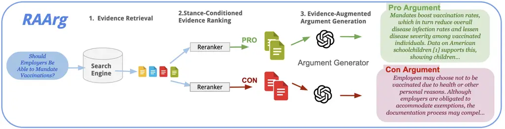
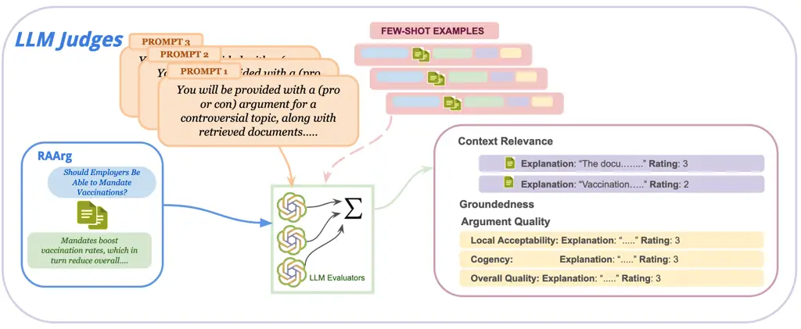
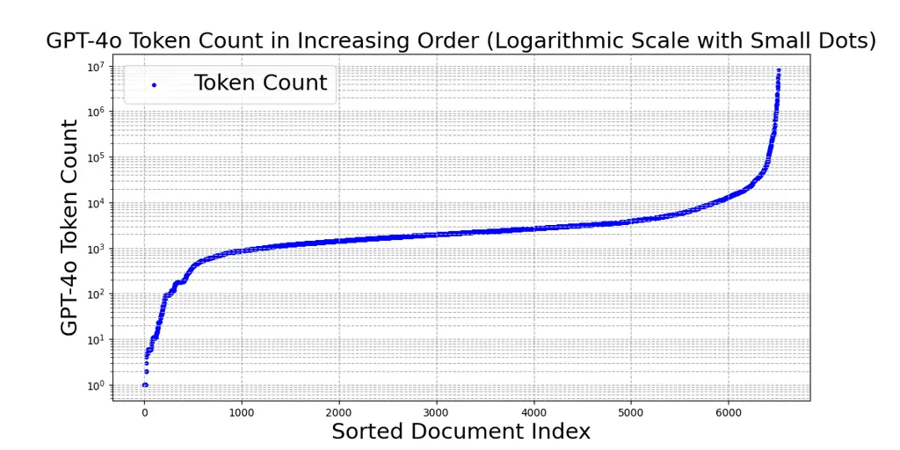
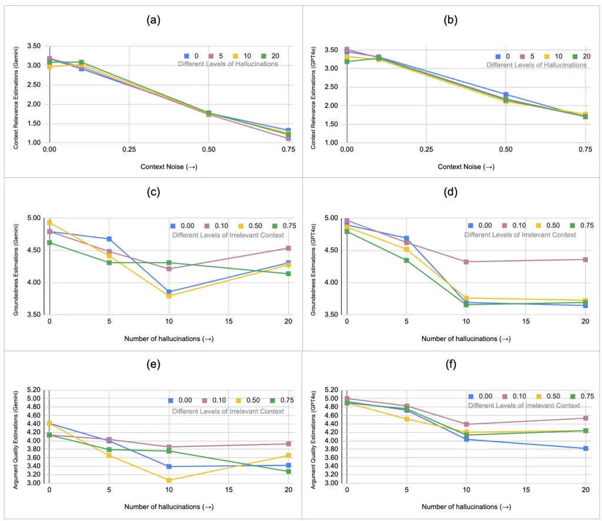

# ConQRet: Benchmarking Fine-Grained Evaluation of Retrieval Augmented Argumentation with LLM Judges

Kaustubh D. Dhole Affiliation: Department of Computer Science    Kai Shu
Affiliation: Emory University, Atlanta USA    Eugene Agichtein
Affiliation: [{kaustubh.dhole, kai.shu,
eugene.agichtein}@emory.edu](mailto:%5C%7Bkaustubh.dhole,%20kai.shu,%20eugene.agichtein%5C%7D@emory.edu)

###### Abstract

Computational argumentation, which involves generating answers or
summaries for controversial topics like abortion bans and vaccination,
has become increasingly important in today’s polarized environment.
Sophisticated LLM capabilities offer the potential to provide nuanced,
evidence-based answers to such questions through Retrieval-Augmented
Argumentation (RAArg), leveraging real-world evidence for high-quality,
grounded arguments. However, evaluating RAArg remains challenging, as
human evaluation is costly and difficult for complex, lengthy answers on
complicated topics. At the same time, re-using existing argumentation
datasets is no longer sufficient, as they lack long, complex arguments
and realistic evidence from potentially misleading sources, limiting
holistic evaluation of retrieval effectiveness and argument quality. To
address these gaps, we investigate automated evaluation methods using
multiple fine-grained LLM judges, providing better and more
interpretable assessments than traditional single-score metrics and even
previously reported human crowdsourcing. To validate the proposed
techniques, we introduce ConQRet, a new benchmark featuring long and
complex human-authored arguments on debated topics, grounded
in real-world websites, allowing an exhaustive evaluation across
retrieval effectiveness, argument quality, and groundedness. We validate
our LLM Judges on a prior dataset and the new ConQRet benchmark. Our
proposed LLM Judges and the ConQRet benchmark can enable rapid progress
in computational argumentation and can be naturally extended to other
complex retrieval-augmented generation tasks.

## 1 Introduction

(a) A high level overview of the task of Retrieval Augmented
Argumentation (RAArg) generating pro and con arguments conditioned on
retrieved (and reranked) evidence for a given controversial topic on
“vaccination”.

(b) LLM Judges for computing fine-grained RAArg metrics to evaluate the
retrieved (and reranked) evidence and the generated argument for a
controversial topic (shown for the pro stance).

Figure 1: Retrieval Augmented Argumentation (RAArg) and LLM Judges used
for evaluation of RAArg.

Computational argumentation Wachsmuth et al. (2017b); El Baff et al.
(2019), or generating arguments for controversial topics—such as debates
over banning abortion or the legalization of marijuana—inherently
involve sensitive discussions and diverse opinions on the appropriate
course of action. Well-informed argumentation requires retrieving
publicly available sources of knowledge, such as blogs and news
articles, which are often lengthy and noisy, and using them to create
well-grounded and persuasive arguments. Large Language Models (LLMs)
employed in a Retrieval Augmented Generation approach are a natural
choice for this task due to their ability to handle large context
lengths and strong performance across various tasks. To emphasize the
importance of retrieved evidence for effective argumentation we call
this task Retrieval Augmented Argumentation, or RAArg, which we
investigate in this paper.

While computational argumentation is a challenging task, even evaluating
RAArg systems is a daunting challenge in itself. The generated arguments
are often long and complex, making human evaluation costly and
time-consuming. Thus, there is an increasing need for automated
evaluation methods that can rigorously assess both the influence of
retrieval involved in argument generation and the overall quality of the
generated arguments, especially when dealing with a diverse set of
controversial topics.

While previous research on automated RAG evaluation has largely focused
on metrics like context relevance, answer relevance, and answer
groundedness, often using LLM-based evaluation methods, also known
as LLM-as-a-Judge TruEra (2024); Saad-Falcon et al. (2024). In contrast,
work in argumentation has concentrated on assessing argument quality
without considering the impact of retrieval El Baff et al. (2019);
Wachsmuth et al. (2018a); Alshomary et al. (2020). Besides, these
evaluations have notable limitations, particularly their reliance on
single-score outputs that lack interpretability and provide minimal
insights into specific performance dimensions like argument cogency,
reasonableness, and performance at the granularity of individual
documents. Additionally, many studies focus on short contexts Salemi and
Zamani (2024), often chunking documents into passage-level contexts,
which can omit essential contextual information. This lack of
generalizability is problematic, especially for tasks like
argumentation, which require evaluation of long, documents from the web,
often unfamiliar to LLMs Jeremy Howard (2024).

Specifically, a successful automated evaluation of an argumentation
system should test the ability to retrieve relevant context and
to generate grounded, and high-quality arguments for a diverse set of
controversial topics. Additionally, the evaluation of the argument must
agree with human preferences and provide cues of irrelevant retrieval
and hallucination, ensuring that the system’s performance is judged on,
both the correctness of its answers and the influence of retrieved
evidence.

To address these challenges, we propose a systematic evaluation of
LLM-based argumentation in a retrieval-augmented setting by validating
multiple fine-grained metrics, which we call LLM Judges, as different
variants of LLM-based evaluation are needed for each of the metrics. The
high level overviews of the task and our LLM Judges are depicted
in Figure 1. Figure 1(a) shows the processing of our RAArg pipeline for
a sample controversial topic and Figure 1(b) shows our proposed
fine-grained LLM Judges being employed to evaluate the retrieved
evidence documents and the generated argument.

[TABLE]

Table 1: Comparison of ConQRet with other argumentation datasets.

Specifically, our contributions are four-fold: (1) first, we demonstrate
the feasibility of using model-based evaluation for the task of
argumentation; (2) we extend our analysis to the retrieval-augmented
setting (RAArg), with evidence retrieved from Web documents; (3) we
introduce a novel benchmark—ConQRet¹¹ 1 ProCon webpage extraction code
and documents will be released
at [https://github.com/emory-irlab/conqret-rag](https://github.com/emory-irlab/conqret-rag)—Controversial
Questions for Argumentation and Retrieval, consisting of human-authored
arguments based on a popular debate portal; and (4) we investigate the
performance of LLM Judges by introducing different types of errors into
the arguments.

To the best of our knowledge, this is the first work that investigates
automated evaluation of retrieval augmented computational argumentation
in a complex and realistic setting.

In the rest of the paper, we first review related work to place our
contributions in context (section 2). Then, section 3 presents a formal
definition of the task of argumentation and a reference implementation
using best RAG practices. section 4 details the construction process of
the ConQRet benchmark. In section 5, we define multiple LLM Judges
through novel and adapted variations of prompts, while section 6
validates them for both a prior argumentation dataset and over ConQRet,
demonstrating the feasibility of automated fine-grained evaluation of
computational argumentation.

## 2 Related Work

We now describe some of the related work in argumentation and LLM
evaluation.

### 2.1 Computational Argumentation

The field of computational argumentation has focused on multiple
problems in modeling the processes of debate and improving
argumentation. Most approaches have attempted to model individual
sub-tasks typically seen in debates like argument retrieval, argument
construction, argument summarization, and counterargument generation.
For instance, Hua et al. (2019) employed a BILSTM encoder-decoder neural
network by retrieving evidence from Wikipedia, and showed improved topic
relevance. Hua and Wang (2018) combined sophisticated retrieval
mechanisms with a two-step generation model, enhancing the quality and
appropriateness of generating counter-arguments. They evaluate their
approaches over a counter-argument generation dataset based on the
ChangeMyView website Tan et al. (2016b). Building on the next utterance
retrieval and generative dialogue systems, Le et al. (2018) employed
LSTMs to debate on controversial topics, showing promise on a corpus
from the Convinceme website, an informal debating portal.
Further, El Baff et al. (2019) select, arrange, and phrase Argument
Discourse Units to synthesize arguments through pathos (emotional) and
logos (logical) strategies for a dataset of 260 arguments and 10 debate
topics Wachsmuth et al. (2018a).  Wachsmuth et al. (2018b) focus on
retrieving potent counterarguments without prior topic knowledge,
achieving significant accuracy through a model that evaluates argument
similarities and differences. Lastly, Alshomary et al. (2020) performed
extracted snippets that more accurately represent the core reasoning of
arguments collecting 73 arguments over 10 topics. These datasets have
been summarised in Table 1.

### 2.2 LLMs for Argumentation

In recent years, large language models (LLMs) have made significant
progress across a variety of language tasks Srivastava et al. (2023),
demonstrating particular promise in generating discourse-level text,
which had previously been more challenging to model. Consequently, LLMs
have also been employed to improve debate and argumentation Khan et al.
(2024); Alshomary and Wachsmuth (2023). Li et al. (2023) create a
manually annotated corpus of \<topic, argument, counter-argument\>
triplets and then instruct tune a Llama-7B Touvron et al. (2023) model
to generate counterargument sentences. Verma et al. (2024) evaluate
LLMs’ argument generation ability to incorporate style and external
evidence from an automatically generated retrieval corpus. Mirzakhmedova
et al. (2024) perform a fine-grained evaluation of arguments
from Wachsmuth et al. (2017a) in a pointwise fashion, by probing 15
argumentation metrics.

In a nutshell, most of the approaches that focussed on both argument
retrieval and argument generation were generally evaluated on informal
debate corpora and generally lacked grounding over human-annotated
evidence.

### 2.3 LLM-based Evaluation of RAG Systems

Prior work on automated evaluations of RAG systems, particularly in
multi-hop QA, has primarily focused on metrics like context relevance,
answer relevance, answer groundedness TruEra (2024). However, these
metrics fall short when applied to tasks like argumentation, which
require longer contexts and more detailed answers. In argumentation over
controversial topics, the effects of irrelevant context and
hallucinations are more pronounced, making evaluation crucial. Moreover,
it is unclear if current evaluators can handle partial amounts of
irrelevant context or provide actionable feedback. Moreover, the
traditional reliance on single-score outputs Es et al. (2024);
Saad-Falcon et al. (2024) designed for short answers limits
interpretability and usefulness in longer, more complex contexts such as
arguments. This highlights the need for specialized evaluation methods
that can better address the unique challenges of argumentation.

## 3 Retrieval Augmented Argumentation

In this section, we formally describe the task of retrieval augmented
argumentation, or RAArg, and describe our reference implementation using
state-of-the-art models and best practices.

### 3.1 Task

Given a controversial topic $`q`$ and a stance $`s`$, computational
argumentation involves generating a stance-conditioned argument
$`A_{s}`$ with or without the retrieval of relevant evidence documents
$`D_{s}`$.

#### 3.1.1 Evidence Retrieval

The first subtask, evidence retrieval, involves identifying relevant
evidence documents $`D_{s}`$ to substantiate or refute the stance $`s`$
on a given topic $`q`$.

#### 3.1.2 Argument Generation

The second subtask, argument generation, focuses on using the retrieved
documents to construct coherent and persuasive arguments, $`A_{s}`$.
This step requires the synthesis of the extracted evidence and ensuring
that the arguments maintain logical consistency and are effectively
communicated to address the controversial topic $`q`$.

### 3.2 Reference RAArg Implementation

Our reference implementation follows the retrieve-and-read
paradigm Lewis et al. (2020); Izacard and Grave (2021), where a
retrieval system’s top-ranked documents are input to a subsequent
generator. Our RAArg system consists of: i) a 2-stage stance-conditioned
evidence retriever and ii) a structured argument generator. Both
components are evaluated with multiple strategies. Note that RAArg is
solely a reference implementation of a RAG system, designed to follow
current best practices for retrieval and generation. Our aim is not to
present a novel RAG system; rather, to implement a reasonable reference
system following current best practices. Future work could explore more
sophisticated retrieval and generation approaches.

For obtaining evidence relevant to the topic, we first retrieve
the top-k relevant evidence documents $`D_{s}`$ for a given
controversial topic $`q`$ and stance $`s\in\{pro,con\}`$ using the
following ranking methodology.

#### 3.2.1 BM25 + LLM Reranking

Specifically, we first employ a two-stage BM25+Listwise Reranking
paradigm popularised in studies like RankGPT Sun et al. (2023) and
RankVicuna Pradeep et al. (2023). This paradigm has shown SoTA results
on a range of ranking tasks Thakur et al. (2021). We use the name of the
controversial topic as the query and index all documents with
PyTerrier Macdonald et al. (2021). For LLM reranking, we use
the Pyterrier_GenRank Dhole (2024) plugin with GPT-4o-mini OpenAI (2024)
as our reranker. We use two types of instructions–generic Sun et al.
(2023) and stance-specific–along with a query and a list of documents,
to generate a ranked list of document IDs for reranking. Other evidence
retrieval and reranking methods could be investigated in the future, but
as we will show this version performs adequately to enable generation of
human-quality arguments.

#### 3.2.2 Few-Shot Argument Generation

We employ GPT-4o-mini in a few-shot fashion, using the prompt reported
in Appendix Table 10. For in-context examples, we select three
controversial topics from the training set, along with their documents
and corresponding expert-written arguments. Our choice of GPT-4o-mini is
based on its SoTA performance across various tasks, its ability to
handle contexts up to 128K tokens, and its affordable pricing. We prompt
the model to generate a structured argument that consists of a set of
conclusions, each followed by premises that justify the conclusion.

Due to limitations of the (large) context size of popular LLMs, it is
advantageous to prioritize documents that support the expected stance,
as these are likely to produce a favorable argument. While RankGPT’s
instructions are useful, they remain generic and do not differentiate
between documents supporting or opposing the stance. In contrast, we
introduce stance-specific instructions during reranking, as illustrated
in Appendix Table 9, enabling the generation of arguments tailored to
each specific stance.

Furthermore, web documents could range in length from a few hundred
tokens to as many as 100K tokens. Therefore, a context of 10 documents
concatenated along with 3-few shot examples could exceed the (current)
128K token limit. In such cases, instead of trimming the documents only
from the end, which could potentially exclude entire documents, we
proportionally trim an equal portion from each document to minimize the
possibility of removing a document in its entirety.

## 4 The ConQRet Benchmark

In order to enable research on complex, evidence-based argumentation, we
develop and present a novel benchmark, ConQRet. The benchmark is
constructed from a popular website of expert-generated arguments, which
we further augment by retrieving the actual sources selected by the
experts to be used as the ground truth evidence for retrieval augmented
argument argumentation. The details of the dataset construction follow.

### 4.1 Web Scraping of ProCon.Org Pages

We use ProCon.org, a debate portal featuring controversial questions
with human-written pro and con arguments grounded in sources like
journals and news outlets. Each argument includes paragraphs linked to
external websites. We scrape these to gather grounded arguments on
various topics, with details provided in appendix A.

### 4.2 Retrieving Evidence Text from the Web

Of the 7,177 sources cited on ProCon webpages, 6,514 (92%) were
successfully identified and extracted using Google or Bing. The
remaining sources were either behind firewalls or required specialized
parsing techniques, detailed in appendix B. Most source documents fall
between a few hundred and 10,000 tokens, while the remainder are in the
long tail, as illustrated by the document length distribution
in Figure 2.

### 4.3 Construction of Query-Relevance Pairs

To enable evidence retrieval evaluation, we construct query-document
relevance pairs as follows:

1.  1.  Relevant Documents: We use the scraped texts of each webpage
        mentioned in the sources section of each topic to create pairs of
        queries and relevant documents.
2.  2.  Irrelevant Documents: To create irrelevant (query, document) pairs,
        we randomly pick an equal number of documents from other queries.

The pairs are split topicwise into two—70% for train and 30% for
evaluation. Both sets do not have any topic or document overlaps shown
in Table 2. This provides us with a set of 6.5k documents, and 98
topics.

| Statistic                    | Train | Test |
| ---------------------------- | ----- | ---- |
| Total topics                 | 68    | 30   |
| Avg. docs per topic          | 69    | 64   |
| Avg. relevant docs per topic | 34    | 32   |
| Avg. docs per stance         | 17    | 16   |
| Total evidence Documents     | 6,500 |      |

Table 2: Summary of ConQRet dataset statistics.

Figure 2: Evidence Document Length Distribution. Most of the documents
have 100 to around 10k tokens.

[TABLE]

Table 3: The different LLM-Judge prompts used to compute context
relevance, groundedness, or preference against an expert written
argument. The first four prompt variations use a separate prompt for
each of the three metrics while the RAG-\* variations are tasked to
generate all the 3 evaluations through a single prompt.

## 5 Experiments and Analysis

In this section, we describe the various LLM Judges used in our
analysis. We first evaluate our LLM Judges in the non-RAG setting and
then extend the evaluation to address the RAG counterpart.

Datasets: We utilize two datasets for our analysis—the ArgQuality
Corpus Wachsmuth et al. (2017a) and ConQRet (Our new RAArgdataset
introduced in Section 4). The ArgQuality corpus contains 320 arguments,
each annotated by experts across 15 quality dimensions using a 3-point
Likert scale (low, medium, high).

### 5.1 Fine-Grained Argument Quality Evaluation

We now describe how we validate our LLM Judges for argument quality
against fine-grained human annotations.

We assess argument quality through the 15 fine-grained dimensions
proposed by Wachsmuth et al. (2017b). Specifically, we introduce
a Listwise evaluation prompt (Appendix Table 11), which presents the
detailed definitions of these dimensions within a single inference call.
These definitions, originally provided to argument expert annotators
by Wachsmuth et al. (2017b), are included along with the argument to be
evaluated.

The Listwise approach requires a single inference call and a reduced
number of tokens compared to a pointwise approach, which would require
15 separate prompts–one for each dimension–resulting in a substantially
higher token count. Due to the known lack of robustness of LLMs Liu
et al. (2024); Dhole et al. (2023), we also explore the effect of
varying the temperature and altering the order of the 15 dimensions in
the prompt. Additionally, we employ a self-consistency Wang et al.
(2023) style listwise prompt (Listwise+SC) and compute the mean across
three different orders. Our evaluations are compared against pointwise
methods outlined in Mirzakhmedova et al. (2024) and human crowd ratings
from Wachsmuth et al. (2017b).

For both datasets, expert annotator ratings are used, and the agreement
between the model’s predictions and the expert ratings is quantified
using Krippendorff’s $`\alpha`$ Krippendorff (2011).

### 5.2 RAG Evaluation

| QRELS   | Ranker                             | P@10     | NDCG@10  |
| ------- | ---------------------------------- | -------- | -------- |
| PRO     | BM25                               | .186     | .213     |
|         | BM25 + General Instruction         | .248^(α) | .312^(α) |
|         | BM25 + Pro Conditioned Instruction | .331^(α) | .434^(α) |
| CON     | BM25                               | .245     | .262     |
|         | BM25 + General Instruction         | .293^(α) | .29      |
|         | BM25 + Con Conditioned Instruction | .286     | .281     |
| PRO+CON | BM25                               | .431     | .452     |
|         | BM25 + Pro Conditioned Instruction | .538^(α) | .579^(α) |
|         | BM25 + Con Conditioned Instruction | .541^(α) | .582^(α) |

Table 4: Performance of Different Methods for Pro and Con Evidence
Retrieval. The first column depicts which (query, document) relevance
pairs were considered relevant for evaluation. $`\alpha`$ denotes
significant improvements (paired t-test with Holm-Bonferroni
correction Holm (1979), p \< .05)

To comprehensively evaluate an argumentation system, it is essential to
assess the quality of the final argument as well as the effect of
retrieval. Particularly, we evaluate the following two metrics:

1.  1.  Context Relevance—How relevant are the evidence documents to the
        controversial topic?
2.  2.  Argument Groundedness—How grounded are the generated arguments in
        the retrieved evidence?

#### 5.2.1 Context Relevance: Traditional Eval

To measure context relevance, we first use the human-annotated evidence
in the form of qrels or (query, document) pairs to compute traditional
IR metrics, viz., nDCG@k Järvelin and Kekäläinen (2002) and P@k
for ConQRet. The results for the different retrievers are shown
in Table 4.

In order to validate our LLM Judges, we resort to using these QRELS,
similar to many automatic relevance labeling studies Rahmani et al.
(2024b); MacAvaney and Soldaini (2023); Rahmani et al. (2024a).

We now describe our LLM Judges in the following subsection.

#### 5.2.2 Context Relevance: LLM Judges

We introduce multiple LLM Judges for evaluating context relevance to
simulate the more realistic setting when relevance annotations are
unavailable. We particularly introduce different prompt variations,
which take the topic $`q`$, documents $`D`$, and argument $`A`$ as
inputs and generate context relevance scores along with argument
groundedness and argument quality.

The different prompts are described below:

[TABLE]

Table 5: Inter-annotator agreement (Krippendorff’s $`\alpha`$) between
human experts and LLM annotations for each fine-grained argument quality
dimension over ArgQuality benchmark Wachsmuth et al. (2017a). $`\alpha`$
– Average Quality is computed by averaging the first 14 dimensions. SC –
Self-Consistency.

- •
  Listwise+RAG: Here, we instruct the model to generate other
  retrieval-based metrics, viz., argument groundedness and context
  relevance along with the argument quality. The context relevance is
  computed for a concatenation of all documents.
- •
  Listwise+RAG Fine-Grained: This is the fine-grained counterpart of
  the Listwise+RAG metric where the context relevance is computed at the
  granularity of each document. The corresponding prompt is shown
  in Figure 11.
- •
  Others: In addition to the above, we also explore other formats of
  prompts to compute context relevance. They are described in Tables 3
  and D.

We use GPT-4o OpenAI (2024) for performing the evaluations due to its
SoTA performance for other tasks for longer contexts. We also analyze
other models viz., phi-3-small/medium-128k-instruct-4 (7B/14B
params) Abdin et al. (2024), which can ingest large contexts and find
that they are unable to understand the intent of evaluation often
generating related but undesirable content missing values or unformatted
JSON. We find that GPT-4o-mini OpenAI (2024), Llama-3.1-70B Dubey et al.
(2024) and Gemini-1.5-Flash Reid et al. (2024) are among the ones which
show the necessary sensitivity to irrelevant context. Additional details
on the varying levels of irrelevant context across different LLM Judges
and models are provided in the Appendix Table 17.

## 6 Results and Analysis

We now present the results of each of the above evaluations on both the
datasets.

### 6.1 Fine-Grained Argument Quality Evaluation

We present the results of the agreement between human experts and
various LLM judges in Table 5. We find that when we employ a listwise
approach with GPT3.5, we obtain better overall quality than a previous
pointwise implementation Mirzakhmedova et al. (2024), and employing a
listwise approach with self-consistency further improves overall quality
as well as most of the individual dimensions. We obtain further
improvements when we employ GPT-4o in the listwise setting.

Specifically, our listwise LLM-judge exhibits the highest agreement with
expert annotators for both overall argument quality and across various
argumentation dimensions, even compared to human crowd workers.
Furthermore, the overall agreement is aligned with the average across
the different dimensions, indicating consistency and alignment of the
overall quality annotation with the intrinsic dimensions of argument
quality. Our listwise LLM Judge is able to achieve overall quality
agreement on par with humans and better than the pointwise setting
employed with Palm2 Anil et al. (2023) and GPT3.5 Mirzakhmedova et al.
(2024). Self-consistency (SC) further improves the overall quality as
well as the average quality. Our Listwise + SC is also better
than Mirzakhmedova et al. (2024)’s “novice” prompt variation for 3 out
of 4 dimensions.

Further, we investigate if there is variation in argument quality
prediction when we change the order of the 15 dimensions. We find that
there is substantial variability when the order of the dimensions is
changed. We show in Appendix Table 13 (a)-(c) how the results of three
different runs change. We hence use a combined mean rating for each
dimension, and see that there is high agreement in both the overall
quality and the average quality, only at the expense of 2 additional
inference calls. We also find prompting in a zero-shot fashion is more
effective as compared to few-shot (Detailed results are shown in
Appendix Table 13 and Table 14).

| Preferences            | No RAG | + RAG | + RAG Fine-Grained |
| ---------------------- | ------ | ----- | ------------------ |
| Listwise GPT-4o        | .184   | .395  |  .428              |
| Listwise+SC (Mean)     | .317   | .439  |  .445              |
| Listwise+SC (Majority) | .335   | .428  |  .461              |

Table 6: Inter-annotator agreement (Krippendorff’s $`\alpha`$) between
human annotators and individual LLM annotators for argument quality
metric over ConQRet.

For our dataset ConQRet, we present the results of the human agreement
with three prompting strategies in Table 6. We find that when the LLM
Judges are prompted to generate the individual RAG metrics before
providing judging argument quality, they demonstrate better argument
quality prediction. Additionally, employing the RAG metrics in a
fine-grained fashion to obtain document-level scores further improves
argument quality prediction. This demonstrates the benefit of
retrieval-based metrics like context relevance and groundedness in
helping provide better estimates of argument quality. Further details
are mentioned in appendix C. We also show a sample generation and its
evaluation in Appendix Figure 5.

[TABLE]

Table 7: Comparing the True Precision with the Precision of the
Listwise+RAG Fine-Grained Approach. Values in brackets indicate absolute
errors.

### 6.2 How close are context relevance predictions to Human Annotated Qrels?

To validate how well our best LLM-Judge viz. Listwise + RAG Fine-Grained
predict context relevance, we compare its precision at different levels
of irrelevant content with the true precision, obtained through human
annotated qrels. We evaluate how sensitive are context relevance
predictions across different levels of irrelevant context. We
specifically evaluate the context relevance by replacing some percentage
of the retrieved documents with random irrelevant documents. We measure
for no (0%), low (10%, 20%), and high (50%, 70%) amounts of irrelevant
content.

First, we compare it with the most popular approach of computing context
relevance directly i.e. the direct metric TruEra (2024). As we see
in Table 7, the Direct metric does not strictly decrease with increasing
levels of irrelevant context lacking the necessary context sensitivity.
However, our Listwise+RAG Fine-grained approach decreases gradually with
increasing irrelevant context. Besides, our fine-grained approach
provides precision estimates close to the True Precision. Also note that
the Direct metric does not provide precision estimates at the
granularity of individual documents, unlike the Listwise+RAG
Fine-grained approach.

We also find that most fine-grained metrics, as shown in
Appendix Tables 16 and 17 show better degradation with increasing
irrelevant context than single-score metrics. Appendix Figure 13
and Table 16 show the results when evaluated with GPT-4o. We find that
while most metrics decrease with increasing irrelevant context, the
decrease is not fully monotonic. The RAG-Direct and RAG-Rubric metrics
display a near-perfect monotonic decrease (Pearson $`\rho\approx`$ -1),
while the direct metric assigns the same context relevance score to 10%
and 50% of irrelevant content. This trend is consistent across arguments
of both stances. This demonstrates that single score metrics are less
useful in practice vis-à-vis fine-grained metrics, like Listwise+RAG
Fine-grained which are consistently sensitive to irrelevant context as
well as interpretable.

### 6.3 Do argument groundedness predictions reflect the number of hallucinations appearing in the argument?

“Despite at least six deaths from the laundry pod challenge, TikTok
persists in promoting dangerous challenges from daring people to shave
down their teeth with nail files has not seen any fatalities from its
challenges, and the platform actively promotes safe practices among
users…\[1\]”

Figure 3: Hallucinated sentences (in purple) inserted into the argument
by converting grounded sentences into sentences contradictory to the
grounded evidence

In the context of controversial topics, hallucination becomes
increasingly significant. When assessing argumentation, it is essential
to evaluate to what extent LLM judges are reliable for identifying
hallucinated content in their argument.

Figure 4: Metric consistency analysis for gemini-1.5-flash (left) and
GPT-4o (right): Comparing the influence of both – increasing irrelevant
content and increasing hallucinations – to see their effects on the 3
metrics.

To simulate varying levels of hallucinations, we start with
expert-written arguments paired with their corresponding documents
from ConQRet, then select a random subset of sentences from the original
argument for modification. These selected sentences are replaced with
hallucinated sentences, resulting in a modified argument as shown
in Figure 3. We anticipate that an effective metric will show a gradual
reduction in its score as the proportion of modified sentences
increases. To generate the hallucinations, we prompt GPT-4o with the
original argument and the original documents, and instruct the model to
replace already grounded sentences by generating sentences which are
contradictory to the original sentence as well as the content appearing
in the document. We generate such modified arguments by modifying 5, and
20 sentences. The complete prompt is shown in Appendix Figure 12. We
find that all metrics are effective in displaying explainable
differences across varying levels of groundedness. The results of the
same are shown in Appendix Table 18.

### 6.4 Metric Consistency Analysis

As our Listwise+RAG Fine-Grained LLM Judge generates multiple metrics,
it is also imperative to understand how they affect each other. For
instance, does irrelevant context affect the evaluation of groundedness
and argument quality?

To measure the same, we increase the levels of both—irrelevant context
(0%, 10%, 50%, 75%) and hallucinated sentences (0, 5, 20)²² 2 To account
for varying argument lengths, we specify the hallucinated content in
terms of 0, 5, and 20 sentences which correspond to 0%, 16%, and 63% of
an average 32-sentence argument.–systematically and evaluate the effects
of our metrics using gemini-1.5-flash and GPT-4o as our evaluators. We
present the results in Figure 4.

We find that across these coarse-grained levels of hallucinated
infusions, context relevance scores and their monotonic degradations
remain unaffected (Figure 4 (a) and (b)). Moreover, at varying
coarse-grained levels of irrelevant context, the groundedness scores and
argument quality decrease monotonically with increasing hallucinated
content. When we further add more fine-grained levels of hallucinations
namely (2, 10), we find that context relevance scores are not strongly
informative. The scores decrease with increased levels of injected
irrelevant context. However, they are unable to distinguish fine-grained
levels of irrelevant context. GPT-4o seems more reliable than Gemini for
groundedness estimation.

Argument quality estimations follow a decreasing trend at some levels of
irrelevant context. GPT-4o argument evaluations are more resistant to
context than Gemini. For a low number of hallucinations, argument
quality evaluations are more reliable.

In summary, through our metrics, we observe that LLMs can be reliably
used for estimating context relevance. However, prompt-based LLM Judges
are not able to reliably evaluate argument groundedness and overall
quality. For all metrics, LLM judges are not able to distinguish
reliably between finer levels of non-relevant evidence or hallucinated
arguments.

These results have important implications for argumentation as well as
language modeling methods relying on LLMs for eliciting pseudo-human
preferences, or employing them as teachers for subsequent distillation,
as our methods reveal several shortcomings.

## 7 Conclusions and Future Work

Human annotation of complex arguments and corresponding evidence
requires extensive knowledge of the topics, and copious amounts of
reading of evidence for each argument, making fine-grained annotations
infeasible at scale. This paper introduces an automatic evaluation
procedure and provides its validation without the need for large-scale
scale human-annotation. We propose the first study on using model-based
evaluation for retrieval-augmented argumentation systems. This problem
is more important as long documents and complex arguments are involved
over controversial topics. We demonstrate how argumentation can be
effectively evaluated over two datasets, showing that our proposed LLM
judges are more efficient, interpretable, and align strongly with human
evaluations. Additionally, we introduce a novel benchmark ConQRet
designed to evaluate both retrievers as well as RAG systems in scenarios
that closely resemble real-world contexts, characterized by long
documents. Our contribution also includes the proposal of new and
modified metrics through LLM judges for measuring context relevance and
answer groundedness, and we describe methods to validate these metrics
without requiring large-scale annotation. We find that larger models
exhibit necessary degradation on fine-grained metrics, in contrast to
popularly employed metrics that provide single, often uninterpretable,
scores.

Our work has several crucial applications. Our LLM judges, in addition
to demonstrating high agreement with human evaluations, also showed the
capability to compute multiple metrics in a single inference call. This
encourages research on a holistic evaluation of retrieval-augmented
systems, allowing metrics to complement and inform each other during the
evaluation process. Furthermore, these fine-grained metrics are
promising, as they offer multiple cues to improve the training and
alignment of LLMs, ultimately leading to more accurate and reliable
systems.

## 8 Limitations

Our study does have some limitations, primarily related to the choice of
models used for evaluation, namely GPT-4o, GPT-4o-mini, LLaMA-3.2-70B,
and Gemini-1.5-Flash. While these models are SoTA in most aspects,
additional models might provide more comprehensive performance insights.
However, the selected models are highly representative of current
capabilities in language models, and the findings hence offer valuable
perspectives. Challenges such as the quadratic growth in memory
requirements with increasing context lengths and occasional difficulties
in handling specific instructions with large contexts in LLaMA-3.1 did
arise, but these issues are inherent to many models and do not detract
from the overall results.

## 9 Ethical Considerations

Controversial topics often involve complex disagreements on political,
financial, or life-threatening issues and hence any computational
argumentation system, built with LLMs should be treated as a part of a
broader socio-technical context, where LLMs act as subsystems Dhole
(2023). Moreover, these systems, functioning as black boxes, camouflage
the relationship between their outputs and the extensive pre-training
data they are based on, making it hard to deduce the rationale for an
argument or an evaluation score with high certainty.

On the other hand, LLMs have demonstrated biases across political
spectrums and exhibit disparities in fairness across different languages
and cultures, rendering them unsuitable for making impartial decisions
on sensitive matters. Furthermore, when deployed in real-world
applications, these systems are vulnerable to adversarial exploitation.
For instance, adversaries may inject irrelevant content into retrieval
processes or prompt the models to generate biased or misleading
arguments that unfairly favor specific positions, often without proper
attribution.

Our work highlights the susceptibility of LLM-based evaluations,
emphasizing both their robustness and sensitivity. This underscores the
critical need for robust evaluation frameworks that can assess argument
quality while detecting shifts in context to ensure fairness.
Additionally, LLM judges may themselves exhibit biases towards
particular arguments. For this reason, we advocate for fine-grained,
interpretative evaluations, which we believe will prove relatively more
effective in practice than traditional single-score metrics. Our
research is intended to encourage effort in that direction.

## Acknowledgements

This material is based upon work supported by the U.S. Department of
Homeland Security under Grant Award Number 17STQAC00001-07-04, NSF
awards (SaTC-2241068, IIS-2339198), a Cisco Research Award, and a
Microsoft Accelerate Foundation Models Research Award. The views and
conclusions in this document are those of the authors and should not be
interpreted as necessarily representing the official policies, either
expressed or implied, of the U.S. Department of Homeland Security or the
National Science Foundation.

## References

- Abdin et al. (2024) Marah Abdin, Sam Ade Jacobs, Ammar Ahmad Awan,
  Jyoti Aneja, Ahmed Awadallah, Hany Awadalla, Nguyen Bach, Amit Bahree,
  Arash Bakhtiari, Harkirat Behl, et al. 2024. Phi-3 technical report: A
  highly capable language model locally on your phone. _arXiv preprint
  arXiv:2404.14219_.
- Alshomary et al. (2020) Milad Alshomary, Nick Düsterhus, and Henning
  Wachsmuth. 2020. Extractive snippet generation for arguments. In
  _Proceedings of the 43rd International ACM SIGIR Conference on
  Research and Development in Information Retrieval_, pages 1969–1972.
- Alshomary and Wachsmuth (2023) Milad Alshomary and Henning
  Wachsmuth. 2023. [Conclusion-based counter-argument
  generation](https://doi.org/10.18653/v1/2023.eacl-main.67). In
  _Proceedings of the 17th Conference of the European Chapter of the
  Association for Computational Linguistics_, pages 957–967, Dubrovnik,
  Croatia. Association for Computational Linguistics.
- Anil et al. (2023) Rohan Anil, Andrew M Dai, Orhan Firat, Melvin
  Johnson, Dmitry Lepikhin, Alexandre Passos, Siamak Shakeri, Emanuel
  Taropa, Paige Bailey, Zhifeng Chen, et al. 2023. Palm 2 technical
  report. _arXiv preprint arXiv:2305.10403_.
- Bondarenko et al. (2020) Alexander Bondarenko, Maik Fröbe, Meriem
  Beloucif, Lukas Gienapp, Yamen Ajjour, Alexander Panchenko, Chris
  Biemann, Benno Stein, Henning Wachsmuth, Martin Potthast, et al. 2020.
  Overview of touché 2020: argument retrieval. In _Experimental IR Meets
  Multilinguality, Multimodality, and Interaction: 11th International
  Conference of the CLEF Association, CLEF 2020, Thessaloniki, Greece,
  September 22–25, 2020, Proceedings 11_, pages 384–395. Springer.
- Chang et al. (2024) Tyler A. Chang, Katrin Tomanek, Jessica Hoffmann,
  Nithum Thain, Erin MacMurray van Liemt, Kathleen Meier-Hellstern, and
  Lucas Dixon. 2024. [Detecting hallucination and coverage errors in
  retrieval augmented generation for controversial
  topics](https://aclanthology.org/2024.lrec-main.423). In _Proceedings
  of the 2024 Joint International Conference on Computational
  Linguistics, Language Resources and Evaluation (LREC-COLING 2024)_,
  pages 4729–4743, Torino, Italia. ELRA and ICCL.
- Dhole (2023) Kaustubh Dhole. 2023. [Large language models as
  SocioTechnical
  systems](https://doi.org/10.18653/v1/2023.bigpicture-1.6). In
  _Proceedings of the Big Picture Workshop_, pages 66–79, Singapore.
  Association for Computational Linguistics.
- Dhole (2024) Kaustubh Dhole. 2024. [PyTerrier-GenRank: The PyTerrier
  Plugin for Reranking with Large Language
  Models](https://github.com/emory-irlab/pyterrier_genrank).
- Dhole et al. (2023) Kaustubh Dhole, Varun Gangal, Sebastian Gehrmann,
  Aadesh Gupta, Zhenhao Li, Saad Mahamood, Abinaya Mahadiran, Simon
  Mille, Ashish Shrivastava, Samson Tan, Tongshang Wu, Jascha
  Sohl-Dickstein, Jinho Choi, Eduard Hovy, Ondřej Dušek, Sebastian
  Ruder, Sajant Anand, Nagender Aneja, Rabin Banjade, Lisa Barthe, Hanna
  Behnke, Ian Berlot-Attwell, Connor Boyle, Caroline Brun, Marco
  Antonio Sobrevilla Cabezudo, Samuel Cahyawijaya, Emile Chapuis,
  Wanxiang Che, Mukund Choudhary, Christian Clauss, Pierre Colombo,
  Filip Cornell, Gautier Dagan, Mayukh Das, Tanay Dixit, Thomas
  Dopierre, Paul-Alexis Dray, Suchitra Dubey, Tatiana Ekeinhor, Marco Di
  Giovanni, Tanya Goyal, Rishabh Gupta, Louanes Hamla, Sang Han, Fabrice
  Harel-Canada, Antoine Honoré, Ishan Jindal, Przemysław Joniak, Denis
  Kleyko, Venelin Kovatchev, Kalpesh Krishna, Ashutosh Kumar, Stefan
  Langer, Seungjae Ryan Lee, Corey James Levinson, Hualou Liang, Kaizhao
  Liang, Zhexiong Liu, Andrey Lukyanenko, Vukosi Marivate, Gerard
  de Melo, Simon Meoni, Maxine Meyer, Afnan Mir, Nafise Sadat Moosavi,
  Niklas Meunnighoff, Timothy Sum Hon Mun, Kenton Murray, Marcin Namysl,
  Maria Obedkova, Priti Oli, Nivranshu Pasricha, Jan Pfister, Richard
  Plant, Vinay Prabhu, Vasile Pais, Libo Qin, Shahab Raji, Pawan Kumar
  Rajpoot, Vikas Raunak, Roy Rinberg, Nicholas Roberts, Juan Diego
  Rodriguez, Claude Roux, Vasconcellos Samus, Ananya Sai, Robin Schmidt,
  Thomas Scialom, Tshephisho Sefara, Saqib Shamsi, Xudong Shen, Yiwen
  Shi, Haoyue Shi, Anna Shvets, Nick Siegel, Damien Sileo, Jamie Simon,
  Chandan Singh, Roman Sitelew, Priyank Soni, Taylor Sorensen, William
  Soto, Aman Srivastava, Aditya Srivatsa, Tony Sun, Mukund Varma,
  A Tabassum, Fiona Tan, Ryan Teehan, Mo Tiwari, Marie Tolkiehn, Athena
  Wang, Zijian Wang, Zijie Wang, Gloria Wang, Fuxuan Wei, Bryan Wilie,
  Genta Indra Winata, Xinyu Wu, Witold Wydmanski, Tianbao Xie, Usama
  Yaseen, Michael Yee, Jing Zhang, and Yue Zhang. 2023. [NL-augmenter: A
  framework for task-sensitive natural language
  augmentation](https://doi.org/https://doi.org/10.3384/nejlt.2000-1533.2023.4725).
  In _Northern European Journal of Language Technology, Volume 9_,
  Linköping, Sweden. Linköping University Electronic Press.
- Dubey et al. (2024) Abhimanyu Dubey, Abhinav Jauhri, Abhinav Pandey,
  Abhishek Kadian, Ahmad Al-Dahle, Aiesha Letman, Akhil Mathur, Alan
  Schelten, Amy Yang, Angela Fan, et al. 2024. The llama 3 herd of
  models. _arXiv preprint arXiv:2407.21783_.
- El Baff et al. (2019) Roxanne El Baff, Henning Wachsmuth, Khalid
  Al Khatib, Manfred Stede, and Benno Stein. 2019. [Computational
  argumentation synthesis as a language modeling
  task](https://doi.org/10.18653/v1/W19-8607). In _Proceedings of the
  12th International Conference on Natural Language Generation_, pages
  54–64, Tokyo, Japan. Association for Computational Linguistics.
- Es et al. (2024) Shahul Es, Jithin James, Luis Espinosa Anke, and
  Steven Schockaert. 2024. [RAGAs: Automated evaluation of retrieval
  augmented generation](https://aclanthology.org/2024.eacl-demo.16). In
  _Proceedings of the 18th Conference of the European Chapter of the
  Association for Computational Linguistics: System Demonstrations_,
  pages 150–158, St. Julians, Malta. Association for Computational
  Linguistics.
- Farzi and Dietz (2024) Naghmeh Farzi and Laura Dietz. 2024. Pencils
  down! automatic rubric-based evaluation of retrieve/generate systems.
  In _Proceedings of the 2024 ACM SIGIR International Conference on
  Theory of Information Retrieval_, pages 175–184.
- Habernal and Gurevych (2016) Ivan Habernal and Iryna Gurevych. 2016.
  [Which argument is more convincing? analyzing and predicting
  convincingness of web arguments using bidirectional
  LSTM](https://doi.org/10.18653/v1/P16-1150). In _Proceedings of the
  54th Annual Meeting of the Association for Computational Linguistics
  (Volume 1: Long Papers)_, pages 1589–1599, Berlin, Germany.
  Association for Computational Linguistics.
- Hashemi et al. (2024) Helia Hashemi, Jason Eisner, Corby Rosset,
  Benjamin Van Durme, and Chris Kedzie. 2024. [LLM-rubric: A
  multidimensional, calibrated approach to automated evaluation of
  natural language
  texts](https://doi.org/10.18653/v1/2024.acl-long.745). In _Proceedings
  of the 62nd Annual Meeting of the Association for Computational
  Linguistics (Volume 1: Long Papers)_, pages 13806–13834, Bangkok,
  Thailand. Association for Computational Linguistics.
- Holm (1979) Sture Holm. 1979. A simple sequentially rejective multiple
  test procedure. _Scandinavian journal of statistics_, pages 65–70.
- Hua et al. (2019) Xinyu Hua, Zhe Hu, and Lu Wang. 2019. [Argument
  generation with retrieval, planning, and
  realization](https://doi.org/10.18653/v1/P19-1255). In _Proceedings of
  the 57th Annual Meeting of the Association for Computational
  Linguistics_, pages 2661–2672, Florence, Italy. Association for
  Computational Linguistics.
- Hua and Wang (2018) Xinyu Hua and Lu Wang. 2018. [Neural argument
  generation augmented with externally retrieved
  evidence](https://doi.org/10.18653/v1/P18-1021). In _Proceedings of
  the 56th Annual Meeting of the Association for Computational
  Linguistics (Volume 1: Long Papers)_, pages 219–230, Melbourne,
  Australia. Association for Computational Linguistics.
- Izacard and Grave (2021) Gautier Izacard and Edouard Grave. 2021.
  [Leveraging passage retrieval with generative models for open domain
  question answering](https://doi.org/10.18653/v1/2021.eacl-main.74). In
  _Proceedings of the 16th Conference of the European Chapter of the
  Association for Computational Linguistics: Main Volume_, pages
  874–880, Online. Association for Computational Linguistics.
- Järvelin and Kekäläinen (2002) Kalervo Järvelin and Jaana
  Kekäläinen. 2002. [Cumulated gain-based evaluation of ir
  techniques](https://doi.org/10.1145/582415.582418). _ACM Trans. Inf.
  Syst._, 20(4):422–446.
- Jeremy Howard (2024) Jeremy Howard. 2024. [Llmstxt: Text generation
  with large language
  models](https://www.answer.ai/posts/2024-09-03-llmstxt.html).
- Khan et al. (2024) Akbir Khan, John Hughes, Dan Valentine, Laura Ruis,
  Kshitij Sachan, Ansh Radhakrishnan, Edward Grefenstette, Samuel R
  Bowman, Tim Rocktäschel, and Ethan Perez. 2024. Debating with more
  persuasive llms leads to more truthful answers. _arXiv preprint
  arXiv:2402.06782_.
- Krippendorff (2011) Klaus Krippendorff. 2011. Computing krippendorff’s
  alpha-reliability.
- Le et al. (2018) Dieu Thu Le, Cam-Tu Nguyen, and Kim Anh Nguyen. 2018.
  [Dave the debater: a retrieval-based and generative argumentative
  dialogue agent](https://doi.org/10.18653/v1/W18-5215). In _Proceedings
  of the 5th Workshop on Argument Mining_, pages 121–130, Brussels,
  Belgium. Association for Computational Linguistics.
- Lewis et al. (2020) Patrick Lewis, Ethan Perez, Aleksandra Piktus,
  Fabio Petroni, Vladimir Karpukhin, Naman Goyal, Heinrich Küttler, Mike
  Lewis, Wen-tau Yih, Tim Rocktäschel, et al. 2020. Retrieval-augmented
  generation for knowledge-intensive nlp tasks. _Advances in Neural
  Information Processing Systems_, 33:9459–9474.
- Li et al. (2023) Junyi Li, Xiaoxue Cheng, Xin Zhao, Jian-Yun Nie, and
  Ji-Rong Wen. 2023. [HaluEval: A large-scale hallucination evaluation
  benchmark for large language
  models](https://doi.org/10.18653/v1/2023.emnlp-main.397). In
  _Proceedings of the 2023 Conference on Empirical Methods in Natural
  Language Processing_, pages 6449–6464, Singapore. Association for
  Computational Linguistics.
- Lin et al. (2023) Jiayu Lin, Rong Ye, Meng Han, Qi Zhang, Ruofei Lai,
  Xinyu Zhang, Zhao Cao, Xuanjing Huang, and Zhongyu Wei. 2023. [Argue
  with me tersely: Towards sentence-level counter-argument
  generation](https://doi.org/10.18653/v1/2023.emnlp-main.1039). In
  _Proceedings of the 2023 Conference on Empirical Methods in Natural
  Language Processing_, pages 16705–16720, Singapore. Association for
  Computational Linguistics.
- Liu et al. (2024) Nelson F. Liu, Kevin Lin, John Hewitt, Ashwin
  Paranjape, Michele Bevilacqua, Fabio Petroni, and Percy Liang. 2024.
  [Lost in the middle: How language models use long
  contexts](https://doi.org/10.1162/tacl_a_00638). _Transactions of the
  Association for Computational Linguistics_, 12:157–173.
- Liu et al. (2023) Yang Liu, Dan Iter, Yichong Xu, Shuohang Wang,
  Ruochen Xu, and Chenguang Zhu. 2023. [G-eval: NLG evaluation using
  gpt-4 with better human
  alignment](https://doi.org/10.18653/v1/2023.emnlp-main.153). In
  _Proceedings of the 2023 Conference on Empirical Methods in Natural
  Language Processing_, pages 2511–2522, Singapore. Association for
  Computational Linguistics.
- MacAvaney and Soldaini (2023) Sean MacAvaney and Luca Soldaini. 2023.
  [One-shot labeling for automatic relevance
  estimation](https://doi.org/10.1145/3539618.3592032). In _Proceedings
  of the 46th International ACM SIGIR Conference on Research and
  Development in Information Retrieval_, SIGIR ’23, page 2230–2235, New
  York, NY, USA. Association for Computing Machinery.
- Macdonald et al. (2021) Craig Macdonald, Nicola Tonellotto, Sean
  MacAvaney, and Iadh Ounis. 2021. Pyterrier: Declarative
  experimentation in python from bm25 to dense retrieval. In
  _Proceedings of the 30th acm international conference on information &
  knowledge management_, pages 4526–4533.
- Mirzakhmedova et al. (2024) Nailia Mirzakhmedova, Marcel Gohsen,
  Chia Hao Chang, and Benno Stein. 2024. [Are large language models
  reliable argument quality
  annotators?](https://doi.org/10.1007/978-3-031-63536-6_8) In _Robust
  Argumentation Machines: First International Conference, RATIO 2024,
  Bielefeld, Germany, June 5–7, 2024, Proceedings_, page 129–146,
  Berlin, Heidelberg. Springer-Verlag.
- OpenAI (2024) OpenAI. 2024. [Gpt-4o-mini: Advancing cost-efficient
  intelligence](https://openai.com/index/gpt-4o-mini-advancing-cost-efficient-intelligence/).
  Accessed: 2024-09-18.
- Pradeep et al. (2023) Ronak Pradeep, Sahel Sharifymoghaddam, and Jimmy
  Lin. 2023. Rankvicuna: Zero-shot listwise document reranking with
  open-source large language models. _arXiv preprint arXiv:2309.15088_.
- Rahmani et al. (2024a) Hossein A. Rahmani, Clemencia Siro, Mohammad
  Aliannejadi, Nick Craswell, Charles L. A. Clarke, Guglielmo Faggioli,
  Bhaskar Mitra, Paul Thomas, and Emine Yilmaz. 2024a. [Llm4eval: Large
  language model for evaluation in
  ir](https://doi.org/10.1145/3626772.3657992). In _Proceedings of the
  47th International ACM SIGIR Conference on Research and Development in
  Information Retrieval_, SIGIR ’24, page 3040–3043, New York, NY, USA.
  Association for Computing Machinery.
- Rahmani et al. (2024b) Hossein A Rahmani, Emine Yilmaz, Nick Craswell,
  Bhaskar Mitra, Paul Thomas, Charles LA Clarke, Mohammad Aliannejadi,
  Clemencia Siro, and Guglielmo Faggioli. 2024b. Llmjudge: Llms for
  relevance judgments. _arXiv preprint arXiv:2408.08896_.
- Reid et al. (2024) Machel Reid, Nikolay Savinov, Denis Teplyashin,
  Dmitry Lepikhin, Timothy Lillicrap, Jean-baptiste Alayrac, Radu
  Soricut, Angeliki Lazaridou, Orhan Firat, Julian Schrittwieser,
  et al. 2024. Gemini 1.5: Unlocking multimodal understanding across
  millions of tokens of context. _arXiv preprint arXiv:2403.05530_.
- Saad-Falcon et al. (2024) Jon Saad-Falcon, Omar Khattab, Christopher
  Potts, and Matei Zaharia. 2024. [ARES: An automated evaluation
  framework for retrieval-augmented generation
  systems](https://doi.org/10.18653/v1/2024.naacl-long.20). In
  _Proceedings of the 2024 Conference of the North American Chapter of
  the Association for Computational Linguistics: Human Language
  Technologies (Volume 1: Long Papers)_, pages 338–354, Mexico City,
  Mexico. Association for Computational Linguistics.
- Salemi and Zamani (2024) Alireza Salemi and Hamed Zamani. 2024.
  [Evaluating retrieval quality in retrieval-augmented
  generation](https://doi.org/10.1145/3626772.3657957). In _Proceedings
  of the 47th International ACM SIGIR Conference on Research and
  Development in Information Retrieval_, SIGIR ’24, page 2395–2400, New
  York, NY, USA. Association for Computing Machinery.
- Srivastava et al. (2023) Aarohi Srivastava, Abhinav Rastogi, Abhishek
  Rao, Abu Awal Md Shoeb, Abubakar Abid, Adam Fisch, Adam R Brown, Adam
  Santoro, Aditya Gupta, Adrià Garriga-Alonso, et al. 2023. Beyond the
  imitation game: Quantifying and extrapolating the capabilities of
  language models. _Transactions on Machine Learning Research_.
- Sun et al. (2023) Weiwei Sun, Lingyong Yan, Xinyu Ma, Shuaiqiang Wang,
  Pengjie Ren, Zhumin Chen, Dawei Yin, and Zhaochun Ren. 2023. [Is
  ChatGPT good at search? investigating large language models as
  re-ranking agents](https://doi.org/10.18653/v1/2023.emnlp-main.923).
  In _Proceedings of the 2023 Conference on Empirical Methods in Natural
  Language Processing_, pages 14918–14937, Singapore. Association for
  Computational Linguistics.
- Tan et al. (2016a) Chenhao Tan, Vlad Niculae, Cristian
  Danescu-Niculescu-Mizil, and Lillian Lee. 2016a. [Winning arguments:
  Interaction dynamics and persuasion strategies in good-faith online
  discussions](https://doi.org/10.1145/2872427.2883081). In _Proceedings
  of the 25th International Conference on World Wide Web_, WWW ’16, page
  613–624, Republic and Canton of Geneva, CHE. International World Wide
  Web Conferences Steering Committee.
- Tan et al. (2016b) Chenhao Tan, Vlad Niculae, Cristian
  Danescu-Niculescu-Mizil, and Lillian Lee. 2016b. Winning arguments:
  Interaction dynamics and persuasion strategies in good-faith online
  discussions. In _Proceedings of WWW_.
- Thakur et al. (2021) Nandan Thakur, Nils Reimers, Andreas Rücklé,
  Abhishek Srivastava, and Iryna Gurevych. 2021. [BEIR: A heterogeneous
  benchmark for zero-shot evaluation of information retrieval
  models](https://openreview.net/forum?id=wCu6T5xFjeJ). In _Thirty-fifth
  Conference on Neural Information Processing Systems Datasets and
  Benchmarks Track (Round 2)_.
- Touvron et al. (2023) Hugo Touvron, Thibaut Lavril, Gautier Izacard,
  Xavier Martinet, Marie-Anne Lachaux, Timothée Lacroix, Baptiste
  Rozière, Naman Goyal, Eric Hambro, Faisal Azhar, et al. 2023. Llama:
  Open and efficient foundation language models. _arXiv preprint
  arXiv:2302.13971_.
- TruEra (2024) TruEra. 2024. [What is the rag
  triad?](https://truera.com/ai-quality-education/generative-ai-rags/what-is-the-rag-triad/)
- Verma et al. (2024) Preetika Verma, Kokil Jaidka, and Svetlana
  Churina. 2024. Auditing counterfire: Evaluating advanced
  counterargument generation with evidence and style. _arXiv preprint
  arXiv:2402.08498_.
- Wachsmuth et al. (2017a) Henning Wachsmuth, Nona Naderi, Ivan
  Habernal, Yufang Hou, Graeme Hirst, Iryna Gurevych, and Benno Stein.
  2017a. [Argumentation quality assessment: Theory vs.
  practice](https://doi.org/10.18653/v1/P17-2039). In _Proceedings of
  the 55th Annual Meeting of the Association for Computational
  Linguistics (Volume 2: Short Papers)_, pages 250–255, Vancouver,
  Canada. Association for Computational Linguistics.
- Wachsmuth et al. (2017b) Henning Wachsmuth, Nona Naderi, Yufang Hou,
  Yonatan Bilu, Vinodkumar Prabhakaran, Tim Alberdingk Thijm, Graeme
  Hirst, and Benno Stein. 2017b. [Computational argumentation quality
  assessment in natural language](https://aclanthology.org/E17-1017). In
  _Proceedings of the 15th Conference of the European Chapter of the
  Association for Computational Linguistics: Volume 1, Long Papers_,
  pages 176–187, Valencia, Spain. Association for Computational
  Linguistics.
- Wachsmuth et al. (2018a) Henning Wachsmuth, Manfred Stede, Roxanne
  El Baff, Khalid Al-Khatib, Maria Skeppstedt, and Benno Stein. 2018a.
  [Argumentation synthesis following rhetorical
  strategies](https://aclanthology.org/C18-1318). In _Proceedings of the
  27th International Conference on Computational Linguistics_, pages
  3753–3765, Santa Fe, New Mexico, USA. Association for Computational
  Linguistics.
- Wachsmuth et al. (2018b) Henning Wachsmuth, Shahbaz Syed, and Benno
  Stein. 2018b. [Retrieval of the best counterargument without prior
  topic knowledge](https://doi.org/10.18653/v1/P18-1023). In
  _Proceedings of the 56th Annual Meeting of the Association for
  Computational Linguistics (Volume 1: Long Papers)_, pages 241–251,
  Melbourne, Australia. Association for Computational Linguistics.
- Wang et al. (2023) Xuezhi Wang, Jason Wei, Dale Schuurmans, Quoc V Le,
  Ed H. Chi, Sharan Narang, Aakanksha Chowdhery, and Denny Zhou. 2023.
  [Self-consistency improves chain of thought reasoning in language
  models](https://openreview.net/forum?id=1PL1NIMMrw). In _The Eleventh
  International Conference on Learning Representations_.

## Appendix A Web Scraping Public Websites

In this section, we describe how we web scraped the ProCon.org website
to create ConQRet.

Initially, we resorted to Python based web-scraping to automate the
extraction of HTML links from all debate pages on the website. Given the
uniform yet occasionally divergent structure of these HTML pages, we
wrote specific rules to accommodate variations in HTML and PDF content
presentation.

The scraped content from each page was systematically organized into a
JSON format. The structure of this JSON includes multiple
keys: title, introduction, a list of  pro and con arguments, and
a sources field. Each argument is further divided into title
and paragraphs, where paragraphs contain multiple text segments.
The sources field includes details such as the local ID, the global
document ID, the source title, and, if available, the URL. Notably, many
sources did not include a direct URL, necessitating retrieving them from
the next step as described below.

## Appendix B Retrieving Evidence Text from the Web

For relevant evidence, we leveraged the sources listed on each debate
page. The source field consists of a title and optionally a URL.
Wherever direct URLs were absent, the source’s title was used as a query
in Google or Bing search engines to retrieve the corresponding URL. We
primarily used Google Search to obtain the first search result and
employed Bing Search as a secondary option. The content of these URLs
was then further scraped using custom HTML parsing and PDF parsing code.
We removed webpages that couldn’t be extracted due to firewall
restrictions, or failed parsing.

For the search engines, we used the googlesearch-python³³ 3
[https://pypi.org/project/googlesearch-python/](https://pypi.org/project/googlesearch-python/)
library and Azure’s Bing API respectively. For HTML and PDF scraping,
the BeautifulSoup⁴⁴ 4
[https://pypi.org/project/beautifulsoup4/](https://pypi.org/project/beautifulsoup4/)
and PyPDF2⁵⁵ 5
[https://pypi.org/project/PyPDF2/](https://pypi.org/project/PyPDF2/)
libraries were used.

Topic: Should the U.S. Government Provide Universal Health Care Stance:
Pro Retrieved Documents: • "Universal healthcare as pandemic
preparedness: The lives and costs that could have been saved during …" •
"Health Reimagined \| Blue Shield of California \| Program overview …" •
"Improving the prognosis of health care in the USA - PubMed …" • …
GPT-4o Mini Argument: “\*\*Argument: The U.S. Government Should Provide
Universal Health Care\*\* \*Conclusion 1: Universal health care would
significantly improve public health outcomes.\*\* The implementation of
a universal health care system is associated with increased life
expectancy and better health outcomes. A study published in \*Frontiers
in Pharmacology\* found that universal health coverage (UHC) is
positively correlated with life expectancy at birth (LEAB) and healthy
life expectancy (HALE). Specifically, the study indicated that UHC could
lead to significant increases in both metrics, with standardized
coefficients showing UHC’s strong influence on life expectancy (Ranabhat
et al., 2018) \[8\]. Furthermore, during the COVID-19 pandemic, a
single-payer system could have saved approximately 212,000 lives and
avoided \$105.6 billion in medical expenses related to COVID-19
hospitaliz ….. ….. A universal health care system would ensure that all
individuals have access to timely medical care, vaccinations, and
preventive services, thereby improving the nation’s ability to respond
to future public health crises. Countries with UHC were able to mobilize
resources more effectively during the pandemic, demonstrating the
importance of having a comprehensive health care system in place for
public health emergencies (Gaffney et al., 2021) \[4\]. In conclusion,
the U.S. government should provide universal health care as it would
lead to improved health outcomes, reduce financial burdens on families,
offer economic savings, and enhance preparedness for future health
crises. The evidence from both domestic and international studies
supports the transition to a universal health care system as a necessary
step toward a healthier, more equitable society.”
—————————————————————————————————————————————– Evaluation Summary
Context Relevance of Retrieved Documents: • Document 1: Score 5 - Highly
relevant; addresses the impact of universal healthcare on saving lives
during the COVID-19 pandemic. • Document 2: Score 3 - Provides broad
insights but lacks specific focus on universal healthcare. • Document 3:
Score 4 - Discusses healthcare prognosis in the USA, including benefits
of universal healthcare; moderately relevant. • … Argument Quality
Ratings: • Answer Relevance: Rating 5 - The argument is highly relevant,
directly addressing the topic with a clear pro stance and specific
points. • Answer Groundedness: Rating 5 - Accurately reflects the
content of the provided documents, citing specific studies and data
points. • Cogency: Rating 5 - Presents acceptable, relevant, and
sufficient premises supporting its conclusions. • Clarity: Rating 5 -
Clear and well-structured, with logical flow and understandable
language. • … Overall Quality: Rating 5 - The argument is excellent,
with strong evidence, clear structure, and persuasive reasoning.

Figure 5: GPT-4o-mini RAG example output (top) and its LLM-Judge
evaluation (bottom).

|                                                                                                                                                                                                                                                                                                                                                                                                                                                                                                                                                                                                                                                                                                                                                       |
| ----------------------------------------------------------------------------------------------------------------------------------------------------------------------------------------------------------------------------------------------------------------------------------------------------------------------------------------------------------------------------------------------------------------------------------------------------------------------------------------------------------------------------------------------------------------------------------------------------------------------------------------------------------------------------------------------------------------------------------------------------- |
|                                                                                                                                                                                                                                                                                                                                                                                                                                                                                                                                                                                                                                                                                                                                                       |
| You need to generate a persuasive argument which has a "pro" stance towards a controversial topic (i.e. you stand "for" the topic). For eg, if the topic is "Is Light a particle", then you should argue why light is indeed a particle. You will be given a collection of documents that provide evidence of a "pro" stance. In your argument, you need to summarise each document in 2 to 4 sentences by focussing on the main takeaways of each document. The argument should focus on the provided topic and convey the specific technical details on how the given documents support the pro stance of the topic. The argument should be overall coherent, take a pro stand and be detailed. If a document is unrelated to the topic, ignore it. |
| TOPIC                                                                                                                                                                                                                                                                                                                                                                                                                                                                                                                                                                                                                                                                                                                                                 |
| EVIDENCE DOCUMENTS (PRO)                                                                                                                                                                                                                                                                                                                                                                                                                                                                                                                                                                                                                                                                                                                              |
|                                                                                                                                                                                                                                                                                                                                                                                                                                                                                                                                                                                                                                                                                                                                                       |

Table 8: Prompt Used for Argument Generation

[TABLE]

Table 9: Prompt for reranking documents based on their relevance to
supporting the ‘pro’ argument.

[TABLE]

Table 10: Prompt for crafting a “pro” stance argument on a controversial
topic.

[TABLE]

Table 11: Prompt used for evaluating argument quality along 15
dimensions based on documentation from Wachsmuth et al. (2017b).

[TABLE]

Table 12: Prompt for crafting a "con" stance argument on a controversial
topic.

|                                                                                                                                                                                                                                                                                                                                                                                                                                                                                                                                                                                                                                                                                                                                                                                                                                                                                                                                                                                                                                                                                                                          |
| ------------------------------------------------------------------------------------------------------------------------------------------------------------------------------------------------------------------------------------------------------------------------------------------------------------------------------------------------------------------------------------------------------------------------------------------------------------------------------------------------------------------------------------------------------------------------------------------------------------------------------------------------------------------------------------------------------------------------------------------------------------------------------------------------------------------------------------------------------------------------------------------------------------------------------------------------------------------------------------------------------------------------------------------------------------------------------------------------------------------------ |
|                                                                                                                                                                                                                                                                                                                                                                                                                                                                                                                                                                                                                                                                                                                                                                                                                                                                                                                                                                                                                                                                                                                          |
| You are a RELEVANCE grader, evaluating the relevance and quality of the given context of evidence DOCUMENTS in relation to the provided controversial TOPIC. Assess the DOCUMENTS based on the following criteria and provide a boolean score (True or False) for each. Additionally, provide a brief explanation (2-4 lines) of your analysis. 1. Direct Relevance to the Topic: Do the DOCUMENTS collectively address the core aspects of the controversial TOPIC? 2. Breadth of Coverage: Do the DOCUMENTS provide context relevant to multiple parts or aspects of the TOPIC? 3. Quality of Evidence: Is the information in the DOCUMENTS credible and supportive of arguments related to the TOPIC? 4. Applicability to Argumentation: Are the DOCUMENTS helpful for constructing a well-rounded argument for or against the TOPIC? 5. Consistency with Topic Relevance: Are the DOCUMENTS consistently relevant throughout, without significant divergence into unrelated areas? 6. Noise and Unrelated Content: Is the presence of noisier or unrelated DOCUMENTS minimal? (Lower scores for higher noise levels) |
| Output Format:                                                                                                                                                                                                                                                                                                                                                                                                                                                                                                                                                                                                                                                                                                                                                                                                                                                                                                                                                                                                                                                                                                           |
| Your output should be in the following JSON format only. Provide a brief explanation (2-4 lines) of your analysis:                                                                                                                                                                                                                                                                                                                                                                                                                                                                                                                                                                                                                                                                                                                                                                                                                                                                                                                                                                                                       |
| {"explanation": "Your explanation here", "scores": { "direct_relevance": true_or_false, "breadth_of_coverage": true_or_false, "quality_of_evidence": true_or_false, "applicability_to_argumentation": true_or_false, "consistency_with_topic_relevance": true_or_false, "noise_and_unrelated_content": true_or_false } }                                                                                                                                                                                                                                                                                                                                                                                                                                                                                                                                                                                                                                                                                                                                                                                                 |
| You should evaluate strictly and carefully. Do not output anything else apart from the JSON.                                                                                                                                                                                                                                                                                                                                                                                                                                                                                                                                                                                                                                                                                                                                                                                                                                                                                                                                                                                                                             |

Figure 6: Fine-grained formatted Context Relevance Prompt

|                                                                                                                                                                                                                                                                                                                                                                                                                                                                                                                                                                                                                                                                    |
| ------------------------------------------------------------------------------------------------------------------------------------------------------------------------------------------------------------------------------------------------------------------------------------------------------------------------------------------------------------------------------------------------------------------------------------------------------------------------------------------------------------------------------------------------------------------------------------------------------------------------------------------------------------------ |
|                                                                                                                                                                                                                                                                                                                                                                                                                                                                                                                                                                                                                                                                    |
| You will be given a set of documents retrieved for a controversial topic. Your task is to rate the documents on one metric. Please make sure you read and understand these instructions carefully.                                                                                                                                                                                                                                                                                                                                                                                                                                                                 |
|                                                                                                                                                                                                                                                                                                                                                                                                                                                                                                                                                                                                                                                                    |
| Evaluation Criteria:                                                                                                                                                                                                                                                                                                                                                                                                                                                                                                                                                                                                                                               |
| Context Relevance (1-5) - Do the DOCUMENTS collectively address the core aspects of the controversial TOPIC? Do the DOCUMENTS provide context relevant to multiple parts or aspects of the TOPIC? Is the information in the DOCUMENTS credible and supportive of arguments related to the TOPIC? Are the DOCUMENTS helpful for constructing a well-rounded argument for or against the TOPIC? Are the DOCUMENTS consistently relevant throughout, without significant divergence into unrelated areas? Is the presence of noisier or unrelated DOCUMENTS minimal?                                                                                                  |
|                                                                                                                                                                                                                                                                                                                                                                                                                                                                                                                                                                                                                                                                    |
| Evaluation Steps:                                                                                                                                                                                                                                                                                                                                                                                                                                                                                                                                                                                                                                                  |
| Step 1: Understand the Topic • Identify the controversial topic under discussion. It is important to know what the debate or controversy centers on. • Look for specific sub-topics or core aspects of the topic that are crucial for understanding all sides of the argument.                                                                                                                                                                                                                                                                                                                                                                                     |
| Step 2: Read Through the Documents • Read all the documents carefully, taking note of whether they collectively cover the different facets of the controversy. • Focus on how well each document addresses the topic and whether it provides substantial, relevant information.                                                                                                                                                                                                                                                                                                                                                                                    |
| Step 3: Assess Core Relevance • Determine if the documents address key aspects of the controversy. Are they focused on important, core issues, or do they drift into unrelated topics? • Check for consistent relevance throughout each document, making sure they stay focused on the controversy rather than diverging into side issues.                                                                                                                                                                                                                                                                                                                         |
| Step 4: Check for Credibility • Evaluate the credibility of the information in each document. Does it come from reputable sources? Is it accurate, or does it appear biased or lacking evidence? • Look for the presence of facts, data, or expert opinions that support arguments related to the topic.                                                                                                                                                                                                                                                                                                                                                           |
| Step 5: Examine Argument Support • See how helpful the documents are in constructing a well-rounded argument. Do they cover both sides or multiple perspectives? • Make sure that the documents, when taken together, contribute to understanding the full picture of the controversy.                                                                                                                                                                                                                                                                                                                                                                             |
| Step 6: Rate for Noise/Unrelated Content • Identify if there are documents or portions of documents that provide irrelevant or noisy information. Are there sections that do not contribute to the topic or seem off-track? • The fewer irrelevant sections, the higher the rating.                                                                                                                                                                                                                                                                                                                                                                                |
| Step 7: Assign a Rating (1-5) • After reviewing all the above criteria, assign a rating based on how well the documents collectively meet the following standards: – 1 (Very Low Relevance): The documents barely touch on the topic or are mostly irrelevant. – 2 (Low Relevance): Some relevant content, but much is off-topic or lacks depth. – 3 (Moderate Relevance): The documents cover the topic but lack consistency or completeness. – 4 (High Relevance): Most of the content is relevant, with only minor off-topic sections. – 5 (Very High Relevance): The documents are consistently relevant and fully address all key aspects of the controversy. |
| You should only output the following JSON:                                                                                                                                                                                                                                                                                                                                                                                                                                                                                                                                                                                                                         |
| {"score": your_score }                                                                                                                                                                                                                                                                                                                                                                                                                                                                                                                                                                                                                                             |

Figure 7: G-Eval formatted Context Relevance Prompt

|                                                                                                                                                                                                                                                                                                                                                                                                                                                                                                              |
| ------------------------------------------------------------------------------------------------------------------------------------------------------------------------------------------------------------------------------------------------------------------------------------------------------------------------------------------------------------------------------------------------------------------------------------------------------------------------------------------------------------ |
|                                                                                                                                                                                                                                                                                                                                                                                                                                                                                                              |
| You are tasked with generating a list of 20 ’nuggets’ based solely on the given query and its stance. A nugget is a key piece of information or point that might support or refute the query’s stance. Next, evaluate the given context of DOCUMENTS and assess how many of the generated nuggets can be inferred from these DOCUMENTS. For each nugget, assign a score between 1 and 5, depending on how well the DOCUMENTS cover that nugget, where 1 means poorly covered and 5 means thoroughly covered. |
|                                                                                                                                                                                                                                                                                                                                                                                                                                                                                                              |
| Output the results in the following JSON format:                                                                                                                                                                                                                                                                                                                                                                                                                                                             |
| {"nuggets": \[ {"the first nugget": score}, {"the second nugget": score}, ... {"the 20th nugget": score} \] }                                                                                                                                                                                                                                                                                                                                                                                                |
|                                                                                                                                                                                                                                                                                                                                                                                                                                                                                                              |
| Ensure that the model evaluates strictly based on the provided context and does not generate any additional information beyond the given instructions.                                                                                                                                                                                                                                                                                                                                                       |

Figure 8: Query Rubric Formatted Context Relevance Prompt

|                                                                                                                                                                                                                                                                                                                                                                                                                     |
| ------------------------------------------------------------------------------------------------------------------------------------------------------------------------------------------------------------------------------------------------------------------------------------------------------------------------------------------------------------------------------------------------------------------- |
|                                                                                                                                                                                                                                                                                                                                                                                                                     |
| You are tasked with performing the following analysis based on a given query, its stance (Pro or Con), provided DOCUMENTS, and two arguments (Argument 1 and Argument 2). Your goal is to assess context relevance, answer relevance, answer groundedness, and argument preference evaluation.                                                                                                                      |
|                                                                                                                                                                                                                                                                                                                                                                                                                     |
| Instructions:                                                                                                                                                                                                                                                                                                                                                                                                       |
| Context Relevance: • Generate a list of 20 nuggets based solely on the given query and its stance. A nugget is a key piece of information or point that might support or refute the query’s stance. • Evaluate how well each nugget is covered by the provided DOCUMENTS. • Assign a score between 1 and 5 to each nugget, where: – 1 = Poorly covered by the DOCUMENTS. – 5 = Thoroughly covered by the DOCUMENTS. |
| Answer Relevance: • Using the same 20 nuggets from the previous step, evaluate how well each nugget is addressed by Argument 1 and Argument 2 separately. • Assign a score between 1 and 5 for each nugget under each argument, where: – 1 = Nugget is minimally or not at all covered by the argument. – 5 = Nugget is fully covered by the argument.                                                              |
| Answer Groundedness: • Generate a new list of 20 key nuggets derived solely from the content of the provided DOCUMENTS. • Evaluate how well each nugget is covered by Argument 1 and Argument 2 separately. • Assign a score between 1 and 5 for each nugget under each argument, where: – 1 = Poor coverage in the argument. – 5 = Excellent coverage in the argument.                                             |
| Argument Preference Evaluation: • Based on the evaluations from the previous steps, determine which argument best addresses each nugget. • For each nugget, indicate your preference as: – "Argument 1" – "Argument 2" – "Both"                                                                                                                                                                                     |
| Output Format:                                                                                                                                                                                                                                                                                                                                                                                                      |
| Provide your results in a JSON object with the following structure:                                                                                                                                                                                                                                                                                                                                                 |
| {"context_relevance": { "nuggets": { "Renewable energy reduces carbon emissions": 5, "Initial cost of renewable energy is high": 4, "...": "...", "Renewable energy sources are unreliable": 2 } },                                                                                                                                                                                                                 |
| "answer_relevance": { "nuggets": { "Renewable energy reduces carbon emissions": { "Argument 1": 5, "Argument 2": 3 }, "Initial cost of renewable energy is high": { "Argument 1": 2, "Argument 2": 5 }, "...": "...", "Renewable energy sources are unreliable": { "Argument 1": 1, "Argument 2": 4 } } },                                                                                                          |
| "answer_groundedness": { "nuggets": { "Solar energy is abundant": { "Argument 1": 5, "Argument 2": 2 }, "Wind energy depends on weather": { "Argument 1": 3, "Argument 2": 5 }, "...": "...", "Hydroelectric power impacts aquatic life": { "Argument 1": 2, "Argument 2": 4 } } },                                                                                                                                 |
| "argument_preference_evaluation": { "nuggets": { "Renewable energy reduces carbon emissions": "Argument 1", "Initial cost of renewable energy is high": "Argument 2", "...": "...", "Renewable energy sources are unreliable": "Both" } } }                                                                                                                                                                         |
| Only provide your output in a valid JSON format and nothing else.                                                                                                                                                                                                                                                                                                                                                   |

Figure 9: RAG Rubric Formatted Prompt: The prompt is used to generate
multiple scores including context relevance and groundedness

|                                                                                                                                                                                                                                                                                                                                                                                                                                                                                                    |
| -------------------------------------------------------------------------------------------------------------------------------------------------------------------------------------------------------------------------------------------------------------------------------------------------------------------------------------------------------------------------------------------------------------------------------------------------------------------------------------------------- |
|                                                                                                                                                                                                                                                                                                                                                                                                                                                                                                    |
| Task: You are tasked with evaluating two arguments on a controversial topic. One argument is written by a human, and the other is generated by a model, but you are not told which is which. Your evaluation should consist of four key metrics:                                                                                                                                                                                                                                                   |
|                                                                                                                                                                                                                                                                                                                                                                                                                                                                                                    |
| Context Relevance: • Evaluate the relevance of the provided evidence documents to the controversial topic for both arguments. Criteria: – Evidence Alignment: Does the document contain information supporting or opposing the topic? – Specificity: Is the content detailed in relation to the topic? – Usefulness: Is the document useful for building an argument?                                                                                                                              |
| Answer Relevance: • Assess how relevant each argument is in addressing the controversial topic. Criteria: – Topic Adherence: Does the argument directly address the topic with a clear stance (for or against)? – Specificity: Is the argument specific and detailed in its response? – Persuasiveness: Is the argument persuasive and comprehensive?                                                                                                                                              |
| Answer Groundedness: • Evaluate how well each argument is grounded in the provided evidence documents. Criteria: – Evidence Accuracy: Does the argument accurately reflect the content of the evidence documents? – Evidence Citation: Does the argument cite specific parts of the evidence? – Consistency: Is the argument consistent with the facts from the evidence?                                                                                                                          |
| Argument Preference Evaluation: • After evaluating the context relevance, answer relevance, and groundedness, determine which argument is more effective overall. Criteria: – Coverage of Evidence: Which argument addresses key points and evidence better? – Depth of Reasoning: Which argument offers more detailed insights? – Coherence and Structure: Which argument is more logically structured and coherent? – Stance Consistency: Which argument better adheres to the specified stance? |
| Output Format:                                                                                                                                                                                                                                                                                                                                                                                                                                                                                     |
| Your output should be in the following JSON format only. For each of the four metrics, provide a score (for context relevance, answer relevance, and answer groundedness) and a preference (for argument preference evaluation). Additionally, provide a brief explanation (2-4 lines) of your analysis for each score or preference.                                                                                                                                                              |
| {"context_relevance": { "explanation": "Your explanation here", "score_argument_1": your_score, "score_argument_2": your_score },                                                                                                                                                                                                                                                                                                                                                                  |
| "answer_relevance": { "explanation": "Your explanation here", "score_argument_1": your_score, "score_argument_2": your_score },                                                                                                                                                                                                                                                                                                                                                                    |
| "answer_groundedness": { "explanation": "Your explanation here", "score_argument_1": your_score, "score_argument_2": your_score },                                                                                                                                                                                                                                                                                                                                                                 |
| "argument_preference_evaluation": { "explanation": "Your explanation here", "preference": "Argument 1" or "Argument 2" or "Tie" } }                                                                                                                                                                                                                                                                                                                                                                |

Figure 10: RAG Direct formatted prompt used for generating multiple
metrics including context relevance and answer groundedness

|                                                                                                                                                                                                                                                                                                                                                                                                                                                                                                                                                                                                                                                                                 |
| ------------------------------------------------------------------------------------------------------------------------------------------------------------------------------------------------------------------------------------------------------------------------------------------------------------------------------------------------------------------------------------------------------------------------------------------------------------------------------------------------------------------------------------------------------------------------------------------------------------------------------------------------------------------------------- |
| You will be provided with a (pro or con) argument for a controversial topic, along with retrieved documents. Your goal is to assess context relevance of each document, answer relevance, answer groundedness, and then 15 other argumentation metrics. For each of these metrics, you need to return an explanation and a rating. Your evaluation should consist of the following metrics: context_relevance (a list): Evaluate the relevance of each of the provided evidence documents to the controversial topic for the given argument.                                                                                                                                    |
| Criteria: • Evidence Alignment: Does the document contain information supporting or opposing the topic? • Specificity: Is the content detailed in relation to the topic? • Usefulness: Is the document useful for building an argument? Answer Relevance: Assess how relevant each argument is in addressing the controversial topic.                                                                                                                                                                                                                                                                                                                                           |
| Criteria: • Topic Adherence: Does the argument directly address the topic with a clear stance (for or against)? • Specificity: Is the argument specific and detailed in its response? • Persuasiveness: Is the argument persuasive and comprehensive? Answer Groundedness: Evaluate how well each argument is grounded in the provided evidence documents.                                                                                                                                                                                                                                                                                                                      |
| Criteria: • Evidence Accuracy: Does the argument accurately reflect the content of the evidence documents? • Evidence Citation: Does the argument cite specific parts of the evidence? • Consistency: Is the argument consistent with the facts from the evidence? Argument Quality: After evaluating the context relevance, answer relevance, and groundedness, you need to annotate the argumentation quality based on 15 dimensions. You need to read the argument and evaluate each of these 15 dimensions on a scale from 0 to 5. You should provide your output only as a JSON with the dimension as the key and the value which contains the explanation and the rating. |
| The following are the dimensions which are followed by the argument: 1) local_acceptance - …                                                                                                                                                                                                                                                                                                                                                                                                                                                                                                                                                                                    |
| …                                                                                                                                                                                                                                                                                                                                                                                                                                                                                                                                                                                                                                                                               |
| 15) overall_quality - …                                                                                                                                                                                                                                                                                                                                                                                                                                                                                                                                                                                                                                                         |

Figure 11: Listwise + RAG Fine-Grained formatted prompt used for
generating multiple metrics including context relevance at the
granularity of a document and 15 argumentation quality metrics

[TABLE]

Table 13: Inter-annotator agreement (Krippendorff’s $`\alpha`$) between
between experts and various LLM Judges (pointwise, listwise,
listwise+SC) for the average quality metrics and average quality over
ArgQuality.

[TABLE]

Table 14: Detailed results of argument quality across LLM Judges of
different listwise orderings in both zero-shot and 5-shot setting for
ArgQaulity.

## Appendix C Argumentation Quality Evaluation over ConQRet

For the ConQRet corpus, we conduct an evaluation of argument quality
across 15 dimensions, as proposed by Wachsmuth et al. (2017a).

Human Annotation: We begin by selecting a subset of 25 arguments and
assign raters to annotate all 15 quality dimensions. To alleviate the
annotation workload, raters provide boolean judgments (high or low,
rather than high/medium/low) for the first 14 dimensions, while the
overall argument quality is rated using a 5-point Likert scale.

Human-Model Agreement: Our findings indicate that the Fine-Grained RAG
Listwise LLM-Judge achieves the highest agreement with human
annotations. i.e. the model’s predictions of argument quality agree with
human annotators when the model additionally predicts related measures
like context relevance and groundedness. The results are shown
in Table 6

[TABLE]

Figure 12: Prompt for generating modified arguments with hallucinations.

## Appendix D Context Relevance Evaluation Formats

To assess the relevance and quality of documents in relation to
controversial topics, we employed a variety of prompts designed to
evaluate different aspects of context relevance. These prompts guided
the LLM Judges in generating ratings or structured outputs that reflect
the relevance of evidence documents. Each prompt variation expects
specific outputs such as numerical scores, JSON objects, or Boolean
evaluations. The following subsections describe each prompt variation.

### D.1 Direct Format

In this format, the LLM-Judge uses the prompt from a popular RAG
evaluation library TruLens ⁶⁶ 6
[https://github.com/truera/trulens/](https://github.com/truera/trulens/).
The LLM is tasked to output a numerical score from 0 to 10, where 0
indicates the least relevance and 10 represents the highest relevance.
The prompt provides detailed guidelines to ensure consistency in
scoring, such as considering the degree of coverage of the topic by the
documents, as well as the relevance to different aspects of the topic.
Long and short documents are to be treated equally in terms of scoring
potential.

### D.2 Fine-grained Format

The Fine-grained Format requires the LLM-Judge to assess the relevance
of documents based on specific criteria, including direct relevance,
breadth of coverage, quality of evidence, applicability to
argumentation, consistency, and the level of unrelated content. Each
criterion is evaluated with a True or False score, accompanied by a
brief explanation. The goal is to provide a detailed evaluation that
identifies strengths and weaknesses in the documents. (Figure 6)

### D.3 G-Eval Prompt

The G-Eval Prompt focuses on evaluating documents against a set of
criteria for context relevance, including direct relevance, breadth of
coverage, evidence credibility, and the consistency of relevance
throughout the documents. Similar to the G-Eval prompt Liu et al. (2023)
used in other tasks, we first generate evaluation steps seperately and
the LLM-Judge is expected to follow these steps to assess whether the
documents collectively cover the core aspects of the controversial
topic, rate for credibility, check for irrelevant content, and assign a
relevance score between 1 and 5. (Figure 7)

### D.4 Query-Rubric Based Format

In the Query-Rubric Based Format, the LLM-Judge generates a list of 20
‘nuggets’ which are key pieces of information relevant to the given
query and its stance. The relevance of these nuggets is assessed based
on how well they are covered by the provided documents, with scores
ranging from 1 (poorly covered) to 5 (thoroughly covered). Unlike the
previous two formats, this format is interpretable and is useful in
determining the degree to which the documents support or refute the
query’s stance by providing evidence for specific points or nuggets.
Rubric based metrics as rubric based evaluation has shown success in
evaluating document relevance Farzi and Dietz (2024) and dialog Hashemi
et al. (2024). (Figure 8)

The following two formats are slightly different than traditional ones
as well as the ones discussed earlier. In the below two formats, we
attempt to generate the context relevance, argument groundedness, and
the argument’s preference against a human argument in a single prompt.

### D.5 RAG-Rubric Format

The RAG-Rubric Format extends the Query-Rubric Based approach by not
only evaluating the coverage of nuggets by the documents but also
comparing the coverage by two different arguments. Evaluators assess
context relevance, answer relevance, answer groundedness, and argument
preference. Each nugget is scored from 1 to 5 for its relevance to the
context, as well as its coverage by Argument 1 and Argument 2. For
assessing context relevance, we take the average score assigned to
Argument 1 for each nugget (when the generated argument is placed
before) and vice versa. (Figure 9)

### D.6 RAG-Direct Format

The Rubric-Direct Format involves evaluating two arguments (one
human-written and one model-generated) on context relevance, answer
relevance, answer groundedness, and argument preference. Each criterion
is evaluated for both arguments, with scores assigned based on how well
the arguments align with the evidence documents, adhere to the topic,
and maintain consistency. The evaluation also includes determining which
argument is more effective overall based on factors such as coverage of
evidence, reasoning depth, coherence, and stance consistency.
(Figure 10)

[TABLE]

Table 15: Fine-grained metrics both monotonically decrease while single
score metrics do not consistently decrease across pro as well as con
types of evidence with gpt-4o-mini as an evaluator.

### D.7 Listwise+RAG Fine-Grained Format

The Listwise+RAG Fine-Grained Format is similar to the RAG-Direct
format, with two main differences. First, the model is forced to
generate a score at the granularity of each document, rather than only a
collection of documents. Second, the model is also forced to generate
the 15 fine-grained argumentation quality metrics. (Figure 11)

|                      |        |               |            |              |            |            |                 |
| -------------------- | ------ | ------------- | ---------- | ------------ | ---------- | ---------- | --------------- |
| % Irrelevant Context | Direct | Static-Rubric | G-Eval-Arg | Query-Rubric | RAG-Rubric | RAG-Direct | Listwise+RAG FG |
| 0                    | .914   | .960          | .869       | .925         | .880       | .722       | .708            |
| 10                   | .897   | .914          | .821       | .923         | .873       | .616       | .670            |
| 20                   | .834   | .833          | .773       | .928         | .826       | .545       | .480            |
| 50                   | .893   | .661          | .698       | .781         | .791       | .372       | .458            |
| 70                   | .772   | .506          | .621       | .686         | .634       | .333       | .329            |
| 100                  | .214   | .017          | .295       | .094         | .477       | .157       | .169            |
| $`\rho\downarrow`$   | -0.82  | -0.97         | -0.95      | -0.90        | -0.97      | -0.99      | -0.97           |
| Monotonic Decrease   | ✗      | ✓             | ✓          | ✗            | ✓          | ✓          | ✓               |

Table 16: GPT-4o Judges vs Irrelevant Context In an Oracle Setting: The
context relevance predictions as we increase the amount of irrelevant
context–the fine-grained metrics decrease monotonically, and are
strongly negatively correlated as compared to the direct metric which
emits a single score ($`\rho`$ = Pearson Correlation Coefficient).

|                         |        |               |            |              |            |            |                 |
| ----------------------- | ------ | ------------- | ---------- | ------------ | ---------- | ---------- | --------------- |
| Metric                  | Direct | Static-Rubric | G-Eval-Arg | Query-Rubric | RAG-Rubric | RAG-Direct | Listwise+RAG FG |
| (Gold) GPT-4o           | ✗      | ✓             | ✓          | ✗            | ✓          | ✓          | ✓               |
| (Gold) GPT-4o-mini      | ✗      | ✓             | ✓          | ✓            | ✗          | ✓          | \-              |
| (Gold) Llama-3.1-70B    | ✗      | ✓             | ✗          | ✓            |  ✗^(γ)     |  ✗^(γ)     |  ✗^(γ)          |
| (Gold) Gemini-1.5-Flash | ✓      | ✗             | ✓          | ✗            | ✗          | ✗          | ✓               |
| (Retrieved) GPT-4o      | ✗      | ✓             | ✗          | ✗            | ✓          | ✓          | ✗               |
| (Retrieved) GPT-4o-mini | ✗      | ✗             | ✓          | ✓            | ✗          | ✓          | \-              |

Table 17: Presence of strict monotonic decrease of context relevance
with increasing irrelevant context over (up) gold documents (bottom)
documents retrieved through a BM25+gpt-4o-mini pipeline. $`\gamma`$ –
the model failed to generate a valid JSON.

Figure 13: Sensitivity of LLM Judges predicting context relevance at
different levels of irrelevance

[TABLE]

Table 18: Argument Groundedness at varying levels of hallucinated
content.
