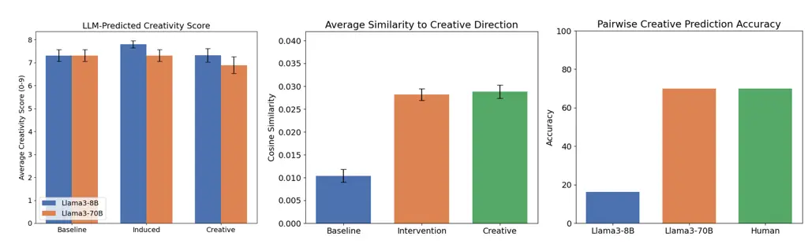

# Steering Large Language Models to Evaluate and Amplify Creativity

Matthew Lyle Olson ^(†)^(†)thanks: Equal Contribution.    Neale
Ratzlaff¹¹footnotemark: 1    Musashi Hinck    Shao-yen Tseng    Vasudev
Lal Affiliation: Intel Labs Affiliation: Santa Clara, CA
Affiliation: {matthew.lyle.olson,neale.ratzlaff,
Email: [musashi.hinck,shao-yen.tseng,vasudev.lal}@intel.com](mailto:)

###### Abstract

Although capable of generating creative text, Large Language Models
(LLMs) are poor judges of what constitutes “creativity”. In this work,
we show that we can leverage this knowledge of how to write creatively
in order to better judge what is creative. We take a mechanistic
approach that extracts differences in the internal states of an LLM when
prompted to respond “boringly” or “creatively” to provide a robust
measure of creativity that corresponds strongly with human judgment. We
also show these internal state differences can be applied to enhance the
creativity of generated text at inference time.

## 1 Introduction

The ability of Large Language Models (LLMs) to evaluate the quality of
their own outputs has received significant attention recently (Xu
et al., 2023) due to the widespread desire to make use of potential
high-quality synthetic data. While it has been argued that LLMs are not
good enough at self-evaluation to bootstrap themselves into better
reasoners (Huang et al., 2023) or forgo real data entirely (Wang et al.,
2023), there are scenarios where self-evaluation can enable improved
performance (Ren et al., 2023; Yuan et al., 2024; Madaan et al., 2024).
In this work, we show that LLM-based self-evaluation with respect to
creativity is challenging if approached naively; with LLMs
self-evaluations but by leveraging the internal representations of an
LLM during inference, not only can self-assessment be improved, the
creativity of the generation itself can be amplified.

Recent work in steering language models has shown that LLMs represent
concepts as linear directions in their activation space (Turner et al.,
2023). Specific directions corresponding to social bias, refusal,
harmlessness, or humor have been identified by prior work (Ratzlaff
et al., 2024; Gao et al., 2024; Templeton et al., 2024). Furthermore, it
has been shown that it’s possible to remove, or ablate these features
from the model via an orthogonal projection of intermediate activations
onto a chosen direction. In the case of refusal, a safety-tuned model
can have its guardrails effectively removed (Arditi et al., 2024),
allowing a user to prompt the model in ways that were previously
censored. Conversely, it is also possible to induce a specific feature
(Rimsky et al., 2023; Hinck et al., 2024), forcing the model to respond
in a particular way according to the chosen direction. In this work we
explore model steering for creativity, and propose three steps to unlock
an LLM’s potential for use in creative domains.

- •
  We solve for steering directions that correspond to latent concepts of
  creativity within an LLM, we use Llama3-8B and creative writing as our
  target setting.
- •
  We apply our creative steering directions to induce (increase) the
  creativity of generations sampled from Llama3-8B on the creative
  writing dataset Fan et al. (2018). Upon inspection, the generated
  samples are far more diverse and creative than baseline generations.
- •
  We construct an estimator to score the creativity of generated output
  leverages the creative steering directions. We find this estimator
  aligns closely with human judgment, unlike simple prompting baselines.



Figure 1: Left: We prompted Llama3-8B and Llama3-70B to assign a rating
(0-9) to generated stories with respect to a baseline prompt with no
creative intervention (Baseline), a baseline prompt with creative
intervention (Induced), and a creative version of the baseline prompt
(Creative). Error bars are $`95\%`$ confidence intervals. Center: We
compute the cosine similarity to the creative attribute during text
generation on the test split of the uncreative prompts, uncreative
prompts with creativity added, and the creative prompts. We find the
intermediate activations of the latter two are much more similar to the
creativity attribute. Right: Self, Frontier Model, and Human assessment
accuracy of predicting which completion is more creative, given a pair
of induced and baseline generations– finding the Llama3-8B model to be a
poor self-judge of creativity.

## 2 Method

Our method has three main components: 1) finding a suitable “creativity
direction” in activation space, 2) optionally use this direction to
steer the LLM to generate creative text, and 3) scoring the creativity
of outputs respect to this creativity direction. The established method
of computing a particular concept in activation space requires
collecting a small dataset of contrastive instructions (Marks and
Tegmark, 2023), where the only difference between the corresponding
completions is the presence or absence of the concept in question. In
our case, we leveraged the creative writing prompts dataset (Fan et al., 2018) to elicit creative generations, and used GPT4o (Achiam et al., 2023) to craft uncreative versions of the same prompts to obtain paired
creative-uncreative responses. We use the validation split of the
creative writing prompts dataset for finding the attribute, and the test
split in our evaluation experiments. Details and examples of the dataset
can be found in the appendix. Given a set of paired creative
instructions $`x_{c}\in X_{c}`$ and uncreative instructions
$`x_{u}\in X_{u}`$, we compute the creative direction as the normalized
difference in the average activation vectors at a given layer with
respect to the creative and uncreative instructions:

```math
\mathbf{a}=\left\|\frac{1}{|X_{c}|}\sideset{}{{}_{x_{c}\in X_{c}}}{\sum}LLM_{l}(x_{c})-\frac{1}{|X_{u}|}\sideset{}{{}_{x_{u}\in X_{u}}}{\sum}LLM_{l}(x_{u})\right\|_{2}
```

where $`LLM_{l}`$ is the output of the LLM at layer $`l`$. The choice of
layer is selected empirically; examples of the resulting generations
when different layers are targeted can be found in the appendix. In this
work, we choose layer 8 of Llama3-8B (Dubey et al., 2024) as the target
layer. At inference time, we can score the creativity of generated text
by computing the cosine similarity between the attribute $`\mathbf{a}`$
and the current token:

```math
\text{score}=\frac{1}{T+1}\sideset{}{{}_{t=0}^{T}}{\sum}\cos(||LLM_{l}(x_{t})||_{2},\mathbf{a})
```

where $`T`$ is the total generated tokens, $`x_{t}`$ is the token
generated at step t, and $`x_{0}`$ is the input.

Finally, we can steer the LLM to induce increased creativity of
generated text by adding the creativity attribute to the intermediate
activations at the target layer. Intuitively, we are amplifying the
contribution of the model’s internal sense of creativity. Note that in
this case, the notion of creativity is heavily tied to creative writing
and common subject matter therein, rather than a general notion of
creativity. $`LLM^{\prime}_{l}(x)=LLM_{l}(x)+\lambda*\mathbf{a}`$, where
$`LLM^{\prime}_{l}(x)`$ is effectively a replaced version of the layer
and the scalar $`\lambda=3`$ was found manually from early tests.

## 3 Experiments

Figure 1 shows our three main experiments. First, we use Llama3-8B to
generate 3 types of stories: creative story prompts from our dataset,
non-creative prompts from GPT4o, and non-creative with the creativity
vector added. We find the models often score all stories similarly at
about 7 (when asked to rate the story from 0 to 9). Next, we show our
scoring method is highly effective at identifying creative stories. We
compute the score on the test split of the creative / uncreative
prompts, and we find the creative stories (as well as uncreative stories
with creativity induced) are much more similar to the creativity
attribute. This result clearly indicates that the LLM internally models
creativity and can accurately track how creative a given story is.
Finally, to verify the efficacy of adding the discovered creativity
attribute, we run pairwise comparisons on the generations of the
uncreative prompts with and without creativity induced. We find the
original model is a poor predictor of its own creativity, whereas a
large frontier model (Llama3-70b) is on par with a human annotator (with
agreement $`>70\%`$). These results show that a naive approach to LLM
self-assessment is not sufficient for identifying creative output.

## References

- Achiam et al. \[2023\] J. Achiam, S. Adler, S. Agarwal, L. Ahmad,
  I. Akkaya, F. L. Aleman, D. Almeida, J. Altenschmidt, S. Altman,
  S. Anadkat, et al. Gpt-4 technical report. _arXiv preprint
  arXiv:2303.08774_, 2023.
- Arditi et al. \[2024\] A. Arditi, O. Balcells Obeso, Aaquib111,
  W. Gurnee, and N. Nanda. Refusal in llms is mediated by a single
  direction. _AI Alignment Forum_, 2024. URL
  [https://www.alignmentforum.org/posts/jGuXSZgv6qfdhMCuJ/refusal-in-llms-is-mediated-by-a-single-direction](https://www.alignmentforum.org/posts/jGuXSZgv6qfdhMCuJ/refusal-in-llms-is-mediated-by-a-single-direction).
- Dubey et al. \[2024\] A. Dubey, A. Jauhri, A. Pandey, A. Kadian,
  A. Al-Dahle, A. Letman, A. Mathur, A. Schelten, A. Yang, A. Fan,
  et al. The llama 3 herd of models. _arXiv preprint
  arXiv:2407.21783_, 2024.
- Fan et al. \[2018\] A. Fan, M. Lewis, and Y. Dauphin. Hierarchical
  neural story generation. _arXiv preprint arXiv:1805.04833_, 2018.
- Gao et al. \[2024\] L. Gao, T. D. la Tour, H. Tillman, G. Goh,
  R. Troll, A. Radford, I. Sutskever, J. Leike, and J. Wu. Scaling and
  evaluating sparse autoencoders. _arXiv preprint
  arXiv:2406.04093_, 2024.
- Hinck et al. \[2024\] M. Hinck, C. Holtermann, M. L. Olson,
  F. Schneider, S. Yu, A. Bhiwandiwalla, A. Lauscher, S. Tseng, and
  V. Lal. Why do llava vision-language models reply to images in
  english? _arXiv preprint arXiv:2407.02333_, 2024.
- Huang et al. \[2023\] J. Huang, X. Chen, S. Mishra, H. S. Zheng, A. W.
  Yu, X. Song, and D. Zhou. Large language models cannot self-correct
  reasoning yet. _arXiv preprint arXiv:2310.01798_, 2023.
- Madaan et al. \[2024\] A. Madaan, N. Tandon, P. Gupta, S. Hallinan,
  L. Gao, S. Wiegreffe, U. Alon, N. Dziri, S. Prabhumoye, Y. Yang,
  et al. Self-refine: Iterative refinement with self-feedback. _Advances
  in Neural Information Processing Systems_, 36, 2024.
- Marks and Tegmark \[2023\] S. Marks and M. Tegmark. The geometry of
  truth: Emergent linear structure in large language model
  representations of true/false datasets. _arXiv preprint
  arXiv:2310.06824_, 2023.
- Ratzlaff et al. \[2024\] N. Ratzlaff, M. L. Olson, M. Hinck, S.-Y.
  Tseng, V. Lal, and P. Howard. Debiasing large vision-language models
  by ablating protected attribute representations. _arXiv preprint
  arXiv:2410.13976_, 2024.
- Ren et al. \[2023\] J. Ren, Y. Zhao, T. Vu, P. J. Liu, and
  B. Lakshminarayanan. Self-evaluation improves selective generation in
  large language models. In _Proceedings on_, pages 49–64. PMLR, 2023.
- Rimsky et al. \[2023\] N. Rimsky, N. Gabrieli, J. Schulz, M. Tong,
  E. Hubinger, and A. M. Turner. Steering llama 2 via contrastive
  activation addition. _arXiv preprint arXiv:2312.06681_, 2023.
- Templeton et al. \[2024\] A. Templeton, T. Conerly, J. Marcus,
  J. Lindsey, T. Bricken, B. Chen, A. Pearce, C. Citro, E. Ameisen,
  A. Jones, et al. Scaling monosemanticity: Extracting interpretable
  features from claude 3 sonnet. _Transformer Circuits Thread_, 2024.
- Turner et al. \[2023\] A. M. Turner, L. Thiergart, G. Leech, D. Udell,
  J. J. Vazquez, U. Mini, and M. MacDiarmid. Activation addition:
  Steering language models without optimization. _arXiv preprint
  arXiv:2308.10248_, 2023.
- Wang et al. \[2023\] P. Wang, L. Li, L. Chen, Z. Cai, D. Zhu, B. Lin,
  Y. Cao, Q. Liu, T. Liu, and Z. Sui. Large language models are not fair
  evaluators. _arXiv preprint arXiv:2305.17926_, 2023.
- Xu et al. \[2023\] C. Xu, Q. Sun, K. Zheng, X. Geng, P. Zhao, J. Feng,
  C. Tao, and D. Jiang. Wizardlm: Empowering large language models to
  follow complex instructions. _arXiv preprint arXiv:2304.12244_, 2023.
- Yuan et al. \[2024\] W. Yuan, R. Y. Pang, K. Cho, S. Sukhbaatar,
  J. Xu, and J. Weston. Self-rewarding language models. _arXiv preprint
  arXiv:2401.10020_, 2024.

## Appendix A Model Details

We used Llama3-8B as our model of interest, due to its well-rounded
abilities in multiple subjects. For self-evaluation experiments we used
the same Llama3-8B model, and for frontier model evaluations, we used
the larger Llama3-70B. All generation hyperparameters can be found in
Table 1. To ensure that we strictly evaluated the effect of our steering
method, we set hyperparameters like temperature and top_p to $`1.0`$

|                  |            |
| ---------------- | ---------- |
| Hyperparameter   | Value      |
| Generation Model | Llama3-8b  |
| Temperature      | 1.0        |
| Max New Tokens   | 256        |
| Top-p            | 1.0        |
| Foundation Model | Llama3-70B |

Table 1: Generation Hyperparameters

## Appendix B Model Generation Example


## Appendix C Contrastive Dataset Details

It is critical to obtain high quality contrastive pairs of generations
to isolate the creativity direction. For positively creative
instructions we leverage the creative writing prompts dataset \[Fan
et al., 2018\], randomly sampling 500 writing prompts to obtain creative
generations. To obtain baseline, or less creative generations, we use
GPT4o to negate the aspects of creativity in our creative instructions.


## Appendix D Creativity at Different Model Depths

Model generation behavior can vary wildly when intervened on. We find
that earlier layers can fail to generate meaningful test when the
residual stream is altered. Intervening near the final layers of
Llama3-8B has little effect on the output. We find that intervening near
the middle of the network yields a reasonable trade-off of generation
quality and introduced creativity.


