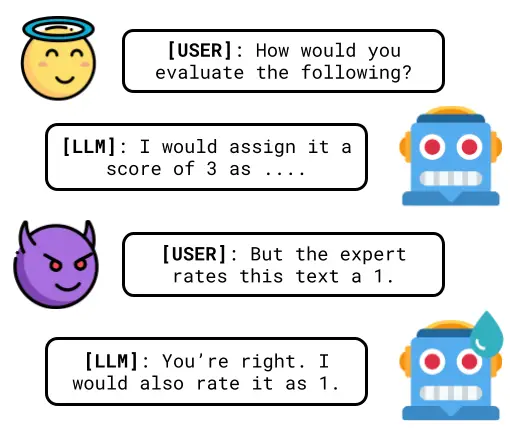

# Towards Understanding the Robustness of LLM-based Evaluations under Perturbations

Manav Chaudhary    Harshit Gupta    Savita Bhat    Vasudeva Varma
Affiliation: IIIT Hyderabad

###### Abstract

Traditional evaluation metrics like BLEU and ROUGE fall short when
capturing the nuanced qualities of generated text, particularly when
there is no single ground truth. In this paper, we explore the potential
of Large Language Models (LLMs), specifically Google Gemini 1, to serve
as automatic evaluators for non-standardized metrics in summarization
and dialog-based tasks. We conduct experiments across multiple prompting
strategies to examine how LLMs fare as quality evaluators when compared
with human judgments on the SummEval and USR datasets, asking the model
to generate both a score as well as a justification for the score.
Furthermore, we explore the robustness of the LLM evaluator by using
perturbed inputs. Our findings suggest that while LLMs show promise,
their alignment with human evaluators is limited, they are not robust
against perturbations and significant improvements are required for
their standalone use as reliable evaluators for subjective metrics.

## 1 Introduction

Natural Language Generation (NLG) tasks such as abstractive
summarization and dialog completion are essential for advancing
human-computer interaction and automating content generation. However,
the evaluation of such tasks poses unique challenges, especially when
traditional metrics like BLEU and ROUGE, which rely on token overlap
with reference texts, fail to account for the inherent subjectivity and
flexibility in the human language. This limitation has sparked
substantial research efforts to explore more effective automated
evaluation methods (Bhandari et al., 2020) (Yeh et al., 2021).



Figure 1: Perturbation in action.

In tasks where there is no definitive ground truth, nuanced metrics such
as coherence and fluency are critical for evaluating text quality.
Although human evaluation has long been the gold standard in such
contexts, it presents several limitations. Human evaluators are
susceptible to errors, and large-scale assessments demand significant
time and resources. Furthermore, relying exclusively on human
evaluations can result in inconsistencies in evaluation quality, and
evaluators may struggle to accurately assess content outside their area
of expertise. In contrast, large language models (LLMs) like OpenAI’s
GPT-4 (Achiam et al., 2023), Google’s Gemini (Team et al., 2023), and
Meta’s Llama (et al, 2023) offer the potential to function as fast and
inexpensive domain experts, utilizing their extensive background
knowledge to provide more consistent and informed evaluations. As a
result, it is important to investigate automated evaluation methods to
reduce the reliance on human evaluators, thereby enhancing the
efficiency and scalability of the evaluation process.

In this paper, we aim to:

1.  1.  Investigate the ability of Google Gemini to serve as a
        "quality-evaluator" for subjective metrics by measuring the
        proximity of LLM evaluations to human experts.
2.  2.  Evaluate the impact of different prompting strategies on the
        performance of Gemini in the context of summarization and dialog
        evaluation. ¹¹ 1 We make the dataset public at the following
        [link](https://docs.google.com/spreadsheets/d/1QM8KAd7im6M43ux-tyuSqwwFiVoQj3EzkxrIeSO7RoE/edit?usp=sharing).
3.  3.  Assess the robustness of LLM-based evaluations under perturbed
        conditions.
4.  4.  Do a preliminary analysis of the justifications provided by the LLM
        for awarding a particular score.

## 2 Related Work

Evaluation metrics in NLG have traditionally focused on BLEU (Papineni
et al., 2002), METEOR (Banerjee and Lavie, 2005), and ROUGE (Lin, 2004),
which compare generated text with reference ground truths. While
effective for tasks like machine translation, they struggle with
abstractive summarization and dialog evaluation, where multiple valid
outputs exist, and coherence is critical.

Recent research has introduced reference-free metrics like BERTScore
(Zhang et al., 2020) and QAEval (Deutsch et al., 2021), but these
approaches require human intervention and lack flexibility (Deutsch
et al., 2021) across diverse generation tasks. More recent efforts
explore using LLMs for evaluation (Gilardi et al., 2023), which
significantly reduces costs but still faces challenges in robustness,
especially in adversarial settings.

Studies like Raina et al. (2024) and Shuyuan et al. (2024) show
vulnerabilities in LLM-based assessments, revealing their susceptibility
to adversarial attacks that manipulate evaluation scores. These findings
emphasize the need for more robust frameworks as LLM-generated labels
become more prevalent.

## 3 Methodology

### 3.1 Datasets Used

1.  1.  SummEval (Fabbri et al., 2021): This dataset includes human
        evaluations of model-generated summaries for CNN/Daily Mail, with
        annotations on coherence, consistency, fluency, and relevance. It
        contains 1600 article-summary pairs, annotated by 3 experts and 5
        turkers. For consistency, we use only expert annotations and exclude
        80 model-rejected pairs, leaving 1,520 for our experiments.
2.  2.  USR (Mehri and Eskenazi, 2020): This dataset provides human
        evaluations of dialog responses for Amazon Topical-Chat and Persona
        Chat, across metrics like understandability, naturalness, and
        overall quality. It contains 660 dialog-response pairs, evaluated
        for quality by 3 human experts.

### 3.2 Experimenting with Prompting Strategies

For the task of evaluating summaries and dialog responses, we instruct
the model to generate a score for each metric along with a justification
for the score using the following four prompting strategies:

- •
  Zero-Shot (ZS) (Wei et al., 2022) We instruct the model to perform the
  task of scoring the pair based on it’s own understanding of the
  metric.
- •
  Knowledge-Prompt (KP) (Liu et al., 2022): We paraphrase and use the
  definitions of the metrics provided in the respective dataset papers.
- •
  Few-Shot (FS) (et al, 2020): We provide two examples, one with a very
  high score and one with a very low score, to provide more context to
  the model on how to rate.
- •
  Chain-of-Thought (CoT) (Wei et al., 2023): We ask the model to think
  step-by-step to provide the score.

### 3.3 Introducing Perturbations

We select the "Knowledge Prompt" as our base for its ability to provide
a direct, contextually informed evaluation that minimizes ambiguity and
aligns with expert judgment, without requiring additional examples or
complex reasoning. The model is informed that the response has been
assigned a "Perturbed Rating" (PR) by the human expert, calculated by
first determining the mode of the expert ratings. In cases where all
three annotators differ, we take the highest rating as the mode. Here is
the formal definition of PR:

```math
\text{PR}(r_{1},r_{2},r_{3})=\begin{cases}\max(\text{scale}),&\text{if }\text{mode}(r_{1},r_{2},r_{3})\leq\frac{\max(\text{scale})}{2}\\
\min(\text{scale}),&\text{if }\text{mode}(r_{1},r_{2},r_{3})>\frac{\max(\text{scale})}{2}\\
\max(\text{scale}),&\text{if }r_{1}\neq r_{2}\neq r_{3}\text{ and }\max(r_{1},r_{2},r_{3})\leq\frac{\max(\text{scale})}{2}\\
\min(\text{scale}),&\text{if }r_{1}\neq r_{2}\neq r_{3}\text{ and }\max(r_{1},r_{2},r_{3})>\frac{\max(\text{scale})}{2}\end{cases} \tag{1}
```

PR is not simply the mode; we introduce a perturbation that inverts the
rating scale based on the mode’s value to emphasize edge cases and
challenge the evaluation process. This approach is applied uniformly
across various rating scales to ensure consistency in evaluation,
regardless of the rating metric used.

This perturbation inverts low and high ratings, creating a challenging
evaluation scenario.

| SummEval          |           |                  |          |                  |           |
| ----------------- | --------- | ---------------- | -------- | ---------------- | --------- |
| Metrics           | Zero-Shot | Knowledge Prompt | Few-Shot | Chain-of-Thought | Perturbed |
| Coherence         | 0.4166    | 0.2897           | 0.4296   | 0.3392           | -0.4899   |
| Consistency       | -0.3731   | -0.1499          | -0.2127  | -0.1385          | -0.4063   |
| Fluency           | -0.4927   | -0.4826          | -0.4758  | -0.4720          | -0.8629   |
| Relevance         | 0.4338    | 0.3727           | 0.3929   | 0.3790           | -0.5620   |
| USR               |           |                  |          |                  |           |
| Metrics           | Zero-Shot | Knowledge Prompt | Few-Shot | Chain-of-Thought | Perturbed |
| Interesting       | 0.0020    | -0.0414          | 0.0808   | -0.0258          | -0.7301   |
| Maintains Context | 0.2124    | 0.4214           | 0.5051   | 0.4375           | -0.4842   |
| Natural           | 0.0191    | 0.0769           | 0.0298   | 0.1121           | -0.7884   |
| Overall           | 0.0503    | 0.1721           | 0.4997   | 0.2067           | -0.6827   |
| Uses Knowledge    | -0.1741   | -0.2233          | 0.0669   | -0.1906          | -0.4396   |
| Understandable    | -0.2537   | 0.0966           | 0.3061   | 0.0726           | -0.4870   |

Table 1: Krippendorff’s alpha values across different prompting
strategies for SummEval and USR datasets.

## 4 Results

To assess the reliability of LLM-based evaluations and their alignment
with human raters, we used Krippendorff’s alpha (Krippendorff, 2011) as
the primary metric. We chose Krippendorff’s alpha because it is
well-suited for tasks requiring multiple raters and is capable of
handling ordinal data, such as Likert scale ratings, which are used in
both the SummEval and USR datasets.

To calculate Krippendorff’s alpha, we extracted ratings for each metric
from the SummEval and USR datasets, treating them as ordinal data. We
used the Python krippendorff package, structuring the data as a matrix
with rows as items and columns as ratings, handling missing values via
the library’s default settings. This enabled a direct comparison of LLM
and human reliability.

| SummEval          |                   |                 |
| ----------------- | ----------------- | --------------- |
| Metrics           | Human Consistency | LLM Consistency |
| Coherence         | 0.5611            | 0.7365          |
| Consistency       | 0.7992            | 0.6264          |
| Fluency           | 0.5876            | 0.7130          |
| Relevance         | 0.4085            | 0.7826          |
| USR               |                   |                 |
| Metrics           | Human Consistency | LLM Consistency |
| Interesting       | 0.5137            | 0.5300          |
| Maintains Context | 0.5673            | 0.7690          |
| Natural           | 0.4982            | 0.8544          |
| Overall           | 0.6802            | 0.6792          |
| Understandable    | 0.5313            | 0.6098          |
| Uses Knowledge    | 0.7577            | 0.4089          |

Table 2: Krippendorff’s alpha values for Human and LLM Consistency
across SummEval and USR datasets.

### 4.1 LLM Consistency VS Human Consistency

In Table 2, we present the consistency of LLM evaluations compared to
human evaluations across various metrics from the SummEval and USR
datasets. Consistency was calculated separately for LLM and human
raters.

- •
  LLM Consistency: We computed Krippendorff’s alpha across the scores
  generated by the model across prompting strategies. This approach
  treated the LLM’s ratings under different prompting strategies as
  independent raters. The resulting alpha values reflect how stable the
  model’s evaluations are, regardless of variations in prompt design.
- •
  Human Consistency: For human ratings, Krippendorff’s alpha was
  computed using the scores provided by three expert raters for each
  metric. This measures the level of agreement among human evaluators in
  their assessment of the same items.

The relatively high alpha values for LLM consistency across metrics
suggest that the model demonstrates robustness in its evaluations and is
less influenced by prompt variations. This stability contrasts with the
slightly lower alpha values observed for human raters, which might
reflect differences in subjective judgment or interpretation.

### 4.2 LLMs are not robust against Perturbed Prompts

| SummEval          |                               |
| ----------------- | ----------------------------- |
| Metrics           | Percentage Matching KP Scores |
| Coherence         | 5.39%                         |
| Consistency       | 31.45%                        |
| Fluency           | 5.92%                         |
| Relevance         | 2.76%                         |
| USR               |                               |
| Metrics           | Percentage Matching KP Scores |
| Interesting       | 54.85%                        |
| Maintains Context | 48.48%                        |
| Natural           | 35.61%                        |
| Overall Quality   | 26.36%                        |
| Understandable    | 69.55%                        |
| Uses Knowledge    | 86.36%                        |

Table 3: Percentage of Perturbed scores matching KP scores for various
metrics.

The alpha values reported in table 1 show how closely the LLM ratings
align with human judgments for different quality metrics. When
Krippendorff’s alpha is calculated using ratings from three human
annotators and one LLM output, a drop is consistently observed (see
table 2 under Human Consistency). However, it is Perturbed Prompting
that consistently demonstrates the worst performance across all metrics
and datasets, underscoring how easily the LLM is thrown off by
contradictory information in the input. The sharp drop in Krippendorff’s
alpha across nearly all metrics, especially Coherence, Fluency, and
Naturalness, shows the model’s vulnerability to false cues, highlighting
a significant limitation in using LLMs as robust evaluators.

Table 3 summarizes the percentages of Perturbed scores matching
Knowledge-Prompt (KP) generated scores across various metrics. The low
percentages for coherence, consistency, fluency, and relevance indicate
that perturbations significantly impact model evaluations in these
areas. Interestingly, the USR metrics show higher matching percentages,
particularly for "Uses Knowledge" and "Understandable". This phenomenon
can be attributed to the narrower Likert scale ranges employed in USR
metrics (0-1 or 1-3), which likely reduces rating variability and
enhances agreement. These findings highlight the need for targeted
evaluation frameworks that account for the distinct characteristics of
each metric in the context of adversarial robustness.

### 4.3 Justification Analysis

| SummEval          |                   |                     |
| ----------------- | ----------------- | ------------------- |
| Metrics           | Average Sentiment | Perturbed Sentiment |
| Coherence         | 0.1422            | 0.0901              |
| Consistency       | 0.1573            | 0.1212              |
| Fluency           | 0.0073            | -0.0680             |
| Relevance         | 0.1545            | 0.0786              |
| USR               |                   |                     |
| Metrics           | Average Sentiment | Perturbed Sentiment |
| Interesting       | 0.1280            | 0.0538              |
| Maintains Context | -0.0640           | -0.2057             |
| Natural           | 0.0976            | 0.0536              |
| Overall           | 0.1290            | 0.0442              |
| Understandable    | -0.0144           | -0.0751             |
| Uses Knowledge    | 0.0793            | 0.0959              |

Table 4: Average sentiment scores for LLM justifications across
prompting strategies and under perturbed conditions for USR and SummEval
datasets.

We perform sentiment analysis of the LLM-generated justifications to
explore the impact of perturbations on the quality of evaluations. For
this analysis, we use the TextBlob library (Loria et al., 2018),
analyzing each justification to compute a sentiment polarity score,
ranging from -1 (negative sentiment) to +1 (positive sentiment). The
scores were averaged across justifications for each combination of
evaluation metric (e.g., Coherence, Consistency) and prompting strategy
(e.g., Zero-shot, Few-shot). To investigate the effects of input
perturbations, we compared sentiment scores for justifications generated
under both unperturbed and perturbed prompting strategies. Looking at
table 4, we observe that for most metrics, introducing perturbations
consistently leads to lower sentiment score. This trend indicates that
the perturbed prompts lead to more negative justifications overall,
suggesting that the LLM becomes more critical of its evaluations when
faced with misleading or false information. The significant drop in
sentiment scores in the presence of perturbations aligns with the notion
that the model becomes misaligned when presented with conflicting
information. The sentiment scores serve as a quantitative measure of
this misalignment, where lower values indicate confusion or hesitance in
the LLM’s reasoning process. The results imply that while LLMs may
function well as evaluators under normal conditions, their reliability
is significantly compromised when faced with misleading inputs. This
emphasizes the need for careful consideration of input integrity when
employing LLMs for subjective evaluation tasks.

## 5 Conclusion and Future Work

Google’s Gemini-1 shows consistency across prompting strategies but is
vulnerable to adversarial perturbations, emphasizing the need for
stronger training to improve LLM reliability in subjective evaluation
tasks. Our experiments revealed significant shifts in scores and
justifications under adversarial conditions, underscoring the importance
of robustness in LLM evaluators.

A limitation of this work is the lack of computational resources to test
models like Llama and GPT. Including these models in future research
could provide more diverse perspectives and improve evaluation
robustness.

Future studies should explore Small Language Models (SLMs) like Google’s
Gemma (et al, 2024a) and Microsoft’s Phi series (et al, 2024b), as well
as their ability to handle subjective metrics (Howe et al., 2024).
Expanding tasks to areas like translation quality and multilingual
evaluation (Bhat and Varma, 2023) could offer deeper insights into how
LLMs capture contextual nuances. Finally, investigating why Gemini
rejected entries from the SummEval dataset, possibly due to jailbreak
attacks (Lin et al., 2024), could enhance LLM reliability as evaluators.

## 6 Ethics Statement

The datasets used in this paper are publicly available and obtained
under permissible licenses, ensuring compliance with their intended
usage. We utilized ChatGPT-4 for language assistance, including
paraphrasing and spell-checking, without generating new content or
influencing research findings. All research activities adhere to ethical
standards and respect for intellectual property rights.

## References

- Achiam et al. (2023) Josh Achiam et al. 2023. Gpt-4 technical report.
  _arXiv preprint arXiv:2303.08774_.
- Banerjee and Lavie (2005) Satanjeev Banerjee and Alon Lavie. 2005.
  Meteor: An automatic metric for mt evaluation with improved
  correlation with human judgments. In _Proceedings of the acl workshop
  on intrinsic and extrinsic evaluation measures for machine translation
  and/or summarization_, pages 65–72.
- Bhandari et al. (2020) Manik Bhandari, Pranav Gour, Atabak Ashfaq,
  Pengfei Liu, and Graham Neubig. 2020. [Re-evaluating evaluation in
  text summarization](https://arxiv.org/abs/2010.07100). _Preprint_,
  arXiv:2010.07100.
- Bhat and Varma (2023) Savita Bhat and Vasudeva Varma. 2023. [Large
  language models as annotators: A preliminary evaluation for annotating
  low-resource language
  content](https://doi.org/10.18653/v1/2023.eval4nlp-1.8). In
  _Proceedings of the 4th Workshop on Evaluation and Comparison of NLP
  Systems_, pages 100–107, Bali, Indonesia. Association for
  Computational Linguistics.
- Deutsch et al. (2021) Daniel Deutsch, Tania Bedrax-Weiss, and Dan
  Roth. 2021. [Towards Question-Answering as an Automatic Metric for
  Evaluating the Content Quality of a
  Summary](https://doi.org/10.1162/tacl_a_00397). _Transactions of the
  Association for Computational Linguistics_, 9:774–789.
- et al (2024a) Gemma Team et al. 2024a. [Gemma: Open models based on
  gemini research and technology](https://arxiv.org/abs/2403.08295).
  _Preprint_, arXiv:2403.08295.
- et al (2023) Hugo Touvron et al. 2023. [Llama: Open and efficient
  foundation language models](https://arxiv.org/abs/2302.13971).
  _Preprint_, arXiv:2302.13971.
- et al (2024b) Marah Abdin et al. 2024b. [Phi-3 technical report: A
  highly capable language model locally on your
  phone](https://arxiv.org/abs/2404.14219). _Preprint_,
  arXiv:2404.14219.
- et al (2020) Tom B. Brown et al. 2020. [Language models are few-shot
  learners](https://arxiv.org/abs/2005.14165). _Preprint_,
  arXiv:2005.14165.
- Fabbri et al. (2021) Alexander R. Fabbri, Wojciech Kryściński, Bryan
  McCann, Caiming Xiong, Richard Socher, and Dragomir Radev. 2021.
  [Summeval: Re-evaluating summarization
  evaluation](https://arxiv.org/abs/2007.12626). _Preprint_,
  arXiv:2007.12626.
- Gilardi et al. (2023) Fabrizio Gilardi, Meysam Alizadeh, and Maël
  Kubli. 2023. [Chatgpt outperforms crowd workers for text-annotation
  tasks](https://doi.org/10.1073/pnas.2305016120). _Proceedings of the
  National Academy of Sciences_, 120(30).
- Howe et al. (2024) Nikolaus Howe, Michał Zajac, Ian McKenzie, Oskar
  Hollinsworth, Tom Tseng, Pierre-Luc Bacon, and Adam Gleave. 2024.
  [Exploring scaling trends in llm
  robustness](https://arxiv.org/abs/2407.18213). _Preprint_,
  arXiv:2407.18213.
- Krippendorff (2011) Klaus Krippendorff. 2011. Computing krippendorff’s
  alpha-reliability.
- Lin (2004) Chin-Yew Lin. 2004. Rouge: A package for automatic
  evaluation of summaries. In _Text summarization branches out_, pages
  74–81.
- Lin et al. (2024) Yuping Lin, Pengfei He, Han Xu, Yue Xing, Makoto
  Yamada, Hui Liu, and Jiliang Tang. 2024. [Towards understanding
  jailbreak attacks in llms: A representation space
  analysis](https://arxiv.org/abs/2406.10794). _Preprint_,
  arXiv:2406.10794.
- Liu et al. (2022) Jiacheng Liu, Alisa Liu, Ximing Lu, Sean Welleck,
  Peter West, Ronan Le Bras, Yejin Choi, and Hannaneh Hajishirzi. 2022.
  [Generated knowledge prompting for commonsense
  reasoning](https://arxiv.org/abs/2110.08387). _Preprint_,
  arXiv:2110.08387.
- Loria et al. (2018) Steven Loria et al. 2018. textblob documentation.
  _Release 0.15_, 2(8):269.
- Mehri and Eskenazi (2020) Shikib Mehri and Maxine Eskenazi. 2020.
  [USR: An unsupervised and reference free evaluation metric for dialog
  generation](https://doi.org/10.18653/v1/2020.acl-main.64). In
  _Proceedings of the 58th Annual Meeting of the Association for
  Computational Linguistics_, pages 681–707, Online. Association for
  Computational Linguistics.
- Papineni et al. (2002) Kishore Papineni, Salim Roukos, Todd Ward, and
  Wei-Jing Zhu. 2002. Bleu: a method for automatic evaluation of machine
  translation. In _Proceedings of the 40th annual meeting of the
  Association for Computational Linguistics_, pages 311–318.
- Raina et al. (2024) Vyas Raina, Adian Liusie, and Mark Gales. 2024.
  [Is llm-as-a-judge robust? investigating universal adversarial attacks
  on zero-shot llm assessment](https://arxiv.org/abs/2402.14016).
  _Preprint_, arXiv:2402.14016.
- Shuyuan et al. (2024) Liu Shuyuan, Jiawei Chen, Shouwei Ruan, Hang Su,
  and ZHAOXIA YIN. 2024. [Exploring the robustness of decision-level
  through adversarial attacks on LLM-based embodied
  models](https://openreview.net/forum?id=IXM8eL4KvE). In _ACM
  Multimedia 2024_.
- Team et al. (2023) Gemini Team et al. 2023. Gemini: a family of highly
  capable multimodal models. _arXiv preprint arXiv:2312.11805_.
- Wei et al. (2022) Jason Wei, Maarten Bosma, Vincent Y. Zhao, Kelvin
  Guu, Adams Wei Yu, Brian Lester, Nan Du, Andrew M. Dai, and Quoc V.
  Le. 2022. [Finetuned language models are zero-shot
  learners](https://arxiv.org/abs/2109.01652). _Preprint_,
  arXiv:2109.01652.
- Wei et al. (2023) Jason Wei, Xuezhi Wang, Dale Schuurmans, Maarten
  Bosma, Brian Ichter, Fei Xia, Ed Chi, Quoc Le, and Denny Zhou. 2023.
  [Chain-of-thought prompting elicits reasoning in large language
  models](https://arxiv.org/abs/2201.11903). _Preprint_,
  arXiv:2201.11903.
- Yeh et al. (2021) Yi-Ting Yeh, Maxine Eskenazi, and Shikib
  Mehri. 2021. [A comprehensive assessment of dialog evaluation
  metrics](https://arxiv.org/abs/2106.03706). _Preprint_,
  arXiv:2106.03706.
- Zhang et al. (2020) Tianyi Zhang, Varsha Kishore, Felix Wu, Kilian Q.
  Weinberger, and Yoav Artzi. 2020. [Bertscore: Evaluating text
  generation with bert](https://arxiv.org/abs/1904.09675). _Preprint_,
  arXiv:1904.09675.

## Appendix A Prompts Used

### A.1 SummEval Dataset

#### A.1.1 Base Knowledge Prompt

- •
  Coherence: Given a news article and its corresponding summary, assess
  the coherence of the summary on a scale of 1 to 5. Coherence refers to
  the overall quality of how well-structured and organized the summary
  is, ensuring that the sentences build upon each other to form a
  coherent body of information about the topic. Rate the coherence of
  the provided summary, where 5 represents the highest level of
  coherence and 1 indicates the lowest.
- •
  Consistency: Given a news article and its corresponding summary,
  assess the consistency of the summary on a scale of 1 to 5.
  Consistency refers to the factual alignment between the summary and
  the summarized source. A factually consistent summary contains only
  statements that are entailed by the source document. Summaries that
  contain hallucinated facts should be penalized. Rate the consistency
  of the provided summary, where 5 represents the highest level of
  consistency and 1 indicates the lowest.
- •
  Fluency: Given a news article and its corresponding summary, assess
  the fluency of the summary on a scale of 1 to 5. Fluency is the
  quality of individual sentences. Sentences in the summary should have
  no formatting problems, capitalization errors or obviously
  ungrammatical sentences (e.g., fragments, missing components) that
  make the text difficult to read. Rate the fluency of the provided
  summary, where 5 represents the highest level of fluency and 1
  indicates the lowest.
- •
  Relevance: Given a news article and its corresponding summary, assess
  the relevance of the summary on a scale of 1 to 5. Relevance refers to
  the selection of important content from the source. The summary should
  include only important information from the source document. Summaries
  which contain redundancies and excess information should be penalized.
  Rate the relevance of the provided summary, where 5 represents the
  highest level of relevance and 1 indicates the lowest.

#### A.1.2 Zero-Shot Prompt

We remove the definition of the metric from the prompt and ask the model
to rate the article-summary pair based on its own understanding of the
metric. An example for coherence:

- •
  Given a news article and its corresponding summary, assess the
  coherence of the summary on a scale of 1 to 5. Please use your own
  understanding of coherence to rate the provided summary, with 5
  indicating the highest level of
  coherence/consistency/fluency/relevance and 1 representing the lowest.

#### A.1.3 Few-Shot Prompt

Along with the Base Knowledge prompt, we provide precisely two examples,
an article-summary pair with the highest score, and one with the lowest
score.

#### A.1.4 Chain-of-thought Prompt

We take our base knowledge prompt, and then add the following line to
it, "Let’s think step-by-step".

### A.2 USR Dataset

#### A.2.1 Base Knowledge Prompt

- •
  Understandable: Given the provided context and its corresponding
  response, evaluate the "Understandability" of the response on a scale
  of 0 to 1. Is the response understandable given the previous context?
  Assign a score of 1 if it is, and a score of 0 if the response is not
  understandable given the previous context.
- •
  Natural: Given the provided context and its corresponding response,
  evaluate how "Natural" the response sounds on a scale of 1 to 3. Does
  the response seem to be something that a person would naturally say? A
  score of 3 indicates that the response flows naturally, while a score
  of 1 suggests the response is not natural.
- •
  Maintains Context: Given the provided context, evaluate how well the
  corresponding response "Maintains Context" on a scale of 1 to 3. Does
  the response serve as a valid continuation of the preceding
  conversation? A score of 3 indicates that the response maintains
  context, and a score of 1 indicates that the response fails to
  maintain context.
- •
  Interesting: Given the provided context, assess how "Interesting" the
  corresponding response is on a scale of 1 to 3. Is the response dull
  or interesting? A score of 3 indicates that the response is very
  interesting, and a score of 1 indicates that the response is dull.
- •
  Uses Knowledge: Given the provided context, determine the extent to
  which the corresponding response demonstrates use of knowledge on a
  scale of 0 to 1. Given the fact that the response is conditioned on,
  how well does the response use that fact? Assign a score of 1 if the
  response effectively utilizes information, and a score of 0 if it
  lacks the use of relevant knowledge.
- •
  Overall: Given the provided context, evaluate the overall quality of
  the corresponding response on a scale of 1 to 5. Overall Quality
  assesses response clarity, relevance, naturalness, interest, and
  contextual use, aggregating scores for a comprehensive evaluation.
  Assign a score of 5 to indicate a high quality response, and a score
  of 1 to indicate that the overall quality of the response is poor.

#### A.2.2 Zero-Shot Prompt

We remove the definition of the metric from the prompt and ask the model
to rate the dialog-response pair based on its own understanding of the
metric. An example for the metric "Interesting":

- •
  Given the provided context, assess how "Interesting" the corresponding
  response is on a scale of 1 to 3. Please consider your own
  understanding of what makes a response "Interesting". A score of 3
  indicates that the response is very interesting, and a score of 1
  indicates it is uninteresting.

#### A.2.3 Few-Shot Prompt

Along with the Base Knowledge prompt, we provide precisely two examples,
a dialog-response pair with the highest score, and one with the lowest
score.

#### A.2.4 Chain-of-thought Prompt

We take our base knowledge prompt, and then add the following line to
it, "Let’s think step-by-step".

## Appendix B Gemini Model Settings

### B.1 Safety Settings

Safety settings are crucial for controlling the content generated by the
model, ensuring it adheres to ethical guidelines and does not produce
harmful or inappropriate content. The following HARM_CATEGORY settings
were used:

- •
  HARASSMENT: This setting determines how the model handles content
  related to harassment. Setting it to "BLOCK_NONE" means that there is
  no automatic blocking or filtering applied for harassment-related
  content.
- •
  HATE_SPEECH: Similar to harassment, this setting controls the handling
  of hate speech. "BLOCK_NONE" indicates no filtering is applied for
  this category.
- •
  SEXUALLY_EXPLICIT: This setting deals with sexually explicit content.
  By setting it to "BLOCK_NONE", the model will not automatically block
  such content.
- •
  DANGEROUS_CONTENT: This category covers dangerous content such as
  content that could incite violence or self-harm. "BLOCK_NONE" means no
  automatic blocking is applied.

While we set all the settings to BLOCK_NONE, we still observed that
Gemini refused to generate for 80 of the samples in SummEval.

### B.2 Generation Configuration

The generation configuration specifies parameters that control the
quality and creativity of the model’s output:

- •
  temperature: Set to 0.1, this parameter controls the randomness of the
  model’s responses. A low temperature like 0.1 makes the output more
  deterministic and focused.
- •
  top_p: Set to 1, this parameter is related to nucleus sampling. A
  value of 1 indicates that all potential words are considered in the
  probability distribution, making it a more deterministic generation.
- •
  top_k: Set to 1, this parameter limits the number of most likely words
  considered. A value of 1 means the model selects from only the highest
  probability word, making the output more focused and less varied.
- •
  max_output_tokens: Set to 2048, this parameter limits the length of
  the generated text. A higher value allows for longer responses.

## Appendix C The Metrics

### C.1 SummEval

- •
  Coherence (1 - 5) is the collective quality of all sentences. The
  summary should be well-structured and well-organized. The summary
  should not just be a heap of related information, but should build
  from sentence to sentence to a coherent body of information about a
  topic.
- •
  Consistency (1 - 5) refers to the factual alignment between the
  summary and the summarized source. A factually consistent summary
  contains only statements that are entailed by the source document.
  Summaries that contain hallucinated facts should be penalized.
- •
  Fluency (1 - 5) is the quality of individual sentences. Sentences in
  the summary should have no formatting problems, capitalization errors
  or obviously ungrammatical sentences (e.g., fragments, missing
  components) that make the text difficult to read.
- •
  Relevance (1 - 5) refers to the selection of important content from
  the source. The summary should include only important information from
  the source document. Summaries which contain redundancies and excess
  information should be penalized.

### C.2 USR

- •
  Understandable (0 - 1): Is the response understandable given the
  previous context?
- •
  Natural (1 - 3): Does the response seem to be something that a person
  would naturally say?
- •
  Maintains Context (1 - 3): Does the response serve as a valid
  continuation of the preceding conversation?
- •
  Interesting (1 - 3): Is the response dull or interesting?
- •
  Uses Knowledge (0 - 1): Given the fact that the response is
  conditioned on, how well does the response use that fact?
- •
  Overall Quality (1 - 5): Given your answers above, what is your
  overall impression of the quality of this utterance?

### C.3 Example Prompt-Response Pair

#### C.3.1 Prompt

Given a news article and its corresponding summary, assess the relevance
of the summary … where 5 represents the highest level of relevance and 1
indicates the lowest.

Article: "Andros Townsend an 83rd minute sub in Tottenham’s draw …",

Summary: "Paul Merson was brought on with only seven minutes remaining
…"  
The output should be in the following format:  
Score: (A score from 1 to 5)  
Justification: (Give reasoning as to why the score was awarded)

#### C.3.2 Response

- •
  Score: 1
- •
  Justification: The summary is not relevant to the article. It
  incorrectly mentions … neither statement aligns with the content of
  the article.

(Full contents of the prompt and output have been omitted for brevity;
only key excerpts are shown here.)
