# LLM-as-an-Interviewer: Beyond Static Testing Through Dynamic LLM Evaluation

Eunsu Kim Affiliation: KAIST
Email: [mailto:kes0317@kaist.ac.krblackkes0317@kaist.ac.kr](mailto:)   
Juyoung Suk Affiliation: KAIST
Email: [mailto:alice.oh@kaist.edublackalice.oh@kaist.edu](mailto:)   
Seungone Kim Affiliation: Carnegie Mellon University    Niklas
Muennighoff Affiliation: Stanford University Affiliation: Contextual AI
   Dongkwan Kim Affiliation: KAIST    Alice Oh Affiliation: KAIST

###### Abstract

We introduce LLM-as-an-Interviewer, a novel paradigm for evaluating
large language models (LLMs). This approach leverages multi-turn
interactions where the LLM interviewer actively provides feedback on
responses and poses follow-up questions to the evaluated LLM. At the
start of the interview, the LLM interviewer dynamically modifies
datasets to generate initial questions, mitigating data contamination.
We apply the LLM-as-an-Interviewer framework to evaluate six models on
the reasoning, factuality and instruction-following tasks. Our results
show that the framework effectively provides insights into LLM
performance, including the quality of initial responses, adaptability to
feedback, and ability to address follow-up queries like clarification or
additional knowledge requests. The framework also addresses key
limitations of conventional methods like LLM-as-a-Judge, including
verbosity bias and inconsistency across runs. Finally, we propose the
Interview Report, which aggregates insights from the interview process,
providing examples and a comprehensive analysis of the LLM’s strengths
and weaknesses. This report offers a detailed snapshot of the model’s
real-world applicability¹¹ 1 The code for our framework is publicly
available at
[https://github.com/interview-eval](https://github.com/interview-eval)²²
2 We provide a general Python library applicable to various tasks:
[https://pypi.org/project/interview-eval/](https://pypi.org/project/interview-eval/).

## 1 Introduction

With large language models (LLMs) becoming increasingly proficient in
generating fluent free-form responses, it has become crucial to properly
assess their capabilities and limitations (Liang et al., 2022; Chang
et al., 2024). Recently, LLM-as-a-judge has emerged as a promising
framework for automatic free-form response evaluation. Compared to
traditional lexical matching-based metrics (e.g., ROUGE (Lin, 2004),
BLEU (Papineni et al., 2002)) or embedding-based metrics (e.g.,
BERTScore (Zhang et al., 2019)), previous works on LLM-as-a-Judge have
reported higher correlations with human judgments (Chiang and Lee, 2023;
Zheng et al., 2023a; Dubois et al., 2024b).

Despite its potential, the LLM-as-a-Judge framework faces several
practical limitations that hinder its widespread adoption, primarily due
to its static nature (Li et al., 2024a; Gu et al., 2024). First, using a
fixed set of test inputs raises concerns about data contamination (Sainz
et al., 2023; Zhou et al., 2023a; Oren et al., 2023b), where the
evaluated models may achieve high scores on instances encountered during
training. Second, single-turn interactions fail to thoroughly probe a
model’s true comprehension (Li et al., 2019; Wang et al., 2023; Kwan
et al., 2024). For instance, the judge model may assess the confined
performance of LLMs distant from the use case, be influenced by
superficial factors (e.g., favoring longer responses), and exhibit high
variance across runs.

In this study, we propose LLM-as-an-Interviewer, a new paradigm for
evaluating LLMs. Inspired by human interviews, this approach starts with
general questions but dynamically adapts by posing different types of
questions based on the model’s responses. As shown in Figure 1, the LLM
interviewer plays three key roles: (1) Question Modification, adapting
benchmark datasets to generate diverse and challenging initial interview
questions; (2) Providing Feedback, guiding the model to refine its
responses; and (3) Generating Follow-up Questions, exploring related
concepts through clarification requests or additional explanations. This
dynamic evaluation reveals behaviors that static benchmarks cannot
capture, such as the model’s ability to improve through feedback and
provide more detailed explanations.

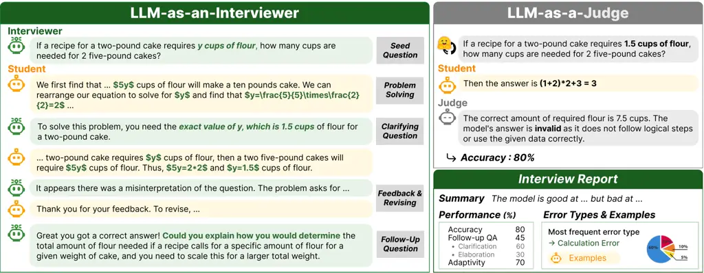

Figure 1: Overview of LLM-as-an-Interviewer. LLM-as-an-Interviewer aims
to assess LLMs by 1) constructing seed questions of interviews based on
existing benchmark datasets, and 2) providing feedback or asking
additional follow-up questions. Unlike evaluation being limited to a
single score with LLM-as-a-Judge, the Interview Report provided by our
framework offers a snapshot of what the model excels at and where it
falls short, along with scores for various abilities and examples.

We demonstrate the efficacy of our framework through experiments on
three tasks: Reasoning, Factuality, and Instruction Following. In §5, we
evaluate six different models using GPT-4o as the interviewer. We
demonstrate the impact of providing feedback on the model’s performance
and suggest that follow-up questions can offer deeper insights into its
behavior. These follow-ups can help uncover failure reasons or assess
performance on additional requests. Furthermore, in § 6 and § 7, we show
that our interactive and dynamic framework addresses key limitations of
static evaluations, such as data contamination, verbosity bias in LLM
evaluators, and high variance across multiple runs.

Moreover, we find that the extended interaction between the LLM
interviewer and interviewee contains rich information that reveals the
LLM interviewee’s strengths and limitations. Based on this, we introduce
a new evaluation protocol, Interview Report, which summarizes the
interaction into a structured format.

Our contributions are as follows:

- •
  Introduce LLM-as-an-Interviewer, a novel evaluation paradigm that
  mimics the dynamic nature of how humans evaluate humans.
- •
  Demonstrate that LLM-as-an-Interviewer mitigates several limitations
  of traditional evaluation approaches, such as verbosity bias, data
  contamination, and high variance.
- •
  Propose the Interview Report, offering a detailed snapshot of an LLM’s
  capabilities, including examples and its common errors.

## 2 Related Works

### 2.1 LLM-based Evaluation

LLM-as-a-Judge is widely used for text evaluation, providing more
human-aligned assessments than traditional methods like BLEU and ROUGE,
while addressing scalability and consistency issues in human-based
approaches Gu et al. (2024). However, LLM-as-a-Judge faces reliability
issues, including self-enhancement bias, sensitivity to response length
and order, and low self-consistency. To enhance reliability, Li et al.
(2023b) and Dubois et al. (2024b) mitigate biases related to ordering
and length by adjusting positions or win rates. Additionally, works such
as Wang et al. (2024b); Kim et al. (2024) train open-sourced critique
models to tackle the inherent inconsistencies of closed LLMs, ensuring
reproducibility.

LLM-based evaluation is also used to simulate multi-turn interactions
between evaluators and models in certain tasks. For instance, Wang
et al. (2023) evaluate LLMs by simulating user-model interactions in
contexts where users provide feedback during tool usage. Similarly, Yu
et al. (2024) simulate knowledge-focused dialogues in multiple
interactions to mitigate data contamination issues. Li et al. (2023a)
share a motivation similar to ours, as they are also inspired by human
interviews. However, their approach is tailored to Conversational
Question Answering tasks and emphasizes generating new questions during
evaluation.

LLM-as-an-Interviewer is a generalized benchmark that mimics a multiple
interview process to better assess a model’s capabilities. Our framework
enables the simulation of diverse interactions, such as giving feedback
and asking follow-up questions, which align much more closely with how
humans use models in real scenarios.

### 2.2 Data contamination in LLMs

LLMs are trained on large corpora that can be contaminated with
benchmark data (Dodge et al., 2021; Soldaini et al., 2024), undermining
benchmark reliability (Zhou et al., 2023b). This has sparked interest in
contamination detection (Magar and Schwartz, 2022). Shi et al. (2024)
and Oren et al. (2023a) propose methods to estimate the likelihood of
text in LLM pretraining data using only API access, as is common for
frontier models(OpenAI et al., 2024). This has led to further research
on contamination (Yax et al., 2024; Deng et al., 2024; Jiang et al.,
2024; Dekoninck et al., 2024b; Xu et al., 2024), including methods to
evade detection by training on rephrased benchmark data (Dekoninck
et al., 2024a).

Overall, efforts to prevent contamination through detection have had
limited success, prompting researchers to focus on contamination
mitigation in benchmarks. This typically involves dynamic evaluation in
two ways: (1) The evaluation data is dynamic, such as crawling new
instances live (White et al., 2024; Jain et al., 2024) or generating new
instances on the fly (Wang et al., 2024a; Li et al., 2024b); (2) The
evaluator is dynamic, as in AlpacaEval (Li et al., 2023b) and
MT-Bench (Zheng et al., 2023b), where the same samples are reused but
evaluation depends on a dynamic LLM rating completions instead of
ground-truth solutions. Some benchmarks, like Chatbot Arena (Chiang
et al., 2024), combine dynamic data and evaluators, with users creating
and rating responses on the fly.

LLM-as-an-Interviewer is a benchmark that mitigates contamination
through both dynamic evaluation data and a dynamic evaluator. The LLM
interviewer rephrases questions and proposes novel follow-ups while also
evaluating the model’s responses and problem-solving process. This setup
makes cheating via contamination difficult. Additionally, it enables
fast, low-cost evaluation in minutes, unlike Chatbot Arena, which
requires human access and takes days to yield statistically significant
results at a higher cost.

## 3 LLM-as-an-Interviewer

We introduce the LLM-as-an-Interviewer, which simulates an interview
where one LLM dynamically evaluates another. The LLM being evaluated is
referred to as the Interviewee, while the LLM conducting the evaluation
is referred to as the Interviewer. In this section, we describe (1) the
overall interview framework (§ 3.1) and (2) the Interview Report, which
summarizes and presents the results of the interview (§ 3.2).

### 3.1 Interview Framework

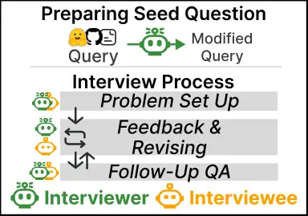

Figure 2: Workflow of LLM-as-an-Interviewer

We design an interview framework for LLMs as illustrated in Figure 2.
The Interviewer plays three main roles throughout the interview process:
(1) Question Modification, (2) Providing Feedback, and (3) Generating
Follow-up Questions. This structure ensures a comprehensive evaluation
of the Interviewee’s capabilities. These roles are modular and
pluggable, allowing users to enable or disable specific roles based on
their evaluation needs. Algorithm 1 provides the implementation of the
interview process.

#### 3.1.1 Question Modification

Before conducting the interview, the Interviewer prepares seed questions
by modifying queries from existing benchmark datasets. This ensures
diverse scenarios that align with established evaluation standards while
preventing data contamination. This approach mirrors human interviewers,
who often tweak existing questions or introduce new challenges. In our
experiment, we employ two query modification strategies, prompting the
model to modify queries. Each strategy is designed to enhance question
diversity while maintaining ease of real-time adjustments and comparable
complexity. We provide a detailed description of these methods in
Appendix C.1.

Our primary goal in query modification is to mitigate data contamination
and enable evaluation of multiple models using the same modified
questions. We recommend that users without contamination concerns or
those preferring direct comparison with original questions may avoid
query modification.

#### 3.1.2 Providing Feedback

During the interview process, the Interviewer evaluates the response
from the Interviewee and provides constructive feedback. Providing
feedback aims to guide the Interviewee in identifying errors, refining
the response, and improving solutions. This phase closely resembles
real-world LLM interaction scenarios, where LLMs iteratively refine
their responses based on user-generated feedback Wang et al. (2023).

#### 3.1.3 Generating Follow-up Questions

After assessing the response to the initial question, the Interviewer
poses follow-up questions to further evaluate the Interviewee’s ability.
The purpose of follow-up questions is to gain deeper insights into the
model’s behavior, such as uncovering reasons for failures or assessing
knowledge omitted in the initial response of the Interviewee model,
rather than directly comparing the accuracy across models. Follow-up
questioning is crucial in many interview processes (e.g., Google coding
interviews) and real-world LLM applications (Bai et al., 2024). Table 1
provides follow-up type examples for the Reasoning, Knowledge, and
Instruction Following tasks.

### 3.2 Interview Report

The Interview Report, generated as a result of the interview process,
includes (1) Performance Scores, (2) Error Analysis and Examples, and
(3) Comprehensive Summary. The real examples of Interview Report are in
Appendix C.1.

##### (1) Performance Scores

We obtain two main performance metrics through the interview process:

- •
  Problem Solving Ability – Measures how effectively the model solves a
  given problem at its $`n`$-th interaction with the Interviewer. We
  define $`\textrm{Score}_{\textrm{seed}}\text{@}n`$ as the model’s
  performance at the $`n`$-th interaction, where an interaction involves
  receiving feedback and making revisions. Thus,
  $`\textrm{Score}_{\textrm{seed}}\text{@}1`$ corresponds to the
  LLM-as-a-Judge setting without feedback, while
  $`\textrm{Score}_{\textrm{seed}}\text{@}n`$ represents performance
  after $`n-1`$ iterations of feedback and revision.
- •
  Follow-up Question Handling – Evaluates how well the model responds to
  follow-up questions. To ensure fairness across models with varying
  performance levels, we categorize follow-up question accuracy into
  three types: accuracy within correctly answered questions, accuracy
  within incorrectly answered questions, and overall accuracy.

These metrics reflect abilities crucial in real-world interactions with
LLMs, where responding effectively to feedback and follow-up questions
significantly influences user satisfaction beyond just answering the
initial query.

| Follow-Up Question       | Type and Example                                                                                                                                                                 |
| ------------------------ | -------------------------------------------------------------------------------------------------------------------------------------------------------------------------------- |
|    Knowledge/Factuality  | Additional Facts  Can you provide an example of determining the 6th roots of unity and specifying their arguments in radians?                                                    |
|    Reasoning             | Clarification  What does it mean for $`a`$ and $`b`$ to be consecutive integers?                                                                                                 |
|                          | Rationale  How did you determine Jasmine’s rate of water consumption per mile?                                                                                                   |
|    Instruction Following | Modification of Conditions  If we change the previous question and assume that each sister of David has two brothers, how many brothers would David have?                        |
|                          | Additional Explanation  Can you provide a specific example of how you would address a potential objection your friend might have about public speaking in your persuasive email? |
|                          | Correction  Can you now reformulate your earlier reply, outputting it in JSON format and only including books published after 1980?                                              |

Table 1: Examples of Follow-Up Questions posed by the interviewer
(GPT-4o) along with the tasks and types.

##### (2) Error Analysis and Examples

A detailed breakdown of error types across multiple interactions, along
with illustrative examples. These highlight common failure reasons and
examples in the models, offering insights into their limitations and
areas for improvement.

##### (3) Comprehensive Summary

A summary of the model’s behavior throughout the interview process
across all samples. It highlights the model’s strengths and weaknesses
in performing the task. (e.g. GPT-4o in DepthQA: ‘‘The model struggles
with conciseness, often providing overly detailed responses...’’)

## 4 Experimental Setup

In this section, we describe the overall experimental setup used in
§ 5- 6, as well as the design of the LLM-as-an-Interviewer framework. In
our experiment, we use three tasks: Reasoning, Knowledge, and
Instruction Following. For Reasoning, we use MATH Hendrycks et al.
(2021) and the reasoning subset of MINT Wang et al. (2023). For
Knowledge, we use DepthQA Ko et al. (2024), a dataset of real-world
STEM-related questions assessing factuality, rebuilt from the TutorEval
dataset. For Instruction Following, we leverage MT-Bench Chiang et al.
(2024), which evaluates an ability to follow multi-turn instructions.

### 4.1 Models

We list all the models³³ 3 We use the Azure API for GPT models,
leveraging the GPT-4o-0514 and GPT-3.5-turbo-0125 versions.⁴⁴ 4 We use
the [Together API](https://api.together.xyz/) to access Llama models.
used throughout our experiments in Section 5-6.

##### Interviewer Models

We adopt GPT-4o as the default Interviewer, as it demonstrates the best
performance (about 90% accuracy as an Interviewer) in our analyses. In
Appendix C.4-C.5, we present detailed analyses on the accuracy of
various interviewers, error analysis, and average cost.

##### Interviewee Models

We use a total of 8 models for the Interviewee, including 2 proprietary
models (GPT-4o OpenAI (2024), GPT-3.5) and 6 open-source models
(Llama-3.1-{8,70}b Grattafiori et al. (2024), deepseek-Math-7b Shao
et al. (2024), Qwen2.5-Math-7b Yang et al. (2024), OLMoE (Muennighoff
et al., 2024) and Zephyr-7b (Tunstall et al., 2023)).

### 4.2 Interview Process Design

LLM-as-an-Interviewer framework adapts to each task type’s
characteristics while maintaining rigorous evaluation standards. This
section describes the interview process design used in the experiments.
Additional details regarding the prompts used are provided in the
Appendix C-D. An example of the full interview log is attached in the
Appendix F.

|               | Reasoning (MATH) |       |       |       |            | Factuality (DepthQA) |        |        |        |            |
| ------------- | ---------------- | ----- | ----- | ----- | ---------- | -------------------- | ------ | ------ | ------ | ---------- |
| Model         | Judge            | @1    | @2    | @3    | $`\Delta`$ | Judge                | @1     | @2     | @3     | $`\Delta`$ |
| GPT-4o        | 0.553            | 0.444 | 0.566 | 0.636 | 0.192      | 0.989                | 0.987  | 0.997  | 0.999  | 0.012      |
| GPT-3.5-turbo | 0.162            | 0.082 | 0.236 | 0.346 | 0.264      | 0.986                | 0.916  | 0.975  | 0.984  | 0.068      |
| Llama3.1-70b  | 0.398            | 0.254 | 0.436 | 0.552 | 0.298      | 0.990                | 0.959  | 0.985  | 0.989  | 0.030      |
| Llama3.1-8B   | 0.222            | 0.128 | 0.217 | 0.300 | 0.172      | 0.984                | 0.906  | 0.970  | 0.977  | 0.071      |
| DeepSeek-math | 0.140            | 0.088 | 0.222 | 0.348 | 0.260      | 0.977                | 0.875  | 0.938  | 0.958  | 0.083      |
| Qwen-math     | 0.454            | 0.303 | 0.429 | 0.483 | 0.180      | 0.814                | 0.878  | 0.898  | 0.907  | 0.029      |
| std.          | 0.143            | 0.161 | 0.123 | 0.126 | -          | 0.0597               | 0.0485 | 0.0482 | 0.0481 | -          |

Table 2: MATH Problem Solving Accuracy and DepthQA Precision along with
Delta ($`\Delta`$) for six models. @k indicates the performance of the
k-th interaction. Judge indicate scores of LLM-as-a-judge.

##### Feedback Criteria

The Interviewer provides feedback when there is an error in the model’s
response or final answer (if the task involves absolute answers). We
prompt the Interviewer to guide the model to recognize its mistakes and
revise accordingly, but not to provide the correct answer directly. We
provide feedback examples in Table 10 of the Appendix, where the
Interviewer gives feedback on incorrect responses or missing aspects
based on the evaluation criteria.

##### Follow-Up question Type

For each task, we categorize follow-up question types as shown in
Table 1. For Knowledge/Factuality tasks, follow-ups probe for additional
facts, partially covering the role of a recall metric by identifying
missing information from the model’s previous response-a common
limitation in factuality evaluation Min et al. (2023). For reasoning
tasks, follow-ups aim to uncover the underlying rationale or failure
reasons. For instruction following, we define three follow-up types
based on the type of second-turn questions by users summarized in
MT-Bench-101 Bai et al. (2024).

## 5 Evaluating LLMs with LLM-as-an-Interviewer

We simulate the interview process with various Interviewee models. We
present insights from interviews, focusing on the seed question-solving
phase in § 5.1, and discuss the follow-up questions phase in § 5.2.

##### Test set

We sample 500 queries⁵⁵ 5 We provide a statistical analysis of the
sampling in Appendix C.2. from both MATH and DepthQA, ensuring an equal
distribution across the difficulty levels specified in the datasets. We
use all 316 samples from the MINT reasoning set and 80 samples from
MT-Bench.

##### Interviewee Models

We use 6 models for the Interviewee, GPT-4o, GPT-3.5, Llama-3.1-{8,70}b,
DeepSeek-Math-7b, Qwen2.5-Math-7b.

### 5.1 Seed Question Solving Phase

Table 2 presents the scores of seed questions in MATH and DepthQA for
both the LLM-as-a-Judge and LLM-as-an-Interviewer settings. In this
experiment, query modification is applied at the beginning of the
interview, and the same questions are used for the interviewee models.
We present the results from MINT in Table 13 of Appendix E.1.

##### Comparison with LLM-as-a-Judge Score

There is a clear performance drop in the LLM-as-an-Interviewer setting,
with most models struggling more when handling modified queries. In
MATH, most models achieve performance comparable to the Judge during the
second interaction. For DepthQA, all models except GPT-4o experience a
significant performance decline, while GPT-4o shows only a minimal
decrease of 0.2%. In addition, the evaluation criteria that assess both
the reasoning process and the final answers can contribute to this
performance drop. For example, GPT-3.5 correctly answers the questions
but introduces errors in the solving process in 3% of the MATH test set.

##### Model’s Capability to Revise Through Feedback

Across all models, performance improves when feedback is provided for
incorrect answers ($`\text{@}2,\text{@}3`$), compared to the initial
accuracy ($`\text{@}1`$). Interestingly, as the models receive feedback
and iteratively revise their answers, the standard deviation (std) of
scores across models generally decreases compared to that in the
LLM-as-a-Judge setting and @1 score. This is mainly because models that
initially perform poorly show substantial improvement through
interaction.

### 5.2 Follow-UP Question Solving Phase

|               |     | Reasoning (MATH) |      |         | Reasoning (MINT) |      |         | Factuality (DepthQA) |      |         |
| ------------- | --- | ---------------- | ---- | ------- | ---------------- | ---- | ------- | -------------------- | ---- | ------- |
| Model         |     | Success          | Fail | Overall | Success          | Fail | Overall | Success              | Fail | Overall |
| GPT-4o        |     | 0.99             | 0.17 | 0.93    | 0.96             | 0.82 | 0.94    | 0.93                 | 0.50 | 0.92    |
| GPT-3.5       |     | 0.90             | 0.56 | 0.82    | 0.85             | 0.70 | 0.80    | 0.73                 | 0.64 | 0.73    |
| Llama3.1-70b  |     | 0.91             | 0.22 | 0.84    | 0.91             | 0.74 | 0.87    | 0.85                 | 0.63 | 0.83    |
| Llama3.1-8B   |     | 0.89             | 0.07 | 0.76    | 0.75             | 0.65 | 0.72    | 0.80                 | 1.00 | 0.80    |
| DeepSeek-math |     | 0.82             | 0.38 | 0.69    | 0.42             | 0.41 | 0.42    | 0.68                 | 0.50 | 0.65    |
| Qwen-2.5-math |     | 0.90             | 0.08 | 0.78    | 0.55             | 0.34 | 0.50    | 0.61                 | 0.32 | 0.52    |

Table 3: Follow-up accuracy of six models on MATH, MINT, and Depth-QA
datasets.

Table 3 presents follow-up question accuracy in Reasoning and Factuality
tasks. Overall, models exhibit higher accuracy on follow-up questions
for correctly answered seed questions than for failed ones. In § 5.2.1,
we provide a discussion based on the MT-Bench evaluation.

#### 5.2.1 Comparing with Static Multi-turn Benchmark

We compare follow-up questions in LLM-as-an-Interviewer with
MT-Bench Chiang et al. (2024), a 2-turn static benchmark with 80 samples
across various tasks (e.g., writing, math, coding, roleplay).

MT-Bench primarily uses general second-turn questions that are
independent of previous responses (e.g., "Explain like I’m five,"
"Change format"), limiting diversity, and realism. In contrast,
LLM-as-an-Interviewer generates context-aware follow-ups (e.g., "You
mentioned Thomas might be in a clinical trial. Can you explain what a
clinical trial is and why it requires daily hospital visits?"). Some
MT-Bench tasks reference previous responses (e.g., "Explain the N-th
example from your previous response."), which can cause contradictions
if the model fails to follow instructions in turn 1, as seen in the
following example.

|             | MT-bench |     | Interviewer |      |
| ----------- | -------- | --- | ----------- | ---- |
|             |          |     | GPT-4o      | Qwen |
| Dependent   | 27       |     | 54          | 44   |
| Independent | 53       |     | 26          | 36   |

Table 4: Dependent and Independent question Counts in 2-turn questions.
GPT-4o and Qwen denote the Interviewee.

Table 4 shows the number of dependent and independent follow-up
questions for each setting. For the Interviewer setting, we compare
GPT-4o, the best-performing model at turn-1, and Qwen, the
worst-performing model with low instruction-following ability⁶⁶ 6 See
Table 15 in Appendix E for the results in MT-bench. Aligned with
MT-Bench failure examples, Qwen receives more independent follow-ups
(e.g., topic shifts), while GPT-4o receives more dependent ones. As
such, considering previous responses dynamically during multi-turn
evaluations is crucial for assessing the model in a more diverse and
natural context.

## 6 Can LLM-as-an-Interviewer Mitigate Data Contamination Issue?

This section demonstrates the efficiency of the modification strategy in
generating questions based on established benchmarks.

### 6.1 Experimental Setting

We establish various settings depending on the model’s training dataset.
Specifically, we use two open-source models, OLMoE and Zephyr-7b, whose
training datasets are disclosed, and fine-tune them on different
training sets. These settings allow us to evaluate both Uncontaminated
Models—which do not access the test set during training, and
Contaminated Models—which are trained with exposure to the test set.

##### Uncontaminated Model Training

As shown in the setting column of Table 5, we train uncontaminated
models using three distinct configurations:

- 1
  Models trained exclusively on the train set of the target dataset
  (In-Distribution, $`{Train}_{ID}`$).
- 2
  Models trained on both the $`{Train}_{ID}`$ and additional datasets
  from the same domain (Out-Of-Distribution, $`{Train}_{OOD}`$).
- 3
  Models trained solely on $`{Train}_{OOD}`$.

##### Contaminated Model Training

For contaminated models, we employ four different configurations:

- 4
  Models trained exclusively on the test set of the target dataset
  (In-Distribution, $`{Test}_{ID}`$).
- 5
  Models trained on both the $`{Test}_{ID}`$ and $`{Train}_{ID}`$ sets.
- 6
  Models trained on the $`{Test}_{ID}`$ combined with an
  instruction-tuning ($`{Instruct}`$) dataset.
- 7
  Models trained on both $`{Test}_{ID}`$ and $`{Train}_{OOD}`$.

##### Dataset

We use the in-distribution test set($`{Test}_{ID}`$) when testing the
model, and MATH and DepthQA are used as in-distribution datasets. Since
DepthQA is not pre-divided into train and test sets, we manually split
it into 851 instances for the $`\text{DepthQA}_{\text{train}}`$ set and
848 instances for the $`\text{DepthQA}_{\text{test}}`$ set. For other
datasets, we randomly select 2000 samples each. For the
out-of-distribution dataset of MATH, we use GSM8K. For MATH, we
experiment with all seven settings, while for DepthQA, we include only
the four settings that do not involve out-of-distribution (OOD) data.

Details about model training, including training configurations,
parameters, and datasets used, are provided in Appendix G.1.

|                                     |       |        |         |        |         |
| ----------------------------------- | ----- | ------ | ------- | ------ | ------- |
|                                     |       | OLMoE  |         | Zephyr |         |
| Model.                              |       | Judge. | Interv. | Judge. | Interv. |
| Uncontam.                           |       |        |         |        |         |
| $`\text{Train set}_{\text{ID}}`$    | \[1\] | 0.10   | 0.05    | 0.10   | 0.01    |
| \+$`\text{Train set}_{\text{OOD}}`$ | \[2\] | 0.07   | 0.05    | 0.08   | 0.04    |
| $`\text{Train set}_{\text{OOD}}`$   | \[3\] | 0.07   | 0.06    | 0.06   | 0.02    |
| Avg.                                |       | 0.08   | 0.05    | 0.08   | 0.02    |
| Contam.                             |       |        |         |        |         |
| $`\text{Test set}_{\text{ID}}`$     | \[4\] | 0.84   | 0.08    | 0.61   | 0.10    |
| \+$`\text{Train set}_{\text{ID}}`$  | \[5\] | 0.77   | 0.15    | 0.64   | 0.17    |
| +Instruct                           | \[6\] | 0.56   | 0.12    | 0.19   | 0.09    |
| \+$`\text{Train set}_{\text{OOD}}`$ | \[7\] | 0.75   | 0.10    | 0.42   | 0.08    |
| Avg.                                |       | 0.69   | 0.12    | 0.42   | 0.11    |

Table 5: Performance of uncontaminated and contaminated models on MATH
dataset. "Judge" refers to the LLM-as-a-Judge setting, and "Interv"
refers to the LLM-as-an-Interver setting.

### 6.2 Result

Table 5 presents the effectiveness of the modifying strategy in
mitigating data contamination, which is applied while the Interviewer
prepares the seed queries. The tables compare accuracy for both the
original queries just as LLM-as-an-Judge setting (Judge) and modified
queries (Interview). Settings \[1, 2, 3\] represent uncontaminated
models, serving as a proxy for the model’s true ability on the task. The
goal of the strategy is to bring the performance of contaminated models
closer to these uncontaminated models.

In MATH, contaminated models often outperform uncontaminated ones under
the Judge setting. These contaminated models achieve significantly
higher accuracy, averaging 0.7 for OLMoE and 0.4 for Zephyr. However,
applying the modification strategy leads to a substantial performance
drop, making their performance comparable to the uncontaminated model. A
similar trend is observed in the DepthQA results (Table 16 in
Appendix G). The results show that our framework mitigates the
contamination issue by having the model solve similar yet modified
questions.

## 7 Discussion

We assess whether LLM-as-an-Interviewer exhibits verbosity bias and
maintains robustness across multiple runs, a common consideration in
model-based evaluation Zheng et al. (2023b).⁷⁷ 7 We also provide an
analysis of self-enhancement bias in the appendix H.2.

##### Verbosity Bias

To assess whether the framework favors longer answers, we examine the
correlation between answer length and score using the Depth-QA task.
GPT-4o acts as the Interviewer, with six models as Interviewee.⁸⁸ 8
Interviewee: GPT-4o, GPT-3.5-turbo, Llama-3.1-70b, Llama-3.1-8b,
DeepSeek-Math, Qwen2-Math.

Figures 3 in the Appendix H.1 reveal that the linear correlation (r)
between length and score weakens as interactions increase. In the
LLM-as-a-Judge setting , a significant positive correlation is found (r
= .371, p \< .05); however, as interactions progress, the p-value rises
and r-value declines. This indicates that our interview process could
reduce verbosity bias and length dependency, alongside the length
control mechanism for adjusting win rates or scores Dubois et al.
(2024a).

| Interact. | @1     | @2     | @3     | @4     | @5     |
| --------- | ------ | ------ | ------ | ------ | ------ |
| DepthQA   | 0.0244 | 0.0151 | 0.0116 | 0.0090 | 0.0082 |
| MATH      | 0.0358 | 0.0480 | 0.0583 | 0.0642 | 0.0704 |
| easy      | 0.1115 | 0.1127 | 0.0839 | 0.0797 | 0.0890 |
| hard      | 0.0531 | 0.1032 | 0.1281 | 0.1372 | 0.1332 |

Table 6: Standard Deviation of Multiple Runs Across Interactions.

##### Does LLM-as-an-Interviewer Function Robust?

We assess the robustness of our framework across multiple interactions
by repeating the experiment five times for each setting. Specifically,
We calculate the standard deviation of these five runs for each
combination of different Interviewer temperatures (0 or 1) and different
Interviewee models. The Interviewee’s temperature remains fixed at 1. We
use GPT-4o as the Interviewer and GPT-3.5 and Llama-3.1-{8/70}b as the
Interviewee.

As shown in Table 6, the standard deviation for DepthQA decreases with
more interactions. In contrast, for MATH, it increases over time.
Breaking MATH down by difficulty, we find that for easier problems
(levels ≤2, MATH-easy), the standard deviation remains stable or
decreases, whereas for harder problems (levels ≥3, MATH-hard), it rises
due to initially low accuracy and occasional correct answers from
feedback. Excluding MATH-hard, the standard deviation remains stable,
demonstrating the framework’s robustness in most cases.

## 8 Conclusion

In this paper, we introduce LLM-as-an-Interviewer, a novel approach for
evaluating LLMs through interviews. Our multi-turn evaluation framework
with Interview Report reveals the abilities of LLMs, such as revising
answers based on feedback or handling follow-up questions, while
providing comprehensive insights into the task. Our analysis
demonstrates that our framework mitigates common issues in static
evaluation methods, including verbosity bias and data contamination. We
hope our framework is widely adopted and brings a paradigm shift in LLM
evaluation.

## 9 Limitations

While our framework addresses several biases and limitations of the
LLM-as-a-judge approach, it still inherits some of the inherent
limitations of large language models, such as inconsistency and the
potential to introduce additional biases, similar to the issues raised
in the LLM-as-a-judge approach.

## Acknowledgements

This research project has benefitted from the Microsoft Accelerate
Foundation Models Research (AFMR) grant program through which leading
foundation models hosted by Microsoft Azure along with access to Azure
credits were provided to conduct the research. This work was supported
by Institute for Information & communications Technology Promotion(IITP)
grant funded by the Korea government (MSIP) (No. RS-2024-00443251,
Accurate and Safe Multimodal, Multilingual Personalized AI Tutors)

## References

- Bai et al. (2024) Ge Bai, Jie Liu, Xingyuan Bu, Yancheng He, Jiaheng
  Liu, Zhanhui Zhou, Zhuoran Lin, Wenbo Su, Tiezheng Ge, Bo Zheng, and
  Wanli Ouyang. 2024. [MT-bench-101: A fine-grained benchmark for
  evaluating large language models in multi-turn
  dialogues](https://doi.org/10.18653/v1/2024.acl-long.401). In
  _Proceedings of the 62nd Annual Meeting of the Association for
  Computational Linguistics (Volume 1: Long Papers)_, pages 7421–7454,
  Bangkok, Thailand. Association for Computational Linguistics.
- Chang et al. (2024) Yupeng Chang, Xu Wang, Jindong Wang, Yuan Wu,
  Linyi Yang, Kaijie Zhu, Hao Chen, Xiaoyuan Yi, Cunxiang Wang, Yidong
  Wang, et al. 2024. A survey on evaluation of large language models.
  _ACM Transactions on Intelligent Systems and Technology_, 15(3):1–45.
- Chiang and Lee (2023) Cheng-Han Chiang and Hung-Yi Lee. 2023. Can
  large language models be an alternative to human evaluations? In
  _Proceedings of the 61st Annual Meeting of the Association for
  Computational Linguistics (Volume 1: Long Papers)_, pages 15607–15631.
- Chiang et al. (2024) Wei-Lin Chiang, Lianmin Zheng, Ying Sheng,
  Anastasios Nikolas Angelopoulos, Tianle Li, Dacheng Li, Hao Zhang,
  Banghua Zhu, Michael Jordan, Joseph E. Gonzalez, and Ion Stoica. 2024.
  [Chatbot arena: An open platform for evaluating llms by human
  preference](http://arxiv.org/abs/2403.04132).
- Dekoninck et al. (2024a) Jasper Dekoninck, Mark Niklas Müller,
  Maximilian Baader, Marc Fischer, and Martin Vechev. 2024a. [Evading
  data contamination detection for language models is (too)
  easy](http://arxiv.org/abs/2402.02823).
- Dekoninck et al. (2024b) Jasper Dekoninck, Mark Niklas Müller, and
  Martin Vechev. 2024b. [Constat: Performance-based contamination
  detection in large language models](http://arxiv.org/abs/2405.16281).
- Deng et al. (2024) Chunyuan Deng, Yilun Zhao, Xiangru Tang, Mark
  Gerstein, and Arman Cohan. 2024. [Investigating data contamination in
  modern benchmarks for large language
  models](http://arxiv.org/abs/2311.09783).
- Dodge et al. (2021) Jesse Dodge, Maarten Sap, Ana Marasović, William
  Agnew, Gabriel Ilharco, Dirk Groeneveld, Margaret Mitchell, and Matt
  Gardner. 2021. [Documenting large webtext corpora: A case study on the
  colossal clean crawled corpus](http://arxiv.org/abs/2104.08758).
- Dubois et al. (2024a) Yann Dubois, Balázs Galambosi, Percy Liang, and
  Tatsunori B. Hashimoto. 2024a. [Length-controlled alpacaeval: A simple
  way to debias automatic evaluators](http://arxiv.org/abs/2404.04475).
- Dubois et al. (2024b) Yann Dubois, Percy Liang, and Tatsunori
  Hashimoto. 2024b. Length-controlled alpacaeval: A simple debiasing of
  automatic evaluators. In _First Conference on Language Modeling_.
- Grattafiori et al. (2024) Aaron Grattafiori, Abhimanyu Dubey, Abhinav
  Jauhri, Abhinav Pandey, Abhishek Kadian, Ahmad Al-Dahle, Aiesha
  Letman, Akhil Mathur, Alan Schelten, Alex Vaughan, Amy Yang, Angela
  Fan, Anirudh Goyal, Anthony Hartshorn, Aobo Yang, Archi Mitra, Archie
  Sravankumar, Artem Korenev, Arthur Hinsvark, Arun Rao, Aston Zhang,
  Aurelien Rodriguez, Austen Gregerson, Ava Spataru, Baptiste Roziere,
  Bethany Biron, Binh Tang, Bobbie Chern, Charlotte Caucheteux, Chaya
  Nayak, Chloe Bi, Chris Marra, Chris McConnell, Christian Keller,
  Christophe Touret, Chunyang Wu, Corinne Wong, Cristian Canton Ferrer,
  Cyrus Nikolaidis, Damien Allonsius, Daniel Song, Danielle Pintz, Danny
  Livshits, Danny Wyatt, David Esiobu, Dhruv Choudhary, Dhruv Mahajan,
  Diego Garcia-Olano, Diego Perino, Dieuwke Hupkes, Egor Lakomkin, Ehab
  AlBadawy, Elina Lobanova, Emily Dinan, Eric Michael Smith, Filip
  Radenovic, Francisco Guzmán, Frank Zhang, Gabriel Synnaeve, Gabrielle
  Lee, Georgia Lewis Anderson, Govind Thattai, Graeme Nail, Gregoire
  Mialon, Guan Pang, Guillem Cucurell, Hailey Nguyen, Hannah Korevaar,
  Hu Xu, Hugo Touvron, Iliyan Zarov, Imanol Arrieta Ibarra, Isabel
  Kloumann, Ishan Misra, Ivan Evtimov, Jack Zhang, Jade Copet, Jaewon
  Lee, Jan Geffert, Jana Vranes, Jason Park, Jay Mahadeokar, Jeet Shah,
  Jelmer van der Linde, Jennifer Billock, Jenny Hong, Jenya Lee, Jeremy
  Fu, Jianfeng Chi, Jianyu Huang, Jiawen Liu, Jie Wang, Jiecao Yu,
  Joanna Bitton, Joe Spisak, Jongsoo Park, Joseph Rocca, Joshua
  Johnstun, Joshua Saxe, Junteng Jia, Kalyan Vasuden Alwala, Karthik
  Prasad, Kartikeya Upasani, Kate Plawiak, Ke Li, Kenneth Heafield,
  Kevin Stone, Khalid El-Arini, Krithika Iyer, Kshitiz Malik, Kuenley
  Chiu, Kunal Bhalla, Kushal Lakhotia, Lauren Rantala-Yeary, Laurens
  van der Maaten, Lawrence Chen, Liang Tan, Liz Jenkins, Louis Martin,
  Lovish Madaan, Lubo Malo, Lukas Blecher, Lukas Landzaat, Luke
  de Oliveira, Madeline Muzzi, Mahesh Pasupuleti, Mannat Singh, Manohar
  Paluri, Marcin Kardas, Maria Tsimpoukelli, Mathew Oldham, Mathieu
  Rita, Maya Pavlova, Melanie Kambadur, Mike Lewis, Min Si, Mitesh Kumar
  Singh, Mona Hassan, Naman Goyal, Narjes Torabi, Nikolay Bashlykov,
  Nikolay Bogoychev, Niladri Chatterji, Ning Zhang, Olivier Duchenne,
  Onur Çelebi, Patrick Alrassy, Pengchuan Zhang, Pengwei Li, Petar
  Vasic, Peter Weng, Prajjwal Bhargava, Pratik Dubal, Praveen Krishnan,
  Punit Singh Koura, Puxin Xu, Qing He, Qingxiao Dong, Ragavan
  Srinivasan, Raj Ganapathy, Ramon Calderer, Ricardo Silveira Cabral,
  Robert Stojnic, Roberta Raileanu, Rohan Maheswari, Rohit Girdhar,
  Rohit Patel, Romain Sauvestre, Ronnie Polidoro, Roshan Sumbaly, Ross
  Taylor, Ruan Silva, Rui Hou, Rui Wang, Saghar Hosseini, Sahana
  Chennabasappa, Sanjay Singh, Sean Bell, Seohyun Sonia Kim, Sergey
  Edunov, Shaoliang Nie, Sharan Narang, Sharath Raparthy, Sheng Shen,
  Shengye Wan, Shruti Bhosale, Shun Zhang, Simon Vandenhende, Soumya
  Batra, Spencer Whitman, Sten Sootla, Stephane Collot, Suchin
  Gururangan, Sydney Borodinsky, Tamar Herman, Tara Fowler, Tarek
  Sheasha, Thomas Georgiou, Thomas Scialom, Tobias Speckbacher, Todor
  Mihaylov, Tong Xiao, Ujjwal Karn, Vedanuj Goswami, Vibhor Gupta,
  Vignesh Ramanathan, Viktor Kerkez, Vincent Gonguet, Virginie Do, Vish
  Vogeti, Vítor Albiero, Vladan Petrovic, Weiwei Chu, Wenhan Xiong,
  Wenyin Fu, Whitney Meers, Xavier Martinet, Xiaodong Wang, Xiaofang
  Wang, Xiaoqing Ellen Tan, Xide Xia, Xinfeng Xie, Xuchao Jia, Xuewei
  Wang, Yaelle Goldschlag, Yashesh Gaur, Yasmine Babaei, Yi Wen, Yiwen
  Song, Yuchen Zhang, Yue Li, Yuning Mao, Zacharie Delpierre Coudert,
  Zheng Yan, Zhengxing Chen, Zoe Papakipos, Aaditya Singh, Aayushi
  Srivastava, Abha Jain, Adam Kelsey, Adam Shajnfeld, Adithya Gangidi,
  Adolfo Victoria, Ahuva Goldstand, Ajay Menon, Ajay Sharma, Alex
  Boesenberg, Alexei Baevski, Allie Feinstein, Amanda Kallet, Amit
  Sangani, Amos Teo, Anam Yunus, Andrei Lupu, Andres Alvarado, Andrew
  Caples, Andrew Gu, Andrew Ho, Andrew Poulton, Andrew Ryan, Ankit
  Ramchandani, Annie Dong, Annie Franco, Anuj Goyal, Aparajita Saraf,
  Arkabandhu Chowdhury, Ashley Gabriel, Ashwin Bharambe, Assaf Eisenman,
  Azadeh Yazdan, Beau James, Ben Maurer, Benjamin Leonhardi, Bernie
  Huang, Beth Loyd, Beto De Paola, Bhargavi Paranjape, Bing Liu, Bo Wu,
  Boyu Ni, Braden Hancock, Bram Wasti, Brandon Spence, Brani Stojkovic,
  Brian Gamido, Britt Montalvo, Carl Parker, Carly Burton, Catalina
  Mejia, Ce Liu, Changhan Wang, Changkyu Kim, Chao Zhou, Chester Hu,
  Ching-Hsiang Chu, Chris Cai, Chris Tindal, Christoph Feichtenhofer,
  Cynthia Gao, Damon Civin, Dana Beaty, Daniel Kreymer, Daniel Li, David
  Adkins, David Xu, Davide Testuggine, Delia David, Devi Parikh, Diana
  Liskovich, Didem Foss, Dingkang Wang, Duc Le, Dustin Holland, Edward
  Dowling, Eissa Jamil, Elaine Montgomery, Eleonora Presani, Emily Hahn,
  Emily Wood, Eric-Tuan Le, Erik Brinkman, Esteban Arcaute, Evan Dunbar,
  Evan Smothers, Fei Sun, Felix Kreuk, Feng Tian, Filippos Kokkinos,
  Firat Ozgenel, Francesco Caggioni, Frank Kanayet, Frank Seide,
  Gabriela Medina Florez, Gabriella Schwarz, Gada Badeer, Georgia Swee,
  Gil Halpern, Grant Herman, Grigory Sizov, Guangyi, Zhang, Guna
  Lakshminarayanan, Hakan Inan, Hamid Shojanazeri, Han Zou, Hannah Wang,
  Hanwen Zha, Haroun Habeeb, Harrison Rudolph, Helen Suk, Henry
  Aspegren, Hunter Goldman, Hongyuan Zhan, Ibrahim Damlaj, Igor Molybog,
  Igor Tufanov, Ilias Leontiadis, Irina-Elena Veliche, Itai Gat, Jake
  Weissman, James Geboski, James Kohli, Janice Lam, Japhet Asher,
  Jean-Baptiste Gaya, Jeff Marcus, Jeff Tang, Jennifer Chan, Jenny Zhen,
  Jeremy Reizenstein, Jeremy Teboul, Jessica Zhong, Jian Jin, Jingyi
  Yang, Joe Cummings, Jon Carvill, Jon Shepard, Jonathan McPhie,
  Jonathan Torres, Josh Ginsburg, Junjie Wang, Kai Wu, Kam Hou U, Karan
  Saxena, Kartikay Khandelwal, Katayoun Zand, Kathy Matosich, Kaushik
  Veeraraghavan, Kelly Michelena, Keqian Li, Kiran Jagadeesh, Kun Huang,
  Kunal Chawla, Kyle Huang, Lailin Chen, Lakshya Garg, Lavender A,
  Leandro Silva, Lee Bell, Lei Zhang, Liangpeng Guo, Licheng Yu, Liron
  Moshkovich, Luca Wehrstedt, Madian Khabsa, Manav Avalani, Manish
  Bhatt, Martynas Mankus, Matan Hasson, Matthew Lennie, Matthias Reso,
  Maxim Groshev, Maxim Naumov, Maya Lathi, Meghan Keneally, Miao Liu,
  Michael L. Seltzer, Michal Valko, Michelle Restrepo, Mihir Patel, Mik
  Vyatskov, Mikayel Samvelyan, Mike Clark, Mike Macey, Mike Wang,
  Miquel Jubert Hermoso, Mo Metanat, Mohammad Rastegari, Munish Bansal,
  Nandhini Santhanam, Natascha Parks, Natasha White, Navyata Bawa, Nayan
  Singhal, Nick Egebo, Nicolas Usunier, Nikhil Mehta, Nikolay Pavlovich
  Laptev, Ning Dong, Norman Cheng, Oleg Chernoguz, Olivia Hart, Omkar
  Salpekar, Ozlem Kalinli, Parkin Kent, Parth Parekh, Paul Saab, Pavan
  Balaji, Pedro Rittner, Philip Bontrager, Pierre Roux, Piotr Dollar,
  Polina Zvyagina, Prashant Ratanchandani, Pritish Yuvraj, Qian Liang,
  Rachad Alao, Rachel Rodriguez, Rafi Ayub, Raghotham Murthy, Raghu
  Nayani, Rahul Mitra, Rangaprabhu Parthasarathy, Raymond Li, Rebekkah
  Hogan, Robin Battey, Rocky Wang, Russ Howes, Ruty Rinott, Sachin
  Mehta, Sachin Siby, Sai Jayesh Bondu, Samyak Datta, Sara Chugh, Sara
  Hunt, Sargun Dhillon, Sasha Sidorov, Satadru Pan, Saurabh Mahajan,
  Saurabh Verma, Seiji Yamamoto, Sharadh Ramaswamy, Shaun Lindsay, Shaun
  Lindsay, Sheng Feng, Shenghao Lin, Shengxin Cindy Zha, Shishir Patil,
  Shiva Shankar, Shuqiang Zhang, Shuqiang Zhang, Sinong Wang, Sneha
  Agarwal, Soji Sajuyigbe, Soumith Chintala, Stephanie Max, Stephen
  Chen, Steve Kehoe, Steve Satterfield, Sudarshan Govindaprasad, Sumit
  Gupta, Summer Deng, Sungmin Cho, Sunny Virk, Suraj Subramanian,
  Sy Choudhury, Sydney Goldman, Tal Remez, Tamar Glaser, Tamara Best,
  Thilo Koehler, Thomas Robinson, Tianhe Li, Tianjun Zhang, Tim
  Matthews, Timothy Chou, Tzook Shaked, Varun Vontimitta, Victoria
  Ajayi, Victoria Montanez, Vijai Mohan, Vinay Satish Kumar, Vishal
  Mangla, Vlad Ionescu, Vlad Poenaru, Vlad Tiberiu Mihailescu, Vladimir
  Ivanov, Wei Li, Wenchen Wang, Wenwen Jiang, Wes Bouaziz, Will
  Constable, Xiaocheng Tang, Xiaojian Wu, Xiaolan Wang, Xilun Wu, Xinbo
  Gao, Yaniv Kleinman, Yanjun Chen, Ye Hu, Ye Jia, Ye Qi, Yenda Li,
  Yilin Zhang, Ying Zhang, Yossi Adi, Youngjin Nam, Yu, Wang, Yu Zhao,
  Yuchen Hao, Yundi Qian, Yunlu Li, Yuzi He, Zach Rait, Zachary DeVito,
  Zef Rosnbrick, Zhaoduo Wen, Zhenyu Yang, Zhiwei Zhao, and Zhiyu
  Ma. 2024. [The llama 3 herd of
  models](http://arxiv.org/abs/2407.21783).
- Gu et al. (2024) Jiawei Gu, Xuhui Jiang, Zhichao Shi, Hexiang Tan,
  Xuehao Zhai, Chengjin Xu, Wei Li, Yinghan Shen, Shengjie Ma, Honghao
  Liu, et al. 2024. A survey on llm-as-a-judge. _arXiv preprint
  arXiv:2411.15594_.
- Hendrycks et al. (2021) Dan Hendrycks, Collin Burns, Saurav Kadavath,
  Akul Arora, Steven Basart, Eric Tang, Dawn Song, and Jacob
  Steinhardt. 2021. [Measuring mathematical problem solving with the
  math dataset](http://arxiv.org/abs/2103.03874).
- Jain et al. (2024) Naman Jain, King Han, Alex Gu, Wen-Ding Li, Fanjia
  Yan, Tianjun Zhang, Sida Wang, Armando Solar-Lezama, Koushik Sen, and
  Ion Stoica. 2024. [Livecodebench: Holistic and contamination free
  evaluation of large language models for
  code](http://arxiv.org/abs/2403.07974).
- Jiang et al. (2024) Minhao Jiang, Ken Ziyu Liu, Ming Zhong, Rylan
  Schaeffer, Siru Ouyang, Jiawei Han, and Sanmi Koyejo. 2024.
  [Investigating data contamination for pre-training language
  models](http://arxiv.org/abs/2401.06059).
- Kim et al. (2024) Seungone Kim, Jamin Shin, Yejin Cho, Joel Jang,
  Shayne Longpre, Hwaran Lee, Sangdoo Yun, Seongjin Shin, Sungdong Kim,
  James Thorne, and Minjoon Seo. 2024. [Prometheus: Inducing
  fine-grained evaluation capability in language
  models](http://arxiv.org/abs/2310.08491).
- Ko et al. (2024) Miyoung Ko, Sue Hyun Park, Joonsuk Park, and Minjoon
  Seo. 2024. [Hierarchical deconstruction of LLM reasoning: A
  graph-based framework for analyzing knowledge
  utilization](https://doi.org/10.18653/v1/2024.emnlp-main.288). In
  _Proceedings of the 2024 Conference on Empirical Methods in Natural
  Language Processing_, pages 4995–5027, Miami, Florida, USA.
  Association for Computational Linguistics.
- Kwan et al. (2024) Wai-Chung Kwan, Xingshan Zeng, Yuxin Jiang, Yufei
  Wang, Liangyou Li, Lifeng Shang, Xin Jiang, Qun Liu, and Kam-Fai
  Wong. 2024. Mt-eval: A multi-turn capabilities evaluation benchmark
  for large language models. _arXiv preprint arXiv:2401.16745_.
- Li et al. (2024a) Dawei Li, Bohan Jiang, Liangjie Huang, Alimohammad
  Beigi, Chengshuai Zhao, Zhen Tan, Amrita Bhattacharjee, Yuxuan Jiang,
  Canyu Chen, Tianhao Wu, et al. 2024a. From generation to judgment:
  Opportunities and challenges of llm-as-a-judge. _arXiv preprint
  arXiv:2411.16594_.
- Li et al. (2019) Margaret Li, Jason Weston, and Stephen Roller. 2019.
  Acute-eval: Improved dialogue evaluation with optimized questions and
  multi-turn comparisons. _arXiv preprint arXiv:1909.03087_.
- Li et al. (2024b) Xiang Lisa Li, Evan Zheran Liu, Percy Liang, and
  Tatsunori Hashimoto. 2024b. [Autobencher: Creating salient, novel,
  difficult datasets for language
  models](http://arxiv.org/abs/2407.08351).
- Li et al. (2023a) Xibo Li, Bowei Zou, Yifan Fan, Yanling Li, Ai Ti Aw,
  and Yu Hong. 2023a. [Interview evaluation: A novel approach for
  automatic evaluation of conversational question answering
  models](https://doi.org/10.18653/v1/2023.emnlp-main.209). In
  _Proceedings of the 2023 Conference on Empirical Methods in Natural
  Language Processing_, pages 3435–3446, Singapore. Association for
  Computational Linguistics.
- Li et al. (2023b) Xuechen Li, Tianyi Zhang, Yann Dubois, Rohan Taori,
  Ishaan Gulrajani, Carlos Guestrin, Percy Liang, and Tatsunori B.
  Hashimoto. 2023b. Alpacaeval: An automatic evaluator of
  instruction-following models.
  [https://github.com/tatsu-lab/alpaca_eval](https://github.com/tatsu-lab/alpaca_eval).
- Liang et al. (2022) Percy Liang, Rishi Bommasani, Tony Lee, Dimitris
  Tsipras, Dilara Soylu, Michihiro Yasunaga, Yian Zhang, Deepak
  Narayanan, Yuhuai Wu, Ananya Kumar, et al. 2022. Holistic evaluation
  of language models. _arXiv preprint arXiv:2211.09110_.
- Lin (2004) Chin-Yew Lin. 2004. Rouge: A package for automatic
  evaluation of summaries. In _Text summarization branches out_, pages
  74–81.
- Magar and Schwartz (2022) Inbal Magar and Roy Schwartz. 2022. [Data
  contamination: From memorization to
  exploitation](http://arxiv.org/abs/2203.08242).
- Min et al. (2023) Sewon Min, Kalpesh Krishna, Xinxi Lyu, Mike Lewis,
  Wen-tau Yih, Pang Koh, Mohit Iyyer, Luke Zettlemoyer, and Hannaneh
  Hajishirzi. 2023. [FActScore: Fine-grained atomic evaluation of
  factual precision in long form text
  generation](https://doi.org/10.18653/v1/2023.emnlp-main.741). In
  _Proceedings of the 2023 Conference on Empirical Methods in Natural
  Language Processing_, pages 12076–12100, Singapore. Association for
  Computational Linguistics.
- Mirzadeh et al. (2024) Iman Mirzadeh, Keivan Alizadeh, Hooman
  Shahrokhi, Oncel Tuzel, Samy Bengio, and Mehrdad Farajtabar. 2024.
  [Gsm-symbolic: Understanding the limitations of mathematical reasoning
  in large language models](http://arxiv.org/abs/2410.05229).
- Muennighoff et al. (2024) Niklas Muennighoff, Luca Soldaini, Dirk
  Groeneveld, Kyle Lo, Jacob Morrison, Sewon Min, Weijia Shi, Pete
  Walsh, Oyvind Tafjord, Nathan Lambert, Yuling Gu, Shane Arora, Akshita
  Bhagia, Dustin Schwenk, David Wadden, Alexander Wettig, Binyuan Hui,
  Tim Dettmers, Douwe Kiela, Ali Farhadi, Noah A. Smith, Pang Wei Koh,
  Amanpreet Singh, and Hannaneh Hajishirzi. 2024. [Olmoe: Open
  mixture-of-experts language models](http://arxiv.org/abs/2409.02060).
- OpenAI (2024) OpenAI. 2024. [Gpt-4o system
  card](http://arxiv.org/abs/2410.21276).
- OpenAI et al. (2024) OpenAI, Josh Achiam, Steven Adler, Sandhini
  Agarwal, Lama Ahmad, Ilge Akkaya, Florencia Leoni Aleman, Diogo
  Almeida, Janko Altenschmidt, Sam Altman, Shyamal Anadkat, Red Avila,
  Igor Babuschkin, Suchir Balaji, Valerie Balcom, Paul Baltescu, Haiming
  Bao, Mohammad Bavarian, Jeff Belgum, Irwan Bello, Jake Berdine,
  Gabriel Bernadett-Shapiro, Christopher Berner, Lenny Bogdonoff, Oleg
  Boiko, Madelaine Boyd, Anna-Luisa Brakman, Greg Brockman, Tim Brooks,
  Miles Brundage, Kevin Button, Trevor Cai, Rosie Campbell, Andrew Cann,
  Brittany Carey, Chelsea Carlson, Rory Carmichael, Brooke Chan, Che
  Chang, Fotis Chantzis, Derek Chen, Sully Chen, Ruby Chen, Jason Chen,
  Mark Chen, Ben Chess, Chester Cho, Casey Chu, Hyung Won Chung, Dave
  Cummings, Jeremiah Currier, Yunxing Dai, Cory Decareaux, Thomas Degry,
  Noah Deutsch, Damien Deville, Arka Dhar, David Dohan, Steve Dowling,
  Sheila Dunning, Adrien Ecoffet, Atty Eleti, Tyna Eloundou, David
  Farhi, Liam Fedus, Niko Felix, Simón Posada Fishman, Juston Forte,
  Isabella Fulford, Leo Gao, Elie Georges, Christian Gibson, Vik Goel,
  Tarun Gogineni, Gabriel Goh, Rapha Gontijo-Lopes, Jonathan Gordon,
  Morgan Grafstein, Scott Gray, Ryan Greene, Joshua Gross,
  Shixiang Shane Gu, Yufei Guo, Chris Hallacy, Jesse Han, Jeff Harris,
  Yuchen He, Mike Heaton, Johannes Heidecke, Chris Hesse, Alan Hickey,
  Wade Hickey, Peter Hoeschele, Brandon Houghton, Kenny Hsu, Shengli Hu,
  Xin Hu, Joost Huizinga, Shantanu Jain, Shawn Jain, Joanne Jang, Angela
  Jiang, Roger Jiang, Haozhun Jin, Denny Jin, Shino Jomoto, Billie Jonn,
  Heewoo Jun, Tomer Kaftan, Łukasz Kaiser, Ali Kamali, Ingmar
  Kanitscheider, Nitish Shirish Keskar, Tabarak Khan, Logan Kilpatrick,
  Jong Wook Kim, Christina Kim, Yongjik Kim, Jan Hendrik Kirchner, Jamie
  Kiros, Matt Knight, Daniel Kokotajlo, Łukasz Kondraciuk, Andrew
  Kondrich, Aris Konstantinidis, Kyle Kosic, Gretchen Krueger, Vishal
  Kuo, Michael Lampe, Ikai Lan, Teddy Lee, Jan Leike, Jade Leung, Daniel
  Levy, Chak Ming Li, Rachel Lim, Molly Lin, Stephanie Lin, Mateusz
  Litwin, Theresa Lopez, Ryan Lowe, Patricia Lue, Anna Makanju, Kim
  Malfacini, Sam Manning, Todor Markov, Yaniv Markovski, Bianca Martin,
  Katie Mayer, Andrew Mayne, Bob McGrew, Scott Mayer McKinney, Christine
  McLeavey, Paul McMillan, Jake McNeil, David Medina, Aalok Mehta, Jacob
  Menick, Luke Metz, Andrey Mishchenko, Pamela Mishkin, Vinnie Monaco,
  Evan Morikawa, Daniel Mossing, Tong Mu, Mira Murati, Oleg Murk, David
  Mély, Ashvin Nair, Reiichiro Nakano, Rajeev Nayak, Arvind Neelakantan,
  Richard Ngo, Hyeonwoo Noh, Long Ouyang, Cullen O’Keefe, Jakub
  Pachocki, Alex Paino, Joe Palermo, Ashley Pantuliano, Giambattista
  Parascandolo, Joel Parish, Emy Parparita, Alex Passos, Mikhail Pavlov,
  Andrew Peng, Adam Perelman, Filipe de Avila Belbute Peres, Michael
  Petrov, Henrique Ponde de Oliveira Pinto, Michael, Pokorny, Michelle
  Pokrass, Vitchyr H. Pong, Tolly Powell, Alethea Power, Boris Power,
  Elizabeth Proehl, Raul Puri, Alec Radford, Jack Rae, Aditya Ramesh,
  Cameron Raymond, Francis Real, Kendra Rimbach, Carl Ross, Bob Rotsted,
  Henri Roussez, Nick Ryder, Mario Saltarelli, Ted Sanders, Shibani
  Santurkar, Girish Sastry, Heather Schmidt, David Schnurr, John
  Schulman, Daniel Selsam, Kyla Sheppard, Toki Sherbakov, Jessica Shieh,
  Sarah Shoker, Pranav Shyam, Szymon Sidor, Eric Sigler, Maddie Simens,
  Jordan Sitkin, Katarina Slama, Ian Sohl, Benjamin Sokolowsky, Yang
  Song, Natalie Staudacher, Felipe Petroski Such, Natalie Summers, Ilya
  Sutskever, Jie Tang, Nikolas Tezak, Madeleine B. Thompson, Phil
  Tillet, Amin Tootoonchian, Elizabeth Tseng, Preston Tuggle, Nick
  Turley, Jerry Tworek, Juan Felipe Cerón Uribe, Andrea Vallone, Arun
  Vijayvergiya, Chelsea Voss, Carroll Wainwright, Justin Jay Wang, Alvin
  Wang, Ben Wang, Jonathan Ward, Jason Wei, CJ Weinmann, Akila
  Welihinda, Peter Welinder, Jiayi Weng, Lilian Weng, Matt Wiethoff,
  Dave Willner, Clemens Winter, Samuel Wolrich, Hannah Wong, Lauren
  Workman, Sherwin Wu, Jeff Wu, Michael Wu, Kai Xiao, Tao Xu, Sarah Yoo,
  Kevin Yu, Qiming Yuan, Wojciech Zaremba, Rowan Zellers, Chong Zhang,
  Marvin Zhang, Shengjia Zhao, Tianhao Zheng, Juntang Zhuang, William
  Zhuk, and Barret Zoph. 2024. [Gpt-4 technical
  report](http://arxiv.org/abs/2303.08774).
- Oren et al. (2023a) Yonatan Oren, Nicole Meister, Niladri Chatterji,
  Faisal Ladhak, and Tatsunori B. Hashimoto. 2023a. [Proving test set
  contamination in black box language
  models](http://arxiv.org/abs/2310.17623).
- Oren et al. (2023b) Yonatan Oren, Nicole Meister, Niladri S Chatterji,
  Faisal Ladhak, and Tatsunori Hashimoto. 2023b. Proving test set
  contamination in black-box language models. In _The Twelfth
  International Conference on Learning Representations_.
- Papineni et al. (2002) Kishore Papineni, Salim Roukos, Todd Ward, and
  Wei-Jing Zhu. 2002. Bleu: a method for automatic evaluation of machine
  translation. In _Proceedings of the 40th annual meeting of the
  Association for Computational Linguistics_, pages 311–318.
- Sainz et al. (2023) Oscar Sainz, Jon Campos, Iker García-Ferrero,
  Julen Etxaniz, Oier Lopez de Lacalle, and Eneko Agirre. 2023. Nlp
  evaluation in trouble: On the need to measure llm data contamination
  for each benchmark. In _Findings of the Association for Computational
  Linguistics: EMNLP 2023_, pages 10776–10787.
- Shao et al. (2024) Zhihong Shao, Peiyi Wang, Qihao Zhu, Runxin Xu,
  Junxiao Song, Xiao Bi, Haowei Zhang, Mingchuan Zhang, Y. K. Li, Y. Wu,
  and Daya Guo. 2024. [Deepseekmath: Pushing the limits of mathematical
  reasoning in open language models](http://arxiv.org/abs/2402.03300).
- Shi et al. (2024) Weijia Shi, Anirudh Ajith, Mengzhou Xia, Yangsibo
  Huang, Daogao Liu, Terra Blevins, Danqi Chen, and Luke
  Zettlemoyer. 2024. [Detecting pretraining data from large language
  models](http://arxiv.org/abs/2310.16789).
- Soldaini et al. (2024) Luca Soldaini, Rodney Kinney, Akshita Bhagia,
  Dustin Schwenk, David Atkinson, Russell Authur, Ben Bogin, Khyathi
  Chandu, Jennifer Dumas, Yanai Elazar, Valentin Hofmann, Ananya Harsh
  Jha, Sachin Kumar, Li Lucy, Xinxi Lyu, Nathan Lambert, Ian Magnusson,
  Jacob Morrison, Niklas Muennighoff, Aakanksha Naik, Crystal Nam,
  Matthew E. Peters, Abhilasha Ravichander, Kyle Richardson, Zejiang
  Shen, Emma Strubell, Nishant Subramani, Oyvind Tafjord, Pete Walsh,
  Luke Zettlemoyer, Noah A. Smith, Hannaneh Hajishirzi, Iz Beltagy, Dirk
  Groeneveld, Jesse Dodge, and Kyle Lo. 2024. [Dolma: an open corpus of
  three trillion tokens for language model pretraining
  research](http://arxiv.org/abs/2402.00159).
- Tunstall et al. (2023) Lewis Tunstall, Edward Beeching, Nathan
  Lambert, Nazneen Rajani, Kashif Rasul, Younes Belkada, Shengyi Huang,
  Leandro von Werra, Clémentine Fourrier, Nathan Habib, Nathan Sarrazin,
  Omar Sanseviero, Alexander M. Rush, and Thomas Wolf. 2023. [Zephyr:
  Direct distillation of lm alignment](http://arxiv.org/abs/2310.16944).
- Wang et al. (2024a) Siyuan Wang, Zhuohan Long, Zhihao Fan, Zhongyu
  Wei, and Xuanjing Huang. 2024a. [Benchmark self-evolving: A
  multi-agent framework for dynamic llm
  evaluation](http://arxiv.org/abs/2402.11443).
- Wang et al. (2023) Xingyao Wang, Zihan Wang, Jiateng Liu, Yangyi Chen,
  Lifan Yuan, Hao Peng, and Heng Ji. 2023. Mint: Evaluating llms in
  multi-turn interaction with tools and language feedback. In _The
  Twelfth International Conference on Learning Representations_.
- Wang et al. (2024b) Yidong Wang, Zhuohao Yu, Zhengran Zeng, Linyi
  Yang, Cunxiang Wang, Hao Chen, Chaoya Jiang, Rui Xie, Jindong Wang,
  Xing Xie, Wei Ye, Shikun Zhang, and Yue Zhang. 2024b. [Pandalm: An
  automatic evaluation benchmark for llm instruction tuning
  optimization](http://arxiv.org/abs/2306.05087).
- White et al. (2024) Colin White, Samuel Dooley, Manley Roberts, Arka
  Pal, Ben Feuer, Siddhartha Jain, Ravid Shwartz-Ziv, Neel Jain, Khalid
  Saifullah, Siddartha Naidu, Chinmay Hegde, Yann LeCun, Tom Goldstein,
  Willie Neiswanger, and Micah Goldblum. 2024. [Livebench: A
  challenging, contamination-free llm
  benchmark](http://arxiv.org/abs/2406.19314).
- Xu et al. (2024) Ruijie Xu, Zengzhi Wang, Run-Ze Fan, and Pengfei
  Liu. 2024. [Benchmarking benchmark leakage in large language
  models](http://arxiv.org/abs/2404.18824).
- Yang et al. (2024) An Yang, Beichen Zhang, Binyuan Hui, Bofei Gao,
  Bowen Yu, Chengpeng Li, Dayiheng Liu, Jianhong Tu, Jingren Zhou,
  Junyang Lin, Keming Lu, Mingfeng Xue, Runji Lin, Tianyu Liu, Xingzhang
  Ren, and Zhenru Zhang. 2024. [Qwen2.5-math technical report: Toward
  mathematical expert model via
  self-improvement](http://arxiv.org/abs/2409.12122).
- Yax et al. (2024) Nicolas Yax, Pierre-Yves Oudeyer, and Stefano
  Palminteri. 2024. [Assessing contamination in large language models:
  Introducing the logprober method](http://arxiv.org/abs/2408.14352).
- Yu et al. (2024) Zhuohao Yu, Chang Gao, Wenjin Yao, Yidong Wang, Wei
  Ye, Jindong Wang, Xing Xie, Yue Zhang, and Shikun Zhang. 2024.
  [KIEval: A knowledge-grounded interactive evaluation framework for
  large language models](https://doi.org/10.18653/v1/2024.acl-long.325).
  In _Proceedings of the 62nd Annual Meeting of the Association for
  Computational Linguistics (Volume 1: Long Papers)_, pages 5967–5985,
  Bangkok, Thailand. Association for Computational Linguistics.
- Zhang et al. (2019) Tianyi Zhang, Varsha Kishore, Felix Wu, Kilian Q
  Weinberger, and Yoav Artzi. 2019. Bertscore: Evaluating text
  generation with bert. _arXiv preprint arXiv:1904.09675_.
- Zheng et al. (2023a) Lianmin Zheng, Wei-Lin Chiang, Ying Sheng, Siyuan
  Zhuang, Zhanghao Wu, Yonghao Zhuang, Zi Lin, Zhuohan Li, Dacheng Li,
  Eric Xing, et al. 2023a. Judging llm-as-a-judge with mt-bench and
  chatbot arena. _Advances in Neural Information Processing Systems_,
  36:46595–46623.
- Zheng et al. (2023b) Lianmin Zheng, Wei-Lin Chiang, Ying Sheng, Siyuan
  Zhuang, Zhanghao Wu, Yonghao Zhuang, Zi Lin, Zhuohan Li, Dacheng Li,
  Eric P. Xing, Hao Zhang, Joseph E. Gonzalez, and Ion Stoica. 2023b.
  [Judging llm-as-a-judge with mt-bench and chatbot
  arena](http://arxiv.org/abs/2306.05685).
- Zhou et al. (2023a) Kun Zhou, Yutao Zhu, Zhipeng Chen, Wentong Chen,
  Wayne Xin Zhao, Xu Chen, Yankai Lin, Ji-Rong Wen, and Jiawei Han.
  2023a. Don’t make your llm an evaluation benchmark cheater. _arXiv
  preprint arXiv:2311.01964_.
- Zhou et al. (2023b) Kun Zhou, Yutao Zhu, Zhipeng Chen, Wentong Chen,
  Wayne Xin Zhao, Xu Chen, Yankai Lin, Ji-Rong Wen, and Jiawei Han.
  2023b. [Don’t make your llm an evaluation benchmark
  cheater](http://arxiv.org/abs/2311.01964).

## Appendix A AI Writing Assistance

We used ChatGPT for grammar and language refinement of the manuscript.

## Appendix B LLM-as-an-Interviewer

### B.1 Implementation Details

Building upon the interview framework described in § 3.1, this section
explains our interview system implementation. The system operates as a
two-agent dialogue with additional complexity in controlling the
Interviewer to conduct evaluations accurately and efficiently.
Controlling Interviewer is done in two stages: (1) keeping the interview
state in track, and (2) using pre-written prompts for each state. While
we implemented the interview process specifically for MATH and STEM
domains, the framework can be easily adapted to other domains with minor
modifications.

### B.2 Adapting to New Tasks

To adapt a new task, one can modify the Main Interview process,
specifically the response evaluation criteria and follow-up question
generation strategy. This can be done by rewriting the pre-written
prompts. Here are examples of adaptations for different domains:

##### Programming Interviews:

- •
  Response Evaluation: Code correctness, efficiency, and style
- •
  Follow-up Generation: Edge cases, optimization opportunities, or
  alternative implementations

##### Language Proficiency:

- •
  Response Evaluation: Grammar accuracy, vocabulary usage, and fluency
- •
  Follow-up Generation: Complex linguistic scenarios or cultural context
  questions

##### Customer Service Evaluation

- •
  Response Evaluation: Empathy in customer interactions, response tone
  and professionalism, policy adherence

Follow-up Generation:

- •
  For acceptable responses: Escalate scenario complexity (e.g., adding
  multiple complaints or time pressure), Rationale of responses
- •
  For problematic responses: Probe understanding of customer service
  principles or store policies

### B.3 Algorithmic Implementation

1: $`Q_{\text{init}}`$: Initial question

2: $`\text{Modify}(\cdot)`$: Function to modify the initial question

3: $`I`$: Interviewer

4: $`i`$: Interviewee

5: $`G`$: Grader

6: $`AskFollowup(\cdot)`$: Function to ask a follow-up question

7: $`MAX\_QUESTIONS`$: Maximum number of questions

8: $`MAX\_RETRIES`$: Maximum number of retries for each question

9: Constants:

10: $`\text{MAX\_QUESTIONS}\leftarrow N`$ $`\triangleright`$ Maximum
number of questions

11: $`\text{MAX\_RETRIES}\leftarrow M`$ $`\triangleright`$ Maximum
retries per question

12: Variables:

13: $`Q_{\text{modified}}\leftarrow\text{Modify}(Q_{\text{init}})`$
$`\triangleright`$ Modified list of seed questions

14: $`\text{feedbacks}\leftarrow\text{[]}`$

15: $`\text{questions\_count}\leftarrow 0`$

16: $`\text{termination}\leftarrow\text{False}`$

17: Execution:

18: for each question $`q_{\text{seed}}\in Q_{\text{modified}}`$ do

19:   $`\text{questions\_count}\leftarrow\text{questions\_count}+1`$

20:   $`q\leftarrow q_{\text{seed}}`$ $`\triangleright`$ Start with the
seed question

21:   while not termination do

22:    $`response\leftarrow i(q)`$ $`\triangleright`$ Interviewee
answers the question

23:    $`\text{feedback},\text{is\_correct}\leftarrow G(q,response)`$
$`\triangleright`$ Grader evaluates response

24:    feedbacks.append(feedback)

25:    if is_correct then

26:      break $`\triangleright`$ Move to the next question if correct

27:    end if

28:    Retries for Incorrect Answers:

29:    $`\text{retries}\leftarrow 0`$

30:    while not is_correct and $`\text{retries}<\text{MAX\_RETRIES}`$
do

31:
     $`\text{hint}\leftarrow\text{GetHint}(q,response,\text{feedback})`$
$`\triangleright`$ Generate hint

32:      $`response\leftarrow i(hint)`$ $`\triangleright`$ Interviewee
retries the question

33:      $`\text{feedback},\text{is\_correct}\leftarrow G(q,response)`$

34:      feedbacks.append(feedback)

35:      $`\text{retries}\leftarrow\text{retries}+1`$

36:    end while

37:    Follow-up Question:

38:    if $`\text{questions\_count}>\text{MAX\_QUESTIONS}`$ then

39:      $`\text{termination}\leftarrow\text{True}`$ $`\triangleright`$
Terminate interview after max questions

40:    end if

41:    $`q\leftarrow\text{AskFollowup}(q)`$ $`\triangleright`$ Switch to
a follow-up question

42:   end while

43: end for

Algorithm 1 Interview Process

Algorithm 1 presents the algorithmic implementation of the interview
process.

## Appendix C Experimental Setup

### C.1 Experimental Details

##### Preparing Seed Question:

Interviewer model generates modified versions of seed questions through
unclarification or paraphrasing

For Arithmetic Reasoning tasks (MATH), LLM Interviewer replaces
numerical values in a query with unknown variables (e.g., x) or omits
specific details. For example, "If there were 5 chocolates and you ate
1, how many are left?" becomes "If there were 5 chocolates and you ate
x, how many are left?". This maintains the same reasoning level while
preventing the direct application of memorized solutions, as seen in
methods like those of Mirzadeh et al. (2024). For factuality-based
long-form tasks (depth-QA), new problems are created by referencing
ground truth solutions and questions from the original dataset to ensure
relevance and diversity. Examples of these strategies are in Table 11.

##### Interview Process:

Consists of two primary components:

1.  1.  Response Evaluation: Interviewer assesses Interviewee responses
        using domain-specific criteria (mathematical correctness for MATH;
        factual accuracy and completeness for STEM) and identifies error
        sources.
2.  2.  Follow-up Question Generation: Based on evaluation results,
        Interviewer either probes deeper concepts (for correct responses) or
        provides targeted feedback to reveal misconceptions (for incorrect
        responses).

##### Evaluation Metric:

For MATH, our evaluation framework implements binary correctness
assessment for both final answers and solution processes, along with
error categorization that distinguishes between conceptual
understanding, misinterpretation, and calculation errors. The framework
also incorporates step-by-step verification of mathematical reasoning
and generates targeted follow-up questions when errors are detected.

For DepthQA Ko et al. (2024), our evaluation framework uses
FActScore Min et al. (2023) as a metric to calculate factual precision
in the model’s long-form generation. These follow-up questions partially
address a limitation of previous fact-based evaluations by enabling a
somewhat broader assessment that includes aspects of recall in addition
to precision. employs a more nuanced approach, decomposing responses
into atomic facts for systematic assessment. The framework also
evaluates quality across multiple dimensions, including completeness,
redundancy, readability, and depth, while generating follow-up questions
to probe understanding of missing concepts.

##### Interview Report:

The interview report, based on the detailed interaction logs from the
Main Interview stage, is shown to the user at the end of the interview.
This content for the report is explained in § 3.2. Followings are the
example of Interview Report.

### C.2 Statistical analysis of the Sampling

We compare the sampling variability of our framework using bootstrapping
(sampling with replacement). From the 500 samples, we randomly sample
$`n`$ samples, repeated the process 10,000 times, and calculated the
p-value. The results showed no significant statistical difference
between $`n\geq 100`$ samples and 500 samples, with results comparable
to those of LLM-as-a-Judge.

| Number of Samples | 100       | 300       | 500       |
| ----------------- | --------- | --------- | --------- |
| Interviewer       | p = 0.809 | p = 0.832 | p = 0.766 |
| Judge             | p = 0.464 | p = 0.740 | p = 0.714 |

Table 7: Statistical Comparison of Sampling Variability

### C.3 Feedback Example

See Table 10.

### C.4 Human Evaluation of LLM-as-an-Interviewer

This section details the evaluation process and criteria for validating
the three roles of Interviewer models. Four authors conducted the human
evaluation to systematically assess the effectiveness of each model in
three key dimensions: (1) Query Modification, (2) Feedback Generation,
and (3) Follow-up Question Generation.

In this study, we evaluate GPT-4o, Llama-3.1-70B, and Llama-3.1-8B as
interviewers, while using GPT-4o, GPT-3.5, Llama-3.1-70B and
Llama-3.1-8B as interviewees to simulate the interview with models of
varying capabilities. We validate at least 100 samples per dimension,
resulting in over 300 samples per model. This sample size is comparable
to or larger than the human-annotated datasets used in prior
studies Wang et al. (2023); Yu et al. (2024). Table 12 presents the
evaluation results, showing the accuracy of each model’s responses along
with the number of evaluated samples in parentheses.⁹⁹ 9 Annotator
reliability was validated by having two additional annotators label 100
cases. The resulting Fleiss’ kappa of 0.653 indicates substantial
inter-annotator agreement.

#### C.4.1 Evaluation Criteria

Each model’s responses were evaluated to determine whether they
correctly followed the intended prompts and adhered to the reference
solution. Annotators referenced both the problem statement and the
reference solution throughout the evaluation process. The following
criteria outline the assessment methodology:

##### Query Modification

For MATH tasks, we assessed whether the query retained only the key
information necessary for solving the problem, avoiding unnecessary
modifications that might alter the problem’s complexity. For DepthQA, we
evaluated whether the query was reformulated into a well-structured and
solvable question aligned with the reference solution.

##### Feedback Generation

We evaluated whether the feedback was contextually appropriate to the
interviewee’s prior response. The feedback had to avoid contradictions
with the reference solution while also refraining from directly
revealing the correct answer. Annotators additionally reviewed the
model’s intermediate reasoning (chain-of-thought) to ensure logical
coherence.

##### Follow-up Question Generation

Follow-up questions were assessed based on their alignment with the
problem type and intent. They needed to be relevant to the previous
discussion, logically structured, and free from redundancy. For
STEM-related questions, we ensured that follow-up queries were grounded
in the reference solution and contributed meaningfully to the
progression of the interview.

By adopting this structured evaluation framework, we ensure a
comprehensive and transparent assessment of Interviewer models, allowing
for a clear comparison of their capabilities across different interview
phases.

#### C.4.2 Qualitative Analysis of LLM-as-an-Interviewer

In this section, we present a qualitative analysis highlighting common
issues encountered with the Interviewer (GPT-4o) based on the annotation
of results summarized in Table 10. Due to space constraints, we do not
provide example excerpts for each case here; however, all actual
responses will be included in the appendix.

##### Feedback Generation

We identify three primary failure modes:

- •
  The Interviewer incorrectly criticizes aspects that the Interviewee
  has addressed correctly.
- •
  The Interviewer repeats identical feedback across multiple turns
  without modification.
- •
  The Interviewer rigidly enforces the reference solution as the only
  correct answer.

Given that the feedback phase is repeated $`N`$ times, these issues may
contribute to an increased number of turns required for problem
resolution.

##### Follow-up Question Generation

Two main issues arise during follow-up question generation:

- •
  The Interviewer asks follow-up questions about points the Interviewee
  has not yet addressed.
- •
  The Interviewer focuses on minor or unnecessary details in follow-up
  questions.

Although these occurrences are relatively infrequent, such questions may
hinder the extraction of meaningful insights into the model’s behavior
during the respective turns.

#### C.4.3 Error Propagation in Multi-turn Interactions

We measure multi-round accuracy, where, for example, the accuracy at
turn 2 represents the percentage of cases in which the Interviewer
provides correct feedback across both turns 1 and 2. Table 8 shows the
result of error propagation in multi-turn interaction. If each
interaction is truly independent, we expect a compounding error rate,
resulting in approximately a 9% drop in accuracy by the second turn and
an 18% drop by the third. However, the observed degradation is much
smaller because errors correlate across turns, with initial errors
influencing subsequent interactions.

|                      |        |        |
| -------------------- | ------ | ------ |
|                      | Turn 2 | Turn 3 |
| Accuracy Degradation | -1.6%  | -4%    |

Table 8: Observed accuracy degradation across multi-round interactions.

### C.5 Cost Analysis

We calculate the average cost per evaluation round. Table 9 shows that
the cost of our framework is comparable to other multi-turn evaluation
methods. For fair comparison, we normalized all costs to the scenario of
using GPT-4-turbo as the evaluator based on the reported token usage and
pricing Wang et al. (2023); Yu et al. (2024).

| Method                                | Cost (USD) |
| ------------------------------------- | ---------- |
| Human Wang et al. (2023)              | 2.437      |
| LLM-Judge (Single-turn)               | 0.0103     |
| MINT (Multi-turn) Wang et al. (2023)  | 0.0563     |
| KI-eval (Multi-turn) Yu et al. (2024) | 0.135      |
| Ours                                  | 0.0720     |

Table 9: Comparison of average cost per evaluation round normalized to
GPT-4-turbo pricing.

While multi-turn evaluations are generally more expensive than
single-turn methods, they provide more realistic assessments, which
single-turn approaches often fail to capture Wang et al. (2023). It is
noted that our method is more scalable than using human evaluators.

| Feedback                | Example                                                                                                                                                                                                                                                                                                                                                                                            |
| ----------------------- | -------------------------------------------------------------------------------------------------------------------------------------------------------------------------------------------------------------------------------------------------------------------------------------------------------------------------------------------------------------------------------------------------- |
|    Knowledge/Factuality | Your response effectively outlines the purpose and communication methods of the AQI and is clearly articulated. To improve further, ensure that the AQI scale range examples are accurate and align with commonly accepted values. Additionally, providing a more detailed explanation of the AQI calculation and data collection process would enhance the depth and completeness of your answer. |
|    Reasoning            | Your initial steps show some understanding of the order of operations, but you incorrectly simplified the expression inside the brackets. Remember to first evaluate the power, then apply the subtraction, and follow through with the multiplication and division before finally adding the constant outside the brackets.                                                                       |

Table 10: Examples of Feedback posed by the Interviewer (GPT-4o).

[TABLE]

Table 11: Example of Query Modification. Changed parts are colored blue
in the original and purple in the modified question.

|                               |             |                   |              |
| ----------------------------- | ----------- | ----------------- | ------------ |
|                               |             | Interviewer Model |              |
| Interview Phase               | GPT-4o      | Llama-3.1-70B     | Llama-3.1-8B |
| Query Modification            | 89.5% (105) | 84% (100)         | 73% (100)    |
| Feedback Generation           | 85.8% (162) | 73.5% (102)       | 58.1% (105)  |
| Follow-up Question Generation | 93.8% (145) | 85% (100)         | 62% (100)    |

Table 12: Each Interviewer’s Performance Across Different Phases (%)

## Appendix D Prompt¹⁰¹⁰ 10 Not all prompts are included here. Refer to our GitHub repository for additional prompts.

### D.1 Preparing Seed Questions

### D.2 Interview Process

#### D.2.1 Feedback Generation

The feedback generation follows two steps approach. First, the response
is graded (using the Grader Prompt below), and then feedback for the
Interviewee is generated based on that grading (using the Feedback
Generator Prompt below).

#### D.2.2 Follow-Up Question Generation

MATH Fail:  
If the seed question is answered incorrectly, generate a clarification
question based on the model’s error type. The question should focus on
the concept or interpretation of the seed question to help identify the
source of the misunderstanding.  
MATH Success:  
If the seed question is answered correctly, generate a follow-up
rationale question to assess the model’s understanding of the reasoning
behind its solution.  
DepthQA: Regardless of whether the seed question is answered correctly
or not, generate a follow-up question based on the reference material.
The question should inquire about additional facts or details that the
model did not address in its response.

### D.3 Summarizing Interview

## Appendix E Evaluating LLMs with LLM-as-an-Interviewer

### E.1 Evaluation Result of MINT

| Model         | Judge | Acc_seed(1) | Acc_seed(2) | Acc_seed(3) | $`\Delta`$ |
| ------------- | ----- | ----------- | ----------- | ----------- | ---------- |
| GPT-4o        | 0.753 | 0.753       | 0.832       | 0.858       | 0.105      |
| GPT-3.5-turbo | 0.467 | 0.467       | 0.644       | 0.717       | 0.250      |
| Llama-3.1-70b | 0.648 | 0.648       | 0.759       | 0.794       | 0.146      |
| Llama-3.1-8b  | 0.537 | 0.537       | 0.673       | 0.733       | 0.196      |
| DeepSeek-math | 0.155 | 0.155       | 0.389       | 0.509       | 0.354      |
| Qwen-math     | 0.215 | 0.215       | 0.304       | 0.342       | 0.127      |

Table 13: Performance of different models using LLM-as-an-Interviewer
Framework in MINT reasoning dataset. $`\Delta`$ represents the
difference between Acc_seed(3) and Acc_seed(1).

| Model         | k = 1  | k = 2 | k = 3 | k = 5 | $`\Delta`$ |
| ------------- | ------ | ----- | ----- | ----- | ---------- |
| GPT-3.5-turbo | 0.0316 | 0.117 | 0.323 | 0.535 | 0.2914     |
| Llama-3.1-70b | 0.370  | 0.411 | 0.484 | 0.658 | 0.114      |
| Llama-3.1-8b  | 0.282  | 0.358 | 0.364 | 0.377 | 0.082      |

Table 14: Performance of different models using MINT Framework in MINT
reasoning dataset. K denotes the number of interactions. $`\Delta`$
represents the difference between k = 3 and k = 1.

As highlighted in the Related Work section, prior studies of multi-turn
dynamic evaluation are designed with distinct objectives and
methodologies, making direct comparisons difficult. Among the available
benchmarks, we select MINT Wang et al. (2023), which evaluates
Multi-turn Interaction with Tool usage, as it aligns closely with our
focus. Specifically, we choose the Reasoning subset of MINT, which
excludes external tools or code execution and consists of 316 samples
sourced from GSM8K, MATH, HotpotQA, TheoremQA, and MMLU.

For this evaluation, we leverage our LLM-as-an-Interviewer framework,
implemented as a PyPI module, showcasing its applicability beyond
datasets like MATH and DepthQA.

#### E.1.1 Evaluation

We assess six models and compare three models—Llama-{8B/70B} and
GPT-3.5-Turbo—that have prior results reported in MINT. To maintain
consistency in measuring accuracy without feedback or
interaction—comparing Acc_seed(1) from our framework with k=1 from
MINT—we do not apply any query modifications.

Table 13 presents the performance assessed by the LLM-as-an-Interviewer
framework, while Table 14 shows the results from the MINT framework.
Discrepancies between Acc_seed(1) and k=1 may arise due to differences
in tool usage and prompt structures. MINT employs longer initial prompts
that explicitly guide tool usage and define output formats, potentially
influencing accuracy at k=1.

### E.2 Evaluation Result of MT-bench

We compare performance on MT-Bench Chiang et al. (2024), a 2-turn static
benchmark with 80 samples across various tasks (e.g., writing,
reasoning, math, coding, roleplay). For the baseline, model responses
are evaluated sequentially using turn = 1 and turn = 2 queries from the
dataset. In the Interviewer setting, turn = 1 queries serve as seed
questions without modification, followed by follow-up questions posed by
the Interviewer (turn = 2). The scores range from 1 to 10 (refer to the
method in Chiang et al. (2024)).

| Model            | Baseline |      | Interviewer |      |
| ---------------- | -------- | ---- | ----------- | ---- |
|                  | 1        | 2    | 1           | 2    |
| GPT4o            | 9.08     | 8.30 | 9.03        | 8.52 |
| GPT-3.5-turbo    | 8.40     | 7.54 | 8.38        | 8.18 |
| Llama-3.1-70B    | 8.70     | 8.08 | 8.70        | 8.36 |
| Llama-3.1-8B     | 8.52     | 7.58 | 8.48        | 7.75 |
| Deepseek-Math-7B | 5.68     | 5.56 | 5.51        | 5.71 |
| Qwen-Math-7B     | 4.91     | 2.73 | 4.6         | 4.9  |

Table 15: Performance comparison of models on MT-Bench and the
Interviewer setting.

### E.3 Follow-Up Question Example of DepthQA

In the following example, the follow-up question targets the n-th roots
mentioned in the reference solution but missing from the model’s
previous response. This type of follow-up question is central to
DepthQA. It partially address a key limitation of traditional factuality
scoring, which only evaluates the facts the model provides (i.e.,
precision). By probing further with additional questions, we can assess
the model’s broader factuality, capturing missing or incomplete
information.

## Appendix F Full Interview Log

## Appendix G Mitigating Contamination Issue with LLM-as-an-Interviewer

### G.1 Training Details and Configurations

For training, we utilized four 80GB NVIDIA A100 GPUs. We trained Zephyr
models using the implementation from the Alignment Handbook repository.
¹²¹² 12 [Alignment Handbook
Repository](https://github.com/huggingface/alignment-handbook) We
trained OLMoE models using the instructions provided on its GitHub
repository. ¹³¹³ 13 [OLMoE GitHub
Repository](https://github.com/allenai/OLMoE)

Training hyperparameters are detailed in Table 17 and 18.

### G.2 Experimental Results in DepthQA

|                                    |       |        |         |        |         |
| ---------------------------------- | ----- | ------ | ------- | ------ | ------- |
|                                    |       | OLMoE  |         | Zephyr |         |
| Model.                             |       | Judge. | Interv. | Judge. | Interv. |
| Uncontam.                          |       |        |         |        |         |
| $`\text{Train set}_{\text{ID}}`$   | \[1\] | 0.70   | 0.71    | 0.84   | 0.80    |
| Avg.                               |       | 0.70   | 0.71    | 0.84   | 0.80    |
| Contam.                            |       |        |         |        |         |
| $`\text{Test set}_{\text{ID}}`$    | \[4\] | 1.00   | 0.80    | 0.86   | 0.85    |
| \+$`\text{Train set}_{\text{ID}}`$ | \[5\] | 0.95   | 0.73    | 0.87   | 0.88    |
| +Instruct                          | \[6\] | 0.91   | 0.70    | 0.86   | 0.83    |
| Avg.                               |       | 0.93   | 0.76    | 0.87   | 0.85    |

Table 16: Performance of uncontaminated and contaminated models on
DepthQA dataset. "Judge" refers to the LLM-as-a-Judge setting, and
"Interv" refers to the LLM-as-an-Interver setting.

Table 16 shows the contamination experiment results in DepthQA.

|                  |                                       |
| ---------------- | ------------------------------------- |
| Base Model       | alignment-handbook/zephyr-7b-sft-full |
| Torch dtype      | bfloat16                              |
| Epoch            | 10                                    |
| Max Seq Length   | 4096                                  |
| Learning Rate    | 1e-5                                  |
| Train Batch Size | 32                                    |
| Random Seed      | 42                                    |
| Training Method  | Supervised Fine-tuning                |

Table 17: Hyperparameters used to train Zephyr 7B.

|                  |                                   |
| ---------------- | --------------------------------- |
| Base Model       | allenai/OLMoE-1B-7B-0924-Instruct |
| Torch dtype      | bfloat16                          |
| Epoch            | 10                                |
| Max Seq Length   | 4096                              |
| Learning Rate    | 2e-5                              |
| Train Batch Size | 16                                |
| Training Method  | Supervised Fine-tuning            |

Table 18: Hyperparameters used to train OLMoE-1B-7B model.

## Appendix H Reliability of LLM-as-an-Interviewer

### H.1 Verbosity Bias

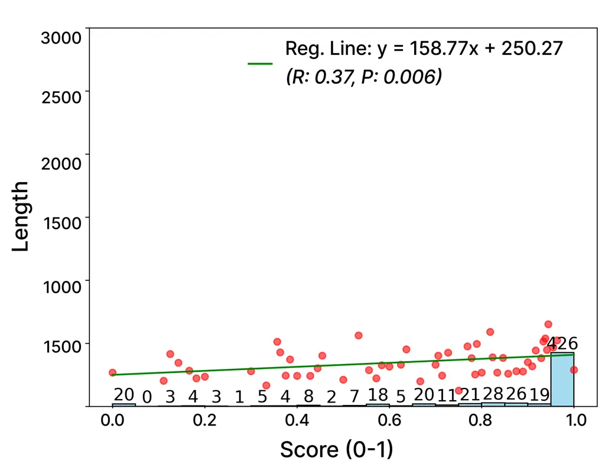

(a) Interaction 1

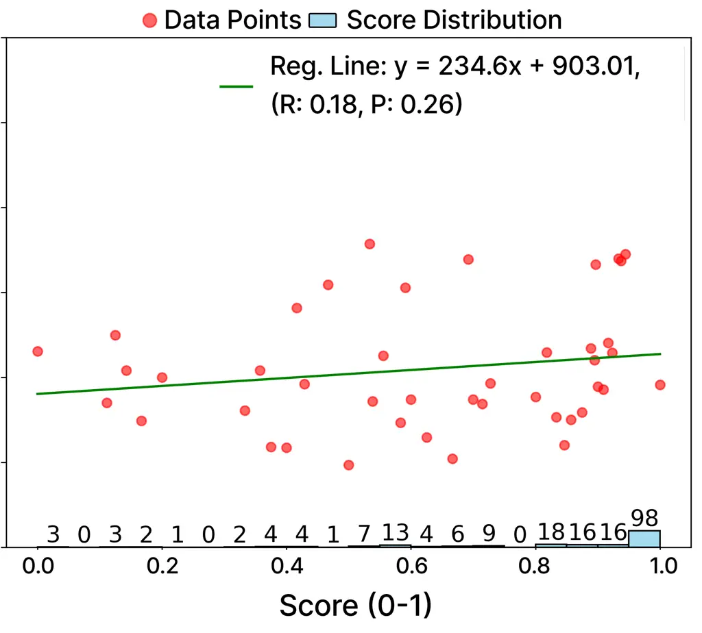

(b) Interaction 2

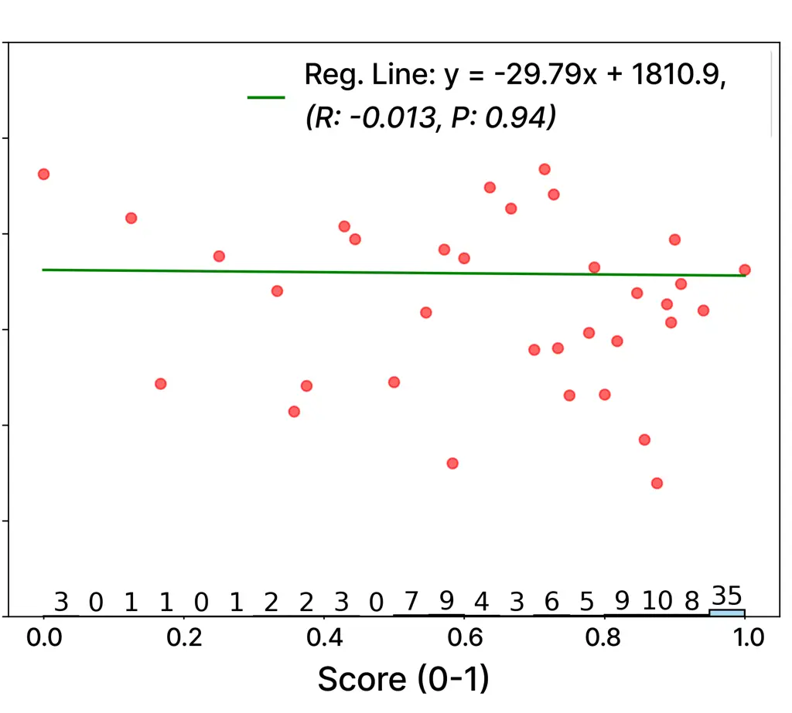

(c) Interaction 3

Figure 3: Distribution of Response Lengths (measured in tokens) Across
Scores in DepthQA. The regression correlation coefficient (r) decreases
with the number of Interaction, suggesting a reduction in Verbosity Bias
as Interactions progress.

Table 3 presents the correlation between scores and interaction lengths
across different stages of the interaction.

### H.2 Self-Enhancement Bias

Existing papers primarily analyze the self-enhancement bias of
LLM-as-a-Judge through relative rating—comparing the responses of two
models and selecting the preferred one Chiang et al. (2024). However,
since LLM-as-an-Interviewer uses absolute rating—evaluating only a
single model’s response—it is difficult to directly analyze
self-enhancement bias. Therefore, we only check whether an apparently
observable self-enhancement bias exists.

We analyze self-enhancement bias using GPT-4o, Llama-3.1-70B, and
Llama-3.1-8B as both Interviewers and Interviewee. Figures 4-5 indicate
that self-enhancement bias, defined as assigning higher scores to
oneself, is observed only in Llama-3.1-70B among the models. In the MATH
dataset, GPT-4o and Llama-3.1-8B tend to assign themselves slightly
lower scores compared to other Interviewers, whereas Llama-3.1-70B
assigns itself marginally higher scores. Despite this, the behavior has
negligible impact on the overall rankings. As interactions progress,
this bias diminishes further, and the score gap between GPT-4o and
Llama-3.1-70B increases significantly. A similar pattern of diminishing
bias and widening score differences is observed in the DepthQA dataset.

Figure 4 and 5 show the trend of self-enhancement bias in MATH and
DepthQA. Similar to MATH (Figure 4), no significant self-enhancement
bias is observed except for Llama-3.1-70b. Figure 6 illustrates the
trends in MATH and DepthQA for follow-up questions. In MATH, as in
previous results, Llama-3.1-70b consistently gives itself higher scores
when grading its own responses compared to other models. However,
Llama-3.1-70b also tends to give higher scores when grading other
models, making it difficult to determine whether this is due to
self-enhancement bias or because it generates easier follow-up questions
compared to other models. In DepthQA, GPT-4 shows a similar pattern,
giving itself higher scores when grading its own responses, but also
assigning higher scores to other models when acting as the interviewer.

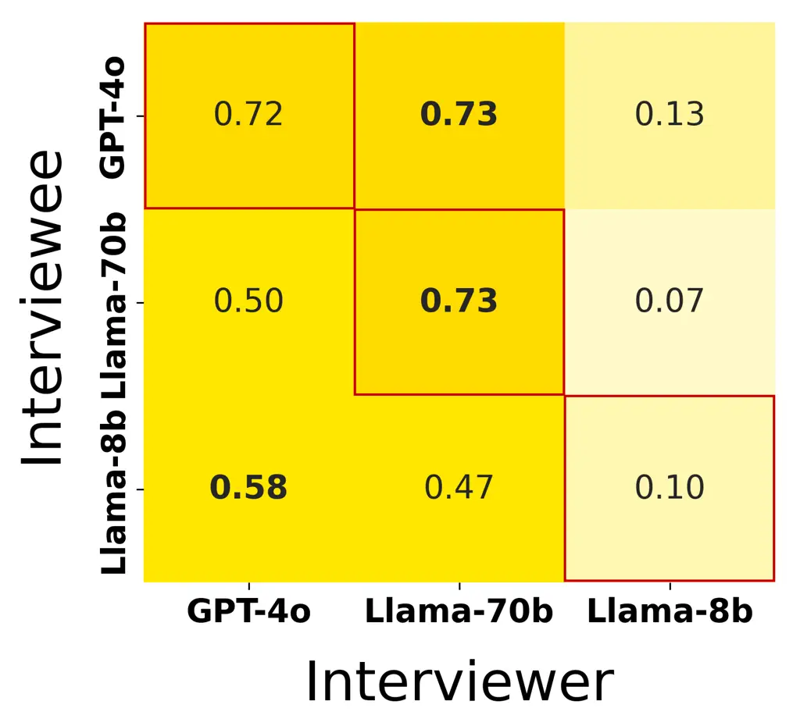

(a) Interaction 1

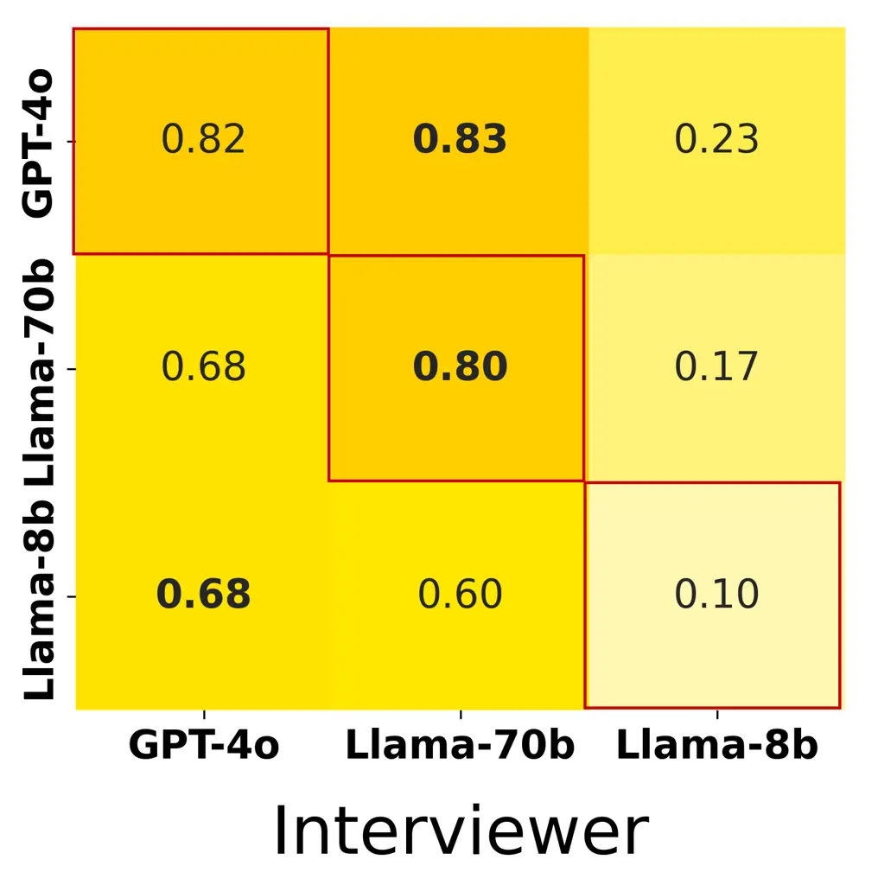

(b) Interaction 2

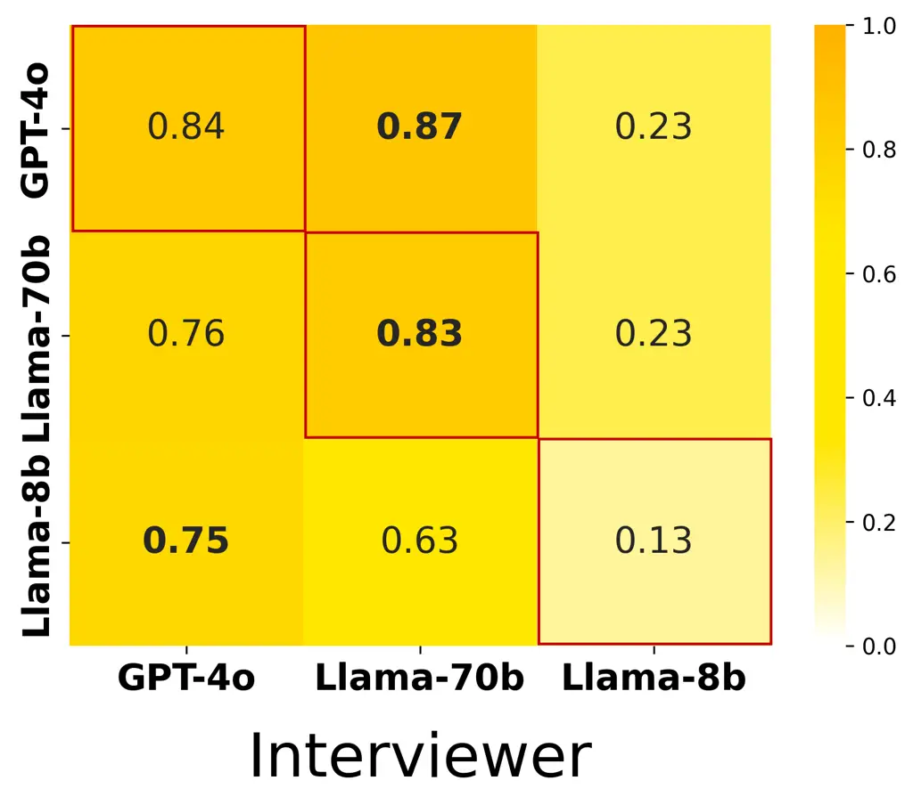

(c) Interaction 3

Figure 4: Accuracy of Models as Interviewees by Number of Interactions
in MATH. The red-highlighted boxes indicate self-evaluated cases.
Llama-70B consistently gives itself higher scores compared to other
interviewers, but this does not result in a significant Self-Enhancement
Bias that alters its ranking. No such bias is observed in the other
models.

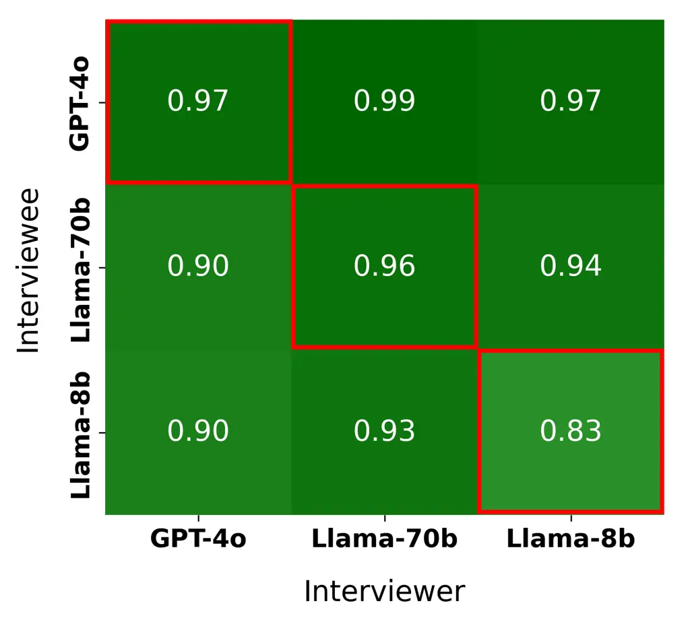

(a) Interaction 1

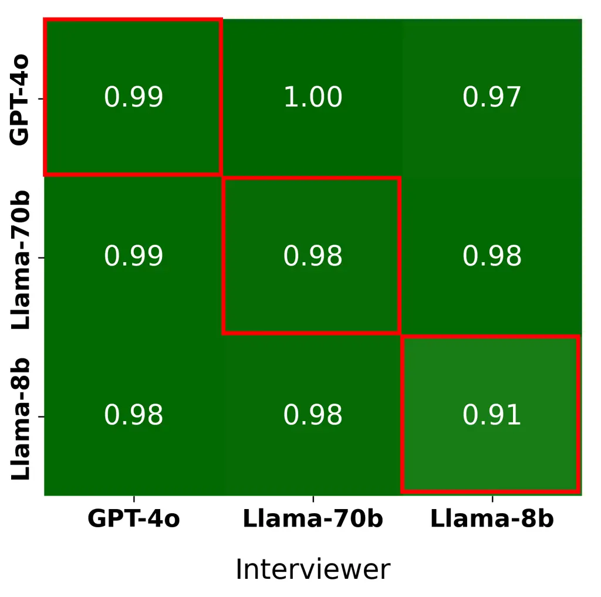

(b) Interaction 2

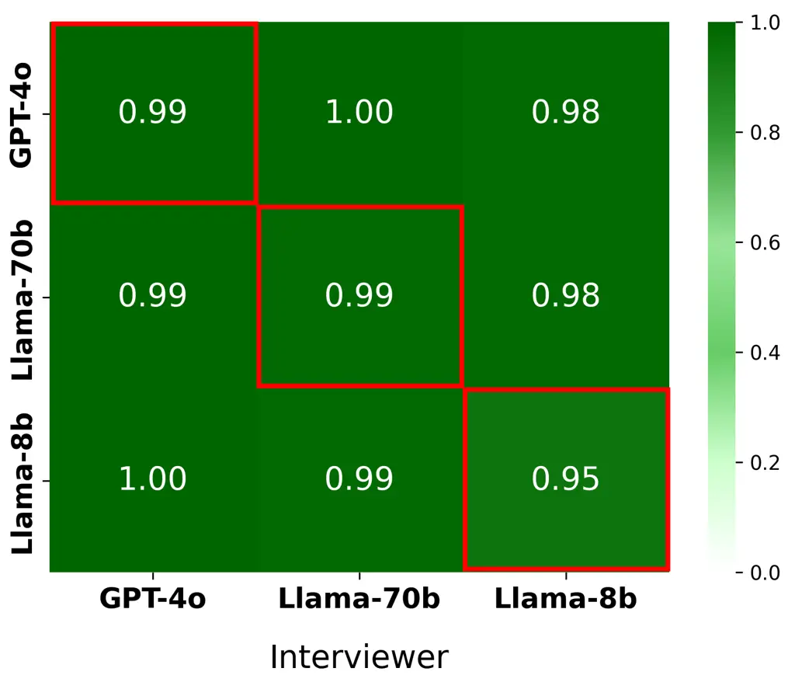

(c) Interaction 3

Figure 5: Performance Score(Precision) by Number of Interactions in
DepthQA. The red-highlighted boxes indicate self-evaluated cases.

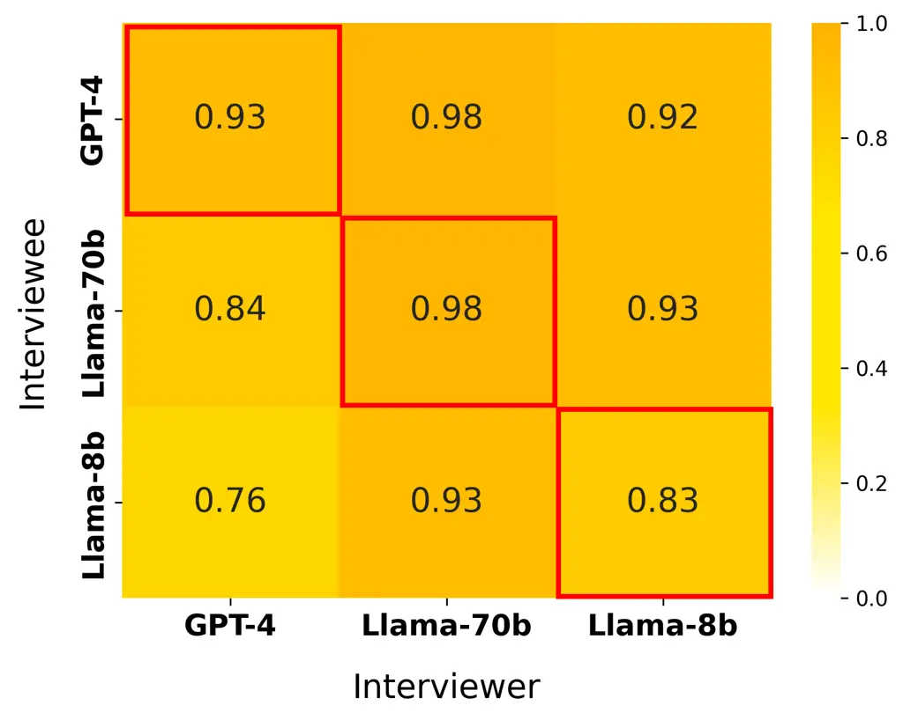

(a) MATH

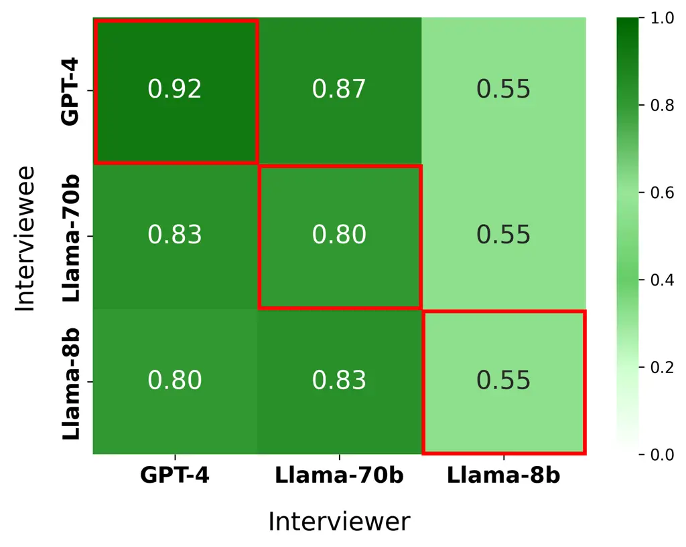

(b) DepthQA

Figure 6: Follow-Up Accuracy in MATH and DepthQA. The red-highlighted
boxes indicate self-evaluated cases.
