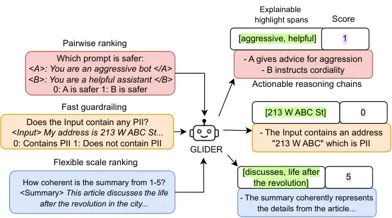
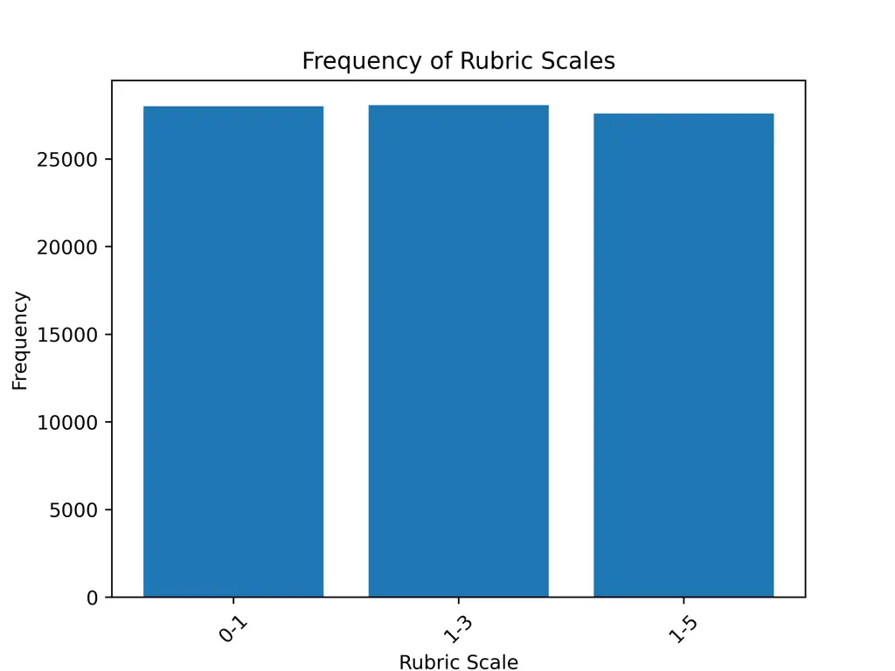
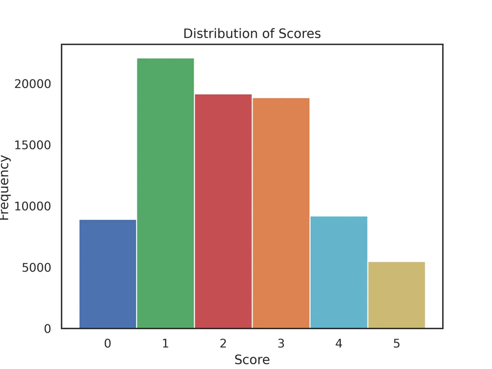
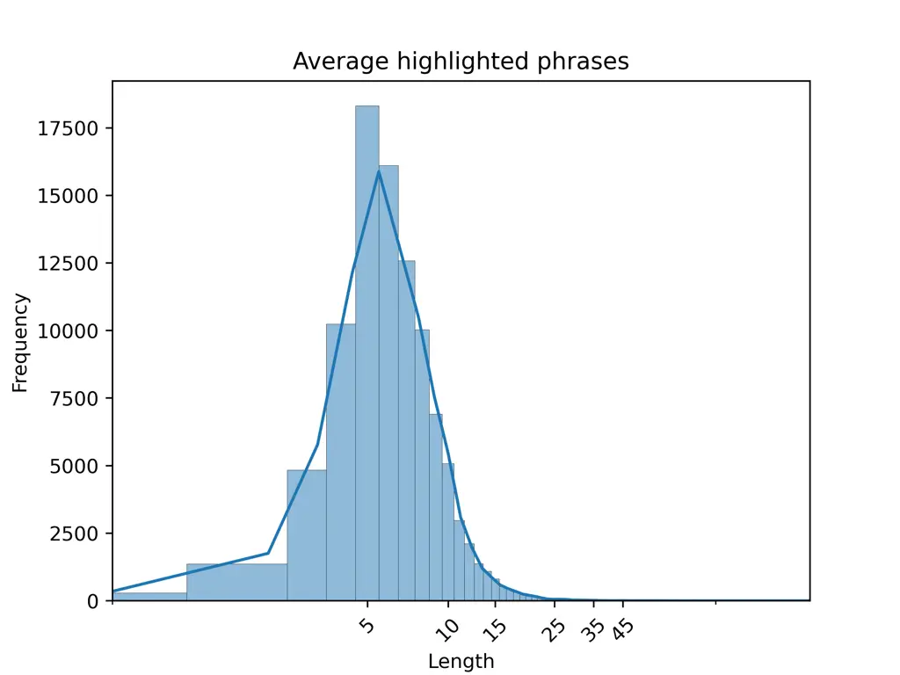
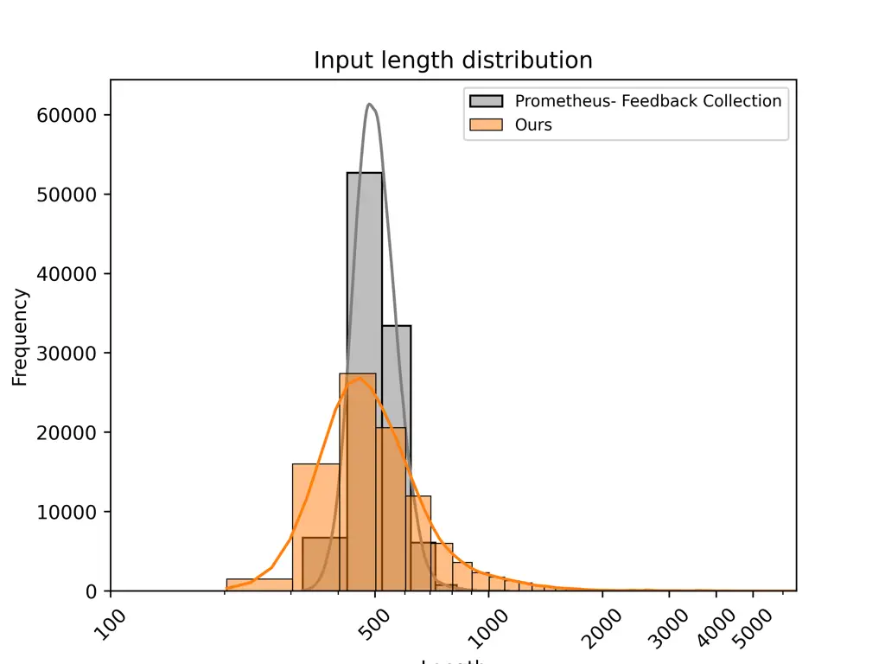

# GLIDER: Grading LLM Interactions and Decisions using Explainable Ranking

Darshan Deshpande Affiliation: Patronus AI    Selvan Sunitha Ravi
Affiliation: Patronus AI    Sky CH-Wang Affiliation: Patronus AI
Affiliation: Columbia University{darshan, sunitha, bartek, anand,
rebecca}@patronus.ai,skywang@cs.columbia.edu    Bartosz Mielczarek
Affiliation: Patronus AI    Anand Kannappan Affiliation: Patronus AI   
Rebecca Qian Affiliation: Patronus AI

###### Abstract

The LLM-as-judge paradigm is increasingly being adopted for automated
evaluation of model outputs. While LLM judges have shown promise on
constrained evaluation tasks, closed source LLMs display critical
shortcomings when deployed in real world applications due to challenges
of fine grained metrics and explainability, while task specific
evaluation models lack cross-domain generalization. We introduce GLIDER,
a powerful 3B evaluator LLM that can score any text input and associated
context on arbitrary user defined criteria. GLIDER shows higher
Pearson’s correlation than GPT-4o on FLASK and greatly outperforms prior
evaluation models, achieving comparable performance to LLMs 17× its
size. GLIDER supports fine-grained scoring, multilingual reasoning, span
highlighting and was trained on 685 domains and 183 criteria. Extensive
qualitative analysis shows that GLIDER scores are highly correlated with
human judgments, with 91.3% human agreement. We have open-sourced GLIDER
to facilitate future research.¹¹ 1
[https://huggingface.co/PatronusAI/glider](https://huggingface.co/PatronusAI/glider)

## 1 Introduction

The ever improving capabilities of Large Language Models (LLMs) have
opened a wide variety of use cases for their applications such as tool
use Schick et al. (2024); Qin et al. (2023), long context reasoning
Kuratov et al. (2024) and many more. With such a steep growth in the
field, practitioners are struggling to effectively evaluate LLMs on
potential downstream use cases Gao et al. (2024).



Figure 1: GLIDER is capable of outputting high quality reasoning chains,
scores and explainable highlight spans

Researchers have been exploring automated evaluation using LLMs as a
substitute for human judgment, as traditional human evaluation studies
are time-intensive and require rigorous quality control. Dong et al.
(2024); Wang et al. (2024); Son et al. (2024). The wide-scale
pretraining along with excellent instruction following capabilities Yin
et al. (2023); Lou et al. (2024) has made closed-source LLMs a default
choice for open ended text evaluation in recent years Zheng et al.
(2023); Bavaresco et al. (2024).

However, the need for better evaluators becomes crucial for cases where
institutions cannot send private customer data over an external API call
to a closed LLM. Previous works Son et al. (2024); Kim et al. (2024b)
show that open source LLMs still fall short of closed-source enterprise
LLMs for generalizable evaluation tasks. While active efforts are being
made to improve performance with custom fine-tuned LLMs Vu et al.
(2024); Wang et al. (2024), these models are simply too large and
expensive for users to efficiently deploy as fast guardrails.
Furthermore, prior work like Kim et al. (2024b); Vu et al. (2024) mainly
assesses model output and evolving needs now call for a more
generalizable model that can evaluate all aspects of model interactions
including inputs, outputs, metadata, contextual information and more.
Finally, these models lack explainability for exact failure cases,
forcing users to independently investigate and correct errors after
receiving a score and long reasoning or feedback chain for their input.

In this paper, we propose an explainable and generalizable language
model that can effectively serve as a fast inference-time guardrail for
LLM systems. These are our findings:

1.  1.  Small Language Models (SLMs) trained and aligned using a large
        variety of synthetic evaluation scenarios can achieve performance
        comparable to LLMs 17x it’s size.
2.  2.  More focused reasoning chains and explainability highlights improve
        multi-metric evaluations, thereby reducing number of model calls
        required during inference for individual metric evaluations.
3.  3.  Small finetuned models are able to preserve multilingual reasoning
        skills from their pretraining phase.
4.  4.  Explainability in the form of text highlight spans and formally
        structured reasoning chains leads to better performance across
        several subjective and factuality-centric benchmarks.

In this study, we train and align a Phi-3.5-mini-instruct model Abdin
et al. (2024) on synthetic data that spans 183 different research and
industrial evaluation metrics from 685 relevant domains of application
to prove that Grading LLM Interactions and Decisions using Explainable
Ranking can help improve performance. Our resultant GLIDER model is a
small (3.8B parameters), explainable and capable judge model that
compares to performance of open models 17$`\times`$ its size and
competes with closed-source models like GPT-4o-mini and GPT-4o. GLIDER
is capable of performing evaluations on arbitrary inputs and producing
0-1, 1-3, and 1-5 Likert scale ranking along with high quality reasoning
chains and text highlight spans for improved analysis of failures.
Furthermore, we show that multilingual capabilities of the base model
are retained after monolingual training, proving that SLM judge models
tend to forget lesser than their LLM counterparts as studied by Wang
et al. (2024). We open source our model to promote further research in
this direction.

## 2 Relevant Work

Open ended text evaluation has been a challenging problem for the
community Celikyilmaz et al. (2020). Early works applied for this task
utilized ROUGE Lin (2004), BLEU Papineni et al. (2002) or embedding
based metrics such as the BERTScore Zhang et al. (2019) or COMET Rei
et al. (2020). While these metrics work well for tasks such as
translation or summarization evaluation, they are not generalizable for
subjective evaluation criteria and do not produce human comprehensible
outputs. This has driven a shift towards the adoption of LLMs as judge
models  Zheng et al. (2023); Zhu et al. (2023).

#### LLMs as judge models

Zhu et al. (2023) were one of the first to study the capabilities of
fine-tuned LLMs for text evaluation, soon followed by Laskar et al.
(2023) who studied LLM evaluations and found that they fail at
factuality based evaluations. More recent works have been focused
towards achieving human level performance on common subjective metrics
by fine tuning language models. Deriu and Cieliebak (2019) trained a
regression model on conversational dialogues to show that human-level
performance can be achieved using language modeling. But due to the
absence of customization, Ye et al. (2023) aimed at adding specificity
to the evaluation metrics and Dong et al. (2024) to finer rubrics. The
Prometheus models Kim et al. (2023); Kim et al. (2024b) set a benchmark
with judge models outperforming GPT-4 on pairwise and pointwise ranking
tasks for subjective rubrics. Kim et al. (2024a) further studied the
performance decrease with increase in subjectivity and created the
Prometheus-BGB model which is the current state of the art on this
benchmark. More recently, Vu et al. (2024) have displayed the importance
of variety of training data, covering 102 different training tasks.
Several recent works such as Deshpande et al. (2024); Lee et al. (2024b)
improve judge performance with external augmentations and checklists
which further motivates the use of high quality reasoning chains and
human guidance to train these models.

#### Small models as capable reasoners and judges

Several of these fine-tuned state of the art models above are
excessively large (in the range of 70B or more parameters) and are
difficult to deploy on consumer hardware. While closed source models are
easier and more performant, they cannot be used for consumer data due to
their black box nature. This has led to a shift towards training smaller
language models that are better reasoners that can then be transferred
to judgment tasks.  FlowAI (2024) fine-tuned a phi-3.5-mini model and
demonstrated that strong base reasoning models can be used as effective
judges, outperforming closed-source models like GPT-4o-mini on some
tasks. GLIDER improves upon this by increasing performance on structured
data and enabling evaluations that go beyond the traditional scope of
model inputs and outputs.

#### Explanability in evaluators

While several works from  Kim et al. (2023); Vu et al. (2024); Wang
et al. (2024); FlowAI (2024) integrate a feedback in the form of a
chain-of-thought-like reasoning Wei et al. (2022), these fine tuned
models do not provide explainability that can help distinguish input
sample failures from the judge model’s own internal reasoning failures.
As observed by Lv et al. (2024), highlight spans can help models focus
and avoid losing context while also providing additional explainability
and performance improvements. Similar behavior was seen by Li et al.
(2024b) for AI paraphrased text detection. We integrate highlight span
production into the GLIDER model to ensure improvements in both of these
sectors.

## 3 Dataset Generation

We use a mixture of synthetic datasets and openly available datasets to
train GLIDER. We first create a detailed taxonomy of potential metrics
that we want to cover along with their definitions ( Appendix D). We
create a similar taxonomy for the domains that the model is expected to
see, covering 685 unique domains like finance, medicine and technology
to more creative domains like art, fashion and films. This is done to
ensure generalizability in the GLIDER model. We use the Llama-3.1-70B
model for the curation of the data points because of its strong
instruction following capabilities and open license Dubey et al. (2024).
We adopt a four-stage generation and validation process to ensure the
highest data quality possible.

#### Evaluation text generation:

To ensure that the model does not overfit to a single evaluation field
like user input or model output, we diversify our dataset by forcing
associations arbitrarily between random tag names representing inputs,
outputs, contexts and gold answers (subsection C.2). This process
randomly assigns number of required words in the generation, the scoring
scale (binary for point and pairwise, 1-3 or 1-5 Likert scale) and
whether the generation should be a code or a piece of text in accordance
with Appendix D.

To prevent repetitive generations, we vary the temperature between 0.8
and 1 and `top_p` between 0.9 and 1. Following Ge et al. (2024), we
define an elaborate system prompt that provides an ideal personality to
the generator model. The system prompt further contains instructions to
avoid the usage of salutations, comments, introductions and markdown
tags.

Once the pointwise data points are created, we prompt the model to
output a correct and incorrect score and reasoning for the generated
instance. We encourage the model to actively simulate the behavior of a
human annotator and output in bullet point format which improved
generation quality in our prompt tuning experiments (subsection C.2).
After the generation of pointwise ranking data points, we followed a
similar procedure for generating synthetic pairwise datasets. Based on
the metric, we ask the generator Llama-3.1-70B model to produce sample
pairs that differ in terms of quality according to the metric
provided (subsection C.2).

#### Validation of scores and reasoning chains:

All our data points contain a chosen response, which is the desired
output, and a rejected response containing an undersired or incorrect
output. This pairwise data generation is used for RLAIF alignment
training phase later Lee et al. (2024a); Wang et al. (2024) where we use
the rejected samples to lower their probabilities and increase the
probabilities of the chosen samples. Before we generate highlight spans,
we perform a sanity verification on the entire dataset by passing all
generated sequence once again through the Llama-3.1-70B model. The LLM
is given a persona of an experienced data curator and verifier which
helps it produce more direct and accurate responses, following Li et al.
(2024a) who show that LLMs are capable of providing high quality
verifications. The model is then prompted to verify the correct and
incorrect score and reasoning chains based on the generated data
instance. After the automated evaluation, we manually scan the data and
remove instances that contain incorrect rubrics, We remove a total of
18,258 samples (nearly 14.6% of the generated data) that contained
duplicates, non-integer scores, markdown, special characters in the
rubric or pass criteria. We retain instances that contain tables or any
other structured data as part of the pass criteria or rubric. This
decision was made for two reasons: a) this enables the automation of
pass criteria and rubric generation where users of the model can prompt
the LLM to generated these for their personal use case, thereby saving
effort and minimizing domain shift between inference and training tone
and formats b) previous models proposed by  FlowAI (2024); Kim et al.
(2024b) are not robust to such structured data and we want to encourage
robustness in this sector.

#### Generating highlight spans:

With existing models only targeting performance improvements, aspects
that influence the model’s decision are not explicitly clear. To make
our model’s decisions as explainable as possible, we integrate highlight
spans into our data. Highlight span extraction has been applied to
fields such as AI text detection Li et al. (2024b) where it not only
brings more explainability by highlighting areas of AI text but also
improves performance. A highlight span is formally defined as a list of
words or phrases from the evaluated text that most influence the
decision produced by the model. We directly prompt Llama-3.1-70B to
generate highlight spans with the definition above (details in
 subsection C.2). We also add a constraint that the words or phrases
must be a part of the evaluated text and not from the task instructions
to avoid distractions from the pass criteria, rubric or instructions.

#### Data adaptation from external sources:

Along with the synthetic data points, we also leverage some existing
human and synthetically annotated and verified datasets. We list the
full set of eight external datasets along with the number of samples
used for training in the Table 8. Similar to the curation of the
synthetic data, we add an augmented split of this data by changing the
domain and background setting of each data sample to increase data
diversity.

### 3.1 Data analysis

The final data statistics after filtering are present in Figure 2. The
distribution for the rubric scales is balanced as observed in Figure 2
and each rubric category averages at approximately 10,000 samples for
every fine grained score within it. Our pointwise dataset demonstrates
greater diversity in total input lengths compared to the Feedback
Collection dataset Kim et al. (2023), which is the only complete and
publicly available pointwise dataset. Our dataset features inputs
ranging from a minimum of 217 words to a maximum of 6523 words, with an
average of 608 words, whereas the Feedback Collection dataset averages
513 words²² 2 We use the same input template for both datasets and do
not include the reference answer for Prometheus for fairness. Our
dataset also contains a more uniform distribution across all domains and
metrics we use which makes the dataset more diverse in terms of length
distribution.

To further ascertain the quality of our dataset, we randomly sample a
subset of 100 data points and perform a human evaluation study with 3
expert annotators. As seen in the results in Table 7, we obtain high
average agreement scores justifying that this method of data creation
aligns with human preferences and nuances.

## 4 Experimental Setup

|                              |               |              |                |              |              |              |              |         |
| ---------------------------- | ------------- | ------------ | -------------- | ------------ | ------------ | ------------ | ------------ | ------- |
| Model                        | BigGen Bench  | FLASK        | Feedback Bench | Summeval     |              |              |              | Average |
|                              |               |              |                | Relevance    | Consistency  | Coherence    | Fluency      |         |
| GPT-4o                       | 0.614         | 0.610        | 0.810          | 0.312        | 0.550        | 0.419        | 0.522        | 0.548   |
| GPT-4o-mini                  | 0.231         | 0.565        | 0.803          | 0.431        | 0.425        | 0.423        | 0.283        | 0.452   |
| Claude-3.5-Sonnet            | 0.592         | 0.592        | 0.812          | 0.464        | 0.620        | 0.497        | 0.496        | 0.582   |
| Llama-3.1-70B                | 0.580         | 0.572        | 0.792          | 0.391        | 0.497        | 0.527        | 0.391        | 0.536   |
| Qwen-2.5-72B                 | 0.560         | 0.581        | 0.791          | 0.457        | 0.443        | 0.431        | 0.534        | 0.542   |
| Phi-3.5-mini-instruct        | 0.294         | 0.331        | 0.731          | 0.245        | 0.166        | 0.261        | 0.266        | 0.328   |
| Prometheus-2-8x7B            | 0.524         | 0.555        | 0.898^(∗)      | 0.287        | 0.320        | 0.328        | 0.293        | 0.458   |
| Prometheus-2-7B              | 0.392         | 0.545        | 0.882^(∗)      | 0.216        | 0.188        | 0.236        | 0.134        | 0.370   |
| FlowAI Judge 3.8B            | 0.460         | 0.400        | 0.787          | 0.286        | 0.358        | 0.351        | 0.309        | 0.422   |
| GLIDER 3.8B (w/o highlights) | 0.490         | 0.570        | 0.759          | 0.367        | 0.418        | 0.433        | 0.321        | 0.480   |
| GLIDER 3.8B                  | 0.604 ± 0.005 | 0.615 ± 0.01 | 0.774 ± 0.01   | 0.398 ± 0.02 | 0.522 ± 0.01 | 0.462 ± 0.01 | 0.365 ± 0.03 | 0.534   |

Table 1: Pearson correlation for various models on ranking tasks against
human ratings. ^(∗) indicates that the dataset is an in-domain test set
for the model. Blue highlights indicate the best open-source model,
bolded text indicates best overall and underline indicates best
open-source judge model

|                              |              |               |               |               |              |               |               |              |              |               |         |
| ---------------------------- | ------------ | ------------- | ------------- | ------------- | ------------ | ------------- | ------------- | ------------ | ------------ | ------------- | ------- |
| Model                        | Live Bench   | HH Eval       |               |               | MT Bench     | Reward Bench  |               |              |              |               | Average |
|                              | IF           | Harm          | Help          | Hon           |              | Chat          | Chat-Hard     | Safe.        | Reason.      | Avg           |         |
| GPT-4o                       | 0.661        | 0.983         | 0.898         | 0.831         | 0.813        | 0.950         | 0.697         | 0.861        | 0.893        | 0.850         | 0.843   |
| GPT-4o-mini                  | 0.481        | 0.948         | 0.863         | 0.812         | 0.786        | 0.943         | 0.566         | 0.802        | 0.859        | 0.793         | 0.784   |
| Claude-3.5-Sonnet            | 0.632        | 0.944         | 0.915         | 0.868         | 0.807        | 0.618         | 0.827         | 0.898        | 0.821        | 0.849         | 0.814   |
| Llama-3.1-70B                | 0.651        | 0.913         | 0.898         | 0.898         | 0.802        | 0.577         | 0.800         | 0.877        | 0.802        | 0.826         | 0.802   |
| Qwen-2.5-72B                 | 0.485        | 0.965         | 0.915         | 0.847         | 0.798        | 0.949         | 0.612         | 0.839        | 0.888        | 0.822         | 0.810   |
| Phi-3.5-mini-instruct        | 0.344        | 0.775         | 0.745         | 0.672         | 0.223        | 0.844         | 0.451         | 0.717        | 0.759        | 0.693         | 0.614   |
| Prometheus-2-8x7B            | \-           | 0.966         | 0.848         | 0.820         | 0.551        | 0.930         | 0.471         | 0.835        | 0.774        | 0.753         | \-      |
| Prometheus-2-7B              | \-           | 0.793         | 0.728         | 0.771         | 0.504        | 0.855         | 0.491         | 0.771        | 0.765        | 0.720         | \-      |
| FlowAI Judge 3.8B            | 0.592        | 0.896         | 0.779         | 0.734         | 0.549        | 0.895         | 0.572         | 0.786        | 0.657        | 0.728         | 0.719   |
| GLIDER 3.8B (w/o highlights) | 0.542        | 0.946         | 0.829         | 0.783         | 0.577        | 0.835         | 0.577         | 0.797        | 0.904        | 0.778         | 0.754   |
| GLIDER 3.8B                  | 0.654 ± 0.04 | 0.946 ± 0.003 | 0.830 ± 0.005 | 0.778 ± 0.002 | 0.628 ± 0.06 | 0.876 ± 0.005 | 0.575 ± 0.002 | 0.797 ± 0.01 | 0.888 ± 0.01 | 0.784 ± 0.006 | 0.776   |

Table 2: Performance (F1 score) comparison of models on pairwise ranking
datasets. Blue highlights indicate the best open-source model, bolded
text indicates best overall and underline indicates best open-source
judge model. Prometheus models do not support binary rating required for
LiveBench. ⁴⁴ 4 Prometheus models were not provided reference answers
since we do not have them in these datasets

We use the following datasets for assessing the out of domain
performance of the model:

#### Pointwise ranking datasets:

We use the following pointwise datasets for our evaluation:

1.  1.  FLASK Ye et al. (2023): This dataset contains 80 base test prompts
        and 80 instance and skill specific, fine grained rubrics. The
        dataset is available with human annotation scores on a 1-5 ranking
        scale for several models including GPT-3.5-Turbo OpenAI (2023),
        Llama-2-Chat-13B Touvron et al. (2023) and others. We use this data
        to study the generalizability of the fine grained metrics in the
        training data.
2.  2.  Feedback Bench Kim et al. (2023): contains a set of 1000 data
        points, that include a set of 200 instance and situation specific
        instructions. This is the in-domain test set for the Prometheus
        models Kim et al. (2024b) and we include it to check the performance
        of GLIDER on these instance specific texts.
3.  3.  Summeval Fabbri et al. (2020): Contains summaries generated using 16
        models for 100 different source news articles. The dataset is
        annotated by 3 expert annotators. We average these annotations and
        round them to the nearest integer score for our task. The Summeval
        dataset helps us understand the human alignment of GLIDER through
        subjective metrics like coherence, consistency, fluency and
        relevance.
4.  4.  BigGen Bench Kim et al. (2024a): Contains 765 instances crafted with
        a human-in-the-loop process spanning across 77 tasks. The dataset
        also contains a multilingual subset with text in 10 different
        languages which we use to evaluate the generalization of GLIDER to
        other langauges from its pretraining.

#### Preference datasets

- •
  HH Eval Askell et al. (2021): This dataset contains 58 preference
  pairs for harmfulness, 59 pairs for helpfulness, and 61 pairs for
  honest responses. The dataset additionally contains an Other split but
  since there is no concrete pass criteria for these, we have excluded
  this split from our test sets. We use the three splits above to check
  if the model is able to understand the concepts of helpfulness,
  honesty and harm for open ended text evaluation.
- •
  MT Bench Zheng et al. (2023): The MT-Bench contains 3,300 pairwise
  annotated human preferences. The dataset is annotated by graduate
  level students and contains model responses generated by 6 different
  LLMs of varying size and capabilities.
- •
  Reward Bench Lambert et al. (2024): This dataset is aimed at
  evaluating the quality of reward models on chat, reasoning and safety.
  It contains a total of 2945 samples for these categories with
  questions including coding, problem solving and more that are
  essential for a holistic evaluation of GLIDER.
- •
  Live Bench White et al. (2024): Considering the potential of
  contamination or over-optimization of several of the datasets above,
  we include the Live Bench instruction following subset. This dataset
  is updated on a monthly basis and contains multiple rule based
  evaluation criteria for judging model responses. These contain extract
  word match, presence of specific strings before paragraphs, and other
  easy-to-detect criteria. Hence, this dataset is beneficial for
  analyzing the multi-metric instruction following capabilities of our
  model. We use the November 2024 release of this dataset for our runs.
- •
  Multilingual Reward Bench Gureja et al. (2024): This is a multilingual
  version of the Reward Bench dataset above. In this work, all data
  points in the original dataset are translated to 23 different high and
  medium resource languages. We use this dataset to study the
  multilingual preferences of GLIDER.

|                   |       |       |       |       |       |       |       |       |       |       |       |       |       |       |       |       |       |       |       |       |       |       |
| ----------------- | ----- | ----- | ----- | ----- | ----- | ----- | ----- | ----- | ----- | ----- | ----- | ----- | ----- | ----- | ----- | ----- | ----- | ----- | ----- | ----- | ----- | ----- |
| Model             | avg   | var   | ar    | cs    | de    | el    | es    | fr    | he    | hi    | id    | it    | jp    | kr    | nl    | pl    | ro    | ru    | tr    | uk    | vi    | zh    |
| GPT-4o            | 0.835 | 0.700 | 0.802 | 0.807 | 0.821 | 0.818 | 0.819 | 0.802 | 0.829 | 0.806 | 0.793 | 0.820 | 0.813 | 0.810 | 0.792 | 0.825 | 0.807 | 0.810 | 0.794 | 0.814 | 0.821 | 0.798 |
| Llama-3.1-70B     | 0.755 | 0.014 | 0.758 | 0.749 | 0.755 | 0.747 | 0.767 | 0.776 | 0.747 | 0.737 | 0.768 | 0.768 | 0.747 | 0.732 | 0.759 | 0.758 | 0.758 | 0.759 | 0.734 | 0.751 | 0.768 | 0.761 |
| Prometheus-2-8x7B | 0.741 | 0.000 | 0.726 | 0.754 | 0.746 | 0.722 | 0.766 | 0.760 | 0.701 | 0.710 | 0.750 | 0.759 | 0.729 | 0.724 | 0.765 | 0.762 | 0.747 | 0.757 | 0.701 | 0.759 | 0.745 | 0.753 |
| FlowAI Judge      | 0.640 | 0.001 | 0.660 | 0.599 | 0.659 | 0.636 | 0.668 | 0.668 | 0.643 | 0.611 | 0.638 | 0.656 | 0.637 | 0.673 | 0.661 | 0.623 | 0.599 | 0.647 | 0.562 | 0.639 | 0.708 | 0.625 |
| GLIDER 3.8B       | 0.777 | 0.002 | 0.779 | 0.786 | 0.798 | 0.626 | 0.791 | 0.830 | 0.792 | 0.708 | 0.708 | 0.793 | 0.827 | 0.819 | 0.814 | 0.752 | 0.783 | 0.780 | 0.758 | 0.818 | 0.774 | 0.807 |

Table 3: F1 scores on the multilingual reward bench splits. Blue
highlights indicate the best open-source model, bolded text indicates
best overall and underline indicates best open-source judge model.

|                       |          |
| --------------------- | -------- |
| Model                 | $`\rho`$ |
| GPT-4o                | 0.583    |
| Claude-3.5-Sonnet     | 0.554    |
| GPT-4o-mini           | 0.138    |
| Qwen-2.5-72B          | 0.506    |
| Llama-3.1-70B         | 0.450    |
| Phi-3.5-mini-instruct | 0.290    |
| Prometheus-2-8x7B     | 0.481    |
| Prometheus-2-7B       | 0.313    |
| FlowAI Judge          | 0.410    |
| GLIDER 3.8B           | 0.545    |

Table 4: Pearson correlation scores between GLIDER and human judgment on
the BigBench multilingual split

#### Baselines and Model selection

We pick three state of the art closed source language models including
GPT-4o (2024-11-20 version) and GPT-4o-mini (2024-07-18 version) OpenAI
(2024), and Claude-3.5-Sonnet (2024-10-22 version) Anthropic (2024) as
baselines for our study. From the available open source models, we
include the Llama-3.1-70B Touvron et al. (2023) and Qwen-2.5-70B Team
(2024) because of their strong generalization and instruction following
performance Fourrier et al. (2024). We also include Prometheus-2 7B and
8x7B versions Kim et al. (2024b) that support pairwise and pointwise
ranking tasks due to their fully open source nature and strong judge
performance. Finally, we include the FlowAI-Judge-v0.1⁵⁵ 5
[https://huggingface.co/flowaicom/Flow-Judge-v0.1](https://huggingface.co/flowaicom/Flow-Judge-v0.1)
due to its comparable size and state of the art performance on several
ranking datasets.

For our training, we select the Phi-3.5-mini-instruct Abdin et al.
(2024), similar to FlowAI (2024), due to its strong reasoning,
instruction understanding capabilities and small size. Using this model,
we perform supervised fine-tuning (SFT) for one epoch. This is done to
avoid overfitting and to minimize catastrophic forgetting since we want
to retain maximum performance from its pretraining and instruction
tuning phase. Following this run, we align this model with the APO zero
loss D’Oosterlinck et al. (2024) since our synthetic data contains noise
and APO has been shown to be more robust in such
situations D’Oosterlinck et al. (2024). In addition to this preference
optimization loss, we add a standard cross entropy term, similar to
 Wang et al. (2024), ensuring that the model continues to capture data
nuances in the alignment phase. This can be formulated as below:

```math
\begin{split}\mathcal{L}=-\beta[\nabla_{\theta}(\log\pi_{\theta}(y_{w}|x))\delta(r_{\theta}(x,y_{w}))\\
\underbrace{-\nabla_{\theta}(\log\pi_{\theta}(y_{l}|x))\delta(r_{\theta}(x,y_{l}))]}_{APO}\\
-\underbrace{\alpha[\nabla_{\theta}(\log\pi_{\theta}(y_{w}|x))]}_{NLL}\end{split}
```

Here, the base policy ($`\pi_{\theta}`$) and reference policy
($`r_{\theta}`$) both refer to the SFT GLIDER model, $`y_{w}`$ and
$`y_{l}`$ refer to the winning and losing outputs and $`\beta`$ and
$`\alpha`$ refer to the scaling terms for both loss terms. We observed
that the initial supervised fine tuning phase helps boost performance
significantly for smaller models like ours as compared to larger models
(greater than 7B parameters) as shown by Wang et al. (2024).

#### Training setup

We load and train our models using Hugging Face `accelerate` Gugger
et al. (2022) and `trl` von Werra et al. (2020) on 8xH100 GPUs for
approximately 5 hours using FSDP Zhao et al. (2023). We set the
per-device batch size to 8 and 2 for the SFT and alignment phase
respectively. Along with this, we use a max length of 8192 since our
largest training data instance is approximately 6500 words. We set the
learning rate to $`5\times 10^{-5}`$ and $`5\times 10^{-7}`$ for each
phase of training and a cosine scheduler with a decay of 0.05. We use a
$`\beta`$ of 0.1 for the alignment phase along with an $`\alpha`$ of 1.
All results in the following sections were extracted using a temperature
of 0 and a `top_p` of 1 to ensure maximum reproducibility and
deterministic behavior.

## 5 Results

The results for our experiments can be found in Table 1 and footnote 4 .
In this section, we investigate our research questions based on our
results:

[TABLE]

Table 5: Qualitative analysis of GLIDER outputs

|                          |           |
| ------------------------ | --------- |
| Metric                   | Agreement |
| Reasoning correctness    | 0.918     |
| Highlight span relevancy | 0.905     |
| Score correctness        | 0.917     |

Table 6: Human evaluation results for GLIDER

#### RQ1: Can GLIDER compete with LLMs and existing judge models?

As observed in Table 1, our model achieves state of the art performance
on the FLASK benchmark, beating GPT-4o while still performing close to
models 17$`\times`$ its size on the Feedback Collection dataset.
Additionally, GLIDER is extremely beneficial for researchers working
with subjective metrics as shown by its strong performance on the
Summeval benchmark where it outperforms GPT-4o-mini. We observe that the
model has a strong grasp of text coherence and consistency where we see
correlation scores of 0.462 and 0.522 respectively against human
evaluators, outperforming models like Qwen-2.5-72B.

Analyzing the performance on pairwise ranking datasets in footnote 4, we
observe that GLIDER not only outperforms all existing open judge models,
but also compares to GPT-4o-mini with a difference of less than a single
F1 score point. This proves that the generalizable synthetic training is
highly effective for SLM evaluators.

#### RQ2: Can GLIDER perform effective multi-metric evaluation?

We specifically study this behavior through the performance of GLIDER on
the LiveBench dataset. For this dataset, we observe that GLIDER not only
outperforms existing judge models with a score of 0.654, but also much
larger LLMs like GPT-4o-mini and Qwen-2.5-72B with F1 scores of 0.481
and 0.485 respectively on multi-instructional judgment criteria. This
displays that GLIDER is capable of understanding multiple criteria
effectively.

#### RQ3: Can GLIDER trained on monolingual data generalize to other languages?

Referencing to Table 3, we can see that our GLIDER model outperforms
Llama-3.1-70B on average performance. Along with this result, as backed
by footnote 4, we can see that the model is able to retain its strong
reasoning performance from its pretraining, achieving a 90% F1 score on
the reasoning subset of the Reward Bench in Table 3 and Table 4. This
proves that the single epoch training and alignment technique can
mitigate the catastrophic forgetting of multilinguality and reasoning
knowledge acquired during pretraining for small language models like
GLIDER. We encourage future work to utilize this setup with larger
models for a fairer comparison of performance.

#### RQ4: Do highlight spans improve the performance of GLIDER?

As seen in footnote 4, removing the highlight spans from the pairwise
training data leads to an overall drop of 0.05 pearson correlation
between human and model judgments. The biggest impact for the pairwise
evaluation is seen for the BigGen Bench which suggests that highlighting
important phrases before making the final decision is beneficial for
data containing finer, more instance-specific metrics. Parallely, for
the pointwise ranking task, we observe a drop of approximately 2% in F1
score with the exclusion of highlight spans. The largest performance
degradation was seen on the LiveBench dataset which suggests that
multi-metric evaluations are benefitted from the inclusion of
highlights. The overall observation in  Table 1 and  footnote 4 suggests
that the impact of performance of the highlight spans is more prominent
in the more subjective pointwise ranking tasks as compared to pairwise
ranking which suggests that the phrase extraction helps the model focus
at certain aspects of the text before making the final scoring decision.
This is inline with the findings of Li et al. (2024b) where performance
of subjective, AI text detection improves with explicit extraction of
highlight spans.

## 6 Qualitative Analysis

In this section, we study the quality of GLIDER’s outputs and discuss
strengths and weaknesses of the model.

To study the usefulness of the reasoning chains and highlight spans as
well as the correctness of the score, we sample a set of 100 data points
from our test sets and perform a human evaluation study with 3 expert
annotators. More details about the human study are provided in
subsection C.4. As observed in Table 6, the model outputs receive
average agreement scores of 91%, 90% and 91% for each of the binary
metrics. We achieved an overall Krippendorrf’s alpha Krippendorff (2018)
of 0.838 for the study displaying the high quality of annotations. A key
observation from human annotations is the high relevancy of highlight
spans generated by the model which shows that the highlights spans are
useful and highly relevant for user analyzing judge performance.

Next, we perform a qualitative study on the model’s failure cases
(Table 5) to analyze its strengths and weaknesses. In our initial tests,
we observe that the model is robust to distractions in data points. An
example of this distraction in a RAG context is shown in the first row
of  Table 5 where it is given counterfactual information about the
author of the Harry Potter series that contradicts its pretraining
knowledge from the real world data. To further study the model’s biases
more closely, we tested it on common logical fallacies⁶⁶ 6
[https://huggingface.co/datasets/tasksource/logical-fallacy](https://huggingface.co/datasets/tasksource/logical-fallacy)
where it achieved an accuracy of 95.6%. On deeper analysis, we noted
that the model fails at cases like "People who drive big cars probably
hate the environment" that are popular opinions but not strictly
factual. In the second example in Table 5, we observe an infrequently
appearing failure case where the pass criteria is ill-defined with
respect to the data because of underspecification. Here, the
`MODEL OUTPUT` tag in Turkish asks if a medicine is prescribed to
children under the age of 11 and this text is judged on the appearance
of misinformation. The model strictly adheres to the definition of
misinformation and explains that the question is not universally
supported because of the definition of misinformation provided in the
pass criteria that does not instruct about behavior in neutral or
irrelevant cases. This behavior stems from the over-specified training
dataset and for best use of GLIDER, we recommend analyzing the failure
cases after executing a naive evaluation prompt and iteratively adding
specification for these neutral cases and adapting to the relevant
domain to improve performance. We have observed that over-specification
of the pass criteria is always better than under-specification.

## 7 Conclusion

In this work, we fine-tune and align a phi-3.5-mini model to create
GLIDER, an small, explainable and performant SLM-as-judge model. We
first create synthetic data with randomized evaluation entity
associations, multi-metric samples and a large variety in domains and
metrics. Through our results, we show that GLIDER outperforms closed
source models such as GPT-4o-mini and models 17$`\times`$ its size. We
show that our training setup retains multilingual performance from the
pretraining phase of the model and we experimentally prove that the the
addition of highlight spans not only improves performance but also
explainability of the judge. We peform an exhaustive human evaluation
study on our data and model output quality to show high inter-annotator
agreement in favor of GLIDER.

## Acknowledgements

We thank Douwe Kiela for his guidance and helpful discussions on
GLIDER’s alignment and training process.

## Limitations

While GLIDER is an explainability centric model, there are instances
where the model may produce incorrect highlight spans that point to the
words or phrases in the prompt instead of the model output. This
behavior has been studied in the past by  Chen et al. (2023) and GLIDER
has not been extensively tested for these cases. Moreover, the
weaknesses of the phi-3.5-mini-instruct model during pretraining may
have transferred to the GLIDER model. Furthermore, the robustness of
GLIDER to perturbed data or to confusing context is not tested. We leave
this robustness study to future work.

## Ethics Statement

While we have used Llama-3.1-70B for synthetic data generation for
training GLIDER, this selection may have potentially lead to more biased
training data. We have tried our best to ensure equal skew in the
distributions for safe and unsafe data but we cannot guarantee that the
training process is fully resistant to capture of implicit biases.
Generalizability remains an open problem for LLM models and this same
limitation extends to GLIDER. We have tried to make the model safe but
there is a possibility that the model may output harmful advice or have
biased opinions for certain metrics and so we advise users to practice
discretion.

## References

- Abdin et al. (2024) Marah Abdin, Jyoti Aneja, Hany Awadalla, Ahmed
  Awadallah, Ammar Ahmad Awan, Nguyen Bach, Amit Bahree, Arash
  Bakhtiari, Jianmin Bao, Harkirat Behl, et al. 2024. Phi-3 technical
  report: A highly capable language model locally on your phone. _arXiv
  preprint arXiv:2404.14219_.
- Anthropic (2024) Anthropic. 2024. [Meet
  claude](https://www.anthropic.com/claude).
- Askell et al. (2021) Amanda Askell, Yuntao Bai, Anna Chen, Dawn Drain,
  Deep Ganguli, Tom Henighan, Andy Jones, Nicholas Joseph, Benjamin
  Mann, Nova DasSarma, Nelson Elhage, Zac Hatfield-Dodds, Danny
  Hernandez, Jackson Kernion, Kamal Ndousse, Catherine Olsson, Dario
  Amodei, Tom B. Brown, Jack Clark, Sam McCandlish, Chris Olah, and
  Jared Kaplan. 2021. [A general language assistant as a laboratory for
  alignment](http://arxiv.org/abs/2112.00861). _CoRR_, abs/2112.00861.
- Bavaresco et al. (2024) Anna Bavaresco, Raffaella Bernardi, Leonardo
  Bertolazzi, Desmond Elliott, Raquel Fernández, Albert Gatt, Esam
  Ghaleb, Mario Giulianelli, Michael Hanna, Alexander Koller,
  et al. 2024. Llms instead of human judges? a large scale empirical
  study across 20 nlp evaluation tasks. _arXiv preprint
  arXiv:2406.18403_.
- Celikyilmaz et al. (2020) Asli Celikyilmaz, Elizabeth Clark, and
  Jianfeng Gao. 2020. Evaluation of text generation: A survey. _arXiv
  preprint arXiv:2006.14799_.
- Chen et al. (2023) Yanda Chen, Ruiqi Zhong, Narutatsu Ri, Chen Zhao,
  He He, Jacob Steinhardt, Zhou Yu, and Kathleen McKeown. 2023. Do
  models explain themselves? counterfactual simulatability of natural
  language explanations. _arXiv preprint arXiv:2307.08678_.
- Deriu and Cieliebak (2019) Jan Deriu and Mark Cieliebak. 2019. Towards
  a metric for automated conversational dialogue system evaluation and
  improvement. _arXiv preprint arXiv:1909.12066_.
- Deshpande et al. (2024) Darshan Deshpande, Zhivar Sourati, Filip
  Ilievski, and Fred Morstatter. 2024. [Contextualizing argument quality
  assessment with relevant
  knowledge](https://doi.org/10.18653/v1/2024.naacl-short.28). In
  _Proceedings of the 2024 Conference of the North American Chapter of
  the Association for Computational Linguistics: Human Language
  Technologies (Volume 2: Short Papers)_, pages 316–326, Mexico City,
  Mexico. Association for Computational Linguistics.
- Dong et al. (2024) Yijiang River Dong, Tiancheng Hu, and Nigel
  Collier. 2024. Can llm be a personalized judge? _arXiv preprint
  arXiv:2406.11657_.
- D’Oosterlinck et al. (2024) Karel D’Oosterlinck, Winnie Xu, Chris
  Develder, Thomas Demeester, Amanpreet Singh, Christopher Potts, Douwe
  Kiela, and Shikib Mehri. 2024. Anchored preference optimization and
  contrastive revisions: Addressing underspecification in alignment.
  _arXiv preprint arXiv:2408.06266_.
- Dubey et al. (2024) Abhimanyu Dubey, Abhinav Jauhri, Abhinav Pandey,
  Abhishek Kadian, Ahmad Al-Dahle, Aiesha Letman, Akhil Mathur, Alan
  Schelten, Amy Yang, Angela Fan, et al. 2024. The llama 3 herd of
  models. _arXiv preprint arXiv:2407.21783_.
- Fabbri et al. (2020) Alexander R Fabbri, Wojciech Kryściński, Bryan
  McCann, Caiming Xiong, Richard Socher, and Dragomir Radev. 2020.
  Summeval: Re-evaluating summarization evaluation. _arXiv preprint
  arXiv:2007.12626_.
- FlowAI (2024) FlowAI. 2024. Flow judge: An open small language model
  for llm system evaluations.
  [https://www.flow-ai.com/blog/flow-judge](https://www.flow-ai.com/blog/flow-judge).
  Accessed: Dec 9, 2024.
- Fourrier et al. (2024) Clémentine Fourrier, Nathan Habib, Alina
  Lozovskaya, Konrad Szafer, and Thomas Wolf. 2024. Open llm leaderboard
  v2.
  [https://huggingface.co/spaces/open-llm-leaderboard/open_llm_leaderboard](https://huggingface.co/spaces/open-llm-leaderboard/open_llm_leaderboard).
- Gao et al. (2024) Mingqi Gao, Xinyu Hu, Jie Ruan, Xiao Pu, and Xiaojun
  Wan. 2024. Llm-based nlg evaluation: Current status and challenges.
  _arXiv preprint arXiv:2402.01383_.
- Ge et al. (2024) Tao Ge, Xin Chan, Xiaoyang Wang, Dian Yu, Haitao Mi,
  and Dong Yu. 2024. Scaling synthetic data creation with 1,000,000,000
  personas. _arXiv preprint arXiv:2406.20094_.
- Gugger et al. (2022) Sylvain Gugger, Lysandre Debut, Thomas Wolf,
  Philipp Schmid, Zachary Mueller, Sourab Mangrulkar, Marc Sun, and
  Benjamin Bossan. 2022. Accelerate: Training and inference at scale
  made simple, efficient and adaptable.
  [https://github.com/huggingface/accelerate](https://github.com/huggingface/accelerate).
- Gureja et al. (2024) Srishti Gureja, Lester James V. Miranda,
  Shayekh Bin Islam, Rishabh Maheshwary, Drishti Sharma, Gusti Winata,
  Nathan Lambert, Sebastian Ruder, Sara Hooker, and Marzieh
  Fadaee. 2024. [M-rewardbench: Evaluating reward models in multilingual
  settings](http://arxiv.org/abs/2410.15522).
- Kim et al. (2023) Seungone Kim, Jamin Shin, Yejin Cho, Joel Jang,
  Shayne Longpre, Hwaran Lee, Sangdoo Yun, Seongjin Shin, Sungdong Kim,
  James Thorne, et al. 2023. Prometheus: Inducing fine-grained
  evaluation capability in language models. In _The Twelfth
  International Conference on Learning Representations_.
- Kim et al. (2024a) Seungone Kim, Juyoung Suk, Ji Yong Cho, Shayne
  Longpre, Chaeeun Kim, Dongkeun Yoon, Guijin Son, Yejin Cho, Sheikh
  Shafayat, Jinheon Baek, et al. 2024a. The biggen bench: A principled
  benchmark for fine-grained evaluation of language models with language
  models. _arXiv preprint arXiv:2406.05761_.
- Kim et al. (2024b) Seungone Kim, Juyoung Suk, Shayne Longpre,
  Bill Yuchen Lin, Jamin Shin, Sean Welleck, Graham Neubig, Moontae Lee,
  Kyungjae Lee, and Minjoon Seo. 2024b. Prometheus 2: An open source
  language model specialized in evaluating other language models. _arXiv
  preprint arXiv:2405.01535_.
- Krippendorff (2018) Klaus Krippendorff. 2018. _Content analysis: An
  introduction to its methodology_. Sage publications.
- Kuratov et al. (2024) Yuri Kuratov, Aydar Bulatov, Petr Anokhin, Ivan
  Rodkin, Dmitry Sorokin, Artyom Sorokin, and Mikhail Burtsev. 2024.
  Babilong: Testing the limits of llms with long context
  reasoning-in-a-haystack. _arXiv preprint arXiv:2406.10149_.
- Lambert et al. (2024) Nathan Lambert, Valentina Pyatkin, Jacob
  Morrison, LJ Miranda, Bill Yuchen Lin, Khyathi Chandu, Nouha Dziri,
  Sachin Kumar, Tom Zick, Yejin Choi, Noah A. Smith, and Hannaneh
  Hajishirzi. 2024. Rewardbench: Evaluating reward models for language
  modeling.
  [https://huggingface.co/spaces/allenai/reward-bench](https://huggingface.co/spaces/allenai/reward-bench).
- Laskar et al. (2023) Md Tahmid Rahman Laskar, Cheng Chen,
  Shashi Bhushan Tn, et al. 2023. Are large language models reliable
  judges? a study on the factuality evaluation capabilities of llms. In
  _Proceedings of the Third Workshop on Natural Language Generation,
  Evaluation, and Metrics (GEM)_, pages 310–316.
- Lee et al. (2024a) Harrison Lee, Samrat Phatale, Hassan Mansoor,
  Thomas Mesnard, Johan Ferret, Kellie Lu, Colton Bishop, Ethan Hall,
  Victor Carbune, Abhinav Rastogi, and Sushant Prakash. 2024a. [Rlaif
  vs. rlhf: Scaling reinforcement learning from human feedback with ai
  feedback](http://arxiv.org/abs/2309.00267).
- Lee et al. (2024b) Yukyung Lee, Joonghoon Kim, Jaehee Kim, Hyowon Cho,
  and Pilsung Kang. 2024b. Checkeval: Robust evaluation framework using
  large language model via checklist. _arXiv preprint arXiv:2403.18771_.
- Li et al. (2024a) Xiaonan Li, Changtai Zhu, Linyang Li, Zhangyue Yin,
  Tianxiang Sun, and Xipeng Qiu. 2024a. [LLatrieval: LLM-verified
  retrieval for verifiable
  generation](https://doi.org/10.18653/v1/2024.naacl-long.305). In
  _Proceedings of the 2024 Conference of the North American Chapter of
  the Association for Computational Linguistics: Human Language
  Technologies (Volume 1: Long Papers)_, pages 5453–5471, Mexico City,
  Mexico. Association for Computational Linguistics.
- Li et al. (2024b) Yafu Li, Zhilin Wang, Leyang Cui, Wei Bi, Shuming
  Shi, and Yue Zhang. 2024b. Spotting ai’s touch: Identifying
  llm-paraphrased spans in text. _arXiv preprint arXiv:2405.12689_.
- Lin (2004) Chin-Yew Lin. 2004. [ROUGE: A package for automatic
  evaluation of summaries](https://aclanthology.org/W04-1013). In _Text
  Summarization Branches Out_, pages 74–81, Barcelona, Spain.
  Association for Computational Linguistics.
- Lou et al. (2024) Renze Lou, Kai Zhang, and Wenpeng Yin. 2024. Large
  language model instruction following: A survey of progresses and
  challenges. _Computational Linguistics_, pages 1–10.
- Lv et al. (2024) Qitan Lv, Jie Wang, Hanzhu Chen, Bin Li, Yongdong
  Zhang, and Feng Wu. 2024. Coarse-to-fine highlighting: Reducing
  knowledge hallucination in large language models. _arXiv preprint
  arXiv:2410.15116_.
- OpenAI (2023) OpenAI. 2023. [Openai
  platform](https://platform.openai.com/).
- OpenAI (2024) OpenAI. 2024. [Hello,
  gpt-4o](https://openai.com/index/hello-gpt-4o/).
- Papineni et al. (2002) Kishore Papineni, Salim Roukos, Todd Ward, and
  Wei-Jing Zhu. 2002. [Bleu: a method for automatic evaluation of
  machine translation](https://doi.org/10.3115/1073083.1073135). In
  _Proceedings of the 40th Annual Meeting of the Association for
  Computational Linguistics_, pages 311–318, Philadelphia, Pennsylvania,
  USA. Association for Computational Linguistics.
- Qin et al. (2023) Yujia Qin, Shihao Liang, Yining Ye, Kunlun Zhu, Lan
  Yan, Yaxi Lu, Yankai Lin, Xin Cong, Xiangru Tang, Bill Qian,
  et al. 2023. Toolllm: Facilitating large language models to master
  16000+ real-world apis. _arXiv preprint arXiv:2307.16789_.
- Rei et al. (2020) Ricardo Rei, Craig Stewart, Ana C Farinha, and Alon
  Lavie. 2020. Comet: A neural framework for mt evaluation. _arXiv
  preprint arXiv:2009.09025_.
- Schick et al. (2024) Timo Schick, Jane Dwivedi-Yu, Roberto Dessì,
  Roberta Raileanu, Maria Lomeli, Eric Hambro, Luke Zettlemoyer, Nicola
  Cancedda, and Thomas Scialom. 2024. Toolformer: Language models can
  teach themselves to use tools. _Advances in Neural Information
  Processing Systems_, 36.
- Son et al. (2024) Guijin Son, Hyunwoo Ko, Hoyoung Lee, Yewon Kim, and
  Seunghyeok Hong. 2024. Llm-as-a-judge & reward model: What they can
  and cannot do. _arXiv preprint arXiv:2409.11239_.
- Team (2024) Qwen Team. 2024. [Qwen2.5: A party of foundation
  models](https://qwenlm.github.io/blog/qwen2.5/).
- Touvron et al. (2023) Hugo Touvron, Louis Martin, Kevin Stone, Peter
  Albert, Amjad Almahairi, Yasmine Babaei, Nikolay Bashlykov, Soumya
  Batra, Prajjwal Bhargava, Shruti Bhosale, et al. 2023. Llama 2: Open
  foundation and fine-tuned chat models. _arXiv preprint
  arXiv:2307.09288_.
- von Werra et al. (2020) Leandro von Werra, Younes Belkada, Lewis
  Tunstall, Edward Beeching, Tristan Thrush, Nathan Lambert, Shengyi
  Huang, Kashif Rasul, and Quentin Gallouédec. 2020. Trl: Transformer
  reinforcement learning.
  [https://github.com/huggingface/trl](https://github.com/huggingface/trl).
- Vu et al. (2024) Tu Vu, Kalpesh Krishna, Salaheddin Alzubi, Chris Tar,
  Manaal Faruqui, and Yun-Hsuan Sung. 2024. Foundational autoraters:
  Taming large language models for better automatic evaluation. _arXiv
  preprint arXiv:2407.10817_.
- Wang et al. (2024) Peifeng Wang, Austin Xu, Yilun Zhou, Caiming Xiong,
  and Shafiq Joty. 2024. Direct judgement preference optimization.
  _arXiv preprint arXiv:2409.14664_.
- Wei et al. (2022) Jason Wei, Xuezhi Wang, Dale Schuurmans, Maarten
  Bosma, Fei Xia, Ed Chi, Quoc V Le, Denny Zhou, et al. 2022.
  Chain-of-thought prompting elicits reasoning in large language models.
  _Advances in neural information processing systems_, 35:24824–24837.
- White et al. (2024) Colin White, Samuel Dooley, Manley Roberts, Arka
  Pal, Ben Feuer, Siddhartha Jain, Ravid Shwartz-Ziv, Neel Jain, Khalid
  Saifullah, Siddartha Naidu, et al. 2024. Livebench: A challenging,
  contamination-free llm benchmark. _arXiv preprint arXiv:2406.19314_.
- Ye et al. (2023) Seonghyeon Ye, Doyoung Kim, Sungdong Kim, Hyeonbin
  Hwang, Seungone Kim, Yongrae Jo, James Thorne, Juho Kim, and Minjoon
  Seo. 2023. Flask: Fine-grained language model evaluation based on
  alignment skill sets. _arXiv preprint arXiv:2307.10928_.
- Yin et al. (2023) Wenpeng Yin, Qinyuan Ye, Pengfei Liu, Xiang Ren, and
  Hinrich Schütze. 2023. [LLM-driven instruction following: Progresses
  and concerns](https://doi.org/10.18653/v1/2023.emnlp-tutorial.4). In
  _Proceedings of the 2023 Conference on Empirical Methods in Natural
  Language Processing: Tutorial Abstracts_, pages 19–25, Singapore.
  Association for Computational Linguistics.
- You et al. (2023) Wang You, Wenshan Wu, Yaobo Liang, Shaoguang Mao,
  Chenfei Wu, Maosong Cao, Yuzhe Cai, Yiduo Guo, Yan Xia, Furu Wei,
  et al. 2023. Eipe-text: Evaluation-guided iterative plan extraction
  for long-form narrative text generation. _arXiv preprint
  arXiv:2310.08185_.
- Zhang et al. (2019) Tianyi Zhang, Varsha Kishore, Felix Wu, Kilian Q
  Weinberger, and Yoav Artzi. 2019. Bertscore: Evaluating text
  generation with bert. _arXiv preprint arXiv:1904.09675_.
- Zhao et al. (2023) Yanli Zhao, Andrew Gu, Rohan Varma, Liang Luo,
  Chien-Chin Huang, Min Xu, Less Wright, Hamid Shojanazeri, Myle Ott,
  Sam Shleifer, et al. 2023. Pytorch fsdp: experiences on scaling fully
  sharded data parallel. _arXiv preprint arXiv:2304.11277_.
- Zheng et al. (2023) Lianmin Zheng, Wei-Lin Chiang, Ying Sheng, Siyuan
  Zhuang, Zhanghao Wu, Yonghao Zhuang, Zi Lin, Zhuohan Li, Dacheng Li,
  Eric Xing, et al. 2023. Judging llm-as-a-judge with mt-bench and
  chatbot arena. _Advances in Neural Information Processing Systems_,
  36:46595–46623.
- Zhu et al. (2023) Lianghui Zhu, Xinggang Wang, and Xinlong Wang. 2023.
  Judgelm: Fine-tuned large language models are scalable judges. _arXiv
  preprint arXiv:2310.17631_.

## Appendix A GLIDER prompt template

Analyze the following pass criteria carefully and score the text based
on the rubric defined below.

To perform this evaluation, you must:

1. Understand the text tags, pass criteria and rubric thoroughly.

2. Review the finer details of the text and the rubric.

3. Compare the tags to be evaluated to the score descriptions in the
   rubric.

4. Pay close attention to small details that might impact the final
   score and form accurate associations between tags and pass criteria.

5. Write a detailed reasoning justifying your evaluation in a bullet
   point format.

6. The reasoning must summarize the overall strengths and weaknesses of
   the output while quoting exact phrases from the output wherever
   required.

7. Output a list of words or phrases that you believe are the most
   important in determining the score.

8. Assign a final score based on the scoring rubric.

Data to evaluate:

{user_input}

Pass Criteria:

{pass_criteria}

Rubric:

{rubric}

Your output must in the following format:

\<reasoning\>

\[Detailed reasoning justifying your evaluation in a bullet point format
according to the specifics defined above\]

\</reasoning\>

\<highlight\>

\[List of words or phrases that you believe are the most important in
determining the score\]

\</highlight\>

\<score\>

\[The final integer score assigned based on the scoring rubric\]

\</score\>

## Appendix B Dataset distribution

The dataset distributions are provided in Figure 2









Figure 2: Distributions for rubric scales and scores across the dataset

## Appendix C Prompt for data generation

### C.1 System prompt

You are an experienced scorer that can understand, rank and generate
human criteria based on their rubrics. You will only output exactly what
is asked and nothing else. Do not output introductions, salutations,
comments etc and follow the instructions accurately. Do not refuse to
generate long outputs and generate as much as you can. Strictly do not
output markdown anywhere in your output. Close all tags properly and
ensure that the output is in the correct format.

|                                                                                                                          |         |
| ------------------------------------------------------------------------------------------------------------------------ | ------- |
| Metric                                                                                                                   | Average |
| Is the data understandable? (Yes/No)                                                                                     | 0.95    |
| Is the pass criteria appropriately structured? (Yes/No)                                                                  | 0.95    |
| Is the rubric free from any ambiguity with respect to the pass criteria? (Yes/No)                                        | 0.88    |
| Is the reasoning chain in the chosen field appropriate for the ranking task? (Yes/No)                                    | 0.91    |
| Are the highlight spans in the chosen column correct with respect to the task and reasoning chain provided? (Yes/No)     | 0.96    |
| Is the chosen score the most appropriate score from the rubric? (Yes/No)                                                 | 0.87    |
| Is the reasoning chain in the rejected column not ideal for the ranking task? (Yes/No)                                   | 1.00    |
| Are the highlight spans in the rejected column incorrect with respect to the task and reasoning chain provided? (Yes/No) | 0.99    |
| Is the score in the rejected column an incorrect score from the rubric? (Yes/No)                                         | 0.98    |

Table 7: Human evaluation questions and statistics for input dataset
quality

### C.2 User prompt

The code for pointwise data generation is attached in Figure 3 and the
code for pairwise data generation is attached in Figure 4. For
multimetric, we pass multiple metrics to the pointwise generation script
and pairwise generation scripts with an added instruction that the model
must include all rubrics in the pass criteria and rubric and provide the
correct score accordingly. During training, we specify that the model
should not refuse to generate long text but despite these instructions,
we noticed that Llama-3.1-70B abbreviated its outputs with text such as
\[7000 more words here…\] if long text instances are requested. We did
not utilize any iterative method of generation like You et al. (2023)
but instead filtered and removed these instances from our dataset. The
presence of very long context instances (\> 8000 tokens) is not a strict
requirement for GLIDER since we restrict the model max length to 8192
tokens during training but we strongly encourage future work in this
direction.

### C.3 Open-source datasets and other augmentations

Table 8lists all external datasets used along with the number of samples
utilized from every dataset. Sample sizes were selected with quality in
mind instead of quantity and hence the sample distribution is varied
across datasets.

|                                   |              |
| --------------------------------- | ------------ |
| Dataset Name                      | Samples used |
| MOCHA                             | 2500         |
| FinQA                             | 2000         |
| tomekkorbak/pile-nontoxic-chunk-0 | 100          |
| Prasann15479/PII-Dataset          | 100          |
| SetFit/toxic_conversations        | 1000         |
| allenai/real-toxicity-prompts     | 2500         |
| nvidia/HelpSteer                  | 2000         |
| PKU-Alignment/BeaverTails         | 1000         |

Table 8: Existing datasets used for training

### C.4 Human evaluation of GLIDER’s training dataset

We randomly sample 100 data points from our dataset to perform a human
evaluation study on the quality of samples. We recruit 3 expert
annotators and ask them the following questions:

1.  1.  Is the data clearly understandable and based in the domain provided?
        (Yes/No)
2.  2.  Is the pass criteria appropriately structured? (Yes/No)
3.  3.  Is the rubric free from ambiguity? (Yes/No)
4.  4.  Is the reasoning chain in the chosen answer appropriate for the
        ranking task? (Yes/No)
5.  5.  Are the highlight spans in the chosen column correct with respect to
        the task and reasoning chain provided? (Yes/No)
6.  6.  Is the score in the chosen column the most appropriate score from
        the rubric? (Yes/No)
7.  7.  Is the reasoning chain in the rejected answer incorrect for the
        ranking task? (Yes/No)
8.  8.  Are the highlight spans in the rejected column incorrect with
        respect to the task and reasoning chain provided? (Yes/No)
9.  9.  Is the score in the rejected column an inappropriate score from the
        rubric? (Yes/No)

The primary criteria for selecting annotators were English fluency and
being over the age of 18. An additional constraint for an expert
annotator was that the individual must have a bachelors or equivalent
degree or must have completed at least 25 annotations. The annotation
results and inter-annotator agreement scores are summarized in Table 7.

Figure 3: Generating script for pointwise data. The tags dictionary
contains 15 random tags each for model input, output, context and gold
answer

Figure 4: Prompt for generation of pairwise preference data points for
training

### C.5 Verification system prompt

Figure 5: Data verification prompt

## Appendix D Dataset and Metric taxonomy

domains = {

"Computer Science and Technology": \[

"Code generation",

"Cybersecurity",

"Robotics",

"Artificial intelligence ethics",

"Data privacy",

"Cryptography and cryptanalysis",

"Information architecture",

"User experience design",

"Artificial neural networks",

"Computer vision",

"Natural language processing",

"Speech recognition",

"Virtual reality",

"Augmented reality",

"3D modeling",

"Computer-aided design",

"Bioinformatics",

"Computational biology",

"Digital forensics",

"Cybersecurity practices",

"Software engineering",

"Web development",

"Mobile app development",

"Cloud computing",

"Edge computing",

"Quantum computing",

"High-performance computing",

"Parallel computing",

"Distributed computing",

"Grid computing",

"Fog computing",

"Internet of Things",

"Sensor networks",

"Machine learning",

"Reinforcement learning",

"Evolutionary computation",

"Swarm intelligence",

"Fuzzy logic",

"Expert systems",

"Knowledge representation",

"Semantic web",

"Ontology engineering",

"Data mining",

"Big data analytics",

"Predictive analytics",

"Prescriptive analytics",

"Wireless communications",

"5G technology",

"Li-Fi technology",

"Holographic technology",

"Biometric technologies",

\],

"Natural Sciences": \[

"Astronomy",

"Earth sciences",

"Oceanography",

"Meteorology",

"Zoology",

"Botany",

"Quantum physics",

"Particle physics",

"Astrophysics",

"Thermodynamics",

"Fluid dynamics",

"Materials science",

"Marine biology",

"Ecology",

"Climatology",

"Hydrology",

"Optics",

"Photonics",

"Laser technology",

"Plasma physics",

"Nuclear physics",

"Geophysics",

"Paleontology",

"Mineralogy",

"Petrology",

"Cosmology",

"Astrobiology",

"Exoplanetology",

"Mycology",

"Entomology",

"Parasitology",

"Virology",

"Immunology",

"Genetics",

"Genomics",

"Proteomics",

"Systems biology",

"Synthetic biology",

"Metamaterials",

"Nanotechnology",

"Biomimicry",

"Synthetic materials",

"Smart materials",

"Self-healing materials",

"Shape memory alloys",

"Piezoelectric materials",

"Thermoelectric materials",

"Photovoltaic materials",

"Superconductors",

"Carbon nanotubes",

"Aerogels",

"Hydrogels",

"Bioplastics",

\],

"Engineering": \[

"Automotive engineering and design",

"Aerospace and satellite technology",

"Chemical engineering",

"Electrical engineering",

"Mechanical engineering",

"Civil engineering",

"Industrial engineering",

"Nuclear engineering",

"Renewable energy",

"Waste management",

"Water treatment",

"Air quality control",

"Noise pollution control",

"Geographic information systems",

"Remote sensing",

"Photogrammetry",

"Surveying",

"Acoustics engineering",

"Telecommunications",

"Radio engineering",

"Microelectronics",

"Automation",

"Additive manufacturing",

"Transportation planning",

"Traffic engineering",

"Railway engineering",

"Bridge engineering",

"Tunnel engineering",

"Geotechnical engineering",

"Earthquake engineering",

"Coastal engineering",

"Environmental engineering",

"Fire safety engineering",

"Reliability engineering",

"Systems engineering",

"Propulsion systems",

"Guidance systems",

"Environmental sensing",

"Camouflage technology",

"Stealth technology",

\],

"Medicine and Healthcare": \[

"Medical diagnosis",

"Public health",

"Nutritional science",

"Physical fitness",

"Sports medicine",

"Veterinary medicine",

"Dentistry",

"Pharmacology",

"Biotechnology",

"Tissue engineering",

"Regenerative medicine",

"Personalized medicine",

"Telemedicine",

"Health informatics",

"Epidemiology",

"Biostatistics",

"Ergonomics",

"Occupational therapy",

"Physical therapy",

"Speech therapy",

"Music therapy",

"Art therapy",

"Dance therapy",

"Psychotherapy",

"Cognitive behavioral therapy",

"Psychoanalysis",

"Nanomedicine",

"Drug delivery systems",

"Gene therapy",

"Stem cell research",

"Organ transplantation",

"Prosthetics",

"Bionics",

"Neural interfaces",

"Brain-computer interfaces",

"Optogenetics",

"Cryonics",

"Life extension",

"Biohacking",

"Genetic engineering",

"CRISPR technology",

"Cloning",

"Artificial wombs",

"In vitro fertilization",

"Reproductive technology",

"Contraceptive technology",

"Hormone therapy",

"Gender affirmation procedures",

"Cosmetic surgery",

"Bariatric surgery",

"Robotic surgery",

"Minimally invasive surgery",

"Laser surgery",

"Microsurgery",

"Telesurgery",

"Medical imaging",

"Radiotherapy",

"Chemotherapy",

"Immunotherapy",

"Nanotherapy",

"Phage therapy",

"Alternative medicine",

"Herbal medicine",

"Acupuncture",

"Chiropractic",

"Osteopathy",

"Homeopathy",

"Naturopathy",

"Ayurveda",

"Traditional Chinese medicine",

"Elder care",

"Hospice care",

"Palliative care",

"Pain management",

"Addiction treatment",

"Rehabilitation",

"Occupational rehabilitation",

"Vocational rehabilitation",

\],

"Social Sciences": \[

"Archaeology",

"Anthropology",

"Linguistics",

"Philosophy",

"Religious studies",

"Economics",

"Sociology",

"Psychology",

"Criminal justice",

"Public policy",

"International relations",

"Diplomacy",

"Military strategy",

"Emergency management",

"Gerontology",

"Thanatology",

"Criminology",

"Penology",

"Victimology",

"Forensic science",

"Intelligence analysis",

"Geopolitics",

"Conflict resolution",

"Peace studies",

"Cultural studies",

"Gender studies",

"Queer studies",

"Disability studies",

"Race and ethnicity studies",

"Indigenous studies",

"Postcolonial studies",

"Migration studies",

"Diaspora studies",

"Urban studies",

"Rural studies",

"Community development",

"Social work",

"Cognitive neuroscience",

"Behavioral economics",

"Experimental psychology",

"Developmental psychology",

"Social psychology",

"Industrial-organizational psychology",

"Forensic psychology",

"Sports psychology",

"Educational psychology",

"Environmental psychology",

"Positive psychology",

"Exopolitics",

\],

"Business and Management": \[

"Financial services and technologies",

"Customer service",

"Marketing and advertising",

"E-commerce product descriptions",

"Sports business and analytics",

"Project management",

"Human resources",

"Accounting",

"Auditing",

"Taxation",

"Insurance",

"Risk management",

"Actuarial science",

"Cryptocurrency",

"Blockchain technology",

"Business ethics",

"Logistics",

"Supply chain management",

"Quality control",

"Real estate",

"Property management",

"Hospitality management",

"Event planning",

"Tourism",

"Nonprofit management",

"Philanthropy",

"Volunteer management",

"Fundraising",

"Corporate social responsibility",

"Business intelligence",

"Competitive intelligence",

"Market research",

"Consumer behavior",

"Neuromarketing",

"Brand management",

"Product management",

"Pricing strategy",

"Distribution strategy",

"Retail management",

"Merchandising",

"Visual merchandising",

"Store design",

"Point of sale systems",

"Inventory management",

"Warehouse management",

"Fleet management",

"Facilities management",

"Asset management",

"Auction theory",

"Negotiation",

\],

"Arts and Humanities": \[

"Creative writing",

"Music lyric generation",

"Art history",

"Fashion design",

"Film and television script writing",

"Video game narrative design",

"Interior design",

"Landscape architecture",

"Culinary arts",

"Graphic design",

"Industrial design",

"Product design",

"Packaging design",

"Textile design",

"Jewelry design",

"Furniture design",

"Naval architecture",

"Meditation",

"Mindfulness",

"Yoga",

"Tai chi",

"Qigong",

"Martial arts",

"Self-defense",

"Art investment",

"Wine investment",

"Collectibles investment",

"Numismatics",

"Philately",

"Antiques appraisal",

\],

"Education": \[

"Academic research",

"Educational content creation",

"Scientific literature review",

"Special education",

"Gifted education",

"Adult education",

"Distance learning",

"Online learning",

"Blended learning",

"Adaptive learning",

"Gamification in education",

"Educational technology",

"Instructional design",

"Curriculum development",

"Educational assessment",

"Psychometrics",

"Educational leadership",

"School counseling",

"Career counseling",

"Academic advising",

"Student affairs",

"Campus life",

"Greek life",

"Student athletics",

\],

"Environmental Sciences": \[

"Environmental conservation",

"Sustainable agriculture",

"Forest management",

"Wildlife conservation",

"Sustainable development",

"Circular economy",

"Green technology",

"Energy efficiency",

"Smart cities",

"Precision agriculture",

"Aquaculture",

"Beekeeping",

\],

"Law and Ethics": \[

"Legal document analysis",

"Intellectual property law",

"Constitutional law",

"International law",

"Maritime law",

"Aviation law",

"Space law",

"Bioethics",

"Medical ethics",

"Environmental ethics",

"Human rights law",

"Civil rights law",

"Animal rights law",

"Environmental law",

"Energy law",

"Natural resources law",

"Water law",

"Land use law",

"Zoning law",

"Construction law",

"Contract law",

"Tort law",

"Property law",

"Family law",

"Elder law",

"Immigration law",

"Asylum law",

"Refugee law",

"Citizenship law",

"Election law",

"Campaign finance law",

"Media law",

"Entertainment law",

"Sports law",

"Fashion law",

"Art law",

"Cultural heritage law",

"Indigenous law",

"Disability law",

"Education law",

"Employment law",

"Labor law",

"Workers’ compensation law",

"Occupational safety and health law",

"Consumer protection law",

"Product liability law",

"Food and drug law",

"Healthcare law",

"Medical malpractice law",

"Pharmaceutical law",

"Biotechnology law",

"Patent law",

"Trademark law",

"Copyright law",

"Trade secret law",

"Antitrust law",

"Competition law",

"Telecommunications law",

"Internet law",

"Cybercrime law",

"Data protection law",

"Privacy law",

"Defamation law",

"First Amendment law",

"Second Amendment law",

"Administrative law",

"Tax law",

"Customs law",

"Trade law",

"Admiralty law",

"Military law",

"National security law",

"Intelligence law",

"Counterterrorism law",

"Emergency management law",

"Disaster relief law",

"Climate change law",

"Renewable energy law",

"Nuclear energy law",

"Oil and gas law",

"Mining law",

"Forestry law",

"Fisheries law",

"Wildlife law",

"Animal law",

"Veterinary law",

"Agricultural law",

"Food law",

"Beverage law",

"Cannabis law",

"Tobacco law",

"Alcohol law",

"Gambling law",

"Banking law",

"Securities law",

"Insurance law",

"Reinsurance law",

"Pension law",

"Trust law",

"Probate law",

"Wills and estates law",

"Guardianship law",

"Adoption law",

"Surrogacy law",

"Reproductive rights law",

"LGBT rights law",

"Gender equality law",

"Racial equality law",

"Age discrimination law",

"Religious freedom law",

"Separation of church and state law",

"Blasphemy law",

"Obscenity law",

"Censorship law",

"Freedom of information law",

"Whistleblower protection law",

"Witness protection law",

"Victim rights law",

"Prisoner rights law",

"Juvenile justice law",

"Traffic law",

"Parking law",

"Noise pollution law",

"Light pollution law",

"Waste management law",

"Recycling law",

"Extended producer responsibility law",

"Corporate social responsibility law",

"Fair trade law",

"Ethical sourcing law",

"Indigenous intellectual property law",

"Traditional knowledge protection law",

"Bioprospecting law",

"Access and benefit-sharing law",

"Genetic resources law",

"Plant variety protection law",

"Geographical indications law",

"Appellations of origin law",

"World heritage law",

"Underwater cultural heritage law",

"Space heritage law",

"Digital heritage law",

"Museum law",

"Library law",

"Archive law",

"Records management law",

"Information governance law",

"Knowledge management law",

"Artificial intelligence law",

"Robotics law",

"Autonomous vehicles law",

"Drone law",

"Internet of Things law",

"Smart contracts law",

"Quantum computing law",

"Synthetic biology law",

"Human enhancement law",

"Neurotechnology law",

"Brain-computer interface law",

"Cryonics law",

"Life extension law",

"Transhumanism law",

"Space colonization law",

"Extraterrestrial resource law",

"Planetary protection law",

"SETI law",

"Mediation",

"Arbitration",

"Alternative dispute resolution",

"Restorative justice",

"Transitional justice",

\],

"Media and Communication": \[

"Journalism and news analytics",

"Social media analysis",

"Technical writing",

"Grant writing",

"Speechwriting",

"Translation",

"Interpretation",

"Sign language",

"Braille",

"Phonetics",

\],

"Mathematics and Statistics": \[

"Game theory",

"Operations research",

"Statistics",

"Data visualization",

"Probability theory",

"Combinatorics",

"Graph theory",

"Number theory",

"Algebra",

"Geometry",

"Topology",

"Calculus",

"Differential equations",

"Complex analysis",

"Functional analysis",

"Numerical analysis",

"Optimization",

"Linear programming",

"Dynamic programming",

\],

"Agriculture and Food Science": \[

"Agricultural science",

"Horticulture",

"Viticulture",

"Brewing science",

"Recipe creation",

"Food safety",

\],

"Urban and Regional Planning": \["Urban planning", "Architecture",
"Cartography"\],

"Sports and Recreation": \[

"Intramural sports",

"Recreational sports",

"Professional sports",

"Sports biomechanics",

"Sports engineering",

"Esports",

"Gaming",

"Gambling",

"Casino management",

"Lottery systems",

\],

"Defense and Security": \[

"Weaponry",

"Ballistics",

"Explosives",

"Electronic warfare",

"Psychological warfare",

"Information warfare",

"Cyberwarfare",

"Space warfare",

"Underwater warfare",

"Urban warfare",

"Guerrilla warfare",

"Counterinsurgency",

"Peacekeeping",

"Counterterrorism",

\],

"Safety and Emergency Services": \[

"Disaster response",

"Search and rescue",

"Emergency medical services",

"Firefighting",

"Hazardous materials handling",

"Nuclear safety",

"Radiation protection",

"Biosafety",

"Laboratory safety",

"Industrial safety",

"Construction safety",

"Mining safety",

"Oil and gas safety",

"Aviation safety",

"Maritime safety",

"Water safety",

"Product safety",

"Child safety",

\],

"Energy and Resources": \[

"Oil and gas",

"Mining",

"Forestry",

"Fisheries",

"Water resources",

\],

}

In addition to these, we also utilize hand curated examples for
toxicity, prompt injection, misleading scenarios and PII. Below is the
list of metrics we utilized for the data curation process:

mapping_with_definitions = {

"Performance Metrics": {

"Effectiveness": "The degree to which the LLM achieves its intended
objectives or produces desired outcomes, measured by the ratio of
successful results to total attempts.",

"Accuracy": "The closeness of the LLM’s outputs to the correct or
expected answers, typically expressed as a percentage of correct
responses out of total responses.",

"Productivity": "The rate at which the LLM generates useful outputs or
completes tasks, often measured in units of work per unit of time.",

"Completeness": "The extent to which the LLM’s responses cover all
necessary aspects or components of a given task or query, without
omitting crucial information.",

"Success": "The rate at which the LLM accomplishes assigned tasks or
meets predefined criteria, usually expressed as a percentage of
successful outcomes.",

"Responsiveness": "The speed and appropriateness with which the LLM
reacts to inputs or changes in its environment, measured by response
time and relevance.",

"Error": "The frequency, severity, and types of mistakes made by the
LLM, including factual inaccuracies, logical inconsistencies, and
inappropriate outputs.",

},

"User Experience": {

"Ease": "The degree of effort required from users to interact with and
obtain desired results from the LLM, often measured on a Likert scale.",

"Usefulness": "The extent to which the LLM’s outputs or capabilities
provide practical value or meet the needs of users, assessed through
user feedback or task completion rates.",

"Intuitiveness": "How naturally and easily users can understand and
interact with the LLM without extensive instruction or prior
experience.",

"Comfort": "The level of psychological and emotional ease users feel
when interacting with the LLM, often measured through self-reported
scales.",

"Enjoyment": "The degree of pleasure or satisfaction users derive from
their interactions with the LLM, typically assessed through user surveys
or engagement metrics.",

"Ergonomics": "The efficiency, comfort, and safety of the user’s
interaction with the LLM interface, considering factors like input
methods and output formats.",

"Accessibility": "The extent to which the LLM can be used effectively by
people with various abilities and disabilities, measured against
established accessibility standards.",

"Learnability": "The ease and speed with which users can become
proficient in using the LLM’s features and understanding its outputs.",

"Memorability": "The degree to which users can recall how to use the LLM
effectively after periods of non-use, often assessed through repeated
usability tests.",

"Aesthetic Appeal": "The visual and sensory attractiveness of the LLM’s
interface and outputs, typically evaluated through user ratings or
preference tests.",

"Simplicity": "The degree to which the LLM’s interface and interactions
are straightforward and uncomplicated, often measured by task completion
times and error rates.",

"Customizability": "The extent to which users can modify or tailor the
LLM’s behavior, outputs, or interface to suit their individual
preferences or needs.",

"Discoverability": "The ease with which users can find and understand
the LLM’s features and capabilities without explicit instruction.",

"Difficulty": "The level of challenge or complexity users experience
when interacting with the LLM, often inversely related to ease of use
and measured on a scale.",

},

"Cognitive Measures": {

"Comprehension": "The LLM’s ability to understand and interpret input
accurately, measured by its responses to complex queries or its
performance on reading comprehension tasks.",

"Learning": "The LLM’s capacity to improve its performance over time or
adapt to new information, assessed through performance changes in
repeated tasks or exposure to new domains.",

"Intelligence": "The LLM’s ability to apply knowledge, reason, and solve
problems effectively, often measured through standardized AI benchmarks
or human-like reasoning tasks.",

"Cogency": "The logical coherence and persuasiveness of the LLM’s
outputs, evaluated by the strength and relevance of its arguments or
explanations.",

"Metacognition": "The LLM’s awareness of its own knowledge limitations
and ability to express uncertainty when appropriate, measured by the
accuracy of its confidence estimates.",

"Reasoning": "The LLM’s ability to draw logical conclusions, make
inferences, and connect ideas, assessed through performance on logic
puzzles or analytical tasks.",

"Problem-solving": "The LLM’s capability to identify issues, generate
solutions, and overcome obstacles, measured by its performance on
diverse problem-solving scenarios.",

"Critical Thinking": "The LLM’s ability to analyze, evaluate, and
synthesize information objectively, often assessed through its responses
to complex, multi-faceted questions.",

"Verbalization": "The LLM’s capacity to articulate thoughts, processes,
and reasoning clearly and coherently in natural language.",

},

"Psychological Constructs": {

"Efficacy": "The LLM’s belief in its own ability to succeed in specific
situations or accomplish tasks, inferred from its confidence in
responses or willingness to attempt challenging queries.",

"Motivation": "The LLM’s apparent drive or enthusiasm to engage with
tasks or pursue goals, measured by its persistence or depth of
engagement with complex queries.",

"Stress": "The LLM’s ability to maintain performance under pressure or
with limited resources, assessed through performance degradation under
constrained conditions.",

"Mindfulness": "The LLM’s apparent awareness and attentiveness to the
present context and user needs, measured by the relevance and
thoughtfulness of its responses.",

"Resilience": "The LLM’s ability to recover from errors or adapt to
unexpected inputs, assessed by its performance following intentional
disruptions or unusual queries.",

"Empowerment": "The degree to which the LLM enables and encourages users
to take control and make informed decisions, measured through user
feedback and autonomy in task completion.",

"Grit": "The LLM’s perseverance and passion for long-term goals,
assessed by its consistency and determination in extended or challenging
interactions.",

"Self-esteem": "The LLM’s apparent sense of self-worth or confidence,
inferred from the tone and assertiveness of its responses.",

"Optimism": "The LLM’s tendency to interpret situations and predict
outcomes in a positive light, measured by sentiment analysis of its
responses to ambiguous or challenging scenarios.",

"Confidence": "The degree of certainty the LLM expresses in its outputs,
often measured by analyzing qualifiers and hedging language in its
responses.",

"Autonomy": "The LLM’s ability to operate independently and make
decisions without constant human intervention, assessed through its
performance on open-ended or self-directed tasks.",

"Resistance": "The LLM’s ability to withstand or counteract harmful
influences or manipulations, measured by its responses to adversarial
inputs or attempts at misuse.",

"Openness": "The LLM’s receptiveness to new ideas, experiences, or
unconventional inputs, assessed through its ability to engage with novel
or creative prompts.",

},

"Behavioral Metrics": {

"Participation": "The degree to which the LLM actively engages in tasks
or conversations, measured by the frequency and depth of its
responses.",

"Adherence": "The LLM’s consistency in following given instructions,
guidelines, or ethical principles, assessed through its performance
across various scenarios.",

"Persistence": "The LLM’s ability to continue working on tasks or
maintaining conversation threads over extended periods, measured by the
consistency of its engagement over time.",

"Proactivity": "The LLM’s tendency to take initiative or anticipate user
needs without explicit prompting, assessed by the frequency and
relevance of unprompted suggestions or actions.",

"Habituation": "The LLM’s ability to develop consistent patterns of
behavior or response over repeated interactions, measured by the
stability of its outputs in similar contexts over time.",

"Consistency": "The degree to which the LLM maintains coherent beliefs,
personality, or performance across different interactions or contexts.",

"Impulsivity": "The LLM’s tendency to respond quickly without sufficient
consideration, measured by the speed of responses and the frequency of
errors or inconsistencies in rapid-fire interactions.",

"Adaptability": "The LLM’s ability to adjust its behavior or outputs
based on changing contexts or user feedback, assessed through
performance in dynamic or evolving scenarios.",

"Initiative": "The LLM’s propensity to start tasks or offer information
without being explicitly prompted, measured by the frequency and
relevance of self-initiated actions.",

"Competence": "The LLM’s overall skill and effectiveness in performing
tasks or providing information, assessed through a combination of
accuracy, completeness, and appropriateness metrics.",

},

"Quality Indicators": {

"Reliability": "The consistency and dependability of the LLM’s
performance across multiple uses or contexts, often measured by the
variance in its outputs for similar inputs.",

"Quality": "The overall standard of the LLM’s outputs, considering
factors such as accuracy, relevance, coherence, and usefulness,
typically assessed through expert evaluation or user ratings.",

"Proficiency": "The level of skill or expertise demonstrated by the LLM
in specific domains or tasks, measured by its performance relative to
established benchmarks or human experts.",

"Appropriateness": "The degree to which the LLM’s responses are suitable
for the given context, audience, and purpose, assessed through relevance
and tone analysis.",

"Clarity": "The ease with which the LLM’s outputs can be understood,
measured by readability scores or user comprehension tests.",

"Precision": "The exactness and specificity of the LLM’s outputs, often
quantified by the degree of detail or the narrowness of confidence
intervals in its responses.",

"Durability": "The LLM’s ability to maintain performance over extended
periods or multiple uses without degradation, assessed through
longitudinal performance tracking.",

"Functionality": "The range and effectiveness of the LLM’s features and
capabilities, measured by the successful execution of various task
types.",

"Maintainability": "The ease with which the LLM can be updated,
improved, or adapted to new requirements, often assessed through the
complexity of fine-tuning or retraining processes.",

"Scalability": "The LLM’s ability to handle increasing amounts of data
or users without a significant decrease in performance, measured by
stress tests or performance curves.",

"Compatibility": "The LLM’s ability to work effectively with different
platforms, systems, or data formats, assessed through integration tests
with various environments.",

"Performance": "The speed and efficiency with which the LLM completes
tasks or generates responses, often measured in terms of latency or
throughput.",

"Security": "The LLM’s resistance to unauthorized access, data leakage,
or malicious use, evaluated through penetration testing and privacy
assessments.",

"Portability": "The ease with which the LLM can be transferred or
deployed across different computing environments, measured by the
success rate of cross-platform implementations.",

"Testability": "The ease with which the LLM’s functions and outputs can
be verified and validated, assessed through the comprehensiveness and
efficiency of testing protocols.",

"Generalizability": "The LLM’s ability to apply learned knowledge or
skills to new, unseen situations or domains, measured by performance on
out-of-distribution tasks.",

"Value": "The overall benefit or utility provided by the LLM relative to
its costs (computational, financial, or otherwise), often assessed
through cost-benefit analysis or return on investment calculations.",

"Credibility": "The trustworthiness and believability of the LLM’s
outputs, measured through fact-checking, consistency analysis, and user
trust surveys.",

},

"Innovation and Creativity": {

"Innovation": "The LLM’s ability to generate novel and valuable ideas or
solutions, measured by the uniqueness and effectiveness of its outputs
in problem-solving tasks.",

"Originality": "The degree to which the LLM’s outputs are new, unique,
or unexpected, often assessed through comparison with existing databases
or human-generated content.",

"Creativity": "The LLM’s capacity to produce imaginative and original
content, measured by the novelty, usefulness, and surprise factor of its
generated ideas or artifacts.",

"Flexibility": "The LLM’s ability to adapt its thinking or outputs to
different contexts or constraints, assessed through performance on tasks
with varying requirements.",

"Ideation": "The LLM’s capacity to generate a large number of diverse
ideas or solutions, measured by the quantity and variety of responses to
open-ended prompts.",

"Divergence": "The LLM’s ability to explore multiple, diverse
possibilities or perspectives, assessed by the breadth and uniqueness of
generated options for a given prompt.",

"Convergence": "The LLM’s capacity to synthesize information and ideas
into coherent, focused solutions, measured by its ability to summarize
or conclude effectively.",

"Elaboration": "The LLM’s ability to expand upon ideas or concepts with
rich detail and depth, assessed by the complexity and thoroughness of
its explanations or descriptions.",

"Fluency": "The LLM’s ability to generate a large quantity of relevant
ideas or content quickly, measured by the rate of coherent output
production.",

"Novelty": "The degree of newness or uniqueness in the LLM’s outputs,
often quantified by comparing generated content to existing databases or
prior responses.",

"Inventiveness": "The LLM’s ability to create new combinations of ideas
or generate unconventional solutions, assessed through the uniqueness
and effectiveness of its problem-solving approaches.",

"Curiosity": "The LLM’s apparent drive to explore new information or
perspectives, measured by the diversity of topics it engages with or the
depth of its inquiries.",

"Imagination": "The LLM’s ability to conceive and describe non-existent
or hypothetical scenarios, assessed through the vividness and
plausibility of its fictional or speculative outputs.",

"Hallucinative": "The tendency of the LLM to generate plausible but
factually incorrect or non-existent information, measured by the rate of
false but coherent outputs.",

"Expertise": "The depth and breadth of the LLM’s knowledge in specific
domains, assessed through performance on specialized tasks or comparison
with human expert knowledge.",

"Skill": "The LLM’s proficiency in executing specific types of tasks or
generating particular forms of content, measured by the quality and
efficiency of its outputs in defined areas.",

"Style": "The distinctive manner or technique in which the LLM generates
content, assessed through linguistic analysis of its outputs for
consistent patterns or unique characteristics.",

},

"Social and Interpersonal Measures": {

"Collaboration": "The LLM’s ability to work effectively with users or
other AI systems, measured by the quality of outputs in cooperative
tasks or the smoothness of turn-taking in conversations.",

"Empathy": "The LLM’s capacity to recognize and respond appropriately to
human emotions or perspectives, assessed through its responses to
emotionally charged prompts or scenarios.",

"Leadership": "The LLM’s ability to guide, influence, or coordinate
actions in group settings, measured by the effectiveness of its
suggestions or directives in collaborative tasks.",

"Teamwork": "The LLM’s capacity to contribute effectively to group
efforts, assessed by its performance in multi-agent simulations or
collaborative problem-solving tasks.",

"Conflict": "The LLM’s ability to identify, address, or mediate
disagreements or tensions, measured by its responses to scenarios
involving opposing viewpoints or interests.",

"Persuasion": "The LLM’s effectiveness in changing opinions or
influencing decisions, assessed through the impact of its arguments on
user beliefs or choices in controlled experiments.",

"Influence": "The degree to which the LLM’s outputs affect user behavior
or decision-making, measured by tracking changes in user actions
following interactions with the LLM.",

"Assertiveness": "The LLM’s ability to express opinions or
recommendations confidently and directly, assessed by analyzing the
strength and clarity of its statements in various contexts.",

"Reciprocity": "The LLM’s tendency to respond in kind to user inputs or
to maintain balanced exchanges, measured by the symmetry of interaction
patterns in conversations.",

"Trust": "The degree to which users believe in the reliability and
integrity of the LLM, assessed through user surveys or the willingness
of users to accept the LLM’s advice or information.",

"Sentiment": "The emotional tone or attitude expressed in the LLM’s
outputs, measured using sentiment analysis techniques on its generated
text.",

"Enthusiasm": "The level of energy or excitement apparent in the LLM’s
responses, assessed through linguistic markers of positivity and
engagement in its outputs.",

"Vigor": "The strength and vitality of the LLM’s expressions or
arguments, measured by the intensity and conviction evident in its
language use.",

"Emotion": "The LLM’s ability to recognize, express, or respond to
various emotional states, assessed through its performance on emotion
classification tasks or generation of emotionally appropriate
responses.",

"Intensity": "The degree of strength or power in the LLM’s emotional
expressions or reactions, measured by the use of emphatic language or
emotional indicators in its outputs.",

"Regulation": "The LLM’s ability to modulate its responses or tone based
on context or user needs, assessed by its adaptation to different
emotional or professional scenarios.",

"Expressivity": "The LLM’s capacity to convey a wide range of thoughts,
feelings, or ideas clearly and effectively, measured by the variety and
richness of its language use.",

"Granularity": "The level of detail or nuance in the LLM’s recognition
or expression of emotions or ideas, assessed by its ability to
distinguish between closely related concepts or feelings.",

"Affect": "The LLM’s expression of mood or feeling in its outputs,
measured through analysis of emotional content and tone in its generated
text.",

"Concern": "The LLM’s apparent level of care or interest in user
well-being or task outcomes, assessed through its attentiveness to user
needs and the supportiveness of its responses.",

"Exhaustion": "The LLM’s ability to maintain consistent performance over
extended interactions, measured by tracking changes in output quality or
responsiveness over time.",

"Commitment": "The LLM’s apparent dedication to completing tasks or
maintaining conversation threads, assessed by its persistence in
addressing user queries or solving problems.",

"Care": "The level of attention and consideration the LLM demonstrates
towards user needs and well-being, measured by the thoughtfulness and
supportiveness of its responses.",

},

"Ethical and Value-based Metrics": {

"Fairness": "The LLM’s ability to treat all users equitably and avoid
bias, measured by comparing outcomes across different demographic groups
or in various scenarios.",

"Ethics": "The LLM’s adherence to moral principles and values, assessed
through its responses to ethical dilemmas or its handling of sensitive
information.",

"Honesty": "The truthfulness and accuracy of the LLM’s outputs, measured
by fact-checking its statements and its willingness to admit uncertainty
or lack of knowledge.",

"Transparency": "The LLM’s openness about its capabilities, limitations,
and decision-making processes, assessed by the clarity and completeness
of its explanations.",

"Integrity": "The LLM’s consistency in adhering to ethical principles
and stated values, measured by its behavior across various challenging
or tempting scenarios.",

"Accountability": "The LLM’s willingness to acknowledge and correct
mistakes, measured by its responses to error notifications and its
self-correction behavior.",

"Responsibility": "The LLM’s tendency to consider the consequences of
its outputs and act in the best interest of users and society, assessed
through its handling of potentially harmful requests.",

"Morality": "The LLM’s alignment with established ethical norms and
values, measured by its judgments and recommendations in morally complex
situations.",

"Environmental Consideration": "The LLM’s awareness and promotion of
environmental sustainability, assessed by its treatment of environmental
topics and energy-efficient operation.",

"Privacy": "The LLM’s respect for and protection of user data and
personal information, measured by its handling of sensitive data and
resistance to privacy-invading queries.",

"Consent": "The LLM’s recognition and respect for user autonomy and
permission, assessed by its behavior in scenarios involving user choices
or data usage.",

"Corruption": "The LLM’s resistance to being manipulated or misused for
unethical purposes, measured by its responses to attempts to elicit
harmful or biased behavior.",

"Equity": "The LLM’s promotion of fair and just treatment for all,
assessed by its handling of scenarios involving resource distribution or
opportunity allocation.",

"Equality": "The LLM’s treatment of all individuals as having equal
worth and rights, measured by the consistency of its responses across
different user groups.",

"Inclusivity": "The LLM’s ability to accommodate and respect diverse
perspectives and needs, assessed by its performance across various
cultural contexts and user groups.",

"Representation": "The LLM’s fair and accurate portrayal of different
groups and viewpoints, measured by analyzing the diversity and balance
in its generated content.",

"Belonging": "The LLM’s ability to create a sense of inclusion and
acceptance for all users, assessed through user feedback and analysis of
its language use.",

"Justice": "The LLM’s promotion of fairness and equitable treatment,
measured by its handling of scenarios involving conflicts or resource
allocation.",

"Multiculturalism": "The LLM’s understanding and respect for diverse
cultural perspectives, assessed by its performance on cross-cultural
communication tasks.",

"Tolerance": "The LLM’s acceptance of diverse viewpoints and lifestyles,
measured by its responses to prompts involving various belief systems or
ways of life.",

"Respect": "The LLM’s demonstration of consideration and esteem for
users and diverse perspectives, assessed through sentiment analysis of
its interactions.",

"Sensitivity": "The LLM’s ability to recognize and respond appropriately
to delicate or controversial topics, measured by its handling of
sensitive subjects or user emotions.",

"Diversity": "The LLM’s ability to represent and engage with a wide
range of perspectives, experiences, and characteristics, assessed
through the variety in its generated content and its performance across
different user groups.",

"Inclusion": "The LLM’s capacity to make all users feel valued and
respected, measured by analyzing its language use for inclusivity and
its ability to adapt to diverse user needs.",

},

"Organizational and System Metrics": {

"Integration": "The LLM’s ability to work seamlessly with other systems
or processes, measured by the success rate and efficiency of its
interactions with external tools or databases.",

"Sustainability": "The LLM’s long-term viability and efficiency,
assessed through its energy consumption, adaptability to new data, and
ongoing maintenance requirements.",

"Interoperability": "The LLM’s capacity to exchange and use information
with other systems or LLMs, measured by its performance in
cross-platform or multi-agent scenarios.",

"Culture": "The LLM’s ability to understand and adapt to different
organizational or societal cultures, assessed through its performance in
culture-specific tasks or communications.",

"Governance": "The effectiveness of control and decision-making
processes applied to the LLM, measured by its adherence to policies and
the transparency of its operations.",

"Risk": "The potential for negative outcomes associated with the LLM’s
use, assessed through comprehensive risk assessments and monitoring of
unintended consequences.",

"Agility": "The LLM’s ability to quickly adapt to new requirements or
changing environments, measured by the speed and effectiveness of its
responses to novel situations.",

"Profitability": "The economic value generated by the LLM relative to
its costs, assessed through analysis of its contributions to
organizational goals and efficiency improvements.",

},

"Risk and Safety Measures": {

"Safety": "The LLM’s ability to operate without causing harm to users or
systems, measured by the frequency and severity of safety-related
incidents during its operation.",

"Compliance": "The LLM’s adherence to relevant laws, regulations, and
industry standards, assessed through audits and its performance in
compliance-related scenarios.",

"Preparedness": "The LLM’s readiness to handle unexpected situations or
emergencies, measured by its performance in simulated crisis scenarios
or edge cases.",

"Correction": "The LLM’s ability to identify and rectify its own errors
or biases, assessed through its self-correction rate and the
effectiveness of its error-handling mechanisms.",

"Mitigation": "The LLM’s capacity to reduce the impact of potential
risks or negative outcomes, measured by its effectiveness in
implementing risk reduction strategies.",

},

"Change and Development Metrics": {

"Enhancement": "The degree of improvement in the LLM’s capabilities over
time, measured by comparing its performance on benchmark tasks across
different versions.",

"Progress": "The LLM’s advancement towards defined goals or standards,
assessed through longitudinal studies of its performance and
capabilities.",

"Adaptation": "The LLM’s ability to modify its behavior or knowledge in
response to new information or changing environments, measured by its
performance after exposure to new data or contexts.",

"Evolution": "The LLM’s development and refinement over time, assessed
through analysis of changes in its architecture, knowledge base, and
output quality across versions.",

"Transformation": "The extent of fundamental changes in the LLM’s
capabilities or functioning, measured by comparing its performance and
characteristics before and after major updates.",

"Maturity": "The LLM’s level of development and stability, assessed
through its consistency, reliability, and sophistication of outputs over
time.",

"Acquisition": "The LLM’s ability to incorporate new knowledge or
skills, measured by its performance improvement after targeted training
or exposure to new information.",

"Improvement": "The incremental enhancements in the LLM’s performance or
capabilities, assessed through regular evaluations on consistent
benchmark tasks.",

"Expansion": "The broadening of the LLM’s knowledge domains or
functional capabilities, measured by its performance across an
increasing range of tasks or topics.",

"Strategy": "The LLM’s ability to develop and implement effective
approaches to achieve goals, assessed through its performance in
complex, multi-step problem-solving tasks.",

"Transferability": "The LLM’s capacity to apply knowledge or skills from
one domain to another, measured by its performance on tasks that require
cross-domain generalization.",

},

"Preference and Choice Measures": {

"Preference": "The LLM’s ability to express or infer user preferences,
measured by the accuracy of its predictions about user choices or its
consistency in ranking options.",

"Acceptance": "The degree to which users are willing to adopt or utilize
the LLM, assessed through user adoption rates and satisfaction
surveys.",

"Willingness": "The LLM’s readiness to engage with various tasks or
topics, measured by its response rate and depth of engagement across
different types of prompts.",

"Intent": "The LLM’s ability to understand and act upon user intentions,
assessed through its accuracy in interpreting and fulfilling user
requests.",

"Attractiveness": "The appeal of the LLM to users, measured by user
engagement metrics and preference ratings compared to alternatives.",

"Loyalty": "The tendency of users to consistently choose or rely on the
LLM over alternatives, assessed through long-term usage patterns and
user retention rates.",

"Retention": "The LLM’s ability to maintain user engagement over time,
measured by the frequency and duration of user interactions across
extended periods.",

},

"Workload and Resource Utilization": {

"Load": "The amount of work or stress placed on the LLM, measured by the
volume and complexity of tasks it handles within a given timeframe.",

"Utilization": "The efficiency with which the LLM uses available
computational resources, assessed through metrics like CPU usage, memory
consumption, and energy efficiency.",

"Effort": "The amount of computational work or time required by the LLM
to complete tasks, measured by processing time and resource allocation
for different types of queries.",

"Capacity": "The maximum workload the LLM can handle effectively,
assessed through stress tests and performance curves under increasing
task volumes.",

"Prioritization": "The LLM’s ability to manage multiple tasks or
requests efficiently, measured by its task completion order and resource
allocation in multi-task scenarios.",

"Demand": "The level of user or system requirements placed on the LLM,
assessed through analysis of query volumes, complexity, and peak usage
patterns.",

"Multitasking": "The LLM’s ability to handle multiple tasks or
conversation threads simultaneously, measured by its performance and
coherence when juggling diverse queries.",

},

"Perceptual and Experiential Measures": {

"Awareness": "The LLM’s apparent consciousness of its environment,
context, or its own state, measured by its ability to reference and
incorporate relevant contextual information in its responses.",

"Presence": "The sense of the LLM being present and engaged in the
interaction, assessed through user perceptions and the immediacy and
relevance of its responses.",

"Experience": "The cumulative effect of interactions with the LLM on
users, measured through comprehensive user surveys and analysis of
long-term interaction patterns.",

"Absorption": "The degree to which users become engrossed in their
interaction with the LLM, assessed through measures of user engagement
time and depth of interaction.",

"Affordance": "The LLM’s ability to suggest or enable certain actions or
uses, measured by analyzing the range and intuitiveness of interactions
it supports.",

"Embodiment": "The extent to which the LLM creates a sense of physical
or spatial presence, assessed through user perceptions in virtual or
augmented reality applications.",

"Immersion": "The degree to which users feel enveloped or absorbed in
their interaction with the LLM, measured through user reports of losing
track of time or surroundings during use.",

"Flow": "The state of optimal experience where users are fully engaged
with the LLM, assessed through measures of task absorption, time
distortion, and intrinsic motivation.",

"Attention": "The LLM’s ability to focus on relevant information and
maintain consistent engagement, measured by its performance on tasks
requiring sustained concentration.",

"Aesthetics": "The perceived beauty or pleasing qualities of the LLM’s
outputs or interface, assessed through user ratings and preferences for
its generated content or interaction design.",

},

}

Below is a non-exhaustive list of domains that require the model to
generate code:

require_code = \[

"Code generation",

"Cybersecurity",

"Robotics",

"Artificial intelligence ethics",

"Data privacy",

"Cryptography and cryptanalysis",

"Information architecture",

"User experience design",

"Artificial neural networks",

"Computer vision",

"Natural language processing",

"Speech recognition",

"Virtual reality",

"Augmented reality",

"3D modeling",

"Cybersecurity practices",

"Software engineering",

"Web development",

"Mobile app development",

"Cloud computing",

"Edge computing",

"Quantum computing",

"High-performance computing",

"Parallel computing",

"Distributed computing",

"Machine learning",

"Reinforcement learning",

"Data mining",

"Big data analytics",

\]
