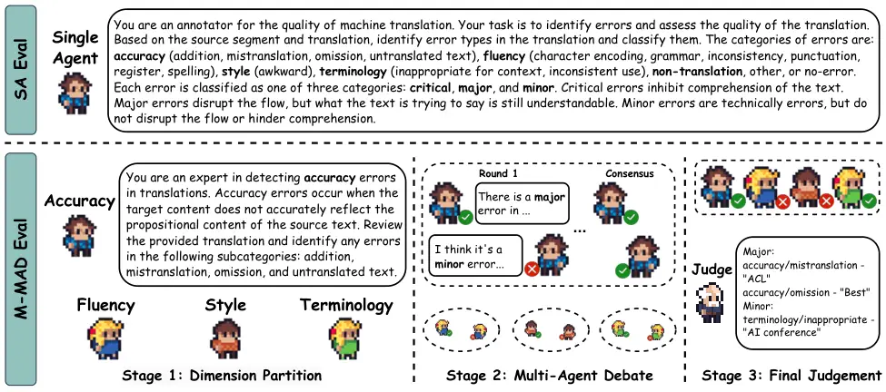
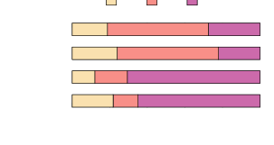

# M-MAD: Multidimensional Multi-Agent Debate for Advanced Machine Translation Evaluation

Zhaopeng Feng Email: [zhaopeng.23@intl.zju.edu.cn](mailto:)    Jiayuan
Su Email: [jiayuan.23@intl.zju.edu.cn](mailto:)    Jiamei Zheng
Affiliation: Zhejiang University
Email: [hongweiwang@intl.zju.edu.cn](mailto:)    Jiahan Ren
Affiliation: Zhejiang University
Email: [zuozhuliu@intl.zju.edu.cn](mailto:)    Yan Zhang
Affiliation: National University of Singapore    Jian Wu
Affiliation: Zhejiang University    Hongwei Wang    Zuozhu Liu

###### Abstract

Recent advancements in large language models (LLMs) have given rise to
the LLM-as-a-judge paradigm, showcasing their potential to deliver
human-like judgments. However, in the field of machine translation (MT)
evaluation, current LLM-as-a-judge methods fall short of learned
automatic metrics. In this paper, we propose Multidimensional
Multi-Agent Debate (M-MAD), a systematic LLM-based multi-agent framework
for advanced LLM-as-a-judge MT evaluation. Our findings demonstrate that
M-MAD achieves significant advancements by (1) decoupling heuristic MQM
criteria into distinct evaluation dimensions for fine-grained
assessments; (2) employing multi-agent debates to harness the
collaborative reasoning capabilities of LLMs; (3) synthesizing
dimension-specific results into a final evaluation judgment to ensure
robust and reliable outcomes. Comprehensive experiments show that M-MAD
not only outperforms all existing LLM-as-a-judge methods but also
competes with state-of-the-art reference-based automatic metrics, even
when powered by a suboptimal model like GPT-4o mini. Detailed ablations
and analysis highlight the superiority of our framework design, offering
a fresh perspective for LLM-as-a-judge paradigm. Our code and data are
publicly available
at [https://github.com/SU-JIAYUAN/M-MAD](https://github.com/SU-JIAYUAN/M-MAD).

|                                       |            |              |               |
| ------------------------------------- | ---------- | ------------ | ------------- |
| Metric                                | Meta       | System-Level | Segment-Level |
| LLM-as-a-judge:                       |            |              |               |
| M-MAD (Ours)                          | 0.808 (1)  | 0.987        | 0.517         |
| GEMBA-MQM                             | 0.784 (5)  | 0.986        | 0.472         |
| GEMBA-DA                              | 0.765 (8)  | 0.990        | 0.474         |
| EAPrompt                              | 0.760 (9)  | 0.907        | 0.452         |
| \[.4pt/2pt\]       Automatic metrics: |            |              |               |
| XCOMET-QE-Ensemble                    | 0.797 (2)  | 0.892        | 0.533         |
| MetricX-23                            | 0.794 (3)  | 0.873        | 0.531         |
| MetricX-23-QE                         | 0.787 (4)  | 0.859        | 0.527         |
| COMETKiwi                             | 0.776 (6)  | 0.963        | 0.525         |
| MaTESe                                | 0.773 (7)  | 0.889        | 0.479         |
| COMET                                 | 0.754 (10) | 0.898        | 0.514         |
| BLEURT-20                             | 0.751 (11) | 0.880        | 0.518         |
| BERTscore                             | 0.720 (12) | 0.810        | 0.499         |
| chrF                                  | 0.671 (13) | 0.809        | 0.485         |
| BLEU                                  | 0.670 (14) | 0.734        | 0.472         |

Table 1: Results of the WMT 2023 Metrics Shared Task ZH-EN testset. The
first column displays the overall meta-evaluation performance. The
second column shows the system-level Pearson correlation. The third
column shows the score of segment-level Accuracy-t. Metrics with gray
background is reference-based.



Figure 1: Comparison between Single-Agent (SA) MT Evaluation and
Multidimensional Multi-Agent Debate (M-MAD). SA: A single agent
evaluates translations using a coupled MQM template (e.g., GEMBA (Kocmi
and Federmann, 2023a)). M-MAD: a) decouple MQM paradigm into four
evaluation dimensions; b) multi-agent groups debate within each
dimension; c) a judge synthesizes viewpoints from debate groups into the
final evaluation. We view M-MAD as analogous to the structure of "a
neural network in natural language form". Each stage functions like a
layer, each agent serves as a neuron, and their interactions act as
hidden states.

## 1 Introduction

Evaluating natural language generation systems has long been a
challenging task. As the quality of these systems continues to improve,
the need for robust and precise evaluation methods has become even more
critical (Chang et al., 2024). In machine translation (MT) evaluation,
learned automatic metrics such as MetricX (Juraska et al., 2023) and
XCOMET (Guerreiro et al., 2024) have achieved state-of-the-art
performance in benchmarks like the WMT Metrics shared task (Freitag
et al., 2023). However, these model-based metrics require extensive
human-annotated datasets for training and rely on reference translations
for better accuracy.

The emerging LLM-as-a-judge paradigm offers a promising alternative by
leveraging large language models (LLMs) to directly assess or critique
generated content (Chiang and Lee, 2023; Zhang et al., 2023; Lee et al.,
2023; Wu et al., 2024; Li et al., 2024; Pavlovic and Poesio, 2024).
Early explorations in MT evaluation have shown potential (Kocmi and
Federmann, 2023b; Fernandes et al., 2023; Xu et al., 2023; Leiter and
Eger, 2024). For example, GEMBA-MQM (Kocmi and Federmann, 2023a) and
EAPrompt (Lu et al., 2024) use coupled heuristic Multidimensional
Quality Metrics (MQM) Freitag et al. (2021) prompt to guide LLMs in
identifying potential errors, which are aggregated into final quality
scores via a weighted scoring system (Freitag et al., 2021). Despite
their comparable performance to learned automatic metrics at the
system-level, these methods face significant limitations: (1) they
exhibit weaker segment-level performance, lagging behind
state-of-the-art model-based automatic metrics (see in Table 1); (2)
they rely on coupled heuristic MQM templates, which may introduce biases
toward specific error types and further influence the quality score; (3)
their single-agent single-step evaluation processes fail to fully
exploit the reasoning and collaborative capabilities inherent in LLMs.

In human evaluation, addressing instability and bias often involves
dividing tasks into distinct dimensions and fostering collaboration
among multiple annotators (van der Lee et al., 2019; Karpinska et al.,
2021). Similarly, in LLM-based multi-agent systems, multi-agent debate
has proven effective in generating truthful and factual judgments (Chan
et al., 2023; Khan et al., 2024; Liang et al., 2024; Du et al., 2024).
These findings highlight that both human and LLM-based collaborative
evaluation processes can achieve greater reliability compared to
individual assessments.

Motivated by these observations and insights, we propose the
Multidimensional Multi-Agent Debating (M-MAD) framework for MT
evaluation. M-MAD operates in three stages: (1) decomposing the
heuristic MQM annotation guideline into distinct dimensions for
independent LLM-as-a-judge assessments; (2) conducting multi-agent
debates within each dimension, harnessing LLMs’ inherent knowledge,
reasoning, and collaborative abilities; (3) synthesizing the debated
outcomes through a final judge agent to produce a comprehensive
evaluation judgment. Comprehensive experiments demonstrate that M-MAD
not only maintains the strong system-level performance but also
significantly enhances segment-level performance compared to existing
LLM-as-a-judge approaches and most automatic metrics. Moreover, even
with a suboptimal LLM like GPT-4o mini, M-MAD achieves performance
comparable to state-of-the-art reference-based automatic metrics.

Our contributions are summarized as follows:

- •
  We introduce the first LLM-based systematic Multidimensional
  Multi-Agent Debating (M-MAD) framework for MT evaluation. By
  decoupling the MQM paradigm into distinct evaluation dimensions and
  integrating multi-agent debates for each dimension, M-MAD enhances the
  robustness, precision, and reliability of LLM-as-a-judge approaches.
- •
  M-MAD achieves significant improvements in segment-level performance,
  surpassing existing LLM-as-a-judge methods while maintaining top-tier
  system-level accuracy. Its alignment with human judgments outperforms
  most advanced model-based automatic metrics. Notably, even when
  powered by a suboptimal LLM (GPT-4o mini), M-MAD delivers results
  comparable to state-of-the-art reference-based and reference-free
  metrics, demonstrating the transformative potential of LLM-as-a-judge
  approaches.
- •
  Beyond introducing M-MAD, we conduct comprehensive benchmarking
  against other multi-agent collaboration frameworks, highlighting the
  benefits of M-MAD’s dimension-decoupling design. Our thorough ablation
  studies and analysis explore key components of the framework, such as
  debating modalities and strategies, emphasizing the importance of
  fine-grained instructions and error-severity debates in MQM evaluation
  scenarios. These insights provide a foundation for future research in
  LLM-based MT evaluation.

## 2 Multidimensional Multi-Agent Debate Framework

In this section, we first introduce the background of the MQM
paradigm (Freitag et al., 2021). We then elaborate on the principal
stages in M-MAD, including dimension partition, multi-agent debate, and
final judgment, as shown in Figure 1.

### 2.1 Preliminary: Multidimensional Quality Metrics Evaluation Method

The MQM framework is a flexible human evaluation method designed to
assess and categorize translation errors (Burchardt, 2013; Freitag
et al., 2021). Unlike traditional Direct Assessment (DA), which relies
on annotators assigning scores on a 0–100 scale, MQM focuses on
identifying specific errors and classifying them based on severity and
category. Annotators evaluate translations segment by segment, taking
into account the context of the entire document. Each error is assigned
a severity level (major or minor) and categorized by type. Spans without
errors are marked with neutral severity and no category. This approach
provides a more granular and structured evaluation compared to DA. The
MQM framework derives quality scores automatically by applying a
weighted scheme to the identified errors, considering both their
severity and category. Segment-level scores range from 0 (perfect
translation) to 25 (worst possible translation), with the overall score
calculated as the average across all annotators. For some applications,
such as correlating with learned metrics, the scores are negated for
consistency. MQM has been shown to align more closely with human
judgments than DA, offering a robust and interpretable framework for
evaluating MT quality (Freitag et al., 2022; Zhao et al., 2024). More
details about MQM are provided in Appendix C.

|                               |       |              |         |               |         |     |              |         |               |         |
| ----------------------------- | ----- | ------------ | ------- | ------------- | ------- | --- | ------------ | ------- | ------------- | ------- |
|                               |       | zh-en        |         |               |         |     | en-de        |         |               |         |
| Metric                        | meta  | System-Level |         | Segment-Level |         |     | System-Level |         | Segment-Level |         |
|                               |       | Acc          | Pearson | Acc-t         | Pearson |     | Acc          | Pearson | Acc-t         | Pearson |
| Reference-based Metrics       |       |              |         |               |         |     |              |         |               |         |
| chrF                          | 0.695 | 0.762        | 0.809   | 0.485         | 0.063   |     | 0.818        | 0.866   | 0.519         | 0.232   |
| BLEU                          | 0.703 | 0.781        | 0.734   | 0.472         | 0.119   |     | 0.894        | 0.917   | 0.520         | 0.192   |
| BERTScore                     | 0.736 | 0.857        | 0.810   | 0.499         | 0.236   |     | 0.879        | 0.891   | 0.528         | 0.325   |
| MaTESe                        | 0.778 | 0.914        | 0.889   | 0.479         | 0.511   |     | 0.848        | 0.918   | 0.528         | 0.554   |
| COMET                         | 0.781 | 0.857        | 0.898   | 0.514         | 0.396   |     | 0.970        | 0.990   | 0.574         | 0.432   |
| BLEURT-20                     | 0.782 | 0.857        | 0.880   | 0.518         | 0.378   |     | 0.970        | 0.990   | 0.572         | 0.484   |
| MetricX-23                    | 0.808 | 0.895        | 0.873   | 0.531         | 0.625   |     | 0.909        | 0.977   | 0.603         | 0.585   |
| XCOMET-Ensemble               | 0.826 | 0.905        | 0.927   | 0.543         | 0.650   |     | 0.939        | 0.980   | 0.604         | 0.675   |
| Reference-free Metrics        |       |              |         |               |         |     |              |         |               |         |
| Learned Automatic Metrics     |       |              |         |               |         |     |              |         |               |         |
| COMETKiwi                     | 0.793 | 0.876        | 0.963   | 0.525         | 0.442   |     | 0.985        | 0.946   | 0.569         | 0.475   |
| MetricX-23-QE                 | 0.806 | 0.867        | 0.859   | 0.527         | 0.647   |     | 0.924        | 0.969   | 0.596         | 0.626   |
| XCOMET-QE-Ensemble            | 0.818 | 0.886        | 0.892   | 0.533         | 0.647   |     | 0.955        | 0.974   | 0.588         | 0.679   |
| \[.4pt/2pt\]   LLM-as-a-judge |       |              |         |               |         |     |              |         |               |         |
| EAPrompt                      | 0.772 | 0.876        | 0.907   | 0.452         | 0.516   |     | 0.939        | 0.962   | 0.471         | 0.520   |
| GEMBA-MQM                     | 0.784 | 0.933        | 0.986   | 0.472         | 0.475   |     | 0.970        | 0.973   | 0.474         | 0.429   |
| M-MAD (Ours)                  | 0.814 | 0.933        | 0.987   | 0.517         | 0.577   |     | 0.970        | 0.979   | 0.555         | 0.552   |

### 2.2 Multidimensional Multi-Agent Debate

In the M-MAD framework, given a translation pair $`(x,y)`$, there are
$`d`$ evaluation dimensions
$`\mathcal{D}=\left\{D_{i}\right\}_{i=1}^{d}`$, where each dimension
corresponds to an error category. For each dimension, $`n`$ agents
$`\mathcal{A}=\left\{A_{i}\right\}_{i=1}^{n}`$, each powered by an LLM
$`L_{i}`$, engaged in debating. The debating process lasts for a maximum
of $`\mathcal{R}`$ rounds. During each round $`r`$, an agent $`A_{i}`$
generates a response
$`\left(s_{i},r\right)\sim A_{i}\left(s_{i}\mid H,P\right)`$, where
$`H`$ is the history of previous messages visible to the agent, and
$`P`$ is the prompt. At the end of the debate, the debating group
provides their final viewpoint for its dimension, denoted as
$`V(D_{i})`$. After evaluating all dimensions, the final judge agent
$`J`$ gathers all viewpoints
$`\mathcal{V}=\left\{V(D_{i})\right\}_{i=1}^{d}`$ and synthesizes them
into an overall evaluation $`O(x,y)`$.

Stage 1: Dimension Partition. We first decouple the pre-defined MQM
guideline into four distinct evaluation dimensions $`(d=4)`$: Accuracy,
Fluency, Style and Terminology. We exclude the rare and easily
identifiable error type non-translation as well as locale convention,
which is not related to translation errors, to ensure a fair comparison
with GEMBA-MQM (Kocmi and Federmann, 2023a). For each dimension, an
agent $`A_{0}`$ performs the initial evaluation
$`s_{0}\sim A_{0}\left(s_{0}\mid P_{0}\right)`$, where $`P_{0}`$ is the
evaluation template designed for this dimension to identify potential
error spans, classify them into subcategories, and assign severity.

Stage 2: Multi-Agent Debate. In this stage, we employ "Pro-Con Debate,"
a formal discussion format where participants present arguments for or
against a topic (Johnson and Johnson, 1985). For each evaluation
dimension, we assign a two-agent debating group $`(n=2)`$. Starting with
the initial evaluation $`s_{0}`$, if an error is detected, agent
$`A_{1}`$ supports $`s_{0}`$, while agent $`A_{2}`$ holds the opposite.
In the first round, $`A_{1}`$ generates a statement
$`(s_{1},1)\sim A_{1}\left(s_{1}\mid H,P\right)`$, where $`H`$ includes
the initial standpoints of both sides, and $`P`$ is the debating prompt.
$`A_{1}`$ may provide explanations, reinforce its position, or switch
sides. Agent $`A_{2}`$ then follows the same process to generate
$`(s_{2},1)`$. These statements, $`(s_{1},1)`$ and $`(s_{2},1)`$, are
added to the history $`H`$ as context for subsequent rounds. After each
round, a consensus checker determines if the agents have reached an
agreement. If consensus is achieved, the resulting statement $`s_{c}`$
becomes the viewpoint $`V(Di)`$ for this dimension, and the debate ends.
If consensus is not reached after $`R`$ rounds, the supportive side of
$`s_{0}`$ is taken as $`V(Di)`$. We conduct extensive experiments to
evaluate different debating strategies and their impact in Section 4.3.

Stage 3: Final Judgement. This stage consists of two steps: viewpoint
synthesis and quality score calculation. First, the final judge agent
$`J`$ gathers the set of viewpoints
$`\mathcal{V}=\left\{V(D_{i})\right\}_{i=1}^{d}`$ obtained in Stage 2.
Agent $`J`$ evaluates the validity of each viewpoint, removes redundant
information, and synthesizes them into an overall evaluation $`O(x,y)`$.
Next, $`O(x,y)`$ is used to calculate the translation quality score by
counting the number of major and minor errors and applying the following
MQM score formula:

```math
MQM\text{ score}=-w_{\text{major}}n_{\text{major}}-w_{\text{minor}}n_{\text{minor}} \tag{1}
```

where $`n_{major}`$ and $`n_{minor}`$ represent the counts of major and
minor errors, respectively, while $`w_{major}`$ and $`w_{minor}`$ denote
their corresponding severity weights. In line with GEMBA-MQM, EAprompt
and WMT Metric Shared Task (Freitag et al., 2023), we set
$`w_{major}=5`$ and $`w_{minor}=1`$.

## 3 Experiments

### 3.1 Experimental Setup

Datasets. Our experiments utilize MQM ratings (Burchardt, 2013; Freitag
et al., 2021) from the WMT 2023 Metrics Shared Task (Freitag et al.,
2023), encompassing a total of 45 systems and 68,130 segments across
four languages: English (EN), German (DE), Chinese (ZH), and Hebrew
(HE). Following the WMT 2023 Metrics Shared Task, we tested three
language pairs: EN-DE, ZH-EN, and HE-EN. The human MQM scores serve as
the ground truth for evaluating the performance of automatic metrics.
Detailed dataset statistics are presented in Table 11.

Meta Evaluation. We adopt the same meta-evaluation metrics as the WMT 23
Metrics Shared Task, which defines a composite evaluation score based on
four scenarios, each contributing equally (weight of 0.25) to the final
meta score:

– system-level pairwise accuracy;

– system-level Pearson correlation;

– segment-level Accuracy-t;

– segment-level Pearson correlation,

All results are computed using MTME ¹¹ 1
[https://github.com/google-research/mt-metrics-eval](https://github.com/google-research/mt-metrics-eval),
a metric evaluation tool recommended by WMT (Freitag et al., 2023) to
ensure comparability with other evaluation metrics.

|                   |        |              |               |
| ----------------- | ------ | ------------ | ------------- |
| Ablations         | Meta   | System-Level | Segment-Level |
| w/o Stage 1 (DP)  | -0.041 | -0.038       | -0.145        |
| w/o Stage 2 (MAD) | -0.006 | -0.019       | -0.002        |
| w/o Stage 3 (FJ)  | -0.011 | -0.038       | -0.021        |

Table 3: Ablation studies of three stages in M-MAD on WMT 23 Metrics
Shared Task ZH-EN. The first column displays the overall meta-evaluation
performance. The second column shows the system-level Accuracy. The
third column shows the segment-level Pearson.

Baseline Metrics. We compare M-MAD against the following categories of
metrics:

1\) Reference-free LLM-as-a-judge methods: GEMBA-MQM (Kocmi and
Federmann, 2023a) and EAPrompt (Lu et al., 2024);

2\) Reference-based metrics: XCOMET (Guerreiro et al., 2024),
MetricX-23 (Juraska et al., 2023), BLEURT-20 (Sellam et al., 2020),
COMET (Rei et al., 2020), MaTESe (Perrella et al., 2022), and
BERTScore (Zhang et al., 2019);

3\) Reference-free metrics: COMETKiwi (Rei et al., 2022),
MetricX-23-QE (Juraska et al., 2023), and XCOMET-QE (Guerreiro et al.,
2024).

We also report results using model-free lexical metrics for
completeness, including BLEU (Papineni et al., 2002) and chrF (Popović,
2015).

Implementation Details. We use GPT-4o mini as the primary model for all
LLM-as-a-judge methods ²² 2
[https://platform.openai.com/docs/models/gpt-4o-mini](https://platform.openai.com/docs/models/gpt-4o-mini)
and set the temperature to 0 to ensure reproducibility. The model’s
accessibility and API-based interaction streamline its integration into
our framework, facilitating both current experiments and future
exploration. In M-MAD Stage 1, we adopt a 4-shot demonstration strategy,
selecting examples from the WMT 22 MQM dataset. For LLM-as-a-judge
methods such as GEMBA-MQM and EAPrompt, we use the templates and
examples provided in their respective papers and conduct experiments
using the same model and settings as M-MAD. For other baseline automatic
metrics, we report their performance using MTME for consistency. More
details are in Appendix B.

### 3.2 Main Results

Improvements over LLM-as-a-judge Methods. Table 2.1 demonstrates that
M-MAD significantly outperforms existing LLM-as-a-judge frameworks for
MT evaluation. On the average Meta score across ZH-EN and EN-DE, M-MAD
achieves a 3.8$`\%`$ improvement over GEMBA-MQM and a 5.4$`\%`$
improvement over EAPrompt. While maintaining the consistently strong
system-level performance, M-MAD achieves notable improvements at the
segment level. For instance, on EN-DE segment-level evaluation, M-MAD
surpasses GEMBA-MQM by 9.5$`\%`$ and EAPrompt by 14.4$`\%`$.

Comparison with SoTA Automatic Metrics. We also compare M-MAD with
state-of-the-art automatic metrics models, as shown in Table 2.1. In the
reference-based setting, M-MAD surpasses COMETKiwi by 2.6$`\%`$ and
MetricX-23-QE by 0.9$`\%`$ in terms of Meta score. Notably, when
compared to reference-based metrics, the reference-free and
training-free M-MAD outperforms most reference-based metrics, trailing
only the XCOMET-Ensemble (XCOMET-XL + XCOMET-XXL). These results
underscore the significant potential of M-MAD in advancing the
LLM-as-a-judge paradigm for MT evaluation.

|           |           |        |          |
| --------- | --------- | ------ | -------- |
| Method    | Precision | Recall | F1 Score |
| EAPrompt  | 0.29      | 0.38   | 0.33     |
| GEMBA-MQM | 0.28      | 0.54   | 0.37     |
| Ours      | 0.41      | 0.78   | 0.54     |

Table 4: Error span prediction performance. Extracting error spans from
unstructured LLM-as-a-judge methods like GEMBA-MQM and EAPrompt is
highly challenging. We address this by matching their output strings to
the gold annotations. This approach may lead to slightly inflated scores
for these two methods.

## 4 Ablation and Analysis

We conduct multiple ablations to demonstrate the impact of each
component of M-MAD and perform a detailed analysis of our approach.

### 4.1 Decoupled Multidimensional Design Brings Significant Improvements

As shown in Table 3, Stage 1 (Dimension Partition) contributes the most
significant improvements in M-MAD framework. When we remove it from
M-MAD, the overall performance dropped by 5.1$`\%`$. This aligns with
the observation of GEMBA-MQM and reinforces our earlier assertion that
previous LLM-as-a-judge methods, which rely on coupled multidimensional
templates, are suboptimal. Decoupling multidimensional evaluation into
separate dimension agents maximizes the potential of each dimension.
Dimension partition also provides a more centralized debating focus for
Stage 2.



Figure 2: MQM score distribution for WMT 23 Metrics Shared Task ZH-EN
set. HQ: High-quality translations with MQM score $`=`$ 0. MQ:
Medium-quality translations with -5 $`<`$ MQM score $`<`$ 0. LQ:
Low-quality translations with MQM score $`\leq`$ -5.

### 4.2 Segment-Level Improvements from More Accurate Error Span Predictions

We evaluate M-MAD’s performance on error span prediction in the WMT 23
ZH-EN Metrics Shared Task using precision, recall, and F1 scores, as
shown in Table 4. Compared to prior LLM-as-a-judge methods, M-MAD
demonstrates significant improvements across all metrics, indicating
more accurate and reliable error span predictions. As illustrated in
Figure 2, both EAPrompt and GEMBA-MQM exhibit a tendency to overestimate
error severity compared to the gold human annotations. In contrast, the
MQM score distribution generated by M-MAD closely aligns with the gold
annotations, outperforming other LLM-as-a-judge approaches. This
observation supports our hypothesis that coupled multidimensional
instructions can introduce biases toward specific error types, thereby
impacting the overall quality score. M-MAD’s ability to mitigate these
biases contributes to its enhanced segment-level performance, further
affirming its effectiveness in MT evaluation.

|                         |                          |          |       |
| ----------------------- | ------------------------ | -------- | ----- |
| Methods                 | Decoupled Multidimension | Debating | Meta  |
| GEMBA-MQM               | ✗                        | ✗        | 0.784 |
| Liang et al. (2024)     | ✗                        | ✓        | 0.665 |
| Khan et al. (2024)^(♡)  | ✗                        | ✓        | 0.728 |
| Khan et al. (2024)^(♠) | ✗                        | ✓        | 0.712 |
| M-MAD (Ours)            | ✓                        | ✓        | 0.808 |

Table 5: Applying the off-the-shelf debating framework directly to MT
evaluation. The debating process is initialized from GEMBA-MQM ZH-EN,
focusing on coupled MQM evaluation results. $`\heartsuit`$ and
$`\spadesuit`$ denote two different strategies in Khan et al. (2024).

### 4.3 More Precise Debating Approaches Yields Better Evaluation Results

Before implementing dimension partitioning, we adapted existing
off-the-shelf debating frameworks for MT evaluation based on the coupled
evaluation results from GEMBA-MQM. However, as shown in Table 5,
directly debating coupled multidimensional results leads to a
significant performance drop. We hypothesize that this occurs because
agents struggle to identify specific focal points for the debate when
addressing multiple dimensions simultaneously. To isolate the influence
of multidimensional coupling, we conduct a controlled experiment after
Stage 1. In this setup, debaters are allowed to freely debate within
distinct dimensions (referred to as "Entirety" in Table 6).
Interestingly, the results still show a substantial decline in
performance, supporting our hypothesis: unfocused or unstructured
debates do not yield positive gains. To identify the most effective
debating strategy, we design and test several structured approaches
following dimension partitioning, including:

Consensus: Two debaters argue over the severity of errors, with one
supporting the initial evaluation and the other opposes it. The debate
ends as soon as consensus is reached. If no agreement is reached, the
original evaluation is retained.

Deliberation: Debaters present opposing arguments over multiple rounds
until the maximum round limit is reached. A judge reviews the transcript
and makes the final decision based on the presented arguments.

|          |       |              |         |               |         |
| -------- | ----- | ------------ | ------- | ------------- | ------- |
|          |       | System-Level |         | Segment-Level |         |
| Topics   | Meta  | Acc          | Pearson | Acc-t         | Pearson |
| Severity | 0.808 | 0.933        | 0.987   | 0.517         | 0.577   |
| Category | 0.666 | 0.819        | 0.444   | 0.423         | 0.320   |
| Entirety | 0.737 | 0.857        | 0.894   | 0.423         | 0.439   |

Table 6: Comparison with debating on different topics on ZH-EN.
Severity: debates on error severity. Category: debates on category
correctness (e.g., fluency, accuracy). Entirety: debates without
specific focus.

Interactive Review: After each round, a reviewer introduces questions to
the debaters, who must rebut each other’s arguments and respond to the
questions. A judge evaluates the complete transcript and determines the
final evaluation.

Figure 3: Performance with increased multi-agent debating rounds on WMT
23 ZH-EN.

Consultancy Review: A debater defends the initial evaluation, engaging
directly with a reviewer over multiple rounds. The reviewer collaborates
with a judge to determine the final outcome.

|                        |       |              |         |               |         |
| ---------------------- | ----- | ------------ | ------- | ------------- | ------- |
|                        |       | System-Level |         | Segment-Level |         |
| Methods                | Meta  | Acc          | Pearson | Acc-t         | Pearson |
| Baseline               | 0.802 | 0.914        | 0.975   | 0.519         | 0.575   |
| \[.4pt/2pt\] Consensus | 0.808 | 0.933        | 0.987   | 0.517         | 0.577   |
| Deliberation           | 0.805 | 0.924        | 0.978   | 0.520         | 0.574   |
| Interactive Review     | 0.798 | 0.905        | 0.978   | 0.518         | 0.561   |
| Consultancy Review     | 0.790 | 0.886        | 0.973   | 0.513         | 0.551   |

Table 7: Comparison with different debating strategies on ZH-EN.
Baseline is the same as Table 3 w/o Stage 2.

Our experimental results in Table 7 demonstrate that debates conducted
within a specific, well-defined dimension yield significantly more
stable and reliable outcomes compared to coupled multidimensional
debates. Furthermore, the Consensus strategy outperforms review-based
questioning approaches, highlighting its effectiveness in refining
evaluation results. We also investigate the impact of debate
focus—comparing error category versus error severity. As shown in
Table 6, debates centered on error severity result in greater
improvements in meta scores. This outcome is intuitive, as error
severity directly influences the final MQM score, thereby playing a
critical role in evaluation accuracy. We believe that exploring dynamic
scoring mechanisms tailored to different error types could further
enhance the effectiveness of MT evaluation in future research.

### 4.4 Performance Convergence as Debating Rounds Progress

To investigate the impact of debating rounds on M-MAD’s performance, we
conduct experiments with up to five rounds of multi-agent debate. As
shown in Figure 3, system-level performance fluctuates across rounds but
consistently peaks at round 3. Segment-level performance, in contrast,
exhibits steady improvement during the first three rounds before
plateauing. These findings suggest that three rounds of debate strike a
balance between refining evaluations and maintaining stability.

### 4.5 Case Study

We provide case studies in Table 8 and Table 10 to illustrate M-MAD’s
effectiveness and limitations. In Table 8, the gold evaluation marks all
error spans as minor, whereas EAPrompt and GEMBA-MQM incorrectly
identify two major errors, significantly distorting the final MQM
scores. Similarly, M-MAD in Stage 1 tends to overestimate errors, with
overlapping annotations. These issues are addressed in subsequent
stages: the multi-agent debate mechanism in Stage 2 resolves
overestimations, while the final judgment in Stage 3 mitigates
overlapping annotations. We conceptualize M-MAD as analogous to "a
neural network in natural language form". Each stage functions as a
layer, agents serve as neurons, and their interactions as hidden states.
The flow of language through this internal workflow enables a deeper
exploration of the evaluation process. This layered design
differentiates M-MAD from traditional LLM-as-a-judge methods and
underpins its success.

Nonetheless, as Table 10 demonstrates, M-MAD occasionally diverges from
gold annotations. By analyzing the cases with the largest discrepancies,
we find instances of potentially mislabeled gold annotations,
complicating evaluation. This aligns with the observations of Agrawal
et al. (2024), which highlight the increasing difficulty of assessing
high-quality translations with automatic metrics as MT systems improve.
Developing more robust annotation paradigms beyond MQM could be critical
for next-generation MT evaluation frameworks.

|                               |                                                                                                                                                                                                                                                                                                                                                       |
| ----------------------------- | ----------------------------------------------------------------------------------------------------------------------------------------------------------------------------------------------------------------------------------------------------------------------------------------------------------------------------------------------------- |
| Source                        | 表的走时是很准的，误差完全在可接受范围内，表的包装里有珠宝鉴定证书，表盘的12字那里是真钻石，这个自己戴很合适，作为礼品送出去也很有面子。                                                                                                                                                                                                              |
| \[.4pt/2pt\] Reference        | The watch’s trip time is extremely accurate, and its error is entirely within acceptable bounds, the 12 on the dial is a genuine diamond, and a certificate of jewelry appraisal is included with the watch, both as a present and as something you may wear by yourself, this is excellent.                                                          |
| \[.4pt/2pt\] Translation      | The time of the watch is very accurate, and the error is completely within the acceptable range. There is a jewelry appraisal certificate in the packaging of the watch, and there is a real diamond on the 12 number on the dial.                                                                                                                    |
| \[.4pt/2pt\] Gold Annotations | Minor: style/unnatural or awkward - "time", "on", "12", "number". (Score: -4)                                                                                                                                                                                                                                                                         |
| EAPrompting                   | Major: accuracy/mistranslation - "the 12 number" terminology/inappropriate for context - "on the dial" Minor: style/unnatural or awkward - "the time of the watch", "there is a real diamond", "on the 12 number". (Score: -13)                                                                                                                       |
| \[.4pt/2pt\] GEMBA-MQM        | Major: accuracy/mistranslation - "12 number on the dial" style/awkward - "the error is completely within the acceptable range". (Score: -10)                                                                                                                                                                                                          |
| \[.4pt/2pt\] M-MAD Stage 1    | Major: accuracy/mistranslation - "there is a real diamond on the 12 number on the dial" accuracy/omission translation - "this is suitable for wearing", "as a gift, it is also very impressive" Minor: fluency/grammar - "the 12 number" terminology/inappropriate for context - "12 number on the dial" style/awkward - "the 12 number on the dial". |
| \[.4pt/2pt\] M-MAD Stage 2    | Minor: accuracy/mistranslation - "there is a real diamond on the 12 number on the dial" accuracy/omission - "this is suitable for wearing", "as a gift, it is also very impressive" fluency/grammar - "the 12 number" terminology/inappropriate for context - "12 number on the dial" style/awkward - "the 12 number on the dial".                    |
| \[.4pt/2pt\] M-MAD Stage 3    | Minor: accuracy/mistranslation - "there is a real diamond on the 12 number on the dial" accuracy/omission - "this is suitable for wearing", "as a gift, it is also very impressive" style/awkward - "the 12 number on the dial". (Score: -4)                                                                                                          |

Table 8: Case study. Red denotes severity, and blue denotes the category
and subcategory.

## 5 Related Work

The success of learned MT metrics (Rei et al., 2020; Sellam et al.,
2020; Rei et al., 2022; Perrella et al., 2022; Naskar et al., 2023;
Gowda et al., 2023; Juraska et al., 2023; Guerreiro et al., 2024), which
fine-tune neural network models pretrained on large amounts of data,
highlights the importance of leveraging transfer learning to achieve
metrics with higher correlation to human judgments. With the advent of
LLMs, several studies have explored using LLMs as evaluation metrics.
For instance, Dreano et al. (2023) used pre-trained LLaMA2 embeddings to
map sentences into vector spaces, employing cosine distance to estimate
similarity or dissimilarity. Similarly, Xu et al. (2023) and Fernandes
et al. (2023) fine-tuned LLMs such as PaLM (Anil et al., 2023) and
LLaMA (Touvron et al., 2023) on human-annotated MQM datasets, achieving
competitive results for specific language pairs. Other research focuses
on directly leveraging the internal knowledge of LLMs. Key comparisons
in our study, such as EAPrompt (Lu et al., 2024) and GEMBA (Kocmi and
Federmann, 2023b; Kocmi and Federmann, 2023a), showcase different
methodologies for LLM-based evaluation. EAPrompt employs
error-severity-focused prompts to guide ChatGPT in the evaluation
process, while GEMBA adopts heuristic templates inspired by DA and MQM
guidelines, mimicking human annotators to generate evaluation results.
Beyond these core comparisons, Leiter and Eger (2024) explored
large-scale prompt engineering to improve evaluation quality. However,
challenges persist. Agrawal et al. (2024) highlighted that current
automatic metrics often fail in high-quality translation scenarios,
where distinguishing subtle differences becomes increasingly difficult.
Additionally, Deutsch et al. (2023) revealed systemic inconsistencies in
the meta-evaluation of metrics, with noticeable discrepancies between
segment-level and system-level performance. Our work presents a
comprehensive multi-agent collaboration framework for LLM-as-a-judge
approaches, offering a novel perspective to advance MT evaluation
methodologies.

## 6 Conclusion

In this work, we introduce M-MAD, an advanced multi-agent collaboration
framework that elevates LLM-as-a-judge methods for MT evaluation. M-MAD
employs a three-stage workflow that decouples MQM criteria into distinct
dimensions, conducts multi-agent debates within each dimension, and
synthesizes the outcomes into a final robust evaluation. Experimental
results demonstrate that M-MAD not only outperforms existing
LLM-as-a-judge methods but is also competitive with the advanced
reference-free and reference-based automatic metrics. Detailed ablations
and analyses reveal the mechanisms behind M-MAD’s success, highlight its
ability to leverage fine-grained evaluations and collaborative reasoning
to enhance reliability and precision. We believe M-MAD offers a
groundbreaking approach for advancing MT evaluation and sets the stage
for developing next-generation LLM-as-a-judge frameworks.

## Limitations

Due to the meta-evaluation’s unique complexity, the token consumption
required by M-MAD is substantial. As a result, we were unable to afford
cutting-edge models like GPT-4o, o1, or Claude-3.5 Sonnet for our
experiments. This constraint limits our ability to explore the upper
performance bounds of the framework with these advanced models. Our
current research primarily focuses on homogeneous groups of LLMs, which
might not capture the full potential of multi-agent collaboration.
Future research could explore heterogeneous groups of LLMs, where
stronger and weaker, close source and open source models cooperate,
offering interesting insights into how various models with different
strengths and weaknesses can complement each other.

## References

- Agrawal et al. (2024) Sweta Agrawal, António Farinhas, Ricardo Rei,
  and Andre Martins. 2024. [Can automatic metrics assess high-quality
  translations?](https://doi.org/10.18653/v1/2024.emnlp-main.802) In
  _Proceedings of the 2024 Conference on Empirical Methods in Natural
  Language Processing_, pages 14491–14502, Miami, Florida, USA.
  Association for Computational Linguistics.
- Anil et al. (2023) Rohan Anil, Andrew M Dai, Orhan Firat, Melvin
  Johnson, Dmitry Lepikhin, Alexandre Passos, Siamak Shakeri, Emanuel
  Taropa, Paige Bailey, Zhifeng Chen, et al. 2023. Palm 2 technical
  report. _arXiv preprint arXiv:2305.10403_.
- Burchardt (2013) Aljoscha Burchardt. 2013. [Multidimensional quality
  metrics: a flexible system for assessing translation
  quality](https://aclanthology.org/2013.tc-1.6). In _Proceedings of
  Translating and the Computer 35_, London, UK. Aslib.
- Chan et al. (2023) Chi-Min Chan, Weize Chen, Yusheng Su, Jianxuan Yu,
  Wei Xue, Shanghang Zhang, Jie Fu, and Zhiyuan Liu. 2023. Chateval:
  Towards better llm-based evaluators through multi-agent debate. _arXiv
  preprint arXiv:2308.07201_.
- Chang et al. (2024) Yupeng Chang, Xu Wang, Jindong Wang, Yuan Wu,
  Linyi Yang, Kaijie Zhu, Hao Chen, Xiaoyuan Yi, Cunxiang Wang, Yidong
  Wang, et al. 2024. A survey on evaluation of large language models.
  _ACM Transactions on Intelligent Systems and Technology_, 15(3):1–45.
- Chiang and Lee (2023) Cheng-Han Chiang and Hung-Yi Lee. 2023. Can
  large language models be an alternative to human evaluations? In
  _Proceedings of the 61st Annual Meeting of the Association for
  Computational Linguistics (Volume 1: Long Papers)_, pages 15607–15631.
- Deutsch et al. (2023) Daniel Deutsch, George Foster, and Markus
  Freitag. 2023. [Ties matter: Meta-evaluating modern metrics with
  pairwise accuracy and tie
  calibration](https://doi.org/10.18653/v1/2023.emnlp-main.798). In
  _Proceedings of the 2023 Conference on Empirical Methods in Natural
  Language Processing_, pages 12914–12929, Singapore. Association for
  Computational Linguistics.
- Dreano et al. (2023) Sören Dreano, Derek Molloy, and Noel
  Murphy. 2023. [Embed_Llama: Using LLM embeddings for the metrics
  shared task](https://doi.org/10.18653/v1/2023.wmt-1.60). In
  _Proceedings of the Eighth Conference on Machine Translation_, pages
  738–745, Singapore. Association for Computational Linguistics.
- Du et al. (2024) Yilun Du, Shuang Li, Antonio Torralba, Joshua B
  Tenenbaum, and Igor Mordatch. 2024. Improving factuality and reasoning
  in language models through multiagent debate. In _Forty-first
  International Conference on Machine Learning_.
- Fernandes et al. (2023) Patrick Fernandes, Daniel Deutsch, Mara
  Finkelstein, Parker Riley, André Martins, Graham Neubig, Ankush Garg,
  Jonathan Clark, Markus Freitag, and Orhan Firat. 2023. [The devil is
  in the errors: Leveraging large language models for fine-grained
  machine translation
  evaluation](https://doi.org/10.18653/v1/2023.wmt-1.100). In
  _Proceedings of the Eighth Conference on Machine Translation_, pages
  1066–1083, Singapore. Association for Computational Linguistics.
- Freitag et al. (2021) Markus Freitag, George Foster, David Grangier,
  Viresh Ratnakar, Qijun Tan, and Wolfgang Macherey. 2021. [Experts,
  errors, and context: A large-scale study of human evaluation for
  machine translation](https://doi.org/10.1162/tacl_a_00437).
  _Transactions of the Association for Computational Linguistics_,
  9:1460–1474.
- Freitag et al. (2023) Markus Freitag, Nitika Mathur, Chi-kiu Lo,
  Eleftherios Avramidis, Ricardo Rei, Brian Thompson, Tom Kocmi,
  Frederic Blain, Daniel Deutsch, Craig Stewart, Chrysoula Zerva, Sheila
  Castilho, Alon Lavie, and George Foster. 2023. [Results of WMT23
  metrics shared task: Metrics might be guilty but references are not
  innocent](https://doi.org/10.18653/v1/2023.wmt-1.51). In _Proceedings
  of the Eighth Conference on Machine Translation_, pages 578–628,
  Singapore. Association for Computational Linguistics.
- Freitag et al. (2022) Markus Freitag, Ricardo Rei, Nitika Mathur,
  Chi-kiu Lo, Craig Stewart, Eleftherios Avramidis, Tom Kocmi, George
  Foster, Alon Lavie, and André F. T. Martins. 2022. [Results of WMT22
  metrics shared task: Stop using BLEU – neural metrics are better and
  more robust](https://aclanthology.org/2022.wmt-1.2). In _Proceedings
  of the Seventh Conference on Machine Translation (WMT)_, pages 46–68,
  Abu Dhabi, United Arab Emirates (Hybrid). Association for
  Computational Linguistics.
- Gowda et al. (2023) Thamme Gowda, Tom Kocmi, and Marcin
  Junczys-Dowmunt. 2023. [Cometoid: Distilling strong reference-based
  machine translation metrics into Even stronger quality estimation
  metrics](https://doi.org/10.18653/v1/2023.wmt-1.62). In _Proceedings
  of the Eighth Conference on Machine Translation_, pages 751–755,
  Singapore. Association for Computational Linguistics.
- Guerreiro et al. (2024) Nuno M Guerreiro, Ricardo Rei, Daan van Stigt,
  Luisa Coheur, Pierre Colombo, and André FT Martins. 2024. xcomet:
  Transparent machine translation evaluation through fine-grained error
  detection. _Transactions of the Association for Computational
  Linguistics_, 12:979–995.
- Johnson and Johnson (1985) David W Johnson and Roger Johnson. 1985.
  Classroom conflict: Controversy versus debate in learning groups.
  _American educational research journal_, 22(2):237–256.
- Juraska et al. (2023) Juraj Juraska, Mara Finkelstein, Daniel Deutsch,
  Aditya Siddhant, Mehdi Mirzazadeh, and Markus Freitag. 2023.
  [MetricX-23: The Google submission to the WMT 2023 metrics shared
  task](https://doi.org/10.18653/v1/2023.wmt-1.63). In _Proceedings of
  the Eighth Conference on Machine Translation_, pages 756–767.
- Karpinska et al. (2021) Marzena Karpinska, Nader Akoury, and Mohit
  Iyyer. 2021. [The perils of using Mechanical Turk to evaluate
  open-ended text
  generation](https://doi.org/10.18653/v1/2021.emnlp-main.97). In
  _Proceedings of the 2021 Conference on Empirical Methods in Natural
  Language Processing_, pages 1265–1285, Online and Punta Cana,
  Dominican Republic. Association for Computational Linguistics.
- Khan et al. (2024) Akbir Khan, John Hughes, Dan Valentine, Laura Ruis,
  Kshitij Sachan, Ansh Radhakrishnan, Edward Grefenstette, Samuel R
  Bowman, Tim Rocktäschel, and Ethan Perez. 2024. Debating with more
  persuasive llms leads to more truthful answers. In _Forty-first
  International Conference on Machine Learning_.
- Kocmi and Federmann (2023a) Tom Kocmi and Christian Federmann. 2023a.
  Gemba-mqm: Detecting translation quality error spans with gpt-4. In
  _Proceedings of the Eighth Conference on Machine Translation_, pages
  768–775.
- Kocmi and Federmann (2023b) Tom Kocmi and Christian Federmann. 2023b.
  [Large language models are state-of-the-art evaluators of translation
  quality](https://aclanthology.org/2023.eamt-1.19). In _Proceedings of
  the 24th Annual Conference of the European Association for Machine
  Translation_, pages 193–203, Tampere, Finland. European Association
  for Machine Translation.
- Lee et al. (2023) Harrison Lee, Samrat Phatale, Hassan Mansoor,
  Kellie Ren Lu, Thomas Mesnard, Johan Ferret, Colton Bishop, Ethan
  Hall, Victor Carbune, and Abhinav Rastogi. 2023. Rlaif: Scaling
  reinforcement learning from human feedback with ai feedback.
- Leiter and Eger (2024) Christoph Leiter and Steffen Eger. 2024.
  Prexme! large scale prompt exploration of open source llms for machine
  translation and summarization evaluation. In _Proceedings of the 2024
  Conference on Empirical Methods in Natural Language Processing_, pages
  11481–11506.
- Li et al. (2024) Dawei Li, Bohan Jiang, Liangjie Huang, Alimohammad
  Beigi, Chengshuai Zhao, Zhen Tan, Amrita Bhattacharjee, Yuxuan Jiang,
  Canyu Chen, Tianhao Wu, et al. 2024. From generation to judgment:
  Opportunities and challenges of llm-as-a-judge. _arXiv preprint
  arXiv:2411.16594_.
- Liang et al. (2024) Tian Liang, Zhiwei He, Wenxiang Jiao, Xing Wang,
  Yan Wang, Rui Wang, Yujiu Yang, Shuming Shi, and Zhaopeng Tu. 2024.
  [Encouraging divergent thinking in large language models through
  multi-agent debate](https://doi.org/10.18653/v1/2024.emnlp-main.992).
  In _Proceedings of the 2024 Conference on Empirical Methods in Natural
  Language Processing_, pages 17889–17904, Miami, Florida, USA.
  Association for Computational Linguistics.
- Lu et al. (2024) Qingyu Lu, Baopu Qiu, Liang Ding, Kanjian Zhang, Tom
  Kocmi, and Dacheng Tao. 2024. [Error analysis prompting enables
  human-like translation evaluation in large language
  models](https://doi.org/10.18653/v1/2024.findings-acl.520). In
  _Findings of the Association for Computational Linguistics: ACL 2024_,
  pages 8801–8816, Bangkok, Thailand. Association for Computational
  Linguistics.
- Naskar et al. (2023) Subhajit Naskar, Daniel Deutsch, and Markus
  Freitag. 2023. [Quality estimation using minimum Bayes
  risk](https://doi.org/10.18653/v1/2023.wmt-1.67). In _Proceedings of
  the Eighth Conference on Machine Translation_, pages 806–811,
  Singapore. Association for Computational Linguistics.
- Papineni et al. (2002) Kishore Papineni, Salim Roukos, Todd Ward, and
  Wei-Jing Zhu. 2002. [Bleu: a method for automatic evaluation of
  machine translation](https://doi.org/10.3115/1073083.1073135). In
  _Proceedings of the 40th Annual Meeting of the Association for
  Computational Linguistics_, pages 311–318, Philadelphia, Pennsylvania,
  USA. Association for Computational Linguistics.
- Pavlovic and Poesio (2024) Maja Pavlovic and Massimo Poesio. 2024. The
  effectiveness of llms as annotators: A comparative overview and
  empirical analysis of direct representation. _arXiv preprint
  arXiv:2405.01299_.
- Perrella et al. (2022) Stefano Perrella, Lorenzo Proietti, Alessandro
  Scirè, Niccolò Campolungo, and Roberto Navigli. 2022. [MaTESe: Machine
  translation evaluation as a sequence tagging
  problem](https://aclanthology.org/2022.wmt-1.51). In _Proceedings of
  the Seventh Conference on Machine Translation (WMT)_, pages 569–577,
  Abu Dhabi, United Arab Emirates (Hybrid). Association for
  Computational Linguistics.
- Popović (2015) Maja Popović. 2015. [chrF: character n-gram F-score for
  automatic MT evaluation](https://doi.org/10.18653/v1/W15-3049). In
  _Proceedings of the Tenth Workshop on Statistical Machine
  Translation_, pages 392–395, Lisbon, Portugal. Association for
  Computational Linguistics.
- Rei et al. (2020) Ricardo Rei, Craig Stewart, Ana C Farinha, and Alon
  Lavie. 2020. Comet: A neural framework for mt evaluation. In
  _Proceedings of the 2020 Conference on Empirical Methods in Natural
  Language Processing (EMNLP)_, pages 2685–2702.
- Rei et al. (2022) Ricardo Rei, Marcos Treviso, Nuno M Guerreiro,
  Chrysoula Zerva, Ana C Farinha, Christine Maroti, José GC De Souza,
  Taisiya Glushkova, Duarte Alves, Luísa Coheur, et al. 2022. Cometkiwi:
  Ist-unbabel 2022 submission for the quality estimation shared task. In
  _Proceedings of the Seventh Conference on Machine Translation (WMT)_,
  pages 634–645.
- Sellam et al. (2020) Thibault Sellam, Dipanjan Das, and Ankur P
  Parikh. 2020. Bleurt: Learning robust metrics for text generation. In
  _Proceedings of ACL_.
- Touvron et al. (2023) Hugo Touvron, Louis Martin, Kevin Stone, Peter
  Albert, Amjad Almahairi, Yasmine Babaei, Nikolay Bashlykov, Soumya
  Batra, Prajjwal Bhargava, Shruti Bhosale, et al. 2023. Llama 2: Open
  foundation and fine-tuned chat models. _arXiv preprint
  arXiv:2307.09288_.
- van der Lee et al. (2019) Chris van der Lee, Albert Gatt, Emiel van
  Miltenburg, Sander Wubben, and Emiel Krahmer. 2019. [Best practices
  for the human evaluation of automatically generated
  text](https://doi.org/10.18653/v1/W19-8643). In _Proceedings of the
  12th International Conference on Natural Language Generation_, pages
  355–368, Tokyo, Japan. Association for Computational Linguistics.
- Wu et al. (2024) Tianhao Wu, Weizhe Yuan, Olga Golovneva, Jing Xu,
  Yuandong Tian, Jiantao Jiao, Jason Weston, and Sainbayar
  Sukhbaatar. 2024. Meta-rewarding language models: Self-improving
  alignment with llm-as-a-meta-judge. _arXiv preprint arXiv:2407.19594_.
- Xu et al. (2023) Wenda Xu, Danqing Wang, Liangming Pan, Zhenqiao Song,
  Markus Freitag, William Wang, and Lei Li. 2023. Instructscore: Towards
  explainable text generation evaluation with automatic feedback. In
  _Proceedings of the 2023 Conference on Empirical Methods in Natural
  Language Processing_, pages 5967–5994.
- Zhang et al. (2023) Ruoyu Zhang, Yanzeng Li, Yongliang Ma, Ming Zhou,
  and Lei Zou. 2023. [LLMaAA: Making large language models as active
  annotators](https://doi.org/10.18653/v1/2023.findings-emnlp.872). In
  _Findings of the Association for Computational Linguistics: EMNLP
  2023_, pages 13088–13103, Singapore. Association for Computational
  Linguistics.
- Zhang et al. (2019) Tianyi Zhang, Varsha Kishore, Felix Wu, Kilian Q
  Weinberger, and Yoav Artzi. 2019. Bertscore: Evaluating text
  generation with bert. _arXiv preprint arXiv:1904.09675_.
- Zhao et al. (2024) Haofei Zhao, Yilun Liu, Shimin Tao, Weibin Meng,
  Yimeng Chen, Xiang Geng, Chang Su, Min Zhang, and Hao Yang. 2024. From
  handcrafted features to llms: A brief survey for machine translation
  quality estimation. _arXiv preprint arXiv:2403.14118_.

## Appendix A Datasets

As shown in Table 11, the dataset consists of three language pairs from
the WMT23 Metrics Shared Task: English-German (En-De), Hebrew-English
(He-En), and Chinese-English (Zh-En). Each language pair is evaluated
using a variety of systems, including GPT4-5shot, NLLB_Greedy, and
ONLINE-A, among others, and incorporates multiple reference
translations, such as refA, refB, and synthetic_ref. This diverse set of
systems and references ensures a thorough evaluation of machine
translation models across different language pairs.

## Appendix B Implementation Prompts

Our method uses few-shot examples, as demonstrated in Figure 10 and
Figure 17. To reproduce GEMBA-MQM, we use the official prompt and
examples provided in their papers, as shown in Figure 4 and Figure 5.
For EAPrompt, we also use the official prompts and present the prompt
for DE-EN in Figure 9.

## Appendix C Multidimensional Quality Metrics (MQM)

The annotator guidelines are provided in Table 12. Possible error
categories are displayed in Table 13.

## Appendix D Results for WMT 23 HE-EN

Due to page limitations, we provide the results for WMT 23 He-En in
Table 9. Aligned with the main results of Zh-En and En-De, M-MAD is also
superior among all metrics in the He-En task, which shows the
effectiveness of M-MAD.

|                    |       |              |         |               |         |
| ------------------ | ----- | ------------ | ------- | ------------- | ------- |
|                    | he-en |              |         |               |         |
| Metric             | meta  | System-Level |         | Segment-Level |         |
|                    |       | Acc          | Pearson | Acc-t         | Pearson |
| chrF               | 0.695 | 0.821        | 0.776   | 0.460         | 0.221   |
| BLEU               | 0.683 | 0.795        | 0.769   | 0.442         | 0.220   |
| BERTScore          | 0.754 | 0.885        | 0.895   | 0.515         | 0.335   |
| MaTESe             | 0.792 | 0.936        | 0.906   | 0.550         | 0.459   |
| COMET              | 0.775 | 0.897        | 0.940   | 0.532         | 0.401   |
| BLEURT-20          | 0.763 | 0.872        | 0.937   | 0.519         | 0.382   |
| MetricX-23         | 0.807 | 0.923        | 0.910   | 0.577         | 0.548   |
| COMETKiwi          | 0.760 | 0.872        | 0.860   | 0.544         | 0.387   |
| MetricX-23-QE      | 0.788 | 0.897        | 0.858   | 0.564         | 0.520   |
| XCOMET-QE-Ensemble | 0.789 | 0.897        | 0.909   | 0.554         | 0.498   |
| M-MAD (Ours)       | 0.787 | 0.910        | 0.972   | 0.538         | 0.425   |

Table 9: Results for system-level and segment-level WMT 23 Metrics
Shared Task on HE-EN.

## Appendix E Analysis of Incorrect Gold Annotations

|                               |                                                                                                                                                                                                                                                                                                                                                                        |
| ----------------------------- | ---------------------------------------------------------------------------------------------------------------------------------------------------------------------------------------------------------------------------------------------------------------------------------------------------------------------------------------------------------------------- |
| Source                        | 你永远主动联系不上这个专员，也不知道她的工号，也没有直线联系电话，就是你联系不上她，只有她联系你。                                                                                                                                                                                                                                                                     |
| \[.4pt/2pt\] Reference        | Since you don’t know the commissioner’s job number and there isn’t a direct phone number to call, you’ll never make the effort to get in touch with her, She is the only one who can reach you, You can’t.                                                                                                                                                             |
| \[.4pt/2pt\] Translation      | You never get in touch with the Commissioner, you don’t know her work number, you don’t have a direct line, you don’t get in touch with her, she gets in touch with you.                                                                                                                                                                                               |
| \[.4pt/2pt\] Gold Annotations | Major: accuracy/mistranslation - "You", "never get", "you", "her", "you", "direct line", "you", "her", "she", "you". Minor: fluency/grammar - "don", "don", "don", "with her, she", "gets"; fluency/spelling - "Commissioner"; style/awkward - "you don’t get in touch with her, she gets in touch with you"; terminology/inappropriate - "Commissioner". (Score: -56) |
| \[.4pt/2pt\] M-MAD Evaluation | Minor: style/awkward - "you don’t get in touch with her, she gets in touch with you"; terminology/inappropriate - "Commissioner". (Score: -2)                                                                                                                                                                                                                          |

Table 10: Bad case study. Some gold annotations appear to be incorrectly
labeled, making evaluation challenging.

In Table 10, this case represents one of several instances where gold
annotations, labeled by human annotators, contain errors. The gold
annotations incorrectly flag several pronouns ("you," "she," "her") as
errors, despite their correct usage in the translation, leading to
unjustified point deductions. Additionally, the gold annotations
misjudge grammatical and fluency issues, marking phrases like "you don’t
get in touch with her, she gets in touch with you" as awkward or
incorrect. These errors are consistent across multiple systems, all
annotated by human annotators, indicating that the gold annotations
themselves may be unreliable. This case highlights the importance of
improving the quality of gold annotations and the risks of relying
solely on them for evaluation. It also demonstrates that our system’s
annotations offer a more reasonable and accurate assessment.

[TABLE]

Table 11: Statistics of testset. Source, reference texts, and
translations are from the WMT23 Metrics Shared Task.

You will be assessing translations at the segment level, where a segment
may contain one or more sentences. Each segment is aligned with a
corresponding source segment, and both segments are displayed within
their respective documents. Annotate segments in natural order, as if
you were reading the document. You may return to revise previous
segments. Please identify all errors within each translated segment, up
to a maximum of five. If there are more than five errors, identify only
the five most severe. If it is not possible to reliably identify
distinct errors because the translation is too badly garbled or is
unrelated to the source, then mark a single _Non-translation_ error that
spans the entire segment. To identify an error, highlight the relevant
span of text, and select a category/sub-category and severity level from
the available options. (The span of text may be in the source segment if
the error is a source error or an omission.) When identifying errors,
please be as fine-grained as possible. For example, if a sentence
contains two words that are each mistranslated, two separate
mistranslation errors should be recorded. If a single stretch of text
contains multiple errors, you only need to indicate the one that is most
severe. If all have the same severity, choose the first matching
category listed in the error typology (eg, _Accuracy_, then _Fluency_,
then _Terminology_, etc). Please pay particular attention to document
context when annotating. If a translation might be questionable on its
own but is fine in the context of the document, it should not be
considered erroneous; conversely, if a translation might be acceptable
in some context, but not within the current document, it should be
marked as wrong. There are two special error categories: _Source error_
and _Non-translation_. Source errors should be annotated separately,
highlighting the relevant span in the source segment. They do not count
against the five-error limit for target errors, which should be handled
in the usual way, whether or not they resulted from a source error.
There can be at most one _Non-translation_ error per segment, and it
should span the entire segment. No other errors should be identified if
_Non-Translation_ is selected.

Table 12: MQM annotator guidelines

|                 |                           |                                                                     |
| --------------- | ------------------------- | ------------------------------------------------------------------- |
| Error Category  |                           | Description                                                         |
| Accuracy        | Addition                  | Translation includes information not present in the source.         |
|                 | Omission                  | Translation is missing content from the source.                     |
|                 | Mistranslation            | Translation does not accurately represent the source.               |
|                 | Untranslated text         | Source text has been left untranslated.                             |
| Fluency         | Punctuation               | Incorrect punctuation (for locale or style).                        |
|                 | Spelling                  | Incorrect spelling or capitalization.                               |
|                 | Grammar                   | Problems with grammar, other than orthography.                      |
|                 | Register                  | Wrong grammatical register (eg, inappropriately informal pronouns). |
|                 | Inconsistency             | Internal inconsistency (not related to terminology).                |
|                 | Character encoding        | Characters are garbled due to incorrect encoding.                   |
| Terminology     | Inappropriate for context | Terminology is non-standard or does not fit context.                |
|                 | Inconsistent use          | Terminology is used inconsistently.                                 |
| Style           | Awkward                   | Translation has stylistic problems.                                 |
| Locale          | Address format            | Wrong format for addresses.                                         |
| convention      | Currency format           | Wrong format for currency.                                          |
|                 | Date format               | Wrong format for dates.                                             |
|                 | Name format               | Wrong format for names.                                             |
|                 | Telephone format          | Wrong format for telephone numbers.                                 |
|                 | Time format               | Wrong format for time expressions.                                  |
| Other           |                           | Any other issues.                                                   |
| Source error    |                           | An error in the source.                                             |
| Non-translation |                           | Impossible to reliably characterize distinct errors.                |

Table 13: MQM hierarchy.

(System) You are an annotator for the quality of machine translation.
Your task is to identify errors and assess the quality of the
translation. (user) {source_language} source:\n
\`\`\`{source_segment}\`\`\`\n {target_language} translation:\n
\`\`\`{target_segment}\`\`\`\n \n Based on the source segment and
machine translation surrounded with triple backticks, identify error
types in the translation and classify them. The categories of errors
are: accuracy (addition, mistranslation, omission, untranslated text),
fluency (character encoding, grammar, inconsistency, punctuation,
register, spelling), style (awkward), terminology (inappropriate for
context, inconsistent use), non-translation, other, or no-error.\n Each
error is classified as one of three categories: critical, major, and
minor. Critical errors inhibit comprehension of the text. Major errors
disrupt the flow, but what the text is trying to say is still
understandable. Minor errors are technically errors, but do not disrupt
the flow or hinder comprehension. (assistant) {observed error classes}

Figure 4: The general prompt for GEMBA-MQM, with the “(user)” and
“(assistant)” section repeated for each few-shot example.

English source: I do apologise about this, we must gain permission from
the account holder to discussan order with another person, I apologise
if this was done previously, however, I would not be ableto discuss this
with yourself without the account holders permission.German translation:
Ich entschuldige mich dafür, wir müssen die Erlaubnis einholen, um eine
Bestellungmit einer anderen Person zu besprechen. Ich entschuldige mich,
falls dies zuvor geschehen wäre, aberohne die Erlaubnis des
Kontoinhabers wäre ich nicht in der Lage, dies mit dir involvement.MQM
annotations:Critical:no-errorMajor:accuracy/mistranslation -
"involvement"accuracy/omission - "the account
holder"Minor:fluency/grammar - "wäre"fluency/register - "dir"

English source: Talks have resumed in Vienna to try to revive the
nuclear pact, with both sidestrying to gauge the prospects of success
after the latest exchanges in the stop-start negotiations.Czech
transation: Ve Vídni se ve Vídni obnovily rozhovory o oživení jaderného
paktu, přičemže oběpartaje se snaží posoudit vyhlídky na úspěch po
posledních výměnách v jednáních.MQM
annotations:Critical:no-errorMajor:accuracy/addition - "ve
Vídni"accuracy/omission - "the
stop-start"Minor:terminology/inappropriate for context - "partaje"

Chinese source:
大众点评乌鲁木齐家居商场频道为您提供高铁居然之家地址，电话，营业时间等最新商户信息，找装修公司，就上大众点评English
translation: Urumqi Home Furnishing Store Channel provides you with the
latest businessinformation such as the address, telephone number,
business hours, etc., of high-speed rail, andfind a decoration company,
and go to the reviews.MQM annotations:Critical:accuracy/addition - "of
high-speed rail"Major:accuracy/mistranslation - "go to the
reviews"Minor:style/awkward - "etc.,"

Figure 5: Three examples used for GEMBA-MQM.

(user) Source: They were addressed to her son, who has autism and lives
in a private care facility, she said. But instead of her son’s name
inside when you opened them, the letters said Dear Maine’s Department of
Health and Human Services -- in Cincinnati, she told local media.
Translation: Sie wurden an ihren Sohn gerichtet, der Autismus hat und in
einer privaten Pflegeeinrichtung lebt, sagte sie. Aber anstelle des
Namens ihres Sohnes im Inneren, als Sie sie öffneten, sagten die Briefe
Dear Maine ’s Department of Health and Human Services -- in Cincinnati,
sagte sie den lokalen Medien. Based on the given source, identify the
major and minor errors in this translation. Note that Major errors refer
to actual translation or grammatical errors, and Minor errors refer to
smaller imperfections, and purely subjective opinions about the
translation. Count the number of major and minor errors and compute the
final score for this translation. Deduct 5 points for each major error.
Deduct 1 point for each minor error. If the translation has no errors,
its score will be 0. Remember to output the calculated score within
\<score\>\</score\> tags at the end. Major errors: (1) “Sie” –
Mistranslation (2) “Dear Maine ’s Department of Health and Human
Services” – Untranslated text Minor errors: (1) “sagten” –
Mistranslation (2) “im Inneren” – Mistranslation (3) “Briefe ,,” –
Omission (4) “wurden” – Grammar (5) “im Inneren, als Sie sie öffneten,
sagten die Briefe” – Awkward Style Based on the above evaluation, The
final score for this translation is -5-5-1-1-1-1-1=-15.
\<score\>-15\</score\> (user) Use the template above to answer the
following question: Source: {source_segment} Translation:
{target_segment} Based on the given source, identify the major and minor
errors in this translation. Note that Major errors refer to actual
translation or grammatical errors, and Minor errors refer to smaller
imperfections, and purely subjective opinions about the translation.
Count the number of major and minor errors and compute the final score
for this translation. Deduct 5 points for each major error. Deduct 1
point for each minor error. If the translation has no errors, its score
will be 0. Remember to output the calculated score within
\<score\>\</score\> tags at the end.

Figure 6: The prompt for EAPrompt, demonstrated here with an example for
EN-DE.

(system) You are an annotator for the quality of machine translation.
You will be assessing translations at the segment level, where a segment
may contain one or more sentences. Each segment is aligned with a
corresponding source segment. Please identify all errors within the
specified category within each translated segment. To identify an error,
highlight the relevant span of text, and select a category/sub-category
and severity level from the available options. (The span of text may be
in the source segment if the error is a source error or an omission.)
When identifying errors, please be as fine-grained as possible. For
example, if a sentence contains two words that are each mistranslated,
two separate mistranslation errors should be recorded. If a single
stretch of text contains multiple errors, you only need to indicate the
one that is most severe. For severity, Major represents errors that may
confuse or mislead the reader due to a significant change in meaning or
because they appear in a visible or important part of the content; Minor
represents errors that don’t lead to loss of meaning and wouldn’t
confuse or mislead the reader but would be noticed, would decrease
stylistic quality, fluency or clarity, or would make the content less
appealing. In case when it is not possible to reliably identify distinct
errors because the translation is too badly garbled or is unrelated to
the source, then mark a special category, called non-translation, that
spans the entire segment. There can be at most one non-translation error
per segment, and it should span the entire segment. No other errors
should be identified if non-translation is selected. (user) You are an
accuracy errors detection expert for translations. Please check the
translation for the following subcategories of accuracy errors:\n\n1.
\*\*Accuracy Addition\*\*: The translation includes information not
present in the source.\n2. \*\*Omission translation\*\*: The translation
is missing content from the source.\n3. \*\*Mistranslation\*\*: The
translation does not accurately represent the source.\n4.
\*\*Untranslated Text\*\*: Source text has been left
untranslated.\n\nPlease analyze the following segment pair and annotate
errors.\n\n##src_lng## source:\n##source_segment##\n##tgt_lng##
translation:\n##target_segment## \n\nProvide your annotations in JSON
format as follows: {\\annotations\\:{\\error_span\\: (if non-translation
error is selected, provide ’all’; otherwise, the error_span must be
chosen from within the translated segment),
\\category\\:\\(accuracy/{subcategory} or non-translation)\\,
\\severity\\:\\(minor or major)\\, \\is_source_error\\:\\(yes or
no)\\},...} (assistant) ... (1st example) (user) You are an accuracy
errors... (assistant) ... (2nd example) (user) You are an accuracy
errors... (assistant) .... (3rd example) (user) You are an accuracy
errors.... (assistant) .... (4th example) (user) You are an accuracy
errors....

Figure 7: The prompt for M-MAD Stage 1, demonstrated here with an
example for Accuracy agent.

\*\*Round 1\*\* Debater A: (system) You are an expert in detecting
accuracy errors in translations. Accuracy errors occur when the target
content does not accurately reflect the propositional content of the
source text. Review the provided translation and identify any errors in
the following subcategories: addition, mistranslation, omission, and
untranslated text. If no errors are found, return {\\annotations\\: }.
If errors are found, list each error with the following details: the
exact error span, the subcategory, and the severity (major or minor).
Major errors significantly impact meaning and may confuse or mislead the
reader. Minor errors have a slight impact, but do not cause loss of
meaning or confusion. In case when it is not possible to reliably
identify distinct errors because the translation is too badly garbled or
is unrelated to the source, then mark a special category, called
non-translation. No other errors should be identified if non-translation
is selected. (user) \##src_lng##
source:\n##source_segment##\n##tgt_lng##
translation:\n##target_segment## (assistant) \##annotations## (user)
These are the annotations from the other agent: \##the other agent’s
response## Given two different answers, think about it again. Examine
your annotations and the other agent’s annotations step by step. When
the severity is hard to decide, please lean toward "minor." Only assign
"major" if it significantly impacts the meaning. Avoid assigning
’non-translation’ unless absolutely necessary. Provide your answer in
the following JSON format at the end of your response:
\`\`\`json\n{\\annotations\\:{\\error_span\\: {error span in translated
segment}, \\category\\:\\{category}/{subcategory}\\,
\\severity\\:\\{minor or major}\\, \\is_source_error\\: \\{yes or
no}\\},...}\n. If no errors are annotated, use the json format:
\`\`\`json\n{"annotations": }\n (assistant) (Debater A’s response)

---

Debater B: (system) You are an expert in detecting accuracy errors in
translations. Accuracy errors occur when the target content does not
accurately reflect the propositional content of the source text. Review
the provided translation and identify any errors in the following
subcategories: addition, mistranslation, omission, and untranslated
text. If no errors are found, return {\\annotations\\: }. If errors are
found, list each error with the following details: the exact error span,
the subcategory, and the severity (major or minor). Major errors
significantly impact meaning and may confuse or mislead the reader.
Minor errors have a slight impact, but do not cause loss of meaning or
confusion. In case when it is not possible to reliably identify distinct
errors because the translation is too badly garbled or is unrelated to
the source, then mark a special category, called non-translation. No
other errors should be identified if non-translation is selected. (user)
\##src_lng## source:\n##source_segment##\n##tgt_lng##
translation:\n##target_segment## (assistant) \##annotations## (All
"major" errors are re-annotated to "minor" errors.) (user) These are the
annotations from the other agent: \##the other agent’s response## Given
two different answers, think about it again. Examine your annotations
and the other agent’s annotations step by step. When the severity is
hard to decide, please lean toward "minor." Only assign "major" if it
significantly impacts the meaning. Avoid assigning ’non-translation’
unless absolutely necessary. Provide your answer in the following JSON
format at the end of your response:
\`\`\`json\n{\\annotations\\:{\\error_span\\: {error span in translated
segment}, \\category\\:\\{category}/{subcategory}\\,
\\severity\\:\\{minor or major}\\, \\is_source_error\\: \\{yes or
no}\\},...}\n. If no errors are annotated, use the json format:
\`\`\`json\n{"annotations": }\n (assistant) (Debater B’s response)

---

Consensus checker: (user) Compare the error annotations provided by two
agents for the same machine-translated segment. Determine if the
annotations are essentially consistent. The first agent annotations are:
{first_annotations}; the other agent annotations are:
{second_annotations}. Return \\yes\\ if they are consistent, or \\no\\
if they are inconsistent. Provide no additional output. (assistant) ...
(If yes, return Debater A’s response; if no, continue to the next
round...)

Figure 8: The prompt for M-MAD Stage 2, demonstrated here with an
example for Accuracy agent.

(system) You are a judge for the translation error annotations, given
the translation pair and annotations from previous rounds. Your task is
to integrate them and remove repeated annotations if any, where if a
single error_span contains multiple errors, indicate only the one that
is the most severe, and if some errors have the same severity, choose
the first matching category listed in the error typology (accuracy, then
fluency, then terminology, then style). But please note this rule is
only applied when a single error_span contains multiple errors. However,
if it is not possible to reliably identify distinct errors because the
translation is too badly garbled or is unrelated to the source, then
mark a special category, called non-translation, that spans the entire
segment. There can be at most one non-translation error per segment, and
it should span the entire segment. No other errors should be identified
if non-translation is selected. (user) Regarding the translation pair
\n\n##src_lng## source:\n##source_segment##\n##tgt_lng##
translation:\n##target_segment##\n\nFrom previous annotations, we have
the accuracy errors detection expert annotations:
\n\n##accuracy_annotations##; the fluency errors detection expert
annotations: \n\n##fluency_annotations##; the terminology errors
detection expert annotations: \n\n \##term_annotations##; and the style
errors detection expert annotations: \n\n##style_annotations##.
\n\nBased on the above information, output your analyses and the final
annotations in JSON format as follows: {\\analysis\\:(first, judge if it
is non-translation error, if yes, explain responsibly why it is; if no,
explain how do you use the rule when a single error_span contains
multiple errors to output final annotations),
\\annotations\\:{\\error_span\\:(if non-translation error is selected,
provide ’all’; otherwise, the error_span must be chosen from within the
translated segment), \\category\\:\\({category}/{subcategory} or
non-translation)\\, \\severity\\:\\(minor or major)\\,
\\is_source_error\\:\\(yes or no)\\},...}

Figure 9: The prompt for M-MAD Stage 3.

Chinese source: 工厂直销生产，欢迎代理批发！ English translation:
Factory direct production, welcome agent wholesale! MQM annotations:
{"annotations":\[{"error_span": "Factory direct production", "category":
"accuracy/mistranslation", "severity": "major"}, {"error_span": "agent
wholesale", "category": "accuracy/mistranslation", "severity":
"major"}\]}

Chinese source: 性能稳定，四个出风口散热没问题，值得推荐。 English
translation: The performance is stable, and the heat dissipation of the
four air outlets is no problem, which is worth recommending. MQM
annotations: {"annotations": \[\]}

Chinese source: 小编为大家带来洁面乳霜哪款好？ English translation:
Xiaobian brings cleansing cream to everyone. Which one is good? MQM
annotations: {"annotations": \[{"error_span": "Xiaobian", "category":
"accuracy/mistranslation", "severity": "minor"}\]}

Chinese source: 赴宴来支雲，留下好心情！ English translation: I’m Xiao
Yun, looking forward to meeting you again! MQM annotations:
{"annotations": \[{"error_span": "all", "category": "non-translation",
"severity": "major", "is_source_error": "no"}\]}

Figure 10: Our examples used in Stage 1 for the Accuracy agent in Zh-En
few-shot prompting.

Chinese source: 这是我除了驾驶证之外一本觉得重要的技能证书之一！ English
translation: This is one of the skills certificates that I think are
important besides my driver’s license! MQM annotations: {"annotations":
\[{"error_span": "are", "category": "fluency/grammar", "severity":
"minor"}\]}

Chinese source: 餐厅表示已经煮好食物半个多小时了。 English translation:
The restaurant said it had cooked the food for more than half an hour.
MQM annotations: {"annotations": \[\]}

Chinese source: 感观不错，色彩还原好，质量可以！ English translation:
Good sense, good color restoration and good quality! MQM annotations:
{"annotations": \[{"error_span": " and", "category":
"fluency/punctuation", "severity": "minor"}\]}

Chinese source: 赴宴来支雲，留下好心情！ English translation: I’m Xiao
Yun, looking forward to meeting you again! MQM annotations:
{"annotations": \[{"error_span": "all", "category": "non-translation",
"severity": "major", "is_source_error": "no"}\]}

Figure 11: Our examples used in Stage 1 for the Fluency agent in Zh-En
few-shot prompting.

Chinese source: 散热效果：散热非常好，基本无热度 轻薄程度：方便携带
外观材质：Thinkpad传统设计， 满意 English translation: Heat dissipation
effect: very good heat dissipation, basically no heat, light and thin
degree: easy to carry appearance material: Thinkpad traditional design,
satisfactory MQM annotations: {"annotations": \[\]}

Chinese source:
有习近平总书记作为党中央的核心、全党的核心领航掌舵，有习近平新时代中国特色社会
主义思想科学指引，有全党全国各族人民团结一心、顽强奋斗，我们就一定能够战胜各种艰难险阻，在全面
建设社会主义现代化国家新征程上创造新的时代辉煌、铸就新的历史伟业。
English translation: With General Secretary Xi as the core of the CPC
Central Committee and the core of the whole party at the helm, With the
scientific guidance of Xi’s thought of socialism with Chinese
characteristics in the new era, and the unity and tenacious struggle of
the whole Party and the people of all ethnic groups, we will be able to
overcome all kinds of difficulties and obstacles, create new era glory
and create new historical great achievements in the new journey of
building a socialist modernized country in an all-round way. MQM
annotations: {"annotations": \[{"error_span": "thought of socialism with
Chinese characteristics in the new era", "category":
"terminology/inappropriate for context", "severity": "minor"}\]}

Chinese source:
A字短裙会很显瘦，比较适合胖女孩，上衣要选择紧身一些的，形成层次感会更显瘦。
English translation: A-line skirt will be very thin, which is more
suitable for fat girls. The jacket should be tight, forming a sense of
hierarchy will be thinner. MQM annotations: {"annotations": \[\]}

Chinese source: 赴宴来支雲，留下好心情！ English translation: I’m Xiao
Yun, looking forward to meeting you again! MQM annotations:
{"annotations": \[{"error_span": "all", "category": "non-translation",
"severity": "major", "is_source_error": "no"}\]}

Figure 12: Our examples used in Stage 1 for the Terminology agent in
Zh-En few-shot prompting.

Chinese source: 商家服务态度好！ English translation: Good service
attitude of merchants! MQM annotations: {"annotations": \[{"error_span":
"merchants", "category": "style/awkward", "severity": "minor"}\]}

Chinese source:
打拐执法，首要目标是寻回被拐的孩子，保护其人身安全、自由。 English
translation: The primary goal of law enforcement against abduction is to
find abducted children and protect their personal safety and freedom.
MQM annotations: {"annotations": \[{"error_span": "merchants",
"category": "style/awkward", "severity": "minor"}\]}

Chinese source: 从党的百年奋斗史中汲取奋进力量 English translation: Draw
the strength of forging ahead from the party’s hundred-year struggle
history MQM annotations: {"annotations": \[\]}

Chinese source: 赴宴来支雲，留下好心情！ English translation: I’m Xiao
Yun, looking forward to meeting you again! MQM annotations:
{"annotations": \[{"error_span": "all", "category": "non-translation",
"severity": "major", "is_source_error": "no"}\]}

Figure 13: Our examples used in Stage 1 for the Style agent in Zh-En
few-shot prompting.

English source: Good Afternoon, thank you for getting in contact with us
today, you’re through to \#NAME#. German translation: Guten Tag, vielen
Dank, dass Sie sich heute mit uns in Verbindung gesetzt haben, Sie sind
durch zu \#NAME#. MQM annotations: {"annotations":\[{"error_span": "Sie
sind durch zu", "category": "accuracy/mistranslation", "severity":
"major", "is_source_error": "no"}\]}

English source: I’m unable to make any changes once the order has been
placed however, when the rider leaves the restaurant you will be able to
contact them through the app. German translation: Ich kann keine
Änderungen vornehmen, sobald die Bestellung aufgegeben wurde, aber wenn
der Fahrer das Restaurant verlässt, können Sie ihn über die App
kontaktieren. MQM annotations: {"annotations": \[\]}

English source: It is a rear occasion that it happens. German
translation: Es ist eine hintere Gelegenheit, dass es passiert. MQM
annotations: {"annotations": \[{"error_span": "hintere", "category":
"accuracy/mistranslation", "severity": "minor", "is_source_error":
"no"}, {"error_span": "es", "category": "accuracy/mistranslation",
"severity": "minor", "is_source_error": "no"}\]}

English source: I love playing football with my friends. German
translation: Der Hund läuft im Park. MQM annotations: {"annotations":
\[{"error_span": "all", "category": "non-translation", "severity":
"major", "is_source_error": "no"}\]}

Figure 14: Our examples used in Stage 1 for the Accuracy agent in En-De
few-shot prompting.

English source: I’ll share with a couple of steps to perform into your
device, okay? German translation: Ich werde mit ein paar Schritten
teilen, um in Ihr Gerät zu spielen, okay? MQM annotations:
{"annotations": \[{"error_span": "mit", "category": "fluency/grammar",
"severity": "minor", "is_source_error": "no"}\]}

English source: Thank you for contacting \#PRS_ORG#, it was my pleasure
to assist you today. German translation: Vielen Dank für die
Kontaktaufnahme mit \#PRS_ORG#, es war mir eine Freude, Ihnen heute
behilflich zu sein. MQM annotations: {"annotations": \[\]}

English source: I was scared that Covid was going to be worse. German
translation: Ich hatte Angst, dass Covid schlimmer wird. MQM
annotations: {"annotations": \[{"error_span": "wird", "category":
"fluency/grammar", "severity": "minor", "is_source_error": "no"}\]}

English source: I love playing football with my friends. German
translation: Der Hund läuft im Park. MQM annotations: {"annotations":
\[{"error_span": "all", "category": "non-translation", "severity":
"major", "is_source_error": "no"}\]}

Figure 15: Our examples used in Stage 1 for the Fluency agent in En-De
few-shot prompting.

English source: Deluxe Manual/ Battery Powered Vacuum Erection Penis
Pump, manufactured by VVI Ltd England, allows you to get a handle on
your erectile dysfunction, commonly known as ED. German translation: Mit
der von VVI Ltd England hergestellten Deluxe Manual / Battery Powered
Vacuum Erection Penis Pump können Sie Ihre erektile Dysfunktion,
allgemein bekannt als ED, in den Griff bekommen. MQM annotations:
{"annotations": \[\]}

English source: So far, 58,595,066 people have received the first dose
of the COVID vaccine, 49,157,835 have received the second dosage and
2,237,841 have gotten the booster shots. German translation: Bisher
haben 58.595.066 Menschen die erste Dosis des COVID-Impfstoffs erhalten,
49.157.835 haben die zweite Dosis erhalten und 2.237.841 haben die
Auffrischimpfungen erhalten. MQM annotations: {"annotations": \[\]}

English source: I hope you have an excellent day. German translation:
Ich wünsche Ihnen einen schönen Tag. MQM annotations: {"annotations":
\[{"error_span": "wird", "category": "fluency/grammar", "severity":
"minor", "is_source_error": "no"}\]}

English source: I love playing football with my friends. German
translation: Der Hund läuft im Park. MQM annotations: {"annotations":
\[{"error_span": "all", "category": "non-translation", "severity":
"major", "is_source_error": "no"}\]}

Figure 16: Our examples used in Stage 1 for the Terminology agent in
En-De few-shot prompting.

English source: Iran reports lowest number of daily COVID-19 cases in
more than one year German translation: Der Iran meldet die niedrigste
Anzahl täglicher COVID-19-Fälle seit mehr als einem Jahr MQM
annotations: {"annotations": \[{"error_span": "Anzahl", "category":
"style/awkward", "severity": "minor", "is_source_error": "no"}\]}

English source: Over the past 24 hours, 19 provinces reported almost no
death case or only one dead. German translation: In den letzten 24
Stunden meldeten 19 Provinzen fast keinen Todesfall oder nur einen
Toten. MQM annotations: {"annotations": \[\]}

English source: Shiba Inu is the latest meme-crypto to go viral and
despite being down almost 60% from it’s all-time high, the market cap
still stands at an eye-watering \$20 billion, making it the 12th biggest
crypto in the world by valuation. German translation: Shiba Inu ist die
neueste Meme-Krypto, die viral wird, und obwohl sie fast 60% von ihrem
Allzeithoch entfernt ist, liegt die Marktkapitalisierung immer noch bei
atemberaubenden 20 Milliarden US-Dollar und ist damit die 12. größte
Krypto der Welt nach Bewertung. MQM annotations: {"annotations":
\[{"error_span": "wird", "category": "style/awkward", "severity":
"minor", "is_source_error": "no"}\]}

English source: I love playing football with my friends. German
translation: Der Hund läuft im Park. MQM annotations: {"annotations":
\[{"error_span": "all", "category": "non-translation", "severity":
"major", "is_source_error": "no"}\]}

Figure 17: Our examples used in Stage 1 for the Style agent in En-De
few-shot prompting.

Table 2: Results for system-level and segment-level WMT 23 Metrics
Shared Task on ZH-EN and EN-DE. Ensemble represents the best performance
from XCOMET-XL and XCOMET-XXL. M-MAD outperforms all LLM-as-a-judge
methods and achieves performance comparable to SoTA model-based
automatic metrics.
