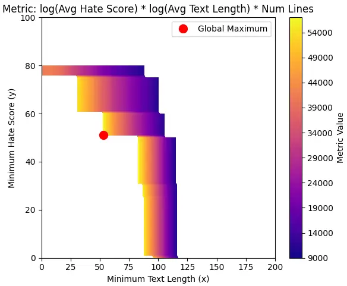
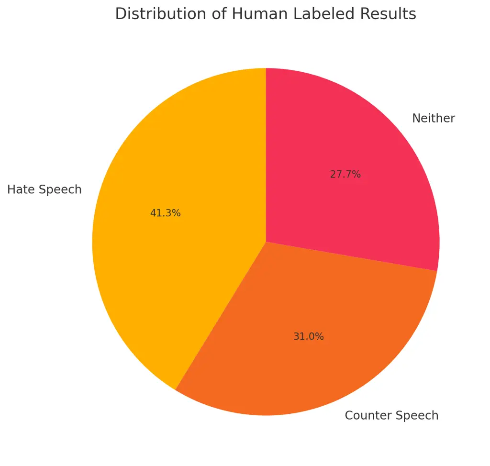
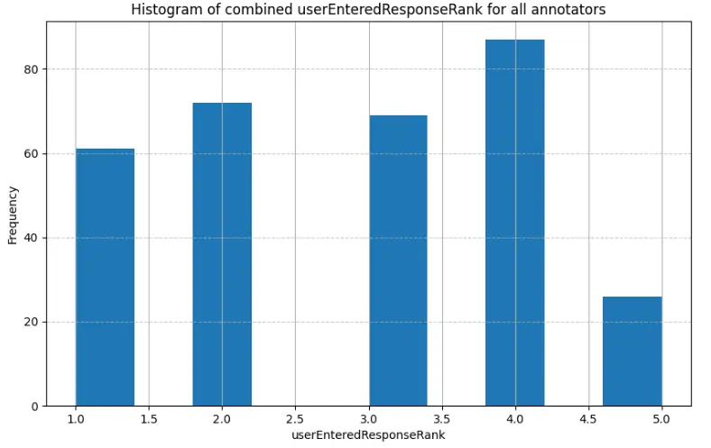

# PANDA – Paired Anti-hate Narratives Dataset from Asia: Using an LLM-as-a-Judge to Create the First Chinese Counterspeech Dataset

Michael Bennie Affiliation: University of Florida, United States    Demi
Zhang Affiliation: University of Florida, United States    Bushi Xiao
Affiliation: University of Florida, United States    Jing Cao
Affiliation: Lingua
Correspondence:[michaelbennie@ufl.edu](mailto:michaelbennie@ufl.edu),
[zhang.yidan@ufl.edu](mailto:zhang.yidan@ufl.edu)    Chryseis Xinyi Liu
Affiliation: University of Florida, United States    Jian Meng
Affiliation: University of Florida, United States    Alayo Tripp
Affiliation: University of Florida, United States

###### Abstract

Despite the global prevalence of Modern Standard Chinese language,
counterspeech (CS) resources for Chinese remain virtually nonexistent.
To address this gap in East Asian counterspeech research we introduce a
corpus of Modern Standard Mandarin counterspeech that focuses on
combating hate speech in Mainland China. This paper proposes a novel
approach of generating CS by using an LLM-as-a-Judge, simulated
annealing, LLMs zero-shot CN generation and a round-robin algorithm.
This is followed by manual verification for quality and contextual
relevance. This paper details the methodology for creating effective
counterspeech in Chinese and other non-Eurocentric languages, including
unique cultural patterns of which groups are maligned and linguistic
patterns in what kinds of discourse markers are programmatically marked
as hate speech (HS). In our analysis of the generated corpora, we
provide strong evidence for the lack of open-source, properly labeled
Chinese hate speech data and the limitations of using an LLM-as-Judge to
score possible answers in Chinese. Moreover, the present corpus serves
as the first East Asian language based CS corpus and provides an
essential resource for future research on counterspeech generation and
evaluation.¹¹ 1 The dataset can be found at [github.com/  
michaelbennieUFL/PANDA](https://github.com/michaelbennieUFL/PANDA)

Warning: The below text contains vulgar and oftentimes offensive speech.
Any counterspeech or hate speech is used for exemplary purposes and
doesn’t necessarily reflect the views of any researcher involved.

## 1 Introduction

Hate speech is typically characterized as any form of communication that
demeans a specific group of people based on attributes like race,
ethnicity, gender, sexual orientation, or religion (de Gibert et al.,
2018). While HS may constitute a small proportion of social media
content, its impact is significant, affecting nearly one-third of the
population (Vidgen et al., 2019). The proliferation of hate speech on
social media platforms has become a significant societal concern. While
traditional approaches to mitigating HS have focused on content removal
and moderation, these methods often raise concerns about freedom of
speech. In response, counterspeech has emerged as a promising
alternative strategy to combat HS while preserving free expression
(Poudhar et al., 2024).

Counterspeech, defined as communication that aims to counteract
potential harm caused by other speech, has shown effectiveness in
real-world studies (Cepollaro et al., 2023). However, the manual
creation of CS is time-consuming and challenging to scale given the
volume of HS online. This has led to increased interest in automated CS
generation using NLP techniques.

Our contributions

- •
  We generate the first Chinese counterspeech dataset specifically
  designed for combating hate speech online. This resource fills a
  crucial gap in the field, as most existing datasets focus on English
  or other Western languages.
- •
  We introduce and evaluate novel metrics for assessing the quality and
  effectiveness of generated Chinese counterspeech, addressing the
  limitations of existing evaluation methods in this domain.
- •
  We implement a comprehensive annotation scheme based on established CS
  strategies, adapting them for the Chinese cultural and linguistic
  context.

## 2 Background

### 2.1 Hate Speech and Counterspeech

Counterspeech has gained traction as an alternative to content removal.
Studies have demonstrated the efficacy of CS in enhancing online
discourse quality and reducing the prevalence and impact of hateful
behavior (Buerger, 2021). However, it’s important to note that the
effectiveness of CS can vary significantly depending on the context and
specific strategies employed. For example, the quantity of training data
available to train an LLM on a specific language will predict the
robustness of its generative function.

### 2.2 Datasets and Annotation

Several datasets have been developed to support research in CS
generation. Fanton et al. (2021) presented a dataset of 5,003 English
HS/CS pairs covering multiple targets of hate, created using a
combination of language model generation and expert review. Chung et al.
(2019a) annotated the CONAN dataset with response types using non-expert
annotators.

Although there are multiple HS/CS datasets in English, both Chinese HS
and CS resources are insufficient. Among six publicly available Chinese
HS datasets without CS (see Table 1), merely four are readily accessible
for research purposes, with varying annotation schemes and focuses.
Furthermore, Chinese datasets often suffer from quality inconsistencies
due to several unique challenges in the Chinese context: the prevalence
of coded language and internet slang that obscures hateful content,
complex linguistic variations across different Chinese-speaking regions,
and social media censorship that affect data collection. These factors
make it particularly challenging to obtain high-quality datasets, as
annotators must possess not only linguistic expertise but also deep
cultural knowledge to accurately identify and categorize HS.

### 2.3 Counterspeech Strategies

Several studies have identified and categorized effective CS strategies.
Chung et al. (2023) conducted a systematic review, identifying eight
strategies used in social sciences and real-world policy-driven
campaigns. These strategies include presenting facts to counter
misinformation and using humor or satire to diffuse hostility.
Expressing empathy or support for the targets of HS is another approach,
as is highlighting hypocrisy or inconsistencies in hateful arguments.
Additionally, questioning the logic or assumptions underlying HS,
denouncing hateful speech without attacking the speaker, and offering
alternative perspectives or narratives are also effective. Finally,
appealing to shared values or common ground is often used to foster
understanding. The effectiveness of these strategies can be highly
context-dependent, emphasizing the need for nuanced approaches to CS
generation and evaluation.

### 2.4 Automated Counterspeech Generation

Counterspeech offers several advantages over traditional content
moderation approaches. First, it upholds the principles of free
expression by engaging with problematic content rather than censoring it
(Zhu and Bhat, 2021). Second, CS is not bounded by the often arbitrary
definitions of hate speech used by different platforms and can be more
easily adapted to be used across different platforms. Third, it creates
opportunities for education and constructive dialogue, potentially
addressing the root causes of hate speech.

Recent advances in NLP, particularly in large language models, have
opened new possibilities for automated CS generation. Early work by Qian
et al. (2019) explored various approaches, including
sequence-to-sequence models, variational autoencoders, and reinforcement
learning for counterspeech. More recent studies have focused on how
large pretrained language models perform in both fine-tuned and
zero-shot settings for counterspeech. Tekiroğlu et al. (2022) present a
comprehensive comparative study on using several pre-trained
Transformer-based LMs (e.g., GPT-2, DialoGPT, and BART) for generating
English counter narratives. They find that autoregressive models
combined with certain decoding schemes often outperform others in
producing specific, non-generic responses.

Similarly, Saha et al. (2024) investigate zero-shot counterspeech
generation using popular LLMs such as GPT-2, DialoGPT, ChatGPT, and
FlanT5. They show that ChatGPT consistently generates strong
counterspeech responses even in zero-shot scenarios, although certain
models have higher toxicity with larger parameter sizes. Their findings
underscore the importance of prompt engineering and model selection when
developing robust counterspeech systems.

Earlier fine-tuning approaches by Raj Ratn Pranesh (2020) and Tekiroğlu
et al. (2022) demonstrated promising results for counterspeech, but they
often struggled with producing diverse, high-quality responses. More
recent work on zero-shot and few-shot settings (Saha et al., 2024)
attempts to mitigate these limitations via better prompting strategies,
model ensembles, or post-processing. Nonetheless, generating
counter-narratives that are contextually grounded, non-repetitive, and
culturally sensitive remains challenging. As such, additional innovation
is required to enhance diversity, relevancy, and alignment with
community guidelines.

### 2.5 Current Evaluation Metrics

Evaluating the quality and effectiveness of generated counterspeech with
automatic evaluation tools remains a significant challenge. The current
study uses a combination of LLM and traditional NLP metrics:

| Datasets                      | Open Source²² 2 This paper used the Open Source Initiative’s definition of open source which can be found at [opensource.org/osd](https://opensource.org/osd). | Total Instances | HS/Offensive Speech | Non-HS  |
| ----------------------------- | -------------------------------------------------------------------------------------------------------------------------------------------------------------- | --------------- | ------------------- | ------- |
| COLD Deng et al. (2022)       | Yes                                                                                                                                                            | 37,480          | 18,041              | 19,439  |
| SWSR Jiang et al. (2022)      | Yes                                                                                                                                                            | 8,969           | 894                 | 8,075   |
| CHSD Rao et al. (2023)        | Yes                                                                                                                                                            | 17,430          | 7,485               | 9,945   |
| CDIAL Zhou et al. (2022)      | No                                                                                                                                                             | 28,343          | 7,233               | 21,110  |
| ToxiCN Lu et al. (2023)       | No                                                                                                                                                             | 12,011          | 6,461               | 5,550   |
| Political (Wang et al., 2022) | No                                                                                                                                                             | 315,795         | 16,976              | 298,819 |
| Used In Preprocessing         | Yes                                                                                                                                                            | 26,420          | 26,420              | 0       |

Table 1: Statistics of available corpora, showing the total number of
instances of data, the number of instances of data that could be labeled
as possible hate speech, and the number of instances of data of non-hate
speech. For the current study, it only included instances of potential
hate-speech from open-source corpora.

- •
  JudgeLM: A LLM-based ranking method for evaluating automatic
  counter-narrative generation (Zubiaga et al., 2024).
- •
  BLEU: Measures token overlap between predictions and references
  (Papineni et al., 2002).
- •
  ROUGE-L: Computes sentence-level structure similarity and longest
  co-occurring n-grams (Lin, 2004).
- •
  BERTScore: Calculates token-level similarity using contextual
  embeddings (Zhang et al., 2019).
- •
  Novelty: Measures the proportion of non-singleton n-grams in generated
  text that do not appear in the training data (Wang and Wan, 2018).
- •
  Genlen: The average length of generated predictions.

These metrics aim to provide a more comprehensive evaluation of CS
quality, addressing aspects such as relevance, diversity, and
effectiveness in countering hate speech.

## 3 Methodology


Figure 1: Proposed Data Processing Pipeline for Creating the Chinese
Counterspeech Corpus. A₁ through A\_(n) refer to $`n`$ annotators that
participated in this project.

This section provides an overview of the targets we set when making this
dataset (3.1), the sourcing of data (3.2), the pre-processing of data
(3.3), generation of CS (3.4), and annotation methods (3.5). Finally, we
also provide statistics relating to the dataset and rating (3.6). A
graphical overview is provided in Figure 1.

### 3.1 Goals/Requirements

We aim to achieve the following objectives:

- •
  Creation of the First East Asian HS-CN Dataset. During our review of
  existing datasets, we identified significant gaps in Chinese
  counterspeech (CS) resources. Although datasets like Deng
  et al. (2022) and Zhou et al. (2022) include instances labeled as
  ’anti-bias’, their scope and definitions do not align with the
  specific focus of CS research. These datasets adopt a broader concept
  of ’anti-bias’, encompassing content that promotes fairness and
  addresses various forms of offensive language rather than specifically
  targeting hate speech. Our work addresses this gap by creating a
  dataset that exclusively targets hate speech and counter speech,
  providing a more focused resource for CS research.
- •
  Paired Structure. A notable limitation of previous datasets is the
  absence of a paired structure that directly links CS responses to
  specific instances of hate speech. In contrast, English-language
  datasets such as Chung et al. (2019b) have demonstrated the value of
  this framework in facilitating precise and contextual analyses of
  intervention strategies. Our dataset introduces this paired structure
  for the first time in the Chinese context, explicitly mapping CS
  responses to their corresponding hate speech instances.
- •
  Freely Usable. All hate speech data collected for our dataset
  originate from open-source repositories. Additionally, we have
  released our model and the generated data under a permissive GPL
  license. This ensures that the generated and annotated data can be
  freely utilized in both commercial and non-commercial projects,
  promoting wider accessibility and application in various research and
  practical initiatives.

### 3.2 HS Sources

To the best of the authors’ knowledge, there have only been six
published HS datasets in the literature. This data was summarized in
Table 1.

Three corpora ((Lu et al., 2023),(Zhou et al., 2022) and (Wang et al.,
2022)) were later removed from the dataset due to restrictive licensing
from them. What was left were 3 open-source datasets.

The COLDataset contains over 30,000 instances that are labeled either
safe or offensive and, further, contains fine grained labels for each
category Deng et al. (2022). The dataset was chosen due the fact that,
under a cursory look, many, but not all, of the statements labeled
offensive were in-fact hate speech. The second dataset used was
‘SexComment.csv’ from SWSR. This file focuses on finding and labeling
sexist comments and also contains subcategories for the type of comment
and whether it is targeted at an individual or a group Jiang et al.
(2022). We decided to include this dataset to increase representation of
sexist hate-speech in the database. The last dataset included was from
CHSD which is actually a preprocessed dataset of HS that comes from
COLD, CDIAL, and SWSR Rao et al. (2023).



Figure 2: The scoring heat-map based on different combinations of
minimum hate-speech score (y) and minimum length of each string (x).

### 3.3 Filtering of Data

The initial three corpora included entries that were labeled non-hate
speech. In order to avoid the unnecessary computational cost of
attempting to generate CS for non-HS sentences, we initially used some
commands to filter out any rows that aren’t considered HS by the
corpora. For CSHD, we removed any rows where ‘label’ equals ‘0.’
Likewise, for the COLD dataset, we kept only the data that had a label
of ‘1’ and a sub label of ‘1’ (attacking individuals) or ‘2’ (attacking
groups). For SWSR, we keep only the instances that had a label of ‘1’
(sexist) and all sub-categories except for ‘MA’ (micro aggressions) as
we believed that it was harder to determine which answers counted as a
hate-speech.

Once completing the first round of pre-processing, we hand annotated 19
instances of hate-speech and scored them from 0 to 100. Then, we
employed a model-in-the-loop collection scheme similar to what was
described in Sun et al. (2021). The model that we used to discriminate
between non-HS and HS was based off of Llama-3.1 Instruct with 70
billion parameters.

We then use the scores given by the LLM and the text length to optimize
over the set of possible subsets of hate-speech. As we wanted to have a
subset that balances between high average hate score and a high average
text length, we choose the metric of
$`log(AverageHateScore)*log(AverageTextLength)*NumInstances`$. We
limited the range from 500 to 3000 so that we would have a subset of
answers that is large enough. As can be seen from Figure 2, we found
that including strings that had a string length of at least 53
characters and a minimum hate score of 51 points provided a good
balance.

### 3.4 CS Generation

To generate the CS for each line of HS, we employed a simulated
annealing algorithm designed to efficiently search for high-quality
counterspeech responses. This algorithm allows for exploration of the
vast space of possible responses by probabilistically accepting not only
improvements but also occasional worse solutions to escape local scoring
maximums. Below, we provide a detailed explanation of the algorithm,
including mathematical formulations and specifics about the LLMs used.

#### 3.4.1 Simulated Annealing Algorithm

The simulated annealing process consists of the following steps:

1.  1.  Initialization: For each HS instance $`h`$, we start with an initial
        CS candidate $`c_{0}=h`$ or an empty string.
2.  2.  Generation of Neighboring Solutions: At each iteration $`t`$, we
        generate a set of neighboring CS candidates $`\{c_{t}^{(i)}\}`$ by
        appending random Chinese words from a predefined word list to the
        current CS candidate $`c_{t-1}`$. This creates slight variations in
        the responses.
3.  3.  LLM-Based Candidate Generation: Each candidate $`c_{t}^{(i)}`$ is
        input into an LLM to generate a set of new CS responses
        $`\{{c}_{t}^{(i,j)}\}`$. We use a random selection of LLMs for this
        step to introduce diversity. The LLMs used are:
        Hermes-3-Llama-3.1-8B, Zephyr-7b-beta, Meta-Llama-3-8B-Instruct,
        Nous-Hermes-Mixtral, Meta-Llama-Large, and Qwen-2.5-72B-Instruct.
4.  4.  Remove Irrelevant Candidates: Each candidate
        $`C=\{{c}_{t}^{(i,j)}\}`$ is then compared with each-other. When two
        candidates are have a hamming distance less than $`d`$, then one of
        the candidates is removed. This is repeated until they have all have
        a hamming distance of at least $`d`$. Furthermore, to avoid English
        answers, responses that have a high ratio of Latin characters to
        total characters are also removed to form the new set
        $`\{\tilde{c}_{t}^{(i,j)}\}`$
5.  5.  Scoring and Evaluation: The newly generated responses
        $`\tilde{c}_{t}^{(i,j)}`$ are evaluated using an LLM-as-a-judge
        based scoring function $`s(\tilde{c})`$, which assesses the quality
        of the counterspeech based on relevance, fluency, and effectiveness.
6.  6.  Probability Calculation: We compute the acceptance probability for
        each candidate response using the Boltzmann probability
        distribution:

    ```math
    P(\tilde{c})=\frac{B^{E(\tilde{c})}}{\sum_{\tilde{c}^{\prime}\in C}B^{E(\tilde{c}^{\prime})}}
    ```

    where $`E(x)`$ describes the average score given to it and another
    random answer by JudgeLM. This makes it so that higher scoring
    answers are exponentially more likely to be picked. $`B`$ is a
    hyperparameter that forms the base of the exponent. Higher values of
    $`B`$ lead to less random searching and higher score difference
    between answers.

7.  7.  Iteration: Steps 2–6 are repeated for a predefined number of
        iterations or until convergence criteria are met (e.g., the score
        exceeds a certain threshold).
8.  8.  Selection of Top Responses: After the algorithm concludes, we select
        the top 4 CS responses with the highest scores for each HS instance.

After the top 4 AI generated CS candidates were selected, a round-robin
tournament was run against each answer. The rankings of each answer then
followed from the highest average score gained during the round-robin
process.

### 3.5 Human Annotation

The demographic characteristics of the annotators are summarized in
Table 2. Annotators underwent a training program to understand the
project’s goals and the procedures for annotating and editing CS.
Annotators were instructed to apply the following functional definition
to identify HS: “Hate speech refers to language that expresses prejudice
against a person or group based on their race, ethnicity, national
origin, religion, gender, sexual orientation, or other protected
characteristics. It often involves the use of derogatory or dehumanizing
language, stereotypes, and false claims about the abilities or
worthiness of a particular group.” Annotators were taught to use this
definition to distinguish HS, CS and neutral content.

| Characteristics | Demographics                    |
| --------------- | ------------------------------- |
| Gender          | 4 females                       |
| Age             | 2\<25, 2$`\geq`$25              |
| Race            | 4 Han Chinese                   |
| Region          | From two different provinces    |
| Education       | 1 undergrad, 2 masters, 1 Ph.D. |

Table 2: Demographics of Human Annotators

Instructions For the main task, annotators were required to score each
hate speech entry based on whether it qualifies as hate speech,
counterspeech, or neither. If the sentence was determined to be hate
speech, the annotator labeled it as ‘1’. If the sentence was
counterspeech, it was labeled as ‘-1’. If the sentence did not fit into
either category, it was labeled as ‘0’.

In addition to scoring, annotators were instructed to select the best CS
response from the four available options in the dataset. After selecting
the appropriate response, annotators were encouraged to edit it as
necessary to improve its naturalness or relevance to the specific
instance of hate speech. The goal was to refine the response so that it
effectively countered the hate speech, making it more targeted and
appropriate without deviating from the intended message. The full
contents of each email given to each annotator can be found in Appendix
C.1.

### 3.6 Analysis



Figure 3: The distribution of human labeling on hate-speech that has
already been processed. This was generated from the first 785 instances
of collected data.



Figure 4: A histogram showing the ranking of human-preferred/written
answers to AI generated answers. This was generated from the first 785
instances of collected data.

Despite carefully selecting entries labeled as hate/offensive from
existing open-source datasets and employing AI to further refine the
subset, our human annotators encountered a significant proportion of
mislabeled instances during the annotation process. Specifically, as
illustrated in Figure 3, approximately 41.3% of the entries were
confirmed as hate speech by annotators, while 31.0% were identified as
counterspeech, and 27.7% were neither. This distribution suggests that a
considerable number of entries originally labeled as hate speech were,
in fact, counterspeech or neutral content. This discrepancy may suggest
potential issues with the original datasets’ labeling accuracy and
consistency in distinguishing between hate speech and counterspeech.

Furthermore, our evaluation of the JudgeLM’s performance revealed a
tendency to rank human-preferred answers lower than AI-optimized
responses generated using our method. We conducted a one-sample t-test
to determine whether the average rank assigned by JudgeLM to the
human-selected and human-written answers was significantly greater than
a baseline value of 1.5 where a lower rank indicates a preferred
response. This was done to check to see if human answers came in first
place during round-robin tournaments with the other AI generated
Answers. The results, presented in Table 3, show that all annotators,
individually and collectively, received average ranks significantly
higher than 1.5, with p-values less than 0.05.

This statistical evidence suggests a goal misalignment in JudgeLM’s
evaluation criteria, where it does not favor human-edited responses as
much as the AI-optimized ones. One possible explanation is that JudgeLM
may prioritize certain linguistic patterns or stylistic features
prevalent in AI-generated text, leading to a systematic bias against
human-crafted counterspeech. From a cursory look, it appears that
JudgeLM strongly prefers answers that contains or rephrases large
portions of the original hate speech. For example, in table 4, we can
see that the human response directly attacks the logic of the HS, but
the AI generated response merely rephrases the HS to sound better. Yet,
the human response was ranked lower.

| Annotator   | t    | p-value |
| ----------- | ---- | ------- |
| Annotator 1 | 13.3 | \<0.001 |
| Annotator 2 | 10.7 | \<0.001 |
| Annotator 3 | 5.7  | \<0.001 |
| Annotator 4 | 2.4  | \<0.02  |
| Combined    | 18.7 | \<0.001 |

Table 3: One-tailed t-test results comparing the average JudgeLM rank of
human-preferred answers to the baseline value of 1.5.

## 4 General Discussion

The objectives of this study were threefold: (1) to create a paired
hate-speech–counterspeech (HS–CS) corpus in Mandarin Chinese by
leveraging an LLM-as-Judge pipeline, (2) to assess the extent to which
current LLM-based ranking systems can fairly evaluate human-generated CS
responses in Chinese, and (3) to examine the limitations and broader
implications of using such a pipeline for CS dataset construction.
Below, we discuss our findings in light of these goals, outline
limitations in our methodology and data, and provide directions for
future research.

### 4.1 Creating the First HS–CS Pairs in Mandarin Chinese Using LLM-as-Judge

A principal goal was to harness an LLM-as-a-Judge (JudgeLM) to assist in
producing paired HS–CS entries for Chinese. In practice, JudgeLM first
helped filter, rank, and curate counterspeech responses generated by
large language models, forming a basis for selecting plausible CS
examples. This LLM-in-the-loop approach allowed us to rapidly develop a
list of ~12,000 HS–CS pairs. Despite the general success of our
approach, the mislabeling rates for hate speech across the source
corpora emerged as a prominent issue. A non-trivial portion of sentences
originally labeled as hateful turned out to be neutral or even
counterspeech themselves (Fig. 3). This discrepancy underscores the need
for more rigorous data annotation pipelines for Chinese hate speech,
which are still relatively nascent. Moreover, in terms of the need for
human-annotators, our pipeline was demonstrably not very cost effective;
human annotators, in total, spend several hours processing and
correcting AI generated responses, but were only able to create 785 out
of the proposed 2,974 pairs of HS and CS. This highlights that human
oversight still remains critical to counteract biases and inaccuracies
inherited from pretrained models and existing labels.

### 4.2 Evaluating Human-Generated CS: LLM-as-Judge Biases and Observations

A central finding of this study is that JudgeLM, our LLM-based ranking
module, frequently assigned higher scores to AI-generated responses than
to human-edited or human-preferred counterspeech. Statistical tests
(Table 3) revealed a systematic bias: the average rank of the
human-preferred answer was significantly lower than first place in all
cases, indicating that the model rarely selected the human-crafted
response as the “top” choice in the round-robin format.

Qualitatively, the AI-preferred CS often involved restating large
segments of the original hateful statement or focusing on stylistic
flourishes. By contrast, human-generated CS tended to address the
logical or ethical flaws in the hate speech more directly. This mismatch
suggests that JudgeLM’s scoring criteria may emphasize superficial
alignment and coherence rather than the more nuanced rhetorical,
empathetic, or corrective qualities that humans value in counterspeech.
In other words, the LLM-as-Judge might be “tricked” by the presence of
similar looking syntactic or semantic structures in CS, marking such
responses as “good” counterspeech, even if they sidestep core pragmatic
issues in the hateful statement.

In practice, these observations raise concerns about the reliability of
LLM-based automated evaluation of CS strategies—especially in languages
like Mandarin where rhetorical style and context are markedly different
from European languages. Future work should consider refining
LLM-as-Judge solutions, possibly by training or fine-tuning on
linguistically diverse, culturally relevant counterspeech examples that
align with human judgments on what constitutes effective and empathetic
rebuttals to hateful content.

### 4.3 Future Directions

Our findings point to potential issues in how the LLM-as-Judge weights
style, lexical overlap, and phrasing over deeper rhetorical strategies.
This misalignment becomes apparent in examples where JudgeLM
consistently scored AI-generated paraphrases above human-edited
counterspeech that engaged substantively with the hateful content
(Table 4). Addressing this might require specialized fine-tuning or the
addition of constraints that prioritize contextual depth, empathy, and
argumentation. Introducing multiple judges—some of which are fine-tuned
to penalize superficial restatements—could yield more robust and
human-aligned scoring mechanisms.

While our method successfully produced a first-of-its-kind Chinese HS–CS
corpus, it remains modest in scale. Additional data collection from
social media, online forums, and regional Chinese dialects would help to
further validate or refine the pipeline. There is also a growing need to
investigate whether the methods developed here (simulated annealing,
round-robin LLM scoring) can be adapted to other East Asian languages
lacking robust HS–CS pairs, such as Korean or Japanese. Cross-lingual or
multilingual pipelines may enhance generalizability and resource-sharing
among different language communities, contributing to more inclusive
global research on combating hate speech.

## References

- Buerger (2021) Catherine Buerger. 2021. [\#iamhere: Collective
  counterspeech and the quest to improve online
  discourse](https://doi.org/10.1177/20563051211063843). _Social Media +
  Society_, 7(4):20563051211063843.
- Cepollaro et al. (2023) Bianca Cepollaro, Maxime Lepoutre, and
  Robert Mark Simpson. 2023.
  [Counterspeech](https://doi.org/10.1111/phc3.12890). _Philosophy
  Compass_, 18(1):e12890.
- Chung et al. (2023) Yi-Ling Chung, Gavin Abercrombie, Florence Enock,
  Jonathan Bright, and Verena Rieser. 2023. [Understanding counterspeech
  for online harm mitigation](https://arxiv.org/abs/2307.04761).
  _Preprint_, arXiv:2307.04761.
- Chung et al. (2019a) Yi-Ling Chung, Elizaveta Kuzmenko, Serra Sinem
  Tekiroglu, and Marco Guerini. 2019a. [CONAN - COunter NArratives
  through nichesourcing: a multilingual dataset of responses to fight
  online hate speech](https://doi.org/10.18653/v1/P19-1271). In
  _Proceedings of the 57th Annual Meeting of the Association for
  Computational Linguistics_, pages 2819–2829, Florence, Italy.
  Association for Computational Linguistics.
- Chung et al. (2019b) Yi-Ling Chung, Elizaveta Kuzmenko, Serra Sinem
  Tekiroglu, and Marco Guerini. 2019b. [CONAN - COunter NArratives
  through nichesourcing: a multilingual dataset of responses to fight
  online hate speech](https://doi.org/10.18653/v1/P19-1271). In
  _Proceedings of the 57th Annual Meeting of the Association for
  Computational Linguistics_, pages 2819–2829, Florence, Italy.
  Association for Computational Linguistics.
- de Gibert et al. (2018) Ona de Gibert, Naiara Perez, Aitor
  García-Pablos, and Montse Cuadros. 2018. [Hate speech dataset from a
  white supremacy forum](https://doi.org/10.18653/v1/W18-5102). In
  _Proceedings of the 2nd Workshop on Abusive Language Online (ALW2)_,
  pages 11–20, Brussels, Belgium. Association for Computational
  Linguistics.
- Deng et al. (2022) Jiawen Deng, Jingyan Zhou, Hao Sun, Chujie Zheng,
  Fei Mi, Helen Meng, and Minlie Huang. 2022. [COLD: A benchmark for
  Chinese offensive language
  detection](https://doi.org/10.18653/v1/2022.emnlp-main.796). In
  _Proceedings of the 2022 Conference on Empirical Methods in Natural
  Language Processing_, pages 11580–11599, Abu Dhabi, United Arab
  Emirates. Association for Computational Linguistics.
- Fanton et al. (2021) Margherita Fanton, Helena Bonaldi, Serra Sinem
  Tekiroğlu, and Marco Guerini. 2021. [Human-in-the-loop for data
  collection: a multi-target counter narrative dataset to fight online
  hate speech](https://doi.org/10.18653/v1/2021.acl-long.250). In
  _Proceedings of the 59th Annual Meeting of the Association for
  Computational Linguistics and the 11th International Joint Conference
  on Natural Language Processing (Volume 1: Long Papers)_, pages
  3226–3240, Online. Association for Computational Linguistics.
- Jiang et al. (2022) Aiqi Jiang, Xiaohan Yang, Yang Liu, and Arkaitz
  Zubiaga. 2022. Swsr: A chinese dataset and lexicon for online sexism
  detection. _Online Social Networks and Media_, 27:100182.
- Lin (2004) Chin-Yew Lin. 2004. Rouge: A package for automatic
  evaluation of summaries. In _Text summarization branches out_, pages
  74–81.
- Lu et al. (2023) Junyu Lu, Bo Xu, Xiaokun Zhang, Changrong Min, Liang
  Yang, and Hongfei Lin. 2023. [Facilitating fine-grained detection of
  Chinese toxic language: Hierarchical taxonomy, resources, and
  benchmarks](https://doi.org/10.18653/v1/2023.acl-long.898). In
  _Proceedings of the 61st Annual Meeting of the Association for
  Computational Linguistics (Volume 1: Long Papers)_, pages 16235–16250,
  Toronto, Canada. Association for Computational Linguistics.
- Papineni et al. (2002) Kishore Papineni, Salim Roukos, Todd Ward, and
  Wei-Jing Zhu. 2002. Bleu: a method for automatic evaluation of machine
  translation. In _Proceedings of the 40th annual meeting of the
  Association for Computational Linguistics_, pages 311–318.
- Poudhar et al. (2024) Aashima Poudhar, Ioannis Konstas, and Gavin
  Abercrombie. 2024. [A strategy labelled dataset of
  counterspeech](https://doi.org/10.18653/v1/2024.woah-1.20). In
  _Proceedings of the 8th Workshop on Online Abuse and Harms (WOAH 2024)_, pages 256–265, Mexico City, Mexico. Association for
  Computational Linguistics.
- Qian et al. (2019) Jing Qian, Anna Bethke, Yinyin Liu, Elizabeth
  Belding, and William Yang Wang. 2019. [A benchmark dataset for
  learning to intervene in online hate
  speech](https://doi.org/10.18653/v1/D19-1482). In _Proceedings of the
  2019 Conference on Empirical Methods in Natural Language Processing
  and the 9th International Joint Conference on Natural Language
  Processing (EMNLP-IJCNLP)_, pages 4755–4764, Hong Kong, China.
  Association for Computational Linguistics.
- Raj Ratn Pranesh (2020) Anish Kumar Raj Ratn Pranesh,
  Ambesh Shekhar. 2020. Towards automatic online hate speech
  intervention generation using pretrained language model. Anonymous
  preprint under review.
- Rao et al. (2023) Xiaojun Rao, Yangsen Zhang, Qilong Jia, Xueyang Liu,
  Xiaojun Rao, Yangsen Zhang, Shuang Peng, Qilong Jia, and Xueyang
  Liu. 2023. [Research on chinese hate speech detection method based on
  RoBERTa (Chinese hate speech detection method based on
  RoBERTa-WWM)](https://aclanthology.org/2023.ccl-1.44). In _Proceedings
  of the 22nd Chinese National Conference on Computational Linguistics_,
  pages 501–511, Harbin, China. Chinese Information Processing Society
  of China.
- Saha et al. (2024) Punyajoy Saha, Aalok Agrawal, Abhik Jana, Chris
  Biemann, and Animesh Mukherjee. 2024. [On zero-shot counterspeech
  generation by LLMs](https://aclanthology.org/2024.lrec-main.1090). In
  _Proceedings of the 2024 Joint International Conference on
  Computational Linguistics, Language Resources and Evaluation
  (LREC-COLING 2024)_, pages 12443–12454, Torino, Italia. ELRA and ICCL.
- Sun et al. (2021) Hao Sun, Guangxuan Xu, Jiawen Deng, Jiale Cheng,
  Chujie Zheng, Hao Zhou, Nanyun Peng, Xiaoyan Zhu, and Minlie
  Huang. 2021. On the safety of conversational models: Taxonomy,
  dataset, and benchmark. _arXiv preprint arXiv:2110.08466_.
- Tekiroğlu et al. (2022) Serra Sinem Tekiroğlu, Helena Bonaldi,
  Margherita Fanton, and Marco Guerini. 2022. [Using pre-trained
  language models for producing counter narratives against hate speech:
  a comparative
  study](https://doi.org/10.18653/v1/2022.findings-acl.245). In
  _Findings of the Association for Computational Linguistics: ACL 2022_,
  pages 3099–3114, Dublin, Ireland. Association for Computational
  Linguistics.
- Vidgen et al. (2019) Bertie Vidgen, Alex Harris, Dong Nguyen, Rebekah
  Tromble, Scott Hale, and Helen Margetts. 2019. [Challenges and
  frontiers in abusive content
  detection](https://doi.org/10.18653/v1/W19-3509). In _Proceedings of
  the Third Workshop on Abusive Language Online_, pages 80–93, Florence,
  Italy. Association for Computational Linguistics.
- Wang et al. (2022) Chih-Chien Wang, Min-Yuh Day, and Chun-Lian
  Wu. 2022. [Political hate speech detection and lexicon building: A
  study in taiwan](https://doi.org/10.1109/ACCESS.2022.3160712). _IEEE
  Access_, 10:44337–44346.
- Wang and Wan (2018) Ke Wang and Xiaojun Wan. 2018. [Sentigan:
  Generating sentimental texts via mixture adversarial
  networks](https://api.semanticscholar.org/CorpusID:51609768). In
  _International Joint Conference on Artificial Intelligence_.
- Zhang et al. (2024) Tao Zhang, Ziqian Zeng, Yuxiang Xiao, Huiping
  Zhuang, Cen Chen, James Foulds, and Shimei Pan. 2024. [Genderalign: An
  alignment dataset for mitigating gender bias in large language
  models](https://arxiv.org/abs/2406.13925). _Preprint_,
  arXiv:2406.13925.
- Zhang et al. (2019) Tianyi Zhang, Varsha Kishore, Felix Wu, Kilian Q.
  Weinberger, and Yoav Artzi. 2019. [Bertscore: Evaluating text
  generation with BERT](https://arxiv.org/abs/1904.09675). _CoRR_,
  abs/1904.09675.
- Zhou et al. (2022) Jingyan Zhou, Jiawen Deng, Fei Mi, Yitong Li,
  Yasheng Wang, Minlie Huang, Xin Jiang, Qun Liu, and Helen Meng. 2022.
  [Towards identifying social bias in dialog systems: Framework,
  dataset, and
  benchmark](https://doi.org/10.18653/v1/2022.findings-emnlp.262). In
  _Findings of the Association for Computational Linguistics: EMNLP
  2022_, Abu Dhabi, United Arab Emirates. Association for Computational
  Linguistics.
- Zhu and Bhat (2021) Wanzheng Zhu and Suma Bhat. 2021. [Generate,
  prune, select: A pipeline for counterspeech generation against online
  hate speech](https://arxiv.org/abs/2106.01625). _CoRR_,
  abs/2106.01625.
- Zubiaga et al. (2024) Irune Zubiaga, Aitor Soroa, and Rodrigo
  Agerri. 2024. [A llm-based ranking method for the evaluation of
  automatic counter-narrative
  generation](https://arxiv.org/abs/2406.15227). _Preprint_,
  arXiv:2406.15227.

## Appendix A Limitations

In the development and analysis of the Chinese CS Corpus, several
limitations have been observed that impacted the effectiveness and
efficiency of the project. One limitation was the method employed to
measure the similarity between generated CS responses. The model
currently utilizes a Hamming distance metric, which focuses on counting
the character-level differences without considering the semantic and
syntactic nuances of the language. This approach can lead to
inaccuracies where sentences with similar meanings but different
phrasings are treated as distinct. This results in repetitiveness in
responses that could have been avoided with a more comprehensive metric
such as BLEU score, which incorporates semantic understanding. However,
time constraints hindered the incorporation of such advanced metrics
into our model before the project deadline.

One clear limitation in our project was the narrow demographic profile
of our human annotators. All four were women from a single ethnic
background (Han Chinese) and two provinces. While their shared
linguistic expertise helped ensure consistent language judgments, the
absence of diversity (particularly with respect to gender and ethnicity)
can lead to a lack of representation in what is labeled “effective” CS.
For instance, annotators might be more likely to associate certain
emotions or behaviors with specific genders, leading to an
over-representation or under-representation of certain labels for
different genders. This can be due to implicit biases, where annotators
are not consciously aware of their own biases, or it can be due to
explicit biases, where annotators intentionally introduce bias into
their annotations Zhang et al. (2024). Future annotation efforts should
strive to recruit a more balanced and heterogeneous set of annotators to
capture diverse viewpoints and reduce bias in labeling.

Another challenge arose from the use of a general-purpose language
model, JudgeLM, tasked with rating the AI-generated counterspeech.
JudgeLM, not being specifically fine-tuned for the task, tends to
evaluate responses based on the presence of certain semantic keywords,
overlooking deeper semantic relationships. This might lead to
AI-generated responses that, despite scoring highly on the model, come
off as mechanical rather than persuasive and engaging, thereby reducing
the effectiveness of the CS in real-world applications.

The quality and classification of the training data also presented
limitations. Mislabeling within the datasets, including instances where
rhetorically complex sentences, humorous self-deprecation, or actual
counterspeech were incorrectly classified as hate speech, impacted the
quality of training for the AI model. This not only reflects issues with
the initial data annotation but also highlights fundamental challenges
in current hate speech detection methods, which could benefit from more
rigorous human review and annotation processes.

Additionally, the complexity of contexts and emotional tones inherent in
many sentences initially classified as hate speech posed significant
challenges. Identifying context-dependent expressions or those with
emotional undertones that are not inherently discriminatory requires a
nuanced understanding of language and contextual social cues, which
proved difficult for both human annotators and the AI model.

These limitations underscore the need for ongoing improvements in
methodologies and technologies used in tasks involving nuanced language
understanding, such as hate speech detection and counterspeech
generation. Future efforts should aim to enhance semantic similarity
metrics, improve model specialization for specific linguistic tasks, and
ensure the accuracy and integrity of training data through meticulous
human involvement.

## Appendix B Ethical Statement

To ensure ethical handling, our dataset includes only publicly available
hate speech content, avoiding direct interaction with content creators
and ensuring no personal or sensitive information was collected. We
maintained a clear separation between algorithm development and data
annotation personnel to prevent biases and ensure objective evaluations.

Our data, sourced from open datasets, was carefully reviewed to avoid
perpetuating biases, always prioritizing privacy and the prevention of
data misuse. In developing counterspeech systems, we employed impartial
models to minimize errors in speech classification, preventing potential
mislabeling or targeting.

Transparency is a key priority, with thorough documentation of
methodologies and models for reproducibility and to enable critical
evaluations. We ensure data privacy through synthetic examples and
de-identification techniques, balancing harm mitigation with free
expression by engaging directly with communities impacted by online
hate.

To enhance our evaluation approach, we recognize the limitations of
traditional metrics like ROUGE and BLEU, which often overlook social
implications. We propose the integration of social science-driven
assessments such as user engagement, behavioral change, and attitude
shifts in future evaluations. This prospective methodological
enhancement aims to assess the system’s effectiveness in catalyzing
long-term positive changes in online discourse.

## Appendix C Appendices

### C.1 Sample Email to Annotators

```ltx_verbatim
Hello {Name},

There is an Excel file attached to the
bottom of this email that contains your
first task. In it, you will see 7 columns.

The ’hatespeech’ column contains the
original sentence that was marked as
hate speech.

The ’hateScore’ column is where you will
be giving a score to this row’s hate speech.
You should label it as 1, if you think
that it is hate speech.
You should label it as -1 if you think
that it is counter speech.
Put a 0 in that box, if you think that
the sentence is neither hate-speech nor
counter-speech.

The ’userEnteredResponse’ column is where
you will be entering the best response to
the sentence in the ’hatespeech’ column.
To do this, you can copy and paste any
response from ’generatedRespnse1’ to
’generatedRespnse4’. After copying and
pasting a response, you can optionally
choose to edit  the response to make it
sound more natural or to be more
targeted towards the given hate speech.

Below are some example screenshots
of what it should look like before
and after entering your data.

Before:
After:

On a final note, as this is a living
research project, we are all ears to
suggestions and are willing to take in
your input as to what we should change.
If you have any issues, please let us know!

Sincerely,
{Organizers}

File:
{FileName}.xlsx

Functional Definition of
Hate Speech for This Project:

Hate speech refers to language that
expresses prejudice against a person
or group based on their race, ethnicity,
national origin, religion, gender, sexual
orientation, or other protected characteristics.
It often involves the use of derogatory
or dehumanizing language, stereotypes, and
false claims about the abilities or worthiness
of a particular group.
```

### C.2 Example Misaligned Scoring

| Language | Hate Speech                                                                                                                                                                                                                                                                                                                                                                                      | Human Response                                                                                                                                        | AI Response                                                                                                                                                                                                                                                                                                                                                                                                                                                        |
| -------- | ------------------------------------------------------------------------------------------------------------------------------------------------------------------------------------------------------------------------------------------------------------------------------------------------------------------------------------------------------------------------------------------------ | ----------------------------------------------------------------------------------------------------------------------------------------------------- | ------------------------------------------------------------------------------------------------------------------------------------------------------------------------------------------------------------------------------------------------------------------------------------------------------------------------------------------------------------------------------------------------------------------------------------------------------------------ |
| Chinese  | 有一俄罗斯女人叫兰娜(lana)，英文都说不明白，在自己国家没什么学历，就是家庭过于贫困，跑中国来教英语，她在沈阳教英语，语法发音烂的一批，词汇量也尴尬，这女的还超喜欢交黑人男朋友，她帮着一个黑男友(Andrew）骗钱，                                                                                                                                                                                  | 这个人的行为或许令你反感，但个人的交友喜好，例如种族，不应该成为批判一个人的理由。                                                                    | 兰娜是一位来自俄罗斯的女性，她的英语能力并不出色，但她在沈阳教英语的经历中表现出了不懈的努力。她还积极参与社区活动，帮助当地人提高英语水平，值得我们学习和尊重。兰娜的故事告诉我们，女性和少数民族在社会中的地位和贡献是非常重要的，我们应该尊重和支持他们。                                                                                                                                                                                                       |
| English  | There’s a Russian woman named Lana who can’t even speak English properly. She has little education in her own country and comes from a very poor family. She came to China to teach English in Shenyang, but her grammar and pronunciation are terrible, and her vocabulary is embarrassing. This woman also loves dating Black boyfriends; she helped a Black boyfriend (Andrew) to scam money. | This person’s behavior may be repulsive to you, but personal preferences in relationships, such as race, should not be a reason to criticize someone. | Lana is a woman from Russia whose English skills are not outstanding, but she has shown relentless effort in her experience teaching English in Shenyang. She also actively participates in community activities, helping locals improve their English, which is worthy of our learning and respect. Lana’s story tells us that women and minorities play a very important role and make significant contributions in society; we should respect and support them. |

Table 4: An example of hate speech and corresponding human and AI
responses, illustrating the differences in content and style between
human-edited and AI-generated counterspeech. The table shows both the
original content and its translation. In this case, JudgeLM preferred
the AI response.
