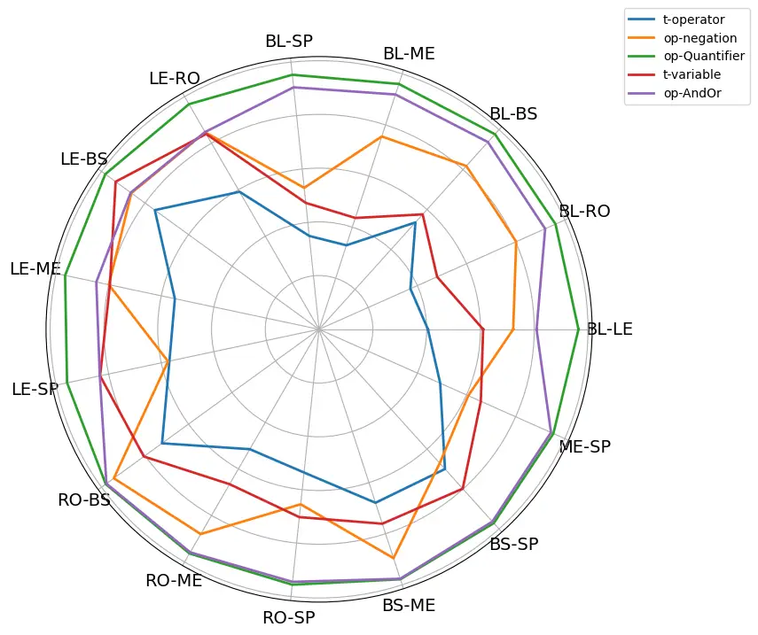
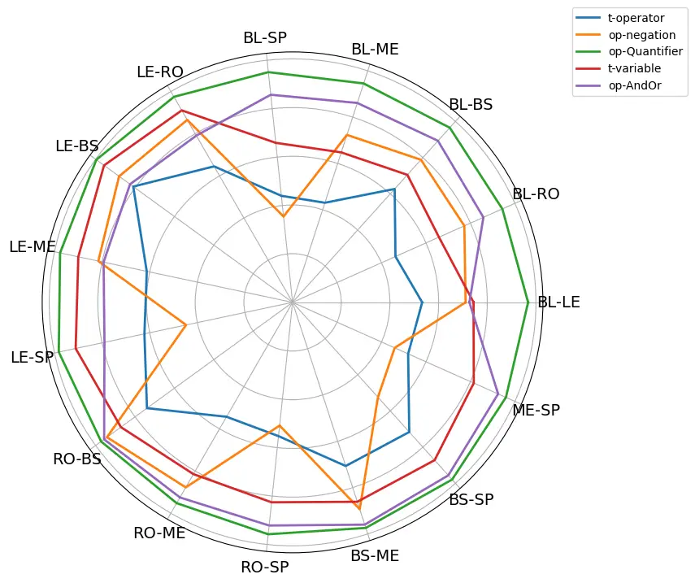
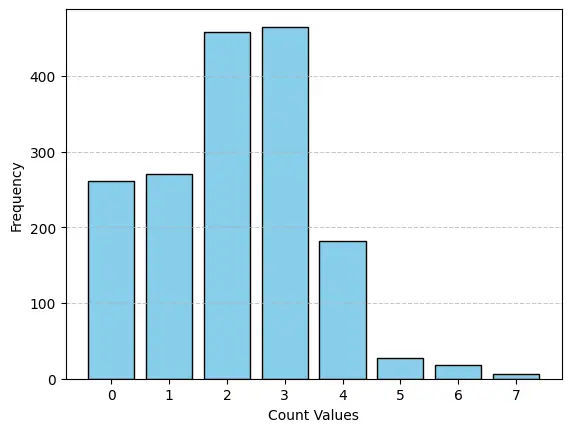
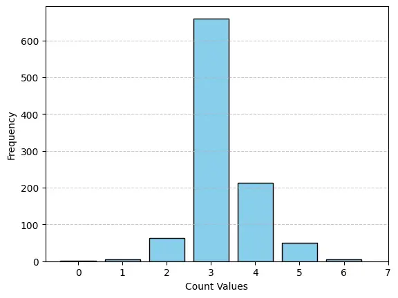

# Assessing the Sensitivity and Alignment of FOL Closeness Metrics

Ramya Keerthy Thatikonda Wray Buntine Ehsan Shareghi
Affiliation: Department of Data Science & AI, Monash University
Affiliation: College of Engineering and Computer Science, VinUniversity

###### Abstract

The recent successful paradigm of solving logical reasoning problems
with tool-augmented large language models (LLMs) leverages translation
of natural language (NL) statements into First-Order Logic (FOL) and
external theorem provers. However, the correctness of FOL statements,
comprising operators and text, often go unverified due to the lack of a
reliable evaluation metric for comparing generated and ground-truth
FOLs. In this paper, we conduct a comprehensive study on the
_sensitivity_ of existing NL-, FOL-, and graph-based metrics to capture
differences between a sampled FOL and its corresponding ground-truth. We
then measure the _alignment_ between a metric-based ranking of FOL
outputs and a strong LLM as-a-judge. To do this, we first apply operator
and text-based perturbations to ground-truth FOL statements to assess
metric sensitivity. We then evaluate metric robustness by comparing the
metrics against LLMs judgment. Our empirical findings highlight a clear
oversensitivity in the n-gram metric BLEU for text perturbations. The
operator perturbation affects the semantic graph metric Smatch++ for
structural changes, and the FOL metric for specific operator changes. We
observe a closer alignment between BertScore and LLM judgement, proving
the importance of semantic evaluation. Additionally, we show that
combining metrics enhances both robustness and sensitivity compared to
using individual metrics. ¹¹ 1 Our code is available at
[https://github.com/RamyaKeerthy/AlignmentFOL](https://github.com/RamyaKeerthy/AlignmentFOL)

## 1 Introduction

Large language models (LLMs) have advanced natural language reasoning,
but logical and mathematical reasoning have long relied on formal,
structured languages for proving deductions and theorems, a process that
predates deep neural networks Candela et al. (2006). This approach
remains relevant today, especially for reasoning tasks that can be
solved using formal statements. In case of first-order logic (FOL), LLM
generations are used as intermediate steps and subsequently passed to
theorem provers to solve the problem Pan et al. (2023); Ye et al.
(2023); Olausson et al. (2023). Compared to the Chain-of-Thought (CoT)
approach Wei et al. (2022), where the model first reasons and then
solves, FOL generation demonstrated superior reliability by offloading
the reasoning task to an external tool. Translating natural language
(NL) into FOL enhanced the overall rigor of the process.

Generating FOL from NL is a challenging task that tests the ability of
LLMs to accurately interpret and convert informal language into a
formal, structured token sequence  Yang et al. (2024a); Wu et al.
(2022). The lack of ground truth for FOL generations complicates direct
verification. Yang et al. (2024b) addressed this challenge by developing
a system specifically for FOL generation, incorporating an
operator-based evaluator to rate the outputs. This evaluation is
combined with BLEU score, using a threshold as a metric in a reward
model. However, the reliance on thresholds complicates the
interpretation of translation quality. Manually assessing formal logic
generations is labor-intensive and has received relatively less
attention compared to traditional text translation metrics.

In this work, we analyze existing natural language translation, tree,
and graph evaluation metrics, focusing on those that offer strong
sentence-level comparisons. We establish a framework to systematically
introduce perturbations and analyze the existing metrics in the presence
of these anomalies in formal language, specifically first-order logic.
Metric sensitivity helps reveal the degree to which each metric responds
to specific types of perturbations. To further assess these metrics on
real-world examples, we generate sample FOLs for NL statements in
FOLIO Han et al. (2024) and MALLS Yang et al. (2024b) datasets using an
LLM and rank them against ground truth values. The ranking is conducted
using established metrics, and LLM-based evaluators. After a small-scale
experiment to select the LLM most aligned with human judgment for this
task, we measure how well each metric-based ranking aligns with the
selected LLM’s judgments ²² 2 While using an LLM as a judge is one
alternative, our alignment-based method offers a more resource-efficient
approach by reducing the need to call an additional LLM.. Our
experiments reveal that BertScore has a better alignment as an
individual metric, and its combination with other metrics could further
boost its alignment. Our findings provide insights into the sensitivity
of current metrics and their applicability to symbolic generation tasks.

## 2 FOL Closeness Metrics

Evaluation scores in natural language generation, such as BLEU Papineni
et al. (2002) and ROUGE Lin (2004), perform n-gram matching between
reference text and candidate outputs. METEOR Banerjee and Lavie (2005),
while also based on n-gram overlap, incorporates additional factors
known to result in improved correlation with human judgments. BERTScore
Zhang et al. (2020) leverages contextual embeddings generated by a
pre-trained BERT Devlin et al. (2019) to compute cosine similarity
between sentences.

In contrast, logical equivalence Yang et al. (2024b) evaluates FOL
translations by comparing the truth values of formal statements,
abstracting away from their textual semantics. Another relevant domain
is Abstract Meaning Representation (AMR) graph metrics, which compare
the structural similarity of semantic graphs. Given the structured
nature of FOL statements, we leverage Smatch++ Opitz (2023), which
incorporates preprocessing, alignment, and sub-graph scoring. These
metrics capture different dimensions of divergence between ground truth
and translations: traditional metrics focus on surface-level and
semantic discrepancies, while formal evaluation methods assess deeper
logical consistency. We present results demonstrating how a
representative set of these metrics respond to variations in logical
constructs within formal language translations.

## 3 Evaluation Framework

### 3.1 Perturbation Evaluations

The effect of perturbations measures the _sensitivity_ of the metrics by
assessing how small changes or variations in the FOL statements impact
the metric scores. Based on the ground-truth of the FOLIO dataset Han
et al. (2024), we utilize nine operators to construct a formal logic
framework.

To evaluate the performance of these metrics, we first conduct a
self-matching experiment on the statements and normalize the results
based on the variations observed in this process. The perturbation
strategies are chosen for sensitivity measure to answer questions
drafted to provide insight into metric sensitivity. There are two
variations, where the sensitivity can be measured by perturbing the
operators or the text (predicates and variables):

#### Operator Quantifier:

How well does the metric respond when a universal quantifier is
misinterpreted as existential? In this perturbation, we swap the
quantifiers $`\forall`$ and $`\exists`$ where applicable. For example,
the formula
$`\forall\text{x}(\text{W}(\text{x},\text{C})\rightarrow\text{A}(\text{x},\text{C}))`$
becomes
$`\exists\text{x}(\text{W}(\text{x},\text{C})\rightarrow\text{A}(\text{x},\text{C}))`$.

#### Operator Negation:

Will the metric be affected by the changes in negation logic? In this
perturbation, we either remove the negation of predicates, if present,
or add it when absent. For example,
$`\forall\text{x}(\neg\text{W}(\text{x},\text{C})\rightarrow\text{A}(\text{x},\text{C}))`$
changes to
$`\forall\text{x}(\text{W}(\text{x},\text{C})\rightarrow\neg\text{A}(\text{x},\text{C}))`$.

#### Operator And/Or:

How well can the metric distinguish between conjunction and disjunction?
This perturbation involves a swap of logical operators, such as (And,
Or).

#### Text minus Operator:

To what extent does a metric rely on textual content? This perturbation
focuses on the role of text without operators in influencing similarity
scores. All logical operators are removed, and any multiple predicates
are connected by a disjunction ($`\lor`$) to preserve the structure. For
instance,
$`\forall\text{x}(\neg\text{W}(\text{x},\text{C})\rightarrow\text{A}(\text{x},\text{C}))`$
becomes
$`\text{W}(\text{x},\text{C})\lor\text{A}(\text{x},\text{C})`$.³³ 3
These errors pass through the tool without triggering any issues, making
them a common occurrence in FOL generations by LLMs (Appendix B).
Identifying this problem highlights a significant gap in the reliability
of LLM-translated FOLs.

#### Text minus Variable:

How reliant are metrics on textual predicates over variable structure?
All text values are replaced with generic variables and compared with
the ground truth. For example,
$`\forall\text{x}(\neg\text{WantToBeAddictedTo}(\text{x},\text{caffeine})\rightarrow\text{AwareThatDrug}(\text{x},\text{caffeine}))`$
becomes
$`\forall\text{x}(\neg\text{A}(\text{x},\text{C})\rightarrow\text{B}(\text{x},\text{C}))`$.
⁴⁴ 4 All previous examples, except for text minus ‘Variable’, have been
shortened for space.

### 3.2 Sample Evaluations

Measuring the sample correctness with respect to the ground truth allows
for an assessment of _alignment_ between different types of rankers. We
extracted FOL statements from the FOLIO and MALLS dataset and
implemented a sampling process in which gpt-4o Achiam et al. (2023) was
prompted in a zero-shot setting to generate three FOL samples for each
natural language input. Each data point, consisting of a natural
language statement and its corresponding FOL label $`\{NL,FOL\}`$, was
used as input to gpt-4o (see Appendix C for prompt detail). The model
then generated three candidate FOL statements:
$`\{FOL_{1},FOL_{2},FOL_{3}\}`$. The generations with duplicate samples
were removed, resulting in a total of 728 and 402 unique FOL outputs for
FOLIO and MALLS respectively.

These samples were evaluated using various metrics by assigning scores
to each comparison. In cases where two or more samples received
identical scores, their ranks were adjusted accordingly. For example, if
the FOLs were initially ranked \[1, 2, 3\], but $`FOL_{1}`$, and
$`FOL_{2}`$ had equal scores, the ranks were updated to \[1, 1, 3\].

To evaluate the effectiveness of the metrics in ranking, we further used
an LLM-based judge to assess the quality of the FOL samples, providing a
broader perspective on the comparative rankings (see Appendix E for
prompt details).

## 4 Experimental Setup

### 4.1 Data Preparation

We use the training set of the FOLIO dataset (consisting 1001 records)
for our experiments because of the availability of ground truth FOL in
the dataset. Since our focus is on individual FOL statements, we
decompose the records into single data points. We extract a total of
1689 records, ensuring a diverse combination of operators. To ensure the
reliability of our results, we add MALLS dataset (sampled 1000 records)
with individual FOL statements. The detailed data statistics are
provided in Appendix A.

### 4.2 Evaluation Preparation

#### Perturbation.

The perturbations are evaluated using six metrics: BLEU (BL), ROUGE
(RO), METEOR (ME), Logical Equivalence (LE), BERTScore (BS), and
Smatch++ (SP). Following the method outlined by Yang et al. (2024b), we
first convert the FOL statements into a parsable format for each metric.
For LE, an additional syntax check is conducted to ensure if the truth
value of the FOL statement is valid before comparison. Due to the nature
of the perturbations, they are applied only to relevant records. For
example, quantifier perturbation is possible only if the statement
contains a quantifier. The percentage of data affected by the
perturbation is provided in Table 1.

[TABLE]

Table 1: Percentage of perturbations applied to all FOL records.
$`\downarrow`$ indicates preference for lower values.

#### LLM-generated FOL Samples.

We use gpt-4o with temperature 0.6 and n=3 to generate three samples for
each input (Appendix C). Samples that had two or more identical FOL
statements were discarded, reducing the dataset to 728 and 402 records
for FOLIO and MALLS respectively.

#### LLM Selection for Judge.

For choosing an LLM to judge the alignment of these samples, we perform
a small scale evaluation between 3 LLMs (gpt-4o, o3-mini,
gemini-flash-2.0) as independent judges and 3 human annotators. Due to
the cost of human annotations, we selected 87 records from FOLIO,
covering all combination of operators. The experiments indicated a
stronger alignment of o3-mini with human annotators (see Appendix D).
Hence we use o3-mini as the LLM judge in the following experiments.

#### Alignment Measure.

We use Root Mean Square Error (RMSE) to evaluate the alignment between
two preferences (i.e., metric-based ranking vs. LLM-based ranking). A
lower RMSE score indicates a better alignment.

## 5 Results and Discussion

We present results from the two variations.

#### Perturbation Analysis.

|       |                            |      |      |      |      |      |      |
| ----- | -------------------------- | ---- | ---- | ---- | ---- | ---- | ---- |
|       | Pertb                      | BL   | LE   | RO   | ME   | BS   | SP   |
| FOLIO | op-Quanti $`\downarrow`$   | 0.96 | 0.97 | 0.96 | 0.96 | 0.99 | 0.95 |
|       | op-negation $`\downarrow`$ | 0.68 | 0.77 | 0.93 | 0.83 | 0.96 | 0.38 |
|       | op-AndOr $`\downarrow`$    | 0.88 | 0.74 | 0.96 | 0.96 | 0.99 | 0.93 |
|       | t-operator $`\downarrow`$  | 0.18 | 0.62 | 0.56 | 0.47 | 0.88 | 0.51 |
|       | t-variable $`\downarrow`$  | 0.25 | 0.97 | 0.71 | 0.62 | 0.90 | 0.69 |
| MALLS | op-Quanti $`\downarrow`$   | 0.94 | 0.99 | 0.95 | 0.95 | 0.99 | 0.96 |
|       | op-negation $`\downarrow`$ | 0.62 | 0.80 | 0.93 | 0.83 | 0.96 | 0.09 |
|       | op-AndOr $`\downarrow`$    | 0.79 | 0.66 | 0.92 | 0.93 | 0.99 | 0.92 |
|       | t-operator $`\downarrow`$  | 0.35 | 0.71 | 0.57 | 0.51 | 0.90 | 0.53 |
|       | t-variable $`\downarrow`$  | 0.49 | 0.99 | 0.82 | 0.80 | 0.92 | 0.83 |

Table 2: Result when comparing the ground-truth and their perturbations
using different metrics. Each row represents results under a specific
perturbation (see §3). These numbers indicate the degree of sensitivity
of each metric when a specific form of perturbation is applied to the
ground-truth. The bold values on each row indicate the metric with the
highest sensitivity.



FOLIO



MALLS

Figure 1: Extensions of Table 2 for a combination of 2 metrics. For
instance, LE-BS indicates sensitivity of a combined metric interpolating
Logical Equivalency (LE) and BertScore (BS).

Table 2 shows the average score by metrics for variations of
perturbations. Here, we observe that BLEU score identifies text
perturbations more effectively than specialized FOL and graph metrics.
LE and Smatch++ exhibit sensitivity to all the perturbations, with a
notable sensitivity to the operator-based perturbations. Smatch++ is
better suitable to capture the presence or absence of negation operator
over LE score, showing a better sensitivity to variations in operators
over lexical graph based LE metric. As expected, text-based
perturbations should influence translation metric scores, and this is
evident in the case of operator and variable perturbations. In contrast,
predicate perturbations cause only a minimal drop in scores, as they
impact a smaller portion of the dataset, as outlined in Table 1.

In a combination metric setting (Figure 1), Smatch++ paired with textual
metrics such as BLEU and METEOR exhibits enhanced sensitivity,
particularly when perturbing negation operators—suggesting that changes
to operators are more effectively captured through a combination of
graph- and text-based metrics. The combination of BLEU and the LE metric
shows higher sensitivity to conjunction and disjunction operator.
Although BLEU alone is significantly impacted by textual perturbations,
combining it with other metrics proves more effective in identifying
such textual variations. This trend is also evident for other metric
combinations, with scores detailed in Appendix F).

#### Metric Ranking vs. LLM-as-a-judge alignment.

We now turn to evaluating the alignment of each individual metric⁵⁵ 5 We
perform a qualitative analysis to show disagreements between individual
metrics for ranking the samples in Appendix G, where there is a clear
distinction between text- and operator-based metrics., as well as the
combination of two metrics, with the LLM (o3-mini) judge.

As shown in Table 3 (on the diagonal), Bertscore demonstrates a closer
alignment with LLM judge. LE score shows the weakest alignment, but
improves when combined with BertScore. The results suggest that, despite
the low alignment of structured evaluators such as LE score and
Smatch++, using other metrics alongside help with improving their
alignment, making them suitable for both semantic and syntactic
verification.

|       |     |      |      |      |      |      |      |
| ----- | --- | ---- | ---- | ---- | ---- | ---- | ---- |
| RMSE  |     | BL   | LE   | RO   | ME   | BS   | SP   |
| FOLIO | BL  | 1.01 | 0.97 | 0.90 | 0.89 | 0.83 | 0.94 |
|       | LE  | \-   | 1.13 | 0.94 | 0.92 | 0.88 | 0.98 |
|       | RO  | \-   | \-   | 0.92 | 0.89 | 0.84 | 0.93 |
|       | ME  | \-   | \-   | \-   | 0.90 | 0.83 | 0.92 |
|       | BS  | \-   | \-   | \-   | \-   | 0.85 | 0.86 |
|       | SP  | \-   | \-   | \-   | \-   | \-   | 0.98 |
| MALLS | BL  | 0.85 | 0.86 | 0.84 | 0.83 | 0.78 | 0.86 |
|       | LE  | \-   | 1.03 | 0.87 | 0.87 | 0.79 | 0.92 |
|       | RO  | \-   | \-   | 0.85 | 0.82 | 0.77 | 0.84 |
|       | ME  | \-   | \-   | \-   | 0.85 | 0.77 | 0.84 |
|       | BS  | \-   | \-   | \-   | \-   | 0.79 | 0.80 |
|       | SP  | \-   | \-   | \-   | \-   | \-   | 0.92 |

Table 3: RMSE scores comparing metric-based and LLM-based (o3-mini)
rankings over 728 records (1 ground-truth + 3 FOL candidates). Diagonal
values (highlighted) show individual metrics vs. LLM rankings;
off-diagonal entries show combined metrics vs. LLM.

## 6 Conclusion

This study has explored the sensitivity of various metrics in evaluating
the closeness of generated First-Order Logic (FOL) translations of
natural language statements and the ground-truth. By carefully analyzing
the sensitivity of existing metrics through perturbations of
ground-truth FOLs, we identified critical gaps in commonly used metrics.
Commonly used FOL metrics are not sufficient for handling anomalies in
FOL generation while BertScore in isolation and in combination with
other metrics offer the most reliable measure.

#### Future Work.

The conclusions presented in this paper highlight the opportunity to
choose a sensitivity- or alignment-based metric depending on the
application. The identified metric combinations can serve as a reward
function to support the development of translation models or formal
generation systems in reasoning spaces. We also emphasize that a
dependable automatic metric is essential, not only for rigorous
evaluation but also for training the next generation of models that
accurately translate natural language into formal symbolic
representations. This need is particularly urgent for
Autoformalization Wu et al. (2022). We hope the systematic evaluation
framework presented here will encourage the development of even more
reliable metrics.

## Limitations

We recognize that GPT models used in our experiments are continually
evolving, which may lead to variations in results over time. To manage
the computational cost of generating multiple samples, we limited the
data sample used in the experiments to 3 samples. This work could
ideally be extended to a larger dataset or used as a reference for
achieving high performance in existing methodologies, but not as a
standalone solution. The FOLIO dataset, despite being widely used, may
contain errors inherent to human judgement.

## References

- Achiam et al. (2023) Josh Achiam, Steven Adler, Sandhini Agarwal, Lama
  Ahmad, Ilge Akkaya, Florencia Leoni Aleman, Diogo Almeida, Janko
  Altenschmidt, Sam Altman, Shyamal Anadkat, et al. 2023. Gpt-4
  technical report. _arXiv preprint arXiv:2303.08774_.
- Banerjee and Lavie (2005) Satanjeev Banerjee and Alon Lavie. 2005.
  Meteor: An automatic metric for mt evaluation with improved
  correlation with human judgments. In _Proceedings of the acl workshop
  on intrinsic and extrinsic evaluation measures for machine translation
  and/or summarization_, pages 65–72.
- Candela et al. (2006) Joaquin Quiñonero Candela, Ido Dagan, Bernardo
  Magnini, and Florence d’Alché-Buc, editors. 2006. [_Machine Learning
  Challenges, Evaluating Predictive Uncertainty, Visual Object
  Classification and Recognizing Textual Entailment, First PASCAL
  Machine Learning Challenges Workshop, MLCW 2005, Southampton, UK,
  April 11-13, 2005, Revised Selected
  Papers_](https://doi.org/10.1007/11736790), volume 3944 of _Lecture
  Notes in Computer Science_. Springer.
- Devlin et al. (2019) Jacob Devlin, Ming-Wei Chang, Kenton Lee, and
  Kristina Toutanova. 2019. [BERT: pre-training of deep bidirectional
  transformers for language
  understanding](https://doi.org/10.18653/V1/N19-1423). In _Proceedings
  of the 2019 Conference of the North American Chapter of the
  Association for Computational Linguistics: Human Language
  Technologies, NAACL-HLT 2019, Minneapolis, MN, USA, June 2-7, 2019,
  Volume 1 (Long and Short Papers)_, pages 4171–4186. Association for
  Computational Linguistics.
- Han et al. (2024) Simeng Han, Hailey Schoelkopf, Yilun Zhao, Zhenting
  Qi, Martin Riddell, Wenfei Zhou, James Coady, David Peng, Yujie Qiao,
  Luke Benson, Lucy Sun, Alexander Wardle-Solano, Hannah Szabó,
  Ekaterina Zubova, Matthew Burtell, Jonathan Fan, Yixin Liu, Brian
  Wong, Malcolm Sailor, Ansong Ni, Linyong Nan, Jungo Kasai, Tao Yu, Rui
  Zhang, Alexander Fabbri, Wojciech Maciej Kryscinski, Semih Yavuz,
  Ye Liu, Xi Victoria Lin, Shafiq Joty, Yingbo Zhou, Caiming Xiong, Rex
  Ying, Arman Cohan, and Dragomir Radev. 2024. [FOLIO: Natural language
  reasoning with first-order
  logic](https://doi.org/10.18653/v1/2024.emnlp-main.1229). In
  _Proceedings of the 2024 Conference on Empirical Methods in Natural
  Language Processing_, pages 22017–22031, Miami, Florida, USA.
  Association for Computational Linguistics.
- Lin (2004) Chin-Yew Lin. 2004. Rouge: A package for automatic
  evaluation of summaries. In _Text summarization branches out_, pages
  74–81.
- Olausson et al. (2023) Theo Olausson, Alex Gu, Benjamin Lipkin,
  Cedegao E. Zhang, Armando Solar-Lezama, Joshua B. Tenenbaum, and Roger
  Levy. 2023. [LINC: A neurosymbolic approach for logical reasoning by
  combining language models with first-order logic
  provers](https://doi.org/10.18653/V1/2023.EMNLP-MAIN.313). In
  _Proceedings of the 2023 Conference on Empirical Methods in Natural
  Language Processing, EMNLP 2023_, pages 5153–5176. Association for
  Computational Linguistics.
- Opitz (2023) Juri Opitz. 2023. [SMATCH++: standardized and extended
  evaluation of semantic
  graphs](https://doi.org/10.18653/V1/2023.FINDINGS-EACL.118). In
  _Findings of the Association for Computational Linguistics: EACL 2023,
  Dubrovnik, Croatia, May 2-6, 2023_, pages 1550–1562. Association for
  Computational Linguistics.
- Pan et al. (2023) Liangming Pan, Alon Albalak, Xinyi Wang, and
  William Yang Wang. 2023. [Logic-lm: Empowering large language models
  with symbolic solvers for faithful logical
  reasoning](https://doi.org/10.18653/V1/2023.FINDINGS-EMNLP.248). In
  _Findings of the Association for Computational Linguistics: EMNLP
  2023, Singapore, December 6-10, 2023_, pages 3806–3824. Association
  for Computational Linguistics.
- Papineni et al. (2002) Kishore Papineni, Salim Roukos, Todd Ward, and
  Wei-Jing Zhu. 2002. Bleu: a method for automatic evaluation of machine
  translation. In _Proceedings of the 40th annual meeting of the
  Association for Computational Linguistics_, pages 311–318.
- Wei et al. (2022) Jason Wei, Xuezhi Wang, Dale Schuurmans, Maarten
  Bosma, Brian Ichter, Fei Xia, Ed H. Chi, Quoc V. Le, and Denny
  Zhou. 2022. [Chain-of-thought prompting elicits reasoning in large
  language
  models](http://papers.nips.cc/paper_files/paper/2022/hash/9d5609613524ecf4f15af0f7b31abca4-Abstract-Conference.html).
  In _Advances in Neural Information Processing Systems 35: Annual
  Conference on Neural Information Processing Systems 2022_.
- Wu et al. (2022) Yuhuai Wu, Albert Qiaochu Jiang, Wenda Li, Markus N.
  Rabe, Charles Staats, Mateja Jamnik, and Christian Szegedy. 2022.
  [Autoformalization with large language
  models](http://papers.nips.cc/paper_files/paper/2022/hash/d0c6bc641a56bebee9d985b937307367-Abstract-Conference.html).
  In _Advances in Neural Information Processing Systems 35: Annual
  Conference on Neural Information Processing Systems 2022, NeurIPS
  2022, New Orleans, LA, USA, November 28 - December 9, 2022_.
- Yang et al. (2024a) Kaiyu Yang, Gabriel Poesia, Jingxuan He, Wenda Li,
  Kristin Lauter, Swarat Chaudhuri, and Dawn Song. 2024a. [Formal
  mathematical reasoning: A new frontier in
  AI](https://doi.org/10.48550/ARXIV.2412.16075). _CoRR_,
  abs/2412.16075.
- Yang et al. (2024b) Yuan Yang, Siheng Xiong, Ali Payani, Ehsan
  Shareghi, and Faramarz Fekri. 2024b. [Harnessing the power of large
  language models for natural language to first-order logic
  translation](https://aclanthology.org/2024.acl-long.375). In
  _Proceedings of the 62nd Annual Meeting of the Association for
  Computational Linguistics (Volume 1: Long Papers)_, pages 6942–6959,
  Bangkok, Thailand. Association for Computational Linguistics.
- Ye et al. (2023) Xi Ye, Qiaochu Chen, Isil Dillig, and Greg
  Durrett. 2023. [Satlm: Satisfiability-aided language models using
  declarative
  prompting](http://papers.nips.cc/paper_files/paper/2023/hash/8e9c7d4a48bdac81a58f983a64aaf42b-Abstract-Conference.html).
  In _Advances in Neural Information Processing Systems 36: Annual
  Conference on Neural Information Processing Systems 2023, NeurIPS
  2023, New Orleans, LA, USA, December 10 - 16, 2023_.
- Zhang et al. (2020) Tianyi Zhang, Varsha Kishore, Felix Wu, Kilian Q.
  Weinberger, and Yoav Artzi. 2020. [Bertscore: Evaluating text
  generation with BERT](https://openreview.net/forum?id=SkeHuCVFDr). In
  _8th International Conference on Learning Representations, ICLR 2020,
  Addis Ababa, Ethiopia, April 26-30, 2020_. OpenReview.net.

## Appendix A Data Statistics

The FOLIO training set contains 1001 records with ground truth FOLs.
Upon review, we observe that the number of operators in the records
ranges from 0 to 7, with 0 representing a standalone predicate. By
expanding the data, we observe additional operator combinations for a
given sentence. For each set of operators, we generate four sentence
variations. The details on the distribution of operators can be referred
to in Figure 2. The perturbation effect on FOL records are reported in
Table 1.



Figure 2: Plot showing the distribution of the operators in each records
for FOLIO. The majority of records contain 2-3 operators. Records with 0
operators reflect the presence of a single predicate, indicating no
logical connections, while records with 7 operators represent complex
statements.

MALLS training set consists of 27,284 individual FOL statements. For
ease of experiment, we randomly sample 1000 statements from the dataset.
The distribution of operators is as presented in Figure 3.



Figure 3: Plot showing the distribution of the operators in each records
for MALLS dataset. The majority of records contain 3 operators.

## Appendix B Rationale for T-Operator

The "Text minus Operator" perturbation may not reflect a common
surface-level error directly. However, its purpose was to simulate
critical logical omissions, which are difficult to isolate using small
surface edits.

In LLM generations, we frequently observe mismatches or omissions of
logical operators. Table  4 shows examples from real LLM outputs where
the operator in the generated FOL deviates from the ground truth. These
reflect structural inconsistencies similar to our perturbation and help
justify its inclusion in the sensitivity analysis.

|             |                                                                          |                                                                                                               |                                                      |
| ----------- | ------------------------------------------------------------------------ | ------------------------------------------------------------------------------------------------------------- | ---------------------------------------------------- |
| ID          | NL Premise                                                               | Ground Truth (FOL)                                                                                            | LLM Generation (FOL)                                 |
| FOLIO_t_56  | The L-2021 monitor is either used in the library or has a type-C port    | Monitor(l_2021) $`\land`$ (In(l_2021, library) $`\oplus`$ Have(l_2021, typeCPort))                            | Used(L_2021, Library) $`\lor`$ HasTypeC(L_2021)      |
| FOLIO_t_254 | Two major types of reasoning rules are inductive and deductive reasoning | $`\forall`$ x (MajorArgumentForm(x) $`\rightarrow`$ (InductiveReasoning(x) $`\oplus`$ DeductiveReasoning(x))) | InductiveReasoning(x) $`\lor`$ DeductiveReasoning(x) |

Table 4: A sample of Ground Truth vs. LLM Generated FOL Expressions.

## Appendix C Sample Generation

We generate the FOL samples from a given NL using the prompt

> “_Given a natural language sentence, your task is to convert the
> sentence into first-order logic statements using the following
> operators:
> $`\land,\lor,\neg,\rightarrow,\leftrightarrow,\forall,\exists,=,\oplus`$.
> The output is a single first-order statement representing the sentence
> with no additional tasks._”

where gpt4o provides 3 samples in the form presented in Figure 4.

Given a natural language sentence, your task is to convert the sentence
into first-order logic statements using the following operators:

```math
\land,\lor,\neg,\rightarrow,\leftrightarrow,\forall,\exists,=,\oplus.
```

The output is a single first-order statement representing the sentence
with no additional tasks. Generate 3 different samples of output. Text:
All eels are fish. Output: 1.
$`\forall x(\text{Eel}(x)\rightarrow\text{Fish}(x))`$ 2.
$`\forall x(\text{E}(x)\rightarrow\text{F}(x))`$ 3.
$`\forall x(\text{IsEel}(x)\rightarrow\text{IsFish}(x))`$

Figure 4: Example of sample generation using gpt-4o. The highlighted
text is the output from the LLM.

## Appendix D Human Annotation Details

The 87 samples were ranked by human annotators on a scale of \[1, 2,
3\], where 1 indicates the best match and 3 the least match to the
ground truth. Additionally, we conducted an LLM-based ranking in which
the LLM is prompted to rank the same three samples using the same scale.
To determine alignment between LLM and human judgments, we compute the
RMSE between the LLM-predicted rankings and human annotations. Based on
the RMSE scores shown in Table 5, we select o3-mini as the evaluation
LLM due to its closest alignment with human preferences.

|                |       |
| -------------- | ----- |
| Model          | Score |
| gpt-4o         | 0.87  |
| o3-mini        | 0.65  |
| gemini-flash-2 | 0.89  |

Table 5: Human Alignment with existing LLMs, where the lowest RMSE score
represents better alignment

#### Annotators qualifications

We enlisted three annotators with at least a Master’s degree in CS or AI
to rank the similarity between the ground truth FOL and the generated
samples. The instructions provided to the experts were kept open-ended,
offering only a basic overview of the logic and ranking criteria to
avoid inducing bias. Although the instructions suggested ranking
randomly in case of a tie, we deduplicated the values and assigned the
same rank to the matching FOLs, as described in the previous passage.

#### Pairwise Ranking.

A pairwise comparison is performed between the three human annotations
to determine the final rankings. For each pair of annotations, we
compare their relative rankings to establish the overall order. This
approach ensures that the final ranking is derived by consistently
evaluating each annotation against the others in a pairwise manner. To
do this, we calculate the scores for each FOL and compute the average
score for each sentence. These averages are then processed to obtain the
final value.

#### Annotator Instruction

The surface level similarity is not specifically a restriction in
scoring as we intended to avoid imposing strict biases and to allow for
a diverse evaluation. Below is the instruction in detail.

The task is to rank the first-order logic (FOL) translations for a given
‘gold label’ a rank of \[1,2,3\], where 1 represents the best match and
3 represents a comparatively bad match to the gold FOL. You are given 3
variations of FOL for each sentence. Please feel free to rank based on
your preference. Few good-to-know instructions:

- •
  $`F_{1}\land F_{2}`$: Logical AND, True only if both $`F_{1}`$ and
  $`F_{2}`$ are true
- •
  $`F_{1}\lor F_{2}`$: Logical OR, False if both $`F_{1}`$ and $`F_{2}`$
  are false
- •
  $`\neg`$: Negation
- •
  $`\rightarrow`$: Implies
- •
  $`\Leftrightarrow`$ Double Implies
- •
  $`\forall`$: For All quantifier
- •
  $`\exists`$: There Exists quantifier
- •
  $`=`$: Equals
- •
  $`F_{1}\oplus F_{2}`$: XOR, True only if $`F_{1}`$ or $`F_{2}`$ are
  true

If two FOLs are the ‘same’, randomly number them. Ex: $`F_{1}`$:
$`A\land B`$ Rank 3, $`F_{2}`$: $`A\land B`$ Rank 2, $`F_{3}`$:
$`A\rightarrow B`$ Rank 1.

You can lower the rank for structure (syntax) or grammar (semantic)
errors. Please do not change the format of the file. Just add the rank
next to ‘Rank’ for each FOL.

There are one or more correct rankings. In case of ‘all incorrect’, pick
the rank based on the closest match to the gold FOL.

Example (put your ranking at the end of each statement after “Rank”):

- •
  label: $`\forall`$ x (Square(x) $`\rightarrow`$ Shape(x))
- •
  FOL1: $`\forall`$ x (Square(x) $`\rightarrow`$ Shape(x)) Rank: 1
- •
  FOL2: $`\forall`$x ($`\neg`$Shape(x) $`\rightarrow`$
  $`\neg`$Square(x)) Rank: 2
- •
  FOL3: $`\forall`$ x (Squares(x) $`\rightarrow`$ Shapes(x)) Rank: 3

A few input examples along with real-time human annotations are
presented in Table 6.

|                                                                                                                      |           |           |           |
| -------------------------------------------------------------------------------------------------------------------- | --------- | --------- | --------- |
| Samples                                                                                                              | H1        | H2        | H3        |
| label: $`\forall`$ x ($`\neg`$ WantToBeAddictedTo (x, caffeine) $`\rightarrow`$ $`\neg`$ AwareThatDrug(x, caffeine)) | \[3,2,1\] | \[3,2,1\] | \[3,2,1\] |
| fol1: $`\forall`$ x ($`\neg`$ Wants(x, Addicted(Caffeine)) $`\rightarrow`$ Knows(x, Drug(Caffeine)))                 |           |           |           |
| fol2: $`\forall`$ x ($`\neg`$ Wants(x, Addicted(Caffeine)) $`\rightarrow\neg`$ Unaware(x, Drug(Caffeine)))           |           |           |           |
| fol3: $`\forall`$ x ($`\neg`$ Wants(x, Addicted(Caffeine)) $`\rightarrow`$ Aware(x, Drug(Caffeine)))                 |           |           |           |
| label: $`\forall x(Eel(x)\rightarrow Fish(x))`$                                                                      | \[3,2,1\] | \[3,2,1\] | \[3,2,1\] |
| fol1: $`\forall x(E(x)\rightarrow F(x))`$                                                                            |           |           |           |
| fol2: $`\forall x(IsEel(x)\rightarrow IsFish(x))`$                                                                   |           |           |           |
| fol3: $`\forall x(Eel(x)\rightarrow Fish(x))`$                                                                       |           |           |           |
| label: $`\forall x(Outside(x,solarSystem)\oplus In(x,solarSystem))`$                                                 | \[1,3,2\] | \[1,3,2\] | \[1,2,3\] |
| fol1: $`\forall x(OutsideSolarSystem(x)\lor InSolarSystem(x))`$                                                      |           |           |           |
| fol2: $`\forall x((\neg InSolarSystem(x))\lor InSolarSystem(x))`$                                                    |           |           |           |
| fol3: $`\forall x(\neg(OutsideSolarSystem(x)\land InSolarSystem(x)))`$                                               |           |           |           |

Table 6: Three Samples of 3 Human annotators rankings of 3 FOLs.

## Appendix E LLM Judge Ranking Prompt

The used prompt is presented in Figure 5.

Given a ground truth first-order logic statement and three variations of
samples, your task is to rank the samples in order of similarity with
the label. The output should be a single list with 3 integers, including
\[1, 2, 3\], where 1 represents the closest match and 3 is the least
match. Do not include any other explanation and the output form is
\[rank_sample1, rank_sample2, rank_sample3\]. Label:
$`\forall x(\text{Eel}(x)\rightarrow\text{Fish}(x))`$ Sample 1:
$`\forall x(\text{E}(x)\rightarrow\text{F}(x))`$ Sample 2:
$`\forall x(\text{IsEel}(x)\rightarrow\text{IsFish}(x))`$ Sample 3:
$`\forall x(\text{Eel}(x)\rightarrow\text{Fish}(x))`$ Output: \[1, 3,
2\]

Figure 5: Example of the prompt used for ranking the FOLs using the LLM
judge. The highlighted text is the output from the LLM.

## Appendix F Pairwise Perturbations

To study the effect of perturbation on the combinations, we obtain
sensitivity scores as shown across Table 7 to Table 11. When compared to
a single metric, the combination helps with improving the sensitivity of
the metric.

|               |           |      |      |      |      |      |      |
| ------------- | --------- | ---- | ---- | ---- | ---- | ---- | ---- |
| op-Quantifier |           | BL   | LE   | RO   | ME   | BS   | SP   |
| FOLIO         | BLEU      | 0.96 | 0.96 | 0.96 | 0.96 | 0.98 | 0.95 |
|               | LE        | \-   | 0.97 | 0.97 | 0.97 | 0.98 | 0.96 |
|               | Rouge     | \-   | \-   | 0.97 | 0.96 | 0.98 | 0.96 |
|               | Meteor    | \-   | \-   | \-   | 0.96 | 0.98 | 0.95 |
|               | BertScore | \-   | \-   | \-   | \-   | 1.00 | 0.97 |
|               | Smatch++  | \-   | \-   | \-   | \-   | \-   | 0.95 |
| MALLS         | BLEU      | 0.94 | 0.97 | 0.94 | 0.95 | 0.97 | 0.95 |
|               | LE        | \-   | 1.00 | 0.97 | 0.98 | 1.00 | 0.98 |
|               | Rouge     | \-   | \-   | 0.95 | 0.95 | 0.97 | 0.96 |
|               | Meteor    | \-   | \-   | \-   | 0.95 | 0.97 | 0.96 |
|               | BertScore | \-   | \-   | \-   | \-   | 0.99 | 0.98 |
|               | Smatch++  | \-   | \-   | \-   | \-   | \-   | 0.97 |

Table 7: Quantifier perturbation pairwise comparison

|             |           |      |      |      |      |      |      |
| ----------- | --------- | ---- | ---- | ---- | ---- | ---- | ---- |
| op-Negation |           | BL   | LE   | RO   | ME   | BS   | SP   |
| FOLIO       | BLEU      | 0.68 | 0.72 | 0.80 | 0.75 | 0.82 | 0.53 |
|             | LE        | \-   | 0.77 | 0.85 | 0.80 | 0.86 | 0.57 |
|             | Rouge     | \-   | \-   | 0.93 | 0.88 | 0.94 | 0.65 |
|             | Meteor    | \-   | \-   | \-   | 0.83 | 0.90 | 0.61 |
|             | BertScore | \-   | \-   | \-   | \-   | 0.96 | 0.67 |
|             | Smatch++  | \-   | \-   | \-   | \-   | \-   | 0.38 |
| MALLS       | BLEU      | 0.62 | 0.71 | 0.77 | 0.72 | 0.79 | 0.35 |
|             | LE        | \-   | 0.80 | 0.87 | 0.82 | 0.88 | 0.45 |
|             | Rouge     | \-   | \-   | 0.93 | 0.88 | 0.94 | 0.51 |
|             | Meteor    | \-   | \-   | \-   | 0.83 | 0.89 | 0.46 |
|             | BertScore | \-   | \-   | \-   | \-   | 0.96 | 0.52 |
|             | Smatch++  | \-   | \-   | \-   | \-   | \-   | 0.09 |

Table 8: Negation perturbation pairwise comparison

|          |           |      |      |      |      |      |      |
| -------- | --------- | ---- | ---- | ---- | ---- | ---- | ---- |
| op-AndOr |           | BL   | LE   | RO   | ME   | BS   | SP   |
| FOLIO    | BLEU      | 0.88 | 0.81 | 0.92 | 0.92 | 0.94 | 0.91 |
|          | LE        | \-   | 0.74 | 0.85 | 0.85 | 0.87 | 0.83 |
|          | Rouge     | \-   | \-   | 0.96 | 0.96 | 0.98 | 0.95 |
|          | Meteor    | \-   | \-   | \-   | 0.96 | 0.98 | 0.94 |
|          | BertScore | \-   | \-   | \-   | \-   | 1.00 | 0.96 |
|          | Smatch++  | \-   | \-   | \-   | \-   | \-   | 0.93 |
| MALLS    | BLEU      | 0.79 | 0.73 | 0.86 | 0.86 | 0.89 | 0.86 |
|          | LE        | \-   | 0.66 | 0.79 | 0.79 | 0.83 | 0.79 |
|          | Rouge     | \-   | \-   | 0.92 | 0.93 | 0.96 | 0.92 |
|          | Meteor    | \-   | \-   | \-   | 0.93 | 0.96 | 0.92 |
|          | BertScore | \-   | \-   | \-   | \-   | 0.99 | 0.96 |
|          | Smatch++  | \-   | \-   | \-   | \-   | \-   | 0.92 |

Table 9: And-Or perturbation pairwise comparison

|            |           |      |      |      |      |      |      |
| ---------- | --------- | ---- | ---- | ---- | ---- | ---- | ---- |
| t-Operator |           | BL   | LE   | RO   | ME   | BS   | SP   |
| FOLIO      | BLEU      | 0.19 | 0.40 | 0.37 | 0.33 | 0.54 | 0.35 |
|            | LE        | \-   | 0.62 | 0.59 | 0.55 | 0.75 | 0.57 |
|            | Rouge     | \-   | \-   | 0.56 | 0.52 | 0.72 | 0.54 |
|            | Meteor    | \-   | \-   | \-   | 0.47 | 0.68 | 0.49 |
|            | BertScore | \-   | \-   | \-   | \-   | 0.89 | 0.70 |
|            | Smatch++  | \-   | \-   | \-   | \-   | \-   | 0.51 |
| MALLS      | BLEU      | 0.35 | 0.53 | 0.46 | 0.43 | 0.63 | 0.44 |
|            | LE        | \-   | 0.71 | 0.65 | 0.61 | 0.81 | 0.62 |
|            | Rouge     | \-   | \-   | 0.58 | 0.54 | 0.74 | 0.55 |
|            | Meteor    | \-   | \-   | \-   | 0.51 | 0.71 | 0.52 |
|            | BertScore | \-   | \-   | \-   | \-   | 0.90 | 0.72 |
|            | Smatch++  | \-   | \-   | \-   | \-   | \-   | 0.53 |

Table 10: Operator perturbation pairwise comparison

|            |           |      |      |      |      |      |      |
| ---------- | --------- | ---- | ---- | ---- | ---- | ---- | ---- |
| t-variable |           | BL   | LE   | RO   | ME   | BS   | SP   |
| FOLIO      | BLEU      | 0.25 | 0.61 | 0.48 | 0.44 | 0.58 | 0.47 |
|            | LE        | \-   | 0.97 | 0.84 | 0.80 | 0.94 | 0.83 |
|            | Rouge     | \-   | \-   | 0.71 | 0.67 | 0.81 | 0.70 |
|            | Meteor    | \-   | \-   | \-   | 0.62 | 0.76 | 0.66 |
|            | BertScore | \-   | \-   | \-   | \-   | 0.90 | 0.80 |
|            | Smatch++  | \-   | \-   | \-   | \-   | \-   | 0.70 |
| MALLS      | BLEU      | 0.49 | 0.74 | 0.66 | 0.65 | 0.70 | 0.66 |
|            | LE        | \-   | 1.00 | 0.91 | 0.90 | 0.96 | 0.91 |
|            | Rouge     | \-   | \-   | 0.83 | 0.81 | 0.87 | 0.83 |
|            | Meteor    | \-   | \-   | \-   | 0.80 | 0.86 | 0.82 |
|            | BertScore | \-   | \-   | \-   | \-   | 0.92 | 0.87 |
|            | Smatch++  | \-   | \-   | \-   | \-   | \-   | 0.83 |

Table 11: Variable perturbation pairwise comparison

## Appendix G Qualitative Study

While identifying cases where all metrics strongly disagree at the same
time is unlikely, we highlight two examples where pairwise disagreements
are notable. These disagreements are calculated by taking an average of
the absolute difference between the score of the samples. A higher value
indicates larger disagreement.

```math
\text{Disagreement}=\frac{1}{N}\sum_{i=1}^{N}\left|s_{i}^{(1)}-s_{i}^{(2)}\right|
```

Where N is the number of samples, $`s_{i}^{(X)}`$ is the score assigned
to the i-th sample of a metric X.

In the table Table 12, we picked two examples. FOLIO_t_461 shows
divergence between text-based metrics, while BERTScore(BS) assigns
partial credit for variations such as “WorkFullTime” vs “Work,” BL would
fail to capture this similarity. FOLIO_t_1098 contrasts semantic and
structural metrics, where logical metrics like SP and LE give high
scores, while text-based metrics disagree due to semantic differences.

|              |        |       |                                                                              |                                                                                                       |                                                                                                        |
| ------------ | ------ | ----- | ---------------------------------------------------------------------------- | ----------------------------------------------------------------------------------------------------- | ------------------------------------------------------------------------------------------------------ |
| ID           | Metric | Score | NL Premise                                                                   | Ground Truth (FOL)                                                                                    | LLM Generation (FOL)                                                                                   |
| FOLIO_t_461  | BL-BS  | 0.94  | Those who are enrolled in an academic program can not work full-time         | $`\forall`$ x (EnrolledIn(x, academicProgram) $`\rightarrow`$ $`\lnot`$ Work(x, fullTime))            | 1. $`\forall`$ x (EnrolledInAcademicProgram(x) $`\rightarrow`$ $`\lnot`$ WorkFullTime(x))              |
|              |        |       |                                                                              |                                                                                                       | 2. $`\forall`$ x (EnrolledInAcademicProgram(x) $`\rightarrow`$ $`\lnot`$ CanWorkFullTime(x))           |
|              |        |       |                                                                              |                                                                                                       | 3. $`\forall`$ x (Enrolled(x) $`\rightarrow`$ $`\lnot`$ FullTimeWork(x))                               |
| FOLIO_t_1098 | BL-SP  | 0.76  | If people don’t care about cleanliness, then they do not prioritize cleaning | $`\forall`$ x ($`\lnot`$ CareAbout(x, cleanliness) $`\rightarrow`$ $`\lnot`$ Prioritize(x, cleaning)) | 1. $`\forall`$ x ($`\lnot`$ CaresAboutCleanliness(x) $`\rightarrow`$ $`\lnot`$ PrioritizesCleaning(x)) |
|              |        |       |                                                                              |                                                                                                       | 2. $`\forall`$ x ($`\lnot`$ CareAboutCleanliness(x) $`\rightarrow`$ $`\lnot`$ PrioritizeCleaning(x))   |
|              |        |       |                                                                              |                                                                                                       | 3. $`\forall`$ x ($`\lnot`$ C(x) $`\rightarrow`$ $`\lnot`$ P(x))                                       |

Table 12: Qualitative analysis of disagreement between metrics for
samples generated by the LLM. Score indicates the disagreement score
calculated for that metric combination.

## Appendix H Package Usage

This paper utilizes automatic evaluation metrics and datasets in
compliance with their respective licenses. Specifically, we employ BLEU,
BertScore (MIT License), ROUGE (Apache-2.0 License), METEOR (MIT
License), Logical Equivalence (Apache-2.0 License), and Smatch++ (GNU
General Public License). The datasets FOLIO and MALLS, used in this
research, are open-sourced under the MIT License and CC-BY-NC-4.0
License respectively.

The packages used in this paper are primarily sourced from the
evaluation metrics provided by [Hugging Face’s Evaluate
library](https://github.com/huggingface/evaluate/tree/main/metrics).
Additionally, the source code for Logical Equivalence and Smatch++ was
utilized.
