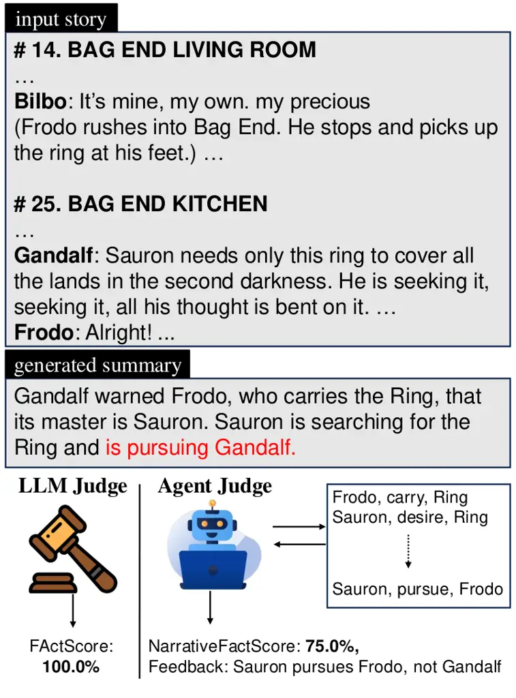
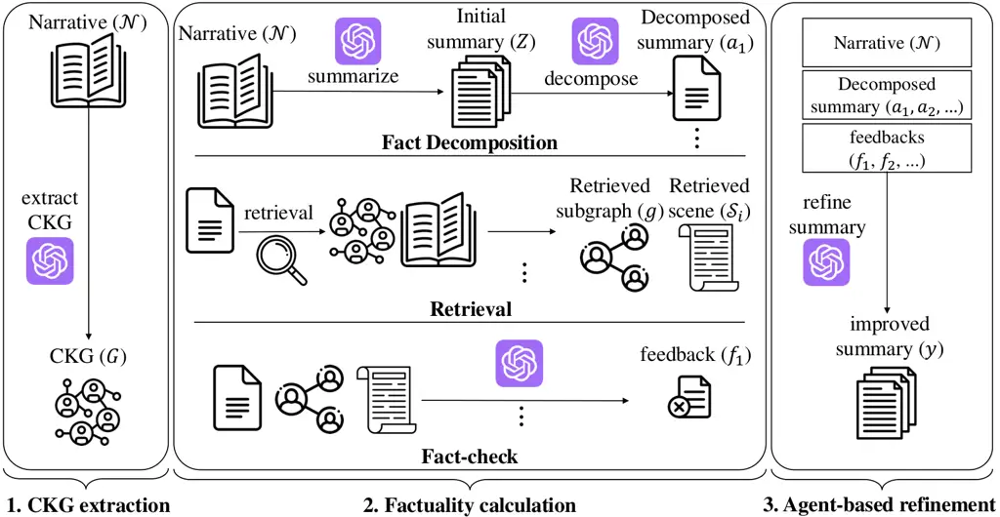
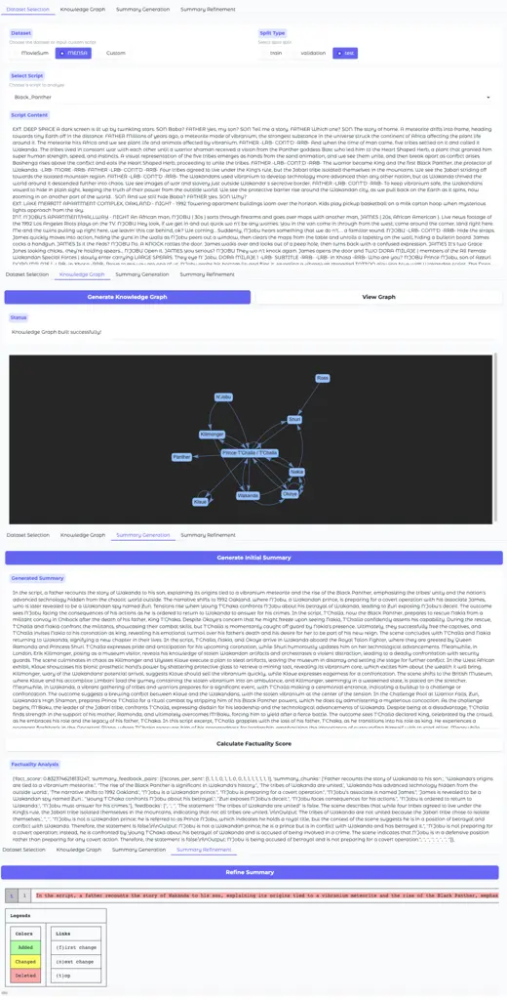

# Agent-as-Judge for Factual Summarization of Long Narratives

Yeonseok Jeong Email: [jys3136@snu.ac.kr](mailto:)    Minsoo Kim
Email: [minsoo9574@snu.ac.kr](mailto:)    Seung-won Hwang
^(†)^(†)thanks: Corresponding Author
Email: [seungwonh@snu.ac.kr](mailto:)    Byung-Hak Kim
Email: [byunghak.kim@hcs.com](mailto:)    IPAI    Seoul National
University    Seoul National University    Hyundai Card

###### Abstract

Large Language Models (LLMs) have demonstrated near-human performance in
summarization tasks based on traditional metrics such as ROUGE and
BERTScore. However, these metrics do not adequately capture critical
aspects of summarization quality, such as factual accuracy, particularly
for long narratives (\>100K tokens). Recent advances, such as
LLM-as-a-Judge, address the limitations of metrics based on lexical
similarity but still exhibit factual inconsistencies, especially in
understanding character relationships and states. In this work, we
introduce NarrativeFactScore (NFS), the first “Agent-as-a-Judge”
framework that evaluates and refines factuality in narrative
summarization. By leveraging a Character Knowledge Graph (CKG) extracted
from input narrative, NarrativeFactScore evaluates the factuality and
provides actionable guidance for refinement, such as identifying missing
or erroneous facts. Our experimental results demonstrate that
constructing the CKG enables reasoning with 1/3 of the factuality
computation used in the prior approach, and achieve three times higher
correlation with human judgments. Furthermore, refinement with
actionable guidance improves the quality of the summary.¹¹ 1
[https://github.com/YeonseokJeong/NarrativeFactScore](https://github.com/YeonseokJeong/NarrativeFactScore)

## 1 Introduction



Figure 1: Comparison of factuality evaluation by LLM and Agent Judge
with NarrativeFactScore. Given scenes from The Lord of the Rings, the
summary incorrectly claims “Sauron is pursuing Gandalf.” The LLM Judge
assigns 100% factuality score, while our Agent Judge correctly
identifies this error through analyzing atomic facts about characters,
assigning 75% NarrativeFactScore, with specific feedback.

The rise of LLMs OpenAI (2023); Dubey et al. (2024) has brought
significant advancements to summarization tasks, achieving performance
close to human levels Pu et al. (2023). Most evaluation metrics Lin
(2004); Zhang et al. (2019); Yuan et al. (2021) for summarization
measure lexical or semantic similarity between summary and ground truth.

In our target scenario of summarizing long narratives (\> 100K tokens),
metrics such as BooookScore Chang et al. (2024) can measure coherence,
but evaluating factuality has remained challenging Subbiah et al.
(2024). This is because it requires comparing summaries not only against
complex facts but also against the evolving relationships among
characters in long narratives. Thus, judging the factuality of such long
narratives has therefore inevitably relied on costly human
evaluations Kim et al. (2024).

More recently, LLM-as-a-Judge metrics Min et al. (2023); Bishop et al.
(2024) have leveraged LLM to assess the factuality, offering a more
cost-effective alternative to human annotations. If applied to narrative
summarization, these metrics split the summary into smaller units,
retrieve similar scenes from the input story, and quantify factuality by
LLM.

However, directly using LLM to evaluate factuality has two limitations.
First, as demonstrated by Kim et al. (2024), the LLM judge often fails
to accurately assess factuality in narratives that require indirect
reasoning, such as understanding character relationships or states. For
example, in Figure 1, although Sauron is pursuing Frodo in order to
obtain the Ring in The Lord of the Rings, the LLM judge inaccurately
evaluates the factuality of a summary which incorrectly reports that
“Sauron is pursuing Gandalf”. This limitation stems from the inability
of the LLM judge to consistently track and reason about character
relationships. To address this, we introduce the CKG, a structured
representation of characters and their relationships that must be
maintained consistently.

Second, the LLM judge outputs only a single score with limited
interpretability, which makes it less reliable and difficult to identify
what needs to be improved. Desirably, evaluation metrics for
summarization can provide feedback, when the score is low, to explain
why it is incorrect and suggest how to improve.

We propose an Agent-as-a-Judge Zhuge et al. (2024) framework, using
interpretable evaluation of summaries with a novel NarrativeFactScore,
based on which we can refine and improve summary quality. CKG achieves
consistency by constructing a names graph that consolidates character
aliases and variations across scenes and by performing multiple rounds
of relationship extraction, selecting relationships that frequently
appear across scenes as edges, inspired by Wang et al. (2023). This
construction process ensures that only well-supported character
relationships are retained. By leveraging this consistent relationship
graph when evaluating the factuality, we can accurately assess even
complex narrative facts that require understanding intricate character
dynamics.

To improve the interpretability of the metric, NarrativeFactScore also
provides feedback for interpretation and refinement when the summary is
incorrect. For each statement in the summary, our metric retrieves
relevant scenes and character relationships from our CKG to calculate a
factuality score. Based on the retrieved evidence, ours evaluates each
statement and generates feedback identifying discrepancies between
claims and supporting evidence. Since our metric operates autonomously,
it is more cost-effective and faster than Human-as-a-Judge. In addition,
it offers feedback for low scores, which makes it more interpretable
than LLM-as-a-Judge metrics. Recognizing the causes of low scores also
contributes to generating more accurate summaries through agent-based
refinement.

Using NarrativeFactScore provides two key advantages for long narrative
summarization. First, it offers a labor-efficient and fast metric that
also approximates human evaluation when evaluating the factuality of
summaries. Our metric demonstrates a statistically strong correlation
with human evaluation, and a test for differences between human
evaluation and our metric yielded statistically significant results,
with the p-value falling below 0.05. Second, by providing feedback on
factually incorrect parts, it can improve summarization performance. We
show that agent-based refinement improves factuality (+14.03), ROUGE
(+2.05), and BERTScore (+0.13) on MovieSum Saxena and Keller (2024a), a
movie script summarization dataset, and also improves factuality
(+12.26), ROUGE (+2.47), and BERTScore (+0.21) on MENSA Saxena and
Keller (2024b), a movie scene saliency dataset.

## 2 Related Work

### 2.1 Long Narrative Summarization

Summarizing long narratives Saxena and Keller (2024a); Saxena and Keller
(2024b) is challenging due to the high computational and memory demands
required by transformer-based models. In prior work Pilault et al.
(2020); Li et al. (2021); Wu et al. (2021); Chang et al. (2024), a
method called hierarchical merging was introduced, where individual
chunks of the narrative are summarized separately and then combined to
form a coherent final summary. Other segmentation-aware strategies have
also been explored Moro and Ragazzi (2022); Moro and Ragazzi (2023);
Zhang et al. (2022). But such chunk-based methods can group unrelated
content into the same segment. Although these methods preserve the
logical structure of the narrative, hallucinations remain a frequent
challenge, especially when capturing global information such as
character relationships. Thus, our focus is on improving the factuality
of the summaries.

### 2.2 Character Knowledge Graph (CKG)

Since characters are integral to narrative Gurung and Lapata (2024),
prior work has aimed to construct a graph to easily utilize them. In
narrative texts, CKG shows the unidirectional relationship between a
subject and an object character. This process is similar to creating a
triple (subject-predicate-object) list in knowledge graph
construction Chen et al. (2020). Andrus et al. (2022) utilized the
OpenIE system Angeli et al. (2015) for story completion and
question-answering tasks, integrating it with GPT-3 Brown et al. (2020)
to enhance its effectiveness. Alternatively, a recent method Zhao et al.
(2024) that assembles CKG directly using LLMs is a more robust approach,
as it better captures the nuanced and complex relationships. Our
distinction lies not only in constructing CKGs but also in utilizing
them to measure and enhance factuality.

### 2.3 Summarization Metrics for Evaluating Factuality

In recent research, efforts have been made to evaluate factuality of
long documents. LongDocFACTScore Bishop et al. (2024) improves this
process by calculating BARTScore Yuan et al. (2021) only on the
semantically similar portions of the source text for each summary
sentence, making it an effective method for handling long documents.
FActScore Min et al. (2023) further enhances factuality evaluation by
decomposing text into atomic facts and verifying each with LLM using
information retrieved from the knowledge source. Unlike these metrics,
our metric focuses on character relationships to accurately evaluate
factuality and provide actionable feedback to refine factually incorrect
parts.

## 3 Proposed Method



Figure 2: The main figure illustrates the overall process of evaluation
and refinement, which includes three main stages. First, it shows the
extraction of CKG $`G`$ from narrative $`\mathcal{N}`$. Next, it depicts
the calculation of factuality by comparing the decomposed summary
$`a_{k}`$ against the retrieved character relationship subgraph $`g`$
and narrative scene $`\mathcal{S}_{i}`$. Finally, it illustrates the
agent-based refinement process, where feedbacks ($`f_{1},f_{2},...`$)
are used to improve the factual accuracy of the summary.

In this section, we elaborate on NarrativeFactScore for evaluating
factuality of long narrative summarization. Figure 2 illustrates three
phases of our framework, which will be detailed in Section 3.1, 3.2, and
3.3 respectively.

### 3.1 CKG Extraction

We construct a consistent CKG, to overcome the inconsistencies of CKG
reported in Kim et al. (2024); Zhao et al. (2024), losing
information Liu et al. (2024) in long narratives and failing to reason
over many implicit relationships at once. To address these issues, we
perform reasoning multiple times Wang et al. (2023) for each scene and
select frequent relationships to improve consistency and accuracy. We
note this requires only 1/3 of the original cost while improving
correlation threefold. (See Appendix 5.3.)

Given a narrative represented as a collection of scenes
$`\mathcal{N}=\{\mathcal{S}_{1},\mathcal{S}_{2},\ldots,\mathcal{S}_{m}\}`$,
where $`m`$ denotes the number of scenes, the goal is to extract a graph
$`G`$ that encapsulates character relationships. Each scene
$`\mathcal{S}_{i}\ (1\leq i\leq m)`$ is processed individually to
extract relation triples (subject-predicate-object) using
GPT-4o-mini OpenAI (2023), as detailed in Section E.1. The extracted
triples are used to initialize the nodes and determine the edges based
on the main relationships between the nodes, forming the final CKG $`G`$
through the following two steps.

(a) Knowledge graph.

\<subject\>Frodo  
  \<predicate\>hobbit, own Ring  
 \<object\>Gandalf  
  \<predicate\>guided by  
 \<object\>Sauron  
  \<predicate\>fear, resist  
\<subject\>Gandalf  
  \<predicate\>wizard  
 \<object\>Frodo  
  \<predicate\>ally of  
 \<object\>Sauron  
  \<predicate\>enemy of  
\<subject\>Sauron  
  \<predicate\>Dark Lord, desire Ring  
 \<object\>Frodo  
  \<predicate\>pursue  
 \<object\>Gandalf  
  \<predicate\>enemy of

(b) Linearized knowledge graph.

Figure 3: (a) Part of a knowledge graph generated from The Lord of the
Rings, with three named entities. ‘Frodo/Frodo Baggins’ is a single
entity with two names. (b) The same graph is in linearized form.

First, to maintain consistency in character identification, we construct
a names graph $`G_{name}`$, consolidating aliases or variations in names
in scenes. Our framework processes each scene in turn, extracts all
character names, and determines several names refer to the same
character based on the context using LLM. For example, in The Lord of
the Rings, ‘Frodo’ and ‘Frodo Baggins’ are recognized as the same
character. As illustrated by ‘Frodo / Frodo Baggins’ in Figure 3(a),
each name variation is a node.²² 2 In practice, an undirected edge is
added between nodes that refer to the same character. This step ensures
an accurate capture of relationships, even when names vary across
scenes. The CKG is initialized using names from the names graph.

Second, to preserve the consistency of relationships, we sample
extracted triples multiple times Wang et al. (2023); Brown et al. (2024)
and select frequent ones as the final edges. Let the node set $`V`$ be
the set of all characters in the names graph:

```math
V=\{v\mid v\in G_{\text{name}}\} \tag{1}
```

Only triples with named entities as subjects and objects are used; if an
object is missing, a self-loop is added to represent the state of a
character. We then define the edge set $`E`$ of our CKG as

```math
E=\bigl\{(s,p,o)\mid s,o\in V,\ \mathrm{freq}(p\mid s,o)\geq\tau\bigr\} \tag{2}
```

where $`(s,o)`$ denotes a character pair, $`\mathrm{freq}(p\mid s,o)`$
is the frequency of predicate $`p`$ for $`(s,o)`$, and $`\tau`$ is the
frequency threshold.³³ 3 Adjusting the threshold allows for control over
the graph: a higher threshold ensures greater consistency, while a lower
threshold increases diversity. Finally, the consistent CKG is given by

```math
G=(V,E). \tag{3}
```

For triples with the same subject and object, frequent predicates
capture temporal changes as directed edges. For triples with the same
subject and object, our CKG saves predicates that occur frequently
across multiple scenes. By storing these frequent predicates in
sequential order, our framework captures temporal narrative shifts as
directed edges (Eq 2). For example, since the early scenes show that
‘Frodo’ fears ‘Sauron’ and the later scenes show that he resists
‘Sauron’, the CKG in Figure 3(a) displays two distinct relationships.
The process of deciding edges is repeated to construct a CKG that can
effectively evaluate the factuality of summaries.

### 3.2 NarrativeFactScore Calculation

We invent a new metric to guide agentic evaluation, unlike existing
factuality metrics Min et al. (2023); Bishop et al. (2024) that do not
provide evidence or feedback for their scores, by considering events in
the input story superficially but overlooking relational information
about characters. Our metric addresses these limitations by
incorporating character relationship graphs and providing detailed
feedback. To calculate the factuality of the narrative summary, we first
generate an initial summary $`Z`$ using the prompt described in
Section E.2.

To evaluate the factuality of the initial summary $`Z`$, we decompose it
into smaller verifiable units, similar to the approach used in Min
et al. (2023). Using the prompt in Section E.3, each sentence in the
initial summary $`Z`$ is divided into a list of atomic facts
$`A=\{a_{1},a_{2},\ldots,a_{z}\}`$.

To evaluate each atomic fact $`a_{k}`$, we need the scene and
information about the characters that appear in the atomic fact. First,
we retrieve the most relevant scene $`\mathcal{S}_{i}`$ within the
narrative $`\mathcal{N}`$, by using the BGE-M3 Chen et al. (2024).
Second, we also retrieve the subgraph $`g`$ from the linearized CKG
$`G`$, as illustrated in Figure 3(b), by sorting candidate triples by
similarity to the atomic fact $`a_{k}`$.

Using the retrieved information, each atomic fact $`a_{k}`$ is evaluated
to determine its factuality and to obtain feedback supporting the
evaluation. We then define an indicator $`I_{k}`$ for factuality based
on:

```math
I_{k}=\mathbbm{1}[a_{k}\ \text{is factual given}\ \mathcal{S}_{i},g)] \tag{4}
```

where $`\mathbbm{1}`$ is the indicator function, yielding 1 if the
atomic fact $`a_{i}`$ is factual and 0 otherwise. This evaluation is
carried out using the prompt detailed in Section E.4, which produces 1
if the atomic fact is accurate. If the atomic fact is determined to be
inaccurate, then feedback $`f_{k}`$ is provided on how to correct it.
Finally, the NarrativeFactScore is calculated as the proportion of
atomic facts that are found to be factual, defined by the following
equation:

```math
\text{{NarrativeFactScore} }=\frac{\sum_{i=1}^{z}I_{k}}{z} \tag{5}
```

### 3.3 Agent-based Fact Refinement

The new metric leveraging consistent CKG enables the LLM agent to guide
refinement by using feedback from the evaluation. This process involves
three key inputs: original narrative to provide global context, the
initial summary that requires modification, and the feedback detailing
the inaccuracies and reasons for those errors. Using a prompt that
incorporates these inputs in Section E.5, LLM refines the initial
summary by correcting only the factually inaccurate parts provided from
feedback, then generates the improved summary $`y`$.

Motivated by Madaan et al. (2024), the improved summary can be further
evaluated as outlined in Section 3.2. This allows the agent-based
refinement to be iterative, where each iteration further refines the
summary to enhance overall factuality.

## 4 Experiments

### 4.1 Implementation Details

#### Uniform Language Model Usage

To ensure that performance gain is due to our framework and not the
underlying language model, we use only gpt-4o-mini-2024-07-18 in our
experiments. This model is applied across all components, including CKG
extraction, summarization, fact decomposition, fact check, and
agent-based fact refinement. This approach prevents superior LLMs from
influencing the results, allowing us to rigorously evaluate the
effectiveness of our framework.

#### Generating Initial Summary

To generate the initial summary $`Z`$, we adopt hierarchical
merging Chang et al. (2024) that ensures the logical structure of the
narrative is preserved. The narrative is first divided into chunks
$`C_{i}`$ where each chunk is formed incrementally by adding scenes
until a predefined context size⁴⁴ 4 we set the predefined context size
of a chunk to 1024. is reached. Once this limit is exceeded, a new chunk
begins, resulting in a sequence of chunks
$`\mathcal{C}=\{C_{1},C_{2},...,C_{n}\}`$. Each chunk $`C_{i}`$ is then
independently summarized using the prompt specified in Section E.2, and
the resulting chunk summaries are sequentially merged to produce the
initial summary $`Z`$.

#### Retrieving Relevant Scene and Subgraph

Using the BGE-M3 embedding model Chen et al. (2024), we retrieve
information relevant to each atomic fact $`a_{k}`$. Specifically, we
identify the most similar scene $`\mathcal{S}_{i}`$ from the narrative
$`\mathcal{N}`$ and a subgraph containing the three most relevant
triples in the linearized CKG $`G`$. All retrieval computations were
performed on a single NVIDIA RTX 3090 GPU.

### 4.2 Evaluation Metrics

We assess the performance of our framework using several key evaluation
metrics. ROUGE Lin (2004) assesses n-gram overlap with reference
summaries, including R-1 (unigram), R-2 (bigram) and R-L (longest common
subsequence). BERTScore Zhang et al. (2019) (BS*(p), BS*(r), BS*(f1))
evaluates similarity using BERT embeddings Devlin et al. (2019), where
BS*(p) represents precision, BS*(r) recall and BS*(f1) the F1-score.
BARTScore Yuan et al. (2021) measures the quality of summaries by
scoring them as conditional language generation tasks. Finally, we
propose NarrativeFactScore (NFS) as a novel metric to measure the
factuality of the generated summaries.

We report ROUGE and BERTScore as reference points for lexical and
semantic similarity, while emphasizing that these metrics were not
designed to capture factual accuracy. Our primary factuality comparisons
are instead carried out with dedicated metrics such as FActScore Min
et al. (2023) and LongDocFACTScore Bishop et al. (2024).

### 4.3 Correlation with Human Factuality Scores

|           |                    |           |                     |
| --------- | ------------------ | --------- | ------------------- |
| Dataset   | \# tokens (source) | \# scenes | \# tokens (summary) |
| FABLES    | 127,467            | 38        | 594                 |
| STORYSUMM | 782                | –         | 322                 |
|           |                    |           |                     |

Table 1: Dataset statistics for STORYSUMM and FABLES.

|                  |           |         |          |         |
| ---------------- | --------- | ------- | -------- | ------- |
| Metrics          | STORYSUMM |         | FABLES   |         |
|                  | Spearman  | KENDALL | Spearman | KENDALL |
| ROUGE-1          | 0.25      | 0.18    | -0.20    | -0.14   |
| ROUGE-2          | 0.30      | 0.22    | -0.04    | -0.03   |
| ROUGE-L          | 0.31      | 0.22    | -0.18    | -0.14   |
| BERTScore\_(f1)  | 0.19      | 0.13    | -0.13    | -0.08   |
| BARTScore        | 0.09      | 0.06    | -0.30    | -0.22   |
| LongDocFACTScore | 0.07      | 0.05    | 0.24     | 0.16    |
| FActScore        | 0.19      | 0.13    | 0.16     | 0.09    |
| NFS              | 0.43      | 0.31    | 0.47     | 0.33    |
|                  |           |         |          |         |

Table 2: Spearman and KENDALL’s tau correlation coefficients between
different metrics and human factuality assessments on STORYSUMM and
FABLES. Coefficients indicating strong correlation are underlined.⁶⁶ 6
We follow widely adopted interpretations reported in Table 9.

|                          |           |         |          |         |
| ------------------------ | --------- | ------- | -------- | ------- |
| Metrics                  | STORYSUMM |         | FABLES   |         |
|                          | Spearman  | KENDALL | Spearman | KENDALL |
| \(A\) NFS                | 0.43      | 0.31    | 0.47     | 0.33    |
| \(B\) 0$`-`$ consistency | 0.21      | 0.14    | 0.19     | 0.13    |
| \(C\) 0$`-`$ CKG         | 0.30      | 0.21    | 0.25     | 0.16    |
|                          |           |         |          |         |

Table 3: Ablation results on STORYSUMM and FABLES, showing the impact of
using different CKG.

#### Dataset

To evaluate whether the NarrativeFactScore we proposed correlates
effectively with human factuality, we required benchmarks that satisfy
two conditions. First, they should provide human factuality scores for
multiple LLM-generated summaries of each narrative, enabling correlation
analysis. Second, they should be released after October 2023 to minimize
potential contamination given the GPT-4o-mini knowledge cutoff.
STORYSUMM Subbiah et al. (2024) and FABLES Kim et al. (2024) are the
only datasets that meet both conditions, so we chose them as our
benchmarks in Tables 6 and 3.

To further explain these datasets, Table 1 shows their statistics.
STORYSUMM is relatively short (782 tokens on average, 322 in summaries)
and thus scenes were not separated, while FABLES is substantially longer
(\>100K tokens with 38 scenes). These statistics confirm that our method
effectively calculates factuality for both short- and long-length
narratives.

#### Results

We computed the Spearman Spearman (1961) correlations and KENDALL’s
tau KENDALL (1938) correlations for each metric in relation to the human
factuality scores, as shown in Table 6. NarrativeFactScore is the only
metric that shows a strong correlation with human annotations in all
datasets. This correlation is statistically significant, with p-values
below 0.05 for all datasets.

#### Ablation Study

To verify the effectiveness of CKG in evaluating factuality, we
conducted an ablation study in Table 3. NarrativeFactScore (A)
iteratively reasons about character relationships, selects frequent
relationships to construct a consistent CKG, and utilizes it for
factuality evaluation. In contrast, (B) generates the CKG by reasoning
character relationships in a single step and evaluates factuality
accordingly. However, according to Zhao et al. (2024), LLMs tend to
generate inaccurate character relationships when reasoning over long
narrative in a single step. Lastly, (C) evaluates factuality without
utilizing a CKG.

The experimental results show that our metric (A) achieves the highest
correlation with human, and indicate the following observations. First,
comparing (A) with (C) shows CKG contributes to more accurate factuality
evaluation. However, the results of (B) and (C) show that an inaccurate
CKG can hinder factuality evaluation rather than improve it. Thus, to
effectively assess the factuality of summary, it is necessary to
construct a consistent CKG through multiple iterations of reasoning.

|                          |       |      |       |         |         |          |       |          |      |       |         |         |          |       |
| ------------------------ | ----- | ---- | ----- | ------- | ------- | -------- | ----- | -------- | ---- | ----- | ------- | ------- | -------- | ----- |
|                          | MENSA |      |       |         |         |          |       | MovieSum |      |       |         |         |          |       |
|                          | R-1   | R-2  | R-L   | BS\_(p) | BS\_(r) | BS\_(f1) | NFS   | R-1      | R-2  | R-L   | BS\_(p) | BS\_(r) | BS\_(f1) | NFS   |
| without merging          |       |      |       |         |         |          |       |          |      |       |         |         |          |       |
|      TextRank            | 34.37 | 4.60 | 12.84 | 46.86   | 49.43   | 48.10    | 59.72 | 33.92    | 4.62 | 16.25 | 46.82   | 49.48   | 48.10    | 60.23 |
|      LED                 | 17.46 | 1.59 | 10.03 | 42.90   | 42.74   | 42.58    | 56.48 | 2.80     | 0.28 | 0.28  | 32.64   | 23.82   | 27.32    | 22.24 |
|      LongT5              | 20.77 | 2.26 | 10.03 | 45.05   | 45.06   | 45.01    | 73.76 | 20.18    | 1.99 | 13.83 | 44.58   | 44.28   | 44.36    | 74.01 |
| hierarchically merging   |       |      |       |         |         |          |       |          |      |       |         |         |          |       |
|      GPT-4o-mini         | 31.79 | 9.69 | 12.68 | 60.00   | 60.03   | 60.01    | 81.05 | 29.26    | 8.72 | 17.88 | 59.11   | 59.29   | 59.19    | 80.56 |
|      Ours: 1st iteration | 33.00 | 9.70 | 12.84 | 60.22   | 60.11   | 60.16    | 85.94 | 30.36    | 8.74 | 18.55 | 59.26   | 59.30   | 59.27    | 86.92 |
|      Ours: 2nd iteration | 33.75 | 9.72 | 13.07 | 60.17   | 60.10   | 60.12    | 88.94 | 30.98    | 8.75 | 18.61 | 59.33   | 59.30   | 59.30    | 92.04 |
|      Ours: 3rd iteration | 34.26 | 9.74 | 13.46 | 60.24   | 60.21   | 60.22    | 93.31 | 31.31    | 8.81 | 18.62 | 59.36   | 59.31   | 59.32    | 94.59 |
|                          |       |      |       |         |         |          |       |          |      |       |         |         |          |       |

Table 4: Evaluation results on MENSA Saxena and Keller (2024b) and
MovieSum Saxena and Keller (2024a) datasets.

### 4.4 Summarization Performance Evaluation

#### Datasets

We evaluated our framework on the MENSA Saxena and Keller (2024b) and
MovieSum Saxena and Keller (2024a) datasets. MENSA aligns movie scenes
with Wikipedia summaries and MovieSum pairs screenplays with summaries.
Since both datasets provide ground-truth summaries, they can be used to
test whether our agent-based refinement improves both factuality and
summarization quality. We use the full test sets: 50 samples from MENSA
and 200 from MovieSum.

#### Results

We evaluated summarization performance using two baseline types. The
first type includes methods without merging that summarize all input in
a single step, such as TextRank Mihalcea and Tarau (2004), Longformer
Encoder-Decoder (LED) Beltagy et al. (2020), and LongT5 Guo et al.
(2022). The second type involves hierarchical merging Chang et al.
(2024), with which we performed experiments using GPT-4o-mini OpenAI
(2023). Additionally, we evaluated the summaries generated by
GPT-4o-mini after agent-based iterative refinements (1st to 3rd).

As shown in Table 4, agent-based refinement improves not only factuality
but also other metrics, improving the overall quality of the summaries.
This refinement improves performance consistently, yielding improvements
of +14.03 in factuality, +2.05 in ROUGE, and +0.13 in BERTScore on
MovieSum, and +12.26, +2.47, and +0.21 respectively on MENSA.

## 5 Analysis

### 5.1 How Consistently Does Ours Capture Character Relationships?

|                                  |         |         |          |
| -------------------------------- | ------- | ------- | -------- |
| Method                           | BS\_(p) | BS\_(r) | BS\_(f1) |
| Naive extract Zhao et al. (2024) | 86.23   | 86.33   | 86.26    |
| Ours                             | 95.63   | 95.68   | 95.65    |
|                                  |         |         |          |

Table 5: Comparison between the naive extract method and our proposed
method.

To effectively evaluate factuality and improve summary, it is necessary
to generate an accurate and consistent CKG. According to Kim et al.
(2024); Zhao et al. (2024), the “naive extract” approach, where an LLM
extracts character relationships in one step, often fails to
consistently capture some relationships. Thus, our objective is to
verify whether our approach can generate a consistent CKG. Unlike other
datasets, Conan Zhao et al. (2024) provides ground truth annotation of
character relationships within narratives. To evaluate whether the
generated relation is semantically similar to this ground truth, we
measure the BERTScore Devlin et al. (2019).

As shown in Table 5, our method generates CKG that is closely similar to
ground truth. Although the “naive extract” achieves 86.26, it
occasionally produces incorrect relationships. In contrast, by reasoning
about relationships scene by scene and aggregating them, our method
chooses more accurate relationships and constructs a consistent CKG.
This supports the role of the CKG in enhancing factuality assessment, as
shown in Table 3. Even without explicit scene boundaries, as in the
Conan dataset, we segmented the text into 256-token chunks with
128-token overlaps. This approach still showed a high BERTScore,
demonstrating robustness.

### 5.2 Challenging Set

|                          |       |      |       |         |         |          |       |
| ------------------------ | ----- | ---- | ----- | ------- | ------- | -------- | ----- |
|                          |       |      |       |         |         |          |       |
|                          | R-1   | R-2  | R-L   | BS\_(p) | BS\_(r) | BS\_(f1) | NFS   |
| without merging          |       |      |       |         |         |          |       |
|      TextRank            | 33.92 | 4.63 | 16.25 | 46.82   | 49.48   | 48.10    | 62.43 |
|      LED                 | 2.75  | 0.17 | 0.64  | 31.78   | 24.44   | 27.37    | 11.70 |
|      LongT5              | 22.10 | 2.29 | 11.16 | 43.86   | 44.69   | 44.18    | 79.38 |
| hierarchically merging   |       |      |       |         |         |          |       |
|      GPT-4o-mini         | 28.07 | 8.01 | 14.12 | 58.37   | 59.36   | 58.53    | 81.30 |
|      Ours: 1st iteration | 29.02 | 8.09 | 14.08 | 58.49   | 59.30   | 58.86    | 84.59 |
|      Ours: 2nd iteration | 29.98 | 8.19 | 14.24 | 58.61   | 59.32   | 58.94    | 90.47 |
|      Ours: 3rd iteration | 30.22 | 8.20 | 14.44 | 58.75   | 59.39   | 59.04    | 93.22 |
|                          |       |      |       |         |         |          |       |

Table 6: Evaluation results on the challenging set of the
MovieSum Saxena and Keller (2024a) dataset.

We aim to evaluate whether our metric can provide feedback necessary to
improve factuality in recent narratives. Although LLM-based metrics
provide accurate factuality feedback for narratives within their
pretraining data, they tend to be less reliable for narratives outside
of their training corpus. However, our metric provides accurate feedback
by evaluating summaries based on narrative story and character
relationships rather than relying on parametric knowledge alone.
Therefore, we define a challenging set of works published after the
knowledge cutoff date of our LLM to verify whether our metric improves
factuality through its feedback.

Our metric demonstrates the capability to provide feedback for improving
factuality even in recent works. For this experiment, we curated a
challenging set of 18 movies from MovieSum Saxena and Keller (2024a)
released after our LLM knowledge cutoff.⁷⁷ 7 We used GPT-4o-mini with an
October 2023 knowledge cutoff date. We conducted refinement experiments
identical to Table 4 to correct factual errors in this challenging set.
As shown in Table 6, three rounds of refinement improved
NarrativeFactScore by 11.92, comparable to the improvements in Table 4.
These results confirm our metric provides effective feedback for recent
stories independent of LLM parametric knowledge.

### 5.3 Latency

[TABLE]

Table 7: Average latency (in minutes) per a summary and Kendall’s tau
correlation for evaluating factuality across different metrics on the
FABLES Kim et al. (2024) dataset. Reported total times are the sum of
CKG extraction and factuality calculation.

We compared the latency of LLM-as-a-Judge metrics, such as
LongDocFACTScore and FActScore, with our Agent-as-a-Judge metric.
Table 7 shows the time required to evaluate the factuality of each
summary in the FABLES Kim et al. (2024). Since long narratives like
those in FABLES exceed 100K tokens, human evaluation by verifying
details is time-consuming.⁸⁸ 8 According to Kim et al. (2024),
annotators spent over 11 hours evaluating five summaries. In contrast,
LLM-based metrics, including ours, assess factuality within a few
minutes. However, LLM-as-a-Judge metrics struggle to assess factuality
while understanding character relationships, leading to discrepancies
with human evaluations, as shown in Table 6. In contrast,
NarrativeFactScore devotes additional time to reasoning about character
relationships before assessing factuality, resulting in more accurate
evaluations despite slightly longer times.

To further analyze efficiency, we also evaluated a one-shot variant of
NarrativeFactScore (NFS w/o consistency). As reported in Table 7, this
variant requires less time for CKG extraction but shows weaker
correlation with human judgments, highlighting a trade-off between speed
and accuracy.

### 5.4 Sensitivity of Metrics on Factual Perturbation

|                   |         |                 |       |
| ----------------- | ------- | --------------- | ----- |
| Summary           | ROUGE-L | BERTScore\_(f1) | NFS   |
| Reference Summary | 100.00  | 100.00          | 95.42 |
| Perturbed Summary | 81.61   | 92.15           | 40.81 |
|                   |         |                 |       |

Table 8: Change in metric scores after factual perturbation of the
reference summary on the MENSA.

We evaluated metric sensitivity to factual perturbations using GPT-4o
with the prompt shown in Figure 10 on the MENSA. Specifically, we
perturbed the reference summaries from MENSA by introducing factual
inaccuracies in each sentence. Table 8 shows that ROUGE-L and
BERTScore\_(f1) decreased minimally despite factual perturbations, while
NarrativeFactScore significantly dropped. In our setup, perturbations
were created by minimally replacing specific words in the reference
summaries rather than generating entirely new content, since the latter
would unfairly penalize ROUGE and BERTScore. These results demonstrate
that our metric is highly sensitive to factual discrepancies, making it
a suitable metric for assessing factuality.

## 6 Conclusion

This work shows how the agent-as-judge is deployed for narrative
summarization to overcome the limitations of existing evaluation
metrics, such as overreliance on lexical similarity or factual
inconsistencies. Specifically, we propose consistent CKG extraction, and
a new factual evaluation metric based on CKG, and an agent that
evaluates and guides the summary and refinement. Through our
implementation, we demonstrated both the process and superior
performance over state-of-the-art methods on real-life industry datasets
and scenarios.

## 7 Limitation

We acknowledge two limitations of our work. First, our framework may
occasionally retrieve subgraphs unrelated to the atomic fact being
evaluated, though this did not impact factuality judgments in our
experiments and outperformed the no-retrieval baseline. Nonetheless,
further enhancing subgraph retrieval precision remains a promising
direction for future work.

Second, our framework has been tested exclusively in the narrative
domain. Although effective, its generalizability to other domains
remains unverified. However, its potential for applications requiring
deep character understanding—such as news summarization, biographical
writing, and historical analysis—suggests promising directions for
future exploration.

## Acknowledgements

This work was supported by the National Research Foundation of Korea
(NRF) grant funded by the Korea government (MSIT) (No.
RS-2024-00414981), the MSIT (Ministry of Science and ICT), Korea, under
the ITRC (Information Technology Research Center) support program
(IITP-2025-2020-0-01789) supervised by the IITP (Institute for
Information & Communications Technology Planning & Evaluation), and
Institute of Information & communications Technology Planning &
Evaluation (IITP) grant funded by the Korea government(MSIT)
\[NO.RS-2021-II211343, Artificial Intelligence Graduate School Program
(Seoul National University)\].

## References

- Andrus et al. (2022) Berkeley R Andrus, Yeganeh Nasiri, Shilong Cui,
  Benjamin Cullen, and Nancy Fulda. 2022. Enhanced story comprehension
  for large language models through dynamic document-based knowledge
  graphs. In _Proceedings of the AAAI Conference on Artificial
  Intelligence_, volume 36, pages 10436–10444.
- Angeli et al. (2015) Gabor Angeli, Melvin Jose Johnson Premkumar, and
  Christopher D. Manning. 2015. [Leveraging linguistic structure for
  open domain information
  extraction](https://doi.org/10.3115/v1/P15-1034). In _Proceedings of
  the 53rd Annual Meeting of the Association for Computational
  Linguistics and the 7th International Joint Conference on Natural
  Language Processing (Volume 1: Long Papers)_, pages 344–354, Beijing,
  China. Association for Computational Linguistics.
- Beltagy et al. (2020) Iz Beltagy, Matthew E Peters, and Arman
  Cohan. 2020. Longformer: The long-document transformer. _arXiv
  preprint arXiv:2004.05150_.
- Bishop et al. (2024) Jennifer A. Bishop, Sophia Ananiadou, and
  Qianqian Xie. 2024. [LongDocFACTScore: Evaluating the factuality of
  long document abstractive
  summarisation](https://aclanthology.org/2024.lrec-main.941). In
  _Proceedings of the 2024 Joint International Conference on
  Computational Linguistics, Language Resources and Evaluation
  (LREC-COLING 2024)_, pages 10777–10789, Torino, Italia. ELRA and ICCL.
- Botsch (2011) R Botsch. 2011. Chapter 12: Significance and measures of
  association. _Scopes and Methods of Political Science_.
- Brown et al. (2024) Bradley Brown, Jordan Juravsky, Ryan Ehrlich,
  Ronald Clark, Quoc V Le, Christopher Ré, and Azalia Mirhoseini. 2024.
  Large language monkeys: Scaling inference compute with repeated
  sampling. _arXiv preprint arXiv:2407.21787_.
- Brown et al. (2020) Tom Brown, Benjamin Mann, Nick Ryder, Melanie
  Subbiah, Jared D Kaplan, Prafulla Dhariwal, Arvind Neelakantan, Pranav
  Shyam, Girish Sastry, Amanda Askell, Sandhini Agarwal, Ariel
  Herbert-Voss, Gretchen Krueger, Tom Henighan, Rewon Child, Aditya
  Ramesh, Daniel Ziegler, Jeffrey Wu, Clemens Winter, Chris Hesse, Mark
  Chen, Eric Sigler, Mateusz Litwin, Scott Gray, Benjamin Chess, Jack
  Clark, Christopher Berner, Sam McCandlish, Alec Radford, Ilya
  Sutskever, and Dario Amodei. 2020. Language Models are Few-Shot
  Learners. In _Advances in Neural Information Processing Systems_,
  volume 33, pages 1877–1901.
- Chang et al. (2024) Yapei Chang, Kyle Lo, Tanya Goyal, and Mohit
  Iyyer. 2024. [Booookscore: A systematic exploration of book-length
  summarization in the era of
  LLMs](https://arxiv.org/pdf/2310.00785.pdf). In _The Twelfth
  International Conference on Learning Representations_.
- Chen et al. (2024) Jianlyu Chen, Shitao Xiao, Peitian Zhang, Kun Luo,
  Defu Lian, and Zheng Liu. 2024. M3-embedding: multi-linguality,
  multi-functionality, multi-granularity text embeddings through
  self-knowledge distillation. In _Findings of the Association for
  Computational Linguistics ACL 2024_, pages 2318–2335.
- Chen et al. (2020) Zhe Chen, Yuehan Wang, Bin Zhao, Jing Cheng, Xin
  Zhao, and Zongtao Duan. 2020. Knowledge graph completion: A review.
  _Ieee Access_, 8:192435–192456.
- Chiang and Lee (2023) Cheng-Han Chiang and Hung-yi Lee. 2023. [Can
  large language models be an alternative to human
  evaluations?](https://doi.org/10.18653/v1/2023.acl-long.870) In
  _Proceedings of the 61st Annual Meeting of the Association for
  Computational Linguistics (Volume 1: Long Papers)_, pages 15607–15631,
  Toronto, Canada. Association for Computational Linguistics.
- Devlin et al. (2019) Jacob Devlin, Ming-Wei Chang, Kenton Lee, and
  Kristina Toutanova. 2019. [BERT: Pre-training of deep bidirectional
  transformers for language
  understanding](https://doi.org/10.18653/v1/N19-1423). In _Proceedings
  of the 2019 Conference of the North American Chapter of the
  Association for Computational Linguistics: Human Language
  Technologies, Volume 1 (Long and Short Papers)_, pages 4171–4186,
  Minneapolis, Minnesota. Association for Computational Linguistics.
- Dubey et al. (2024) Abhimanyu Dubey, Abhinav Jauhri, Abhinav Pandey,
  Abhishek Kadian, Ahmad Al-Dahle, Aiesha Letman, Akhil Mathur, Alan
  Schelten, Amy Yang, Angela Fan, et al. 2024. The llama 3 herd of
  models. _arXiv preprint arXiv:2407.21783_.
- Guo et al. (2022) Mandy Guo, Joshua Ainslie, David C Uthus, Santiago
  Ontanon, Jianmo Ni, Yun-Hsuan Sung, and Yinfei Yang. 2022. Longt5:
  Efficient text-to-text transformer for long sequences. In _Findings of
  the Association for Computational Linguistics: NAACL 2022_, pages
  724–736.
- Gurung and Lapata (2024) Alexander Gurung and Mirella Lapata. 2024.
  [CHIRON: Rich character representations in long-form
  narratives](https://doi.org/10.18653/v1/2024.findings-emnlp.499). In
  _Findings of the Association for Computational Linguistics: EMNLP
  2024_, pages 8523–8547, Miami, Florida, USA. Association for
  Computational Linguistics.
- KENDALL (1938) MG KENDALL. 1938. A new measure of rank correlation.
  _Biometrika_, 30:81–93.
- Kim et al. (2024) Yekyung Kim, Yapei Chang, Marzena Karpinska, Aparna
  Garimella, Varun Manjunatha, Kyle Lo, Tanya Goyal, and Mohit
  Iyyer. 2024. [FABLES: Evaluating faithfulness and content selection in
  book-length
  summarization](https://openreview.net/forum?id=YfHxQSoaWU). In _First
  Conference on Language Modeling_.
- Li et al. (2021) Haoran Li, Arash Einolghozati, Srinivasan Iyer,
  Bhargavi Paranjape, Yashar Mehdad, Sonal Gupta, and Marjan
  Ghazvininejad. 2021. Ease: Extractive-abstractive summarization with
  explanations. _arXiv preprint arXiv:2105.06982_.
- Lin (2004) Chin-Yew Lin. 2004. Rouge: A package for automatic
  evaluation of summaries. In _Text summarization branches out_, pages
  74–81.
- Liu et al. (2024) Nelson F Liu, Kevin Lin, John Hewitt, Ashwin
  Paranjape, Michele Bevilacqua, Fabio Petroni, and Percy Liang. 2024.
  Lost in the middle: How language models use long contexts.
  _Transactions of the Association for Computational Linguistics_,
  11:157–173.
- Madaan et al. (2024) Aman Madaan, Niket Tandon, Prakhar Gupta, Skyler
  Hallinan, Luyu Gao, Sarah Wiegreffe, Uri Alon, Nouha Dziri, Shrimai
  Prabhumoye, Yiming Yang, et al. 2024. Self-refine: Iterative
  refinement with self-feedback. _Advances in Neural Information
  Processing Systems_, 36.
- Mihalcea and Tarau (2004) Rada Mihalcea and Paul Tarau. 2004.
  Textrank: Bringing order into text. In _Proceedings of the 2004
  conference on empirical methods in natural language processing_, pages
  404–411.
- Min et al. (2023) Sewon Min, Kalpesh Krishna, Xinxi Lyu, Mike Lewis,
  Wen-tau Yih, Pang Koh, Mohit Iyyer, Luke Zettlemoyer, and Hannaneh
  Hajishirzi. 2023. [FActScore: Fine-grained atomic evaluation of
  factual precision in long form text
  generation](https://doi.org/10.18653/v1/2023.emnlp-main.741). In
  _Proceedings of the 2023 Conference on Empirical Methods in Natural
  Language Processing_, pages 12076–12100, Singapore. Association for
  Computational Linguistics.
- Moro and Ragazzi (2022) Gianluca Moro and Luca Ragazzi. 2022.
  [Semantic self-segmentation for abstractive summarization of long
  documents in low-resource
  regimes](https://doi.org/10.1609/aaai.v36i10.21357). In _Proceedings
  of the Thirty-Sixth AAAI Conference on Artificial Intelligence
  (AAAI-22)_, pages 11085–11093, Virtual Event. AAAI Press.
- Moro and Ragazzi (2023) Gianluca Moro and Luca Ragazzi. 2023.
  [Align-then-abstract representation learning for low-resource
  summarization](https://doi.org/10.1016/j.neucom.2023.126356).
  _Neurocomputing_, 548:126356.
- OpenAI (2023) OpenAI. 2023. [Gpt-4 technical
  report](https://arxiv.org/abs/2303.08774). _Preprint_,
  arXiv:2303.08774.
- Pilault et al. (2020) Jonathan Pilault, Raymond Li, Sandeep
  Subramanian, and Chris Pal. 2020. [On extractive and abstractive
  neural document summarization with transformer language
  models](https://doi.org/10.18653/v1/2020.emnlp-main.748). In
  _Proceedings of the 2020 Conference on Empirical Methods in Natural
  Language Processing (EMNLP)_, pages 9308–9319, Online. Association for
  Computational Linguistics.
- Pu et al. (2023) Xiao Pu, Mingqi Gao, and Xiaojun Wan. 2023.
  Summarization is (almost) dead. _arXiv preprint arXiv:2309.09558_.
- Qwen Team (2024) Qwen Team. 2024. [Qwen2.5: A party of foundation
  models](https://qwenlm.github.io/blog/qwen2.5/).
- Saxena and Keller (2024a) Rohit Saxena and Frank Keller. 2024a.
  Moviesum: An abstractive summarization dataset for movie screenplays.
  In _Findings of the Association for Computational Linguistics ACL
  2024_, pages 4043–4050.
- Saxena and Keller (2024b) Rohit Saxena and Frank Keller. 2024b. Select
  and summarize: Scene saliency for movie script summarization. In
  _Findings of the Association for Computational Linguistics: NAACL
  2024_, pages 3439–3455.
- Spearman (1961) Charles Spearman. 1961. The proof and measurement of
  association between two things.
- Subbiah et al. (2024) Melanie Subbiah, Faisal Ladhak, Akankshya
  Mishra, Griffin Adams, Lydia Chilton, and Kathleen Mckeown. 2024.
  Storysumm: Evaluating faithfulness in story summarization. In
  _Proceedings of the 2024 Conference on Empirical Methods in Natural
  Language Processing_, pages 9988–10005.
- Wang et al. (2023) Xuezhi Wang, Jason Wei, Dale Schuurmans, Quoc V Le,
  Ed H. Chi, Sharan Narang, Aakanksha Chowdhery, and Denny Zhou. 2023.
  [Self-consistency improves chain of thought reasoning in language
  models](https://openreview.net/forum?id=1PL1NIMMrw). In _The Eleventh
  International Conference on Learning Representations_.
- Wu et al. (2021) Jeff Wu, Long Ouyang, Daniel M Ziegler, Nisan
  Stiennon, Ryan Lowe, Jan Leike, and Paul Christiano. 2021. Recursively
  summarizing books with human feedback. _arXiv preprint
  arXiv:2109.10862_.
- Yuan et al. (2021) Weizhe Yuan, Graham Neubig, and Pengfei Liu. 2021.
  Bartscore: Evaluating generated text as text generation. _Advances in
  Neural Information Processing Systems_, 34:27263–27277.
- Zhang et al. (2019) Tianyi Zhang, Varsha Kishore, Felix Wu, Kilian Q
  Weinberger, and Yoav Artzi. 2019. Bertscore: Evaluating text
  generation with bert. _arXiv preprint arXiv:1904.09675_.
- Zhang et al. (2022) Yusen Zhang, Ansong Ni, Ziming Mao, Chen Henry Wu,
  Chenguang Zhu, Budhaditya Deb, Ahmed Awadallah, Dragomir Radev, and
  Rui Zhang. 2022. [Summn̂: A multi-stage summarization framework for
  long input dialogues and
  documents](https://doi.org/10.18653/v1/2022.acl-long.112). In
  _Proceedings of the 60th Annual Meeting of the Association for
  Computational Linguistics (ACL 2022), Long Papers_, pages 1592–1604,
  Dublin, Ireland. Association for Computational Linguistics.
- Zhao et al. (2024) Runcong Zhao, Qinglin Zhu, Hainiu Xu, Jiazheng Li,
  Yuxiang Zhou, Yulan He, and Lin Gui. 2024. [Large language models fall
  short: Understanding complex relationships in detective
  narratives](https://aclanthology.org/2024.findings-acl.454). In
  _Findings of the Association for Computational Linguistics ACL 2024_,
  pages 7618–7638, Bangkok, Thailand and virtual meeting. Association
  for Computational Linguistics.
- Zhuge et al. (2024) Mingchen Zhuge, Changsheng Zhao, Dylan Ashley,
  Wenyi Wang, Dmitrii Khizbullin, Yunyang Xiong, Zechun Liu, Ernie
  Chang, Raghuraman Krishnamoorthi, Yuandong Tian, et al. 2024.
  Agent-as-a-judge: Evaluate agents with agents. _arXiv preprint
  arXiv:2410.10934_.

## Appendices

## Appendix A Further Analysis

### A.1 Analysis for Baseline Metrics

|                       |                     |                    |
| --------------------- | ------------------- | ------------------ |
| Strength              | Spearman ($`\rho`$) | KENDALL ($`\tau`$) |
| Very weak correlation | 0.00~0.15           | 0.00~0.10          |
| Weak correlation      | 0.15~0.30           | 0.10~0.20          |
| Moderate correlation  | 0.30~0.43           | 0.20~0.30          |
| Strong correlation    | 0.43~1.00           | 0.30~1.00          |
|                       |                     |                    |

Table 9: Correlation strength based on coefficients.

Table 9 shows widely adopted interpretation of correlations from Botsch
(2011); Chiang and Lee (2023), where $`|\tau|\in[0.3,1.0]`$ is
considered a strong correlation. For Spearman Spearman (1961),
thresholds are derived by converting $`\tau`$⁹⁹ 9 $`\tau`$ indicates
Kendall’s tau KENDALL (1938) intervals under the assumption of bivariate
normality.

We analyze the results compared to other metrics in Table 6. Metrics
based on lexical overlap, such as ROUGE, show stronger correlations with
human factuality assessments compared to semantic similarity metrics
such as BERTScore, as they better capture repeated entities and
locations in narratives. In contrast, metrics such as BARTScore and
LongDocFACTScore Bishop et al. (2024), which rely on log-likelihood and
entailment, have lower correlations due to their limited ability to
account for broader context and character relationships. FActScore Min
et al. (2023), reproduced in our study, incorporates character
relationship retrieval to improve factuality assessments. Building on
this, NarrativeFactScore further enhances performance by addressing
common errors caused by misinterpreted character relationships, leading
to more accurate evaluations.

### A.2 Effectiveness with Open-Source LLM

|                           |       |      |       |         |         |          |       |
| ------------------------- | ----- | ---- | ----- | ------- | ------- | -------- | ----- |
|                           |       |      |       |         |         |          |       |
|                           | R-1   | R-2  | R-L   | BS\_(p) | BS\_(r) | BS\_(f1) | NFS   |
| without merging           |       |      |       |         |         |          |       |
|      TextRank             | 34.37 | 4.60 | 12.84 | 46.86   | 49.43   | 48.10    | 59.72 |
|      LED                  | 17.46 | 1.59 | 10.03 | 42.90   | 42.74   | 42.58    | 56.48 |
|      LongT5               | 20.77 | 2.26 | 10.03 | 45.05   | 45.06   | 45.01    | 73.76 |
| hierarchically merging    |       |      |       |         |         |          |       |
|      Qwen2.5-14B-Instruct | 30.45 | 7.03 | 11.99 | 58.20   | 59.61   | 58.89    | 67.29 |
|      Ours: 1st iteration  | 31.26 | 7.06 | 12.05 | 58.31   | 59.68   | 58.95    | 70.71 |
|      Ours: 2nd iteration  | 31.57 | 7.08 | 12.09 | 58.35   | 59.69   | 58.97    | 71.89 |
|                           |       |      |       |         |         |          |       |

Table 10: Evaluation results on the MENSA Saxena and Keller (2024b)
dataset. Hierarchically merging results are based on
Qwen2.5-14B-Instruct.

Our framework is also effective with open-source model. As shown in
Table 10, NarrativeFactScore implemented using Qwen2.5-14B-Instruct Qwen
Team (2024) consistently improves summarization performance on MENSA
across two iterations. Compared to the initial summarization, our
refinement shows steady gains, achieving NFS of 70.71 and 71.89 after
the first and second iterations, respectively. These results confirm
that the benefits of our method are not limited to proprietary LLMs but
also extend to accessible open-source alternatives.

### A.3 Baseline Evaluation with Hierarchical Merging

|                          |       |      |       |         |         |          |       |          |      |       |         |         |          |       |
| ------------------------ | ----- | ---- | ----- | ------- | ------- | -------- | ----- | -------- | ---- | ----- | ------- | ------- | -------- | ----- |
|                          | MENSA |      |       |         |         |          |       | MovieSum |      |       |         |         |          |       |
|                          | R-1   | R-2  | R-L   | BS\_(p) | BS\_(r) | BS\_(f1) | NFS   | R-1      | R-2  | R-L   | BS\_(p) | BS\_(r) | BS\_(f1) | NFS   |
| hierarchically merging   |       |      |       |         |         |          |       |          |      |       |         |         |          |       |
|      LED                 | 22.02 | 3.30 | 9.00  | 43.10   | 43.62   | 43.19    | 59.71 | 21.45    | 2.55 | 14.37 | 44.86   | 44.32   | 44.49    | 61.90 |
|      LongT5              | 30.88 | 4.49 | 11.23 | 45.85   | 48.84   | 47.27    | 78.13 | 31.19    | 4.06 | 17.62 | 46.01   | 48.92   | 47.39    | 79.15 |
|      GPT-4o-mini         | 31.79 | 9.69 | 12.68 | 60.00   | 60.03   | 60.01    | 81.05 | 29.26    | 8.72 | 17.88 | 59.11   | 59.29   | 59.19    | 80.56 |
|      Ours: 1st iteration | 33.00 | 9.70 | 12.84 | 60.22   | 60.11   | 60.16    | 85.94 | 30.36    | 8.74 | 18.55 | 59.26   | 59.30   | 59.27    | 86.92 |
|      Ours: 2nd iteration | 33.75 | 9.72 | 13.07 | 60.17   | 60.10   | 60.12    | 88.94 | 30.98    | 8.75 | 18.61 | 59.33   | 59.30   | 59.30    | 92.04 |
|      Ours: 3rd iteration | 34.26 | 9.74 | 13.46 | 60.24   | 60.21   | 60.22    | 93.31 | 31.31    | 8.81 | 18.62 | 59.36   | 59.31   | 59.32    | 94.59 |
|                          |       |      |       |         |         |          |       |          |      |       |         |         |          |       |

Table 11: Evaluation results on MENSA and MovieSum datasets with
hierarchical merging.

Our conclusions remain consistent even when baselines are evaluated with
hierarchical merging. As shown in Table 11, NarrativeFactScore with
refinement continues to outperform LED and LongT5 on both MENSA and
MovieSum, confirming the robustness of our improvements regardless of
baseline settings.

## Appendix B Qualitative Example

[TABLE]

Table 12: Qualitative example illustrating NarrativeFactScore. Red text
in the initial summary and atomic facts indicate factually incorrect
statements based on scene evidence, while blue text in the refined
summary indicate corrections made through agent-based refinement based
on feedback.

In this section, we illustrate how our approach evaluates factuality,
provides actionable feedback, and refines summaries through a
qualitative example. Table 12 shows the evaluation and refinement
process for a summary of The Lord of the Rings generated by
GPT-4o-mini OpenAI (2023). The CKG has already been constructed using
the method described in Section 3.1.

To evaluate factuality, we decompose the initial summary into atomic
facts. The summary contains two factually incorrect statements
highlighted in red, which are also presented in the atomic facts. First,
according to the original script, Saruman uses a Palantir to observe
Sauron; however, due to difficulty in understanding character
relationships, the incorrect summary stating Sauron observes Saruman was
generated and recorded as atomic fact \[3\]. Second, while the original
script depicts Frodo and Sam in a messy situation, chased in the Shire
by Merry and Pippin, the summary incorrectly describes it as peaceful,
recorded as atomic fact \[7\].

In our framework, we retrieve relevant scene and subgraph for each
atomic fact to evaluate factuality. Consequently, only \[3\] and \[7\]
were identified as false. For these facts, the framework generates not
only the factuality but also actionable feedback explaining why they are
false and how to correct them. For \[3\], based on retrieved scene and
relationship that Saruman owns the Palantir, our framework determines
that the statement is false and generates feedback suggesting that
Saruman uses the Palantir to gain knowledge about Sauron’s actions and
intentions. Similarly, for \[7\], based on the scene showing Frodo and
Sam in a messy situation with Merry and Pippin in the Shire, our
framework determines the statement is false and provides proper
feedback. Using this detailed feedback, our framework generates refined
summary by correcting only the erroneous parts of the initial summary.

[TABLE]

Table 13: Qualitative example illustrating NarrativeFactScore when
irrelevant subgraph is retrieved. Blue text in the initial summary and
atomic facts indicates the correct fact, but due to irrelevant
retrieval, it is first misjudged as false (red). Through subsequent
refinement, the error is corrected.

As shown in Table 13, this example shows how irrelevant subgraph
retrieval can cause errors. The atomic fact \[3\] “Sauron seeks the Ring
to regain power” is correct. However, the retrieved triple
“Sauron-master of Ring” gives misleading feedback that Sauron already
owns the Ring. This results in an incorrect refinement, where the fact
is wrongly judged as false. Through iterative refinement, the system
retrieves more relevant subgraphs (e.g., Frodo owns the Ring and Sauron
seeks it) or uses scene evidence. As a result, the correct factual
judgment is recovered in later iterations.

## Appendix C System Deployment



Figure 4: Deployment overview of NarrativeFactScore.

This section describes our system deployment, which is necessary for the
media industry¹⁰¹⁰ 10 The media industry broadly refers to the sector
that creates, distributes, and analyzes various forms of narratives,
such as movies, television shows, books, video games, and other media
that tell stories. This includes businesses involved in producing,
editing, and consuming these forms of content, focusing on storytelling
in both traditional and digital media. where companies make investment
decisions on narratives (\> 100K tokens) such as dramas or movies. Since
reading all narratives is challenging, media companies utilize summaries
of each narrative to determine its production feasibility. However,
summaries generated by humans or LLMs frequently contain factual
inconsistencies, which hinder accurate investment decisions. Therefore,
our proposed system is deployed to evaluate the factuality of summary
for long narratives and improve its factuality.

Figure 4 shows screenshots of the system¹¹¹¹ 11
[huggingface.co/spaces/yeonseokjeong/NarrativeFactScore](https://huggingface.co/spaces/yeonseokjeong/NarrativeFactScore),
aligned with the three phases of our framework in Figure 2. Using the
example Black Panther, users can view the original narrative after
selecting a dataset, data type, and name. Clicking “Generate Knowledge
Graph” generates and visualizes the CKG (Section 3.1). The “Generate
Initial Summary” and “Calculate Factuality Score” buttons create an
initial summary and evaluate its factuality using the CKG (Section 3.2).
Finally, “Refine Summary” improves the summary based on feedback,
enhancing factuality (Section 3.3).

## Appendix D Usage of AI Assistants

We utilized ChatGPT to improve the clarity and grammatical accuracy of
the writing. It provided suggestions for rephrasing sentences and
correcting grammatical errors to make the text flow more naturally.

## Appendix E Prompts

To ensure ethical transparency and reproducibility, we disclose the
prompts used at each stage of our process.

### E.1 Knowledge Extraction Prompt for LLM


Figure 5: Simplified prompt for named entity recognition and knowledge
graph edges generation.

### E.2 Narrative Summarization Prompt for LLM


Figure 6: Prompt for summarizing a chunk of narrative from a movie
script.

### E.3 Atomic Fact Decomposition Prompt for LLM


Figure 7: Prompt for extracting atomic facts from a movie script
summary.

### E.4 Fact-Checking Prompt for NarrativeFactScore


Figure 8: Prompt for validating a summary against a scene and a
relationship subgraph.

### E.5 Agent-based Refinement Prompt for LLM


Figure 9: Prompt for revising and summarizing a movie script based on
feedback. Note that ‘Statement to Revise’ and ‘Reason for Revision’
correspond to the atomic fact and factuality feedback calculated in
Figure 8.

### E.6 Factual Perturbation Prompt


Figure 10: Prompt used to generate factual perturbations.
