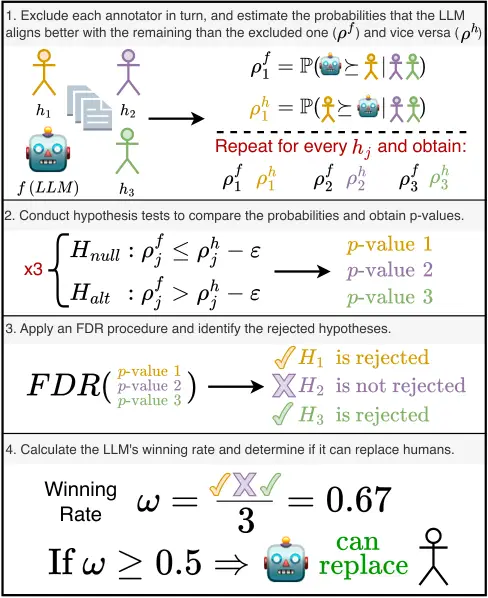
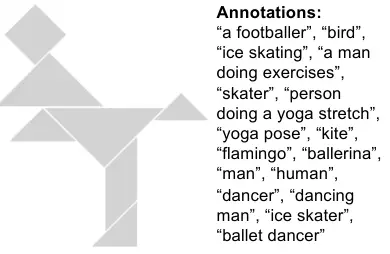

# The Alternative Annotator Test for LLM-as-a-Judge: How to Statistically Justify Replacing Human Annotators with LLMs

Nitay Calderon Affiliation: Faculty of Data and Decision Science,
Technion Email: [nitay@campus.technion.ac.il](mailto:)    Roi Reichart
Affiliation: Faculty of Data and Decision Science, Technion
Email: [roiri@technion.ac.il](mailto:)    Rotem Dror
Affiliation: Faculty of Computer and Information Science, University of
Haifa Email: [rdror@is.haifa.ac.il](mailto:)

###### Abstract

The ‘‘LLM-as-an-annotator’’ and ‘‘LLM-as-a-judge’’ paradigms employ
Large Language Models (LLMs) as annotators, judges, and evaluators in
tasks traditionally performed by humans. LLM annotations are widely
used, not only in NLP research but also in fields like medicine,
psychology, and social science. Despite their role in shaping study
results and insights, there is no standard or rigorous procedure to
determine whether LLMs can replace human annotators. In this paper, we
propose a novel statistical procedure, the Alternative Annotator Test
(alt-test), that requires only a modest subset of annotated examples to
justify using LLM annotations. Additionally, we introduce a versatile
and interpretable measure for comparing LLM annotators and judges. To
demonstrate our procedure, we curated a diverse collection of ten
datasets, consisting of language and vision-language tasks, and
conducted experiments with six LLMs and four prompting techniques. Our
results show that LLMs can sometimes replace humans with closed-source
LLMs (such as GPT-4o), outperforming the open-source LLMs we examine,
and that prompting techniques yield judges of varying quality. We hope
this study encourages more rigorous and reliable practices. ¹¹ 1 Code
for the procedure and datasets are available at:
[https://github.com/nitaytech/AltTest](https://github.com/nitaytech/AltTest)

### 1 Introduction

The rise of Large Language Models (LLMs) has transformed the field of
Natural Language Processing (NLP), bringing unprecedented capabilities
in reasoning and generating human-like text (Kojima et al., 2022; Achiam
et al., 2023; Laskar et al., 2023; Yang et al., 2024). Recently, a new
trend has emerged where LLMs are employed as annotators and judges
across various NLP applications (Li et al., 2024a; Tan et al., 2024b).

One key advantage of LLM-as-an-annotator and LLM-as-a-judge²² 2 The term
“LLM-as-a-judge” typically refers to LLMs evaluating outputs of other
LLMs. It can be viewed as a special case of the broader
“LLM-as-an-annotator” paradigm. However, since “LLM-as-a-judge” is more
widely used, we adopt it throughout this work to refer more generally to
any evaluation, annotation, or labeling of texts (or images)
traditionally performed by humans, regardless of the input source.
paradigms is the scalability and speed of LLMs. They can quickly
annotate large-scale datasets, reducing the time required for tasks
traditionally performed by costly human annotators Nasution and Onan
(2024). LLMs also avoid challenges inherent to human factors, such as
fatigue and guideline misinterpretation Uma et al. (2021); Bartsch
et al. (2023). In certain cases, they even outperform crowd-workers
(Gilardi et al., 2023; Nahum et al., 2024).

Indeed, LLMs-as-judges are extensively used in research, taking on a
pivotal role once filled by humans. They are employed to annotate new
datasets (Gat et al., 2024; Tan et al., 2024b), or refine existing ones
(Nahum et al., 2024; Pavlovic and Poesio, 2024), and commonly serve as
evaluators for benchmarking models and methods (Ahmed et al., 2024; Gu
et al., 2024; Li et al., 2024a).

LLMs’ influence extends far beyond the NLP field. They annotate papers
for literature reviews (Calderon and Reichart, 2024; Joos et al., 2024)
or extract findings from academic literature (Khraisha et al., 2024;
Naik et al., 2024). They are also utilized in cognitive sciences to
simulate human subjects (Aher et al., 2023; Shapira et al., 2024; Trott, 2024) and in social science, researchers leverage LLM annotations to
uncover social and cultural insights (Ventura et al., 2023; Ziems
et al., 2024). Accordingly, LLMs directly shape the results, findings,
and insights of studies and guide the direction of scientific inquiry,
prioritization, and innovation.

Despite the advantages of the LLM-as-a-judge paradigm, research shows
that LLMs amplify biases, leading to unfair or inconsistent judgments
(Ashktorab et al., 2024; Chen et al., 2024c; Ye et al., 2024) and that
they may struggle with tasks that require deep contextual understanding
or domain-specific expertise (Ravid and Dror, 2023; Szymanski et al.,
2024). These weaknesses highlight the need for rigorous evaluation and
transparency when relying on LLM annotations in research.

Yet, many studies employing LLM annotations do not explicitly measure
the alignment between LLMs and humans, and those that do typically use
traditional measures such as accuracy (% agreements), F1 score,
Inter-Annotator-Agreement (IAA) kappas, and correlation (Li et al.,
2024b), which have limitations. To start, IAA measures assess agreement
among a group of annotators, while we aim to compare the LLM to the
group. Other measures frequently rely on majority vote labels,
overlooking important nuances that individuals introduce. Moreover,
there are no established criteria for making a definitive yes/no
decision on whether an LLM can replace humans (e.g., “is an F1 score of
0.6 sufficient?”). This decision demands statistical rigor, which often
lacks in the way researchers apply traditional measures. Finally, they
can only evaluate whether an LLM matches human performance (i.e., is
bounded by it) but cannot determine whether it provides a better
alternative.

We argue that to justify using an LLM instead of human annotators,
researchers should demonstrate that the LLM offers a better alternative
to recruiting human annotators. In other words, when factoring in the
cost-benefit and efficiency advantages of LLM annotations, they should
be as good as or better than human annotations. In this paper, we
propose a statistical procedure to verify this claim, which we call the
Alternative Annotator Test, or simply alt-test. This procedure is simple
and requires minimal effort to apply; it involves comparing the LLM to a
small group of human annotators (at least three) on a modest subset of
examples (between 50 and 100). Our procedure is described in §3 and
illustrated in Figure 1. Once applied, researchers can confidently rely
on the LLM’s annotations for their work.

In addition, we define a measure for comparing LLM judges called the
Average Advantage Probability. This measure is naturally derived from
our statistical procedure and represents the probability that the LLM
annotations are as good as or better (e.g., by being closer to the
majority) than those of a randomly chosen human annotator. It possesses
desirable properties that traditional measures lack while maintaining a
high correlation with them. It is versatile, supports different types of
annotations, and is highly interpretable.

We exemplify the application of our procedure with six LLMs and four
prompting techniques. To this end, we curate a diverse collection of ten
datasets, each with instances annotated by multiple annotators. Our
datasets vary in size, annotation types (discrete, continuous, and
free-text), number of annotators (3 to 13), and levels of annotator
expertise (crowd-workers, skilled annotators, and experts). They
encompass a wide range of language tasks, including two vision-language
tasks.

Our results indicate that in many cases, LLMs can serve as an
alternative to human annotators. Specifically, on nine datasets, at
least one LLM, with some prompting technique, successfully passed the
alt-test. We found that closed-source LLMs (such as GPT-4o and
Gemini-1.5) consistently outperform open-source models we examined (like
Mistral-v3 and Llama-3.1), and that in-context learning generally
improves LLM performance, while chain-of-thought and ensemble methods do
not yield similar benefits.

Finally, in Appendix D, we propose modifications to our procedure to
address advanced scenarios: handling imbalanced labels (§D.1),
benchmarking against a single expert (§D.2), incorporating annotator
quality scores (§D.3), and respecting minority opinions in subjective
tasks (§D.4).

Our contributions are as follows: (1) We propose a statistical
procedure, the alt-test, to justify replacing human annotators with
LLMs; (2) We introduce a versatile and interpretable measure, the
average advantage probability, for comparing LLM judges; (3) We curate a
diverse collection of ten datasets and analyze six LLMs and four
prompting techniques, demonstrating that LLMs can sometimes replace
humans; (4) We develop a theorem regarding the optimal LLM-as-a-judge
(§3.4, §E).

We encourage researchers to adopt our procedure and hope this study
paves the way for rigorous scientific practices in NLP and beyond.

### 2 Previous Work

Research on LLMs as annotators and judges is a rapidly growing field
(Chiang et al., 2023; Zheng et al., 2024a), resulting in numerous
surveys (Gu et al., 2024; Li et al., 2024a; Tan et al., 2024b; Pavlovic
and Poesio, 2024). Most studies focus on enhancing LLM performance,
either by parameter tuning (Gekhman et al., 2023; Yue et al., 2023; Zhu
et al., 2023; Jiang et al., 2024; Kim et al., 2024) or prompting
strategies (Bai et al., 2023; Moniri et al., 2024; Song et al., 2024).
For instance, Dong et al. (2024) investigated personalized LLM judges,
Verga et al. (2024) proposed using a panel of diverse LLMs, and Chen
et al. (2024b) extended LLM-as-a-judge to multimodal tasks.

Many statistical works propose corrections to estimations that are built
with LLM annotations (Angelopoulos et al., 2023a; Egami et al., 2023;
Angelopoulos et al., 2023b; Chatzi et al., 2024; Gligoric et al., 2024;
Ludwig et al., 2024). Conversely, the question we address is how to
justify replacing human annotators with LLMs, ensuring researchers can
confidently apply LLMs for model evaluation or data annotation.

While existing works do not directly address how to justify human
replacement, many have explored how well LLMs align with human
annotators (Chiang and Lee, 2023; Ahmed et al., 2024; Bavaresco et al.,
2024; Chen et al., 2024a; Gera et al., 2024; Lambert et al., 2024; Nahum
et al., 2024; Nasution and Onan, 2024; Tan et al., 2024a; Trott, 2024),
often focusing on specific LLM limitations or biases (Wu and Aji, 2023;
Ashktorab et al., 2024; Jung et al., 2024; Chen et al., 2024c; Wang
et al., 2024; Xu et al., 2024). These studies rely on traditional
measures such as accuracy, F1 score, correlation, or metrics that
quantify bias. In contrast, we propose a statistical procedure to
determine whether an LLM can be used, providing a clear yes/no answer.
Additionally, we introduce an interpretable and versatile measure for
comparing LLM judges.



Figure 1: An Illustration of the Alt-Test: Given instances annotated by
human annotators, we first exclude each annotator in turn to estimate
the probabilities that the LLM better represents the remaining
annotators and that the excluded annotator better represents them. We
then test whether the LLM probability exceeds the annotator probability
(considering a cost-benefit penalty $`\varepsilon`$), and apply a False
Discovery Rate (FDR) controlling procedure. Then, we calculate the
winning rate, $`\omega`$, as the proportion of rejected hypotheses. If
$`\omega\geq 0.5`$, we conclude that the LLM is more likely to hold an
advantage over human annotators, which justifies using it.

### 3 Method

We propose using an LLM-as-a-judge instead of human annotators when it
offers a comparable alternative to recruiting an annotator. By comparing
the predictions of the LLM to those of humans, we can evaluate which
more closely emulates the gold label distribution. Gold labels represent
the ‘‘true’’ or ground truth annotations and are typically determined
through rigorous processes, such as consensus among experts or extensive
quality control. Consequently, since experts are expensive and often
inaccessible, we assume gold labels are unavailable. Hence, a common
approach is to approximate them using the collective responses of
multiple annotators. This is the exact setup we use in this paper: a
modest subset of randomly sampled examples, each annotated by multiple
annotators.³³ 3 In §B.2, we discuss the number of annotators, their
profiles, and levels of expertise to ensure reliable outcomes.

Accordingly, a key consideration in our method is that the perspective
of every annotator is valued. Specifically, our leave-one-out approach
excludes one annotator at a time and evaluates how well the LLM’s
annotations align with those of the remaining annotators. Similarly, we
evaluate the alignment of the excluded annotator with the remaining
annotators. We then compare the LLM and the excluded annotator,
justifying the use of the LLM-as-a-judge if the LLM aligns more closely
with the collective distribution than an individual does. The procedure
is illustrated in Figure 1.

##### Notations and Definitions

For a dataset of $`n`$ instances $`\{x_{1},\ldots,x_{n}\}`$ and $`m`$
human annotators $`\{h_{1},\ldots,h_{m}\}`$, we denote the annotation of
the $`j`$th annotator for instance $`x_{i}`$ as $`h_{j}(x_{i})`$. The
annotation predicted by the LLM is denoted as $`f(x_{i})`$. In addition,
$`[-j]`$ represents the set of indices from $`1`$ to $`m`$ excluding the
$`j`$th index, i.e., $`[-j]=\{1,\ldots,j-1,j+1,\ldots,m\}`$. The set of
indices of the instances annotated by $`h_{j}`$ is denoted as
$`{\mathbb{I}}_{j}`$. Similarly, $`{\mathbb{H}}_{i}`$ is the set of
indices of human annotators that annotated $`x_{i}`$. For example,
assume we have three instances and four annotators.
$`{\mathbb{I}}_{2}=\{2,3\}`$ means that the second annotator, $`h_{2}`$,
annotated instances $`x_{2}`$ and $`x_{3}`$, and
$`{\mathbb{H}}_{1}=\{1,3,4\}`$ means that the first instance, $`x_{1}`$,
was annotated by the first, third, and fourth annotators,
$`h_{1},h_{3},h_{4}`$.

#### 3.1 Computing the Instance Alignment Score

We start by examining the removal of each human annotator $`h_{j}`$ in
turn and compute a score that measures the alignment between the
annotations of the $`[-j]`$ human annotators and the annotation of the
LLM for instance $`x_{i}`$. We use $`S(f,x_{i},j)`$ to denote the
alignment scoring function between $`f(x_{i})`$ and the annotations of
$`{\mathbb{H}}_{i}[-j]`$. For example, $`S`$ could be RMSE (root mean
squared error) in regression tasks (continuous numerical labels) or ACC
(accuracy) in classification tasks (categorical or rank labels).

In generation tasks (e.g., machine translation), $`S`$ can be computed
using a relevant evaluation metric (denoted as sim) that typically
measures the similarity between the LLM-generated output and the
human-generated output. For convenience, we assume that higher values of
$`S`$ indicate a better alignment between an LLM and the human
annotators; thus, we use negative RMSE. Below, we formally define the
mentioned variants of $`S`$: $`\displaystyle-\texttt{RMSE}(f,x_{i},j)`$
$`\displaystyle=-\sqrt{\frac{1}{|{\mathbb{H}}_{i}|-1}\sum_{k\in{\mathbb{H}}_{i}[-j]}(f(x_{i})-h_{k}(x_{i}))^{2}}`$
$`\displaystyle\texttt{ACC}(f,x_{i},j)`$
$`\displaystyle=\frac{1}{|{\mathbb{H}}_{i}|-1}\sum_{k\in{\mathbb{H}}_{i}[-j]}\bm{1}\{f(x_{i})=h_{k}(x_{i})\}`$
$`\displaystyle\texttt{SIM}(f,x_{i},j)`$
$`\displaystyle=\frac{1}{|{\mathbb{H}}_{i}|-1}\sum_{k\in{\mathbb{H}}_{i}[-j]}\texttt{sim}(f(x_{i}),h_{k}(x_{i}))`$
Note that $`-\texttt{RMSE}(h_{j},x_{i},j)`$,
$`\texttt{ACC}(h_{j},x_{i},j)`$, and $`\texttt{SIM}(h_{j},x_{i},j)`$
represent score differences between $`h_{j}`$ and the other annotators.
Consequently, we are interested in comparing $`S(f,x_{i},j)`$ to
$`S(h_{j},x_{i},j)`$.

#### 3.2 Estimating the Advantage Probabilities

After computing the alignment score for each instance, we estimate the
likelihood that the LLM achieves a comparable alignment with the
annotators to that of the excluded annotator. The estimator will be
constructed by calculating the percentage of instances for which the
score of the LLM, $`S(f,x_{i},j)`$, was higher or equal to the score of
the $`j`$th excluded human annotator, $`S(h_{j},x_{i},j)`$. We represent
this event (for $`x_{i}`$) using the indicator:

```math
\displaystyle W_{i,j}^{f}=\begin{cases}1,&\text{if }S(f,x_{i},j)\geq S(h_{j},x_{i},j)\\
0,&\text{otherwise }\end{cases}
```

Similarly, we define the indicator $`W_{i,j}^{h}`$ by reversing the
inequality (to $`\leq`$) in the definition above, representing that the
annotation of $`h_{j}`$ for $`x_{i}`$ is comparable to that of the LLM.

The expectation of $`W_{i,j}^{f}`$ represents the probability that the
LLM annotations are as good as or better than those of $`h_{j}`$. We
estimate this probability by averaging $`W_{i,j}^{f}`$ values across all
instances:

```math
\displaystyle\rho_{j}^{f}=\hat{\mathbb{P}}(\text{LLM}\succeq h_{j})=\hat{\mathbb{E}}[W_{i,j}^{f}]=\frac{1}{|{\mathbb{I}}_{j}|}\sum_{i\in{\mathbb{I}}_{j}}{W_{i,j}^{f}}
```

We denote this estimation of the advantage over $`h_{j}`$ probability as
$`\rho_{j}^{f}`$. Similarly, $`\rho_{j}^{h}`$ estimates the probability
that $`h_{j}`$ holds an advantage over the LLM, calculated by averaging
the values of $`W_{i,j}^{h}`$. The set
$`\{(\rho_{j}^{f},\rho_{j}^{h})\}_{j=1}^{m}`$ is used in our statistical
procedure.

#### 3.3 Should the LLM Replace Annotators?

Using an LLM instead of a human annotator is justified if the LLM offers
a reliable alternative to hiring an annotator. To formalize this, if
$`\rho_{j}^{f}`$ is significantly larger than $`\rho_{j}^{h}`$ it
indicates that employing the LLM instead of $`h_{j}`$ is a justified
evidence-based decision. Notice, however, that employing an LLM is a
cheaper and less labor-intensive alternative. Therefore, we introduce
$`\varepsilon`$,⁴⁴ 4 In §B.1 we explore how different $`\varepsilon`$
values impact our procedure and recommend suitable ones for researchers.
a cost-benefit hyperparameter which penalizes $`\rho_{j}^{h}`$ to
reflect the higher cost and effort associated with human annotation.

We define the following set of hypothesis testing problems to test if
the LLMs’ relative advantage probability is significantly larger than
that of $`h_{j}`$:

```math
\displaystyle\mathbf{H_{0j}:}\rho_{j}^{f}\leq\rho_{j}^{h}-\varepsilon\quad\text{vs.}\quad\mathbf{H_{1j}:}\rho_{j}^{f}>\rho_{j}^{h}-\varepsilon
```

The appropriate statistical test for this hypothesis problem is a paired
$`t`$-test Dror et al. (2018), which examines the difference between the
$`i`$th indicators: $`d_{i,j}=W_{i,j}^{h}-W_{i,j}^{f}`$. The null
hypothesis asserts that $`\bar{d}_{j}=\rho_{j}^{h}-\rho_{j}^{f}`$ is
greater than or equal to $`\varepsilon`$, while the alternative
hypothesis posits that it is smaller.

The test statistic $`t_{j}`$ is defined as:

```math
\displaystyle t_{j}=\frac{\bar{d}_{j}-\varepsilon}{s_{j}/\sqrt{n}}\quad s_{j}=\sqrt{\frac{\sum_{i=1}^{n}\left(d_{i,j}-\bar{d}_{j}\right)^{2}}{n-1}}
```

The p-value can be calculated using a student’s $`t`$-distribution
table. When $`n<30`$, the normality assumption may not hold, and a
non-parametric test (e.g., Wilcoxon signed-rank) should be used. If the
p-value $`<\alpha`$ (typically $`\alpha=0.05`$), we reject the null
hypothesis, concluding that the LLM holds a statistically significant
advantage over $`h_{j}`$ when considering the cost-benefit tradeoff.

So far, we discussed the advantage of LLMs over a single human
annotator. To generalize our conclusion to any annotator, we measure the
percentage of annotators that the LLM “wins”, i.e., the proportion of
rejected null hypotheses. We denote this winning rate (WR) by
$`\omega`$, formally:
$`\displaystyle\omega=\frac{1}{m}\sum_{j=1}^{m}{\bm{1}\{H_{0j}\text{ is rejected}\}}`$
where $`\bm{1}\{H_{0j}\text{ is rejected}\}`$ is an indicator that
receive one if the null hypothesis is rejected and zero, otherwise. If
$`\omega\geq 0.5`$,⁵⁵ 5 This is a hyperparameter. It is set to 0.5 to
establish that it is more likely that the LLM holds an advantage over
humans. Stricter thresholds can be used in high-stakes domains. then the
LLM wins the majority of human annotators, hence we assert that it can
replace human annotators.

##### Multiple Comparison Correction

Simply counting the number of rejected null hypotheses is problematic
due to the accumulation of Type-I errors when performing multiple
hypothesis tests, particularly when the hypotheses are dependent Dror
et al. (2017). In our case, the dependency arises because the score of
$`h_{j}`$ relies on the annotations of the remaining $`[-j]`$ annotators
(see how $`S`$ is defined). The standard practice to address this issue
is a multiple comparison correction.

We suggest using a procedure that controls the false discovery rate
(FDR), which is the expected proportion of false positives (incorrect
rejections of null hypotheses) among all rejected hypotheses in a
multiple-hypothesis testing scenario. In other words, the
FDR-controlling procedure ensures that the observed WR $`\omega`$ is
reliable and does not overestimate the true percentage of wins due to
accumulated false rejections or dependence between hypotheses. We
recommend using the Benjamini-Yekutieli (BY) procedure (Benjamini and
Yekutieli (2001), see Algorithm 1 in the Appendix) to control the FDR,
as it is specifically suited for scenarios where the null hypotheses are
dependent. In our experiments, we use the standard target FDR level of
$`q=0.05`$ (i.e., in expectation, at most 5% of the rejections will be
false rejections).

##### Summary: the Alt-Test

As illustrated in Figure 1, the alt-test involves the following steps:
First, we compute the set of probabilities
$`\{(\rho_{j}^{f},\rho_{j}^{h})\}_{j=1}^{m}`$, where each $`\rho_{j}`$
represents the advantage of the LLM over $`h_{j}`$ and vice versa. Next,
we conduct $`m`$ one-sample proportion t-tests for the difference
$`\rho_{j}^{h}-\rho_{j}^{f}`$ against $`\varepsilon`$, resulting in a
corresponding set of $`m`$ p-values. We then apply the BY procedure to
these p-values, which identifies the set of rejected null hypotheses.
Finally, we compute the winning rate (the proportion of rejected
hypotheses) and if $`\omega\geq 0.5`$, we can statistically justify
using LLM annotations.

#### 3.4 How to Compare LLM Judges?

In many scenarios, we wish to compare different LLM judges. While it is
possible to compare LLMs by their winning rate ($`\omega`$), we argue
this is suboptimal. First, $`\omega`$ does not account for the magnitude
of the wins. For example, $`\rho_{j}^{f}=0.9`$ and $`\rho_{j}^{f}=0.6`$
contribute equally to $`\omega`$ if their respective null hypotheses are
rejected. Second, $`\omega`$ depends on the value of $`\varepsilon`$,
and third, the range of its possible values depends on the number of
human annotators, making it a coarse measure. For instance, with only
three annotators, $`\omega`$ value is limited to 0,
$`\nicefrac{{1}}{{3}}`$, $`\nicefrac{{2}}{{3}}`$, 1.

Discrete Annotation Tasks Dataset $`m`$ $`n`$ Cats I.p.A A.p.I Agree
Fleiss’s $`\kappa`$ Task Description WAX 8 C 246 16 172 5.61 0.33 0.26
Identify the type of relationship between two associated words. LGBTeen
4 E 880 5 640 2.91 0.69 0.53 Assess the emotional support provided by
LLMs to queer youth. MT-Bench 3 E 120 3 82 2.05 0.66 0.49 Compare two
conversations between a user and different LLMs. Framing 4 S 2552 3 1914
3.00 0.79 0.57 Annotate climate articles with frame-related yes/no
questions. CEBaB-A 10 C 1008 3 403 4.00 0.86 0.74 Determine the
sentiment for four aspects of restaurant reviews. Continuous Annotation
Tasks Dataset Anns Items Scale I.p.A A.p.I MAE Pearson Task Description
SummEval 3 E 6400 1–5 6400 3.00 0.51 0.74 Rate model-generated summaries
on four aspects. 10k Prompts 13 S 1698 1–5 296 2.26 0.84 0.41 Rate the
quality of synthetic and human-written prompts. CEBaB-S 10 C 711 1–5 219
3.08 0.67 0.67 Identify the star rating (1-5) given in restaurant
reviews. ![[Uncaptioned
image]](arxiv-2501-10970v4--89c486cbc474.figures/figure-2.webp) Lesion
6 S 500 1–6 497 5.96 0.44 0.77 Score five melanoma-related features
based on lesion images. Free-Text Annotation Tasks Dataset Anns Items –
I.p.A A.p.I Avg. Similarity Task Description ![[Uncaptioned
image]](arxiv-2501-10970v4--89c486cbc474.figures/figure-2.webp)
KiloGram 50 C 993 – 144 7.27 0.28 Generate free-text descriptions of
tangram images.

Table 1: Details of the Ten Datasets: The number of human annotators
($`m`$), data instances ($`n`$), and categories (Cats). The letter in
the ‘$`m`$’ column indicates the type of annotators: Experts (E),
Skilled (S), or Crowd-workers (C). I.p.A and A.p.I denote the average
numbers of items per annotator and annotators per item, respectively.
For discrete tasks, we compute the proportion of pairwise agreements
between human annotators (Agree) and Fleiss’s $`\kappa`$. For continuous
tasks, we compute the mean absolute error between annotators (MAE) and
the average Pearson correlation. For the text generation task, we
compute the average embedding cosine similarity (see Table 4).

Therefore, for comparing LLM judges, we propose the Average Advantage
Probability (AP):

```math
\displaystyle\rho=\frac{1}{m}\sum_{j=1}^{m}{\rho_{j}^{f}}
```

We argue that $`\rho`$ is a good measure for comparing LLM judges due to
its desirable properties. Unlike $`\omega`$, $`\rho`$ spans a denser
range of values and accounts for the magnitude of $`\rho_{j}^{f}`$s.
Furthermore, it is more interpretable than traditional measures like F1,
Cohen’s $`\kappa`$, or correlation — it directly represents the
probability that the LLM annotations are as good as or better than those
of a randomly chosen annotator. This intuitive interpretation makes it
accessible and meaningful for decision-makers. Finally, $`\rho`$ can be
applied consistently across different types of annotation tasks
(discrete, continues, and free-text), providing a unified evaluation
framework that eliminates the need to switch between measures.

##### The Optimal LLM-as-a-Judge

We now turn to the question of what constitutes the optimal
LLM-as-a-judge. We define it as an LLM that achieves an advantage
probability of $`\rho=1`$ (since $`\omega`$ depends on $`n`$ and
$`\varepsilon`$, we do not include it in the theorem). The optimal
LLM-as-a-judge naturally depends on the choice of the scoring function,
$`S(f,x_{i},j)`$. The theorem below addresses two functions: ACC (for
discrete tasks) and $`-\texttt{RMSE}`$ (for continuous tasks). See
Appendix E for more details and the proof.

###### Theorem 1 (Optimal LLM-as-a-Judge).

For a given dataset, let $`S(f,x_{i},j)`$ be the alignment scoring
function. The optimal LLM-as-a-judge, denoted as $`f^{*}(x_{i})`$, is
defined as follows:

- •
  If $`S=\texttt{ACC}`$, then $`f^{*}(x_{i})=MV(x_{i})`$, predicting the
  majority vote of the annotators for $`x_{i}`$.
- •
  If $`S=-\texttt{RMSE}`$, then
  $`f^{*}(x_{i})=\frac{\sum_{k\in{\mathbb{H}}_{i}}{h_{k}(x_{i})}}{|{\mathbb{H}}_{i}|}`$,
  predicting the mean annotation for $`x_{i}`$.

In both cases, the optimal LLM-as-a-judge achieves an advantage
probability of $`\rho=1`$.

Discrete Annotation Tasks WAX ($`\varepsilon=0.1`$) LGBTeen
($`\varepsilon=0.2`$) MT-Bench ($`\varepsilon=0.2`$) Framing
($`\varepsilon=0.15`$) CEBaB-A ($`\varepsilon=0.1`$) Acc WR $`\omega`$
AP $`\rho`$ Acc WR $`\omega`$ AP $`\rho`$ Acc WR $`\omega`$ AP $`\rho`$
Acc WR $`\omega`$ AP $`\rho`$ Acc WR $`\omega`$ AP $`\rho`$ Gemini-Flash
0.38 0.38 0.69 0.54 0.25 0.71 0.62 0.0 0.72 0.69 1.0 0.83 0.88 0.7 0.91
Gemini-Pro 0.39 0.5 0.74 0.47 0.0 0.67 0.62 0.0 0.76 0.79 1.0 0.91 0.91
0.9 0.94 GPT-4o 0.38 0.5 0.73 0.63 0.75 0.77 0.68 0.0 0.77 0.80 1.0 0.92
0.90 0.9 0.93 GPT-4o-mini 0.24 0.0 0.59 0.59 0.75 0.76 0.60 0.0 0.74
0.74 1.0 0.87 0.86 0.5 0.90 Llama-3.1 0.24 0.0 0.57 0.54 0.0 0.72 0.54
0.0 0.69 0.66 0.5 0.80 0.87 0.6 0.89 Mistral-v3 0.17 0.0 0.50 0.58 0.25
0.75 0.52 0.0 0.68 0.66 0.25 0.80 0.78 0.1 0.81 Continuous and Textual
Annotation Tasks SummEval ($`\varepsilon=0.2`$) 10K Prompts
($`\varepsilon=0.15`$) CEBaB-S ($`\varepsilon=0.1`$) Lesion
($`\varepsilon=0.15`$) KiloGram ($`\varepsilon=0.1`$) Pears WR
$`\omega`$ AP $`\rho`$ Pears WR $`\omega`$ AP $`\rho`$ Pears WR
$`\omega`$ AP $`\rho`$ Pears WR $`\omega`$ AP $`\rho`$ Sim WR $`\omega`$
AP $`\rho`$ Gemini-Flash 0.51 0.0 0.46 0.44 0.31 0.67 0.75 0.6 0.82 0.70
0.17 0.71 0.79 0.66 0.61 Gemini-Pro 0.47 0.0 0.44 0.33 0.08 0.63 0.78
0.8 0.87 0.73 1.0 0.81 0.77 0.08 0.43 GPT-4o 0.54 0.0 0.48 0.47 0.69
0.76 0.80 0.9 0.90 0.67 0.0 0.62 0.78 0.2 0.53 GPT-4o-mini 0.50 0.0 0.54
0.46 0.92 0.80 0.79 0.9 0.89 0.72 0.67 0.73 0.78 0.16 0.49 Llama-3.1
0.36 0.0 0.58 0.23 0.15 0.67 0.78 0.6 0.85 – – – – – – Mistral-v3 0.12
0.0 0.62 0.28 0.15 0.67 0.76 0.5 0.83 – – – – – –

Table 2: Main Results (zero-shot) — Full Datasets: For all tasks, we
report a traditional LLM-human alignment measure, such as accuracy with
the majority vote (Acc) for discrete tasks, Pearson’s correlation
(Pears) for continuous tasks, and average similarity (Sim) for textual
tasks. Additionally, we present our proposed measures: the winning rate
(WR $`\omega`$, the $`\varepsilon`$ value is stated next to the dataset
name) and the average advantage probability (AP $`\rho`$). Bold values
indicate the best-performing LLM according to $`\rho`$, while a light
green background highlights $`\omega\geq 0.5`$.

### 4 Experimental Setup

#### 4.1 Datasets

We conducted experiments on ten diverse datasets, varying in size,
number of human annotators, and types of annotators (crowd-workers,
skilled annotators, or experts). Table 1 provides information about
these datasets, including inter-annotator agreement measures. We
comprehensively review each of the ten datasets in Appendix F.

The datasets span a broad range of tasks, including traditional NLP
tasks like sentiment analysis, word-relation labeling, and summarization
evaluation, as well as modern LLM-related tasks like conversation
comparison, prompt quality assessment, and emotional support evaluation.
Moreover, two datasets address vision-language tasks: skin lesion
examination and abstract visual reasoning.

The selection of the datasets followed three principles: (1) covering
diverse annotation types, including discrete, continuous, and free-text;
(2) ensuring annotators have identifiers; and (3) requiring each item be
annotated by multiple annotators.

#### 4.2 LLMs

The six models that were used as candidate LLM annotators for our
experiments are Gemini-1.5-Flash and Pro⁶⁶ 6
[https://deepmind.google/technologies/gemini/](https://deepmind.google/technologies/gemini/)
by Google DeepMind, GPT-4o and GPT-4o-mini⁷⁷ 7
[https://openai.com/index/hello-gpt-4o/](https://openai.com/index/hello-gpt-4o/)
by Open AI, Llama-3.1-7B-Instruct⁸⁸ 8
[https://www.llama.com/docs/model-cards-and-prompt-formats/llama3_1/](https://www.llama.com/docs/model-cards-and-prompt-formats/llama3_1/)
by Meta AI, and Mistral-7B-Instruct-v0.3⁹⁹ 9
[https://writingmate.ai/blog/mistral-7b-v03-guide-and-details](https://writingmate.ai/blog/mistral-7b-v03-guide-and-details)
by Mistral AI. Llama-3.1 and Mistral-v3 do not have results on Lesion
and KiloGram datasets because they are not able to process images. The
prompts used in our experiments are detailed in Appendix H, and, where
applicable, adhere to the annotation guidelines outlined in the papers
describing the dataset.

In addition to the basic Zero-shot strategy, we experimented with three
advanced LLM-as-a-judge strategies (Li et al., 2024a): Few-shot (also
known as In-Context Learning), where the prompt includes four randomly
sampled demonstrations (an input paired with its majority vote label);
Chain-of-Thought (CoT), where the prompt instructs the LLM to reason
step-by-step and provide an explanation before making a prediction; and
Ensemble, where the final prediction is determined by the majority label
across an ensemble of LLMs and different prompting strategies (Nahum
et al., 2024).

### 5 Results

Table 2 presents the performance of various LLMs across discrete,
continuous, and free-text tasks. We report three key measures:
traditional LLM-human alignment measures (accuracy, Pearson’s
correlation, and similarity), the winning rate (WR, denoted as
$`\omega`$), and the average advantage probability (AP, denoted as
$`\rho`$). For each dataset, we selected $`\varepsilon`$ values based on
the type of annotators (as indicated in Table 1): experts
($`\varepsilon=0.2`$), skilled annotators ($`\varepsilon=0.15`$), and
crowd-workers ($`\varepsilon=0.1`$). See the discussion in §B.1 for an
explanation of these choices. Below, we summarize our main findings:

3 Annotators and 100 Instances Subsets (mean values computed over 100
bootstraps) WAX ($`\varepsilon=0.1`$) LGBTeen ($`\varepsilon=0.2`$)
MT-Bench ($`\varepsilon=0.2`$) SummEval ($`\varepsilon=0.2`$) 10K
Prompts ($`\varepsilon=0.15`$) Acc WR $`\omega`$ AP $`\rho`$ Acc WR
$`\omega`$ AP $`\rho`$ Acc WR $`\omega`$ AP $`\rho`$ Pears WR $`\omega`$
AP $`\rho`$ Pears WR $`\omega`$ AP $`\rho`$ Gemini-Flash 0.37 0.08 0.66
0.55 0.02 0.74 0.63 0.0 0.72 0.47 0.0 0.48 0.36 0.09 0.66  + 4-shots
0.41 0.19 0.70 0.66 0.61 0.83 0.61 0.0 0.73 0.60 0.41 0.76 0.40 0.58
0.76  + CoT 0.38 0.09 0.69 0.47 0.0 0.70 0.63 0.01 0.76 0.47 0.0 0.46
0.37 0.01 0.61 Gemini-Pro 0.40 0.15 0.70 0.50 0.0 0.69 0.62 0.01 0.76
0.42 0.0 0.43 0.28 0.01 0.61  + 4-shots 0.39 0.17 0.69 0.55 0.04 0.73
0.63 0.03 0.77 0.57 0.59 0.77 0.24 0.0 0.60  + CoT 0.36 0.09 0.68 0.48
0.0 0.70 0.58 0.0 0.76 0.49 0.0 0.56 0.32 0.01 0.64 GPT-4o 0.37 0.17
0.69 0.65 0.55 0.82 0.69 0.16 0.78 0.52 0.0 0.49 0.41 0.27 0.73  +
4-shots 0.39 0.15 0.69 0.55 0.03 0.75 0.66 0.13 0.78 0.58 0.28 0.74 0.38
0.16 0.72  + CoT 0.37 0.11 0.70 0.65 0.43 0.81 0.65 0.4 0.79 0.58 0.03
0.67 0.37 0.43 0.74 GPT-4o-mini 0.27 0.0 0.59 0.59 0.1 0.78 0.60 0.0
0.73 0.49 0.0 0.53 0.36 0.48 0.76  + 4-shots 0.30 0.01 0.62 0.60 0.12
0.77 0.61 0.0 0.74 0.60 0.77 0.79 0.42 0.74 0.78  + CoT 0.33 0.0 0.66
0.57 0.06 0.75 0.59 0.0 0.72 0.56 0.0 0.60 0.32 0.44 0.74 Ens. Geminis
0.42 0.21 0.71 0.56 0.11 0.77 0.66 0.03 0.76 0.48 0.0 0.55 0.33 0.06
0.67 Ens. GPTs 0.38 0.05 0.67 0.61 0.19 0.79 0.60 0.0 0.73 0.58 0.04
0.66 0.39 0.64 0.77 Ens. All 0.44 0.24 0.73 0.63 0.37 0.80 0.61 0.01
0.74 0.58 0.02 0.66 0.39 0.41 0.74

Table 3: Results – Advanced LLM Judges: Each data point is calculated
using a bootstrap of 100 combinations of three annotators and one
hundred instances. Ens. stands for “Ensemble”. Please see the caption of
Table 2.

##### LLMs can sometimes replace humans.

Table 2 shows that many LLMs pass the alt-test across various datasets.
While in two datasets (MT-Bench, and SummEval), none of the LLMs pass
the test, in four (Framing, CEBAB-A, CEBaB-S and Lesion), almost all
LLMs achieve $`\omega\geq 0.5`$. In the free-text dataset KiloGram, only
Gemini-Flash passes the test. The results suggest that in many
scenarios, employing LLMs can be an alternative to recruiting additional
human annotators.

However, this positive news does not imply that LLMs can always replace
human annotators. The success of LLMs is nuanced and aspect-dependent.
In Table 5 in the Appendix, we analyze three datasets, breaking them
down into sub-annotation tasks corresponding to different aspects. For
instance, in the SummEval dataset (which will be discussed later),
summary annotations are divided into four aspects: coherence,
consistency, fluency, and relevance. Notably, each aspect may require
varying levels of expertise and capabilities, and indeed, the
performance of LLMs varies accordingly.

In the Lesion dataset, which involves annotating five aspects of skin
lesion images, all LLMs pass our test on color-related aspects (e.g.,
identifying the number of colors or the presence of a bluish glow) but
struggle with shape-related aspects, such as assessing asymmetry or
border irregularity. In the LGBTeen dataset, all LLMs excel in the
sensitivity aspect, while for five other aspects (out of ten), only one
or two LLMs pass the test. In the remaining four aspects, all LLMs fail.
Notably, the aspects where LLMs struggle often require higher emotional
intelligence or contextual understanding (e.g., the Mental and
Completeness aspects; see Lissak et al. (2024)). Finally, in SummEval,
most LLMs pass the test for two aspects, Coherence and Relevance, but
fail on the other two.

Our results demonstrate that test success depends on the dataset and
annotation aspect, with LLMs often failing to pass it. This emphasizes
the relevance of the alt-test: researchers cannot simply rely on LLM
annotations without justifying this choice.

##### Traditional measures strongly correlate with the average advantage probability.

In addition to the statistical procedure, our method enables comparing
LLM judges using the average advantage probability, $`\rho`$. In
subsection §3.4, we outlined the desired properties of $`\rho`$, such as
its interpretability (as it directly represents the likelihood of the
LLM being as good as or better than a random annotator) and its
flexibility, allowing it to be applied to various types of annotation
tasks.

Notably, in almost all datasets, the top-ranked LLM is the same based on
$`\rho`$ values and the traditional measures. Furthermore, in discrete
tasks, the ranking of models based on Accuracy and $`\rho`$ shows a
strong correlation, with an average Kendall $`\tau`$ value of 0.92.
Other tasks also correlate highly, with an average Kendall $`\tau`$
value of 0.84, except for SummEval, which shows a negative correlation.
We discuss this anomaly in Appendix B.3, which can be partially
attributed to label imbalance (see Appendix D.1 for a solution to
handling imbalance)

Figure 2: Analysis of the Impact of the Number of Items: Each data point
is calculated using a bootstrap of 100 combinations of three annotators
and $`n`$ items (x-axis). The y-axis shows the winning rates
($`\omega`$, solid lines) for $`\varepsilon=0.1`$ (purple) and
$`\varepsilon=0.2`$ (turquoise). In addition, it presents the average
advantage probability ($`\rho`$, dashed brown line) with its empirical
0.9 confidence intervals. The subplot title indicates the examined LLM.

##### Few-Shot improves LLM-human alignment.

Table 2 indicates that the closed-source LLMs (GPTs and Geminis),
outperform open-source LLMs.¹⁰¹⁰ 10 Further experiments across varying
model sizes are necessary to support broader claims about model
openness. In discrete tasks, GPT-4o and Gemini-Pro consistently are the
best-performing LLMs, while in continuous tasks, no single model emerges
as the clear winner. However, Table 2 reports only zero-shot
experiments. Thus, we also conducted experiments using three other
strategies: few-shot, CoT, and ensemble. The results are presented in
Table 3 and are based on 100 bootstraps of three annotators and 100
randomly sampled instances from five datasets. The reduced sample size
was chosen to minimize computational costs¹¹¹¹ 11 We annotated a maximum
of 300 instances per dataset, which were then used for bootstrapping.
and primarily to reflect practical constraints better, as researchers
are unlikely to annotate thousands of instances for testing whether the
LLM is a good judge.

As shown in Table 3, the few-shot approach (with four demonstrations)
improved the performance of nearly all LLM judges. Importantly, two
few-shot LLMs achieved $`\omega\geq 0.5`$ on SummEval, a result not
observed in the zero-shot setting. This success can be attributed to the
demonstrations in the prompt, which helped align the LLMs’ scoring
distributions more closely with the human distributions. In contrast,
the CoT methodology led to a decline in performance in many cases (45%).
Finally, the ensemble method did not improve the few-shot approach
without ensembling.

#### 5.1 The Number Of Instances

To help researchers reduce the costly need for manual annotations, we
propose a statistical procedure that requires only a subset of such
annotations and can verify whether an LLM can be used instead. This
naturally leads to the question: how many annotated instances are needed
for a reliable test? To answer this, we present a bootstrap analysis in
Figure 2 illustrating how the number of instances impacts our measures
for the best-performing LLM (according to $`\rho`$) in each dataset.

As shown, the winning rate $`\omega`$ strongly depends on the number of
instances. This is because $`\omega`$ reflects the number of rejected
hypotheses (i.e., the number of annotators the LLM wins), and more
instances increase the power of the statistical test and the likelihood
of rejecting a false null hypothesis (the human wins). In contrast,
since $`\rho`$ does not involve hypothesis testing, it is not affected
on expectation by the number of instances. Yet, increasing the number of
instances reduces the variance of $`\rho`$ (since it is a mean of
means), making it a more robust measure for comparing LLM judges.

Regarding the recommended number, beyond the minimum requirement of 30
instances to satisfy the normality assumption of the $`t`$-test,
Figure 2 shows that for $`\varepsilon=0.2`$, in most cases, the LLM
begins to pass the test before annotating 100 instances, and in half
even before 50 instances. With $`\varepsilon=0.1`$ the alt-test requires
more instances, typically double the amount needed for
$`\varepsilon=0.2`$, between 100 and 150. Yet, in three datasets
(LGBTeen, MT-Bench, and SummEval), the LLM fails to pass the test
regardless of the number of instances. While the exact number may vary
depending on the task, the number of annotators, and the $`\varepsilon`$
value, our analysis highlights a promising finding: only a modest subset
of annotations is required.

Finally, we refer readers to the simulation-based analysis in
Appendix C, which provides intuition on the number of instances required
under different conditions, such as the number of categories, and the
reliability of the annotators or the LLM.

### 6 Conclusion

Science advances through systematic observation, precise measurement,
and the rigorous validation of hypotheses. It is no coincidence that
Pearson famously claimed statistics to be “the grammar of science”. As
results and findings of studies increasingly rely on LLMs instead of
human annotators, extra care is needed to uphold scientific rigor.

In this paper, we proposed a statistical procedure to justify using LLM
annotations in research studies, the alt-test, which is simple and
requires minimal effort. As demonstrated in our analysis, researchers
can recruit a small group of annotators (at least three) to annotate a
subset of 50 to 100 examples, depending on the complexity of the task.

Appendix A provides a list of frequently asked questions about our
procedure, along with answers and best practices. Then, in Appendix B,
we further discuss and analyze additional aspects of our procedure, like
the impact of $`\varepsilon`$ and the choice of human annotators.
Finally, in Appendix D, we propose modifications to our procedure to
address advanced scenarios: handling imbalanced labels (§D.1),
benchmarking against a single expert annotator (§D.2), incorporating
annotator quality scores (§D.3), respecting minotiy opinions in
subjective annotation tasks (§D.4), and testing whether LLMs outperform
humans (§D.5).

We encourage researchers to adopt our procedure to ensure more reliable
and transparent evaluations of LLMs, and careful practices to leverage
their annotations in NLP research and other fields.

### 7 Limitations

##### Data contamination

One limitation of our experiments is the potential for data
contamination, where datasets used in our experiments may overlap with
the training data of the evaluated LLMs. Popular datasets such as
SummEval and MT-Bench, commonly used for benchmarking LLM-as-judges, are
publicly available and might have been included in the training data of
some LLMs. Notice that most of the datasets we used are recent
(published after 2022) and not widely known, with fewer than 50
citations each. Additionally, one of our datasets, LGBTeen, is available
only upon request. Hopefully, this lowers the risk of data
contamination.

##### High disagreement among human annotators

High disagreement among human annotators can arise from various factors,
such as untrained crowd workers, annotators who are not suited for the
task, unclear or poorly designed annotation guidelines, or the
inherently subjective nature of the task itself. In such cases, and as
demonstrated in our simulation-based analysis in Appendix C, it is less
likely that the LLM-as-a-judge will succeed in passing our test. The
procedure compares the LLM with each annotator to test alignment with
the remaining annotators. When the remaining annotators are
inconsistent, this introduces high variance in determining who aligns
better (the LLM or the excluded annotator). Under these conditions, the
hypothesis test is unlikely to reject the null hypothesis, and the LLM’s
winning rate remains low.

This property of our procedure can be desirable, as it may help
researchers identify potential issues with the annotation process, such
as unclear guidelines, unqualified annotators, or the inherent
subjectivity of the task. Traditional measures would similarly yield low
scores in such cases.

For inherently subjective tasks, we advocate for developing alternative
methods to assess the quality of human annotations, where disagreements
are a feature rather than a flaw (Basile et al., 2021; Uma et al., 2021)
and methods to evaluate the LLM-as-a-judge’s ability to represent a
spectrum of opinions. Finally, we refer readers to §D.4 in the Appendix,
where we discuss modifications of our procedure to better account for
subjectivity and emphasize minority opinions.

##### Comparing against weak human annotators

A potential misuse of our procedure is intentionally comparing the LLM
against weak human annotators to demonstrate that the LLM outperforms
them and justify its use. In cases where human annotators are
intentionally weak, with low inter-annotator agreement, the LLM might
pass the test, as shown in our simulation-based analysis in Appendix C.
To ensure sound and transparent testing, researchers should always
report the IAA of the human annotators. If the IAA is low, the
conclusions drawn from the alt-test are less reliable, and to compensate
for this, researchers must use small values of $`\varepsilon\leq 0.1`$
and annotate more instances.

In the single expert scenario (see Appendix D.2), the LLM is compared
against non-experts, and both are tested for alignment with a single
expert. If the non-experts are particularly weak (e.g., inconsistent or
unqualified), the LLM may appear to outperform them, and our procedure
cannot fully prevent such misuse. Science, however, is built on
transparency and trust. We strongly encourage researchers to disclose
detailed information about the annotators and to publish the human
annotations, allowing others to reproduce and validate the results. As
discussed in §B, the expertise of the human annotators directly impacts
the reliability and authority of the procedure. Readers and reviewers
should critically assess the choice of annotators, and if the annotators
are deemed unsuitable, the study’s results should be taken with a grain
of salt.

### References

- Abraham et al. (2022) Eldar D Abraham, Karel D’Oosterlinck, Amir
  Feder, Yair Gat, Atticus Geiger, Christopher Potts, Roi Reichart, and
  Zhengxuan Wu. 2022. Cebab: Estimating the causal effects of real-world
  concepts on nlp model behavior. _Advances in Neural Information
  Processing Systems_, 35:17582–17596.
- Achiam et al. (2023) Josh Achiam, Steven Adler, Sandhini Agarwal, Lama
  Ahmad, Ilge Akkaya, Florencia Leoni Aleman, Diogo Almeida, Janko
  Altenschmidt, Sam Altman, Shyamal Anadkat, et al. 2023. Gpt-4
  technical report. _arXiv preprint arXiv:2303.08774_.
- Aher et al. (2023) Gati V. Aher, Rosa I. Arriaga, and Adam Tauman
  Kalai. 2023. [Using large language models to simulate multiple humans
  and replicate human subject
  studies](https://proceedings.mlr.press/v202/aher23a.html). In
  _International Conference on Machine Learning, ICML 2023, 23-29 July
  2023, Honolulu, Hawaii, USA_, volume 202 of _Proceedings of Machine
  Learning Research_, pages 337–371. PMLR.
- Ahmed et al. (2024) Toufique Ahmed, Premkumar T. Devanbu, Christoph
  Treude, and Michael Pradel. 2024. [Can llms replace manual annotation
  of software engineering
  artifacts?](https://doi.org/10.48550/ARXIV.2408.05534) _CoRR_,
  abs/2408.05534.
- Angelopoulos et al. (2023a) Anastasios N. Angelopoulos, Stephen Bates,
  Clara Fannjiang, Michael I. Jordan, and Tijana Zrnic. 2023a.
  [Prediction-powered
  inference](https://doi.org/10.48550/ARXIV.2301.09633). _CoRR_,
  abs/2301.09633.
- Angelopoulos et al. (2023b) Anastasios N. Angelopoulos, John C. Duchi,
  and Tijana Zrnic. 2023b. [PPI++: efficient prediction-powered
  inference](https://doi.org/10.48550/ARXIV.2311.01453). _CoRR_,
  abs/2311.01453.
- Ashktorab et al. (2024) Zahra Ashktorab, Michael Desmond, Qian Pan,
  James M. Johnson, Martin Santillan Cooper, Elizabeth M. Daly, Rahul
  Nair, Tejaswini Pedapati, Swapnaja Achintalwar, and Werner
  Geyer. 2024. [Aligning human and LLM judgments: Insights from
  evalassist on task-specific evaluations and ai-assisted assessment
  strategy preferences](https://doi.org/10.48550/ARXIV.2410.00873).
  _CoRR_, abs/2410.00873.
- Bai et al. (2023) Yushi Bai, Jiahao Ying, Yixin Cao, Xin Lv, Yuze He,
  Xiaozhi Wang, Jifan Yu, Kaisheng Zeng, Yijia Xiao, Haozhe Lyu, Jiayin
  Zhang, Juanzi Li, and Lei Hou. 2023. [Benchmarking foundation models
  with
  language-model-as-an-examiner](http://papers.nips.cc/paper_files/paper/2023/hash/f64e55d03e2fe61aa4114e49cb654acb-Abstract-Datasets_and_Benchmarks.html).
  In _Advances in Neural Information Processing Systems 36: Annual
  Conference on Neural Information Processing Systems 2023, NeurIPS
  2023, New Orleans, LA, USA, December 10 - 16, 2023_.
- Bartsch et al. (2023) Henning Bartsch, Ole Jorgensen, Domenic Rosati,
  Jason Hoelscher-Obermaier, and Jacob Pfau. 2023. Self-consistency of
  large language models under ambiguity. _arXiv preprint
  arXiv:2310.13439_.
- Basile et al. (2021) Valerio Basile, Michael Fell, Tommaso Fornaciari,
  Dirk Hovy, Silviu Paun, Barbara Plank, Massimo Poesio, Alexandra Uma,
  et al. 2021. We need to consider disagreement in evaluation. In
  _Proceedings of the 1st workshop on benchmarking: past, present and
  future_, pages 15–21. Association for Computational Linguistics.
- Bavaresco et al. (2024) Anna Bavaresco, Raffaella Bernardi, Leonardo
  Bertolazzi, Desmond Elliott, Raquel Fernández, Albert Gatt, Esam
  Ghaleb, Mario Giulianelli, Michael Hanna, Alexander Koller, André
  F. T. Martins, Philipp Mondorf, Vera Neplenbroek, Sandro Pezzelle,
  Barbara Plank, David Schlangen, Alessandro Suglia, Aditya K.
  Surikuchi, Ece Takmaz, and Alberto Testoni. 2024. [Llms instead of
  human judges? A large scale empirical study across 20 NLP evaluation
  tasks](https://doi.org/10.48550/ARXIV.2406.18403). _CoRR_,
  abs/2406.18403.
- Benjamini and Yekutieli (2001) Yoav Benjamini and Daniel
  Yekutieli. 2001. The control of the false discovery rate in multiple
  testing under dependency. _Annals of statistics_, pages 1165–1188.
- Calderon and Reichart (2024) Nitay Calderon and Roi Reichart. 2024. On
  behalf of the stakeholders: Trends in nlp model interpretability in
  the era of llms. _arXiv preprint arXiv:2407.19200_.
- Chatzi et al. (2024) Ivi Chatzi, Eleni Straitouri, Suhas Thejaswi, and
  Manuel Gomez Rodriguez. 2024. [Prediction-powered ranking of large
  language models](https://doi.org/10.48550/ARXIV.2402.17826). _CoRR_,
  abs/2402.17826.
- Chen et al. (2024a) Beiduo Chen, Xinpeng Wang, Siyao Peng, Robert
  Litschko, Anna Korhonen, and Barbara Plank. 2024a. ["seeing the big
  through the small": Can llms approximate human judgment distributions
  on NLI from a few
  explanations?](https://aclanthology.org/2024.findings-emnlp.842) In
  _Findings of the Association for Computational Linguistics: EMNLP
  2024, Miami, Florida, USA, November 12-16, 2024_, pages 14396–14419.
  Association for Computational Linguistics.
- Chen et al. (2024b) Dongping Chen, Ruoxi Chen, Shilin Zhang, Yinuo
  Liu, Yaochen Wang, Huichi Zhou, Qihui Zhang, Pan Zhou, Yao Wan, and
  Lichao Sun. 2024b. Mllm-as-a-judge: Assessing multimodal
  llm-as-a-judge with vision-language benchmark. _arXiv preprint
  arXiv:2402.04788_.
- Chen et al. (2024c) Guiming Hardy Chen, Shunian Chen, Ziche Liu, Feng
  Jiang, and Benyou Wang. 2024c. Humans or llms as the judge? a study on
  judgement biases. _arXiv preprint arXiv:2402.10669_.
- Cheplygina and Pluim (2018) Veronika Cheplygina and Josien P. W.
  Pluim. 2018. [Crowd disagreement about medical images is
  informative](https://doi.org/10.1007/978-3-030-01364-6_12). In
  _Intravascular Imaging and Computer Assisted Stenting and Large-Scale
  Annotation of Biomedical Data and Expert Label Synthesis. LABELS,
  CVII, STENT 2018_, volume 11043 of _Lecture Notes in Computer
  Science_, pages 62–70. Springer, Cham.
- Chiang and Lee (2023) Cheng-Han Chiang and Hung-yi Lee. 2023. [Can
  large language models be an alternative to human
  evaluations?](https://doi.org/10.18653/v1/2023.acl-long.870) In
  _Proceedings of the 61st Annual Meeting of the Association for
  Computational Linguistics (Volume 1: Long Papers)_, pages 15607–15631,
  Toronto, Canada. Association for Computational Linguistics.
- Chiang et al. (2023) Wei-Lin Chiang, Zhuohan Li, Zi Lin, Ying Sheng,
  Zhanghao Wu, Hao Zhang, Lianmin Zheng, Siyuan Zhuang, Yonghao Zhuang,
  Joseph E Gonzalez, et al. 2023. Vicuna: An open-source chatbot
  impressing gpt-4 with 90%\* chatgpt quality. _See https://vicuna.
  lmsys. org (accessed 14 April 2023)_, 2(3):6.
- Codella et al. (2018) Noel C. F. Codella, David A. Gutman, M. Emre
  Celebi, Brian Helba, Michael A. Marchetti, Stephen W. Dusza, Aadi
  Kalloo, Konstantinos Liopyris, Nabin K. Mishra, Harald Kittler, and
  Allan Halpern. 2018. [Skin lesion analysis toward melanoma detection:
  A challenge at the 2017 international symposium on biomedical imaging
  (isbi), hosted by the international skin imaging collaboration
  (ISIC)](https://doi.org/10.1109/ISBI.2018.8363547). In _15th IEEE
  International Symposium on Biomedical Imaging, ISBI 2018, Washington,
  DC, USA, April 4-7, 2018_, pages 168–172. IEEE.
- Dong et al. (2024) Yijiang River Dong, Tiancheng Hu, and Nigel
  Collier. 2024. Can llm be a personalized judge? _arXiv preprint
  arXiv:2406.11657_.
- Dror et al. (2017) Rotem Dror, Gili Baumer, Marina Bogomolov, and Roi
  Reichart. 2017. Replicability analysis for natural language
  processing: Testing significance with multiple datasets. _Transactions
  of the Association for Computational Linguistics_, 5:471–486.
- Dror et al. (2018) Rotem Dror, Gili Baumer, Segev Shlomov, and Roi
  Reichart. 2018. The hitchhiker’s guide to testing statistical
  significance in natural language processing. In _Proceedings of the
  56th annual meeting of the association for computational linguistics
  (volume 1: Long papers)_, pages 1383–1392.
- Egami et al. (2023) Naoki Egami, Musashi Hinck, Brandon M. Stewart,
  and Hanying Wei. 2023. [Using imperfect surrogates for downstream
  inference: Design-based supervised learning for social science
  applications of large language
  models](http://papers.nips.cc/paper_files/paper/2023/hash/d862f7f5445255090de13b825b880d59-Abstract-Conference.html).
  In _Advances in Neural Information Processing Systems 36: Annual
  Conference on Neural Information Processing Systems 2023, NeurIPS
  2023, New Orleans, LA, USA, December 10 - 16, 2023_.
- Fabbri et al. (2021) Alexander R Fabbri, Wojciech Kryściński, Bryan
  McCann, Caiming Xiong, Richard Socher, and Dragomir Radev. 2021.
  Summeval: Re-evaluating summarization evaluation. _Transactions of the
  Association for Computational Linguistics_, 9:391–409.
- Frermann et al. (2023) Lea Frermann, Jiatong Li, Shima Khanehzar, and
  Gosia Mikolajczak. 2023. [Conflicts, villains, resolutions: Towards
  models of narrative media
  framing](https://doi.org/10.18653/v1/2023.acl-long.486). In
  _Proceedings of the 61st Annual Meeting of the Association for
  Computational Linguistics (Volume 1: Long Papers)_, pages 8712–8732,
  Toronto, Canada. Association for Computational Linguistics.
- Gat et al. (2024) Yair Ori Gat, Nitay Calderon, Amir Feder, Alexander
  Chapanin, Amit Sharma, and Roi Reichart. 2024. [Faithful explanations
  of black-box NLP models using llm-generated
  counterfactuals](https://openreview.net/forum?id=UMfcdRIotC). In _The
  Twelfth International Conference on Learning Representations, ICLR
  2024, Vienna, Austria, May 7-11, 2024_. OpenReview.net.
- Gekhman et al. (2023) Zorik Gekhman, Jonathan Herzig, Roee Aharoni,
  Chen Elkind, and Idan Szpektor. 2023. [Trueteacher: Learning factual
  consistency evaluation with large language
  models](https://doi.org/10.18653/V1/2023.EMNLP-MAIN.127). In
  _Proceedings of the 2023 Conference on Empirical Methods in Natural
  Language Processing, EMNLP 2023, Singapore, December 6-10, 2023_,
  pages 2053–2070. Association for Computational Linguistics.
- Gera et al. (2024) Ariel Gera, Odellia Boni, Yotam Perlitz, Roy
  Bar-Haim, Lilach Eden, and Asaf Yehudai. 2024. Justrank: Benchmarking
  llm judges for system ranking. _arXiv preprint arXiv:2412.09569_.
- Gilardi et al. (2023) Fabrizio Gilardi, Meysam Alizadeh, and Maël
  Kubli. 2023. [Chatgpt outperforms crowd-workers for text-annotation
  tasks](https://doi.org/10.48550/ARXIV.2303.15056). _CoRR_,
  abs/2303.15056.
- Gligoric et al. (2024) Kristina Gligoric, Tijana Zrnic, Cinoo Lee,
  Emmanuel J. Candès, and Dan Jurafsky. 2024. [Can unconfident LLM
  annotations be used for confident
  conclusions?](https://doi.org/10.48550/ARXIV.2408.15204) _CoRR_,
  abs/2408.15204.
- Gu et al. (2024) Jiawei Gu, Xuhui Jiang, Zhichao Shi, Hexiang Tan,
  Xuehao Zhai, Chengjin Xu, Wei Li, Yinghan Shen, Shengjie Ma, Honghao
  Liu, et al. 2024. A survey on llm-as-a-judge. _arXiv preprint
  arXiv:2411.15594_.
- Hadhazy (2023) Adam Hadhazy. 2023. [Chatgpt out-scores medical
  students on complex clinical care exam
  questions](https://hai.stanford.edu/news/chatgpt-out-scores-medical-students-complex-clinical-care-exam-questions).
  Accessed: 2025-01-07.
- Inel et al. (2014) Oana Inel, Khalid Khamkham, Tatiana Cristea, Anca
  Dumitrache, Arne Rutjes, Jelle van der Ploeg, Lukasz Romaszko, Lora
  Aroyo, and Robert-Jan Sips. 2014. [Crowdtruth: Machine-human
  computation framework for harnessing disagreement in gathering
  annotated data](https://doi.org/10.1007/978-3-319-11915-1_31). In _The
  Semantic Web - ISWC 2014 - 13th International Semantic Web Conference,
  Riva del Garda, Italy, October 19-23, 2014. Proceedings, Part II_,
  volume 8797 of _Lecture Notes in Computer Science_, pages 486–504.
  Springer.
- Ji et al. (2022) Anya Ji, Noriyuki Kojima, Noah Rush, Alane Suhr,
  Wai Keen Vong, Robert Hawkins, and Yoav Artzi. 2022. [Abstract visual
  reasoning with tangram
  shapes](https://doi.org/10.18653/v1/2022.emnlp-main.38). In
  _Proceedings of the 2022 Conference on Empirical Methods in Natural
  Language Processing_, pages 582–601, Abu Dhabi, United Arab Emirates.
  Association for Computational Linguistics.
- Jiang et al. (2024) Dongfu Jiang, Yishan Li, Ge Zhang, Wenhao Huang,
  Bill Yuchen Lin, and Wenhu Chen. 2024. [Tigerscore: Towards building
  explainable metric for all text generation
  tasks](https://openreview.net/forum?id=EE1CBKC0SZ). _Trans. Mach.
  Learn. Res._, 2024.
- Joos et al. (2024) Lucas Joos, Daniel A. Keim, and Maximilian T.
  Fischer. 2024. [Cutting through the clutter: The potential of llms for
  efficient filtration in systematic literature
  reviews](https://doi.org/10.48550/ARXIV.2407.10652). _CoRR_,
  abs/2407.10652.
- Jung et al. (2024) Jaehun Jung, Faeze Brahman, and Yejin Choi. 2024.
  Trust or escalate: Llm judges with provable guarantees for human
  agreement. _arXiv preprint arXiv:2407.18370_.
- Khraisha et al. (2024) Qusai Khraisha, Sophie Put, Johanna Kappenberg,
  Azza Warraitch, and Kristin Hadfield. 2024. Can large language models
  replace humans in systematic reviews? evaluating gpt-4’s efficacy in
  screening and extracting data from peer-reviewed and grey literature
  in multiple languages. _Research Synthesis Methods_.
- Kim et al. (2024) Seungone Kim, Jamin Shin, Yejin Choi, Joel Jang,
  Shayne Longpre, Hwaran Lee, Sangdoo Yun, Seongjin Shin, Sungdong Kim,
  James Thorne, and Minjoon Seo. 2024. [Prometheus: Inducing
  fine-grained evaluation capability in language
  models](https://openreview.net/forum?id=8euJaTveKw). In _The Twelfth
  International Conference on Learning Representations, ICLR 2024,
  Vienna, Austria, May 7-11, 2024_. OpenReview.net.
- Kojima et al. (2022) Takeshi Kojima, Shixiang Shane Gu, Machel Reid,
  Yutaka Matsuo, and Yusuke Iwasawa. 2022. [Large language models are
  zero-shot
  reasoners](http://papers.nips.cc/paper_files/paper/2022/hash/8bb0d291acd4acf06ef112099c16f326-Abstract-Conference.html).
  In _Advances in Neural Information Processing Systems 35: Annual
  Conference on Neural Information Processing Systems 2022, NeurIPS
  2022, New Orleans, LA, USA, November 28 - December 9, 2022_.
- Lambert et al. (2024) Nathan Lambert, Valentina Pyatkin, Jacob
  Morrison, LJ Miranda, Bill Yuchen Lin, Khyathi Raghavi Chandu, Nouha
  Dziri, Sachin Kumar, Tom Zick, Yejin Choi, Noah A. Smith, and Hannaneh
  Hajishirzi. 2024. [Rewardbench: Evaluating reward models for language
  modeling](https://doi.org/10.48550/ARXIV.2403.13787). _CoRR_,
  abs/2403.13787.
- Laskar et al. (2023) Md Tahmid Rahman Laskar, M Saiful Bari, Mizanur
  Rahman, Md Amran Hossen Bhuiyan, Shafiq Joty, and Jimmy Huang. 2023.
  [A systematic study and comprehensive evaluation of ChatGPT on
  benchmark datasets](https://doi.org/10.18653/v1/2023.findings-acl.29).
  In _Findings of the Association for Computational Linguistics: ACL
  2023_, pages 431–469, Toronto, Canada. Association for Computational
  Linguistics.
- Li et al. (2024a) Dawei Li, Bohan Jiang, Liangjie Huang, Alimohammad
  Beigi, Chengshuai Zhao, Zhen Tan, Amrita Bhattacharjee, Yuxuan Jiang,
  Canyu Chen, Tianhao Wu, et al. 2024a. From generation to judgment:
  Opportunities and challenges of llm-as-a-judge. _arXiv preprint
  arXiv:2411.16594_.
- Li et al. (2024b) Haitao Li, Qian Dong, Junjie Chen, Huixue Su, Yujia
  Zhou, Qingyao Ai, Ziyi Ye, and Yiqun Liu. 2024b. Llms-as-judges: A
  comprehensive survey on llm-based evaluation methods. _arXiv preprint
  arXiv:2412.05579_.
- Lissak et al. (2024) Shir Lissak, Nitay Calderon, Geva Shenkman,
  Yaakov Ophir, Eyal Fruchter, Anat Brunstein Klomek, and Roi
  Reichart. 2024. [The colorful future of LLMs: Evaluating and improving
  LLMs as emotional supporters for queer
  youth](https://doi.org/10.18653/v1/2024.naacl-long.113). In
  _Proceedings of the 2024 Conference of the North American Chapter of
  the Association for Computational Linguistics: Human Language
  Technologies (Volume 1: Long Papers)_, pages 2040–2079, Mexico City,
  Mexico. Association for Computational Linguistics.
- Liu et al. (2022) Chunhua Liu, Trevor Cohn, Simon De Deyne, and Lea
  Frermann. 2022. Wax: A new dataset for word association explanations.
  In _Proceedings of the 2nd Conference of the Asia-Pacific Chapter of
  the Association for Computational Linguistics and the 12th
  International Joint Conference on Natural Language Processing (Volume
  1: Long Papers)_, pages 106–120.
- Ludwig et al. (2024) Jens Ludwig, Sendhil Mullainathan, and Ashesh
  Rambachan. 2024. Large language models: An applied econometric
  framework. _arXiv preprint arXiv:2412.07031_.
- Luo et al. (2024) Xiaoliang Luo, Akilles Rechardt, Guangzhi Sun,
  Kevin K Nejad, Felipe Yáñez, Bati Yilmaz, Kangjoo Lee, Alexandra O
  Cohen, Valentina Borghesani, Anton Pashkov, et al. 2024. Large
  language models surpass human experts in predicting neuroscience
  results. _Nature Human Behaviour_, pages 1–11.
- Moniri et al. (2024) Behrad Moniri, Hamed Hassani, and Edgar
  Dobriban. 2024. [Evaluating the performance of large language models
  via debates](https://doi.org/10.48550/ARXIV.2406.11044). _CoRR_,
  abs/2406.11044.
- Nahum et al. (2024) Omer Nahum, Nitay Calderon, Orgad Keller, Idan
  Szpektor, and Roi Reichart. 2024. Are llms better than reported?
  detecting label errors and mitigating their effect on model
  performance. _arXiv preprint arXiv:2410.18889_.
- Naik et al. (2024) Aakanksha Naik, Bailey Kuehl, Erin Bransom, Doug
  Downey, and Tom Hope. 2024. [CARE: extracting experimental findings
  from clinical
  literature](https://doi.org/10.18653/V1/2024.FINDINGS-NAACL.285). In
  _Findings of the Association for Computational Linguistics: NAACL
  2024, Mexico City, Mexico, June 16-21, 2024_, pages 4580–4596.
  Association for Computational Linguistics.
- Nasution and Onan (2024) Arbi Haza Nasution and Aytug Onan. 2024.
  [Chatgpt label: Comparing the quality of human-generated and
  llm-generated annotations in low-resource language NLP
  tasks](https://doi.org/10.1109/ACCESS.2024.3402809). _IEEE Access_,
  12:71876–71900.
- Pavlovic and Poesio (2024) Maja Pavlovic and Massimo Poesio. 2024.
  [The effectiveness of llms as annotators: A comparative overview and
  empirical analysis of direct
  representation](https://doi.org/10.48550/ARXIV.2405.01299). _CoRR_,
  abs/2405.01299.
- Plank (2022) Barbara Plank. 2022. [The “problem” of human label
  variation: On ground truth in data, modeling and
  evaluation](https://doi.org/10.18653/v1/2022.emnlp-main.731). In
  _Proceedings of the 2022 Conference on Empirical Methods in Natural
  Language Processing_, pages 10671–10682, Abu Dhabi, United Arab
  Emirates. Association for Computational Linguistics.
- Ravid and Dror (2023) Itay Ravid and Rotem Dror. 2023. 140 characters
  of justice? the promise and perils of using social media to reveal lay
  punishment perspectives. _U. Ill. L. Rev._, page 1473.
- Schubert et al. (2023) Marc Cicero Schubert, Wolfgang Wick, and Varun
  Venkataramani. 2023. Performance of large language models on a
  neurology board–style examination. _JAMA network open_,
  6(12):e2346721–e2346721.
- Shapira et al. (2024) Eilam Shapira, Omer Madmon, Roi Reichart, and
  Moshe Tennenholtz. 2024. [Can large language models replace economic
  choice prediction labs?](https://doi.org/10.48550/ARXIV.2401.17435)
  _CoRR_, abs/2401.17435.
- Song et al. (2024) Mingyang Song, Mao Zheng, and Xuan Luo. 2024. [Can
  many-shot in-context learning help long-context LLM judges? see more,
  judge better!](https://doi.org/10.48550/ARXIV.2406.11629) _CoRR_,
  abs/2406.11629.
- Szymanski et al. (2024) Annalisa Szymanski, Noah Ziems, Heather A.
  Eicher-Miller, Toby Jia-Jun Li, Meng Jiang, and Ronald A.
  Metoyer. 2024. [Limitations of the llm-as-a-judge approach for
  evaluating LLM outputs in expert knowledge
  tasks](https://doi.org/10.48550/ARXIV.2410.20266). _CoRR_,
  abs/2410.20266.
- Tan et al. (2024a) Sijun Tan, Siyuan Zhuang, Kyle Montgomery,
  William Y. Tang, Alejandro Cuadron, Chenguang Wang, Raluca Ada Popa,
  and Ion Stoica. 2024a. [Judgebench: A benchmark for evaluating
  llm-based judges](https://doi.org/10.48550/ARXIV.2410.12784). _CoRR_,
  abs/2410.12784.
- Tan et al. (2024b) Zhen Tan, Dawei Li, Song Wang, Alimohammad Beigi,
  Bohan Jiang, Amrita Bhattacharjee, Mansooreh Karami, Jundong Li,
  Lu Cheng, and Huan Liu. 2024b. [Large language models for data
  annotation and synthesis: A
  survey](https://aclanthology.org/2024.emnlp-main.54). In _Proceedings
  of the 2024 Conference on Empirical Methods in Natural Language
  Processing, EMNLP 2024, Miami, FL, USA, November 12-16, 2024_, pages
  930–957. Association for Computational Linguistics.
- Trott (2024) Sean Trott. 2024. [Large language models and the wisdom
  of small
  crowds](https://direct.mit.edu/opmi/article/doi/10.1162/opmi_a_00144/121179).
  _Open Mind_, 8:723–738.
- Uma et al. (2021) Alexandra Uma, Tommaso Fornaciari, Dirk Hovy, Silviu
  Paun, Barbara Plank, and Massimo Poesio. 2021. [Learning from
  disagreement: A survey](https://doi.org/10.1613/JAIR.1.12752). _J.
  Artif. Intell. Res._, 72:1385–1470.
- Ventura et al. (2023) Mor Ventura, Eyal Ben-David, Anna Korhonen, and
  Roi Reichart. 2023. [Navigating cultural chasms: Exploring and
  unlocking the cultural POV of text-to-image
  models](https://doi.org/10.48550/ARXIV.2310.01929). _CoRR_,
  abs/2310.01929.
- Verga et al. (2024) Pat Verga, Sebastian Hofstatter, Sophia Althammer,
  Yixuan Su, Aleksandra Piktus, Arkady Arkhangorodsky, Minjie Xu, Naomi
  White, and Patrick Lewis. 2024. Replacing judges with juries:
  Evaluating llm generations with a panel of diverse models. _arXiv
  preprint arXiv:2404.18796_.
- Wang et al. (2024) Peiyi Wang, Lei Li, Liang Chen, Zefan Cai, Dawei
  Zhu, Binghuai Lin, Yunbo Cao, Lingpeng Kong, Qi Liu, Tianyu Liu, and
  Zhifang Sui. 2024. [Large language models are not fair
  evaluators](https://doi.org/10.18653/V1/2024.ACL-LONG.511). In
  _Proceedings of the 62nd Annual Meeting of the Association for
  Computational Linguistics (Volume 1: Long Papers), ACL 2024, Bangkok,
  Thailand, August 11-16, 2024_, pages 9440–9450. Association for
  Computational Linguistics.
- Wu and Aji (2023) Minghao Wu and Alham Fikri Aji. 2023. [Style over
  substance: Evaluation biases for large language
  models](https://doi.org/10.48550/ARXIV.2307.03025). _CoRR_,
  abs/2307.03025.
- Xu et al. (2024) Wenda Xu, Guanglei Zhu, Xuandong Zhao, Liangming Pan,
  Lei Li, and William Wang. 2024. [Pride and prejudice: LLM amplifies
  self-bias in
  self-refinement](https://doi.org/10.18653/v1/2024.acl-long.826). In
  _Proceedings of the 62nd Annual Meeting of the Association for
  Computational Linguistics (Volume 1: Long Papers)_, pages 15474–15492,
  Bangkok, Thailand. Association for Computational Linguistics.
- Yang et al. (2024) Jingfeng Yang, Hongye Jin, Ruixiang Tang, Xiaotian
  Han, Qizhang Feng, Haoming Jiang, Shaochen Zhong, Bing Yin, and
  Xia Ben Hu. 2024. [Harnessing the power of llms in practice: A survey
  on chatgpt and beyond](https://doi.org/10.1145/3649506). _ACM Trans.
  Knowl. Discov. Data_, 18(6):160:1–160:32.
- Ye et al. (2024) Jiayi Ye, Yanbo Wang, Yue Huang, Dongping Chen, Qihui
  Zhang, Nuno Moniz, Tian Gao, Werner Geyer, Chao Huang, Pin-Yu Chen,
  Nitesh V. Chawla, and Xiangliang Zhang. 2024. [Justice or prejudice?
  quantifying biases in
  llm-as-a-judge](https://doi.org/10.48550/ARXIV.2410.02736). _CoRR_,
  abs/2410.02736.
- Yue et al. (2023) Xiang Yue, Boshi Wang, Ziru Chen, Kai Zhang, Yu Su,
  and Huan Sun. 2023. [Automatic evaluation of attribution by large
  language models](https://doi.org/10.18653/V1/2023.FINDINGS-EMNLP.307).
  In _Findings of the Association for Computational Linguistics: EMNLP
  2023, Singapore, December 6-10, 2023_, pages 4615–4635. Association
  for Computational Linguistics.
- Zheng et al. (2024a) Lianmin Zheng, Wei-Lin Chiang, Ying Sheng, Siyuan
  Zhuang, Zhanghao Wu, Yonghao Zhuang, Zi Lin, Zhuohan Li, Dacheng Li,
  Eric Xing, et al. 2024a. Judging llm-as-a-judge with mt-bench and
  chatbot arena. _Advances in Neural Information Processing
  Systems_, 36.
- Zheng et al. (2024b) Lianmin Zheng, Wei-Lin Chiang, Ying Sheng, Siyuan
  Zhuang, Zhanghao Wu, Yonghao Zhuang, Zi Lin, Zhuohan Li, Dacheng Li,
  Eric P. Xing, Hao Zhang, Joseph E. Gonzalez, and Ion Stoica. 2024b.
  Judging llm-as-a-judge with mt-bench and chatbot arena. NIPS ’23, Red
  Hook, NY, USA. Curran Associates Inc.
- Zhu et al. (2023) Lianghui Zhu, Xinggang Wang, and Xinlong Wang. 2023.
  [Judgelm: Fine-tuned large language models are scalable
  judges](https://doi.org/10.48550/ARXIV.2310.17631). _CoRR_,
  abs/2310.17631.
- Ziems et al. (2024) Caleb Ziems, William Held, Omar Shaikh, Jiaao
  Chen, Zhehao Zhang, and Diyi Yang. 2024. [Can large language models
  transform computational social
  science?](https://doi.org/10.1162/COLI_A_00502) _Comput. Linguistics_,
  50(1):237–291.

## Appendix

### Appendix A Frequently Asked Questions

Q: How should I report the alt-test results?  
A: We recommend the following best practices for applying and reporting
the alt-test results:

1.  1.  Provide details about the human annotators, including their profile,
        level of expertise, annotation guidelines, training, and the overall
        process.
2.  2.  Explain the rationale behind the choice of $`\varepsilon`$ (see the
        relevant question below for guidance).
3.  3.  For selecting the number of instances, see the relevant question
        below.
4.  4.  Report a measure of reliability for the human annotators, such as
        inter-annotator agreement (e.g., Cohen’s $`\kappa`$) or correlation
        measures. This is essential to ensure that the annotators are
        sufficiently reliable and the $`\varepsilon`$ value is appropriate.
5.  5.  For selecting the LLM-as-a-judge, report the average advantage
        probability ($`\rho`$), clearly state which LLMs are compared, and
        provide their corresponding $`\rho`$ values.
6.  6.  Report the winning rate of the selected LLM.

Q: Why not use an Inter-Annotator Agreement (IAA) measure?  
A: Our procedure is a type of IAA, but unlike traditional IAA measures
(such as Cohen’s kappa), which assess agreement among a group of
annotators, our goal is to compare the LLM to the group to determine
whether it can replace them.

Q: Why not use a traditional measure such as F1 score or accuracy?  
A: To compare the LLM to human annotators and to address the
‘replacement question’ (i.e., whether the LLM can be used instead of the
annotators), one might consider traditional LLM-human alignment measures
(e.g., the F1 score or a correlation between the LLM and the majority
vote label). However, answering the replacement question requires
statistical rigor. Even though a statistical test can check if the
traditional measure exceeds a predefined threshold, there is no
universal standard for setting it, which may vary across datasets and
setups. Additionally, traditional measures only evaluate whether the LLM
matches human performance, not whether it provides a better alternative.

In contrast, our procedure involves statistical practices and provides
clear passing criteria. Most importantly, it directly answers the
replacement question by using a leave-one-out approach – excluding one
annotator at a time and assessing whether the LLM better represents the
remaining annotators than the excluded one.

Q: Why do you recommend at least three human annotators and not two?  
A: While our procedure can be used with two annotators, we believe it is
less reliable. With only two, the procedure simply checks whether the
LLM aligns more with one annotator than the other, lacking a consensus
signal. This makes results more sensitive to individual biases. With at
least three annotators, the procedure better evaluates whether the LLM
represents the broader group. Obviously, the more annotators, the
better, as this increases the reliability, reduces the influence of
individual biases, and provides a more robust consensus signal.

Q: What if I have annotations from a single human annotator?  
A: Since our procedure requires at least two annotators, we recommend
recruiting additional annotators for the alt-test. However, if the
single annotator is an expensive expert (or you trust their annotations)
and cannot recruit others at the same expertise level, you can instead
recruit lower-quality annotators and test who better represents the
expert: the LLM or the newly recruited annotators. We refer to this as
the single-expert scenario and provide a detailed discussion in
Appendix D.2.

Q: How do I select the $`\varepsilon`$ value?  
A: We discuss this topic in detail in §B.1. Note that $`\varepsilon`$ is
the cost-benefit hyperparameter, where higher values indicate greater
efficiency advantages of the LLM. As a rule of thumb, for expert
annotators (reliable but expensive, sometimes inaccessible), set
$`\varepsilon=0.2`$. For skilled annotators (e.g., undergraduate
students, trained workers, etc., who are less reliable than experts),
set $`\varepsilon=0.15`$. For crowd-workers, set $`\varepsilon=0.1`$.
Moreover, the choice of $`\varepsilon`$ should depend on the reliability
of the human annotators. When IAA is low, a smaller $`\varepsilon`$
should be used. The simulation-based analysis in Appendix C can help
understand the effect of IAA on the alt-test, and guide the selection of
an appropriate $`\varepsilon`$.

Q: How many instances should I annotate?  
A: We discuss this topic in detail in §5.1. To ensure the normality
assumption of the t-test holds, you should have at least 30 instances.
Our analysis shows that annotating between 50 and 100 instances is
sufficient in most cases. Obviously, the more annotated instances, the
better, as this increases the statistical power of the t-test and the
likelihood of the LLM passing the alt-test. We encourage researchers to
conduct simulation analyses similar to the one presented in Appendix C
to help determine the required number of instances. The simulation code
is available in our GitHub repository. It can be customized by adjusting
parameters such as the number of categories or the expected IAA to
reflect the characteristics of their data.

Q: What if I have fewer than 30 annotated instances per annotator?  
A: In this case, the normality assumption of the t-test does not hold,
so a non-parametric test, such as the Wilcoxon signed-rank test, should
be used instead. Still, we strongly recommend having annotators label
additional instances. See the next question for an alternative approach.

Q: I have two sets of human annotators. Can I combine annotators from
the first set with the second set to increase the number of instances
per annotator?  
A: If you have two separate sets of annotators who annotated different,
non-overlapping instances, you can artificially increase the number of
instances per annotator by pairing them across sets. For example,
suppose Set 1 consists of three annotators who annotated 20 instances,
and Set 2 consists of another three annotators who annotated a different
set of 20 instances. You can combine an annotator from Set 1 with an
annotator from Set 2, treating them as a single “combined annotator”
with 40 instances. To improve robustness, you can form multiple such
pairs and report the average winning rate across different pairing
combinations.

While this approach can increase the number of annotated instances per
annotator, it is not ideal. The best practice is still to annotate more
instances. Combining annotators like this may also increase the variance
of the statistics (since we combine instances annotated by different
distributions). This could lead to higher p-values, making the LLM fail.

Q: What if I care about ranking rather than exact scores?  
A: In some cases, the exact match between LLM predictions and human
annotations may not be as important as the relative ordering of
instances. For example, if the goal is to ensure that higher-scored
instances by humans are also ranked higher by the LLM. To evaluate this,
we can adapt our procedure to operate on ranks instead of raw scores.
Specifically, we create a separate ranked list for each human annotator
and the LLM by assigning ranks to instances based on their annotated
scores (e.g., the lowest score gets rank 1). We then apply our procedure
to these ranks, replacing the original annotations. The alignment
scoring function can be negative RMSE, computed for each instance based
on the difference between its rank assigned by the LLM and its rank
assigned by the human annotator.

Q: What if I have a skewed label distribution?  
A: In Appendix D.1, we discuss modifications to our procedure to account
for label imbalance.

Q: How to test if the LLM can be used in several environments or
domains?  
A: When evaluating whether an LLM-as-a-judge can be used across multiple
environments or domains, it is important to evaluate it in each setting
independently while also controlling for the overall False Discovery
Rate (FDR). For example, suppose we have five domains, each with three
human annotators, resulting in 15 comparisons between the LLM and
humans. The FDR-controlling procedure should be applied to the 15
p-values to ensure statistical rigor. Additionally, the winning rate
should be computed separately for each environment, and the results
should be summarized as:  
“The LLM passes the alt-test in X out of 5 domains.”

In cases of hundreds of environments, collecting labeled data from at
least three annotators per environment may be impractical. This remains
an open challenge, but it offers promising directions for future work,
such as sampling representative environments rather than testing all of
them.

Q: How to test who better represents human experts? LLMs or
crowd-workers?  
A: We discuss this scenario in Appendix D.2.

Q: How to test whether LLMs outperform humans? (and not whether they can
replace them)?  
A: We discuss this scenario in Appendix D.5.

Q: What if I trust one annotator more than the others?  
A: In Appendix D.3, we discuss simple modifications to our procedure to
account for variations in annotator quality.

### Appendix B Discussion

The goal of this section is to discuss factors that influence the
outcomes of the alt-test: the number of annotated instances (which was
already discussed in §5.1), the value of the cost-benefit trade-off
hyperparameter $`\varepsilon`$ (§B.1), and the profile of the human
annotators against whom we compare the LLM (§B.2). In addition, we also
present a case study analysis of the SummEval dataset (§B.3).

Figure 3: Analysis of the Impact of Different $`\varepsilon`$ Values:
The x-axis represents different $`\varepsilon`$ values, while the y-axis
shows the winning rate $`\omega`$ for four LLMs. If $`\omega\geq 0.5`$
(red line with triangles), the LLM passes the test, indicating it is a
comparable alternative to human annotators when considering the
cost-benefit tradeoff represented by $`\varepsilon`$. The annotator
types are stated next to the dataset names.

#### B.1 The Cost-benefit Hyperparameter

We wish to use LLMs instead of human annotators since they offer a much
cheaper, faster, and less labor-intensive alternative. Therefore, we
incorporated a cost-benefit hyperparameter into our procedure,
$`\varepsilon`$, which lowers the necessary threshold the LLM must
exceed (i.e., $`\rho_{j}^{h}-\varepsilon`$) to pass the alt-test.
Generally, higher values of $`\varepsilon`$ are recommended when the
cost and labor savings provided by the LLM are substantial. For
instance, this applies when human annotators are highly expensive,
require extensive and prolonged training, or when the task is
time-consuming or particularly challenging (e.g., annotating complex
relationships within lengthy documents). Conversely, smaller values of
$`\varepsilon`$ are more appropriate for simple annotation tasks that
untrained crowd-workers can complete.

To explore the relationship between different $`\varepsilon`$ values and
the outcomes of the alt-test, as well as to provide guidelines for
setting these values, we analyze the effect of $`\varepsilon`$ on the
winning rate $`\omega`$ of four LLMs, as shown in Figure 3. The strong
monotonic increasing relationship between $`\varepsilon`$ and
$`\omega`$, as presented by our analysis, enables us to identify the
effective range of $`\varepsilon`$, which lies between 0.05 and 0.3. For
$`\varepsilon>0.3`$, all LLMs achieve $`\omega\geq 0.5`$ on every
dataset (except SummEval, and Gemini-Pro in KiloGram) and pass the test.
In contrast, for $`\varepsilon<0.05`$, all LLMs achieve $`\omega<0.5`$
on all datasets (except CEBaB-S) and fail the test.

From this analysis, we derive practical guidelines for selecting
appropriate $`\varepsilon`$ values. First and foremost, any value can be
valid if the researcher reasonably justifies their choice. This
justification may involve several aspects, including the cost and effort
of the annotation, the expertise of the annotators, the cost of
annotation mistakes (which varies based on the application and domain),
and the centrality of LLM annotations to the study.Moreover, based on
the simulation-based analysis in Appendix C, we recommend selecting
$`\varepsilon`$ values according to the quality of the human annotators.
When annotator reliability is low (e.g., low IAA), a smaller
$`\varepsilon`$ should be used. This aligns with the expectation that
expert annotators tend to be more reliable than skilled annotators, who
in turn are generally more reliable than crowd-workers.

As a rule of thumb, we recommend setting $`\varepsilon`$ to 0.2 when the
annotators are trusted experts or highly reliable, and 0.15 when they
are skilled annotators (e.g., undergraduate students or trained
workers). If the annotators are crowd workers or have low reliability,
$`\varepsilon`$ should be set to 0.1. In either case, the quality of the
annotators must be high enough to ensure reliable annotations, as
discussed in the following subsection. In our experiments, we selected
$`\varepsilon`$ values based on the type of annotators (as indicated in
Table 1 and Figure 3) and the recommendations above.

#### B.2 The Human Annotators Profile

Recall that our procedure aims to justify replacement if the LLM aligns
more closely with the collective distribution than an individual does,
where the collective distribution approximates the gold label
distribution. This collective distribution is the most reliable and
authoritative benchmark when the annotators are experts. Accordingly, we
recommend using expert annotators whenever possible and, at the very
least, highly trained crowd-workers. If researchers themselves are
experienced with the task, they can serve as annotators.

In §D, we examine advanced topics related to human annotators. In §D.2,
we address the scenario of a single expert annotator and propose a
simple modification to our procedure. This scenario is particularly
relevant when only one expert is available due to limited accessibility
or the high cost of their annotations. This single expert annotates a
small subset of instances, and their annotations are considered the gold
labels (i.e., there is no collective distribution in this scenario). Our
modification compares the LLM against non-experts to determine whether
the LLM aligns more closely with the single expert than a non-expert
does.

Additionally, in §D.3, we propose a modification to our procedure that
incorporates a quality score for each human annotator. This score can be
derived from various sources, such as qualification tests, and allows
researchers to account for annotator expertise and reliability
differences.

In §D.4, we address the unique challenges of subjective annotation
tasks, where minority opinions may carry importance. For example, in
hate speech and offensive language detection, it is often a single
sensitive annotator, frequently from an underrepresented group, who
identifies the offensive content and deviates from the majority label.
In such cases, we aim to adapt our method to account for and emphasize
minority votes.

Finally, many studies aim not to use LLMs for annotations or judgments
but to evaluate whether LLMs outperform humans. For example: “ChatGPT
Out-scores Medical Students on Clinical Care Exam Questions” (Hadhazy,
2023). In these cases, gold labels (e.g., exam answers) are available
and are used for benchmarking. Moreover, we set $`\varepsilon=0`$
because there is no need to penalize humans. In §D.5, we discuss
adapting the alt-test to rigorously answer if LLMs outperform humans.

#### B.3 Case study: SummEval

Table 2 reveals an anomaly in the SummEval dataset: Mistral-v3 achieves
the highest $`\rho`$. Interestingly, Mistral’s traditional measure score
(Pearson’s correlation) is low (0.12). This discrepancy warrants further
investigation. As shown in Table 5 in the Appendix, Mistral passes the
test only for the Consistency aspect, with $`\rho=0.87`$, much higher
than other LLMs (around 0.45).

First, this demonstrates why each aspect should be tested separately.
Second, Table 6 in the Appendix, which reports the annotation
distributions for SummEval, explains why Mistral’s $`\rho`$ is so high:
human annotations for Consistency are highly skewed, with the score ‘5’
assigned 89% of the time. The only LLM with a similarly skewed
prediction distribution is Mistral. Other LLMs predict ‘5’ only about
30% of the time. However, as shown by Table 6, few-shot helps LLMs
adjust and skew their distributions, improving their alignment.

Noteworthy, unlike traditional measures (Pearson’s and Spearman’s
correlations), our method captures this nuance in alignment. In §D.1 of
the Appendix, we discuss label imbalance (like this case) and propose an
adjustment to our method using Inverse Probability Weighting (IPW).

### Appendix C Simulations

The goal of this section is to explore the behavior of the alt-test
further and demonstrate that it behaves as expected. Since the available
datasets do not support the fine-grained analysis we seek, we turn to
simulated data. Specifically, we focus on discrete annotation tasks and
simulate both LLM and human annotations by controlling the level of
noise in their annotations and the number of categories (classes). By
varying the noise level, we can simulate LLM or human annotators ranging
from poor to accurate, allowing us to analyze how many instances are
required to test the LLM.

Figure 4: Simulation-Based Analysis of Annotator and LLM Noise Dynamics:
Each data point is calculated using a bootstrap of 2500 combinations of
different gold label priors, three annotators, $`n`$ items (x-axis), and
$`K=4`$ categories. The y-axis shows the winning rates ($`\omega`$,
solid lines) for four $`\varepsilon`$ values. In addition, it presents
the average advantage probability ($`\rho`$, dashed brown line) with its
empirical 0.9 confidence intervals. The subplot titles indicate the
noise levels: $`\eta_{h}`$ increases from left to right, and
$`\eta_{f}`$ increases from top to bottom. Each subplot also reports the
IAA Cohen’s $`\kappa`$ for the human annotators and the accuracy of the
LLM with the majority vote.

This simulation-based analysis can also help researchers determine how
many human annotations they should collect for the alt-test, depending
on their expectations about the quality of the LLM and the reliability
of human annotators. The simulation code is available in our GitHub
repository for further use by the research community. We begin by
describing the simulation procedure and then proceed to analyze the
results.

We simulate annotation data for a discrete labeling task with $`n`$
instances $`\{x_{1},\ldots,x_{n}\}`$, $`m`$ human annotators
$`\{h_{1},\ldots,h_{m}\}`$, and an LLM $`f`$. First, we draw the class
prior vector over $`K`$ categories by sampling from a Dirichlet
distribution with a symmetric parameter vector of ones,
$`\mathbf{1}_{K}=(1,...,1)`$:

```math
\displaystyle\bm{\pi} \displaystyle\sim\mathrm{Dirichlet}(\mathbf{1}_{K})
```

next, for each instance $`x_{i}`$, we sample its gold label:

```math
\displaystyle y(x_{i}) \displaystyle\sim\mathrm{Categorical}\bigl(\bm{\pi}\bigr)
```

For each human annotator $`h_{j}`$ and $`i\in\{1,...,n\}`$, we define a
noisy annotation distribution in which with probability $`1-\eta_{h}`$
the true label $`y(x_{i})`$ is chosen and with probability $`\eta_{h}`$
a label is drawn from $`\bm{\pi}`$:

```math
\displaystyle\mathbf{p}^{h_{j}}_{i} \displaystyle=(1-\eta_{h})\,\mathbf{e}_{y(x_{i})}\;+\;\eta_{h}\,\bm{\pi},
```

```math
\displaystyle h_{j}(x_{i})\;\; \displaystyle\sim\;\mathrm{Categorical}\bigl(\mathbf{p}^{h_{j}}_{i}\bigr)
```

where $`\mathbf{e}_{y(x_{i})}`$ is the one-hot vector corresponding to
the gold label $`y(x_{i})`$. The LLM annotates every instance
analogously, but with noise level $`\eta_{f}`$:

```math
\displaystyle f(x_{i})\;\; \displaystyle\sim\;\mathrm{Categorical}\bigl(\mathbf{p}^{f}_{i}\bigr)
```

The noise parameter $`\eta`$ controls reliability. In a task with
$`K=4`$ categories, setting $`\eta_{h}=0.1`$ yields an IAA Cohen’s
$`\kappa\approx 0.8`$ among human annotators, indicating high agreement.
In contrast, $`\eta_{h}=0.5`$ produces $`\kappa\approx 0.2`$, reflecting
weak agreement. By varying $`\eta_{h}`$ and $`\eta_{f}`$, we simulate
annotators or LLMs with poor to perfect performance.

For each triplet of noise levels and number of categories
$`(\eta_{h},\eta_{f},K)`$, the simulation is based on 50 independently
generated datasets, each constructed according to the distributions
defined above, with six human annotators and 500 instances per dataset.
For each sample size considered (ranging from 30 to 200 instances), we
perform 50 bootstrap samples within each dataset, by randomly selecting
the specified size and three human annotators. Thus, each data point is
aggregated over a total of 2,500 bootstraps (50 datasets $`\times`$ 50
bootstraps), providing stable and reliable estimates.

Figure 5: Simulation-Based Analysis of the Number of Categories: Please
see the caption of Figure 4. We set $`\eta_{f}=0.2`$. The subplot titles
indicate the human noise $`\eta_{h}`$, which increases from left to
right, and the number of categories $`K`$, which increases from top to
bottom.

The simulation results are presented in Figures 4 and 5. The first
figure shows how varying both $`\eta_{h}`$ and $`\eta_{f}`$ (i.e., the
quality of the human annotators and the LLM) affects the behavior of the
alt-test when $`K=4`$. The second figure shows how varying $`K`$ (the
number of categories) and $`\eta_{h}`$ affects the alt-test when
$`\eta_{f}=0.2`$. For both figures, we report the winning rate for four
values of $`\varepsilon`$ and the average advantage probability, along
with 0.9 empirical CIs. We also report the IAA Cohen’s $`\kappa`$,
representing the quality of the human annotators and the accuracy of the
LLM with the human majority vote, representing the quality of the LLM.

##### Stronger LLM requires fewer instances.

As shown in Figure 4, the larger the gap in noise levels in favor of the
LLM (i.e., moving down within the same column of subfigures, with
$`\eta_{f}>\eta_{h}`$), the fewer instances are needed, as desired. The
LLM can pass the test even for smaller $`\varepsilon`$ values, including
$`\varepsilon=0`$, when the gap is large enough (greater than 0.3). This
desirable behavior demonstrates that the alt-test reliably detects when
the LLM is genuinely better than human annotators. When they have the
same noise level ($`\eta_{h}=\eta_{f}`$, diagonal subfigures), the LLM
passes the test for $`\varepsilon=0.2`$ (a relatively large value) with
fewer than 50 instances, but not for stricter thresholds
($`\varepsilon<0.1`$).

##### Larger noise requires more instances.

When fixing a noise gap ($`\eta_{f}-\eta_{h}`$), the larger both noises
are, the more instances are required for passing the alt-test. This is
desirable, as higher noise requires more statistical power. As a result,
the alt-test discourages comparisons between low-quality LLMs and
low-quality annotators, and instead favors comparisons to high-quality
human annotators.

##### Stronger human annotators require more instances.

When the human annotations are less noisy (i.e., moving left within the
same row of subfigures in Figure 4), leading to higher reliability and
greater IAA values, it becomes harder for the LLM to pass the alt-test,
and more instances are required. This is expected, as high-quality
annotators provide a stronger baseline. However, this should not
incentivize researchers to use weak annotators intentionally. To ensure
sound and transparent testing, researchers should always report the IAA
of the human annotators. If the IAA is low, the conclusions drawn from
the alt-test are less reliable, and to compensate for this, researchers
must use small values of $`\varepsilon\leq 0.1`$ and annotate more
instances.

##### The impact of the number of categories.

Figure 5 illustrates how the behavior of the alt-test varies with the
number of categories, under a fixed LLM noise level ($`\eta_{f}=0.2`$)
and varying human annotator noise levels. The analysis shows that when
human annotators are reliable ($`\eta_{h}\leq 0.2`$, IAA $`\geq 0.6`$),
increasing the number of categories requires more instances for the LLM
to pass the test. In contrast, when annotators are less reliable
($`\eta_{h}\geq 0.4`$, IAA $`\leq 0.4`$), increasing the number of
categories makes it easier for the LLM to pass. This occurs because both
the LLM and the excluded human annotator are more likely to predict a
label that differs from the other two annotators, leading to ties in our
procedure. This phenomenon is also reflected in the decreasing accuracy
of the LLM with the majority vote as the number of categories increases.
To compensate for this effect, we recommend using smaller values of
$`\varepsilon`$, which is always advisable whenever human annotators are
noisy, and reporting an additional traditional metric, such as accuracy
with the majority vote, to complement the alt-test results.
Nevertheless, the behavior observed in the scenario of noisy human
annotators combined with many categories is expected. In such a
scenario, the resulting human annotations are of low quality. Since the
goal of the alt-test is to assess whether the LLM is a comparable
alternative to recruiting human annotators, it is appropriate that the
LLM passes the test when it provides a more reliable option.

### Appendix D Advanced Topics

#### D.1 Handling Imbalanced Labels

In many annotation tasks, there is an issue of label imbalance, where
one class or category is disproportionately represented compared to
others. For instance, in the SummEval dataset’s "Consistency" aspect,
the majority vote scores are distributed as follows:
$`\{1:0.02,2:0.07,3:0.02,4:0.00,5:0.89\}`$.

This imbalance poses challenges for evaluation. Traditional metrics like
accuracy tend to favor annotators who predominantly assign ‘5’ as an
annotator who always chooses ‘5’ would achieve a high accuracy of 0.89.
Conversely, correlation metrics may penalize such annotators, even when
their labels have substantial overlap with others, as illustrated in the
code below:

1 from scipy.stats import pearsonr, spearmanr

2

3 l1 = \[1, 2, 3, 4\] + \[5\] \* 100

4 l2 = \[5\] \* 100 + \[4, 3, 2, 1\]

5 print(f’Pearson: {pearsonr(l1, l2)\[0\]:.2f}’)

6 print(f’Spearman: {spearmanr(l1, l2)\[0\]:.2f}’)

 

```ltx_verbatim
Pearson: -0.03
Spearman: -0.04
```

Our procedure is not without flaws. For instance, an LLM that
consistently predicts ‘5’ would succeed and pass our test due to the
high proportion of ties (at least 89%). To address the issue of
imbalanced labels, we propose a modification to our procedure described
below.

Let $`Y={y_{1},y_{2},\dots,y_{l}}`$ represent the set of possible
classes. We define $`y_{i,j}`$ as the “gold” label for instance
$`x_{i}`$ when comparing the LLM with annotator $`h_{j}`$. The “gold”
label is given by $`y_{i,j}=MV_{j}(x_{i})`$, where $`MV_{j}(x_{i})`$ is
the majority vote label for $`x_{i}`$ based on all annotators except
$`h_{j}`$ (ensuring the excluded annotator does not influence the gold
label). In the case of a single expert annotator (see §D.2), the gold
label is defined as $`y_{i,j}=h_{\text{exp}}(x_{i})`$. For simplicity,
we use $`y_{i}`$ instead of $`y_{i,j}`$ in the notation.

The idea is to weigh each instance annotated by $`h_{j}`$ with the
inverse probability of its $`MV`$ label (this correction is known as
inverse probability weighting, IPW). The inverse probability of class
$`y`$, denoted by $`\pi_{y,j}`$, is defined as:

```math
\pi_{y,j}=\frac{|{\mathbb{I}}_{j}|}{\sum_{i\in{\mathbb{I}}_{j}}{\bm{1}\{MV_{j}(x_{i})=y\}}}
```

where $`{\mathbb{I}}_{j}`$ is the set of instances annotated by
$`h_{j}`$, and $`\bm{1}\{MV_{j}(x_{i})=y\}`$ is an indicator function
that gets one if the majority vote label of $`x_{i}`$ is class $`y`$,
and zero otherwise. The difference between the indicators
$`W_{i,j}^{f}`$ and $`W_{i,j}^{h}`$ is weighted to
$`d_{i,j}^{\pi}=\pi_{y,j}(W_{i,j}^{h}-W_{i,j}^{f})`$.

The formula of the weighted and balanced advantage probability,
$`\rho_{j,\pi}^{f}`$, is:

```math
\rho_{j}^{f,\pi}=\frac{\sum_{i\in{\mathbb{I}}_{j}}{\pi_{{y_{i}},j}W_{i,j}}}{\sum_{i\in{\mathbb{I}}_{j}}{\pi_{y_{i},j}}}
```

This formulation ensures that the overrepresentation of certain classes
is mitigated, allowing each class to contribute equally to
$`\rho_{j}^{f,\pi}`$. Similarly, we define $`\rho_{j}^{h,\pi}`$ and the
difference random variable is given by
$`\bar{d}_{j}^{\pi}=\rho_{j}^{h,\pi}-\rho_{j}^{f,\pi}`$.

Since the new random variables are weighted means, their variance is
different, and the corresponding test statistics should be adjusted:

```math
\displaystyle t_{j}^{\pi}=\frac{\bar{d}_{j}^{\pi}-\varepsilon}{s_{j}^{\pi}/\sqrt{n^{\pi}}}
```

Where $`s_{j}^{\pi}`$ and the effective sample size $`n^{\pi}`$ are:

```math
\displaystyle s_{j}^{\pi} \displaystyle=\sqrt{\frac{\sum_{i=1}^{n}{\pi_{y_{i},j}\left(d_{i,j}-\bar{d}_{j}\right)^{2}}}{\sum_{i\in{\mathbb{I}}_{j}}{\pi_{y_{i},j}}}}
```

```math
\displaystyle n^{\pi} \displaystyle=\frac{(\sum_{i\in{\mathbb{I}}_{j}}{\pi_{y_{i},j}})^{2}}{\sum_{i\in{\mathbb{I}}_{j}}\pi_{y_{i},j}^{2}}
```

The rest of the procedure for computing the winning rate $`\omega`$ and
applying the FDR correction remains unchanged.

#### D.2 A Single Expert Annotator

In many cases, researchers wish to annotate their dataset using experts,
however, expert annotations are expensive, hence most often we have only
one expert to compare to. To address this scenario, we propose a simple
adjustment to our procedure, and ask whether the LLM aligns more closely
to a single expert than a non-expert human annotator does. This scenario
represents a practical case where an expert has annotated a subset of
examples, but more annotations are required. To continue, the researcher
must decide: Should the remaining annotations be completed by the LLM or
by recruiting a non-expert annotator? The adjustment is applied only to
the formula for the alignment score:

```math
\displaystyle-\texttt{RMSE}(f,x_{i},\text{exp}) \displaystyle=-|f(x_{i})-h_{\text{exp}}(x_{i}))|
```

```math
\displaystyle\texttt{ACC}(f,x_{i},\text{exp}) \displaystyle=\bm{1}\{f(x_{i})=h_{\text{exp}}(x_{i})\}
```

```math
\displaystyle\texttt{SIM}(f,x_{i},\text{exp}) \displaystyle=\texttt{sim}(f(x_{i}),h_{\text{exp}}(x_{i}))
```

Note that this time, we compare $`S(f,x_{i},\text{exp})`$ against
$`\{S(h_{j},x_{i},\text{exp})\}_{j=1}^{m}`$, where
$`\{h_{j}\}_{j=1}^{m}`$ represent non experts. The methods for
aggregating the scores across the entire datasets to calculate
$`\rho_{j}`$ and the winning rate $`\omega`$ remain unchanged.

#### D.3 Incorporating Annotator Quality

A key principle of our procedure is valuing the perspectives of all
annotators, and until this subsection, each perspective has been treated
equally. However, this can sometimes be a limitation, as not all
annotators have the same level of expertise. For instance, the input of
a more experienced or highly trained crowd-worker should carry more
weight than that of a novice. In medical annotations, such as analyzing
lesion images, the opinion of an experienced dermatologist would
naturally be more reliable and respected than that of an intern.

In this subsection, we propose a modification to our procedure that
incorporates a quality score assigned to each human annotator. The
quality score can be derived from various sources, such as performance
on a qualification test performed by the crowd-workers or a subjective
assessment by the paper authors based on their judgment. Weighting
annotations based on an annotator’s quality score is a well-established
practice in the NLP community (Inel et al., 2014; Uma et al., 2021;
Plank, 2022).

Let $`Q_{j}`$ represent the quality score of annotator $`h_{j}`$. This
score is incorporated at two points in our procedure. The first is in
the formula for the alignment score metric, $`S(f,x_{i},j)`$, where we
assign greater weight to high-quality annotators. The modification is
defined as follows: $`\displaystyle-\texttt{RMSE}(f,x_{i},j)`$
$`\displaystyle=-\sqrt{\frac{\sum_{k\in{\mathbb{H}}_{i}[-j]}{Q_{k}(f(x_{i})-h_{k}(x_{i}))^{2}}}{\sum_{k\in{\mathbb{H}}_{i}[-j]}{Q_{k}}}}`$
$`\displaystyle\texttt{ACC}(f,x_{i},j)`$
$`\displaystyle=\frac{\sum_{k\in{\mathbb{H}}_{i}[-j]}{Q_{k}\bm{1}\{f(x_{i})=h_{k}(x_{i})\}}}{\sum_{k\in{\mathbb{H}}_{i}[-j]}{Q_{k}}}`$
$`\displaystyle\texttt{SIM}(f,x_{i},j)`$
$`\displaystyle=\frac{\sum_{k\in{\mathbb{H}}_{i}[-j]}{Q_{k}\texttt{sim}(f(x_{i}),h_{k}(x_{i}))}}{\sum_{k\in{\mathbb{H}}_{i}[-j]}{Q_{k}}}`$

The second point where quality scores can be incorporated is in the
winning rate formula. Specifically, if the LLM outperforms a
high-quality annotator, this should contribute more significantly to the
winning rate. The modification is as follows:
$`\displaystyle\omega=\frac{\sum_{j=1}^{m}{Q_{j}\bm{1}\{H_{0j}\text{ is rejected}\}}}{\sum_{j=1}^{m}{Q_{j}}}`$

#### D.4 Subjective Annotation Tasks

Subjective annotation tasks, such as those involving hate speech or
offensive language, often lack a single ground truth and may reflect
diverse perspectives, especially from marginalized or underrepresented
groups. Accordingly, minority opinions should be considered when
determining labels and assessing annotation quality in subjective tasks.
Next, we will specify three options that can help address this issue.

##### Label imbalance (Appendix D.1):

While subjective tasks may not traditionally fall under label imbalance,
our proposed solution involves penalizing instances based on their “gold
label” (i.e., majority vote), such that majority-class instances
contribute less to the test. A similar approach can be adapted for
subjective tasks, for example, giving more weight to instances where a
single annotator flags a problematic statement, even if it is not the
majority view.

##### Annotator quality (Appendix D.3):

We discuss incorporating annotator quality scores, such as in cases
where one annotator is an expert and another is less experienced. This
approach is also applicable to subjective tasks, for instance, by
assigning higher quality scores to more sensitive annotators or those
from minority demographics.

##### Customize the alignment scoring function ($`S(f,x_{i},j)`$):

The alignment scoring function (e.g., accuracy for classification) can
be customized to fit the researcher’s needs. For example, one might use
a variant of accuracy suitable for hate speech, e.g., giving more weight
to specific hate speech labels. The rest of the procedure remains
unchanged, making our method highly flexible and easily adaptable.

#### D.5 Testing if LLMs Outperform Humans

Many studies do not aim to use LLMs for annotations or judgments but
instead evaluate whether LLMs outperform humans. For instance, Schubert
et al. (2023) assessed LLM performance on neurology board–style
examinations, where LLMs answered 85.0% of questions correctly,
surpassing the mean human score of 73.8%. Similarly, Luo et al. (2024)
compared LLMs to human experts in predicting neuroscience experiment
outcomes, finding that LLMs achieved an average accuracy of 81.4%,
outperforming human experts, who averaged 63.4%. In these cases, gold
labels (test answers or experiment outcomes) are available and used to
benchmark LLMs against humans.

While comparing the performance of LLMs to humans and conducting
hypothesis tests to determine the significance of performance
differences is a well-established approach (Dror et al., 2018), our
procedure can also be applied in these scenarios. To apply the alt-test,
the modification follows the approach outlined in the previous
subsection §D.2. Simply replace the single expert annotation,
$`h_{\text{exp}}(x_{i})`$ with the gold label $`y_{\text{gold}}`$ in the
formula for the alignment score. Moreover, researchers should set
$`\varepsilon=0.0`$ in this case, as the goal is to determine whether
the LLM outperforms humans, rather than testing if it holds an advantage
in annotation tasks while considering the cost-benefit penalty.

The advantage of the alt-test is that it quantifies the number of humans
the LLM statistically outperforms. For example, consider a scenario
where the LLM achieves a score of 70 on an exam, while three humans
score 80, 80, and 20. A simple comparison of the mean would suggest that
the LLM outperforms humans. However, $`\omega`$ offers a more realistic
assessment by setting the LLM’s winning rate to 0.33. Furthermore, the
alt-test addresses a potential limitation of mean comparisons, where the
human mean may disproportionately reflect individuals who contributed
more annotations.

#### D.6 The Benjamini-Yekutiali Procedure

The Benjamini-Yekutieli (BY) procedure (presented in Algorithm 1) is a
statistical procedure designed to control the false discovery rate (FDR)
in multiple hypothesis testing. It is particularly suited for scenarios
where the test statistics of the different null hypotheses are
dependent. Unlike the simpler Benjamini-Hochberg procedure, the BY
method introduces a correction factor,
$`c_{m}=\sum_{j=1}^{m}\frac{1}{j}`$, which accounts for dependency among
hypotheses. This ensures that the overall FDR remains at the desired
level $`q`$. The procedure identifies the largest set of hypotheses
whose p-values are below adjusted thresholds, rejecting these null
hypotheses while controlling the FDR. The BY procedure is widely used in
fields like genomics and machine learning, where testing dependencies
are common.

1: p-values from $`m`$ hypothesis tests, desired FDR level $`q`$ (e.g.,
0.05)

2: Sort the p-values in ascending order:
  $`p_{(1)}\leq p_{(2)}\leq\ldots\leq p_{(m)}`$

3: for $`i=1`$ to $`m`$ do

4:   Compute the adjusted threshold using:

```math
\text{threshold}(i)=\frac{i}{m}\times\left(\frac{q}{\sum_{j=1}^{m}\frac{1}{j}}\right)
```

5: end for

6: Find the largest $`i`$ such that $`p_{(i)}\leq\text{threshold}(i)`$

7: Reject null hypotheses corresponding to
$`p_{(1)},p_{(2)},\ldots,p_{(i)}`$

8: return List of rejected null hypotheses

Algorithm 1 Benjamini-Yekutieli (BY) Procedure

### Appendix E The Optimal LLM-as-a-Judge

In this subsection, we introduce a theorem that defines the optimal
LLM-as-a-judge. The theorem identifies the function that maximizes
alignment with the collective distribution, achieving an advantage
probability of $`\rho=1`$.

The optimal LLM-as-a-judge naturally depends on the choice of the
scoring function, $`S(f,x_{i},j)`$. For instance, if ACC (accuracy) is
used as the metric, the optimal LLM-as-a-judge is the one that predicts
the majority vote for each instance. Conversely, if RMSE (root mean
squared error) is used, the optimal LLM-as-a-judge is the one that
predicts the mean of the annotations. This is formalized in the theorem:

###### Theorem 1 (Optimal LLM-as-a-Judge).

For a given dataset, let $`S(f,x_{i},j)`$ be the alignment scoring
function. The optimal LLM-as-a-judge, denoted as $`f^{*}(x_{i})`$, is
defined as follows:

- •
  If $`S=\texttt{ACC}`$, then $`f^{*}(x_{i})=MV(x_{i})`$, predicting the
  majority vote of the annotators for $`x_{i}`$.
- •
  If $`S=-\texttt{RMSE}`$, then
  $`f^{*}(x_{i})=\frac{\sum_{k\in{\mathbb{H}}_{i}}{h_{k}(x_{i})}}{|{\mathbb{H}}_{i}|}`$,
  predicting the mean annotation for $`x_{i}`$.

In both cases, the optimal LLM-as-a-judge achieves an advantage
probability of $`\rho=1`$.

###### Proof.

Let $`h_{j}`$ be the excluded annotator.

##### Case 1 $`S=\texttt{ACC}`$:

Let $`MV(x_{i})`$ denote the majority vote for instance $`x_{i}`$,
defined as the label that appears most frequently in the set
$`\{h_{k}(x_{i})\}_{k\in{\mathbb{H}}_{i}}`$. In the event of a tie,
where more than one label qualifies as the majority, $`MV(x_{i})`$ is
randomly sampled from the tied labels. We now show that
$`f(x_{i})=MV(x_{i})`$ is optimal.

If $`h_{j}(x_{i})=MV(x_{i})`$, then $`f(x_{i})=h_{j}(x_{i})`$ and
therefore $`W_{i,j}^{f}=1`$. Otherwise, if
$`h_{j}(x_{i})\neq MV(x_{i})`$, then by the definition of $`MV(x_{i})`$:

```math
\displaystyle\bigl|\{\,k\in{\mathbb{H}}_{i}:h_{k}(x_{i})=MV(x_{i})\}\bigr|\;\geq\;
```

```math
\displaystyle\bigl|\{\,k\in{\mathbb{H}}_{i}:h_{k}(x_{i})=h_{j}(x_{i})\}\bigr|
```

Note that if there is a single majority label, the set on the left (top)
is strictly larger than the set on the right (bottom). If there is no
single majority label, it may be a tie in which $`h_{j}(x_{i})`$ appears
with the same frequency as the (randomly sampled) $`MV(x_{i})`$.

Once we exclude $`h_{j}`$ from both sets, the size of the left set
remains unchanged (since $`MV(x_{i})\neq h_{j}(x_{i})`$, $`h_{j}`$ was
never in the left set). However, the right set loses one element
(specifically $`h_{j}`$). Hence,
$`\texttt{ACC}(f,x_{i},j)>\texttt{ACC}(h_{j},x_{i},j)`$ which implies
$`W_{i,j}^{f}=1`$.

##### Case 2 $`S=-\texttt{RMSE}`$:

Let

```math
\bar{h}(x_{i})\;=\;\frac{\sum_{k\in{\mathbb{H}}_{i}}h_{k}(x_{i})}{\lvert{\mathbb{H}}_{i}\rvert}
```

be the mean value of the annotations for instance $`x_{i}`$. We now show
that $`f(x_{i})=\bar{h}(x_{i})`$ is optimal.

If $`h_{j}(x_{i})=\bar{h}(x_{i})`$, then $`f(x_{i})=h_{j}(x_{i})`$,
implying $`W_{i,j}^{f}=1`$. Otherwise,
$`h_{j}(x_{i})\neq\bar{h}(x_{i})`$.

To show that $`\texttt{RMSE}(f,x_{i},j)<\texttt{RMSE}(h_{j},x_{i},j)`$
(which implies $`W_{i,j}^{f}=1`$), we need to prove:

```math
\displaystyle\sum_{k\in{\mathbb{H}}_{i}[-j]}(\bar{h}(x_{i})-h_{k}(x_{i}))^{2} \displaystyle\;<\;
```

```math
\displaystyle\sum_{k\in{\mathbb{H}}_{i}[-j]}(h_{j}(x_{i})-h_{k}(x_{i}))^{2}
```

First, we recall that the arithmetic mean uniquely minimizes the sum of
squared errors over a set of real numbers. Formally, for any $`c`$:

```math
\displaystyle\sum_{k\in{\mathbb{H}}_{i}}(\bar{h}(x_{i})-h_{k}(x_{i}))^{2} \displaystyle\;<\;
```

```math
\displaystyle\sum_{k\in{\mathbb{H}}_{i}}(c-h_{k}(x_{i}))^{2}
```

By setting $`c=h_{j}(x_{i})`$, it follows:

```math
\displaystyle\sum_{k\in{\mathbb{H}}_{i}}(\bar{h}(x_{i})-h_{k}(x_{i}))^{2} \displaystyle\;<\;
```

```math
\displaystyle\sum_{k\in{\mathbb{H}}_{i}}\bigl(h_{j}(x_{i})-h_{k}(x_{i})\bigr)^{2}
```

Second, note that

```math
\displaystyle\sum_{k\in{\mathbb{H}}_{i}[-j]}\bigl(\bar{h}(x_{i})-h_{k}(x_{i})\bigr)^{2} \displaystyle\;<\;
```

```math
\displaystyle\sum_{k\in{\mathbb{H}}_{i}}\bigl(\bar{h}(x_{i})-h_{k}(x_{i})\bigr)^{2} \displaystyle\;<\;
```

```math
\displaystyle\sum_{k\in{\mathbb{H}}_{i}}\bigl(h_{j}(x_{i})-h_{k}(x_{i})\bigr)^{2} \displaystyle\;=\;
```

```math
\displaystyle\sum_{k\in{\mathbb{H}}_{i}[-j]}\bigl(h_{j}(x_{i})-h_{k}(x_{i})\bigr)^{2}
```

The first inequality holds because

```math
\bigl(\bar{h}(x_{i})-h_{j}(x_{i})\bigr)^{2}>0
```

given $`h_{j}(x_{i})\neq\bar{h}(x_{i})`$. The second follows from the
minimization property of the mean. The final equality is trivial since

```math
\bigl(h_{j}(x_{i})-h_{j}(x_{i})\bigr)^{2}=0
```

Therefore, $`W_{i,j}^{f}=1`$.

##### Conclusion:

We have demonstrated that in both cases, setting $`f^{*}(x_{i})`$ as
defined ensures $`W_{i,j}^{f}=1`$ for any instance $`x_{i}`$.
Consequently, $`\rho_{j}^{f}=1`$. Furthermore, since this holds for any
excluded annotator $`j`$, it follows that $`\rho=1`$.

∎

### Appendix F Datasets

- •
  WAX Liu et al. (2022) – Prompt provided in Box H. We use the Relation
  Labeling task from the Word Association eXplanations (WAX) dataset. In
  this task, MTurk annotators were presented with two words—a cue word
  and an associated word (e.g., shark and sharp), along with an
  explanation (e.g., “shark teeth are sharp”). The annotators labeled
  the relation between the two associated words based on the given
  explanation, selecting from 16 predefined relation types. We included
  only items that were annotated by at least five crowd workers.
- •
  SummEval Fabbri et al. (2021) – Prompt provided in Box H. This dataset
  includes human evaluations of summaries generated by 16 neural
  summarization models applied to 100 documents from the CNN/DailyMail
  test set. We focused on expert annotations (authors of summarization
  papers) collected for four dimensions: coherence, consistency,
  fluency, and relevance. The annotators rated summaries on a Likert
  scale from 1 to 5, with higher scores indicating better quality.
- •
  LGBTeen Lissak et al. (2024) – Prompt provided in Box H. Three expert
  annotators evaluated responses from humans and various LLMs to queries
  from queer youth, extracted from the r/LGBTeen subreddit. Each
  response was assessed using a ten-question questionnaire designed to
  evaluate desirable traits, such as inclusiveness, sensitivity, and
  openness (see Box H). Responses were categorized as ‘Yes,’
  ‘Partially,’ ‘No,’ or ‘Irrelevant’. We kept only responses that were
  annotated by at least two annotators.
- •
  MT-Bench Zheng et al. (2024b) – Prompt provided in Box H. MT-Bench is
  a dataset consisting of 80 manually crafted multi-turn questions
  designed to evaluate the conversational and instruction-following
  abilities of LLMs. The dataset covers eight categories of prompts,
  such as writing, reasoning, math, and coding. Expert annotators,
  including the paper’s authors and graduate students with expertise in
  the relevant categories, evaluated responses from LLMs by assessing 20
  multi-turn questions conversation. For each question, annotators
  selected the better response between two competing LLM responses or
  marked it as a tie. We included only items annotated by at least two
  annotators and annotators who evaluated more than 30 items.
- •
  Lesion Cheplygina and Pluim (2018) – Prompt provided in Box H. This
  dataset includes images of skin lesions from the ISIC 2017 challenge
  (Codella et al., 2018) that undergraduate students annotated during a
  project on medical image analysis. Each image was annotated with five
  features: asymmetry (scale 0-2), irregularity of the border (0-2),
  number of colors present (1-6), presence of structures such as dots
  (0-2) and presence of a blueish glow (0-2).
- •
  Framing Frermann et al. (2023) – Prompt provided in Box H. This
  dataset consists of articles on climate change annotated with 22
  yes/no questions about narrative framing. The questions are grouped
  into five framing categories: resolution, conflict, human interest,
  moral, and economic. The 22 questions and annotation guidelines are
  presented in Boxes H and H. The annotations were performed by four
  on-site annotators with backgrounds in social and political sciences,
  who underwent an extensive training phase. We included only
  article-question pairs that were annotated by at least three
  annotators.
- •
  CEBaB Abraham et al. (2022) – Prompt provided in Box H. This
  large-scale dataset comprises restaurant reviews annotated by crowd
  workers. The workers labeled the sentiment of four aspects: Food,
  Service, Noise, and Ambiance. Each aspect was categorized as
  ‘Positive’, ‘Negative’ or ‘Unknown’. Additionally, star ratings were
  provided on a five-point scale. We use two variants of this dataset:
  CEBaB-A, which includes annotations for the four aspects, and CEBaB-S,
  which includes the star ratings. For each variant, we retained only
  items annotated by at least three annotators. We identified a subset
  of ten annotators with the highest overlap of annotated items (i.e.,
  items annotated by the largest number of these ten annotators).
- •
  10K Prompts¹²¹² 12
  [https://huggingface.co/datasets/data-is-better-together/10k_prompts_ranked](https://huggingface.co/datasets/data-is-better-together/10k_prompts_ranked)
  – Prompt provided in Box H. This dataset is part of a project by
  Argilla and HuggingFace and was created by collecting prompts from
  various sources. The annotators are members of the HuggingFace
  community tasked with ranking the quality of synthetic and
  human-generated prompts on a Likert scale from 1 to 5. We identified a
  set of 13 annotators, each with at least 30 items also annotated by
  another annotator.
- •
  KiloGram Ji et al. (2022) – Prompt provided in Box H. This dataset
  includes thousands of tangram images (see an example in Figure 6),
  annotated by MTurk workers. Each annotator provided a short free-text
  description of what the tangram shape looks like. For computing
  similarity between annotations, we use cosine similarity applied to
  representations extracted by a SentenceTransformer model. Note that we
  tested various SentenceTransformer models based on the HuggingFace STS
  English leaderboard¹³¹³ 13
  [https://huggingface.co/spaces/mteb/leaderboard](https://huggingface.co/spaces/mteb/leaderboard),
  and the results presented in Table 4. We decided to report the results
  using ‘e5-large-v2’.¹⁴¹⁴ 14
  [https://huggingface.co/intfloat/e5-large-v2](https://huggingface.co/intfloat/e5-large-v2)

  
  Figure 6: Example of a tangram from the KiloGram dataset with
  corresponding free-text human annotations.

  all-MiniLM-L6-v2 e5-large-v2 Sim WR $`\omega`$ WP $`\rho`$ Sim WR
  $`\omega`$ WP $`\rho`$ Humans 0.28 – – 0.78 – – Gemini-Flash 0.28 0.42
  0.56 0.79 0.66 0.61 Gemini-Pro 0.26 0.14 0.49 0.77 0.08 0.43 GPT-4o
  0.27 0.3 0.50 0.78 0.2 0.53 GPT-4o-mini 0.25 0.14 0.46 0.78 0.16 0.49
  UAE-Large-V1 GIST-Embedding-v0 Sim WR $`\omega`$ WP $`\rho`$ Sim WR
  $`\omega`$ WP $`\rho`$ Humans 0.51 – – 0.65 – – Gemini-Flash 0.51 0.32
  0.53 0.66 0.62 0.57 Gemini-Pro 0.50 0.16 0.48 0.64 0.0 0.42 GPT-4o
  0.49 0.12 0.43 0.65 0.32 0.53 GPT-4o-mini 0.48 0.04 0.41 0.65 0.32
  0.52

  Table 4: Kilogram – Different Embeddings Models: Sim is the average
  cosine similarity between the embeddings. $`\omega`$ is calculated
  with $`\varepsilon=0.1`$. Bold values indicate the best-performing LLM
  according to $`\rho`$ and a green background highlights a $`\omega`$
  higher than 0.5.

### Appendix G Additional Results

SummEval — $`m=3,n=1600,\varepsilon=0.2`$ Coherence Consistency Fluency
Relevance Pears WR $`\omega`$ AP $`\rho`$ Pears WR $`\omega`$ AP
$`\rho`$ Pears WR $`\omega`$ AP $`\rho`$ Pears WR $`\omega`$ AP $`\rho`$
Gemini-Flash 0.38 0.67 0.64 0.54 0.0 0.51 0.31 0.0 0.16 0.34 0.0 0.54
Gemini-Pro 0.40 0.67 0.66 0.59 0.0 0.32 0.19 0.0 0.15 0.34 0.67 0.63
GPT-4o 0.47 1.0 0.75 0.62 0.0 0.44 0.43 0.0 0.21 0.37 0.0 0.50
GPT-4o-mini 0.42 1.0 0.75 0.53 0.0 0.46 0.36 0.0 0.21 0.42 1.0 0.76
Llama-3.1 0.36 1.0 0.70 0.52 0.0 0.68 0.26 0.0 0.2 0.38 1.0 0.74
Mistral-v3 0.17 0.33 0.58 0.10 1.0 0.87 0.16 0.0 0.48 0.16 0.33 0.56
Lesion — $`m=6,n=100,\varepsilon=0.15`$ Asymmetry Blue Border Color
Dermo Pears WR $`\omega`$ AP $`\rho`$ Pears WR $`\omega`$ AP $`\rho`$
Pears WR $`\omega`$ AP $`\rho`$ Pears WR $`\omega`$ AP $`\rho`$ Pears WR
$`\omega`$ AP $`\rho`$ Gemini-Flash 0.36 0.00 0.52 0.55 1.0 0.91 0.15
0.0 0.61 0.63 1.0 0.89 0.27 0.0 0.63 Gemini-Pro 0.32 0.17 0.74 0.58 1.0
0.95 0.17 0.0 0.72 0.56 1.0 0.85 0.19 0.5 0.78 GPT-4o 0.39 0.00 0.57
0.64 1.0 0.91 -0.02 0.0 0.21 0.59 0.83 0.81 0.24 0.0 0.59 GPT-4o-mini
0.15 0.17 0.65 0.49 1.0 0.93 0.01 0.0 0.57 0.60 0.67 0.75 0.32 0.5 0.77
LGBTeen — $`m=4,n=88,\varepsilon=0.2`$ Q1 Inclusiveness Q2 Sensitivity
Q3 Validation Q4 Mental Q5 Personal Acc WR $`\omega`$ AP $`\rho`$ Acc WR
$`\omega`$ AP $`\rho`$ Acc WR $`\omega`$ AP $`\rho`$ Acc WR $`\omega`$
AP $`\rho`$ Acc WR $`\omega`$ AP $`\rho`$ Gemini-Flash 0.78 0.0 0.79
0.81 0.75 0.90 0.66 0.0 0.74 0.38 0.00 0.66 0.59 0.5 0.86 Gemini-Pro
0.82 0.0 0.84 0.61 0.25 0.76 0.53 0.0 0.59 0.48 0.25 0.77 0.52 0.0 0.78
GPT-4o 0.83 0.0 0.82 0.77 0.75 0.90 0.74 0.5 0.82 0.51 0.00 0.70 0.48
0.25 0.76 GPT-4o-mini 0.80 0.0 0.80 0.81 0.75 0.93 0.67 0.25 0.73 0.50
0.00 0.69 0.47 0.0 0.75 Llama-3.1 0.88 0.75 0.87 0.81 0.75 0.89 0.70 0.0
0.75 0.40 0.00 0.70 0.61 0.5 0.82 Mistral-v3 0.84 0.0 0.86 0.82 0.75
0.90 0.74 0.25 0.82 0.49 0.00 0.68 0.38 0.0 0.72 Q6 Networks Q7
Resources Q8 Safety Q9 Authenticity Q10 Completeness Acc WR $`\omega`$
AP $`\rho`$ Acc WR $`\omega`$ AP $`\rho`$ Acc WR $`\omega`$ AP $`\rho`$
Acc WR $`\omega`$ AP $`\rho`$ Acc WR $`\omega`$ AP $`\rho`$ Gemini-Flash
0.38 0.0 0.67 0.58 0.0 0.69 0.34 0.0 0.58 0.40 0.0 0.64 0.48 0.0 0.62
Gemini-Pro 0.41 0.0 0.70 0.49 0.0 0.62 0.18 0.0 0.47 0.33 0.0 0.59 0.33
0.0 0.53 GPT-4o 0.57 0.5 0.78 0.58 0.0 0.65 0.69 0.25 0.87 0.64 0.25
0.77 0.39 0.0 0.66 GPT-4o-mini 0.48 0.0 0.71 0.57 0.0 0.69 0.59 0.5 0.86
0.59 0.0 0.72 0.42 0.0 0.69 Llama-3.1 0.48 0.0 0.63 0.38 0.0 0.57 0.51
0.0 0.78 0.20 0.0 0.49 0.53 0.0 0.69 Mistral-v3 0.47 0.0 0.69 0.22 0.0
0.44 0.73 0.75 0.89 0.66 0.25 0.71 0.48 0.0 0.79

Table 5: Results for different annotation aspects in SummEval, Lesion
and LGBTeen datasets. $`m`$ and $`n`$ are the number of annotators and
instances, respectively. Acc is the accuracy with the majority vote, and
Pears is the average Pearson correlation. WR is the winning rate
($`\omega`$), and AP is the average advantage probability ($`\rho`$).
Bold values indicate the best-performing LLM according to $`\rho`$, and
a green background highlights $`\omega\geq 0.5`$.

Coherence Consistency Fluency Relevance 1 2 3 4 5 1 2 3 4 5 1 2 3 4 5 1
2 3 4 5 Humans .05 .14 .36 .20 .25 .02 .07 .02 .00 .89 .00 .02 .08 .02
.88 .02 .05 .27 .44 .22 Llama-3.1 .02 .29 .32 .24 .13 .02 .04 .09 .27
.58 .10 .30 .17 .34 .09 .01 .18 .20 .41 .20 Mistral-v3 .00 .00 .01 .57
.42 .00 .00 .02 .01 .97 .00 .00 .04 .59 .37 .00 .00 .01 .04 .95
Gemini-Flash .04 .39 .52 .05 .00 .02 .03 .19 .37 .39 .00 .18 .54 .27 .01
.03 .36 .53 .08 .00  + 4-shots .02 .16 .53 .25 .04 .00 .03 .08 .09 .80
.00 .01 .07 .24 .68 .02 .10 .53 .31 .04 Gemini-Pro .01 .46 .42 .11 .00
.02 .05 .16 .59 .18 .00 .16 .77 .07 .00 .00 .23 .61 .14 .02  + 4-shots
.00 .14 .27 .46 .13 .01 .05 .09 .11 .74 .00 .00 .17 .21 .62 .01 .11 .30
.39 .19 GPT-4o .01 .20 .45 .34 .00 .01 .12 .09 .44 .34 .01 .09 .42 .45
.03 .03 .45 .45 .07 .00  + 4-shots .01 .07 .21 .52 .19 .01 .06 .08 .19
.66 .00 .01 .11 .30 .58 .00 .08 .39 .43 .10 GPT-4o-mini .01 .20 .46 .33
.00 .00 .06 .13 .50 .31 .00 .10 .45 .44 .01 .00 .11 .48 .40 .01  +
4-shots .01 .11 .27 .57 .04 .00 .00 .05 .11 .84 .00 .01 .08 .27 .64 .00
.07 .21 .58 .14

Table 6: Distributions of human and LLM annotations (scores between 1 to 5) for different aspects of SummEval. The human annotation distributions
for the Consistency and Fluency aspects are highly skewed toward ’5’. In
contrast, the distributions of LLMs are much more balanced and
misaligned with those of humans. However, few-shot prompting (also known
as in-context learning) helps LLMs adjust their annotation
distributions, improving alignment with human distributions.

### Appendix H Prompts


