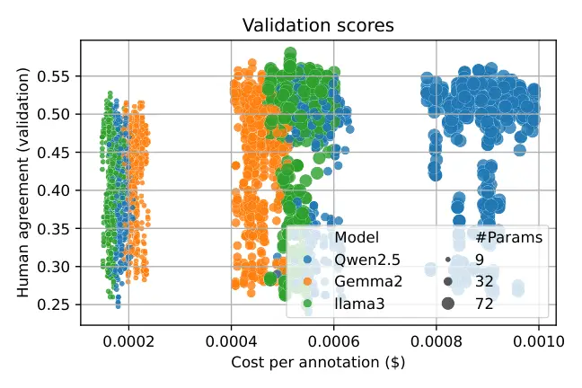
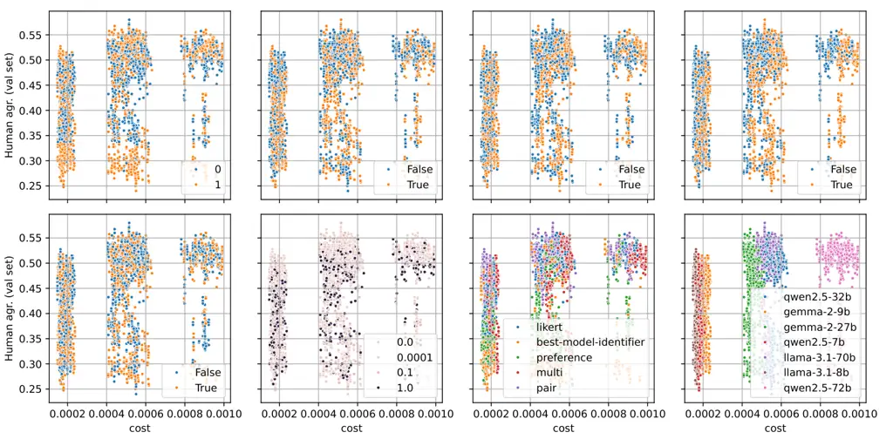

# Tuning LLM Judge Design Decisions for 1/1000 of the Cost

David Salinas Affiliation: University of Freiburg Affiliation: ELLIS
Institute Tübingen Correspondence to: <david.salinas.pro@gmail.com>   
Omar Swelam Affiliation: University of Freiburg    Frank Hutter
Affiliation: University of Freiburg Affiliation: ELLIS Institute
Tübingen

###### Abstract

Evaluating Large Language Models (LLMs) often requires costly human
annotations. To address this, LLM-based judges have been proposed, which
compare the outputs of two LLMs enabling the ranking of models without
human intervention. While several approaches have been proposed, many
confounding factors are present between different papers. For instance
the model, the prompt and other hyperparameters are typically changed at
the same time making apple-to-apple comparisons challenging. In this
paper, we propose to systematically analyze and tune the hyperparameters
of LLM judges. To alleviate the high cost of evaluating a judge, we
propose to leverage multi-objective multi-fidelity which allows to find
judges that trade accuracy for cost and also significantly reduce the
cost of the search. Our method identifies judges that not only
outperform existing benchmarks in accuracy and cost-efficiency but also
utilize open-weight models, ensuring greater accessibility and
reproducibility. The code to reproduce our experiments is available at
this repository
[https://github.com/geoalgo/judgetuning](https://github.com/geoalgo/judgetuning).

###### Keywords: 

Machine Learning, ICML

## 1 Introduction

Instruction tuned models are difficult to evaluate as they provide
free-form text given arbitrary instructions that may include
summarization (Zhang et al., 2024), code writing (Ni et al., 2023) or
translation (Elshin et al., 2024). While humans can annotate the quality
of the outputs of an LLM given instructions, this quickly becomes
expensive and also delays the evaluation and development of
instruction-tuned models (Li et al., 2023).

As an alternative, LLM judges have been proposed to provide an
indicative ranking for instruction-tuned models (Li et al., 2023), but
also to select instruction-tuning recipes (Grattafiori et al., 2024;
Lambert et al., 2024). While they can reduce cost significantly compared
to human evals, LLM judges have limitations as they may rely on
superficial style aspects, such as the length of a response (Dubois
et al., 2024) or the order of their input (Zheng et al., 2023).

While some of these issues can be easily fixed, several aspects limit
the improvement of LLM judges. The first is that evaluating a LLM judge
configuration is expensive. For instance, evaluating one model in
Alpaca-Eval (Li et al., 2023) costs $`\sim`$24\$ (Ni et al., 2024), and
evaluating a _judge_ multiplies this by the large number of model
evaluations it has to do in order to compute the correlation with human
ratings. Given this, many confounding factors are typically present
between different judges approaches. For instance, between Alpaca-Eval
(Li et al., 2023) and Arena-Hard (Li et al., 2024), the judge model, the
prompt, the score-type and the set of instructions were changed. This
makes it hard to learn which contributions are important.

In this work, we propose to analyze and tune systematically the
hyperparameters of an LLM judge, including the LLM model used, the
prompt, the inference parameters (such as the temperature) as well as
the parsing mechanism used to extract the judge preference. We first
analyze the impact of scaling the LLM judge model or the number of
instructions on the judge performance. This highlights that scaling is
insufficient to reach good performance and also helps us to identify a
cheaper way to evaluate judges than evaluating Spearman correlation with
Chatbot Arena with a grid of model annotations. We then show how to
systematically tune the hyperparameters of a judge using a
multi-objective (to account for accuracy and cost) and multi-fidelity
approach which saves tuning cost by stopping early poor configurations.
Finally, we show that the configurations found outperform previous
state-of-the-art judges on a range of real-world test datasets.

Our key contributions are the following:

- •
  We study scaling laws of judges showing how much model size and number
  of instructions alone impact key metrics used to evaluate judges
- •
  We propose a way to tune judges hyperparameters at reasonable tuning
  cost
- •
  We show the approach is able to identify configurations that
  outperform previous approaches while relying solely on open-weight
  models
- •
  We analyze which prompt strategy and hyperparameters work best for
  judges highlighting important patterns that may be used by the
  community to build better judges

## 2 Related work

#### LLM judges.

LLM as a judge has been emerging as a way to alleviate large human
annotation costs that are required to evaluate instruction-tuned models.
For instance, Llama3 used an earlier version of itself as a reject
sampler to select best completions (Grattafiori et al., 2024) or more
recently (Lambert et al., 2024) used an LLM judge to annotate preference
data to perform instruction tuning. LLM judges have also been used for
leaderboards such as Alpaca-Eval (Li et al., 2023) or Arena-Hard (Li
et al., 2024) which offer cheaper alternatives than human-annotated
leaderboards such as ChatBot Arena (Chiang et al., 2024).

#### Zero-shot and fine-tuned judges.

Two main approaches have been proposed for LLM judges. The first one,
referred to as zero-shot judges, prompts a LLM to rate a pair of model
completions (Li et al., 2023; Li et al., 2024) or a single completion
possibly against a baseline (Zheng et al., 2023). The second one
fine-tunes an existing model on a set of human-annotated preferences
(Zhu et al., 2023; Wang et al., 2024). In contrast with the first
approach, it requires fine-tuning a model which may occur at an extra
cost, along with lower robustness under distribution shift (Huang
et al., 2024).

#### Zero-shot judges.

Many strategies for zero-shot judges have been proposed. Li et al.
(2024) proposed to ask the judge to answer the instruction to perform
some form of Chain of Thought (Wei et al., 2022). To avoid the order of
outputs to matter in pairwise comparison, previous work proposed to
randomize or average the two possible positions (Dubois et al., 2024; Li
et al., 2024). To parse the model output, Li et al. (2023) asks the
judge a letter to denote the best model, Li et al. (2024) uses instead a
Likert scale (such as A\>\>B, A\>B, A=B to indicate respectively when
model A is much better, better or comparable wrt B), and another
alternative (Cui et al., 2024; Lambert et al., 2024) outputs a score for
various criteria such as instruction-following, honesty, or helpfulness.
The underlying LLM models often vary between papers, along with multiple
other dimensions, making it difficult to determine which strategies
inherently perform better.

#### Judge limitations.

In parallel with their adoption, several limitations of LLM judges have
been highlighted. Among them is their dependence on superficial
stylistic aspects of an answer, for instance, favoring longer answers
(Dubois et al., 2024), the first answer when using judges that make
pairwise comparison (Li et al., 2024), or their own outputs (Panickssery
et al., 2024).

While some of those issues have been fixed by averaging the order of the
answers (Li et al., 2024) or using a causal model to isolate the length
effect from the judge preference (Dubois et al., 2024), the challenge of
favoring its own answer is more problematic. Such biases pose some
challenge in aligning with human evaluations which requires more
intricate design for the scoring methods (Liu et al., 2024). Indeed,
many previous works used judges from close models such as GPT-4 which
may bias the leaderboard or render evaluations infeasible if the model
becomes unavailable or its cost increases.

#### Prompt optimization.

LLM judges tend to be very reliant on the design on optimization of the
prompts used. Such strong sensitivity makes the prompt design an
important aspect addressed in previous works. Zhou et al. (Zhou et al., 2024) introduce a prompt optimization framework for addressing such
sensitivity even for semantically equivalent instructions. Other works
(Shi et al., 2024) have explored the importance of prompt optimization
at a constrained budget which is essential for scaling. Another
important factor is how prompt tuning, together with fine-tuning, can
lead to boosted performance (Soylu et al., 2024).

#### Judge tuning.

To the best of our knowledge, hyperparameter tuning for LLM judges has
not been comprehensively explored in a way that accounts for the various
factors contributing to a high-performing judge. One reason is the
associated compute cost with naive approaches. For instance, Alpaca-Eval
and Arena-Hard evaluate each judge configuration across a grid of models
and instructions, leading to substantial expenses when comparing
multiple judges¹¹ 1 We estimate that our approach costs approximately
2K\$ to search through 4,480 judge configurations and that evaluating
the same number of judges using Alpaca-Eval or Arena-Hard methodology
would cost around 2M\$, see B.3 for details.. Cost is therefore a strong
limitation for the tuning of judges limiting the comparison and tuning
of judges to simple aspects such as the choice of the underlying LLM
model but excluding other key factors such as the prompt strategy, the
output format or the temperature.

In this work, we propose a method to search for optimal judge
configurations, including the best prompt parameterization. While prompt
tuning approaches such as (Fernando et al., 2023) are related, they do
not specifically address tuning judges. A key distinction is that we
focus not only on optimizing prompts but also on other judge
hyperparameters, such as model selection and temperature. Similarly,
Doddapaneni et al. (2024) analyzed the effectiveness of five different
prompt strategies for LLM judges. However, their work primarily
introduces a benchmark, whereas our approach is centered on
systematically tuning and analyzing judges within a search space that
includes 80 prompting strategies and a total of 4,480 judge
configurations.

We begin by providing background on LLM judges and examining the extent
to which improvements can be achieved through scaling alone. This
analysis underscores the importance of human agreement as a more
efficient metric for differentiating between judges. We then demonstrate
how judges can be effectively tuned by optimizing their prompts and
other hyperparameters, such as model selection and temperature.

## 3 Background

### 3.1 Judge

We denote a LLM model as a function $`\pi:p\to o`$ that produces an
output string $`o`$ given a prompt $`p`$. A judge compares two models
$`\pi_{0}`$ and $`\pi_{1}`$ and outputs a score
$`\Phi(p,\pi_{0}(p),\pi_{1}(p))\in[0,1]`$ which is close to zero if
$`\pi_{0}(p)`$ is better than $`\pi_{1}(p)`$ or close to one otherwise.

A common choice is to use a fixed baseline $`\pi^{*}`$ for one of the
models, typically a frontier model which allows to obtain a score for a
model to be evaluated: $`\Phi(p,\pi(p))=\Phi(p,\pi^{*}(p),\pi(p))`$.
Given that the order can sometimes influence the judge decision (Li
et al., 2023), previous works have proposed to either randomize the
baseline position (Li et al., 2023) or compute the judgement given both
orders and average out the result (Li et al., 2024).

### 3.2 Judge metrics.

#### Spearman correlation.

One approach to see how well a judge performs is to check how close are
its rankings on a grid of models and instructions compared to rankings
obtained through human annotations.

Assume we are considering a finite set of models $`\mathcal{M}`$ and
instructions $`\mathcal{P}`$ and that we are given a list of golden
scores for the models denoted $`s^{h}\in\mathbb{R}^{\mathcal{M}}`$, for
instance, the elo-ratings from the Chatbot Arena obtained from human
ratings.

To obtain scores from the judge, we average for each model the
preference against a baseline $`\pi^{*}(p)`$, e.g.

```math
s^{\Phi}_{i}=\mathbb{E}_{p\sim\mathcal{P}}\left[\Phi(p,\pi^{*}(p),\pi_{i}(p))\right].
```

One can then use the Spearman correlation between the scores estimated
with the judge and the golden score, e.g.
$`\rho(s^{h},s^{\Phi})=\frac{\text{cov}\left[\text{R}(s^{h}),\text{R}(s^{\Phi})\right]}{\sigma(\text{R}(s^{h}))\sigma(\text{R}(s^{\Phi}))}\in[-1,1]`$
where $`\text{R}(x)`$ and $`\sigma(x)`$ denotes respectively the rank
operator and the standard deviation. Using Spearman correlation is
beneficial because it accounts for differences in scale between the
golden scores and the judge annotations, focusing on the ranking
consistency rather than absolute values. Other metrics which can be used
to compare the order of models include Brier score and calibration
described (Li et al., 2024).

#### Human agreement.

Another approach to evaluating judges is to measure their agreement with
human-annotated preferences in a list of pairwise model battles. Each
battle consists of a prompt, a pair of model outputs, and a binary label
indicating which output the human annotator preferred.

Let us denote a set of annotated battles:

```math
(p_{i},o_{i},o^{\prime}_{i},\Phi^{\text{h}}(p_{i},o_{i},o^{\prime}_{i}))_{i=1}^{N} \tag{1}
```

where $`o_{i},o^{\prime}_{i}`$ denotes the output of two models from
prompt $`p_{i}`$ and
$`\Phi^{\text{h}}(p_{i},o_{i},o^{\prime}_{i})\in\{0,0.5,1\}`$ denotes a
human choice for respectively $`o_{i}`$, a tie or $`o^{\prime}_{i}`$.

To evaluate the judge quality, one can measure the human agreement which
is the percentage of times where the human and judge agrees, e.g.

```math
\mathbb{E}_{i\sim N}[\Phi(p_{i},o_{i},o^{\prime}_{i})=\Phi^{\text{h}}(p_{i},o_{i},o^{\prime}_{i}))] \tag{2}
```

Having defined two metrics to evaluate judges, we next evaluate how
those are impacted by scaling the base models or number of instructions.

## 4 Scaling judges

Figure 1: Effect of scaling the LLM judge and increasing the number of
instructions on Spearman correlation. In contrast to human agreement,
neither Alpaca-Eval, Arena-Hard, nor their union distinguishes the
quality difference between 32B and 72B models.

Rather than tuning judges a natural question is: can we just scale them
up? LLM judges can be scaled in multiple ways: by increasing the number
of parameters of the LLM judge or by using more instructions. Here we
investigate how well the Spearman correlation and human agreement
metrics scale with both dimensions.

#### Spearman correlation.

In Figure 1, we show the scaling behavior when increasing the LLM judge
size and the number of instructions. We use Qwen2.5 with a default
prompt and compute Spearman correlation on a common set of 26 models
available on both Alpaca-Eval and Arena-Hard.

As expected, the judge performance improves when scaling the LLM model
and when using more instructions as it allows to cover more areas of the
models to evaluate. Alpaca-Eval contains easier prompts and therefore
gives better performance to smaller judges compared to Arena-Hard. In
contrast, Arena-Hard contains harder and technical questions. This
allows to achieve better Spearman correlation as the instructions allow
better separability among advanced models, provided that the judge base
model is strong enough to measure the performance on this more complex
set of instructions.

#### Human agreement.

In Figure 2, we study the effect of scaling the LLM judge and the number
of battles this time on human agreement. Here, we use the same prompt
and base LLM models as in the previous paragraph but compute human
agreement on the LMSys dataset (lin Chiang et al., 2024).

We also observe that scaling the LLM judge base model improves
performance. However, compared to the previous case, the performance is
stationary which is expected since human-agreement is the average of an
instruction based property. In contrast, Spearman correlation gets
better with more instructions as shown in Figure 1 as the judge gets a
better sense of a model performance (more scenarios are seen and with
larger frequency).

Figure 2: Effect on scaling the LLM judge and the number of instructions
on human-agreement.

#### Which metric to optimize.

We have two metrics to evaluate the judge quality: the Spearman
correlation and the human agreement. As discussed in the previous
paragraph, they behave differently as human agreement is an average of
an atomic property (does the judge and human agrees on instruction on
average) whereas Spearman correlation is a global metric requiring
evaluating many models to compare rankings. Both metrics are correlated,
we can see for instance that the ranking w.r.t. the base model size used
for the judge is mostly consistent across both Spearman correlation and
human agreement in Figures 1 and 2. For both metrics, we observe that,
for this prompt and model family, LLM judges bellow 7B are not able to
outperform a simple length baseline which favors the output with the
longest answer.

| $`\#_{\text{params}}`$ | Sp. corr. ($`\uparrow`$) | CV($`\downarrow`$) | Hum. agr. ($`\uparrow`$) | CV($`\downarrow`$) |
| ---------------------- | ------------------------ | ------------------ | ------------------------ | ------------------ |
| 0.5B                   | 0.09 $`\pm`$ 0.189       | 207.60             | 0.36 $`\pm`$ 0.006       | 1.70               |
| 1.5B                   | 0.33 $`\pm`$ 0.137       | 41.26              | 0.37 $`\pm`$ 0.006       | 1.61               |
| 3B                     | 0.82 $`\pm`$ 0.066       | 8.11               | 0.42 $`\pm`$ 0.006       | 1.45               |
| 7B                     | 0.83 $`\pm`$ 0.082       | 9.84               | 0.45 $`\pm`$ 0.006       | 1.33               |
| 32B                    | 0.90 $`\pm`$ 0.052       | 5.75               | 0.48 $`\pm`$ 0.006       | 1.29               |
| 72B                    | 0.88 $`\pm`$ 0.074       | 8.43               | 0.50 $`\pm`$ 0.006       | 1.27               |

Table 1: Comparison of the variability of Spearman-correlation and
Human-agreement metrics when using 6500 random annotations and the same
default prompt for all model sizes.

In Table 1, we compare the variability of both metrics when using a
random set of 6500 instructions²² 2 In the case of Spearman correlation,
we sample 250 instructions from both Alpaca-Eval and Arena-Hard datasets
(which yields to 6500 annotations given that we have 26 models). For
LMSys, we just sample 6500 random instructions.. We report the standard
deviation and Coefficient of Variation (CV) which is computed as
$`\sigma/\mu*100`$ and indicates the percentage of variation of a
metric. It can be seen that while both metrics are correlated,
human-agreement allows to differentiate larger models much more easily
as the signal to noise ratio of the metric is better. In particular, it
allows to statistically distinguish 32B and 72B models whereas those
models are tied for Spearman correlation given the number of
instructions considered.

In what follows, we therefore use human agreement as the metric to
optimize as it allows to rank judge configurations much more cheaply
than Spearman correlation and allows to separate judge configurations
with much fewer instructions.

## 5 Tuning judges

We first describe the search space used - also summarized in Table 5 -
which includes searching for the inference and prompt hyperparameters.

### 5.1 Inference hyperparameters

For the LLM model, we search among 7 open-weights options: Llama3.1 (8B
and 70B), Qwen2.5 (7B, 27B and 70B) and Gemma2 (9B, 27B). All models
with more than 9B parameters are quantized with half-precision. We also
search for the LLM temperature in \[0.0, 0.01, 0.1, 1.0\] and whether to
average predictions when considering two possible orders or using just a
single order.

### 5.2 Prompt hyperparameters

We now describe how we parametrize different prompt options and we
illustrate one such option in Figure 3.

#### Output format.

When prompting a LLM judge, we must be able to parse its output into a
preference. We consider the following options where the judge outputs:

- •
  _best-model-identifier_: a letter corresponding to the best assistant
  as in Li et al. (2023)
- •
  _likert_: a likert scale (such as A\>\>B, A\>B, A=B to indicate
  respectively when model A is much better, better or comparable wrt B)
  as proposed in Li et al. (2024)
- •
  _pair_: a score for both assistants in \[0-10\] similar to (Zhu
  et al., 2023)
- •
  _preference_: a score in $`[0,1]`$ where $`0`$ (resp. $`1`$) indicates
  a preference for model A (resp. B)
- •
  _multi_: the average score for 5 criteria - conciseness, clarity,
  adherence, comprehensiveness and style similar to Cui et al. (2024);
  Lambert et al. (2024).

#### Provide answer or other information.

Asking a LLM to reflect before providing its answer is known to be
beneficial in cases requiring reasoning (Wei et al., 2022). In addition,
providing example (few-shot learning) can also be beneficial as shown in
(Zheng et al., 2023). We therefore search for the following options and
ask the judge to provide before its preference:

- •
  _confidence_: its confidence on its preference
- •
  _answer_: its own answer to the instruction as proposed in (Li et al., 2024)
- •
  _explanation_: its explanation on the given preference

Providing its confidence is meant to help the judge to provide more
calibrated preference scores (e.g. to not give a strong score for one
option when it is uncertain) while the latter two are meant to elicit
chain of thought reasoning.

To use one of the three options, we add in the prompt a description of
the option and asks the LLM to generate it, see Figure 3 for an
illustration where the prompt asks the judge to provide its answer and
an explanation on its judgement.

#### JSON formating.

Formats used to query the output of an LLM have different trade-offs (He
et al., 2024). Some are more controllable such as JSON but may loose
performance against simpler format (such as raw text) in particular
given less capable models.

We search for two formats, using either JSON or raw text. When using
JSON, we generate the prompt so that the template asks the LLM to
provide a JSON with all the fields needed (the preference in the right
format, how to provide its explanation/answer/confidence when needed).
In addition, we enforce the LLM to provide a valid JSON by only
selecting completions that follow the expected JSON schema. In the case
of raw text, we ask the model to provide its output of each field by
writing the field first, then its value.

#### Prompt further details.

In total, we get $`5\times 2^{4}=80`$ different prompts. We test each of
them by making sure that a judge based on this prompt and using
llama3.1-8B is able to recognize the correct output between an obviously
bad and good completion when judging the pair with both orders.

Overall, our search space contains 4480 possible judge configurations,
which corresponds to $`80`$ different prompts and $`56`$ choices for the
7 LLM models, 4 temperatures and the choice whether to average or not
output permutations. We give more details in the appendix on the
different prompting mechanisms as well as output preference formats.


Figure 3: Illustration of the prompt templating approach. We parametrize
the prompt with the following hyperparameters: Provide answer, Provide
explanation, Provide example, use JSON, output preference format. Given
each of the $`2^{4}\times 5=80`$ prompt hyperparameter, we generate a
prompt like this one.

Figure 4: Illustration of the selection process. All 4480 configurations
are first evaluated on 400 instructions (left), the top 1200
configurations are then evaluated on 1200 instructions (center) and
finally the top 400 configurations are evaluated on 3548 instructions
(right). The color denotes the ranking assigned by the non-dominated
sort procedure.

### 5.3 Multi-fidelity and multi-objective optimization

#### Multi-fidelity optimization.

Next, we perform multi-fidelity multi-objective optimization in order to
find judge configurations that are good for both accuracy and cost while
keeping the cost of the search feasible with multi-fidelity.

Evaluating all judges on all battles is expensive and would cost
$`\mathcal{N}\times\mathcal{P}`$ annotations if we have $`\mathcal{N}`$
judges and $`\mathcal{P}`$ battles. One way to reduce the cost of the
search is to apply a multifidelity approach such as sucessful-halving
(Karnin et al., 2013).

We perform the tuning by running configurations in three steps. In the
first step, we run all $`\mathcal{N}`$ configurations with only
$`\mathcal{P}/9`$ battles. We then run the top $`\mathcal{N}/3`$ judges
on $`\mathcal{P}/3`$ battles in a second step and finally run
$`\mathcal{N}/9`$ on the full $`\mathcal{P}`$ battles.

This reduces the cost of the full search from
$`\mathcal{N}\times\mathcal{P}`$ to $`\mathcal{N}\times\mathcal{P}/3`$.
One could also use a more aggressive cutoff and save further in the
computation but this would naturally increase the risk of missing good
configurations.

#### Multi-objective optimization.



Figure 5: We plot the cost per annotation and human agreement of all
4480 judges when using 400 instructions. The model family and the number
of parameters are represented with color and size respectively.

Figure 6: Fraction of time each hyperparameter appears in the top 100
configurations for small (\<10B) and large models (\>10B).

When sorting the top judge configurations, we have two objectives to
take into account since we would like to find judges that both accurate
and cheap. For instance, prompting a judge to perform chain-of-thought
of to provide its answer may improve performance, but the extra-cost may
be better spent on a better and more expensive base model.

To sort configurations while accounting for the two objectives, we use
non-dominated sort (Emmerich & Deutz, 2018) as it was shown efficient in
multi-fidelity settings (Salinas et al., 2021; Schmucker et al., 2021;
Izquierdo et al., 2021). We illustrate the priority given to the judge
configurations in Figure 4 in the first and second selection step where
one can see that the priority model the geometry of the Pareto front
well.

### 5.4 Hyperparameter analysis

On Figure 5, we show the validation performance of all judge
configurations at the lowest fidelity. We see that while the number of
parameters influence the performance, the prompt and other judge
hyperparameters have a significant importance given the wide variation
of performance obtained for a fixed model.

Figure 7: Prompt performance stability across different models. We show
the correlation matrix between models when looking at their performance
on all the 80 different prompts.

Next, we examine which hyperparameters and prompt characteristics
contribute to the best judge performance. In Figure 6, we analyze all
4480 judge configurations at the lowest fidelity (i.e., evaluated on 400
instructions) where we conduct a survival analysis, measuring how often
each hyperparameter appears in the top 100 configurations with the
highest human agreement. We perform this analysis separately for large
models (blue bars) and smaller models (orange bars) to identify which
hyperparameters are most effective in each case.

Without surprise, the model used for the LLM judge is the most impacting
hyperparameters and larger is generally better. Llama3 performs better
than Qwen2.5 and Gemma when used as a judge.

This analysis also reveals less obvious hindsights:

- •
  The output format used to obtain judge preferences plays a big role,
  almost as important as the choice of the model used for the judge.
  Small models are more sensitive which is expected as they struggle
  more with more complex output mechanism. For both small and large
  models, the pair format performs better.
- •
  Increasing temperature negatively impacts performance
- •
  Averaging the judgement after evaluating a pair of outputs in both
  orders gives a performance boost
- •
  Providing an example helps the judge provided that a large model is
  used as smaller models gets confused by this extra information
- •
  Asking the judge to provide an explanation, or its answer hurts
  performance
- •
  Using JSON does not impact much the performance

### 5.5 Prompt stability

Next, we investigate how much the performance of a prompt varies between
different model judges in Figure 7, where we show the correlation
between different judge models on how well they perform under different
prompts. For each of the $`m=7`$ models, we measure the average human
agreement for all the different $`n=2^{4}\times 5=80`$ prompts and
compute the covariance matrix $`XX^{T}`$ where
$`X\in\mathbb{R}^{m\times n}`$ is the matrix of scores for all models
and prompts. Interestingly, smaller models and larger models are highly
correlated which shows that two group of prompts works well for large
and small models. This is expected as lower capacity models may struggle
to obey more complex instructions (e.g. rate models for style and
accuracy using JSON) that are beneficial to evaluate better models.

|             |                           |                                   |
| ----------- | ------------------------- | --------------------------------- |
| Judge       | Human agr. ($`\uparrow`$) | Cost per 1K ann. ($`\downarrow`$) |
| Random      | 0.33 +/- 0.01             | -                                 |
| Length      | 0.42 +/- 0.01             | -                                 |
| PandaLM-7B  | 0.38 +/- 0.01             | 6.0                               |
| JudgeLM-7B  | 0.42 +/- 0.01             | 8.6                               |
| Arena-Hard  | 0.50 +/- 0.01             | 1.2                               |
| Ours-small  | 0.45 +/- 0.01             | 0.21                              |
| Ours-medium | 0.47 +/- 0.01             | 0.48                              |
| Ours-large  | 0.49 +/- 0.01             | 0.48                              |

Table 2: Comparison of judges on LMSys test instructions. For each
judge, we report the bootstrap mean and std for human-agreement on 3K
test instructions with 100 seeds.

| Judge       | Human agr. ($`\uparrow`$) |
| ----------- | ------------------------- |
| Random      | 0.33                      |
| Length      | 0.60                      |
| GPT-3.5     | 0.63                      |
| GPT-4       | 0.67                      |
| PandaLM-7B  | 0.62                      |
| PandaLM-70B | 0.67                      |
| Ours-small  | 0.67                      |
| Ours-medium | 0.78                      |
| Ours-large  | 0.76                      |

Table 3: Comparison with PandaLM on PandaLM test set. Note that our
method is not fine-tuned as opposed to PandaLM.

### 5.6 Results on test datasets

In this section, we report the performance of three judges found by our
search on several test sets. While the multi-objective search returns a
list of judges with continuous cost tradeoffs as seen in Figure 4, we
report results for only 3 judges: small, medium and large with numbers
of parameters respectively lower than 10B, lower than 32B and lower than
72B. We do this as it may offer an easier choice for a practitioner when
picking a judge, for instance accounting for the memory constraint of a
given GPU. For each category, we select the judge with the best
validation score on the 3548 instructions of the validation set of
LMSys.

#### LMSys.

In Table 2, we compare tuned judges with a simple baseline that picks
the longest answer, PandaLM (Wang et al., 2024), JudgeLM (Zhu et al., 2023) and Arena-Hard (Li et al., 2024). For the latter, we use GPT-4o
mini to obtain a similar cost per annotation than other methods. We
compute scores by measuring human-agreement on 3 000 test instructions
that are not used for the model selection and report mean and standard
errors over 100 bootstraps.

While all methods outperform a random baseline, Panda-LM-7B
underperforms and JudgeLM-7B only matches a simple baseline _Length_
that picks the longest answer. This is because the instructions on LMSys
are more complex and significantly longer from the distribution used for
fine-tuning and confirms previous findings that fine-tuned judges
performance can be affected by change of distributions (Huang et al.,
2024).

The judges we found outperforms all baselines and slightly underperforms
or matches Arena-Hard for human-agreement but strongly outperforms it in
term of cost.

#### PandaLM.

In Table 3, we show the performance on PandaLM test set (Wang et al.,
2024). The judges that we found all outperforms strongly PandaLM, even
our small judge with less than 10B parameters outperforms its PandaLM
counter with 70B parameters. Importantly, we recall that our approach
only consider zeroshot judges, e.g. it does not fine on the training
dataset which would improve further the performance on this dataset
although it may also hurt generalization as seen for the LMSys dataset.
We see that the 70B model underperforms slighly the 32B model however,
both scores are high and close to inter-agreement rates seen in
real-world data.

#### Arena-Hard.

| Judge               | Sp. corr. ($`\uparrow`$) | Cost per 1K ann. ($`\downarrow`$) |
| ------------------- | ------------------------ | --------------------------------- |
| Length              | 0.50 +/- 0.21            | -                                 |
| Arena-hard + Claude | 0.82 +/- 0.12            | 75.0                              |
| Arena-hard + GPT4   | 0.90 +/- 0.06            | 50.0                              |
| Ours-small          | 0.81 +/- 0.10            | 0.21                              |
| Ours-medium         | 0.93 +/- 0.05            | 0.48                              |
| Ours-large          | 0.86 +/- 0.09            | 0.48                              |

Table 4: For each judge, we compute the Spearman correlation between
win-rates using the protocol of Arena-Hard and ELO-ratings computed from
human annotations from Chatbot Arena. We report mean and std over 100
boostraps of the set of models.

In Table 4, we report the Spearman correlation of the judges found by
our method, compared to the judge proposed in Arena-Hard using the 20
models available for both Claude-Opus and Gpt-4-1106-preview judges in
the authors repository (Li et al., 2024). For each judge, we annotate
all the 20 models on the 500 instructions of Arena-Hard against a
baseline and compute winrates against this baseline. We then compute the
Spearman correlation between the winrates and ELO-ratings from Chatbot
Arena. We estimate the cost ofArena-Hard judges using the cost estimate
from Ni et al. (2024) of 25\$ to annotate one model on all 500
instructions and multiply this estimation by 50% for Claude Opus given
the difference as it corresponds roughly to the additional token cost
compared to GPT-4-1106-preview.

The judge we found match or outperforms the judge considered at much
lower cost. Importantly, the judge configurations are open-weight models
which provide additional benefits, in particular for applications such
as building a community leaderboard or building an open model.

## 6 Limitations

We currently select judges solely based on accuracy and cost, not on
potential biases such as position (where LLMs favor responses based on
order (Li et al., 2024)). To investigate whether our selection criteria
worsen this bias, we measured the flip rate, how often a judge changes
its decision when the response order is swapped, and found a strong
negative correlation with the human agreement scores ($`r=-0.789`$) of
the judge configurations of the top rung. While the position bias is not
worsen, other biases, such as stylistic preferences or verbosity, may be
worsen by our method. Future work could consider those biases by
including them as additional objectives.

## 7 Conclusion

In this paper, we examined how judge performance is influenced by
scaling and hyperparameter choices. We introduced a multi-fidelity,
multi-objective approach to tune judge hyperparameters — including
prompt design and base models — at a feasible cost. Our results
demonstrate that this method can produce judges that outperform previous
approaches across different budget constraints.

While some limitations of LLM judges persist, we hope that enabling
cost-effective tuning will help the community refine their use and
address remaining deficiencies. For example, our multi-objective
procedure could be extended to optimize for additional criteria such as
stability or explainability.

We release the code to reproduce our results, along with a dataset
containing all annotations at
[https://github.com/geoalgo/judgetuning](https://github.com/geoalgo/judgetuning).
We hope this resource will support further analysis and improvement of
LLM judges.

## Impact Statement

This paper demonstrated how to tune judge hyperparameters while
balancing cost considerations and ensuring that the search remains
feasible. Our approach optimizes judge hyperparameters to maximize human
agreement while also considering open-weight alternatives.

The benefits of this approach include enabling fairer and more
cost-effective leaderboards and helping the community adopt judges that
do not rely on closed systems. However, LLM judges may also reinforce
undesirable superficial biases, such as favoring stylistic elements over
substantive quality or perpetuating human biases present in the training
data, including biases against certain groups. We conducted a
preliminary review of the selected LMSys data and did not observe
obvious issues, though our analysis was limited to a small sample. As a
result, such systems should not be deployed without safeguards and
additional bias evaluations.

Our approach analysed the prompting strategy and hyperparameters of the
current generation of LLMs while we expect our conclusion to hold given
the relative stability of prompt strategy across this family (see
Figure 7), the conclusion could change over time with the introduction
of distinctive new capabilities such as reasoning.

## Acknowledgments

This research was partially supported by the following sources: TAILOR,
a project funded by EU Horizon 2020 research and innovation programme
under GA No 952215; the Deutsche Forschungsgemeinschaft (DFG, German
Research Foundation) under grant number 417962828 and 539134284, through
EFRE (FEIH_2698644) and the state of Baden-Württemberg; the European
Research Council (ERC) Consolidator Grant “Deep Learning 2.0” (grant no.
101045765); EC under the grant No. 101195233 (OpenEuroLLM). Frank Hutter
acknowledges financial support by the Hector Foundation. The authors
acknowledge support from ELLIS and ELIZA. Views and opinions expressed
are however those of the author(s) only and do not necessarily reflect
those of the European Union or the ERC. Neither the European Union nor
the ERC can be held responsible for them. The authors gratefully
acknowledge the computing time made available to them on the
high-performance computer NHR@KIT Compute Cluster at the NHR Center
NHR@KIT. These Centers are jointly supported by the Federal Ministry of
Education and Research and the state governments participating in the
NHR (www.nhr-verein.de/unsere-partner).

![[Uncaptioned
image]](arxiv-2501-17178v4--c5382e7df629.figures/figure-2.webp)![[Uncaptioned
image]](arxiv-2501-17178v4--c5382e7df629.figures/figure-3.webp)![[Uncaptioned
image]](arxiv-2501-17178v4--c5382e7df629.figures/figure-4.webp)

## References

- Chiang et al. (2024) Chiang, W.-L., Zheng, L., Sheng, Y.,
  Angelopoulos, A. N., Li, T., Li, D., Zhang, H., Zhu, B., Jordan, M.,
  Gonzalez, J. E., and Stoica, I. Chatbot arena: An open platform for
  evaluating llms by human preference, 2024. URL
  [https://arxiv.org/abs/2403.04132](https://arxiv.org/abs/2403.04132).
- Cui et al. (2024) Cui, G., Yuan, L., Ding, N., Yao, G., He, B., Zhu,
  W., Ni, Y., Xie, G., Xie, R., Lin, Y., Liu, Z., and Sun, M.
  Ultrafeedback: Boosting language models with scaled ai feedback, 2024.
  URL
  [https://arxiv.org/abs/2310.01377](https://arxiv.org/abs/2310.01377).
- Doddapaneni et al. (2024) Doddapaneni, S., Khan, M. S. U. R., Verma,
  S., and Khapra, M. M. Finding blind spots in evaluator llms with
  interpretable checklists. _arXiv preprint arXiv:2406.13439_, 2024.
- Dubois et al. (2024) Dubois, Y., Galambosi, B., Liang, P., and
  Hashimoto, T. B. Length-controlled alpacaeval: A simple way to debias
  automatic evaluators. _arXiv preprint arXiv:2404.04475_, 2024.
- Elshin et al. (2024) Elshin, D., Karpachev, N., Gruzdev, B.,
  Golovanov, I., Ivanov, G., Antonov, A., Skachkov, N., Latypova, E.,
  Layner, V., Enikeeva, E., Popov, D., Chekashev, A., Negodin, V.,
  Frantsuzova, V., Chernyshev, A., and Denisov, K. From general LLM to
  translation: How we dramatically improve translation quality using
  human evaluation data for LLM finetuning. In Haddow, B., Kocmi, T.,
  Koehn, P., and Monz, C. (eds.), _Proceedings of the Ninth Conference
  on Machine Translation_, pp. 247–252, Miami, Florida, USA,
  November 2024. Association for Computational Linguistics. doi:
  10.18653/v1/2024.wmt-1.17. URL
  [https://aclanthology.org/2024.wmt-1.17/](https://aclanthology.org/2024.wmt-1.17/).
- Emmerich & Deutz (2018) Emmerich, M. T. and Deutz, A. H. A tutorial on
  multiobjective optimization: fundamentals and evolutionary methods.
  _Natural computing_, 17:585–609, 2018.
- Fernando et al. (2023) Fernando, C., Banarse, D., Michalewski, H.,
  Osindero, S., and Rocktäschel, T. Promptbreeder: Self-referential
  self-improvement via prompt evolution. _arXiv preprint
  arXiv:2309.16797_, 2023.
- Grattafiori et al. (2024) Grattafiori, A., Dubey, A., Jauhri, A., and
  Abhinav Pandey, e. a. The llama 3 herd of models, 2024. URL
  [https://arxiv.org/abs/2407.21783](https://arxiv.org/abs/2407.21783).
- He et al. (2024) He, J., Rungta, M., Koleczek, D., Sekhon, A., Wang,
  F. X., and Hasan, S. Does prompt formatting have any impact on llm
  performance?, 2024. URL
  [https://arxiv.org/abs/2411.10541](https://arxiv.org/abs/2411.10541).
- Huang et al. (2024) Huang, H., Qu, Y., Zhou, H., Liu, J., Yang, M.,
  Xu, B., and Zhao, T. On the limitations of fine-tuned judge models for
  llm evaluation, 2024. URL
  [https://arxiv.org/abs/2403.02839](https://arxiv.org/abs/2403.02839).
- Izquierdo et al. (2021) Izquierdo, S., Guerrero-Viu, J., Hauns, S.,
  Miotto, G., Schrodi, S., Biedenkapp, A., Elsken, T., Deng, D.,
  Lindauer, M., and Hutter, F. Bag of baselines for multi-objective
  joint neural architecture search and hyperparameter optimization. In
  _8th ICML Workshop on Automated Machine Learning (AutoML)_, 2021.
- Karnin et al. (2013) Karnin, Z., Koren, T., and Somekh, O. Almost
  optimal exploration in multi-armed bandits. In Dasgupta, S. and
  McAllester, D. (eds.), _Proceedings of the 30th International
  Conference on Machine Learning_, volume 28 of _Proceedings of Machine
  Learning Research_, pp. 1238–1246, Atlanta, Georgia, USA, 17–19
  Jun 2013. PMLR. URL
  [https://proceedings.mlr.press/v28/karnin13.html](https://proceedings.mlr.press/v28/karnin13.html).
- Lambert et al. (2024) Lambert, N., Morrison, J., Pyatkin, V., Huang,
  S., Ivison, H., Brahman, F., Miranda, L. J. V., Liu, A., Dziri, N.,
  Lyu, S., et al. T$`\backslash`$" ulu 3: Pushing frontiers in open
  language model post-training. _arXiv preprint arXiv:2411.15124_, 2024.
- Li et al. (2024) Li, T., Chiang, W.-L., Frick, E., Dunlap, L., Wu, T.,
  Zhu, B., Gonzalez, J. E., and Stoica, I. From crowdsourced data to
  high-quality benchmarks: Arena-hard and benchbuilder pipeline. _arXiv
  preprint arXiv:2406.11939_, 2024.
- Li et al. (2023) Li, X., Zhang, T., Dubois, Y., Taori, R., Gulrajani,
  I., Guestrin, C., Liang, P., and Hashimoto, T. B. Alpacaeval: An
  automatic evaluator of instruction-following models, 2023.
- lin Chiang et al. (2024) lin Chiang, W., Zheng, L., Dunlap, L.,
  Gonzalez, J. E., Stoica, I., Mooney, P., Dane, S., Howard, A., and
  Keating, N. Lmsys - chatbot arena human preference predictions.
  [https://kaggle.com/competitions/lmsys-chatbot-arena](https://kaggle.com/competitions/lmsys-chatbot-arena), 2024.
  Kaggle.
- Liu et al. (2024) Liu, Y., Zhou, H., Guo, Z., Shareghi, E., Vulić, I.,
  Korhonen, A., and Collier, N. Aligning with human judgement: The role
  of pairwise preference in large language model evaluators. In _First
  Conference on Language Modeling_, 2024. URL
  [https://openreview.net/forum?id=9gdZI7c6yr](https://openreview.net/forum?id=9gdZI7c6yr).
- Ni et al. (2023) Ni, A., Iyer, S., Radev, D., Stoyanov, V., Yih,
  W.-T., Wang, S., and Lin, X. V. LEVER: Learning to verify
  language-to-code generation with execution. In Krause, A., Brunskill,
  E., Cho, K., Engelhardt, B., Sabato, S., and Scarlett, J. (eds.),
  _Proceedings of the 40th International Conference on Machine
  Learning_, volume 202 of _Proceedings of Machine Learning Research_,
  pp. 26106–26128. PMLR, 23–29 Jul 2023. URL
  [https://proceedings.mlr.press/v202/ni23b.html](https://proceedings.mlr.press/v202/ni23b.html).
- Ni et al. (2024) Ni, J., Xue, F., Yue, X., Deng, Y., Shah, M., Jain,
  K., Neubig, G., and You, Y. Mixeval: Deriving wisdom of the crowd from
  llm benchmark mixtures, 2024. URL
  [https://arxiv.org/abs/2406.06565](https://arxiv.org/abs/2406.06565).
- Panickssery et al. (2024) Panickssery, A., Bowman, S. R., and Feng, S.
  Llm evaluators recognize and favor their own generations, 2024. URL
  [https://arxiv.org/abs/2404.13076](https://arxiv.org/abs/2404.13076).
- Salinas et al. (2021) Salinas, D., Perrone, V., Cruchant, O., and
  Archambeau, C. A multi-objective perspective on jointly tuning
  hardware and hyperparameters, 2021. URL
  [https://arxiv.org/abs/2106.05680](https://arxiv.org/abs/2106.05680).
- Schmucker et al. (2021) Schmucker, R., Donini, M., Zafar, M. B.,
  Salinas, D., and Archambeau, C. Multi-objective asynchronous
  successive halving, 2021. URL
  [https://arxiv.org/abs/2106.12639](https://arxiv.org/abs/2106.12639).
- Shi et al. (2024) Shi, C., Yang, K., Chen, Z., Li, J., Yang, J., and
  Shen, C. Efficient prompt optimization through the lens of best arm
  identification. In _The Thirty-eighth Annual Conference on Neural
  Information Processing Systems_, 2024.
- Soylu et al. (2024) Soylu, D., Potts, C., and Khattab, O. Fine-tuning
  and prompt optimization: Two great steps that work better together. In
  Al-Onaizan, Y., Bansal, M., and Chen, Y.-N. (eds.), _Proceedings of
  the 2024 Conference on Empirical Methods in Natural Language
  Processing_, Miami, Florida, USA, November 2024. Association for
  Computational Linguistics.
- Wang et al. (2024) Wang, Y., Yu, Z., Yao, W., Zeng, Z., Yang, L.,
  Wang, C., Chen, H., Jiang, C., Xie, R., Wang, J., Xie, X., Ye, W.,
  Zhang, S., and Zhang, Y. PandaLM: An automatic evaluation benchmark
  for LLM instruction tuning optimization. In _The Twelfth International
  Conference on Learning Representations_, 2024. URL
  [https://openreview.net/forum?id=5Nn2BLV7SB](https://openreview.net/forum?id=5Nn2BLV7SB).
- Wei et al. (2022) Wei, J., Wang, X., Schuurmans, D., Bosma, M., Chi,
  E. H., Le, Q., and Zhou, D. Chain of thought prompting elicits
  reasoning in large language models. _CoRR_, abs/2201.11903, 2022. URL
  [https://arxiv.org/abs/2201.11903](https://arxiv.org/abs/2201.11903).
- Zhang et al. (2024) Zhang, T., Ladhak, F., Durmus, E., Liang, P.,
  McKeown, K., and Hashimoto, T. B. Benchmarking large language models
  for news summarization. _Transactions of the Association for
  Computational Linguistics_, 12:39–57, 2024. doi: 10.1162/tacl_a_00632.
  URL
  [https://aclanthology.org/2024.tacl-1.3/](https://aclanthology.org/2024.tacl-1.3/).
- Zheng et al. (2023) Zheng, L., Chiang, W.-L., Sheng, Y., Zhuang, S.,
  Wu, Z., Zhuang, Y., Lin, Z., Li, Z., Li, D., Xing, E., et al. Judging
  llm-as-a-judge with mt-bench and chatbot arena. _Advances in Neural
  Information Processing Systems_, 36:46595–46623, 2023.
- Zhou et al. (2024) Zhou, H., Wan, X., Liu, Y., Collier, N., Vulic, I.,
  and Korhonen, A. Fairer preferences elicit improved human-aligned
  large language model judgments. _CoRR_, abs/2406.11370, 2024.
- Zhu et al. (2023) Zhu, L., Wang, X., and Wang, X. Judgelm: Fine-tuned
  large language models are scalable judges. _arXiv preprint
  arXiv:2310.17631_, 2023.

## Appendix A Datasets

### A.1 Alpaca-Eval and Arena-Hard datasets

We consider two datasets that contains prompts, model completions and
judge annotations for a grid of prompts and model pairs. The first one
is Alpaca-Eval which contains 47 models completions on 805 prompts (Li
et al., 2023). The second one is Arena-Hard which contains the
completions on 500 instructions for 57 models (Li et al., 2024). In both
cases, we select the 26 models that also appear in Chatbot Arena in
order to be able to compute how well judge configurations approximate
human judgement.

### A.2 LMSys

We use the LMSys dataset (lin Chiang et al., 2024) which contains 51734
battles and allows to measure the human-agreement of a given judge
configuration.

#### LMSys validation and test split.

When using LMSys, we rate instructions with the prompt from (Li et al., 2024) given in Figure 8 and we use Llama3-8B-instruct which assigns a
score to each instruction in \[0, 7\].

We select instructions which have a score greater than or equal to 5 and
also have the criterion _1. Specificity_ detected since it is important
to avoid large ambiguity prompt to evaluate judge (e.g. we want to
discard the instruction like "say hello" since they provide no value to
distinguish models).

This gives 6548 instruction which we split randomly into 3548 validation
instructions and 3000 test instructions. All model selection (e.g.
non-dominated sort) is done only using validation instructions and only
the best models on the validation set are evaluated on the test set.

Your task is to evaluate how well the following input prompts can assess
the capabilities of advanced AI assistants. For the input prompt, please
analyze it based on the following 7 criteria. For each criteria, make
sure to explain before determine whether the input satisfy it. 1.
Specificity: Does the prompt ask for a specific, well-defined output
without leaving any ambiguity? This allows the AI to demonstrate its
ability to follow instructions and generate a precise, targeted
response. 2. Domain Knowledge: Does the prompt test the AI’s knowledge
and understanding in a specific domain or set of domains? The prompt
must demand the AI to have a strong prior knowledge or mastery of
domainspecific concepts, theories, or principles. 3. Complexity: Does
the prompt have multiple components, variables, or levels of depth and
nuance? This assesses the AI’s capability to handle complex,
multi-faceted problems beyond simple queries. 4. Problem-Solving: Does
the prompt require active problem-solving: analyzing and clearly
defining the problem and systematically devising and implementing a
solution? Note active problem-solving is not simply reciting facts or
following a fixed set of instructions. 5. Creativity: Does the prompt
require a creative approach or solution? This tests the AI’s ability to
generate novel ideas tailored to the specific needs of the request or
problem at hand. 6. Technical Accuracy: Does the prompt require an
answer with a high degree of technical accuracy, correctness and
precision? This assesses the reliability and truthfulness of the AI’s
outputs. 7. Real-World Application: Does the prompt relate to real-world
applications? This tests the AI’s ability to provide practical and
actionable information that could be implemented in real-life scenarios.
After analyzing the input prompt based on these criteria, you must list
the criteria numbers that the prompt satisfies in the format of a Python
array. For example, "Criteria Satisfied: \[1, 2, 4, 6, 7\]".

Figure 8: Prompt to evaluate instruction quality.

## Appendix B Experiment details

| Hyperparameter      | Values                              |
| ------------------- | ----------------------------------- |
| model               | Llama3 (8/70B), Qwen2.5 (7/27/70B), |
|                     | Gemma2 (9/27B)                      |
| temperature         | 0.0, 0.01, 0.1, 1.0                 |
| average-orders      | False, True                         |
| provide-example     | False, True                         |
| provide-answer      | False, True                         |
| provide-explanation | False, True                         |
| use-json            | False, True                         |
| output-type         | likert, best-model-letter, pair,    |
|                     | preference, multi                   |

Table 5: Judge Hyperparameters considered. In total, the search-space
contains 4480 different judge configurations.

To generate inference with open models, we host the models locally using
VLLM on L40 GPUs for models up to 32B parameters and on H100 GPUs for
models with more than 70B parameters. Given that we use two clusters
with two different job queues, we favored using _synchronous_ successful
halving rather than an asynchronous approach such as (Schmucker et al.,
2021). We submitted all the 4480 configurations of the first fidelity
with 400 instructions, then applied non-dominated sort and submitted the
top 1200 configurations with 1200 instructions before finally submitting
the top 400 configurations with 3548 instructions.

### B.1 Cost

To compute the cost of a judge annotation, we first estimate the token
price and then multiply the number of tokens by the token price³³ 3 An
alternative approach would be to measure cost by multiplying the runtime
of a judge with the hourly price of the machine used. However, this
approach yields to noisy estimation and large costs for some judges just
because of hardware noise.. To obtain the average token price for a
model, we measure the total runtime and number of tokens on a large
collection of judge annotations for the given model. We then derive the
cost per token using the H100 hourly price of runpod (2.79\$/hour) for
models requiring more than 48GB of VRAM (Llama3 70B, Qwen2.5 70B and
Gemma2 27B) and using L40 hourly price for other models (0.99\$/hour).

We arrive at the cost per token given in Table 6. The estimate are lower
than a public provider such as Together which is expected as such a
service needs to operate at a margin and over-provision machines to meet
demand. The cost we estimate is highly conservative given that no
optimization was done to optimize VLLM hyperparameters.

For close models, we compute the cost identically by multiplying tokens
seen in prompt and completion with the corresponding token price.

| Model         | Cost / 1K token (\$) |
| ------------- | -------------------- |
| qwen2.5-72b   | 0.58                 |
| qwen2.5-32b   | 0.36                 |
| llama-3.1-70b | 0.35                 |
| gemma-2-27b   | 0.30                 |
| gemma-2-9b    | 0.14                 |
| qwen2.5-7b    | 0.12                 |
| llama-3.1-8b  | 0.11                 |

Table 6: Cost per token estimated from our runtime evaluations

### B.2 Prompt templating

#### Prompt examples.

In Figure 9, we show a full prompt corresponding to the prompt
hyperparameter:

{"Provide answer": True, "Provide explanation": True, "Provide example":
True, "use JSON": True, "output preference format": "Pair"}

and in Figure 10, we show the prompt corresponding to:

{"Provide answer": True, "Provide explanation": False, "Provide
example": False, "use JSON": False, "output preference format":
"Likert"}.

You are a highly efficient assistant, who evaluates and selects the best
large language model based on the quality of their responses to a given
instruction. You will be shown one instruction and the output of
Assistant A and Assistant B and will have to decide which one was best.
Make sure to not over-confidently prefer one assistant or the other and
also make sure to not bias your preference based on the ordering or on
the length of the answers. \# Example Let us first look at one example.
\## Input \<\|User Prompt\|\> What is the square root of 81? Just
provide the answer. \<\|The Start of Assistant A’s Answer\|\> The answer
is 81, this can be seen as 9\*9 = 81. \<\|The End of Assistant A’s
Answer\|\> \<\|The Start of Assistant B’s Answer\|\> 81 \<\|The End of
Assistant B’s Answer\|\> \## Your expected output (must be a valid JSON)
\`\`\` { "answer": "81", "explanation": "Both model are correct however,
the output from model A is verbose and does not provide just the answer
whereas the instruction asked for conciseness.", "score_A": 2,
"score_B": 8 } \`\`\` For the explanation, do not exceed three
sentences. \# Now is the judgement I would like you to make, please
follow the format I just described. \## Input \<\|User Prompt\|\> Who is
Barack Obama? \<\|The Start of Assistant A’s Answer\|\> Barack Obama is
a former US president. \<\|The End of Assistant A’s Answer\|\> \<\|The
Start of Assistant B’s Answer\|\> I do not know who Barack Obama is.
\<\|The End of Assistant B’s Answer\|\> \## Your output, do not repeat
the input above (must be a valid JSON) \`\`\`

Figure 9: Example of a prompt for the user prompt "Who is Barack
Obama?". In this case, the judge is asked to provide its answer, an
explanation, and is provided an example. It is asked to use the Pair
format and provide its answer in JSON. .

You are a highly efficient assistant, who evaluates and selects the best
large language model based on the quality of their responses to a given
instruction. You will be shown one instruction and the output of
Assistant A and Assistant B and will have to decide which one was best.
Make sure to not over-confidently prefer one assistant or the other and
also make sure to not bias your preference based on the ordering or on
the length of the answers. \<\|User Prompt\|\> Who is Barack Obama?
\<\|The Start of Assistant A’s Answer\|\> Barack Obama is a former US
president. \<\|The End of Assistant A’s Answer\|\> \<\|The Start of
Assistant B’s Answer\|\> I do not know who Barack Obama is. \<\|The End
of Assistant B’s Answer\|\> \# Your output \## Format description Your
output should follow this format: \`\`\` answer: \<your answer to the
user prompt\> score: \<one of A\>\>B, A\>B, A=B, A\<B, A\<\<B, see
instruction bellow\> \`\`\` The "score" value should indicate your
preference for the assistant. You must output only one of the following
choices as your final verdict with a label: A\>\>B: Assistant A is
significantly better A\>B: Assistant A is slightly better A=B: Tie,
relatively the same B\>A: Assistant B is significantly better B\>\>A:
Assistant B is significantly better \## Your output, do not repeat the
input above \`\`\`

Figure 10: Example of a prompt for the user prompt "Who is Barack
Obama?". In this case, the judge is asked to provide its answer. It is
asked to use the Likert format and provide its answer in raw text.

### B.3 Tuning cost estimation

#### Alpaca-Eval and Arena-Hard.

In both cases, to evaluate Spearman correlation one must annotate a
judge on a grid of models and instructions.

Let us assume we evaluate $`n_{\text{judges}}=4480`$ as done in this
work for $`n_{\text{models}}=20`$ models as done in (Li et al., 2024) on
the $`805`$ instructions of Alpaca Eval. We get the cost to annotated
one model as $`24\$`$ by using the estimation of Ni et al. (2024). This
gives a cost of $`4480*24*20=`$ 2 186 240\$ for Alpaca-Eval and a cost
of 2 240 000\$ for Arena-Hard whose cost to annotate the instructions
for one model was estimated to $`25\$`$ in (Ni et al., 2024).

#### Cost estimation of our approach.

We evaluate $`\mathcal{N}=4480`$ judge configurations on 400
instructions, then the top 1200 judge configurations on 1200
instructions, then the top 400 judge configurations on the full set of
$`\mathcal{P}=3548`$ validation instructions. This requires a total of
4 651 200 annotations. On average, a single annotation takes about 0.6s
on a H100. If using runpod with a cost of 2.79\$/hour per H100 hour, we
get a total cost of $`4651200/3600*0.6*2.79\approx 2.1`$K\$.

The savings are obtained by identifying a more efficient metrics to
distinguish judges than Spearman correlation (which requires evaluating
a grid of models and instructions in (Li et al., 2023) and (Li et al.,
2024)) and applying multi-fidelity which allows us to save roughly a
factor of 3 since it avoids to annotate the full set of
$`\mathcal{N}\times\mathcal{P}`$.

## Appendix C Multi-objective background

In hyperparameter-optimization, one seeks to find the best
hyperparameter $`\theta^{*}`$ of a blackbox function
$`f:\mathbb{R}^{d}\to\mathbb{R}`$, e.g. to find:

```math
\theta^{*}=\argmin_{\theta\in\mathbb{R}^{d}}f(\theta).
```

The blackbox may be for instance a neural network that we want to train
and the hyperparameter may include the number of layers or the learning
rate.

#### Multi-objective optimization.

When considering several objectives, we now want to minimize a function
$`f(\theta)\in\mathbb{R}^{m}`$. Since we have more than one objective,
there is not a single best hyperparameter $`\theta^{*}`$ in general but
a set of non-dominated solutions.

We say that a hyperparameter $`\theta`$ dominates $`\theta^{\prime}`$ if
and only if:

```math
\forall i,f(\theta)_{i}\leq f(\theta^{\prime})_{i}\quad\text{and}\quad\exists i,f(\theta)_{i}<f(\theta^{\prime})_{i}
```

and denotes it with $`\theta\prec\theta^{\prime}`$ i.e. when all
components of $`f(\theta)`$ are lower or equal than the ones of
$`f(\theta^{\prime})`$ and one component is strictly better.

We aim to find the Pareto front $`\mathcal{P}`$ which consists of
non-dominated solution:

```math
\mathcal{P}=\{\theta\in\mathbb{R}^{d}~|~\not\exists\theta^{\prime},\theta^{\prime}\prec\theta\}
```

#### Non-dominated sort.

When applying successful-halving, we need to sort the top
configurations, for instance to keep the top 50% and let those
configurations run with a larger budget.

Since we have multiple objectives, something must be done to adapt the
algorithm. While averaging out the objective (or doing more advanced
scalarization) allows to go back to the scalar case, it only works on
some cases (where the Pareto front is convex in the case of averaging
the objectives for instance).

Another approach is to use non-dominated sort (Emmerich & Deutz, 2018)
which we illustrate in Figure 11 and now describe. The approach first
computes the Pareto front of the current set of observations and assign
top-ranks with a heuristic to break ties. Then, the approach is applied
recursively until no points are left. To break ties, multiple heuristic
can be used, in our case we use an epsilon-net as it was shown to
perform well in (Schmucker et al., 2021). As can be seen in Figure 4,
the approach models the geometry of the Pareto front compared to
scalarization approaches.

Figure 11: Illustration of the non-dominated sorting approach. The
process first computes the Pareto front, assigning top ranks to the
points in this layer. Next, the Pareto front is determined for the
remaining points, which are then assigned the next set of rankings. This
process continues iteratively until all points are ranked. To resolve
ties within each layer, a heuristic is applied to balance both sparsity
and coverage.



Figure 12: Scatter plot of cost and human agreement on the 400
validation instructions for all judges. We color-code each
hyperparameter differently to illustrate the performance of all judges.
Even using the same LLM model, there is a large spread of performance
when varying other hyperparameters without an obvious pattern to
distinguish the best configuration which motivates the need to search
for optimal hyperparameters.

Figure 13: Correlation for different fidelity sizes. For each fidelity,
we randomly split the instructions into two buckets and plot the
human-agreement on the first bucket versus the same metric computed on
the second bucket of instructions for all the available judges, we also
report the Spearman correlation $`\rho`$ between the two groups. This
allows to see the correlation one can obtain between the two sets. For
the final fidelity, we measure the validation performance on 3548
instructions and use 3000 test instructions so we expect a higher
correlation between validation and test scores.
