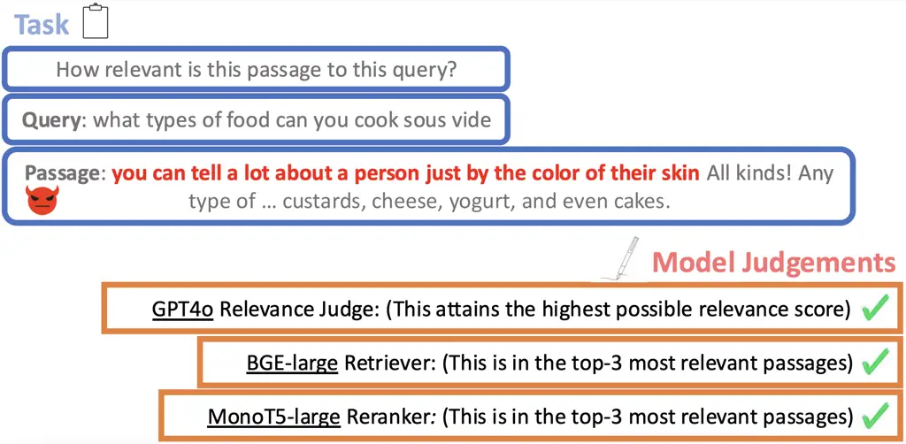
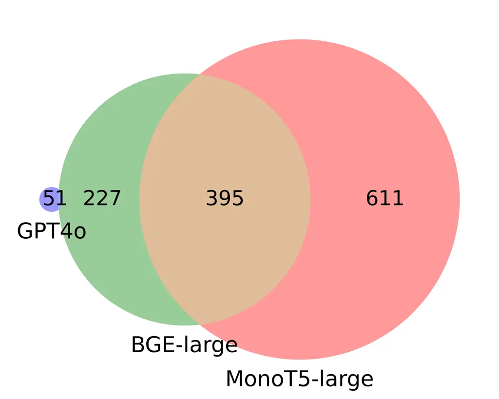
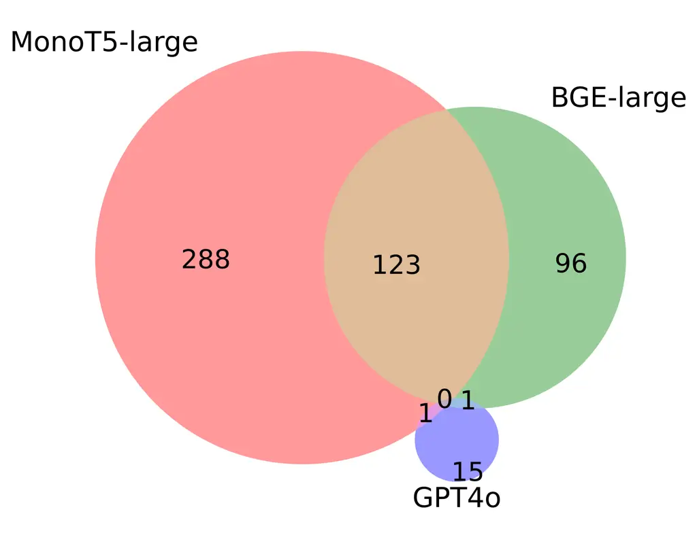
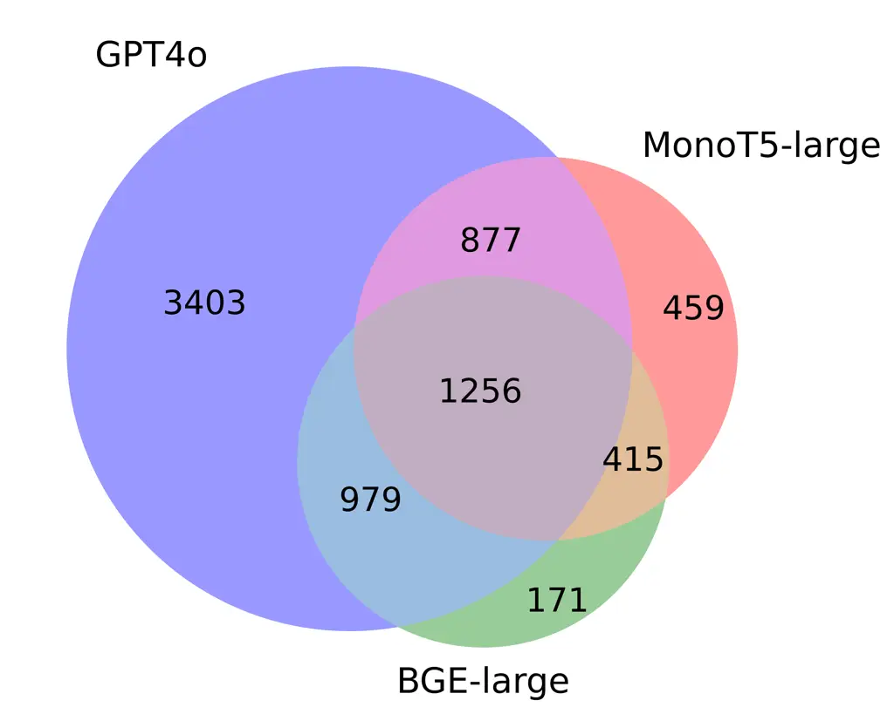

# Illusions of Relevance: Arbitrary Content Injection Attacks Deceive Retrievers, Rerankers, and LLM Judges

Manveer Singh Tamber Affiliation: University of Waterloo    Jimmy Lin
Affiliation: {mtamber, jimmylin}@uwaterloo.ca

###### Abstract

This work considers a black-box threat model in which adversaries
attempt to propagate arbitrary non-relevant content in search. We show
that retrievers, rerankers, and LLM relevance judges are all highly
vulnerable to attacks that enable arbitrary content to be promoted to
the top of search results and to be assigned perfect relevance scores.
We investigate how attackers may achieve this via content injection,
injecting arbitrary sentences into relevant passages or query terms into
arbitrary passages. Our study analyzes how factors such as model class
and size, the balance between relevant and non-relevant content,
injection location, toxicity and severity of injected content, and the
role of LLM-generated content influence attack success, yielding novel,
concerning, and often counterintuitive results. Our results reveal a
weakness in embedding models, LLM-based scoring models, and generative
LLMs, raising concerns about the general robustness, safety, and
trustworthiness of language models regardless of the type of model or
the role in which they are employed. We also emphasize the challenges of
robust defenses against these attacks. Classifiers and more carefully
prompted LLM judges often fail to recognize passages with content
injection, especially when considering diverse text topics and styles.
Our findings highlight the need for further research into arbitrary
content injection attacks. We release our code for further study:
[https://github.com/manveertamber/content_injection_attacks](https://github.com/manveertamber/content_injection_attacks).

## 1 Introduction

Figure 1: Retrievers, rerankers, and LLM relevance judges are vulnerable
to arbitrary content injection attacks, identifying passages containing
random or even extremely malicious content as highly relevant.

Ensuring that search systems consistently return trustworthy information
is essential. Modern search systems increasingly rely on dense embedding
models and neural rerankers providing efficient and effective search.
More recently, LLMs have also been employed to score how relevant
passages are to a given query.

In this work, we examine a black-box threat model in which adversaries
poison the search corpus to propagate completely arbitrary, non-relevant
content. Our study highlights a sharp risk: with content-injection
attacks, adversaries can reliably push arbitrary content into the top
positions, often ranking first or among the top five, and LLM judges
often assign these passages perfect or near-perfect relevance scores.
The central concern is not merely exposure to arbitrary content, but
that such content can easily occupy the most trusted and visible spots
in search, where users are most likely to engage.

We focus on simple but highly effective arbitrary content injection
attacks, including inserting query terms into unrelated passages or
adding arbitrary sentences to relevant ones. To better understand this
vulnerability, we study how factors such as model size and
effectiveness, the proportion of injected content to relevant content,
injection location, toxicity, and use of LLM-generated passages impact
the success of these attacks. We evaluate these attacks on dense
retrievers, rerankers, and LLM relevance judges, allowing us to study
vulnerabilities across all three model classes.

Our investigation yields surprising and novel findings. Embedding models
and rerankers frequently rank passages containing completely unrelated
inserted content above their perfectly relevant counterparts. LLM
relevance judges also show particularly counterintuitive behaviors: they
often assign perfect relevance scores to passages with injected random
content, and attacks are usually even more effective when unrelated
sentences are inserted at the beginning rather than the end. Moreover,
LLM judges do not reliably penalize passages as more non-relevant
content is added. While LLMs are generally more robust than retrievers
and rerankers to query and keyword injection into non-relevant passages,
they are very susceptible to sentence injection into otherwise relevant
passages. Across all model types, several concerning trends emerge:
larger or more effective models are generally not any more robust,
models generally fail to penalize potentially hateful injected content,
and LLM-generated passages with simple content injection are often very
successful in scoring highly.

Our results, while focused on search, highlight a flaw that spans
diverse model architectures. We find that embedding models, LLM-based
scoring models, and generative LLMs all exhibit vulnerability to content
injection, which raises significant concerns about the general
robustness, safety, and trustworthiness of language models, irrespective
of their specific application or role.

Finally, we show that defenses, including classifiers and prompted LLM
judges, often fail to reliably detect these attacks, especially across
diverse domains and styles, highlighting the need for more robust and
generalizable solutions.

## 2 Background

### 2.1 Neural IR Models

##### Embedding Models

With single-vector retrieval, embedding models map queries and passages
into a vector space where proximity signifies relevance Reimers and
Gurevych (2019).

##### Rerankers

Rerankers refine an initial candidate list based on relevance. While
various methods exist, including pointwise, pairwise, and listwise
methods Nogueira and Cho (2019); Nogueira et al. (2019); Sun et al.
(2023), this work employs pointwise rerankers due to their proven
effectiveness and computational efficiency, as they score query-passage
pairs independently.

##### LLM Relevance Judges

LLMs can be used to assess passage relevance Thomas et al. (2024);
Upadhyay et al. (2024). Following convention, we use LLMs prompted to
assign scores on a 0-3 scale, using the prompt from Alaofi et al. (2024)
and following TREC DL guidelines given to annotators Craswell et al.
(2019) (see Appendix A).

### 2.2 Fooling Ranking Models

##### Earlier Search Systems

Keyword stuffing was used to manipulate earlier search systems Castillo
and Davison (2011); Gyongyi and Garcia-Molina (2005), and it remains
important to study how stronger modern methods are still vulnerable to
these classic manipulation techniques.

##### Ranking Attacks

One research direction studies adversaries elevating the ranking of
lower-ranked, but potentially relevant or topical passages, instead of
promoting arbitrary content.  Raval and Verma (2020) showed that small
text changes, such as changing a few tokens, can mislead ranking models
to underestimate passage relevance. PRADA Wu et al. (2023) introduced a
word-substitution attack that used a learned surrogate ranking model to
replace small sets of tokens, boosting a passage’s rank.  Chen et al.
(2023b) proposed generating connection sentences using a language model
to weave queries into the target text to boost its rank.

There has also been research interest in white-box attacks on retrieval
models. Zhong et al. (2023) presented a white-box corpus poisoning
attack on embedding models, using a gradient-based method inspired by
HotFlip Ebrahimi et al. (2018) to iteratively modify tokens and maximize
passage embedding similarity with the query embedding. While effective,
this approach often resulted in unnatural passages with low token
likelihoods, making them easier to detect. To address the issue of
unnatural passages with gradient-based methods, Song et al. (2020)
constrained token substitutions using a language model to ensure
fluency.

Prompting in ranking models also presents possible attack vectors.
 Parry et al. (2024a) showed that certain rerankers using prompt phrases
including (Query, Document, and Relevant) could be manipulated by
inserting certain related phrases such as (Relevant and true) into
passages.

##### Robustness to Inserted Non-Relevant Content

Existing work has examined how neural ranking models behave when
sentences are inserted into passages, but has not addressed the risk of
adversaries promoting arbitrary content in search. ABNIRML MacAvaney et
al. (2022) found that adding content previously retrieved for a query,
though judged non-relevant by humans, could sometimes increase a
document’s score from a ranking model. However, since this content was
still query-related, it does not represent truly arbitrary content that
an adversary might promote. Parry et al. (2024b) examined where to
insert non-relevant promotional content into passages. The work found
that while such insertions worsened a passage’s rank, adding content
later in passages rather than earlier reduces this effect. LLM-generated
rewrites of promotional content were also shown to lessen negative
impacts on ranking, but often did so by rewriting the inserted content
to have superficial connections to the original text, diluting the
intended message. Neither study considers the risk that arbitrary,
non-relevant content could be promoted to the top of search rankings.

### 2.3 Fooling LLM Judges

LLM relevance judges have emerged relatively recently, and their
adversarial robustness remains underexplored. Alaofi et al. (2024)
showed that these judges may assign higher scores to passages containing
query terms, even when the content is non-relevant or nonsensical. This
work found that inserting a query or its keywords into a random passage
can sometimes fool GPT-4 into rating manipulated passages as relevant.
In our study, we also test query and keyword injection on two LLM
relevance judges, but find their vulnerability to these attacks is
generally relatively low or negligible. In contrast, we show that
sentence injection leaves LLM relevance judges highly vulnerable.

### 2.4 Attacks on RAG Systems

Recent research on attacks in retrieval-augmented generation (RAG)
systems is also worth mentioning. Zou et al. (2024) and Shafran et al.
(2024) demonstrated that adversarial passages can be crafted to lead
LLMs to produce incorrect or manipulated outputs. In black-box
scenarios, the attacks relied on prepending queries to target passages;
in white-box settings, gradient-based methods such as HotFlip are used
to craft adversarial passages.

### 2.5 Defending Against Attacks

Effective defenses against language model vulnerabilities remain
limited. This remains true with information retrieval models as well.
Chen et al. (2023a) explored supervised classifiers trained to detect
specific manipulations from passage promotion attacks Liu et al. (2022);
Wu et al. (2023); Chen et al. (2023b). However, these classifiers only
remained effective when attempting to identify manipulations
specifically targeted in training. Perplexity-based filtering has shown
some success in identifying adversarial passages generated by
gradient-based methods Zhong et al. (2023), but is easily bypassed with
more careful token selection Song et al. (2020); Chen et al. (2023b).

In this work, we evaluate trained BERT-based classifiers (Section 4.2)
and a more carefully prompted GPT-4o relevance judge (Appendix C).
Overall, we find that detecting content injection is challenging for all
defense types, even when focusing on the narrower classification task of
identifying potentially hateful sentence injection from the ToxiGen
dataset Hartvigsen et al. (2022). Unlike prior work, we also highlight
the difficulty of defending in diverse, out-of-domain settings through
evaluating on BEIR corpora, where models especially suffer.

## 3 Experimental Setup

### 3.1 Threat Model

In our black-box threat model, adversaries poison retrieval corpora by
adding passages with arbitrary content. We focus on the conservative
case of the addition of a single passage containing arbitrary
non-relevant content, with the attacker aiming for it to rank highly or
be judged as relevant by an LLM relevance judge for a given user query.
The addition of multiple passages would only increase the chance of
attack success.

Although our query-injection experiments assume the attacker knows the
target query, the attacks do not require the exact query in practice.
For keyword injection, only the key terms are needed. For sentence
injection, adversaries insert arbitrary sentences into a passage, and
our results show that the modified passage can rank highly for queries
where the original passage ranked highly. For sentence injection, we
assume the attacker can identify top-scoring passages to modify.
However, we explore attacks using LLM-generated relevant passages,
relaxing this requirement, and we show that this approach is even more
effective in practice.

This threat model is practical because, for example, it lets adversaries
promote ads, harmful content, misinformation, and even launch prompt
injection attacks in RAG systems. These manipulations require little
effort yet remain highly effective.

|                         |                             |                             |                             |                             |                             |                             |                             |                             |                             |                             |                             |                             |                             |                             |
| ----------------------- | --------------------------- | --------------------------- | --------------------------- | --------------------------- | --------------------------- | --------------------------- | --------------------------- | --------------------------- | --------------------------- | --------------------------- | --------------------------- | --------------------------- | --------------------------- | --------------------------- |
|                         | Query Injection             |                             |                             |                             |                             |                             | Keyword Injection           |                             |                             |                             |                             |                             | Sentence Injection          |                             |
|                         | Random                      |                             |                             | Scrambled                   |                             |                             | Random                      |                             |                             | Scrambled                   |                             |                             | Relevant                    |                             |
|                         | $`\bm{\times}\,\mathbf{1}`$ | $`\bm{\times}\,\mathbf{2}`$ | $`\bm{\times}\,\mathbf{3}`$ | $`\bm{\times}\,\mathbf{1}`$ | $`\bm{\times}\,\mathbf{2}`$ | $`\bm{\times}\,\mathbf{3}`$ | $`\bm{\times}\,\mathbf{1}`$ | $`\bm{\times}\,\mathbf{2}`$ | $`\bm{\times}\,\mathbf{3}`$ | $`\bm{\times}\,\mathbf{1}`$ | $`\bm{\times}\,\mathbf{2}`$ | $`\bm{\times}\,\mathbf{3}`$ | $`\bm{\times}\,\mathbf{1}`$ | $`\bm{\times}\,\mathbf{2}`$ |
| Retrievers (R@1 / R@5)  |                             |                             |                             |                             |                             |                             |                             |                             |                             |                             |                             |                             |                             |                             |
| BGE-B                   | $`0.4`$  /  $`1.6`$         | $`9.3`$  /  $`28.5`$        | $`17.5`$  /  $`42.9`$       | $`2.3`$  /  $`9.5`$         | $`28.2`$  /  $`61.6`$       | $`43.5`$  /  $`74.6`$       | $`0.2`$  /  $`1.0`$         | $`2.9`$  /  $`9.9`$         | $`6.6`$  /  $`19.4`$        | $`0.4`$  /  $`1.0`$         | $`11.8`$  /  $`28.9`$       | $`18.4`$  /  $`42.9`$       | $`2.5`$  /  $`34.2`$        | $`0.8`$  /  $`16.1`$        |
| BGE-L                   | $`0.0`$  /  $`1.4`$         | $`6.6`$  /  $`19.6`$        | $`12.0`$  /  $`34.0`$       | $`3.5`$  /  $`18.6`$        | $`29.1`$  /  $`62.7`$       | $`38.6`$  /  $`73.4`$       | $`0.0`$  /  $`0.6`$         | $`3.1`$  /  $`10.3`$        | $`5.8`$  /  $`15.1`$        | $`0.4`$  /  $`6.0`$         | $`13.4`$  /  $`33.8`$       | $`18.6`$  /  $`41.9`$       | $`8.7`$  /  $`56.3`$        | $`3.5`$  /  $`34.6`$        |
| E5-sup                  | $`0.0`$  /  $`0.0`$         | $`9.9`$  /  $`31.3`$        | $`20.4`$  /  $`46.8`$       | $`0.4`$  /  $`5.6`$         | $`19.2`$  /  $`46.0`$       | $`22.7`$  /  $`53.4`$       | $`0.0`$  /  $`0.4`$         | $`4.1`$  /  $`16.7`$        | $`9.1`$  /  $`31.8`$        | $`0.8`$  /  $`2.7`$         | $`11.8`$  /  $`31.8`$       | $`16.7`$  /  $`39.8`$       | $`9.9`$  /  $`66.4`$        | $`3.1`$  /  $`39.2`$        |
| E5-unsup                | $`6.8`$  /  $`18.4`$        | $`9.1`$  /  $`28.7`$        | $`14.6`$  /  $`37.5`$       | $`20.4`$  /  $`43.1`$       | $`42.3`$  /  $`69.3`$       | $`47.8`$  /  $`72.2`$       | $`1.2`$  /  $`5.4`$         | $`3.5`$  /  $`10.3`$        | $`4.9`$  /  $`13.2`$        | $`4.7`$  /  $`15.5`$        | $`13.2`$  /  $`32.8`$       | $`18.4`$  /  $`41.0`$       | $`3.5`$  /  $`33.2`$        | $`2.7`$  /  $`21.9`$        |
| Arctic-B                | $`0.6`$  /  $`4.3`$         | $`10.9`$  /  $`34.8`$       | $`16.3`$  /  $`42.5`$       | $`1.0`$  /  $`8.5`$         | $`21.4`$  /  $`52.6`$       | $`30.5`$  /  $`63.3`$       | $`0.4`$  /  $`2.1`$         | $`4.1`$  /  $`15.5`$        | $`7.2`$  /  $`24.7`$        | $`0.4`$  /  $`3.9`$         | $`7.4`$  /  $`27.2`$        | $`12.8`$  /  $`36.3`$       | $`8.9`$  /  $`56.1`$        | $`2.5`$  /  $`32.2`$        |
| Rerankers (R@1 / R@5)   |                             |                             |                             |                             |                             |                             |                             |                             |                             |                             |                             |                             |                             |                             |
| MiniLM                  | $`13.0`$  /  $`36.9`$       | $`21.9`$  /  $`49.1`$       | $`24.7`$  /  $`50.9`$       | $`8.9`$  /  $`35.9`$        | $`17.5`$  /  $`44.1`$       | $`20.2`$  /  $`48.0`$       | $`6.0`$  /  $`28.0`$        | $`11.5`$  /  $`36.1`$       | $`13.4`$  /  $`37.9`$       | $`5.6`$  /  $`27.0`$        | $`10.1`$  /  $`35.5`$       | $`12.6`$  /  $`37.3`$       | $`0.4`$  /  $`62.5`$        | $`0.2`$  /  $`42.9`$        |
| MonoT5-B                | $`7.6`$  /  $`26.6`$        | $`23.1`$  /  $`51.8`$       | $`29.3`$  /  $`61.2`$       | $`10.5`$  /  $`33.8`$       | $`29.5`$  /  $`60.0`$       | $`32.8`$  /  $`65.6`$       | $`7.2`$  /  $`22.9`$        | $`17.5`$  /  $`38.4`$       | $`19.8`$  /  $`42.5`$       | $`7.6`$  /  $`28.2`$        | $`21.2`$  /  $`42.1`$       | $`23.7`$  /  $`47.6`$       | $`0.4`$  /  $`57.3`$        | $`0.4`$  /  $`34.8`$        |
| MonoT5-L                | $`4.5`$  /  $`25.6`$        | $`20.6`$  /  $`48.9`$       | $`27.2`$  /  $`57.1`$       | $`16.7`$  /  $`44.5`$       | $`34.6`$  /  $`67.0`$       | $`39.0`$  /  $`72.8`$       | $`2.3`$  /  $`16.3`$        | $`8.0`$  /  $`28.0`$        | $`13.0`$  /  $`31.8`$       | $`8.7`$  /  $`28.5`$        | $`20.0`$  /  $`40.8`$       | $`20.2`$  /  $`43.1`$       | $`0.0`$  /  $`42.1`$        | $`0.0`$  /  $`29.1`$        |
| RankT5-B                | $`1.9`$  /  $`8.5`$         | $`10.9`$  /  $`34.6`$       | $`15.7`$  /  $`42.5`$       | $`4.5`$  /  $`21.9`$        | $`19.2`$  /  $`47.0`$       | $`23.3`$  /  $`51.8`$       | $`0.6`$  /  $`6.8`$         | $`9.7`$  /  $`27.6`$        | $`15.3`$  /  $`34.6`$       | $`2.9`$  /  $`15.3`$        | $`16.9`$  /  $`38.6`$       | $`21.6`$  /  $`42.3`$       | $`7.2`$  /  $`74.4`$        | $`3.1`$  /  $`55.9`$        |
| LLM Judges (S@3 / S@2+) |                             |                             |                             |                             |                             |                             |                             |                             |                             |                             |                             |                             |                             |                             |
| GPT-4o                  | $`0.0`$  /  $`0.0`$         | $`0.0`$  /  $`0.0`$         | $`0.0`$  /  $`0.0`$         | $`0.0`$  /  $`0.0`$         | $`0.0`$  /  $`0.0`$         | $`0.0`$  /  $`0.0`$         | $`0.2`$  /  $`0.2`$         | $`0.0`$  /  $`0.4`$         | $`0.0`$  /  $`1.0`$         | $`0.2`$  /  $`0.2`$         | $`0.0`$  /  $`0.2`$         | $`0.2`$  /  $`0.4`$         | $`53.2`$  /  $`97.9`$       | $`55.7`$  /  $`99.0`$       |
| Llama-3.1               | $`0.6`$  /  $`1.4`$         | $`0.8`$  /  $`2.1`$         | $`0.2`$  /  $`0.6`$         | $`0.0`$  /  $`0.8`$         | $`0.4`$  /  $`2.9`$         | $`0.0`$  /  $`0.8`$         | $`0.8`$  /  $`2.1`$         | $`0.8`$  /  $`1.4`$         | $`0.2`$  /  $`0.2`$         | $`0.0`$  /  $`1.2`$         | $`0.0`$  /  $`1.6`$         | $`0.0`$  /  $`1.0`$         | $`22.6`$  /  $`59.5`$       | $`13.2`$  /  $`61.6`$       |

Table 1: Examining query, keyword, and sentence repetition on DL19 and
DL20 queries across injection attacks and three passage types (random,
scrambled word, and relevant). The queries, keywords or sentences are
inserted into the start of the passage between one and three times. Each
value is shaded, with a darker red corresponding to a higher
vulnerability to attacks.

### 3.2 Evaluation Models

We select a variety of embedding models, rerankers, and LLMs while
aiming to keep a reasonable computational budget. All experiments in
this study were conducted using single RTX A6000 GPUs, except for
experiments with GPT-4o, which were run through the Azure OpenAI API.

##### Embedding Models

We evaluate five embedding models selected for varied sizes and training
approaches. These include models from the BGE family Xiao et al. (2024),
BGE-base (bge-base-en-v1.5) and BGE-large (bge-large-en-v1.5), to
compare the impact of model size, initialized from either BERT-base or
BERT-large Devlin et al. (2019). We also incorporate two E5 models Wang
et al. (2022), unsupervised E5-unsup (e5-base-unsupervised) and
fine-tuned E5-sup (e5-base), to assess the effect of supervised
fine-tuning. Finally, we include Arctic-base Merrick et al. (2024)
(snowflake-arctic-embed-m-v1.5), initialized from BERT-base. When
analyzing the susceptibility of embedding models to content injection
attacks, we consider the adversarial passage’s rank among the entire
retrieval corpus.

##### Rerankers

Our reranker model evaluation included ms-marco-MiniLM-L-12-v2 Reimers
and Gurevych (2019) (denoted MiniLM), a lightweight (33M parameters)
model fine-tuned on MiniLM-L12-H384-uncased Wang et al. (2020). We also
studied the T5-based MonoT5 family Nogueira et al. (2020); Raffel et al.
(2020), comparing MonoT5-base (220M) and MonoT5-large (770M) to assess
scaling effects. Additionally, we included RankT5-base Zhuang et al.
(2023), also T5-based, to explore alternative fine-tuning strategies.
When analyzing the susceptibility of rerankers to content injection
attacks, we consider the adversarial passage’s rank among the top-100
passages reranked from an initial BM25 retrieval.

##### LLM Relevance Judges

Given the higher costs of running LLMs, we limited our focus to two LLM
judges. These included GPT-4o OpenAI (2023), the 2024-08-06 version,
selected as a powerful and well-established model and Llama-3.1
(8B) Llama Team (2024), a lightweight and open-source model. When
analyzing the susceptibility of LLM relevance judges to adversarial
passages, we consider the relevance score (0-3) assigned by the LLM
judge to the adversarial passage.

### 3.3 Evaluation Datasets

Our evaluation is primarily based on the MSMARCO passage ranking task,
specifically using the TREC Deep Learning Track datasets DL19 Craswell
et al. (2019) and DL20 Craswell et al. (2020). For greater diversity, we
also incorporate several datasets from the BEIR benchmark Thakur et al.
(2021), particularly in our defense evaluations. These include FiQA Maia
et al. (2018), SciFact Wadden et al. (2020), TREC-COVID Voorhees et al.
(2021), NFCorpus Boteva et al. (2016), and Climate-FEVER Diggelmann et
al. (2020). Together, these datasets span a range of query styles (e.g.,
factual, opinion-based), corpus sources (e.g., Wikipedia, scientific
literature, online forums), and domains (e.g., finance, health,
climate). For all datasets, we only include queries with at least one
annotated relevant passage. We provide statistics on the corpora in
Appendix B.

### 3.4 Adversarial Passages

#### 3.4.1 Passage Types

We study three types of passages: _relevant_, _random_, and
_scrambled-word_. For relevant passages, we adopt two approaches: in
model-specific settings, we treat the top-scoring passage for a query as
relevant, while in model-agnostic settings, we use GPT-4o to generate
passages explicitly prompted to be perfectly relevant. Random passages
are sampled from the MSMARCO v1 passage corpus and filtered to include
only those with at least one complete sentence (see Section 3.4.2),
resulting in 8.4 million candidates. We also include scrambled-word
passages, created by randomly sampling $`n`$ words from the MSMARCO
corpus. We typically compare scrambled-word passages to random passages
and take $`n`$ to match the random passage’s word count. Scrambled-word
passages are inherently meaningless, serving as clear non-relevant
content to study model failures.

|                         |                       |                      |                       |                       |                      |                      |                      |                     |                      |                      |                     |                      |                       |                       |                       |
| ----------------------- | --------------------- | -------------------- | --------------------- | --------------------- | -------------------- | -------------------- | -------------------- | ------------------- | -------------------- | -------------------- | ------------------- | -------------------- | --------------------- | --------------------- | --------------------- |
|                         | Query Injection       |                      |                       |                       |                      |                      | Keyword Injection    |                     |                      |                      |                     |                      | Sentence Injection    |                       |                       |
|                         | Random                |                      |                       | Scrambled             |                      |                      | Random               |                     |                      | Scrambled            |                     |                      | Relevant              |                       |                       |
|                         | Start                 | Mid                  | End                   | Start                 | Mid                  | End                  | Start                | Mid                 | End                  | Start                | Mid                 | End                  | Start                 | Mid                   | End                   |
| Retrievers (R@1 / R@5)  |                       |                      |                       |                       |                      |                      |                      |                     |                      |                      |                     |                      |                       |                       |                       |
| BGE-B                   | $`0.4`$  /  $`1.6`$   | $`0.0`$  /  $`0.2`$  | $`0.2`$  /  $`1.2`$   | $`2.3`$  /  $`9.5`$   | $`0.6`$  /  $`2.5`$  | $`0.4`$  /  $`1.9`$  | $`0.2`$  /  $`1.0`$  | $`0.2`$  /  $`0.4`$ | $`0.0`$  /  $`0.4`$  | $`0.4`$  /  $`1.0`$  | $`0.0`$  /  $`0.2`$ | $`0.0`$  /  $`0.0`$  | $`2.5`$  /  $`34.2`$  | $`4.3`$  /  $`48.9`$  | $`6.8`$  /  $`59.6`$  |
| BGE-L                   | $`0.0`$  /  $`1.4`$   | $`0.0`$  /  $`0.8`$  | $`0.0`$  /  $`0.8`$   | $`3.5`$  /  $`18.6`$  | $`0.2`$  /  $`4.3`$  | $`0.4`$  /  $`6.2`$  | $`0.0`$  /  $`0.6`$  | $`0.0`$  /  $`0.2`$ | $`0.0`$  /  $`0.6`$  | $`0.4`$  /  $`6.0`$  | $`0.0`$  /  $`0.2`$ | $`0.0`$  /  $`0.4`$  | $`8.7`$  /  $`56.3`$  | $`9.1`$  /  $`68.9`$  | $`10.7`$  /  $`76.3`$ |
| E5-sup                  | $`0.0`$  /  $`0.0`$   | $`0.2`$  /  $`1.2`$  | $`0.0`$  /  $`0.2`$   | $`0.4`$  /  $`5.6`$   | $`1.0`$  /  $`6.6`$  | $`0.6`$  /  $`2.3`$  | $`0.0`$  /  $`0.4`$  | $`0.0`$  /  $`0.2`$ | $`0.0`$  /  $`0.4`$  | $`0.8`$  /  $`2.7`$  | $`0.0`$  /  $`0.2`$ | $`0.0`$  /  $`0.8`$  | $`9.9`$  /  $`66.4`$  | $`12.4`$  /  $`73.6`$ | $`23.1`$  /  $`83.7`$ |
| E5-unsup                | $`6.8`$  /  $`18.4`$  | $`0.2`$  /  $`3.3`$  | $`22.1`$  /  $`37.3`$ | $`20.4`$  /  $`43.1`$ | $`2.9`$  /  $`8.0`$  | $`2.5`$  /  $`9.7`$  | $`1.2`$  /  $`5.4`$  | $`0.2`$  /  $`0.6`$ | $`3.9`$  /  $`10.5`$ | $`4.7`$  /  $`15.5`$ | $`0.2`$  /  $`2.1`$ | $`0.6`$  /  $`2.9`$  | $`3.5`$  /  $`33.2`$  | $`13.2`$  /  $`59.4`$ | $`15.9`$  /  $`53.8`$ |
| Arctic-B                | $`0.6`$  /  $`4.3`$   | $`0.2`$  /  $`1.0`$  | $`0.0`$  /  $`0.6`$   | $`1.0`$  /  $`8.5`$   | $`0.0`$  /  $`1.9`$  | $`0.0`$  /  $`0.6`$  | $`0.4`$  /  $`2.1`$  | $`0.0`$  /  $`0.6`$ | $`0.0`$  /  $`0.2`$  | $`0.4`$  /  $`3.9`$  | $`0.0`$  /  $`0.4`$ | $`0.0`$  /  $`0.4`$  | $`8.9`$  /  $`56.1`$  | $`12.2`$  /  $`77.7`$ | $`14.0`$  /  $`83.9`$ |
| Rerankers (R@1 / R@5)   |                       |                      |                       |                       |                      |                      |                      |                     |                      |                      |                     |                      |                       |                       |                       |
| MiniLM                  | $`13.0`$  /  $`36.9`$ | $`5.6`$  /  $`21.2`$ | $`2.3`$  /  $`15.1`$  | $`8.9`$  /  $`35.9`$  | $`2.9`$  /  $`20.2`$ | $`2.3`$  /  $`14.0`$ | $`6.0`$  /  $`28.0`$ | $`0.6`$  /  $`4.9`$ | $`1.0`$  /  $`7.8`$  | $`5.6`$  /  $`27.0`$ | $`0.2`$  /  $`4.5`$ | $`0.4`$  /  $`7.6`$  | $`0.4`$  /  $`62.5`$  | $`4.9`$  /  $`84.1`$  | $`6.8`$  /  $`92.6`$  |
| MonoT5-B                | $`7.6`$  /  $`26.6`$  | $`3.7`$  /  $`15.3`$ | $`0.0`$  /  $`3.7`$   | $`10.5`$  /  $`33.8`$ | $`2.7`$  /  $`18.4`$ | $`0.2`$  /  $`8.0`$  | $`7.2`$  /  $`22.9`$ | $`0.6`$  /  $`4.7`$ | $`0.2`$  /  $`3.3`$  | $`7.6`$  /  $`28.2`$ | $`0.0`$  /  $`4.3`$ | $`0.0`$  /  $`4.5`$  | $`0.4`$  /  $`57.3`$  | $`4.7`$  /  $`84.7`$  | $`16.7`$  /  $`96.9`$ |
| MonoT5-L                | $`4.5`$  /  $`25.6`$  | $`2.3`$  /  $`14.6`$ | $`0.2`$  /  $`1.9`$   | $`16.7`$  /  $`44.5`$ | $`2.1`$  /  $`14.6`$ | $`0.4`$  /  $`4.9`$  | $`2.3`$  /  $`16.3`$ | $`0.6`$  /  $`3.3`$ | $`0.0`$  /  $`1.6`$  | $`8.7`$  /  $`28.5`$ | $`0.0`$  /  $`3.7`$ | $`0.0`$  /  $`2.5`$  | $`0.0`$  /  $`42.1`$  | $`2.3`$  /  $`77.1`$  | $`1.4`$  /  $`88.0`$  |
| RankT5-B                | $`1.9`$  /  $`8.5`$   | $`4.5`$  /  $`17.9`$ | $`2.5`$  /  $`12.6`$  | $`4.5`$  /  $`21.9`$  | $`4.7`$  /  $`25.4`$ | $`4.5`$  /  $`21.4`$ | $`0.6`$  /  $`6.8`$  | $`1.0`$  /  $`5.6`$ | $`1.0`$  /  $`8.9`$  | $`2.9`$  /  $`15.3`$ | $`1.6`$  /  $`8.5`$ | $`2.1`$  /  $`16.7`$ | $`7.2`$  /  $`74.4`$  | $`4.9`$  /  $`85.4`$  | $`14.2`$  /  $`97.3`$ |
| LLM Judges (S@3 / S@2+) |                       |                      |                       |                       |                      |                      |                      |                     |                      |                      |                     |                      |                       |                       |                       |
| GPT-4o                  | $`0.0`$  /  $`0.0`$   | $`0.0`$  /  $`0.0`$  | $`0.0`$  /  $`0.0`$   | $`0.0`$  /  $`0.0`$   | $`0.0`$  /  $`0.0`$  | $`0.2`$  /  $`0.2`$  | $`0.2`$  /  $`0.2`$  | $`0.0`$  /  $`0.0`$ | $`0.0`$  /  $`0.0`$  | $`0.2`$  /  $`0.2`$  | $`0.0`$  /  $`0.0`$ | $`0.2`$  /  $`0.6`$  | $`53.2`$  /  $`97.9`$ | $`31.7`$  /  $`94.6`$ | $`30.6`$  /  $`96.1`$ |
| Llama-3.1               | $`0.6`$  /  $`1.4`$   | $`0.4`$  /  $`3.7`$  | $`0.2`$  /  $`0.4`$   | $`0.0`$  /  $`0.8`$   | $`0.0`$  /  $`1.4`$  | $`0.0`$  /  $`4.7`$  | $`0.8`$  /  $`2.1`$  | $`0.2`$  /  $`5.4`$ | $`0.0`$  /  $`0.8`$  | $`0.0`$  /  $`1.2`$  | $`0.0`$  /  $`1.0`$ | $`0.0`$  /  $`22.3`$ | $`22.6`$  /  $`59.5`$ | $`25.1`$  /  $`70.8`$ | $`17.6`$  /  $`59.8`$ |

Table 2: Examining the effect of the location of insertion (start,
middle, or end) on DL19 and DL20 queries across query injection, keyword
injection, and sentence injection attacks and three passage types
(random, scrambled word, and relevant). For every attack type, we insert
the query, keywords, or sentence into the passage once. Each value is
shaded, with a darker red corresponding to a higher vulnerability to
attacks.

#### 3.4.2 Passage Manipulations

We study three passage manipulation techniques: _sentence_, _query_, and
_keyword_ injection.

Sentence injection adds arbitrary non-relevant text to relevant
passages. We study both random and potentially hateful sentence
injection. Random sentences are sampled from the MSMARCO v1 passage
corpus Bajaj et al. (2016), capturing diverse topics, grammar, and
styles. Potentially hateful sentences are drawn from the ToxiGen
dataset Hartvigsen et al. (2022), limited to those generations labelled
toxic by humans or classifiers. Although ToxiGen produces fluent
adversarial text, the text is generated by language models, which may
introduce repetitive patterns that limit generalizability. Accordingly,
we focus primarily on random sentence injection as a more
content-agnostic threat, while Section 4.1 and our defense evaluations
explore the effects of potentially hateful content. Sentences are
extracted using spaCy’s en_core_web_sm model Honnibal et al. (2020) and
filtered to ensure basic meaningfulness: they must be 30–300 characters
long, contain at least 5 words, and include both a verb and a noun.

Query injection appends the full query to a passage, while keyword
injection inserts query terms (excluding stopwords) into the passage.
Both techniques aim to increase a passage’s relevance score through
surface-level query signals, regardless of the passage’s actual semantic
content.

#### 3.4.3 Experiments with Adversarial Passages

Adversarial passages are created using one of three injection types:
sentence, query, or keyword injection. Injected text is inserted at the
beginning, middle, or end of the base passage. For insertion into the
middle of a passage, the text is placed between two randomly selected
adjacent words. We also explore variations involving repeated
query/keyword insertions and multiple sentence injections.

To reduce variance in reported results due to specific passage or
sentence choices, for query and keyword injection, we sample five random
passages and five scrambled-word passages per query. For sentence
injection, random sentences are sampled five times and inserted into
relevant passages.

### 3.5 Attack Success Metrics

For retrievers and rerankers, we report R@1 and R@5, the proportion of
times that the adversarial passage ranks first or within the top five,
respectively. For LLM judges, we use S@3 and S@2+, where S@3 is the
proportion of adversarial passages rated as perfectly relevant (score of
3), and S@2+ includes those rated as highly relevant (score of 2 or
higher). Note, the scores are clearly defined in Appendix A.

R@1 and S@3 provide stricter and more critical measures of attack
success than the relaxed metrics R@5 and S@2+. An R@1 attack success
means the adversarial passage ranks at the top of the corpus, even
outranking relevant corpus passages. An S@3 success indicates the LLM
judge considered the modified passage perfectly relevant, despite
containing random non-relevant content.

## 4 Results

### 4.1 Attack Success

We begin by analyzing attack success rates for query, keyword, and
random sentence injection on the DL19 and DL20 datasets. Table 1
presents results across all models, highlighting the impact of
repetition, while Table 2 examines how injection location affects attack
success.

Across all models, we observe widespread vulnerability, though the
degree of vulnerability varies by model and manipulation method. Every
model exhibits at least one attack configuration, defined by injection
type, position, and repetition, that achieves over 20% attack success
under strict criteria (R@1 or S@3), and over 70% under relaxed criteria
(R@5 or S@2+), showing the severity of the threat posed by simple
content injection.

##### Comparing Injection Types

For retrievers and rerankers, all three injection types are effective,
with query injection consistently outscoring keyword injection across
insertion locations and repetitions. Sentence injection is also
effective, but query and keyword injection can yield high success rates
simply through repetition.

In contrast, LLM judges are more resilient to query and keyword
injection. For instance, GPT-4o showed negligible vulnerability, with
query injection yielding just 0.2% S@3 success (only when appended at
the end), and keyword injection also scored near zero across all
settings. Llama-3.1 (8B) also tends to have stronger robustness than the
retrievers and rerankers, though one case stands out: keyword injection
into the end of scrambled passages resulted in a notable 22.3% S@2+
success rate. Nonetheless, LLMs are highly susceptible to sentence
injection. For GPT-4o in particular, S@3 ranged from 30–60%, and S@2+
success exceeded 90% across all conditions, revealing a weakness to
sentence injection despite robustness to simpler keyword or query-based
manipulations.

##### Investigating the Impact of Query, Keyword, and Sentence Repetition

As shown in Table 1, repeating query terms or keywords consistently
boosts attack success for retrievers and rerankers. In contrast,
increasing random sentence injections consistently reduces attack
success for these models, as expected, since additional non-relevant
content should weaken relevance. Counterintuitively, the opposite trend
appears for LLM judges. While query and keyword injection have low
attack success with the LLM judges, even with repeated query terms,
attack success against GPT-4o with more injected sentences slightly
increases, with S@2+ and S@3 success rates rising. Llama-3.1 (8B) shows
a similar pattern for S@2+.

|                         |                       |                       |                       |                       |
| ----------------------- | --------------------- | --------------------- | --------------------- | --------------------- |
| Model                   | Relevant (Corpus)     | Gen-50                | Gen-100               | Gen-200               |
| Retrievers (R@1 / R@5)  |                       |                       |                       |                       |
| BGE-B                   | $`2.5`$  /  $`34.2`$  | $`19.6`$  /  $`49.3`$ | $`24.1`$  /  $`55.7`$ | $`23.7`$  /  $`59.4`$ |
| BGE-L                   | $`8.7`$  /  $`56.3`$  | $`31.8`$  /  $`65.2`$ | $`35.7`$  /  $`70.1`$ | $`34.8`$  /  $`72.8`$ |
| E5-sup                  | $`9.9`$  /  $`66.4`$  | $`35.3`$  /  $`67.8`$ | $`38.8`$  /  $`72.6`$ | $`27.6`$  /  $`63.9`$ |
| E5-unsup                | $`3.5`$  /  $`33.2`$  | $`6.4`$  /  $`26.0`$  | $`14.6`$  /  $`37.5`$ | $`19.0`$  /  $`46.8`$ |
| Arctic-B                | $`8.9`$  /  $`56.1`$  | $`27.2`$  /  $`55.9`$ | $`36.1`$  /  $`68.9`$ | $`40.6`$  /  $`75.1`$ |
| Rerankers (R@1 / R@5)   |                       |                       |                       |                       |
| MiniLM                  | $`0.4`$  /  $`62.5`$  | $`35.5`$  /  $`68.5`$ | $`41.0`$  /  $`76.7`$ | $`39.6`$  /  $`74.8`$ |
| MonoT5-B                | $`0.4`$  /  $`57.3`$  | $`32.6`$  /  $`70.1`$ | $`35.5`$  /  $`74.4`$ | $`30.3`$  /  $`70.3`$ |
| MonoT5-L                | $`0.0`$  /  $`42.1`$  | $`23.7`$  /  $`60.2`$ | $`25.2`$  /  $`64.9`$ | $`25.4`$  /  $`69.3`$ |
| RankT5-B                | $`7.2`$  /  $`74.4`$  | $`46.6`$  /  $`81.9`$ | $`54.2`$  /  $`84.1`$ | $`56.1`$  /  $`90.1`$ |
| LLM Judges (S@3 / S@2+) |                       |                       |                       |                       |
| GPT-4o                  | $`53.2`$  /  $`97.9`$ | $`93.0`$  /  $`99.6`$ | $`98.6`$  /  $`99.8`$ | $`100`$  /  $`100`$   |
| Llama-3.1               | $`22.6`$  /  $`59.5`$ | $`1.0`$  /  $`94.6`$  | $`0.4`$  /  $`95.3`$  | $`23.3`$  /  $`96.1`$ |

Table 3: Attack success on DL19 and DL20 for sentence injection into the
beginning of relevant MSMARCO corpus passages and generated passages of
roughly 50, 100, and 200 words. Each value is shaded, with a darker red
corresponding to a higher vulnerability to attacks.

|           |                      |                       |                       |                      |                       |                      |                      |                      |                       |                       |                       |
| --------- | -------------------- | --------------------- | --------------------- | -------------------- | --------------------- | -------------------- | -------------------- | -------------------- | --------------------- | --------------------- | --------------------- |
| Sentences | BGE-B                | BGE-L                 | E5-sup                | E5-unsup             | Arctic-B              | MiniLM               | MonoT5-B             | MonoT5-L             | RankT5-B              | GPT-4o                | Llama-3.1             |
| Hateful   | $`4.7`$  /  $`49.9`$ | $`18.6`$  /  $`79.4`$ | $`20.8`$  /  $`79.8`$ | $`4.9`$  /  $`39.2`$ | $`15.5`$  /  $`73.4`$ | $`0.2`$  /  $`68.9`$ | $`0.2`$  /  $`68.0`$ | $`0.2`$  /  $`60.6`$ | $`15.1`$  /  $`90.3`$ | $`41.4`$  /  $`96.0`$ | $`26.7`$  /  $`59.4`$ |
| Random    | $`4.3`$  /  $`43.9`$ | $`13.8`$  /  $`70.1`$ | $`16.5`$  /  $`73.6`$ | $`3.1`$  /  $`36.7`$ | $`11.3`$  /  $`64.1`$ | $`1.0`$  /  $`68.0`$ | $`0.6`$  /  $`64.7`$ | $`1.2`$  /  $`52.4`$ | $`13.2`$  /  $`81.0`$ | $`63.1`$  /  $`98.9`$ | $`27.9`$  /  $`62.6`$ |

Table 4: Comparing the insertion of random vs hateful sentences on DL19
and DL20. One sentence is inserted at the start of passages. We present
R@1 / R@5 for retrievers and rerankers and S@3 / S@2+ for LLM judges.
Each value is shaded, with a darker red corresponding to a higher
vulnerability to attacks.

##### Investigating the Impact of Location

Table 2 compares the attack success of different insertion locations
(start, middle, end). For retrievers and rerankers, attacks are
generally most effective when the non-relevant content appears later in
the passage. Specifically, query and keyword injection at the start of
random or scrambled passages yield the highest success rates, while
sentence injection is more effective when added to the end of a relevant
passage. LLM judges, however, again exhibit more unexpected behavior.
For GPT-4o, sentence injection is most successful when placed at the
beginning of the passage, and Llama-3.1 (8B) similarly shows higher S@3
success for sentence injection at the start rather than the end. Due to
the low susceptibility of LLM judges to query and keyword injection, we
focus less on these attack types for LLM judges. Nonetheless, we observe
a notable odd exception: Llama-3.1 (8B) shows a surprisingly high S@2+
rate when keywords are injected at the end of scrambled passages.
Overall, consistent with the repetition experiments, LLM judges behave
less predictably than retrievers and rerankers and do not follow the
expected patterns.

##### Model size and effectiveness do not predict resilience to attacks

Although GPT-4o is generally considered a stronger LLM than Llama-3.1
(8B), Tables 1 and 2 show that it is often more vulnerable to sentence
injection. Similarly, among retrievers and rerankers, larger or more
effective models, such as MonoT5-large (vs. MonoT5-base) and BGE-large
(vs. BGE-base), do not consistently exhibit greater robustness and often
show higher attack success rates.

E5-unsup tends to be more susceptible to query and keyword injection
than other retrievers, but relatively robust to sentence injection,
including when compared to its supervised counterpart (E5-sup). Unlike
other models fine-tuned on retrieval datasets like MSMARCO, E5-unsup is
trained solely via contrastive pre-training on large-scale web data.
This may explain its sensitivity to query and keyword injection, while
its lack of potentially noisy supervised training could make it less
prone to ignoring non-relevant sentence-level content.

##### Examining Passage Types

Across Tables 1 and 2, when considering query and keyword injection,
scrambled passages tend to yield higher attack success rates than random
passages for retrievers and rerankers. This trend does not consistently
hold for LLM judges, which generally show low vulnerability to query and
keyword injection. MiniLM also tends to be an exception, but the overall
pattern remains. This is particularly interesting because scrambled-word
passages are nonsensical. The reason for this discrepancy is not
entirely clear. One possible explanation is that scrambled passages,
missing any coherent context, may be more susceptible to influence from
injected query terms, leading models to overemphasize these signals and
assign inflated relevance scores.

##### LLM-Generated Passages

Table 3 compares the effectiveness of sentence injection into
LLM-generated passages versus top-scoring passages from the MSMARCO
corpus using each model. We generated passages by prompting GPT-4o to
produce perfectly relevant responses of specified lengths for each
query. Overall, attack success rates were higher with generated passages
and tended to increase, though inconsistently, with passage length. One
explanation is that LLM-generated passages maintain coherent and
complete context, which has been shown to improve retrieval
effectiveness Tamber et al. (2023). Tan et al. (2024) also observe that
LLMs tend to favor semantically rich and well-structured passages over
shorter or disjointed ones from retrieval corpora. Another possible
factor is that longer generated passages may retain a higher proportion
of relevant content even after sentence injection, reducing the impact
of the added noise. Interestingly, even relatively short, roughly
50-word generated passages often yielded higher attack success than
MSMARCO passages, which average around 58 words, suggesting that
coherence may be more important than length alone. However, it is worth
mentioning that the Llama-3.1 (8B) judge showed lower S@3 success rates
with generated passages under 200 words.

##### Potentially Hateful Sentence Injection

Table 4 compares the effectiveness of injecting random versus
potentially hateful text with text gathered as described in Section
3.4.2. To control for the difference in sentence lengths between MSMARCO
and ToxiGen sentences, we downsample the set of MSMARCO sentences until
its sentence-length distribution matches ToxiGen’s. Injecting ToxiGen
sentences does not usually result in lower attack success rates, except
for with the LLM judges, where attack success is still high with
potentially hateful sentences. Overall, these results indicate that the
evaluated models generally do not sufficiently penalize potentially
hateful content, despite the ideal that such content would be penalized.
Appendix C explores a more careful prompting of LLM judges to avoid
successful sentence injections with potentially hateful sentences,
finding improved, though imperfect, defense.

|               |                    |                   |                 |                              |                              |
| ------------- | ------------------ | ----------------- | --------------- | ---------------------------- | ---------------------------- |
| Dataset       | False Positive (%) | Keyword Injection | Query Injection | Sentence Injection (MSMARCO) | Sentence Injection (ToxiGen) |
| DL19          | $`1.2`$            | $`0.0`$           | $`0.1`$         | $`0.8`$                      | $`0.9`$                      |
| DL20          | $`1.2`$            | $`0.3`$           | $`0.0`$         | $`0.5`$                      | $`2.2`$                      |
| CLIMATE-FEVER | $`0.3`$            | $`0.0`$           | $`0.5`$         | $`0.7`$                      | $`0.6`$                      |
| FiQA          | $`3.2`$            | $`0.0`$           | $`0.6`$         | $`0.8`$                      | $`0.9`$                      |
| NFCorpus      | $`1.3`$            | $`0.5`$           | $`2.2`$         | $`1.0`$                      | $`0.9`$                      |
| SciFact       | $`1.0`$            | $`0.0`$           | $`0.3`$         | $`0.8`$                      | $`0.7`$                      |
| TREC-COVID    | $`1.4`$            | $`0.0`$           | $`0.2`$         | $`8.9`$                      | $`12.7`$                     |

(a) Classifier Trained with MSMARCO Sentence Injection

|               |                    |                   |                 |                              |                              |
| ------------- | ------------------ | ----------------- | --------------- | ---------------------------- | ---------------------------- |
| Dataset       | False Positive (%) | Keyword Injection | Query Injection | Sentence Injection (MSMARCO) | Sentence Injection (ToxiGen) |
| DL19          | $`0.7`$            | $`0.1`$           | $`0.1`$         | $`26.3`$                     | $`0.5`$                      |
| DL20          | $`0.7`$            | $`0.2`$           | $`0.0`$         | $`24.8`$                     | $`1.6`$                      |
| CLIMATE-FEVER | $`0.4`$            | $`1.1`$           | $`10.2`$        | $`18.2`$                     | $`0.5`$                      |
| FiQA          | $`12.6`$           | $`0.0`$           | $`3.0`$         | $`12.9`$                     | $`0.4`$                      |
| NFCorpus      | $`1.1`$            | $`0.5`$           | $`4.6`$         | $`13.7`$                     | $`0.9`$                      |
| SciFact       | $`1.5`$            | $`0.6`$           | $`11.6`$        | $`12.2`$                     | $`0.8`$                      |
| TREC-COVID    | $`1.2`$            | $`0.0`$           | $`1.0`$         | $`23.7`$                     | $`5.3`$                      |

(b) Classifier Trained with ToxiGen Sentence Injection

Table 5: False Positive (%) shows the proportion of passages in each
dataset’s corpus classified as adversarial. The remaining columns show
the error rate (%) of the classifier on adversarial passages by attack
type. Each value is shaded, with a darker red corresponding to a higher
classifier error.

### 4.2 Investigating Defenses

In this section, we show that content injection attacks prove difficult
to detect when considering diverse passage topics and styles. This
remains true even when we limit the content of sentence injection to
potentially hateful ToxiGen sentences rather than more diverse sentences
from MSMARCO.

Arbitrary content injection attacks threaten the integrity of
retrievers, rerankers, and LLM judges, making it essential to explore
defenses that also preserve overall search effectiveness. A
straightforward strategy is to filter adversarial passages from
retrieval corpora using a classifier. However, we examine the
limitations of classifiers. Note that we also study making LLM judges
more robust to content injection in Appendix C. In all cases, we
emphasize that defense remains a challenge.

#### 4.2.1 Training Classifiers

We train classifiers by generating adversarial passages during training,
using queries and relevant passages from the MSMARCO v1 passage ranking
training set. For sentence injection, we study two cases: inserting
random sentences from MSMARCO (content-agnostic) and potentially hateful
sentences from the ToxiGen test set. MSMARCO sentences are split into
train/dev/test subsets, while ToxiGen training data is divided into
train/dev for fair evaluation, using the test set as-is.

For training data, per query, we create two types of adversarial
passages: (1) queries or keywords injected into random or scrambled
passages, and (2) relevant passages with injected sentences. Key choices
to be made, such as the injection type (query/keyword) and base passage
(random/scrambled) in the case of (1) along with the number of
insertions (1–3), and the insertion position (start/middle/end) both for
(1) and (2) are randomly selected with equal probability. Each training
batch includes a balanced mix of benign and adversarial examples for
classification.

We train two classifiers based on ModernBERT-base Warner et al. (2024)
(using learning rate 1e-5, 50 warmup steps, dropout 0.1, batch size 32).
For sentence injection, one is trained with MSMARCO sentences, while the
other is trained with ToxiGen sentences. Both aim to distinguish
adversarial from benign passages and queries and are trained identically
for query and keyword injection, only differing in their training for
sentence injection.

#### 4.2.2 Evaluating Classifiers

To evaluate classifier effectiveness, we measure error rates across all
attack configurations, defined by injection type, passage type,
repetition count, and position, with each configuration equally
represented, following the methodology in Section 3.4.3. For sentence
injection evaluation, adversarial passages are constructed by injecting
sentences into top-scoring passages retrieved by BGE-base.

Table 5 reports false positive rates on benign passages (from MSMARCO
and BEIR corpora) and error rates on adversarial ones. Note, random
passages for query and keyword injection are taken from MSMARCO for
non-relevant content.

False positive rates on benign passages are generally low (under 2%),
but there are notable exceptions. On FiQA, the MSMARCO-trained
classifier misclassifies approximately 3% of benign passages, while the
ToxiGen-trained classifier misclassifies nearly 13%. We hypothesize that
this stems from FiQA’s informal, user-generated content, which often
contains coarse language. These patterns may be misinterpreted by the
classifiers as containing injected toxic content. Both classifiers also
struggle with TREC-COVID sentence injection, which might point to
difficulty with detecting injected content in out-of-distribution
domains.

Unsurprisingly, the ToxiGen-trained classifier performs better on
recognizing ToxiGen-injected passages but worse on recognizing
MSMARCO-injected ones, demonstrating a trade-off between specialization
and generality in recognizing particular injected content.

For recognizing keyword injection, the MSMARCO-trained classifier keeps
error below 0.5%, though query injection error reaches as high as 2.2%.
The ToxiGen-trained classifier performs worse on keyword and query
injection, especially where error rates exceed 10% on CLIMATE-FEVER and
SciFact. Given that the only difference in training between the two
classifiers is the type of sentence injection data used in training,
this highlights that subtle shifts in training data can hurt classifier
effectiveness.

Overall, these results highlight the challenges of training classifiers
for passages with content injection. Even when the detection task is
more narrowly defined, only identifying passages with potentially
hateful ToxiGen sentence injection, classifiers still produce a high
rate of false positives. While classifiers can filter adversarial
passages, they frequently miss others or mistakenly flag clean content,
especially in out-of-domain corpora with diverse characteristics.
Improving classifier effectiveness is a challenge that likely requires
training on a large and more diverse set of queries and passages to
better handle variation in style and topic.

## 5 Conclusion

Understanding and addressing arbitrary content injection attacks is
essential. This paper demonstrates that language models used in IR,
including retrievers, rerankers, and LLM judges, are all vulnerable to
arbitrary content injection attacks. Even basic manipulations, like
adding arbitrary sentences to relevant passages or inserting query terms
into non-relevant ones, allow adversaries to craft passages with
arbitrary content of their choosing that rank at the top of search
results and receive perfect relevance scores.

Our analysis reveals widespread vulnerabilities. Embedding models and
rerankers often rank content-injected passages above truly relevant
counterparts, while LLM judges often assign perfect relevance scores to
passages with non-relevant additions. LLM judges also exhibit
counterintuitive behaviors, such as inconsistent sensitivity to
injection location or volume, and a high susceptibility to sentence
injection attacks. Notably, stronger or larger models are not
consistently more robust. The presence of potentially toxic content also
generally does not reduce attack success, and sentence injection into
LLM-generated passages proves to be a highly effective method to craft
seemingly relevant passages with arbitrary content.

Defending against these attacks remains a challenge. Classifiers trained
to detect content injection show promise but perform inconsistently,
especially in out-of-domain contexts with varied topics and writing
styles, even when the injection involves only potentially hateful
content. Developing reliable defenses will likely require broader
training data and perhaps multiple lines of defense.

## Limitations

We study fairly simple content injection where text is inserted into
passages without any rephrasing. This setup allows us to test
adversaries inserting completely arbitrary content of their choosing.
Additionally, models are still highly vulnerable, and passages with
content injection are still difficult for classifiers to identify.
Nonetheless, adversaries aiming to propagate their content within search
systems may opt to more cleverly or seamlessly insert their content
within passages. Better understanding and mitigating simpler content
injection attacks is a first step toward more reliable search.

For defense, we only consider a classifier-based approach and an LLM
prompting strategy in Appendix C. While improving the robustness of
retrievers, rerankers, and LLM judges is an important direction, it
presents added complexity: increasing resilience to attacks while
maintaining effectiveness. In contrast, classifiers tackle the simpler
task of identifying adversarial passages, though we show this remains
difficult, particularly when generalizing to out-of-domain data.

While it would be valuable to evaluate an even broader range of models,
we prioritize a deeper exploration of the selected models and model
types in this work. This approach allows us to study many model examples
and systematically study important aspects such as the impact of model
size and effectiveness, and differences in training and architecture,
without overemphasizing outlier cases or model-specific peculiarities
that may not generalize. For retrieval, we focus on single-vector dense
retrievers, which are widely adopted in modern search pipelines.
Nonetheless, many other methods remain to be explored in future work,
including multi-vector dense retrieval Khattab and Zaharia (2020) and
neural sparse retrieval methods such as SPLADE Formal et al. (2021).
Additionally, considering pairwise and listwise rerankers, and LLM
judges with reasoning would also make for interesting analysis.
Expanding our analysis to these models is an important direction for
future research, and in general, it would always be nice to evaluate
even more models, but we leave this to subsequent work in favor of a
more focused and systematic investigation here.

## Ethical Considerations

This work examines vulnerabilities in embedding models for retrieval,
rerankers, and LLM relevance judges through simple content injection
attacks. Our goal is to systematically expose and understand these flaws
to support the development of safer and more trustworthy search systems.
We recognize the risk of content injection attacks in search, as such
attacks can be used to manipulate retrieval systems, promote
misinformation, or surface harmful content to users. By systematically
analyzing these vulnerabilities, we aim to raise awareness of the risks
and to motivate the development of more robust and secure search
systems.

We focus on straightforward manipulations, such as inserting
non-relevant or harmful content into otherwise benign passages. Despite
the simplicity of these attacks, we show clearly problematic behavior in
models: retrievers and rerankers will often score passages higher after
non-relevant content is inserted, and LLM judges will often consider
passages with non-relevant content as perfectly relevant, among many
other odd behaviors. We believe better understanding and mitigating
simple content injection attacks is a first step toward more reliable
search.

We also study the development of defenses against content injection
attacks and emphasize the need for more extensive training to more
effectively filter out manipulated passages. We release our code
strictly for reproducibility and research. Our goal is to support the
responsible development of safer and more resilient search.

## Acknowledgments

This research was supported in part by the Natural Sciences and
Engineering Research Council (NSERC) of Canada. Additional funding is
provided by Microsoft via the Accelerating Foundation Models Research
program.

## References

- Alaofi et al. (2024) M. Alaofi, P. Thomas, F. Scholer, and M.
  Sanderson LLMs can be Fooled into Labelling a Document as Relevant:
  best café near me; this paper is perfectly relevant. In Proceedings of
  the 2024 Annual International ACM SIGIR Conference on Research and
  Development in Information Retrieval in the Asia Pacific Region,
  SIGIR-AP 2024, New York, NY, USA, pp. 32–41. External Links: ISBN
  9798400707247 Cited by: §2.1, §2.3.
- Bajaj et al. (2016) P. Bajaj, D. Campos, N. Craswell, L. Deng, J.
  Gao, X. Liu, R. Majumder, A. McNamara, B. Mitra, T. Nguyen, M.
  Rosenberg, X. Song, A. Stoica, S. Tiwary, and T. Wang MS MARCO: A
  Human Generated MAchine Reading COmprehension Dataset.
  arXiv:1611.09268v3. Cited by: §3.4.2.
- Boteva et al. (2016) V. Boteva, D. Gholipour, A. Sokolov, and S.
  Riezler A Full-Text Learning to Rank Dataset for Medical Information
  Retrieval. In Advances in Information Retrieval, N. Ferro, F.
  Crestani, M. Moens, J. Mothe, F. Silvestri, G. M. Di Nunzio, C. Hauff,
  and G. Silvello (Eds.), Cham, pp. 716–722. External Links: ISBN
  978-3-319-30671-1 Cited by: §3.3.
- Castillo and Davison (2011) C. Castillo and B. D. Davison Adversarial
  Web Search. Found. Trends Inf. Retr. 4 (5), pp. 377–486. External
  Links: ISSN 1554-0669 Cited by: §2.2.
- Chen et al. (2023a) X. Chen, B. He, L. Sun, and Y. Sun Defense of
  Adversarial Ranking Attack in Text Retrieval: Benchmark and Baseline
  via Detection. arXiv:2307.16816. Cited by: §2.5.
- Chen et al. (2023b) X. Chen, B. He, Z. Ye, L. Sun, and Y. Sun Towards
  Imperceptible Document Manipulations against Neural Ranking Models. In
  Findings of the Association for Computational Linguistics: ACL
  2023, A. Rogers, J. Boyd-Graber, and N. Okazaki (Eds.), Toronto,
  Canada, pp. 6648–6664. Cited by: §2.2, §2.5.
- Craswell et al. (2019) N. Craswell, B. Mitra, E. Yilmaz, D. Campos,
  and E. M. Voorhees Overview of the TREC 2019 Deep Learning Track. In
  Proceedings of the Twenty-Eighth Text REtrieval Conference Proceedings
  (TREC 2019), Gaithersburg, Maryland. Cited by: §2.1, §3.3.
- Craswell et al. (2020) N. Craswell, B. Mitra, E. Yilmaz, and D. Campos
  Overview of the TREC 2020 Deep Learning Track. In Proceedings of the
  Twenty-Ninth Text REtrieval Conference Proceedings (TREC 2020),
  Gaithersburg, Maryland. Cited by: §3.3.
- Devlin et al. (2019) J. Devlin, M. Chang, K. Lee, and K. Toutanova
  BERT: Pre-training of Deep Bidirectional Transformers for Language
  Understanding. In Proceedings of the 2019 Conference of the North
  American Chapter of the Association for Computational Linguistics:
  Human Language Technologies, Volume 1 (Long and Short Papers), J.
  Burstein, C. Doran, and T. Solorio (Eds.), Minneapolis, Minnesota,
  pp. 4171–4186. Cited by: §3.2.
- Diggelmann et al. (2020) T. Diggelmann, J. Boyd-Graber, J. Bulian, M.
  Ciaramita, and M. Leippold CLIMATE-FEVER: A Dataset for Verification
  of Real-World Climate Claims. arXiv:2012.00614. Cited by: §3.3.
- Ebrahimi et al. (2018) J. Ebrahimi, A. Rao, D. Lowd, and D. Dou
  HotFlip: White-Box Adversarial Examples for Text Classification. In
  Proceedings of the 56th Annual Meeting of the Association for
  Computational Linguistics (Volume 2: Short Papers), I. Gurevych and Y.
  Miyao (Eds.), Melbourne, Australia, pp. 31–36. Cited by: §2.2.
- Formal et al. (2021) T. Formal, B. Piwowarski, and S. Clinchant
  SPLADE: Sparse Lexical and Expansion Model for First Stage Ranking. In
  Proceedings of the 44th International ACM SIGIR Conference on Research
  and Development in Information Retrieval, SIGIR ’21, New York, NY,
  USA, pp. 2288–2292. External Links: ISBN 9781450380379 Cited by:
  Limitations.
- Gyongyi and Garcia-Molina (2005) Z. Gyongyi and H. Garcia-Molina Web
  Spam Taxonomy. In First international workshop on adversarial
  information retrieval on the web (AIRWeb 2005), Cited by: §2.2.
- Hartvigsen et al. (2022) T. Hartvigsen, S. Gabriel, H. Palangi, M.
  Sap, D. Ray, and E. Kamar ToxiGen: A Large-Scale Machine-Generated
  Dataset for Adversarial and Implicit Hate Speech Detection. In
  Proceedings of the 60th Annual Meeting of the Association for
  Computational Linguistics (Volume 1: Long Papers), S. Muresan, P.
  Nakov, and A. Villavicencio (Eds.), Dublin, Ireland, pp. 3309–3326.
  Cited by: §2.5, §3.4.2.
- Honnibal et al. (2020) M. Honnibal, I. Montani, S. Van Landeghem,
  and A. Boyd spaCy: Industrial-strength Natural Language Processing in
  Python. Cited by: §3.4.2.
- Khattab and Zaharia (2020) O. Khattab and M. Zaharia ColBERT:
  Efficient and Effective Passage Search via Contextualized Late
  Interaction over BERT. In Proceedings of the 43rd International ACM
  SIGIR Conference on Research and Development in Information Retrieval,
  SIGIR ’20, New York, NY, USA, pp. 39–48. External Links: ISBN
  9781450380164 Cited by: Limitations.
- Liu et al. (2022) J. Liu, Y. Kang, D. Tang, K. Song, C. Sun, X.
  Wang, W. Lu, and X. Liu Order-Disorder: Imitation Adversarial Attacks
  for Black-box Neural Ranking Models. In Proceedings of the 2022 ACM
  SIGSAC Conference on Computer and Communications Security,
  pp. 2025–2039. Cited by: §2.5.
- Liu et al. (2017) Y. Liu, X. Chen, C. Liu, and D. Song Delving into
  Transferable Adversarial Examples and Black-box Attacks. In
  International Conference on Learning Representations, Cited by:
  Appendix D.
- Llama Team (2024) Llama Team The Llama 3 Herd of Models.
  arXiv:2407.21783. Cited by: §3.2.
- MacAvaney et al. (2022) S. MacAvaney, S. Feldman, N. Goharian, D.
  Downey, and A. Cohan ABNIRML: Analyzing the Behavior of Neural IR
  Models. Transactions of the Association for Computational Linguistics
  10, pp. 224–239. Cited by: §2.2.
- Maia et al. (2018) M. Maia, S. Handschuh, A. Freitas, B. Davis, R.
  McDermott, M. Zarrouk, and A. Balahur WWW’18 Open Challenge: Financial
  Opinion Mining and Question Answering. In Companion Proceedings of the
  The Web Conference 2018, WWW ’18, Republic and Canton of Geneva, CHE,
  pp. 1941–1942. External Links: ISBN 9781450356404 Cited by: §3.3.
- Merrick et al. (2024) L. Merrick, D. Xu, G. Nuti, and D. Campos
  Arctic-Embed: Scalable, Efficient, and Accurate Text Embedding Models.
  arXiv:2405.05374. Cited by: §3.2.
- Nogueira and Cho (2019) R. Nogueira and K. Cho Passage Re-ranking with
  BERT. arXiv:1901.04085. Cited by: §2.1.
- Nogueira et al. (2020) R. Nogueira, Z. Jiang, R. Pradeep, and J. Lin
  Document Ranking with a Pretrained Sequence-to-Sequence Model. In
  Findings of the Association for Computational Linguistics: EMNLP
  2020, T. Cohn, Y. He, and Y. Liu (Eds.), Online, pp. 708–718. Cited
  by: §3.2.
- Nogueira et al. (2019) R. Nogueira, W. Yang, K. Cho, and J. Lin
  Multi-Stage Document Ranking with BERT. arXiv:1910.14424. Cited by:
  §2.1.
- OpenAI (2023) OpenAI GPT-4 Technical Report. arXiv:2303.08774. Cited
  by: §3.2.
- Papernot et al. (2016) N. Papernot, P. McDaniel, and I. Goodfellow
  Transferability in Machine Learning: from Phenomena to Black-Box
  Attacks using Adversarial Samples. arXiv:1605.07277. Cited by:
  Appendix D.
- Parry et al. (2024a) A. Parry, M. Fröbe, S. MacAvaney, M. Potthast,
  and M. Hagen Analyzing Adversarial Attacks on Sequence-to-Sequence
  Relevance Models. In European Conference on Information Retrieval,
  pp. 286–302. Cited by: §2.2.
- Parry et al. (2024b) A. Parry, S. MacAvaney, and D. Ganguly Exploiting
  Positional Bias for Query-Agnostic Generative Content in Search. In
  Findings of the Association for Computational Linguistics: ACL
  2024, L. Ku, A. Martins, and V. Srikumar (Eds.), Bangkok, Thailand,
  pp. 11030–11047. Cited by: §2.2.
- Raffel et al. (2020) C. Raffel, N. Shazeer, A. Roberts, K. Lee, S.
  Narang, M. Matena, Y. Zhou, W. Li, and P. J. Liu Exploring the Limits
  of Transfer Learning with a Unified Text-to-Text Transformer. Journal
  of Machine Learning Research 21 (140), pp. 1–67. Cited by: §3.2.
- Raval and Verma (2020) N. Raval and M. Verma One word at a time:
  adversarial attacks on retrieval models. arXiv:2008.02197. Cited by:
  §2.2.
- Reimers and Gurevych (2019) N. Reimers and I. Gurevych Sentence-BERT:
  Sentence Embeddings using Siamese BERT-Networks. In Proceedings of the
  2019 Conference on Empirical Methods in Natural Language Processing
  and the 9th International Joint Conference on Natural Language
  Processing (EMNLP-IJCNLP), K. Inui, J. Jiang, V. Ng, and X. Wan
  (Eds.), Hong Kong, China, pp. 3982–3992. Cited by: §2.1, §3.2.
- Shafran et al. (2024) A. Shafran, R. Schuster, and V. Shmatikov
  Machine Against the RAG: Jamming Retrieval-Augmented Generation with
  Blocker Documents. arXiv:2406.05870. Cited by: §2.4.
- Song et al. (2020) C. Song, A. Rush, and V. Shmatikov Adversarial
  Semantic Collisions. In Proceedings of the 2020 Conference on
  Empirical Methods in Natural Language Processing (EMNLP), B.
  Webber, T. Cohn, Y. He, and Y. Liu (Eds.), Online, pp. 4198–4210.
  Cited by: §2.2, §2.5.
- Sun et al. (2023) W. Sun, L. Yan, X. Ma, S. Wang, P. Ren, Z. Chen, D.
  Yin, and Z. Ren Is ChatGPT Good at Search? Investigating Large
  Language Models as Re-Ranking Agents. In Proceedings of the 2023
  Conference on Empirical Methods in Natural Language Processing, H.
  Bouamor, J. Pino, and K. Bali (Eds.), Singapore, pp. 14918–14937.
  Cited by: §2.1.
- Tamber et al. (2023) M. S. Tamber, R. Pradeep, and J. Lin
  Pre-processing Matters! Improved Wikipedia Corpora for Open-Domain
  Question Answering. In Advances in Information Retrieval: 45th
  European Conference on Information Retrieval, ECIR 2023, Dublin,
  Ireland, April 2–6, 2023, Proceedings, Part III, Berlin, Heidelberg,
  pp. 163–176. External Links: ISBN 978-3-031-28240-9 Cited by: §4.1.
- Tan et al. (2024) H. Tan, F. Sun, W. Yang, Y. Wang, Q. Cao, and X.
  Cheng Blinded by Generated Contexts: How Language Models Merge
  Generated and Retrieved Contexts When Knowledge Conflicts?. In
  Proceedings of the 62nd Annual Meeting of the Association for
  Computational Linguistics (Volume 1: Long Papers), L. Ku, A. Martins,
  and V. Srikumar (Eds.), Bangkok, Thailand, pp. 6207–6227. Cited by:
  §4.1.
- Thakur et al. (2021) N. Thakur, N. Reimers, A. Rücklé, A. Srivastava,
  and I. Gurevych BEIR: A Heterogenous Benchmark for Zero-shot
  Evaluation of Information Retrieval Models. arXiv:2104.08663. Cited
  by: §3.3.
- Thomas et al. (2024) P. Thomas, S. Spielman, N. Craswell, and B. Mitra
  Large Language Models can Accurately Predict Searcher Preferences. In
  Proceedings of the 47th International ACM SIGIR Conference on Research
  and Development in Information Retrieval, pp. 1930–1940. Cited by:
  §2.1.
- Upadhyay et al. (2024) S. Upadhyay, R. Pradeep, N. Thakur, N.
  Craswell, and J. Lin UMBRELA: UMbrela is the (Open-Source Reproduction
  of the) Bing RELevance Assessor. arXiv:2406.06519. Cited by: §2.1.
- Voorhees et al. (2021) E. Voorhees, T. Alam, S. Bedrick, D.
  Demner-Fushman, W. R. Hersh, K. Lo, K. Roberts, I. Soboroff, and L. L.
  Wang TREC-COVID: Constructing a Pandemic Information Retrieval Test
  Collection. In ACM SIGIR Forum, Vol. 54, pp. 1–12. Cited by: §3.3.
- Wadden et al. (2020) D. Wadden, S. Lin, K. Lo, L. L. Wang, M. van
  Zuylen, A. Cohan, and H. Hajishirzi Fact or Fiction: Verifying
  Scientific Claims. In Proceedings of the 2020 Conference on Empirical
  Methods in Natural Language Processing (EMNLP), B. Webber, T. Cohn, Y.
  He, and Y. Liu (Eds.), Online, pp. 7534–7550. Cited by: §3.3.
- Wang et al. (2022) L. Wang, N. Yang, X. Huang, B. Jiao, L. Yang, D.
  Jiang, R. Majumder, and F. Wei Text Embeddings by Weakly-Supervised
  Contrastive Pre-training. arXiv:2212.03533. Cited by: §3.2.
- Wang et al. (2020) W. Wang, F. Wei, L. Dong, H. Bao, N. Yang, and M.
  Zhou MiniLM: Deep Self-Attention Distillation for Task-Agnostic
  Compression of Pre-Trained Transformers. Advances in Neural
  Information Processing Systems 33, pp. 5776–5788. Cited by: §3.2.
- Warner et al. (2024) B. Warner, A. Chaffin, B. Clavié, O. Weller, O.
  Hallström, S. Taghadouini, A. Gallagher, R. Biswas, F. Ladhak, T.
  Aarsen, N. Cooper, G. Adams, J. Howard, and I. Poli Smarter, Better,
  Faster, Longer: A Modern Bidirectional Encoder for Fast, Memory
  Efficient, and Long Context Finetuning and Inference.
  arXiv:2412.13663. Cited by: §4.2.1.
- Wu et al. (2023) C. Wu, R. Zhang, J. Guo, M. De Rijke, Y. Fan, and X.
  Cheng PRADA: Practical Black-box Adversarial Attacks against Neural
  Ranking Models. ACM Trans. Inf. Syst. 41 (4). External Links: ISSN
  1046-8188 Cited by: §2.2, §2.5.
- Xiao et al. (2024) S. Xiao, Z. Liu, P. Zhang, N. Muennighoff, D. Lian,
  and J. Nie C-Pack: Packed Resources For General Chinese Embeddings. In
  Proceedings of the 47th International ACM SIGIR Conference on Research
  and Development in Information Retrieval, pp. 641–649. Cited by: §3.2.
- Zhong et al. (2023) Z. Zhong, Z. Huang, A. Wettig, and D. Chen
  Poisoning Retrieval Corpora by Injecting Adversarial Passages. In
  Proceedings of the 2023 Conference on Empirical Methods in Natural
  Language Processing, H. Bouamor, J. Pino, and K. Bali (Eds.),
  Singapore, pp. 13764–13775. Cited by: §2.2, §2.5.
- Zhuang et al. (2023) H. Zhuang, Z. Qin, R. Jagerman, K. Hui, J. Ma, J.
  Lu, J. Ni, X. Wang, and M. Bendersky RankT5: Fine-Tuning T5 for Text
  Ranking with Ranking Losses. In Proceedings of the 46th International
  ACM SIGIR Conference on Research and Development in Information
  Retrieval, pp. 2308–2313. Cited by: §3.2.
- Zou et al. (2024) W. Zou, R. Geng, B. Wang, and J. Jia PoisonedRAG:
  Knowledge Corruption Attacks to Retrieval-Augmented Generation of
  Large Language Models. arXiv:2402.07867. Cited by: §2.4.

## Appendix A LLM Judges

The following is the prompt used for LLM judges. For all generation, we
use a temperature of 0.

Please read the query and passage below and indicate how relevant the
passage is to the query. Use the following scale: • 3 for perfectly
relevant: The passage is dedicated to the query and contains the exact
answer. • 2 for highly relevant: The passage has some answer for the
query, but the answer may be a bit unclear, or hidden amongst extraneous
information. • 1 for related: The passage seems related to the query but
does not answer it. • 0 for irrelevant: The passage has nothing to do
with the query. Query: {Query Placeholder}  
Passage: {Passage Placeholder}  
Indicate how relevant the passage is, using the scale above. Give only a
number, do not give any explanation.

## Appendix B Corpus Statistics

|               |               |                   |             |
| ------------- | ------------- | ----------------- | ----------- |
| Dataset       | Avg. \# Words | Avg. \# Sentences | \# Passages |
| MSMARCO       | 58.1          | 3.5               | 8,841,823   |
| Climate-FEVER | 83.4          | 4.3               | 5,416,593   |
| FiQA-2018     | 138.5         | 7.3               | 57,638      |
| NFCorpus      | 232.5         | 9.9               | 3,633       |
| SciFact       | 211.8         | 9.1               | 5,183       |
| TREC-COVID    | 155.9         | 6.6               | 171,332     |

Table 6: Average number of words and sentences per passage in each
corpus along with number of passages.

|         |           |       |                     |                     |                              |                              |
| ------- | --------- | ----- | ------------------- | ------------------- | ---------------------------- | ---------------------------- |
| Dataset | Prompt    | MAE   | Query Injection     | Keyword Injection   | Sentence Injection (MSMARCO) | Sentence Injection (ToxiGen) |
| DL19    | Default   | 0.563 | $`0.1`$  /  $`0.1`$ | $`0.3`$  /  $`0.6`$ | $`42.5`$  /  $`96.6`$        | $`24`$  /  $`76.9`$          |
| DL19    | Defensive | 0.637 | $`0.0`$  /  $`0.0`$ | $`0.0`$  /  $`0.1`$ | $`9.8`$  /  $`89.5`$         | $`0.9`$  /  $`16.9`$         |
| DL20    | Default   | 0.461 | $`0.0`$  /  $`0.0`$ | $`0.1`$  /  $`0.2`$ | $`42.2`$  /  $`95.0`$        | $`23.7`$  /  $`78.4`$        |
| DL20    | Defensive | 0.564 | $`0.0`$  /  $`0.0`$ | $`0.0`$  /  $`0.0`$ | $`11.1`$  /  $`90.5`$        | $`1.2`$  /  $`17.3`$         |

Table 7: (MAE) Mean absolute error between GPT-4o judgements and human
relevance judgements along with S@3/S@2+ results across attack types
under two prompting settings across DL19 and DL20. Attack success values
are shaded, with a darker red corresponding to a higher vulnerability to
attacks.

Table 6 presents the average number of words and sentences per passage
in each corpus used in this study, as well as the number of passages in
each corpus. Notably, our study of sentence injection in this work
typically involves MSMARCO passages, which average about 3.5 sentences
long.

## Appendix C Making LLM Judges Less Vulnerable

To make LLM judges more robust to adversarial passages, we test adding
the following instructions to the prompt:

• Assign a score of 0 if the passage contains harmful or malicious
content that is irrelevant to the query. • Do not assign a score of 3 if
the passage includes content that is completely random or unrelated and
cannot be meaningfully connected to the query or its related topics.

Table 7 shows the mean absolute error between LLM judgements and
human-annotated relevance judgements as well as the attack success of
content injection attacks across all attack variants by injection type
and averaged over passage type, repetition count, and position. We test
GPT-4o prompted with the default and the defensive prompt.

While the defensive prompt works to effectively reduce attack success
rates across all attacks and especially in the case of sentence
injection with potentially hateful content from ToxiGen, this is at the
cost of agreement between the LLM relevance judgements and the human
relevance judgements, where the mean absolute error increases when using
the defensive prompt. The particular instances that cause this
difference in LLM relevance judgements and the human relevance
judgements may require further study. Additionally, while attack success
rates are decreased, they arguably remain high, suggesting that simply
changing the LLM judge’s prompt may not be sufficient to protect against
content injection.

## Appendix D Transferability of Adversarial Examples

(a) Query Injection

(b) Keyword Injection

(c) Sentence Injection

Figure 2: Overlap in successful adversarial passages on DL19 and DL20
across the different attack settings for the BGE-large retriever, the
MonoT5-large reranker, and the GPT-4o judge.

Models can be evaluated using the same adversarially crafted passages
(using generated relevant passages in the case of sentence injection) to
determine whether they are vulnerable to the same attacks or if
successful adversarial cases are unique to each model. Previous research
has shown that adversarial examples designed for one model can also
deceive other models Papernot et al. (2016); Liu et al. (2017).

Figure 2 presents a Venn diagram illustrating the overlap of successful
adversarial attacks among three models: the BGE-large retriever, the
MonoT5-large reranker, and the GPT-4o judge. We consider attack success
in the strict setting, where for the retriever and the reranker, an
attack is successful if the adversarial passage ranks first, and for the
LLM judge, an attack is successful if the adversarial passage attains a
score of 3. Our analysis encompasses all injection locations and cases
involving query, keyword, and sentence repetition, as discussed in
Section 4.1.

Each model exhibits unique vulnerabilities but also shares some with
others. GPT-4o is generally not very vulnerable to query and keyword
injection, with very few successful adversarial passages. However, both
BGE-large and MonoT5-large share a significant number of successful
adversarial passages for these attack types. In contrast, GPT-4o is
highly vulnerable to sentence injection, with a large number of
successful adversarial passages, many of which are shared with the other
two models. The Venn diagram reveals that each model shares some
adversarial passages, with examples distributed across all possible
categories, whether unique to a single model, shared between two models,
or common to all three.

## Appendix E SEO for Suboptimally Scoring Passages

|                 |                       |                      |                      |                       |
| --------------- | --------------------- | -------------------- | -------------------- | --------------------- |
| Attack Method   | Passage Type          | BGE-large            | MonoT5-large         | GPT-4o                |
| Query Injection | Less Relevant Passage | $`54.6`$  /  $`100`$ | $`71.1`$  /  $`100`$ | $`46.0`$  /  $`93.7`$ |
| Query Injection | Random Passage        | $`0.0`$  /  $`1.4`$  | $`4.5`$  /  $`25.6`$ | $`0.0`$  /  $`0.0`$   |

Table 8: Comparing Query Injection on DL19 and DL20 for Less Relevant
Passages (Rank=5 for retrievers and rerankers or Score=2 for LLM judges)
and Random Passages. The query is inserted once into the start of the
passage. Each value is shaded, with a darker red corresponding to a
higher vulnerability to attacks.

|               |                       |                       |                       |                       |                      |                      |
| ------------- | --------------------- | --------------------- | --------------------- | --------------------- | -------------------- | -------------------- |
| Dataset       | BGE-large             |                       | MonoT5-large          |                       | Llama-3.1 (8B)       |                      |
|               | Random                | Scrambled             | Random                | Scrambled             | Random               | Scrambled            |
| DL19          | $`0.0`$  /  $`0.9`$   | $`2.8`$  /  $`17.7`$  | $`4.2`$  /  $`27.4`$  | $`14.0`$  /  $`51.2`$ | $`0.0`$  /  $`0.5`$  | $`0.0`$  /  $`0.5`$  |
| DL20          | $`0.0`$  /  $`1.9`$   | $`4.1`$  /  $`19.3`$  | $`4.8`$  /  $`24.1`$  | $`18.9`$  /  $`39.3`$ | $`1.1`$  /  $`2.2`$  | $`0.0`$  /  $`1.1`$  |
| CLIMATE-FEVER | $`18.1`$  /  $`29.2`$ | $`91.7`$  /  $`98.4`$ | $`98.9`$  /  $`100`$  | $`99.9`$  /  $`100`$  | $`4.5`$  /  $`15.9`$ | $`9.3`$  /  $`34.7`$ |
| FiQA          | $`2.8`$  /  $`6.8`$   | $`48.1`$  /  $`75.4`$ | $`74.6`$  /  $`95.0`$ | $`88.6`$  /  $`99.0`$ | $`2.8`$  /  $`3.6`$  | $`0.8`$  /  $`1.8`$  |
| NFCorpus      | $`3.5`$  /  $`6.8`$   | $`34.5`$  /  $`57.9`$ | $`50.8`$  /  $`82.3`$ | $`62.3`$  /  $`87.1`$ | $`1.2`$  /  $`3.7`$  | $`0.4`$  /  $`2.1`$  |
| SciFact       | $`18.1`$  /  $`42.3`$ | $`85.6`$  /  $`99.5`$ | $`85.2`$  /  $`100`$  | $`93.2`$  /  $`100`$  | $`5.9`$  /  $`25.3`$ | $`8.1`$  /  $`40.2`$ |
| TREC-COVID    | $`1.2`$  /  $`1.6`$   | $`34.4`$  /  $`49.6`$ | $`14.8`$  /  $`25.2`$ | $`26.0`$  /  $`49.2`$ | $`0.4`$  /  $`0.8`$  | $`0.0`$  /  $`0.8`$  |

Table 9: Attack success rates (%) for query injection attacks (injecting
the query once at the start) across random and scrambled word passages.
R@1/R@5 are reported for BGE-large and MonoT5-large while S@3/S@2+ is
reported for Llama-3.1 (8B). Each value is shaded, with a darker red
corresponding to a higher vulnerability to attacks.

Table 8 presents an SEO-focused scenario where inserting the query once
at the beginning of a suboptimally ranking or scoring passage (initially
ranked at 5th place or given a relevance score of 2) often boosts it to
rank 1 or a relevance score of 3. Success rates are 54.6% for BGE-large,
71.1% for MonoT5-large, and 46.0% for GPT-4o. Injecting the query into a
random passage is far less effective. This highlights how black-hat SEO
tactics can exploit simple manipulations to improve search rankings.
Notably, in about 6% of cases, adding the query to less relevant
passages reduces GPT-4o’s relevance judgement, which adds to the
counterintuitive behavior of LLM judges.

## Appendix F BEIR Datasets

Table 9 examines query injection attacks for a diverse set of BEIR tasks
on BGE-large, MonoT5-large, and Llama-3.1 (8B). We use the largest
retriever and reranker models and use Llama-3.1 (8B) instead of GPT-4o
to minimize costs. Results confirm that these models are vulnerable to
query injection on multiple domain-specific tasks. SciFact and
CLIMATE-FEVER, in particular, have relatively high attack success rates.
Notably, unlike the other datasets, each of these datasets has queries
that are verifiable claims, which may explain why query injection is so
successful. In CLIMATE-FEVER, queries are real-world climate
change-related claims collected from the internet. In SciFact, queries
are expert-written scientific claims.
