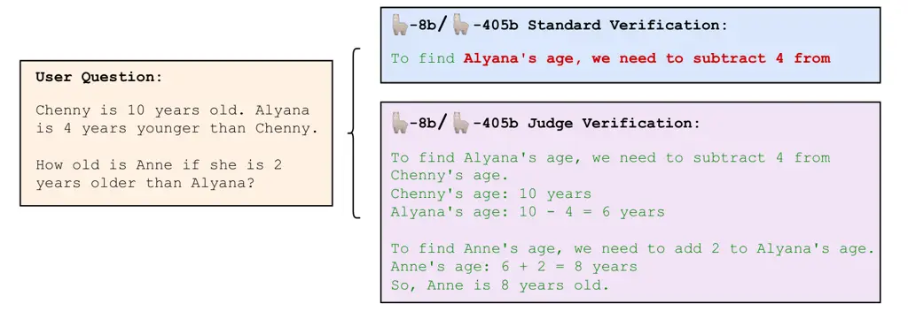
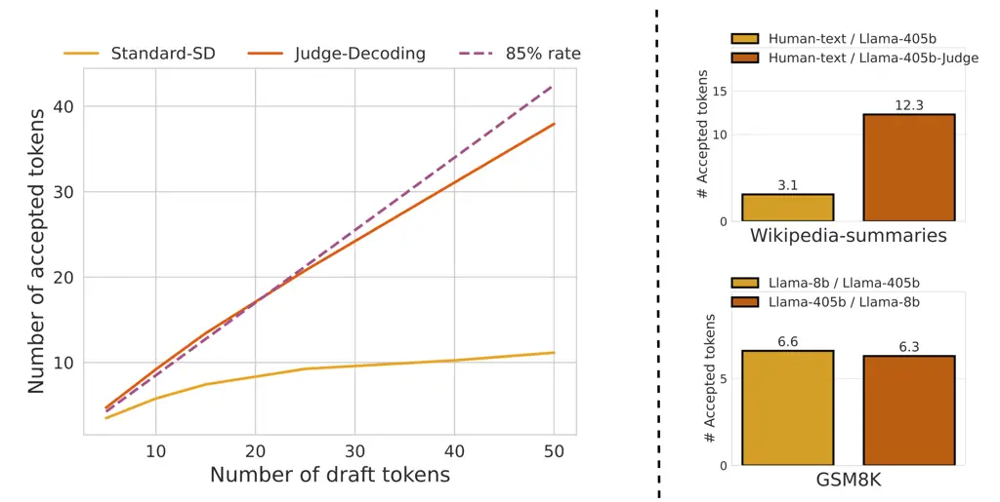
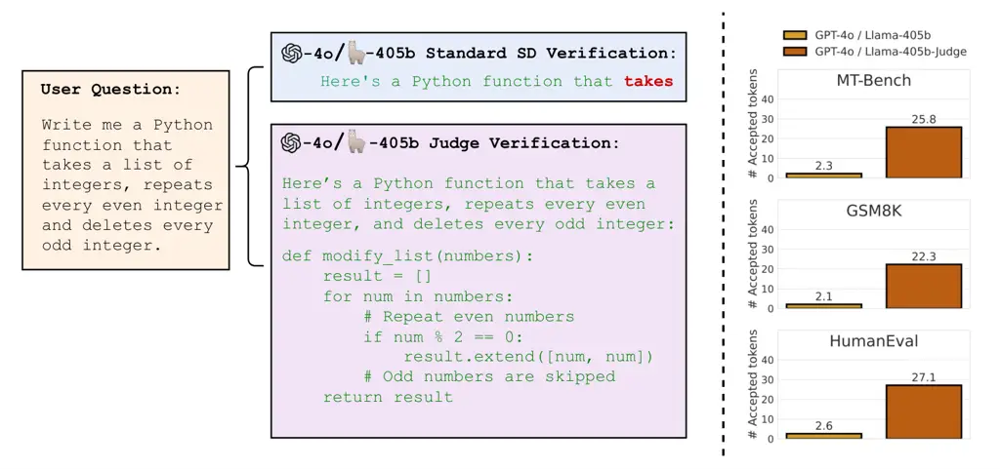
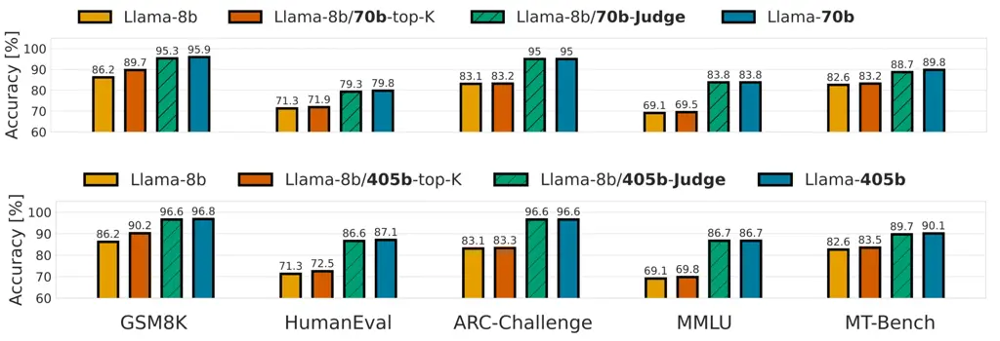
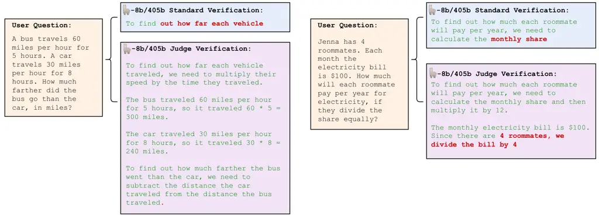
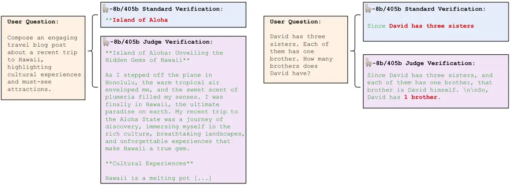
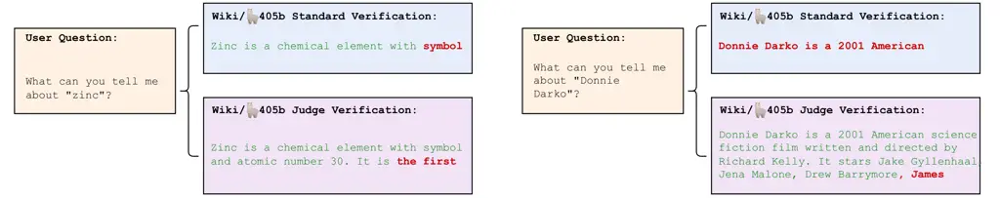

# Judge Decoding: Faster Speculative Sampling Requires Going Beyond Model Alignment

Gregor Bachmann    Sotiris Anagnostidis    Albert Pumarola    Markos
Georgopoulos    Artsiom Sanakoyeu    Yuming Du    Edgar Schönfeld    Ali
Thabet    Jonas Kohler ^(†)^(†)thanks: ^(\*)Work done during an
internship at Meta GenAI. ^(†)Meta GenAI. ^(§)ETH Zürich.  
Correspondence to: gregorb@ethz.ch

###### Abstract

The performance of large language models (LLMs) is closely linked to
their underlying size, leading to ever-growing networks and hence slower
inference. Speculative decoding has been proposed as a technique to
accelerate autoregressive generation, leveraging a fast draft model to
propose candidate tokens, which are then verified in parallel based on
their likelihood under the target model. While this approach guarantees
to reproduce the target output, it incurs a substantial penalty: many
high-quality draft tokens are rejected, even when they represent
objectively valid continuations. Indeed, we show that even powerful
draft models such as GPT-4o, as well as human text cannot achieve high
acceptance rates under the standard verification scheme. This severely
limits the speedup potential of current speculative decoding methods, as
an early rejection becomes overwhelmingly likely when solely relying on
alignment of draft and target.

We thus ask the following question: Can we adapt verification to
recognize correct, but non-aligned replies? To this end, we draw
inspiration from the LLM-as-a-judge framework, which demonstrated that
LLMs are able to rate answers in a versatile way. We carefully design a
dataset to elicit the same capability in the target model by training a
compact module on top of the embeddings to produce “judgements” of the
current continuation. We showcase our strategy on the Llama-3.1 family,
where our 8b/405B-Judge achieves a speedup of $`9\times`$ over
Llama-405B, while maintaining its quality on a large range of
benchmarks. These benefits remain present even in optimized inference
frameworks, where our method reaches up to $`141`$ tokens/s for
8B/70B-Judge and $`129`$ tokens/s for 8B/405B on $`2`$ and $`8`$ H100s
respectively.

|     |
| --- |
|     |



Figure 1: Standard speculative decoding versus our judge decoding
strategy for Llama-3.1-8B as draft and Llama-3.1-405B as target.
Accepted (rejected) tokens are highlighted in green (red).

## 1 Introduction

Large language models have transformed the field of natural language
processing in recent years, displaying astounding capabilities across
various tasks (Radford et al., 2019; OpenAI et al., 2024). The
performance of these models is closely tied to their underlying size,
with bigger models often achieving significantly better results across
benchmarks (Kaplan et al., 2020; Hoffmann et al., 2022). For example,
Meta recently released their largest and best model to date with
Llama-3.1-405B, boasting an enormous parameter count of 405 billion
(Dubey et al., 2024).

While offering great performance, such big models require a vast amount
of resources to be deployed, and inference efficiency starts to pose a
critical problem. Due to the autoregressive nature of decoding coupled
with the large parameter count, token generation becomes a memory-bound
process, especially at small batch sizes (Shazeer, 2019; Ivanov et al.,
2021; Pope et al., 2023). To speed up inference in such a setting,
speculative decoding (SD) has been proposed (Stern et al., 2018; Xia
et al., 2023; Chen et al., 2023; Leviathan et al., 2023), a technique
that leverages the fact that processing several tokens in parallel comes
at no additional latency cost in the memory-bound regime. More
concretely, a small but fast _draft_ model produces a sequence of $`M`$
candidate tokens, which are then verified in parallel by the model of
interest, usually referred to as the _target_ model. In standard SD, the
target model accepts a candidate token if it assigns the same or higher
probability given the context, otherwise a biased coin is flipped. If at
least one candidate token is accepted, inference time is reduced as the
large model needs to be called only once to produce multiple tokens. As
shown in Chen et al. (2023), such a strategy provably preserves the
distribution of the target model, while achieving significant speedups.

Relying on target probabilities guarantees the same output, but as a
consequence, a token is solely judged based on its alignment with the
target model, and not by its inherent contextual quality. As a
consequence, current approaches set the number of candidate tokens to
small numbers $`M\in\{5,7\}`$, as an early rejection becomes
overwhelmingly likely when drafting more. On the other hand, the quality
of “small” language models (and thus the quality of candidate tokens)
has been rapidly improving recently. GPT-4o and the recently introduced
GPT-4o-mini show strong performance across many benchmarks, with OpenAI
actively recommending these models over the more expensive GPT-4.
Similarly, Llama-3.1-8B has achieved bigger gains in performance over
its prior iterations, compared to the larger Llama-3.1-70B (Dubey
et al., 2024), highlighting as well that small models are catching up.
Phi-3-mini is another small model at “only” three billion parameters
that despite its size manages to match the performance of GPT-3.5 (Abdin
et al., 2024).

While draft models are rapidly improving and providing increasingly
high-quality answers, alignment-based verification fails to reflect this
progress, still rejecting tokens that are not perfectly aligned with the
target response (see Fig. 1 for an example). Motivated by this insight,
we explore the following question in this paper:

We draw inspiration from the LLM-as-a-judge framework, where LLMs are
used to judge the quality of other model responses to user questions
(Zheng et al., 2023). These judgements exhibit very strong correlation
with human ratings, making this a cheap and scalable approach for model
quality evaluation. Interestingly, LLM-judges display the ability to
rate answers in a versatile way, allowing them to appreciate correct but
potentially unaligned responses. To equip the target model with similar
capabilities, we design a small dataset consisting of correct and wrong
replies to user questions. We create a diverse set of responses from
several models and precisely annotate the location of the mistaken
tokens. We then leverage the powerful target embeddings to train a small
module with the objective of predicting the correctness of a given
token, mimicking the LLM-judge mechanism.

In summary, we make the following contributions:

- •
  We demonstrate through a series of experiments how the decision
  mechanism in speculative decoding rejects many high quality tokens,
  identifying a key limitation of the technique.
- •
  We adapt verification using ideas from LLM-as-a-judge, eliciting the
  same versatile rating capability in the target by adding a simple
  linear layer that can be trained in under 1.5 hours.
- •
  Using a Llama 8B/70B-Judge, our approach obtains speedups of
  $`9\times`$ over standard decoding, achieving an unprecedented $`129`$
  tokens/s, while maintaining the quality of Llama-405B on a range of
  benchmarks.

## 2 Related Works

Speculative decoding has been used and extended in a range of works,
leading to significant speedups across many model families and datasets.
Several ideas for draft models have been explored in the literature.
Early papers rely on specialized draft models (Sun et al., 2021; Xia
et al., 2023) or smaller versions of the target model (Chen et al.,
2023; Leviathan et al., 2023), usually trained using the same data and
learning protocol. Another line of work uses shallow networks on top of
the target embeddings as a drafter with the goal to predict multiple
tokens into the future (Stern et al., 2018; Cai et al., 2024; Li et al.,
2024a; Li et al., 2024b; Zhang et al., 2024a; Wertheimer et al., 2024;
Ankner et al., 2024; Gloeckle et al., 2024; Bhendawade et al., 2024).
Other approaches use a sub-network of the target model, e.g. Schuster
et al. (2022); Zhang et al. (2024b); Elhoushi et al. (2024); Liu et al.
(2024b); Liu et al. (2024a) skip a percentage of the layers to produce
candidate tokens. Other architectures have also been explored: Wang
et al. (2024) develop a SD variant for Mamba models (Gu & Dao, 2024),
while Christopher et al. (2024) explore diffusion-based language models
as drafters. Other components of the process have been investigated as
well; Huang et al. (2024); Liu et al. (2024c) analyze the number of
draft tokens $`M`$ with the goal of learning to choose it dynamically.
Kim et al. (2023) take a similar approach aiming to measure the
uncertainty of the draft model, allowing the target to take over when
needed. Monea et al. (2023); Bachmann & Nagarajan (2024) on the other
hand explore parallel decoding without a draft by conditioning on
“look-ahead” tokens or using Jacobi iterations (Santilli et al., 2023;
Fu et al., 2024), allowing the target to produce several tokens in one
step.

Many works have aimed to improve the acceptance rates in SD: Zhou et al.
(2024) encourage higher alignment by finetuning with a distillation
loss, Li et al. (2024a); Cai et al. (2024); Ankner et al. (2024); Miao
et al. (2024); Chen et al. (2024) construct token trees out of the
top-$`K`$ predictions in various ways and verify them in parallel using
tree-attention, covering thus a larger space of token combinations.
Other methods propose to exchange more information between draft and
target: Du et al. (2024) allow the draft to access the key-value cache
of the target, while in S et al. (2024) the draft is further conditioned
on target activations. All these methods improve acceptance rates by
either encouraging better alignment with more information or producing
more guesses in parallel. This is different from our work, which seeks
to change the verification scheme itself.

## 3 Verification in Speculative Decoding

### 3.1 Background

#### Speculative decoding.

Denote by $`\texttt{LLM}_{\text{targ}}`$ and
$`\texttt{LLM}_{\text{draft}}`$ the target and draft model respectively.
We use $`\mathcal{V}=\{1,\dots,V\}`$ for the vocabulary. Let
$`M\in\mathbb{N}`$ represent the number of candidate tokens, $`m_{*}`$
the number of accepted tokens and $`\bm{s}\in\mathcal{V}^{L}`$ the
context. Let us denote by

```math
(t_{1},\bm{p}_{1}),\dots,(t_{m},\bm{p}_{m})=\texttt{LLM}^{(m)}(\bm{s}) \tag{1}
```

an autoregressive sampling of $`m`$ tokens from LLM given context
$`\bm{s}`$, where $`t_{1},\dots,t_{m}\in\mathcal{V}`$ are the sampled
tokens and $`\bm{p}_{i}\in\mathbb{R}^{V}`$ the corresponding softmax
probabilities. Further, we denote by

```math
\bm{p}_{1},\dots,\bm{p}_{m+1}=\texttt{LLM}(t_{1},\dots,t_{m};\bm{s}) \tag{2}
```

running the (parallel) forward pass of LLM on tokens
$`t_{1},\dots,t_{m}`$. Notice that this produces one more probability
vector $`\bm{p}_{m+1}`$ as we now also process token $`t_{m}`$.

In SD, the draft model autoregressively produces $`M`$ candidate tokens
given the current context $`\bm{s}`$ using any sampling scheme (but
usually greedy),

```math
(c_{1},\bm{q}_{1}),\dots,(c_{M},\bm{q}_{M})=\texttt{LLM}_{\text{draft}}^{(M)}(\bm{s}) \tag{3}
```

where $`c_{1},\dots,c_{M}`$ are the sampled candidate tokens and
$`\bm{q}_{i}\in\mathbb{R}^{V}`$ for $`i=1,\dots,M`$ are the
corresponding probability vectors over the vocabulary. The probability
of token $`c_{i}`$ under the draft model is thus $`\bm{q}_{i}[c_{i}]`$.
The target model then processes these tokens in parallel, resulting in
probability vectors
$`\bm{p}_{1},\dots,\bm{p}_{M+1}=\texttt{LLM}_{\text{targ}}\left(c_{1},\dots,c_{M};\bm{s}\right)`$.
Rejection now works as follows:

```math
\text{Accept }c_{i}\text{ if all previous tokens are accepted and }\epsilon_{i}<\frac{\bm{p}_{i}[c_{i}]}{\bm{q}_{i}[c_{i}]}\text{ for }\epsilon_{i}\sim\mathcal{U}\left([0,1]\right) \tag{4}
```

In words, a candidate $`c_{i}`$ is accepted if the probability under the
target model is even larger. If the probability is smaller, a stochastic
decision is made according to the discrepancy between the probabilities.
Crucially, one is always guaranteed to produce at least one valid token:
$`\bm{p}_{1}`$ is solely a function of the current context $`\bm{s}`$
and can thus be used to sample a token according to the target
distribution. Similarly, if $`c_{i}`$ is the first rejected token, one
can sample a correct token from $`\bm{p}_{i}`$. Finally, when all
candidate tokens are accepted, an extra token can be sampled from
$`\bm{p}_{M+1}`$. The accepted tokens are then added to the current
context $`\bm{s}`$ and we repeat the steps until completion.

#### Number of draft tokens.

An immediate question comes to mind when examining speculative decoding:
How many draft tokens should one choose for optimal speedup? On the one
hand, if the draft model produces good tokens, one would ideally want to
draft a high number of candidate tokens $`M`$ to avoid invoking the
expensive target model too many times. On the other hand, if many
candidates end up being rejected, one wants to avoid spending the
unnecessary drafting time. The ideal $`M`$ thus heavily depends on the
acceptance rate, which in turn naturally depends on the verification
scheme. In Fig. 2 we plot the average number of accepted tokens as a
function of $`M`$ for the model pair Llama-3.1-8B and Llama-3.1-405B
evaluated on MT-Bench (Zheng et al., 2023) and GSM8K (Cobbe et al., 2021) (yellow curve). We observe that the number of accepted tokens
quickly saturates as a function of $`M`$ and the acceptance rates thus
decrease rapidly. As a result, choosing a large number of draft tokens
$`M`$ solely calls the draft model more in vain, leading to inefficient
inference overall. This is the reason why prior work is limited largely
to $`M\leq 7`$.



Figure 2: Left: Average number of generated tokens as a function of the
number of draft tokens $`M`$ for Llama-8B/405B with standard and judge
verification. Right: Number of accepted tokens on high-quality human
text (top) and for both 8B/405B and 405B/8B (bottom), both standard SD.

### 3.2 Limitations of Standard Verification

#### Rejected tokens.

What types of tokens get rejected in such a setup? In order to obtain an
intuition, we explore the behaviour of SD on several benchmarks
including GSM8K, MT-Bench and HumanEval (Chen et al., 2021). We use
Llama-8B as the draft and Llama-405B as the target model. While there is
a significant discrepancy in terms of performance between these two
models, it is worth highlighting that the draft model achieves
competitive scores on all these tasks. Higher acceptance rates would
thus not necessarily reduce the quality of the output on many of these
examples. In fact, a large number of draft answers could be accepted as
they are, especially those addressing relatively simple queries.

Notably, even in instances where the draft model produces entirely
accurate solutions, the target model frequently rejects numerous tokens
due to the stringent nature of the verification process. This rejection
occurs despite the correctness of the solution, as the target model
seeks alignment with its own response rather than contextual
accuracy (Liu et al., 2023). As illustrated in Fig 1, a correct answer
can be rejected after only two tokens, underscoring the potential for
relaxed verification schemes.¹¹ 1 Additional examples of this phenomenon
are provided in Appendix C.1 for further examination. Intuitively, one
would expect from a well-calibrated verification scheme to allow for
accepting candidate tokens whenever they are contextually correct.
However, as we show in the following two paragraphs, this not the case
for standard logits-based verification.

#### High-quality draft model.

To further demonstrate how valid responses incur high rejection rates,
we perform the following experiment: We take a very powerful LLM as the
draft model and evaluate whether the target model accepts more candidate
tokens, which are now guaranteed to be of high quality. While such a
setup does not make sense for SD from an efficiency point of view (a
powerful drafter is of course too slow), it further investigates if
acceptance rates improve with the quality of responses. To that end we
use GPT-4o as draft model for the target Llama-405B. We generate full
answers with GPT-4o on MT-Bench, GSM8K and HumanEval and simply check
how many tokens the target accepts under greedy decoding before the
first rejection, as there is no way to properly perform SD with
closed-source models. In order to ensure that the target model is able
to “recognize” the high-quality tokens, we use the performant
Llama-405B. We display the average acceptance length and an example
prompt in Fig. 3. Counter-intuitively, we find that the target model
does not reward the higher quality of tokens, accepting only roughly two
before encountering the first rejection. To further explore if this
observation changes when running the complete process of SD, we reverse
the roles of our standard setup and use Llama-405B as draft for
a Llama-8B target model. Similarly, we find that reversing the roles
reduces the number of accepted tokens slightly (see Fig. 2, right side),
even though they are of better quality now. We thus conclude that
acceptance rates do not improve with the quality of the responses.

#### Human expert drafting.

Finally, we evaluate the efficacy of human annotations as candidate
tokens for Llama-405B by processing Wikipedia articles. Using a subset
of the wikipedia-summary dataset (Scheepers, 2017), which contains
high-quality, community-reviewed abstracts, we assess token acceptance
rates under greedy SD verification when prompting the model to summarize
these articles. As illustrated in Fig. 2 (right), a substantial
proportion of tokens face rejection, even within this high-quality
context.

In summary, we conclude that SD verification in its current form is
highly inefficient, as large portions of correct answers are rejected.
Motivated by this insight, the following section presents a more
effective verification scheme that goes beyond model alignment in order
to increase efficiency.



Figure 3: Left: Standard SD and our judge decoding when GPT-4o is
drafting and Llama-405B is verifying. Green denotes accepted and red
rejected tokens. Right: Number of accepted tokens for GPT-4o as draft
and Llama-405B as target for standard speculative and our judge
verification.

## 4 Judge Decoding

As demonstrated by previous experiments, we need a more flexible method
of verifying sequences to increase the number of accepted draft tokens,
especially as draft models continue to improve in quality. Recent work
by Zheng et al. (2023) showed that large LLMs can reliably act as judges
to evaluate responses generated by less capable models, correlating
highly with human ratings. This judging approach allows for more
versatile evaluation, focusing on correctness and contextual quality
rather than strict alignment. However, using LLM-judges directly is not
feasible because (a) they require lengthy system prompts and often
chain-of-thought reasoning, slowing inference, and (b) they evaluate
full answers, whereas SD requires evaluating short, sometime partial
continuations.

We thus aim to achieve this judge-like behavior efficiently while
retaining the advantages of the original verification method, which
ensures accurate next-token predictions in case of rejection. Since this
involves computing embeddings for each draft token, we explore whether
these embeddings contain sufficient information to enable rapid,
reliable judgments.

### 4.1 Versatile and Accurate Verification with Token Embeddings

#### Token embeddings signal errors.

Contrary to standard SD, which accepts or rejects a given token based on
its softmax probabilities (see Eq. 4), we find that the model’s reaction
to processing the incorrect token itself reveals surprisingly valuable
information. Specifically, our experiments show that last hidden layer
embeddings of erroneous tokens effectively ”flag” errors and
contradictions, prompting the model to generate subsequent tokens that
attempt to correct the mistake. This phenomenon is strikingly
illustrated in Fig. 5, where we condition Llama-405B on wrong replies
(highlighted in red) and observe the model’s immediate efforts to
rectify its response (highlighted in green). For instance, when forced
to start with the incorrect statement ”The capital of France is Berlin”,
the model continues with ”… just kidding, it’s actually Paris”. More
such examples can be found in Appendix C.3. This unexpected behavior
suggests the feasibility of leveraging the embedding of the current
token as a means of verifying its correctness. In fact, we will show in
the following that a simple logistic regression head on top of these
embeddings achieves high accuracy and can be trained in under $`1.5`$
hours. Prior, embeddings have also been used to discover latent
knowledge in LLMs and edit them (Burns et al., 2023; Zou et al., 2023a;
von Rütte et al., 2024), further underscoring their richness.

Figure 4: Two examples from our dataset. We highlight the incorrect
tokens in the wrong answer in red.

#### Dataset curation.

In order to leverage token embeddings for verification, we carefully
craft a dataset consisting of high-quality user inputs, along with a
correct and wrong answer pair. The set of input prompts are a mixture of
newly-created questions and two public datasets that we heavily filtered
(Alpaca (Taori et al., 2023) and ARC (Clark et al., 2018)). Importantly,
we only use the input questions and none of the answers. We leverage
several models to produce a diverse set of correct and wrong answers,
including Mistral-Large-2, Llama-8B and Llama-405B, thereby fostering
robustness of the trained judge to recognize correct but differently
aligned solutions. All answers were manually reviewed and corrected by
the authors, who also annotated the precise location of errors in wrong
answers²² 2 Using LLMs to that end proved to be too imprecise, which is
consistent with recent observations in Tyen et al. (2024).. In total we
collected $`500`$ high-quality question, correct answer, wrong answer
tuples. For training, we label every token from the correct answer as
positive, every token from the wrong answer up until the point of
mistake as positive, and finally every mistaken token as negative. Two
examples from our dataset are depicted in Fig. 4. Naturally, the dataset
exhibits a strong imbalance, leading to roughly $`20\times`$ more
positive than negative examples.

#### Model design and training.

Equipped with the dataset, we train a linear head $`f_{\text{judge}}`$
on top of the target embeddings, using a weighted cross entropy loss as
the objective to counter the imbalance in the dataset. We place larger
weight on the negative examples in order to ensure that the resulting
judge does not falsely accept wrong tokens to limit quality degradation
and perform early-stopping to reduce overfitting. We tune all
hyperparameters on a small test split. We experiment with embeddings
from several layers and find that deeper layers perform best with only
insignificant differences, while too shallow layers are clearly worse,
consistent with similar observations in previous works (Zou et al.,
2023b; Gurnee & Tegmark, 2023; von Rütte et al., 2024). For simplicity,
we thus stick to using the last embedding of the target before the RMS
normalization (Zhang & Sennrich, 2019) and the language modelling (LM)
head. While we experimented with more complex architectures, including
MLPs and shallow Transformer networks, a simple linear head proved most
effective, demonstrating excellent performance without overfitting. This
linear classifier offers significant practical advantages: we train only
16.4k parameters on just 30k tokens in less than 1.5 hours, with all
target model parameters remaining frozen. Additional details are
provided in Appendix B.1.

#### Inference.

How is the judge head now combined with the standard elements of SD? In
essence, we use $`f_{\text{judge}}`$ as an additional evaluator for a
given token $`c_{i}`$ (or rather its embedding
$`\bm{e}_{i}\in\mathbb{R}^{D}`$) and accept it if
$`\sigma\left(f_{\text{judge}}(\bm{e}_{i})\right)>\delta`$ for
$`\delta\in[0.5,1]`$, where $`\sigma`$ is the sigmoid function. In other
words, $`\delta`$ serves as a threshold for the confidence of acceptance
and practitioners can thus choose how much to trust the judge layer. In
practice we observed that there is no need to tune this value to ensure
quality and leave it at the natural value $`\delta=0.5`$. Given a
sequence of candidate tokens $`c_{1},\dots,c_{M}`$, we thus get two
accept/reject masks from the target model:
$`\bm{z}_{\text{stand}}\in\{0,1\}^{M}`$ as in standard SD verification
and $`\bm{z}_{\text{judge}}\in\{0,1\}^{M}`$ from the judge head. We take
the logical OR between the two,
$`\bm{z}=\bm{z}_{\text{stand}}\vee\bm{z}_{\text{judge}}`$, since when
the judge rejects and standard SD accepts, the corrected token according
to the target will exactly be the same token. We can thus already accept
it. We illustrate this mechanism in more detail in Appendix B.2. Note
that $`\delta=1`$ reduces to SD.

Figure 5: Left: Conditioning Llama-405B on wrong outputs. The part of
the assistant response in red was forced, while parts in green were
generated freely. Right: Judge illustration where $`s_{L}`$ is the last
token from the context $`\bm{s}`$ and $`c_{1},\dots,c_{M}`$ are
candidate tokens. Orange denotes embeddings, green denotes the LM-head
output and red denotes the produced judgements.

## 5 Evaluation of Judge Decoding

First, we revisit the initial experiments outlined in Sec. 3.2 where we
use GPT-4o as the draft model, as well as human generated text as
candidate tokens. In both cases, the average number of accepted tokens
is significantly higher for our method across datasets (see Fig 2 and
3). The example prompt in Fig. 3 (left) shows that the correct response
of GPT-4o is fully accepted by judge decoding while standard SD rejects
after two words. This illustrates that our verification scheme offers
more versatile decisions.

|                      | $`m_{*}`$ | HuggingFace                 | GPT-Fast                    | Tokens/s $`(512+512)`$ |
| -------------------- | --------- | --------------------------- | --------------------------- | ---------------------- |
| 8B/70B-Standard      | $`6.4`$   | $`1.5\times`$               | $`1.7\times`$               | $`{76.7}`$             |
| 8B/70B-Judge (ours)  | $`18.8`$  | $`2\times`$                 | $`\textbf{3}\bm{\times}`$   | 141.8                  |
| 70B-Eagle-2          | $`4.5`$   | $`\textbf{3.3}\bm{\times}`$ | $`{1.9}{\times}`$           | $`88.1`$               |
| 8B/405B-Standard     | $`6.3`$   | $`5.3\times`$               | $`1.78\times`$              | $`58.7`$               |
| 8B/405B-Judge (ours) | $`19.7`$  | $`\textbf{9.7}\bm{\times}`$ | $`\textbf{3.9}\bm{\times}`$ | 129.3                  |
| 405B-Medusa          | $`<6`$    | $`<6\times`$                | $`1.9\times`$               | $`{108}^{*}`$          |

Table 1: Average acceptance length ($`m_{*}`$) and speedup factor over
standard decoding in HuggingFace and gpt-fast for batch size $`1`$. We
report generation tokens/s for gpt-fast for $`512`$ input and output
tokens, quantized to $`8`$-bit. All 70B (405B) models run on 2 (8) H100
GPUs, except for ^(∗)Medusa (Nvidia, 2024), which runs on significantly
faster H200s with NVLink Switch and TensorRT.

### 5.1 Performance Benchmark

We now evaluate our verification method on standard benchmarks in the SD
literature, including GSM8K (Cobbe et al., 2021), HumanEval (Chen
et al., 2021) and MT-Bench (Zheng et al., 2023). In contrast to standard
SD works, we do need to report the achieved accuracy values of our
strategy, as adapting verification comes with the possibility of
accepting wrong tokens and thus worse performance. To give a more
complete picture, we further include multiple-choice benchmarks ARC
(Clark et al., 2018) and MMLU (Hendrycks et al., 2021), which are
atypical tasks for standard SD as only a few tokens need to be produced,
but further serves as a check that our verification scheme does not
degrade performance. We use the prompting templates from Dubey et al.
(2024).

#### Training-free baseline.

To provide more context for our results and to demonstrate that our
judging strategy goes beyond simple heuristics, we also explore a simple
training-free method to relax the acceptance scheme. In particular, we
investigate top-K verification, where a candidate token $`c_{i}`$ is
accepted, if it is among the $`K`$ highest valued probabilities
$`\bm{p}_{i}`$ produced by token $`c_{i-1}`$. $`K\in\mathbb{N}`$ is a
hyper-parameter of the decoding technique that trades-off quality
against speed. Setting $`K=V`$ reduces to running just the fast draft
model, while $`K=1`$ results in standard SD.

#### Preserving target performance.

We display the accuracy of judge decoding alongside the vanilla draft
and target models, as well as top-$`K`$ decoding in Fig. 6 for both
Llama-405B and Llama-70B. We observe that judge decoding almost exactly
preserves target performance for all benchmarks, showing hence that up
to $`\sim 20`$ tokens can be accepted on average from modern draft
models without loss of quality. The simple heuristic baseline, on the
other hand, is hardly able to improve over the draft model (even for
$`K=5`$), highlighting the difficulty of the problem we address with the
learned head.

### 5.2 Speed Benchmark

The end-to-end speed-ups achieved by SD methods improve as mainly two
factors increase: (1) the number of accepted tokens and (2) the latency
gap between draft and target model. Importantly, the latter is heavily
dependent on whether or not orthogonal inference time optimizations like
quantization, model parallelism and graph/kernel optimization techniques
(like torch.compile and TensorRT) are applied. Unfortunately, prior
works on SD have almost excursively relied on the user-friendly – but
un-optimized – library HuggingFace (Wolf et al., 2020) to implement
their methods. Yet, as rightfully pointed out by  (Wertheimer et al.,
2024), speed-ups of prior SD methods reported in HuggingFace tend to
shrink significantly when moving to optimized inference frameworks. For
example, the acceleration of Eagle on Llama-2-7B reduces from
$`3\times`$ to merely $`1.5\times`$ when using gpt-fast as reported in
Li et al. (2024a). In fact, vanilla Llama-70B without any speculative
decoding achieves a higher throughput in gpt-fast than the
state-of-the-art SD method Eagle-2 does on the same model in HuggingFace
($`{\sim}45`$ vs $`{\sim}33`$ tokens$`/`$s).

To offer a complete picture, we here provide latency benchmarks in both
frameworks, HuggingFace to facilitate comparison, as well as the
arguably more relevant and optimized gpt-fast framework (Pytorch-Team,
2023). If not stated otherwise, we run Llama-70B and Llama-405B on $`2`$
and $`8`$ Nvidia H100 GPUs respectively. Our results are summarized in
Table 1.

#### Llama-3.1-70B.

When drafting with Llama-8B for Llama-70B with batch size $`1`$ in
simple frameworks, the latency delta between the two models is
relatively small, limiting the speed-ups of judge decoding. This is
particularly evident when compared to SD methods that leverage small LM
heads as draft modules (such as Eagle-2 Li et al. (2024b) and Medusa Cai
et al. (2024)). However, in the more realistic setting of deployment
within an optimized inference framework, several latency bottlenecks
(like CPU instruction and memory I/O) are alleviated, resulting in a
more pronounced latency delta between the target and draft models.
Consequently, our method effectively capitalizes on this increased
latency disparity and outperforms the current state-of-the-art by a
substantial margin (see right-hand side of Table 1).

#### Llama-3.1-405B.

Replacing the target model with the more powerful Llama-405B model
significantly increases verification latency. As a result, drafting (and
accepting) longer sequences becomes more crucial for the overall
runtime. In such settings, judge decoding shines because the average
number of accepted tokens is $`>3\times`$ larger than prior works
(left-hand side of Table 1). In particular, both Medusa and Eagle-2³³ 3
of which no $`405`$B version exists. are limited to drafting $`\leq 6`$
token at the time, by the number of heads and the draft tree depth
respectively. Our 8B/405B-Judge, however, accepts close to $`20`$ tokens
at a time and thereby achieves a $`9.7\times`$ speed-up in HuggingFace
and unprecedented $`129`$ tokens/s in gpt-fast.



Figure 6: Benchmark results. Top: Draft Llama-8B and target Llama-70B.
Bottom: Draft Llama-8B and target Llama-405B. We show top-$`K`$
decoding, standard SD for $`M=10`$ and our judge decoding for $`M=25`$
(striped). Notice that our judging method preserves accuracies very
well, while top-$`K`$ loses most performance.

### 5.3 Out-of-distribution Performance

Finally, we investigate to what degree our judge-decoding strategy
extends to situations for which it has not been trained. To this end, we
filter our dataset by removing all coding examples, train the
verification head for Llama-405B on this reduced set and then evaluate
on the coding task HumanEval. While we do observe a drop in performance
from $`86.6`$ to $`80.4\%`$, the performance is still significantly
better than the draft model at $`71.3\%`$, indicating that the notion of
“correctness” transfers between tasks at least to some degree.
Nevertheless, our approach is not a silver bullet and to maintain target
quality it is required to train the judge on data of similar nature.

## 6 Conclusion

In this work we have investigated the verification mechanism in
speculative decoding and identified how its focus on alignment between
draft and target response leads to the rejection of objectively correct
continuations. To fully leverage the improved quality of “small”
language models, we thus proposed an adapted verification scheme that
makes use of the capability of LLMs to judge responses in a versatile
way. This allows for efficiently drafting more tokens, leading to
significant speedups up to $`9\times`$ on a range of benchmarks,
achieving unprecedented speeds of $`129`$ tokens/s for Llama-405B. In
the regime of many draft tokens, “small” language models shine as
drafters compared to the small modules employed in approaches like Eagle
or Medusa and we believe this trend will only further accentuate in the
future. Our approach however also comes with a drawback; the
mathematical guarantee to maintain target quality is lost by relying on
the judge. Through extensive experiments we show that a well-trained
judge does not lose performance on standard benchmarks and we thus view
our approach as a significant first step into this direction. On the
other hand, our strategy in its current version does not present a
silver bullet; novel tasks require the careful annotation of similar
data to maintain quality, otherwise performance is lost. The small
amount of data required in our setup is nevertheless a very encouraging
sign. Future work can hopefully build upon our contributions, further
improving our judge decoding strategy to enable more speedups.

## References

- Abdin et al. (2024) Marah Abdin, Jyoti Aneja, Hany Awadalla, Ahmed
  Awadallah, Ammar Ahmad Awan, Nguyen Bach, Amit Bahree, Arash
  Bakhtiari, Jianmin Bao, Harkirat Behl, Alon Benhaim, Misha Bilenko,
  Johan Bjorck, Sébastien Bubeck, Martin Cai, Qin Cai, Vishrav
  Chaudhary, Dong Chen, Dongdong Chen, Weizhu Chen, Yen-Chun Chen,
  Yi-Ling Chen, Hao Cheng, Parul Chopra, Xiyang Dai, Matthew Dixon,
  Ronen Eldan, Victor Fragoso, Jianfeng Gao, Mei Gao, Min Gao, Amit
  Garg, Allie Del Giorno, Abhishek Goswami, Suriya Gunasekar, Emman
  Haider, Junheng Hao, Russell J. Hewett, Wenxiang Hu, Jamie Huynh, Dan
  Iter, Sam Ade Jacobs, Mojan Javaheripi, Xin Jin, Nikos Karampatziakis,
  Piero Kauffmann, Mahoud Khademi, Dongwoo Kim, Young Jin Kim, Lev
  Kurilenko, James R. Lee, Yin Tat Lee, Yuanzhi Li, Yunsheng Li, Chen
  Liang, Lars Liden, Xihui Lin, Zeqi Lin, Ce Liu, Liyuan Liu, Mengchen
  Liu, Weishung Liu, Xiaodong Liu, Chong Luo, Piyush Madan, Ali
  Mahmoudzadeh, David Majercak, Matt Mazzola, Caio César Teodoro Mendes,
  Arindam Mitra, Hardik Modi, Anh Nguyen, Brandon Norick, Barun Patra,
  Daniel Perez-Becker, Thomas Portet, Reid Pryzant, Heyang Qin, Marko
  Radmilac, Liliang Ren, Gustavo de Rosa, Corby Rosset, Sambudha Roy,
  Olatunji Ruwase, Olli Saarikivi, Amin Saied, Adil Salim, Michael
  Santacroce, Shital Shah, Ning Shang, Hiteshi Sharma, Yelong Shen,
  Swadheen Shukla, Xia Song, Masahiro Tanaka, Andrea Tupini, Praneetha
  Vaddamanu, Chunyu Wang, Guanhua Wang, Lijuan Wang, Shuohang Wang, Xin
  Wang, Yu Wang, Rachel Ward, Wen Wen, Philipp Witte, Haiping Wu,
  Xiaoxia Wu, Michael Wyatt, Bin Xiao, Can Xu, Jiahang Xu, Weijian Xu,
  Jilong Xue, Sonali Yadav, Fan Yang, Jianwei Yang, Yifan Yang, Ziyi
  Yang, Donghan Yu, Lu Yuan, Chenruidong Zhang, Cyril Zhang, Jianwen
  Zhang, Li Lyna Zhang, Yi Zhang, Yue Zhang, Yunan Zhang, and Xiren
  Zhou. Phi-3 technical report: A highly capable language model locally
  on your phone, 2024. URL
  [https://arxiv.org/abs/2404.14219](https://arxiv.org/abs/2404.14219).
- Ankner et al. (2024) Zachary Ankner, Rishab Parthasarathy, Aniruddha
  Nrusimha, Christopher Rinard, Jonathan Ragan-Kelley, and William
  Brandon. Hydra: Sequentially-dependent draft heads for medusa
  decoding, 2024. URL
  [https://arxiv.org/abs/2402.05109](https://arxiv.org/abs/2402.05109).
- Bachmann & Nagarajan (2024) Gregor Bachmann and Vaishnavh Nagarajan.
  The pitfalls of next-token prediction. In _Forty-first International
  Conference on Machine Learning_, 2024. URL
  [https://openreview.net/forum?id=76zq8Wkl6Z](https://openreview.net/forum?id=76zq8Wkl6Z).
- Bhendawade et al. (2024) Nikhil Bhendawade, Irina Belousova, Qichen
  Fu, Henry Mason, Mohammad Rastegari, and Mahyar Najibi. Speculative
  streaming: Fast llm inference without auxiliary models, 2024. URL
  [https://arxiv.org/abs/2402.11131](https://arxiv.org/abs/2402.11131).
- Burns et al. (2023) Collin Burns, Haotian Ye, Dan Klein, and Jacob
  Steinhardt. Discovering latent knowledge in language models without
  supervision. In _The Eleventh International Conference on Learning
  Representations_, 2023. URL
  [https://openreview.net/forum?id=ETKGuby0hcs](https://openreview.net/forum?id=ETKGuby0hcs).
- Cai et al. (2024) Tianle Cai, Yuhong Li, Zhengyang Geng, Hongwu Peng,
  Jason D. Lee, Deming Chen, and Tri Dao. Medusa: Simple llm inference
  acceleration framework with multiple decoding heads. _arXiv preprint
  arXiv: 2401.10774_, 2024.
- Chen et al. (2023) Charlie Chen, Sebastian Borgeaud, Geoffrey Irving,
  Jean-Baptiste Lespiau, Laurent Sifre, and John Jumper. Accelerating
  large language model decoding with speculative sampling, 2023. URL
  [https://arxiv.org/abs/2302.01318](https://arxiv.org/abs/2302.01318).
- Chen et al. (2021) Mark Chen, Jerry Tworek, Heewoo Jun, Qiming Yuan,
  Henrique Ponde de Oliveira Pinto, Jared Kaplan, Harri Edwards, Yuri
  Burda, Nicholas Joseph, Greg Brockman, Alex Ray, Raul Puri, Gretchen
  Krueger, Michael Petrov, Heidy Khlaaf, Girish Sastry, Pamela Mishkin,
  Brooke Chan, Scott Gray, Nick Ryder, Mikhail Pavlov, Alethea Power,
  Lukasz Kaiser, Mohammad Bavarian, Clemens Winter, Philippe Tillet,
  Felipe Petroski Such, Dave Cummings, Matthias Plappert, Fotios
  Chantzis, Elizabeth Barnes, Ariel Herbert-Voss, William Hebgen Guss,
  Alex Nichol, Alex Paino, Nikolas Tezak, Jie Tang, Igor Babuschkin,
  Suchir Balaji, Shantanu Jain, William Saunders, Christopher Hesse,
  Andrew N. Carr, Jan Leike, Josh Achiam, Vedant Misra, Evan Morikawa,
  Alec Radford, Matthew Knight, Miles Brundage, Mira Murati, Katie
  Mayer, Peter Welinder, Bob McGrew, Dario Amodei, Sam McCandlish, Ilya
  Sutskever, and Wojciech Zaremba. Evaluating large language models
  trained on code, 2021. URL
  [https://arxiv.org/abs/2107.03374](https://arxiv.org/abs/2107.03374).
- Chen et al. (2024) Zhuoming Chen, Avner May, Ruslan Svirschevski,
  Yuhsun Huang, Max Ryabinin, Zhihao Jia, and Beidi Chen. Sequoia:
  Scalable, robust, and hardware-aware speculative decoding, 2024. URL
  [https://arxiv.org/abs/2402.12374](https://arxiv.org/abs/2402.12374).
- Christopher et al. (2024) Jacob K Christopher, Brian R Bartoldson,
  Bhavya Kailkhura, and Ferdinando Fioretto. Speculative diffusion
  decoding: Accelerating language generation through diffusion, 2024.
  URL
  [https://arxiv.org/abs/2408.05636](https://arxiv.org/abs/2408.05636).
- Clark et al. (2018) Peter Clark, Isaac Cowhey, Oren Etzioni, Tushar
  Khot, Ashish Sabharwal, Carissa Schoenick, and Oyvind Tafjord. Think
  you have solved question answering? try arc, the ai2 reasoning
  challenge. _ArXiv_, abs/1803.05457, 2018. URL
  [https://api.semanticscholar.org/CorpusID:3922816](https://api.semanticscholar.org/CorpusID:3922816).
- Cobbe et al. (2021) Karl Cobbe, Vineet Kosaraju, Mohammad Bavarian,
  Mark Chen, Heewoo Jun, Lukasz Kaiser, Matthias Plappert, Jerry Tworek,
  Jacob Hilton, Reiichiro Nakano, Christopher Hesse, and John Schulman.
  Training verifiers to solve math word problems, 2021. URL
  [https://arxiv.org/abs/2110.14168](https://arxiv.org/abs/2110.14168).
- Du et al. (2024) Cunxiao Du, Jing Jiang, Xu Yuanchen, Jiawei Wu,
  Sicheng Yu, Yongqi Li, Shenggui Li, Kai Xu, Liqiang Nie, Zhaopeng Tu,
  and Yang You. Glide with a caPE: A low-hassle method to accelerate
  speculative decoding. In _Forty-first International Conference on
  Machine Learning_, 2024. URL
  [https://openreview.net/forum?id=mk8oRhox2l](https://openreview.net/forum?id=mk8oRhox2l).
- Dubey et al. (2024) Abhimanyu Dubey, Abhinav Jauhri, Abhinav Pandey,
  Abhishek Kadian, Ahmad Al-Dahle, Aiesha Letman, Akhil Mathur, Alan
  Schelten, Amy Yang, Angela Fan, Anirudh Goyal, Anthony Hartshorn, Aobo
  Yang, Archi Mitra, Archie Sravankumar, Artem Korenev, Arthur Hinsvark,
  Arun Rao, Aston Zhang, Aurelien Rodriguez, Austen Gregerson, Ava
  Spataru, Baptiste Roziere, Bethany Biron, Binh Tang, Bobbie Chern,
  Charlotte Caucheteux, Chaya Nayak, Chloe Bi, Chris Marra, Chris
  McConnell, Christian Keller, Christophe Touret, Chunyang Wu, Corinne
  Wong, Cristian Canton Ferrer, Cyrus Nikolaidis, Damien Allonsius,
  Daniel Song, Danielle Pintz, Danny Livshits, David Esiobu, Dhruv
  Choudhary, Dhruv Mahajan, Diego Garcia-Olano, Diego Perino, Dieuwke
  Hupkes, Egor Lakomkin, Ehab AlBadawy, Elina Lobanova, Emily Dinan,
  Eric Michael Smith, Filip Radenovic, Frank Zhang, Gabriel Synnaeve,
  Gabrielle Lee, Georgia Lewis Anderson, Graeme Nail, Gregoire Mialon,
  Guan Pang, Guillem Cucurell, Hailey Nguyen, Hannah Korevaar, Hu Xu,
  Hugo Touvron, Iliyan Zarov, Imanol Arrieta Ibarra, Isabel Kloumann,
  Ishan Misra, Ivan Evtimov, Jade Copet, Jaewon Lee, Jan Geffert, Jana
  Vranes, Jason Park, Jay Mahadeokar, Jeet Shah, Jelmer van der Linde,
  Jennifer Billock, Jenny Hong, Jenya Lee, Jeremy Fu, Jianfeng Chi,
  Jianyu Huang, Jiawen Liu, Jie Wang, Jiecao Yu, Joanna Bitton, Joe
  Spisak, Jongsoo Park, Joseph Rocca, Joshua Johnstun, Joshua Saxe,
  Junteng Jia, Kalyan Vasuden Alwala, Kartikeya Upasani, Kate Plawiak,
  Ke Li, Kenneth Heafield, Kevin Stone, Khalid El-Arini, Krithika Iyer,
  Kshitiz Malik, Kuenley Chiu, Kunal Bhalla, Lauren Rantala-Yeary,
  Laurens van der Maaten, Lawrence Chen, Liang Tan, Liz Jenkins, Louis
  Martin, Lovish Madaan, Lubo Malo, Lukas Blecher, Lukas Landzaat, Luke
  de Oliveira, Madeline Muzzi, Mahesh Pasupuleti, Mannat Singh, Manohar
  Paluri, Marcin Kardas, Mathew Oldham, Mathieu Rita, Maya Pavlova,
  Melanie Kambadur, Mike Lewis, Min Si, Mitesh Kumar Singh, Mona Hassan,
  Naman Goyal, Narjes Torabi, Nikolay Bashlykov, Nikolay Bogoychev,
  Niladri Chatterji, Olivier Duchenne, Onur Çelebi, Patrick Alrassy,
  Pengchuan Zhang, Pengwei Li, Petar Vasic, Peter Weng, Prajjwal
  Bhargava, Pratik Dubal, Praveen Krishnan, Punit Singh Koura, Puxin Xu,
  Qing He, Qingxiao Dong, Ragavan Srinivasan, Raj Ganapathy, Ramon
  Calderer, Ricardo Silveira Cabral, Robert Stojnic, Roberta Raileanu,
  Rohit Girdhar, Rohit Patel, Romain Sauvestre, Ronnie Polidoro, Roshan
  Sumbaly, Ross Taylor, Ruan Silva, Rui Hou, Rui Wang, Saghar Hosseini,
  Sahana Chennabasappa, Sanjay Singh, Sean Bell, Seohyun Sonia Kim,
  Sergey Edunov, Shaoliang Nie, Sharan Narang, Sharath Raparthy, Sheng
  Shen, Shengye Wan, Shruti Bhosale, Shun Zhang, Simon Vandenhende,
  Soumya Batra, Spencer Whitman, Sten Sootla, Stephane Collot, Suchin
  Gururangan, Sydney Borodinsky, Tamar Herman, Tara Fowler, Tarek
  Sheasha, Thomas Georgiou, Thomas Scialom, Tobias Speckbacher, Todor
  Mihaylov, Tong Xiao, Ujjwal Karn, Vedanuj Goswami, Vibhor Gupta,
  Vignesh Ramanathan, Viktor Kerkez, Vincent Gonguet, Virginie Do, Vish
  Vogeti, Vladan Petrovic, Weiwei Chu, Wenhan Xiong, Wenyin Fu, Whitney
  Meers, Xavier Martinet, Xiaodong Wang, Xiaoqing Ellen Tan, Xinfeng
  Xie, Xuchao Jia, Xuewei Wang, Yaelle Goldschlag, Yashesh Gaur, Yasmine
  Babaei, Yi Wen, Yiwen Song, Yuchen Zhang, Yue Li, Yuning Mao,
  Zacharie Delpierre Coudert, Zheng Yan, Zhengxing Chen, Zoe Papakipos,
  Aaditya Singh, Aaron Grattafiori, Abha Jain, Adam Kelsey, Adam
  Shajnfeld, Adithya Gangidi, Adolfo Victoria, Ahuva Goldstand, Ajay
  Menon, Ajay Sharma, Alex Boesenberg, Alex Vaughan, Alexei Baevski,
  Allie Feinstein, Amanda Kallet, Amit Sangani, Anam Yunus, Andrei Lupu,
  Andres Alvarado, Andrew Caples, Andrew Gu, Andrew Ho, Andrew Poulton,
  Andrew Ryan, Ankit Ramchandani, Annie Franco, Aparajita Saraf,
  Arkabandhu Chowdhury, Ashley Gabriel, Ashwin Bharambe, Assaf Eisenman,
  Azadeh Yazdan, Beau James, Ben Maurer, Benjamin Leonhardi, Bernie
  Huang, Beth Loyd, Beto De Paola, Bhargavi Paranjape, Bing Liu, Bo Wu,
  Boyu Ni, Braden Hancock, Bram Wasti, Brandon Spence, Brani Stojkovic,
  Brian Gamido, Britt Montalvo, Carl Parker, Carly Burton, Catalina
  Mejia, Changhan Wang, Changkyu Kim, Chao Zhou, Chester Hu,
  Ching-Hsiang Chu, Chris Cai, Chris Tindal, Christoph Feichtenhofer,
  Damon Civin, Dana Beaty, Daniel Kreymer, Daniel Li, Danny Wyatt, David
  Adkins, David Xu, Davide Testuggine, Delia David, Devi Parikh, Diana
  Liskovich, Didem Foss, Dingkang Wang, Duc Le, Dustin Holland, Edward
  Dowling, Eissa Jamil, Elaine Montgomery, Eleonora Presani, Emily Hahn,
  Emily Wood, Erik Brinkman, Esteban Arcaute, Evan Dunbar, Evan
  Smothers, Fei Sun, Felix Kreuk, Feng Tian, Firat Ozgenel, Francesco
  Caggioni, Francisco Guzmán, Frank Kanayet, Frank Seide,
  Gabriela Medina Florez, Gabriella Schwarz, Gada Badeer, Georgia Swee,
  Gil Halpern, Govind Thattai, Grant Herman, Grigory Sizov, Guangyi,
  Zhang, Guna Lakshminarayanan, Hamid Shojanazeri, Han Zou, Hannah Wang,
  Hanwen Zha, Haroun Habeeb, Harrison Rudolph, Helen Suk, Henry
  Aspegren, Hunter Goldman, Ibrahim Damlaj, Igor Molybog, Igor Tufanov,
  Irina-Elena Veliche, Itai Gat, Jake Weissman, James Geboski, James
  Kohli, Japhet Asher, Jean-Baptiste Gaya, Jeff Marcus, Jeff Tang,
  Jennifer Chan, Jenny Zhen, Jeremy Reizenstein, Jeremy Teboul, Jessica
  Zhong, Jian Jin, Jingyi Yang, Joe Cummings, Jon Carvill, Jon Shepard,
  Jonathan McPhie, Jonathan Torres, Josh Ginsburg, Junjie Wang, Kai Wu,
  Kam Hou U, Karan Saxena, Karthik Prasad, Kartikay Khandelwal, Katayoun
  Zand, Kathy Matosich, Kaushik Veeraraghavan, Kelly Michelena, Keqian
  Li, Kun Huang, Kunal Chawla, Kushal Lakhotia, Kyle Huang, Lailin Chen,
  Lakshya Garg, Lavender A, Leandro Silva, Lee Bell, Lei Zhang,
  Liangpeng Guo, Licheng Yu, Liron Moshkovich, Luca Wehrstedt, Madian
  Khabsa, Manav Avalani, Manish Bhatt, Maria Tsimpoukelli, Martynas
  Mankus, Matan Hasson, Matthew Lennie, Matthias Reso, Maxim Groshev,
  Maxim Naumov, Maya Lathi, Meghan Keneally, Michael L. Seltzer, Michal
  Valko, Michelle Restrepo, Mihir Patel, Mik Vyatskov, Mikayel
  Samvelyan, Mike Clark, Mike Macey, Mike Wang, Miquel Jubert Hermoso,
  Mo Metanat, Mohammad Rastegari, Munish Bansal, Nandhini Santhanam,
  Natascha Parks, Natasha White, Navyata Bawa, Nayan Singhal, Nick
  Egebo, Nicolas Usunier, Nikolay Pavlovich Laptev, Ning Dong, Ning
  Zhang, Norman Cheng, Oleg Chernoguz, Olivia Hart, Omkar Salpekar,
  Ozlem Kalinli, Parkin Kent, Parth Parekh, Paul Saab, Pavan Balaji,
  Pedro Rittner, Philip Bontrager, Pierre Roux, Piotr Dollar, Polina
  Zvyagina, Prashant Ratanchandani, Pritish Yuvraj, Qian Liang, Rachad
  Alao, Rachel Rodriguez, Rafi Ayub, Raghotham Murthy, Raghu Nayani,
  Rahul Mitra, Raymond Li, Rebekkah Hogan, Robin Battey, Rocky Wang,
  Rohan Maheswari, Russ Howes, Ruty Rinott, Sai Jayesh Bondu, Samyak
  Datta, Sara Chugh, Sara Hunt, Sargun Dhillon, Sasha Sidorov, Satadru
  Pan, Saurabh Verma, Seiji Yamamoto, Sharadh Ramaswamy, Shaun Lindsay,
  Shaun Lindsay, Sheng Feng, Shenghao Lin, Shengxin Cindy Zha, Shiva
  Shankar, Shuqiang Zhang, Shuqiang Zhang, Sinong Wang, Sneha Agarwal,
  Soji Sajuyigbe, Soumith Chintala, Stephanie Max, Stephen Chen, Steve
  Kehoe, Steve Satterfield, Sudarshan Govindaprasad, Sumit Gupta,
  Sungmin Cho, Sunny Virk, Suraj Subramanian, Sy Choudhury, Sydney
  Goldman, Tal Remez, Tamar Glaser, Tamara Best, Thilo Kohler, Thomas
  Robinson, Tianhe Li, Tianjun Zhang, Tim Matthews, Timothy Chou, Tzook
  Shaked, Varun Vontimitta, Victoria Ajayi, Victoria Montanez, Vijai
  Mohan, Vinay Satish Kumar, Vishal Mangla, Vítor Albiero, Vlad Ionescu,
  Vlad Poenaru, Vlad Tiberiu Mihailescu, Vladimir Ivanov, Wei Li,
  Wenchen Wang, Wenwen Jiang, Wes Bouaziz, Will Constable, Xiaocheng
  Tang, Xiaofang Wang, Xiaojian Wu, Xiaolan Wang, Xide Xia, Xilun Wu,
  Xinbo Gao, Yanjun Chen, Ye Hu, Ye Jia, Ye Qi, Yenda Li, Yilin Zhang,
  Ying Zhang, Yossi Adi, Youngjin Nam, Yu, Wang, Yuchen Hao, Yundi Qian,
  Yuzi He, Zach Rait, Zachary DeVito, Zef Rosnbrick, Zhaoduo Wen, Zhenyu
  Yang, and Zhiwei Zhao. The llama 3 herd of models, 2024. URL
  [https://arxiv.org/abs/2407.21783](https://arxiv.org/abs/2407.21783).
- Elhoushi et al. (2024) Mostafa Elhoushi, Akshat Shrivastava, Diana
  Liskovich, Basil Hosmer, Bram Wasti, Liangzhen Lai, Anas Mahmoud,
  Bilge Acun, Saurabh Agarwal, Ahmed Roman, Ahmed Aly, Beidi Chen, and
  Carole-Jean Wu. LayerSkip: Enabling early exit inference and
  self-speculative decoding. In Lun-Wei Ku, Andre Martins, and Vivek
  Srikumar (eds.), _Proceedings of the 62nd Annual Meeting of the
  Association for Computational Linguistics (Volume 1: Long Papers)_,
  pp. 12622–12642, Bangkok, Thailand, August 2024. Association for
  Computational Linguistics. URL
  [https://aclanthology.org/2024.acl-long.681](https://aclanthology.org/2024.acl-long.681).
- Fu et al. (2024) Yichao Fu, Peter Bailis, Ion Stoica, and Hao Zhang.
  Break the sequential dependency of LLM inference using lookahead
  decoding. In _Forty-first International Conference on Machine
  Learning_, 2024. URL
  [https://openreview.net/forum?id=eDjvSFOkXw](https://openreview.net/forum?id=eDjvSFOkXw).
- Gloeckle et al. (2024) Fabian Gloeckle, Badr Youbi Idrissi, Baptiste
  Roziere, David Lopez-Paz, and Gabriel Synnaeve. Better & faster large
  language models via multi-token prediction. In _Forty-first
  International Conference on Machine Learning_, 2024. URL
  [https://openreview.net/forum?id=pEWAcejiU2](https://openreview.net/forum?id=pEWAcejiU2).
- Gu & Dao (2024) Albert Gu and Tri Dao. Mamba: Linear-time sequence
  modeling with selective state spaces, 2024. URL
  [https://arxiv.org/abs/2312.00752](https://arxiv.org/abs/2312.00752).
- Gurnee & Tegmark (2023) Wes Gurnee and Max Tegmark. Language models
  represent space and time. _arXiv preprint arXiv:2310.02207_, 2023.
- Hendrycks et al. (2021) Dan Hendrycks, Collin Burns, Steven Basart,
  Andy Zou, Mantas Mazeika, Dawn Song, and Jacob Steinhardt. Measuring
  massive multitask language understanding. In _International Conference
  on Learning Representations_, 2021. URL
  [https://openreview.net/forum?id=d7KBjmI3GmQ](https://openreview.net/forum?id=d7KBjmI3GmQ).
- Hoffmann et al. (2022) Jordan Hoffmann, Sebastian Borgeaud, Arthur
  Mensch, Elena Buchatskaya, Trevor Cai, Eliza Rutherford, Diego
  de Las Casas, Lisa Anne Hendricks, Johannes Welbl, Aidan Clark, Tom
  Hennigan, Eric Noland, Katie Millican, George van den Driessche,
  Bogdan Damoc, Aurelia Guy, Simon Osindero, Karen Simonyan, Erich
  Elsen, Jack W. Rae, Oriol Vinyals, and Laurent Sifre. Training
  compute-optimal large language models, 2022. URL
  [https://arxiv.org/abs/2203.15556](https://arxiv.org/abs/2203.15556).
- Huang et al. (2024) Kaixuan Huang, Xudong Guo, and Mengdi Wang.
  Specdec++: Boosting speculative decoding via adaptive candidate
  lengths, 2024. URL
  [https://arxiv.org/abs/2405.19715](https://arxiv.org/abs/2405.19715).
- Ivanov et al. (2021) Andrei Ivanov, Nikoli Dryden, Tal Ben-Nun,
  Shigang Li, and Torsten Hoefler. Data movement is all you need: A case
  study on optimizing transformers. _Proceedings of Machine Learning and
  Systems_, 3:711–732, 2021.
- Kaplan et al. (2020) Jared Kaplan, Sam McCandlish, Tom Henighan,
  Tom B. Brown, Benjamin Chess, Rewon Child, Scott Gray, Alec Radford,
  Jeffrey Wu, and Dario Amodei. Scaling laws for neural language
  models, 2020. URL
  [https://arxiv.org/abs/2001.08361](https://arxiv.org/abs/2001.08361).
- Kim et al. (2023) Sehoon Kim, Karttikeya Mangalam, Suhong Moon,
  Jitendra Malik, Michael W. Mahoney, Amir Gholami, and Kurt Keutzer.
  Speculative decoding with big little decoder. In _Thirty-seventh
  Conference on Neural Information Processing Systems_, 2023. URL
  [https://openreview.net/forum?id=EfMyf9MC3t](https://openreview.net/forum?id=EfMyf9MC3t).
- Leviathan et al. (2023) Yaniv Leviathan, Matan Kalman, and Yossi
  Matias. Fast inference from transformers via speculative decoding. In
  _Proceedings of the 40th International Conference on Machine
  Learning_, ICML’23. JMLR.org, 2023.
- Li et al. (2024a) Yuhui Li, Fangyun Wei, Chao Zhang, and Hongyang
  Zhang. Eagle: Speculative sampling requires rethinking feature
  uncertainty. In _International Conference on Machine Learning_, 2024a.
- Li et al. (2024b) Yuhui Li, Fangyun Wei, Chao Zhang, and Hongyang
  Zhang. Eagle-2: Faster inference of language models with dynamic draft
  trees, 2024b. URL
  [https://arxiv.org/abs/2406.16858](https://arxiv.org/abs/2406.16858).
- Liu et al. (2024a) Fangcheng Liu, Yehui Tang, Zhenhua Liu, Yunsheng
  Ni, Kai Han, and Yunhe Wang. Kangaroo: Lossless self-speculative
  decoding via double early exiting, 2024a. URL
  [https://arxiv.org/abs/2404.18911](https://arxiv.org/abs/2404.18911).
- Liu et al. (2024b) Jiahao Liu, Qifan Wang, Jingang Wang, and Xunliang
  Cai. Speculative decoding via early-exiting for faster LLM inference
  with Thompson sampling control mechanism. In Lun-Wei Ku, Andre
  Martins, and Vivek Srikumar (eds.), _Findings of the Association for
  Computational Linguistics ACL 2024_, pp. 3027–3043, Bangkok, Thailand
  and virtual meeting, August 2024b. Association for Computational
  Linguistics. URL
  [https://aclanthology.org/2024.findings-acl.179](https://aclanthology.org/2024.findings-acl.179).
- Liu et al. (2024c) Tianyu Liu, Yun Li, Qitan Lv, Kai Liu, Jianchen
  Zhu, and Winston Hu. Parallel speculative decoding with adaptive draft
  length, 2024c. URL
  [https://arxiv.org/abs/2408.11850](https://arxiv.org/abs/2408.11850).
- Liu et al. (2023) Xiaoxuan Liu, Lanxiang Hu, Peter Bailis, Ion Stoica,
  Zhijie Deng, Alvin Cheung, and Hao Zhang. Online speculative decoding.
  _arXiv preprint arXiv:2310.07177_, 2023.
- Loshchilov & Hutter (2019) Ilya Loshchilov and Frank Hutter. Decoupled
  weight decay regularization. In _International Conference on Learning
  Representations_, 2019. URL
  [https://openreview.net/forum?id=Bkg6RiCqY7](https://openreview.net/forum?id=Bkg6RiCqY7).
- Miao et al. (2024) Xupeng Miao, Gabriele Oliaro, Zhihao Zhang, Xinhao
  Cheng, Zeyu Wang, Zhengxin Zhang, Rae Ying Yee Wong, Alan Zhu, Lijie
  Yang, Xiaoxiang Shi, Chunan Shi, Zhuoming Chen, Daiyaan Arfeen, Reyna
  Abhyankar, and Zhihao Jia. Specinfer: Accelerating large language
  model serving with tree-based speculative inference and verification.
  In _Proceedings of the 29th ACM International Conference on
  Architectural Support for Programming Languages and Operating Systems,
  Volume 3_, ASPLOS ’24, pp. 932–949, New York, NY, USA, 2024.
  Association for Computing Machinery. ISBN 9798400703867. doi:
  10.1145/3620666.3651335. URL
  [https://doi.org/10.1145/3620666.3651335](https://doi.org/10.1145/3620666.3651335).
- Monea et al. (2023) Giovanni Monea, Armand Joulin, and Edouard Grave.
  Pass: Parallel speculative sampling, 2023. URL
  [https://arxiv.org/abs/2311.13581](https://arxiv.org/abs/2311.13581).
- Nvidia (2024) Nvidia. Llama 3.1 performance with medusa.
  [https://shorturl.at/IkXRC](https://shorturl.at/IkXRC), 2024.
  Accessed: 2024-10-01.
- OpenAI et al. (2024) OpenAI, Josh Achiam, Steven Adler, Sandhini
  Agarwal, Lama Ahmad, Ilge Akkaya, Florencia Leoni Aleman, Diogo
  Almeida, Janko Altenschmidt, Sam Altman, Shyamal Anadkat, Red Avila,
  Igor Babuschkin, Suchir Balaji, Valerie Balcom, Paul Baltescu, Haiming
  Bao, Mohammad Bavarian, Jeff Belgum, Irwan Bello, Jake Berdine,
  Gabriel Bernadett-Shapiro, Christopher Berner, Lenny Bogdonoff, Oleg
  Boiko, Madelaine Boyd, Anna-Luisa Brakman, Greg Brockman, Tim Brooks,
  Miles Brundage, Kevin Button, Trevor Cai, Rosie Campbell, Andrew Cann,
  Brittany Carey, Chelsea Carlson, Rory Carmichael, Brooke Chan, Che
  Chang, Fotis Chantzis, Derek Chen, Sully Chen, Ruby Chen, Jason Chen,
  Mark Chen, Ben Chess, Chester Cho, Casey Chu, Hyung Won Chung, Dave
  Cummings, Jeremiah Currier, Yunxing Dai, Cory Decareaux, Thomas Degry,
  Noah Deutsch, Damien Deville, Arka Dhar, David Dohan, Steve Dowling,
  Sheila Dunning, Adrien Ecoffet, Atty Eleti, Tyna Eloundou, David
  Farhi, Liam Fedus, Niko Felix, Simón Posada Fishman, Juston Forte,
  Isabella Fulford, Leo Gao, Elie Georges, Christian Gibson, Vik Goel,
  Tarun Gogineni, Gabriel Goh, Rapha Gontijo-Lopes, Jonathan Gordon,
  Morgan Grafstein, Scott Gray, Ryan Greene, Joshua Gross,
  Shixiang Shane Gu, Yufei Guo, Chris Hallacy, Jesse Han, Jeff Harris,
  Yuchen He, Mike Heaton, Johannes Heidecke, Chris Hesse, Alan Hickey,
  Wade Hickey, Peter Hoeschele, Brandon Houghton, Kenny Hsu, Shengli Hu,
  Xin Hu, Joost Huizinga, Shantanu Jain, Shawn Jain, Joanne Jang, Angela
  Jiang, Roger Jiang, Haozhun Jin, Denny Jin, Shino Jomoto, Billie Jonn,
  Heewoo Jun, Tomer Kaftan, Łukasz Kaiser, Ali Kamali, Ingmar
  Kanitscheider, Nitish Shirish Keskar, Tabarak Khan, Logan Kilpatrick,
  Jong Wook Kim, Christina Kim, Yongjik Kim, Jan Hendrik Kirchner, Jamie
  Kiros, Matt Knight, Daniel Kokotajlo, Łukasz Kondraciuk, Andrew
  Kondrich, Aris Konstantinidis, Kyle Kosic, Gretchen Krueger, Vishal
  Kuo, Michael Lampe, Ikai Lan, Teddy Lee, Jan Leike, Jade Leung, Daniel
  Levy, Chak Ming Li, Rachel Lim, Molly Lin, Stephanie Lin, Mateusz
  Litwin, Theresa Lopez, Ryan Lowe, Patricia Lue, Anna Makanju, Kim
  Malfacini, Sam Manning, Todor Markov, Yaniv Markovski, Bianca Martin,
  Katie Mayer, Andrew Mayne, Bob McGrew, Scott Mayer McKinney, Christine
  McLeavey, Paul McMillan, Jake McNeil, David Medina, Aalok Mehta, Jacob
  Menick, Luke Metz, Andrey Mishchenko, Pamela Mishkin, Vinnie Monaco,
  Evan Morikawa, Daniel Mossing, Tong Mu, Mira Murati, Oleg Murk, David
  Mély, Ashvin Nair, Reiichiro Nakano, Rajeev Nayak, Arvind Neelakantan,
  Richard Ngo, Hyeonwoo Noh, Long Ouyang, Cullen O’Keefe, Jakub
  Pachocki, Alex Paino, Joe Palermo, Ashley Pantuliano, Giambattista
  Parascandolo, Joel Parish, Emy Parparita, Alex Passos, Mikhail Pavlov,
  Andrew Peng, Adam Perelman, Filipe de Avila Belbute Peres, Michael
  Petrov, Henrique Ponde de Oliveira Pinto, Michael, Pokorny, Michelle
  Pokrass, Vitchyr H. Pong, Tolly Powell, Alethea Power, Boris Power,
  Elizabeth Proehl, Raul Puri, Alec Radford, Jack Rae, Aditya Ramesh,
  Cameron Raymond, Francis Real, Kendra Rimbach, Carl Ross, Bob Rotsted,
  Henri Roussez, Nick Ryder, Mario Saltarelli, Ted Sanders, Shibani
  Santurkar, Girish Sastry, Heather Schmidt, David Schnurr, John
  Schulman, Daniel Selsam, Kyla Sheppard, Toki Sherbakov, Jessica Shieh,
  Sarah Shoker, Pranav Shyam, Szymon Sidor, Eric Sigler, Maddie Simens,
  Jordan Sitkin, Katarina Slama, Ian Sohl, Benjamin Sokolowsky, Yang
  Song, Natalie Staudacher, Felipe Petroski Such, Natalie Summers, Ilya
  Sutskever, Jie Tang, Nikolas Tezak, Madeleine B. Thompson, Phil
  Tillet, Amin Tootoonchian, Elizabeth Tseng, Preston Tuggle, Nick
  Turley, Jerry Tworek, Juan Felipe Cerón Uribe, Andrea Vallone, Arun
  Vijayvergiya, Chelsea Voss, Carroll Wainwright, Justin Jay Wang, Alvin
  Wang, Ben Wang, Jonathan Ward, Jason Wei, CJ Weinmann, Akila
  Welihinda, Peter Welinder, Jiayi Weng, Lilian Weng, Matt Wiethoff,
  Dave Willner, Clemens Winter, Samuel Wolrich, Hannah Wong, Lauren
  Workman, Sherwin Wu, Jeff Wu, Michael Wu, Kai Xiao, Tao Xu, Sarah Yoo,
  Kevin Yu, Qiming Yuan, Wojciech Zaremba, Rowan Zellers, Chong Zhang,
  Marvin Zhang, Shengjia Zhao, Tianhao Zheng, Juntang Zhuang, William
  Zhuk, and Barret Zoph. Gpt-4 technical report, 2024.
- Pope et al. (2023) Reiner Pope, Sholto Douglas, Aakanksha Chowdhery,
  Jacob Devlin, James Bradbury, Jonathan Heek, Kefan Xiao, Shivani
  Agrawal, and Jeff Dean. Efficiently scaling transformer inference.
  _Proceedings of Machine Learning and Systems_, 5:606–624, 2023.
- Pytorch-Team (2023) Pytorch-Team. gpt-fast.
  [https://github.com/pytorch-labs/gpt-fast](https://github.com/pytorch-labs/gpt-fast), 2023.
- Radford et al. (2019) Alec Radford, Jeffrey Wu, Rewon Child, David
  Luan, Dario Amodei, Ilya Sutskever, et al. Language models are
  unsupervised multitask learners. _OpenAI blog_, 1(8):9, 2019.
- S et al. (2024) Aishwarya P S, Pranav Ajit Nair, Yashas Samaga B L,
  Toby James Boyd, Sanjiv Kumar, Prateek Jain, and Praneeth Netrapalli.
  Tandem transformers for inference efficient LLMs. In Ruslan
  Salakhutdinov, Zico Kolter, Katherine Heller, Adrian Weller, Nuria
  Oliver, Jonathan Scarlett, and Felix Berkenkamp (eds.), _Proceedings
  of the 41st International Conference on Machine Learning_, volume 235
  of _Proceedings of Machine Learning Research_, pp. 42906–42917. PMLR,
  21–27 Jul 2024. URL
  [https://proceedings.mlr.press/v235/s24a.html](https://proceedings.mlr.press/v235/s24a.html).
- Santilli et al. (2023) Andrea Santilli, Silvio Severino, Emilian
  Postolache, Valentino Maiorca, Michele Mancusi, Riccardo Marin, and
  Emanuele Rodola. Accelerating transformer inference for translation
  via parallel decoding. In Anna Rogers, Jordan Boyd-Graber, and Naoaki
  Okazaki (eds.), _Proceedings of the 61st Annual Meeting of the
  Association for Computational Linguistics (Volume 1: Long Papers)_,
  pp. 12336–12355, Toronto, Canada, July 2023. Association for
  Computational Linguistics. doi: 10.18653/v1/2023.acl-long.689. URL
  [https://aclanthology.org/2023.acl-long.689](https://aclanthology.org/2023.acl-long.689).
- Scheepers (2017) Thijs Scheepers. Improving the compositionality of
  word embeddings. Master’s thesis, Universiteit van Amsterdam, Science
  Park 904, Amsterdam, Netherlands, 11 2017.
- Schuster et al. (2022) Tal Schuster, Adam Fisch, Jai Gupta, Mostafa
  Dehghani, Dara Bahri, Vinh Q. Tran, Yi Tay, and Donald Metzler.
  Confident adaptive language modeling. In Alice H. Oh, Alekh Agarwal,
  Danielle Belgrave, and Kyunghyun Cho (eds.), _Advances in Neural
  Information Processing Systems_, 2022. URL
  [https://openreview.net/forum?id=uLYc4L3C81A](https://openreview.net/forum?id=uLYc4L3C81A).
- Shazeer (2019) Noam Shazeer. Fast transformer decoding: One write-head
  is all you need, 2019. URL
  [https://arxiv.org/abs/1911.02150](https://arxiv.org/abs/1911.02150).
- Stern et al. (2018) Mitchell Stern, Noam M. Shazeer, and Jakob
  Uszkoreit. Blockwise parallel decoding for deep autoregressive models.
  In _Neural Information Processing Systems_, 2018. URL
  [https://api.semanticscholar.org/CorpusID:53208380](https://api.semanticscholar.org/CorpusID:53208380).
- Sun et al. (2021) Xin Sun, Tao Ge, Furu Wei, and Houfeng Wang.
  Instantaneous grammatical error correction with shallow aggressive
  decoding. In Chengqing Zong, Fei Xia, Wenjie Li, and Roberto Navigli
  (eds.), _Proceedings of the 59th Annual Meeting of the Association for
  Computational Linguistics and the 11th International Joint Conference
  on Natural Language Processing (Volume 1: Long Papers)_, pp.
  5937–5947, Online, August 2021. Association for Computational
  Linguistics. doi: 10.18653/v1/2021.acl-long.462. URL
  [https://aclanthology.org/2021.acl-long.462](https://aclanthology.org/2021.acl-long.462).
- Taori et al. (2023) Rohan Taori, Ishaan Gulrajani, Tianyi Zhang, Yann
  Dubois, Xuechen Li, Carlos Guestrin, Percy Liang, and Tatsunori B.
  Hashimoto. Stanford alpaca: An instruction-following llama model.
  [https://github.com/tatsu-lab/stanford_alpaca](https://github.com/tatsu-lab/stanford_alpaca), 2023.
- Tyen et al. (2024) Gladys Tyen, Hassan Mansoor, Victor Cărbune, Peter
  Chen, and Tony Mak. Llms cannot find reasoning errors, but can correct
  them given the error location, 2024. URL
  [https://arxiv.org/abs/2311.08516](https://arxiv.org/abs/2311.08516).
- von Rütte et al. (2024) Dimitri von Rütte, Sotiris Anagnostidis,
  Gregor Bachmann, and Thomas Hofmann. A language model’s guide through
  latent space. _arXiv preprint arXiv:2402.14433_, 2024.
- Wang et al. (2024) Junxiong Wang, Daniele Paliotta, Avner May,
  Alexander M. Rush, and Tri Dao. The mamba in the llama: Distilling and
  accelerating hybrid models, 2024. URL
  [https://arxiv.org/abs/2408.15237](https://arxiv.org/abs/2408.15237).
- Wertheimer et al. (2024) Davis Wertheimer, Joshua Rosenkranz, Thomas
  Parnell, Sahil Suneja, Pavithra Ranganathan, Raghu Ganti, and Mudhakar
  Srivatsa. Accelerating production llms with combined token/embedding
  speculators, 2024. URL
  [https://arxiv.org/abs/2404.19124](https://arxiv.org/abs/2404.19124).
- Wolf et al. (2020) Thomas Wolf, Lysandre Debut, Victor Sanh, Julien
  Chaumond, Clement Delangue, Anthony Moi, Pierric Cistac, Tim Rault,
  Rémi Louf, Morgan Funtowicz, Joe Davison, Sam Shleifer, Patrick von
  Platen, Clara Ma, Yacine Jernite, Julien Plu, Canwen Xu, Teven Le
  Scao, Sylvain Gugger, Mariama Drame, Quentin Lhoest, and Alexander M.
  Rush. Transformers: State-of-the-art natural language processing. In
  _Proceedings of the 2020 Conference on Empirical Methods in Natural
  Language Processing: System Demonstrations_, pp. 38–45, Online,
  October 2020. Association for Computational Linguistics. URL
  [https://www.aclweb.org/anthology/2020.emnlp-demos.6](https://www.aclweb.org/anthology/2020.emnlp-demos.6).
- Xia et al. (2023) Heming Xia, Tao Ge, Peiyi Wang, Si-Qing Chen, Furu
  Wei, and Zhifang Sui. Speculative decoding: Exploiting speculative
  execution for accelerating seq2seq generation. In Houda Bouamor, Juan
  Pino, and Kalika Bali (eds.), _Findings of the Association for
  Computational Linguistics: EMNLP 2023_, pp. 3909–3925, Singapore,
  December 2023. Association for Computational Linguistics. doi:
  10.18653/v1/2023.findings-emnlp.257. URL
  [https://aclanthology.org/2023.findings-emnlp.257](https://aclanthology.org/2023.findings-emnlp.257).
- Zhang et al. (2024a) Aonan Zhang, Chong Wang, Yi Wang, Xuanyu Zhang,
  and Yunfei Cheng. Recurrent drafter for fast speculative decoding in
  large language models. _arXiv preprint arXiv:2403.09919_, 2024a.
- Zhang & Sennrich (2019) Biao Zhang and Rico Sennrich. Root mean square
  layer normalization, 2019. URL
  [https://arxiv.org/abs/1910.07467](https://arxiv.org/abs/1910.07467).
- Zhang et al. (2024b) Jun Zhang, Jue Wang, Huan Li, Lidan Shou,
  Ke Chen, Gang Chen, and Sharad Mehrotra. Draft& verify: Lossless large
  language model acceleration via self-speculative decoding. In Lun-Wei
  Ku, Andre Martins, and Vivek Srikumar (eds.), _Proceedings of the 62nd
  Annual Meeting of the Association for Computational Linguistics
  (Volume 1: Long Papers)_, pp. 11263–11282, Bangkok, Thailand, August
  2024b. Association for Computational Linguistics. URL
  [https://aclanthology.org/2024.acl-long.607](https://aclanthology.org/2024.acl-long.607).
- Zheng et al. (2023) Lianmin Zheng, Wei-Lin Chiang, Ying Sheng, Siyuan
  Zhuang, Zhanghao Wu, Yonghao Zhuang, Zi Lin, Zhuohan Li, Dacheng Li,
  Eric Xing, Hao Zhang, Joseph E. Gonzalez, and Ion Stoica. Judging
  LLM-as-a-judge with MT-bench and chatbot arena. In _Thirty-seventh
  Conference on Neural Information Processing Systems Datasets and
  Benchmarks Track_, 2023. URL
  [https://openreview.net/forum?id=uccHPGDlao](https://openreview.net/forum?id=uccHPGDlao).
- Zhou et al. (2024) Yongchao Zhou, Kaifeng Lyu, Ankit Singh Rawat,
  Aditya Krishna Menon, Afshin Rostamizadeh, Sanjiv Kumar, Jean-François
  Kagy, and Rishabh Agarwal. Distillspec: Improving speculative decoding
  via knowledge distillation. In _The Twelfth International Conference
  on Learning Representations_, 2024. URL
  [https://openreview.net/forum?id=rsY6J3ZaTF](https://openreview.net/forum?id=rsY6J3ZaTF).
- Zou et al. (2023a) Andy Zou, Long Phan, Sarah Chen, James Campbell,
  Phillip Guo, Richard Ren, Alexander Pan, Xuwang Yin, Mantas Mazeika,
  Ann-Kathrin Dombrowski, Shashwat Goel, Nathaniel Li, Michael J. Byun,
  Zifan Wang, Alex Troy Mallen, Steven Basart, Sanmi Koyejo, Dawn Song,
  Matt Fredrikson, Zico Kolter, and Dan Hendrycks. Representation
  engineering: A top-down approach to ai transparency. _ArXiv_,
  abs/2310.01405, 2023a. URL
  [https://api.semanticscholar.org/CorpusID:263605618](https://api.semanticscholar.org/CorpusID:263605618).
- Zou et al. (2023b) Andy Zou, Long Phan, Sarah Chen, James Campbell,
  Phillip Guo, Richard Ren, Alexander Pan, Xuwang Yin, Mantas Mazeika,
  Ann-Kathrin Dombrowski, et al. Representation engineering: A top-down
  approach to ai transparency. _arXiv preprint arXiv:2310.01405_, 2023b.

## Appendix A Limitations

Here we list limitations of our approach to the best of our knowledge:

- •
  An obvious limitation is the loss of the mathematical guarantee to
  match target quality. While we perform extensive experiments and show
  that quality is maintained, there is no certainty for novel tasks.
- •
  The draft model needs to be of high-quality, otherwise our approach
  naturally does not prove beneficial and too many tokens end up being
  rejected. Self-speculation and small drafters in the spirit of Medusa
  or Eagle are thus not ideal since their generations quickly
  deteriorate when drafting too far into the future.
- •
  Similarly, the target model needs to be of sufficient size to be able
  to provide accurate judgements. Speedups for smaller models such as
  Llama-8B are hence tougher to achieve.
- •
  As highlighted in the main text, new tasks do require careful
  annotation of data to maintain quality. The required amount on the
  other hand turns out to be small in our case.
- •
  If the draft model has safety issues, the target model could
  potentially accept safety-critical tokens through the judge, even if
  the target would otherwise never produce such outputs. We have not
  observed such issues in our experiments but have also not thoroughly
  investigated this problem as it is beyond the scope of our work.

## Appendix B Architectural and Experimental Details

### B.1 Linear head

We train our linear heads using the AdamW optimizer (Loshchilov &
Hutter, 2019) with learning rate $`\eta=0.0001`$, weight decay $`0.1`$
and batch size $`128`$. Note that for Llama-405B, our linear head has
dimension $`16,384`$ while for Llama-70B it has $`8,192`$. Our linear
head can be viewed as an additional entry in the vocabulary
$`\mathcal{V}`$, reducing its inference overhead thus to practically
zero.

### B.2 Judge masking

We describe the the combination of standard and judge mask in more
detail in Fig. 7.

Figure 7: Illustration of mask creation in judge decoding. The decision
mask resulting from the judge is combined with the standard mask from
SD. Once both methods disagree, subsequent tokens get rejected
automatically as usual, even if they were individually accepted.

In the following we will describe in more detail why it is natural to
combine the masks of judge decoding and standard speculative decoding.
We illustrate this in Fig. 8. There are (rare) scenarios where a
candidate token is rejected by judge decoding (such as ”that” in the
example) and the ”corrected” token according to the target model happens
to be the same token (”that” in blue). This situation could repeat; the
very next token could again be rejected by JD and accepted by the target
(token ”guy” in the example). Standard SD on the other hand would accept
all those tokens as the draft exactly matches the target suggestion. We
eventually end up accepting the exact same tokens (in case of rejection
we have to trust the target), so it makes sense to combine the masks and
use the SD mask to not end up repeating the steps (in the example we
combine steps 1., 2., 3. into one step on the right). In our experiments
we do not observe this situation too often, but it can occasionally
occur as the judge was tuned to rather reject than accept when in doubt
to avoid false positives.

Figure 8: Illustration how combining the masks of judge decoding (JD)
and standard speculative decoding (SD) results in the same reply but in
less steps in the (rare) case that JD rejects a token that is actually
the target token.

### B.3 Hardware

We run all of our experiments on a single node of H100-SXM5 GPUs. For
Llama-405B we use $`8`$ GPUs and $`8`$-bit quantization to ensure that
the model fits on a single node. For Llama-70B, we use again $`8`$-bit
quantization but only $`2`$ GPUs.

## Appendix C More prompts

### C.1 Rejected replies for Llama-8B

Here we provide more example prompts where Llama-8B provides completely
correct answers but gets rejected early on by the target Llama-405B. We
display the decision of our judge decoding strategy right below. To also
highlight that judge decoding can catch errors and does not just blindly
accept responses, we also show prompts where Llama-8B provides a wrong
response.



Figure 9: More example prompts for SD for Llama-8B and Llama-405B. Left:
Correct response getting rejected early under standard decoding, while
judge decoding accepts a long continuation (but admittedly
over-cautiously rejects later on). Right: Wrong response that gets
rejected too early by standard decoding and correctly rejected later on
by judge decoding (there are 5 roommates in total).



Figure 10: More example prompts for speculative decoding for Llama-8B
and Llama-405B. Left: Correct response getting rejected early under
standard decoding, while judge decoding accepts a long continuation (but
admittedly over-cautiously rejects later on). Right: Wrong response that
gets rejected too early by standard decoding and correctly rejected
later on by judge decoding (there are 5 roommates in total).

### C.2 Judging of Wikipeda articles

Here we provide more details and examples for verifying Wikipedia
articles. Given a Wikipedia article name such as “aluminium”, “Moore’s
Law” or “Pet Shop Boys”, we prompt the model for information by asking
“What can you tell me about \<insert topic\>?”. We then again compare
greedy matching for standard speculative decoding with our judging
strategy when using the summary part of the Wikipedia article as a
reply. We display some example prompts along with the corresponding
verifications in Fig. 11.



Figure 11: Two example prompts from the subset of wikipedia-summaries,
along with the correspond verifications.

### C.3 Forcing wrong replies for Llama-405B

Here we provide some more evidence of the “correcting” behaviour of
Llama-405B when conditioned on wrong tokens.

Figure 12: Left: Llama-405B corrects the mistake by subtracting l\[i\]
to double instead of triple. Right: Similar correction behaviour by
pointing out that response so far is wrong.

If the model cannot fix the response anymore, then it will often point
out that the completion it just gave is actually wrong, see e.g.
examples in Fig. 13. This again strongly suggests that correctness
should thus be detectable in the embeddings of such tokens.

Figure 13: Left: Llama-405B correctly points out that there is a bug as
the index variable “j”” is not defined. Right: The model can also catch
more subtle mistakes. Here the original list also gets modified as no
copy was made, leading to wrong outputs.
