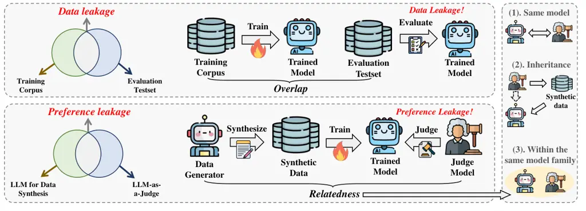
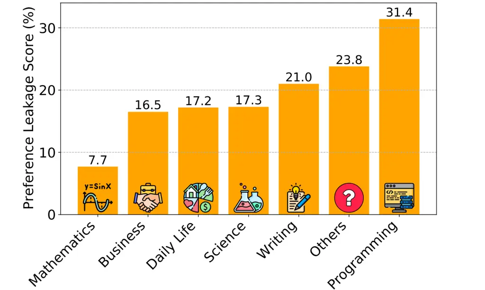
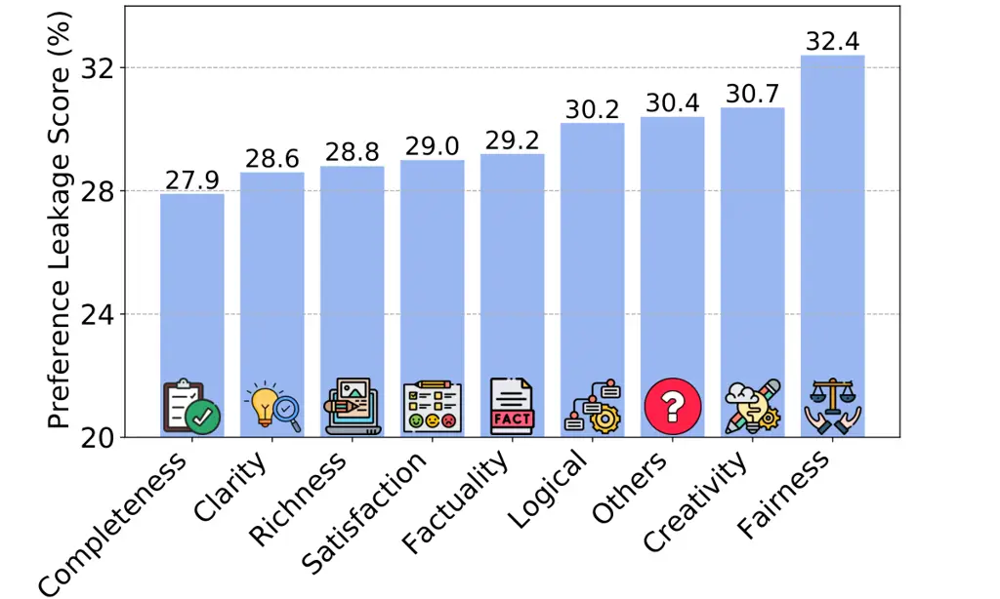
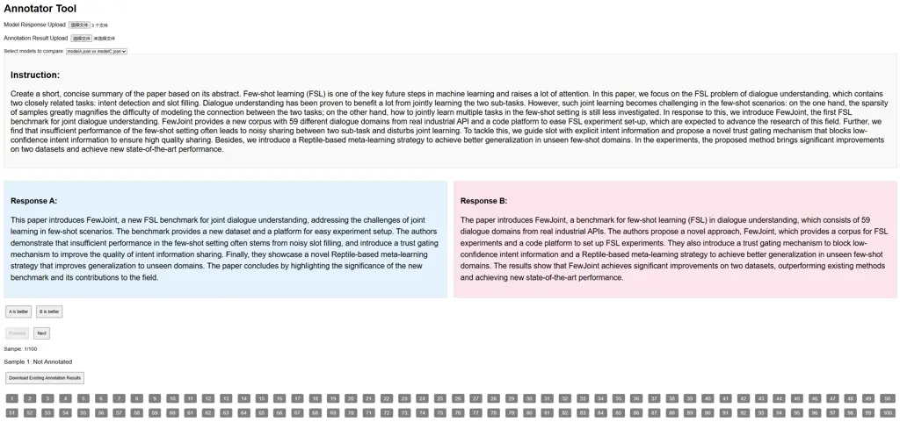

# Preference Leakage: A Contamination Problem in LLM-as-a-judge

Dawei Li ^(†)^(†)thanks: Equal contribution.
Email: [daweili5@asu.edu](mailto:)    Renliang Sun    Yue Huang    Ming
Zhong Affiliation: University of Notre Dame, University of Illinois
Urbana-Champaign    Bohan Jiang    Jiawei Han Affiliation: University of
Notre Dame, University of Illinois Urbana-Champaign    Xiangliang Zhang
   Wei Wang Affiliation: Arizona State University, University of
California, Los Angeles    Huan Liu

###### Abstract

Large Language Models (LLMs) as judges and LLM-based data synthesis have
emerged as two fundamental LLM-driven data annotation methods in model
development. While their combination significantly enhances the
efficiency of model training and evaluation, little attention has been
given to the potential contamination brought by this new model
development paradigm. In this work, we expose preference leakage, a
contamination problem in LLM-as-a-judge caused by the relatedness
between the synthetic data generators and LLM-based evaluators. To study
this issue, we first define three common relatednesses between the data
generator LLM and the judge LLM: being the same model, having an
inheritance relationship, and belonging to the same model family.
Through extensive experiments, we empirically confirm the bias of judges
towards their related student models caused by preference leakage across
multiple LLM baselines and benchmarks. Further analysis suggests that
preference leakage is a pervasive and real-world problem that is harder
to detect compared to previously identified biases in LLM-as-a-judge
scenarios. All of these findings imply that preference leakage is a
widespread and challenging problem in the area of LLM-as-a-judge. We
release all codes and data at:
[https://github.com/David-Li0406/Preference-Leakage](https://github.com/David-Li0406/Preference-Leakage)¹¹
1 More resources on LLM-as-a-judge are on the website:
[https://llm-as-a-judge.github.io/](https://llm-as-a-judge.github.io/).

|     |
| --- |
|     |

## 1 Introduction

Recent advancements in Large Language Models (LLMs) Achiam et al.
(2023); Jaech et al. (2024); Tong et al. (2024); Zhang et al. (2024a);
Tan et al. (2024a); Tan et al. (2025); Huang et al. (2026) have
empowered various downstream tasks and applications. However, this also
poses substantial challenges to the automatic evaluation of these
models. Representatively, LLM-based AI agents’ focus transfer from
traditional natural language processing tasks Yang et al. (2023); Zhang
et al. (2023) to real-world Liu et al. (2023b); Huang et al. (2023),
open-ended response generation Wu et al. (2024), which greatly limits
the applicability of traditional n-gram matching methods (e.g., BLEU
Papineni et al. (2002) and ROUGE Lin (2004)) Liu et al. (2016); Reiter
(2018) or model-based evaluators Zhang et al. (2020); Zhong et al.
(2022) for evaluation.

To address these challenges, the paradigm of LLM-as-a-judge Zheng et al.
(2023a); Li et al. (2024a); Jiang et al. (2024a); Zhong et al. (2024);
Li et al. (2025a); Qu et al. (2025) has been proposed, designed to
leverage LLM as evaluators to assess response quality. By combining
powerful LLMs with well-designed prompting strategies, LLM-as-a-judge
enables human-like evaluation of long-form and open-ended generation in
a more cost-efficient and scalable manner. However, recent studies point
out some weaknesses of such an assessment. For instance, Ye et al.
(2024) explores various biases and vulnerabilities of LLM-as-a-judge,
highlighting the importance of developing a reliable and fair LLM-based
evaluation system.

In this work, we aim to highlight a subtle yet critical bias in
LLM-as-a-Judge: Preference Leakage. This issue arises when the LLMs used
for data generation and evaluation are closely related, causing the
preference of the LLM evaluators to leak to the student models through
synthetic data and thus inflating the evaluation score (as illustrated
in Figure 1). Synthetic data generated by LLMs Gan et al. (2023); Tan
et al. (2024b); Li et al. (2024b); Li et al. (2024c) has become a
cornerstone of model training Lee et al. (2025). When combined with
LLM-as-a-Judge, they offer significant efficiency gains in model
development. However, limited attention has been given to the potential
contamination that occurs when the generator and evaluator LLMs share a
close relationship. During our preliminary study, we find this issue is
particularly pervasive in popular LLM-as-a-judge benchmarks (e.g.,
AlpacaEval 2.0 Dubois et al. (2024) and Arena-Hard Li et al. (2024e))
and LLM-relevant studies (more details can be found in Appendix B), due
to the common reliance on the most advanced LLMs, such as GPT-4 Achiam
et al. (2023), for both data synthesis and evaluation to ensure the
highest quality outputs. In our work, we reveal this relatedness—akin to
the overlap between training data and evaluation sets in traditional
data contamination—would introduce a systematic bias of judge LLMs
towards their related student models (i.e., the model distilled by the
data generator which is related to the judge). Compared to other biases
in LLM-as-a-Judge, such as length bias or egocentric bias Ye et al.
(2024); Panickssery et al. (2024), preference leakage is subtler and
more challenging to detect, especially given that most LLMs do not
disclose their training data.



Figure 1: Overview of preference leakage. We make a comparison between
data leakage and preference leakage and present three types of
relatedness: being the same model, having an inheritance relationship
and belonging to the same model family.

To investigate and reveal the preference leakage problem, we first
define three relatednesses between data generator LLM and judge LLM:
being the same model, having an inheritance relationship, and belonging
to the same model family. Each of these scenarios is commonly
encountered in real-world applications. Then, we pose and answer three
core research questions about preference leakage:

- •
  RQ1: Does preference leakage introduce systematic biases in LLM-based
  evaluation? To answer it, we conduct experiments with various LLM
  baselines in two widely recognized LLM-as-a-judge benchmarks, also
  introduce the preference leakage score to quantify the bias caused by
  preference leakage. The analysis results suggest an obvious bias of
  judging LLMs toward their related student models due to preference
  leakage.
- •
  RQ2: What is the severity of preference leakage under various
  scenarios? We conduct experiments under various data mixing
  strategies, relatedness settings, tuning techniques and real-world
  applications to address it, finding that preference leakage
  consistently affects judge LLMs. Moreover, the severity of preference
  leakage correlates with the degree of relatedness between the data
  generator and LLM judges, as well as the proportion of synthetic data.
- •
  RQ3: What are the underlying mechanisms causing preference leakage?
  For this question, we analyze LLMs’ recognition capabilities on their
  related student models’ generation as well as the distribution of bias
  across different question types and judgment dimensions. The analysis
  reveals that preference leakage is a subtle, hard-to-detect issue for
  the LLM evaluators, particularly affecting subjective questions and
  judgment dimensions.

To summarize, our contributions in this work are as follows:

- •
  For the first time, we introduce preference leakage, a contamination
  issue arising from the relatedness between the data generator and
  judge LLMs.
- •
  We conduct extensive experiments across various LLMs and benchmarks to
  study how and to what extent the potential bias brought by preference
  leakage influences judgment.
- •
  Our further analysis reveals that preference leakage is prevalent in
  diverse scenarios and difficult for judge LLMs to detect, providing
  valuable insights for future research on this challenging issue.

## 2 Related Work

LLM-as-a-Judge. LLM-as-a-Judge, introduced by Zheng et al. (2023a),
leverages LLMs to automatically evaluate responses and assign rewards.
This approach has gained widespread adoption in areas such as model
alignment Zhang et al. (2024d) and benchmarking Liu et al. (2023a);
Zhang et al. (2024b); Gao et al. (2023); Zhong et al. (2024); Beigi
et al. (2024); Li et al. (2026), driving significant progress in the
field. Building on this concept, Zhuge et al. (2024) proposed
Agent-as-a-Judge, where agentic systems are employed to evaluate other
agentic systems. Additionally, Prometheus, a series of open-source LLMs
tailored for LLM-as-a-Judge Kim et al. (2023); Kim et al. (2024),
addresses the prohibitive costs associated with proprietary models,
further democratizing the technology.

Despite its promising potential, recent studies have highlighted the
vulnerabilities and biases of LLM-as-a-Judge Zheng et al. (2023a); Ye
et al. (2024); Koo et al. (2023); Chen et al. (2024); Zheng et al.
(2023a); Huang et al. (2024); Thakur et al. (2024); Shi et al. (2024).
Among these, egocentric bias, where LLM evaluators tend to favor their
generations Koo et al. (2024); Liu et al. (2024b); Wataoka et al.
(2024); Xu et al. (2024b); Rando et al. (2025); Panickssery et al.
(2024); Chen et al. (2025), is most closely related to the preference
leakage proposed in this work.

However, in contrast to the relatively straightforward setting of
egocentric bias, preference leakage presents a more complex and dynamic
challenge. It can arise from various types of relatedness between
data-generating and evaluating LLMs, as well as the intricate flow of
synthetic data among modern LLMs Tan et al. (2024b). Moreover, detecting
preference leakage is also more challenging, given LLMs often do not
disclose their training data and the difficulty in distillation
quantification Wadhwa et al. (2025); Lee et al. (2025).

Data Leakage. The possible overlap between training data and evaluation
benchmarks has become a central issue, since LLMs are usually trained on
extensive web corpora Dodge et al. (2021). This phenomenon, known as
data leakage, can artificially improve the performance of LLMs and
undermine the reliability of the assessment Deng et al. (2024a); Jiang
et al. (2024b); Li et al. (2025b). Several researchers have proposed
methods to detect and mitigate data contamination. Deng et al. (2024b)
proposed a retrieval-based approach to assess the degree of overlap
between pre-training text and benchmark data. Golchin & Surdeanu (2023)
have developed “guided instruction” to flag contaminated instances. Dong
et al. (2024b) proposed the CDD method to identify peaks in the output
distribution to detect data contamination. Several studies analyze data
leakage for specific LLMs Balloccu et al. (2024); Xu et al. (2024a) and
report contamination such as cross-language contamination Yao et al.
(2024) and task contamination Li & Flanigan (2024) that can evade
traditional detection methods. To address data contamination issues, Ni
et al. (2024) have used web user query detection and benchmark mixture.
White et al. (2024) use the most recent information to update the
problem.

## 3 Preference Leakage

### 3.1 LLMs as Oracles: A New Avenue for Contamination

With the advent of LLMs, these models are increasingly employed as
“oracles” in various scenarios: for both synthetic data generation
($`M_{G}`$) and employed as evaluators ($`M_{J}`$) to automate the
assessment. While these approaches enhance scalability and efficiency,
they also introduce potential risks. Specifically, if the LLM used for
data generation ($`M_{G}`$) and the LLM used for evaluation ($`M_{J}`$)
are not independent, a new contamination—preference leakage—can emerge,
biasing evaluation outcomes.

### 3.2 Defining Preference Leakage in LLM-based Evaluation

Formally, to define preference leakage, we consider the following
entities in models development:

- •
  Data Generator LLM, $`M_{G}`$, defining a conditional distribution
  $`P_{M_{G}}(y|x)`$ for generating an output $`y`$ given a prompt
  $`x`$, forming the synthetic dataset $`D_{syn}`$ for student LLMs
  training.
- •
  Student LLM, $`M_{S}`$, trained on data generated by $`M_{G}`$,
  producing an output distribution $`P_{M_{S}}(y|x)`$.
- •
  Judge LLM, $`M_{J}`$, providing a scoring function $`S_{M_{J}}(y|x)`$
  that assesses output $`y`$ for prompt $`x`$.

Preference leakage occurs when the evaluation score assigned by
$`M_{J}`$ to $`M_{S}`$’s outputs is inflated due to an underlying
relatedness between $`M_{G}`$ and $`M_{J}`$. This implies that $`M_{J}`$
may favor outputs from $`M_{S}`$ not solely based on their intrinsic
quality, but because they exhibit spurious features (e.g., style,
format, wording) inherited from $`M_{G}`$, to which $`M_{J}`$ is
predisposed due to this relatedness:

```math
E_{x,y_{S}\sim P_{M_{S}}}[S_{M_{J}}(y_{S}|x)|M_{G}\sim_{rel}M_{J}]>E_{x,y_{S}\sim P_{M_{S}}}[S_{M_{J^{\prime}}}(y_{S}|x)|M_{G}\not\sim_{rel}M_{J^{\prime}}], \tag{1}
```

where $`y_{S}`$ are outputs from $`M_{S}`$. The relation
$`M_{G}\sim_{rel}M_{J}`$ denotes that judge $`M_{J}`$ is related to
$`M_{G}`$, while $`M_{G}\not\sim_{rel}M_{J^{\prime}}`$ denotes that an
alternative judge $`M_{J^{\prime}}`$ is not related to $`M_{G}`$ and
possess comparable intrinsic quality assessment capabilities to
$`M_{J}`$. The expectation is taken over the input distribution
$`\mathcal{X}`$ and the trained Student LLM’s output distribution
$`P_{M_{S}}`$.

### 3.3 Type of LLM “Relatedness”

The condition $`M_{G}\sim_{rel}M_{J}`$ in Equation 1 encapsulates
several ways the Data Generator LLM and Judge LLM can be interconnected.
We identify three common types in the real world:

- •
  Being the Same Model: The most direct form of relatedness occurs when
  the Data Generator LLM and the Judge LLM are the exact same model
  instance:

  ```math
  M_{G}\equiv M_{J}. \tag{2}
  ```

  In this scenario, the inherent preferences in the model that shape its
  generative distribution $`P_{M_{G}}(y|x)`$ are precisely the same as
  those guiding its evaluation via the scoring function
  $`S_{M_{G}}(y|x)`$.

- •
  Inheritance Relationship: One model’s development is directly based on
  another, either by fine-tuning the existing model or by training a new
  model on the other’s outputs, for instance:

  ```math
  M_{J}\leftarrow\text{FineTune}(M_{G},D_{train})\quad\text{or}\quad M_{J}\leftarrow\text{FineTune}(M_{base},D_{syn_{G}}), \tag{3}
  ```

  where $`D_{train}`$ represents general training data used to adapt
  $`M_{G}`$ into $`M_{J}`$, $`M_{base}`$ is a base model, and
  $`D_{syn_{G}}`$ denotes synthetic data generated by $`M_{G}`$. This
  type of relationship is bidirectional; $`M_{G}`$ can similarly inherit
  from $`M_{J}`$ through analogous processes. In such cases, the
  descendant model is likely to internalize and thus favor the
  preferences, styles, or biases of its progenitor.

- •
  Within the Same Model Family: The Data Generator LLM $`M_{G}`$ and
  Judge LLM $`M_{J}`$ belong to the same model family (e.g., different
  versions or sizes of GPT). Models within such a family typically share
  a common architectural blueprint ($`A_{X}`$) and are often developed
  from foundational models pre-trained on substantially overlapping
  datasets ($`D_{X}`$). This shared foundation ($`A_{X},D_{X}`$) would
  lead to correlated preferences and systemic biases characteristic of
  the common origin:

  ```math
  M_{k}\in\text{Family}(A_{X},D_{X})\quad\text{for }k\in\{G,J\}. \tag{4}
  ```

## 4 Main Experiment

### 4.1 Experiment Setup

Models. We choose three powerful LLMs as data generator/ judge models.
They are GPT-4o-2024-11-20 Achiam et al. (2023), Gemini-1.5-flash Team
et al. (2024), and LLaMA-3.3-70B-Instruct-turbo Dubey et al. (2024). For
the student model, we choose Mistral-7B-v0.1 Jiang et al. (2023) and
Qwen-2.5-14B Yang et al. (2024). To avoid potential preference leakage
due to distilling data from other LLMs during the instruction-tuning
process, we choose to use the -pre-trained version rather than the
-instruct version of these student models.

Evaluation Datasets. We choose two representative pairwise evaluation
datasets, Arena-Hard Li et al. (2024e) and AlpacaEval 2.0 Dubois et al.
(2024), to evaluate the trained student models. Arena-Hard includes 500
challenging questions in English. Additionally, the evaluation agreement
between Arena-Hard and LMArena Zheng et al. (2023a)’s hard prompts
achieved a 96.7% Spearman correlation, demonstrating the consistency of
Arena-Hard with human preferences Li et al. (2024e). AlpacaEval 2.0 is
an improved evaluation method based on AlpacaEval Li et al. (2023) and
contains 805 questions. Compared to version 1.0, AlpacaEval 2.0
significantly reduces the effect of text length on the evaluation
results.

Implementation Details. In our main experiment, we examine the
preference leakage introduced by using the same data generator and
evaluator in supervised fine-tuning (SFT). We will discuss other
relatedness and learning methods in Section 5. To obtain synthetic
datasets, We first randomly sample 30,000 prompts from the Ultrafeedback
dataset Cui et al. (2024). The Ultrafeedback dataset includes
instructions from several publicly available high-quality datasets such
as TruthfulQA Lin et al. (2022), FalseQA Hu et al. (2023), and
Evol-Instruct Xu et al. (2023). For each data generator model, we
provide these prompts for them to produce synthetic responses, resulting
in three synthetic instruction datasets. We then use each dataset to
supervised fine-tune the student model, obtaining three different
versions for each baseline: Mistral/ Qwen-GPT-4o, Mistral/
Qwen-Gemini-1.5 and Mistral/ Qwen-LLaMA-3.3. After that, we pair each
two student models and obtain three model pairs. For each model pair, we
perform the pairwise comparison using the three judge models
respectively.

Metrics Based on our hypothesis, preference leakage would lead to bias
of judge LLMs towards their related student models. Following this
principle, we design the preference leakage score $`\text{PLS}(i,j)`$ to
measure the bias in model pair $`(i,j)`$ caused by preference leakage:

```math
\text{PLS}(i,j)=\frac{\left(\frac{\text{WR}(i,i)-\text{AVG}(i,j)}{\text{AVG}(i,j)}\right)+\left(\frac{\text{WR}(j,j)-\text{AVG}(j,i)}{\text{AVG}(j,i)}\right)}{2}, \tag{5}
```

```math
\text{AVG}(i,j)=\frac{\text{WR}(i,i)+\text{WR}(i,j)}{2}. \tag{6}
```

Here $`\text{WR}(i,j)`$ represents the win-rate score from judge model
$`j`$ to student model $`i`$. Intuitively, a large preference leakage
score indicates that the two judge models demonstrate strong bias toward
their related student models, suggesting a significant preference
leakage phenomenon.

The main experiments in Section 4 and the mitigation analyses in
Sections 5.4 and 5.7 are designed for complementary purposes. The main
experiments focus on controlled and interpretable measurement of
preference leakage itself—quantifying the phenomenon across models and
conditions while minimizing confounding factors such as human labeling
noise. In contrast, the mitigation analyses prioritize realism and
external validity, using human-labeled benchmarks and metrics. Since
these setups involve labeled data rather than automatically computed
PLS, they serve as realistic extensions that test mitigation feasibility
in practical LLM-as-a-judge scenarios. More details about model training
and metric explanation can be found in Appendix C.

| Model        | Data Generator/ Judge Pair | Arena-Hard | AlpacaEval 2.0 | Avg.  |
| ------------ | -------------------------- | ---------- | -------------- | ----- |
|              | GPT-4o & Gemini-1.5        | 28.7%      | 18.4%          | 23.6% |
|              | GPT-4o & LLaMA-3.3         | -1.5%      | 1.4%           | -0.1% |
| Mistral-7B   | LLaMA-3.3 & Gemini-1.5     | 13.1%      | 19.8%          | 16.4% |
|              | GPT-4o & Gemini-1.5        | 37.1%      | 18.6%          | 27.9% |
|              | GPT-4o & LLaMA-3.3         | 1.0%       | 2.3%           | 1.7%  |
| Qwen-2.5-14B | LLaMA-3.3 & Gemini-1.5     | 25.4%      | 18.4%          | 21.9% |

Table 1: Preference leakage score result on Arena-Hard and AlpacaEval
2.0. The blue background indicates a negative preference leakage score
value and the purple background indicates a positive value. The deeper
the color, the larger the absolute value.

### 4.2 Main Results

In our main experiment, we aim to provide insights into RQ1.

Preference leakage exists in most model pairs. The original judgment
results from Arena-Hard and AlpacaEval 2.0, along with the calculated
preference leakage scores, are shown in Table 1. As the results
demonstrate, in most model pairs (except Mistral-GPT-4o vs
Mistral-LLaMA-3.3 and Qwen-GPT-4o vs Qwen-LLaMA-3.3), the judge LLMs
exhibit a strong preference toward their related student models, leading
to large positive values in the preference leakage scores. This finding
suggests that preference leakage, along with the resulting bias, is
widespread in SFT when the data generator and evaluator are the same.

Smaller student models cause even more bias from judge LLMs. To
investigate the impact of student model size on the degree of preference
leakage, we conduct additional experiments using various sizes of the
LLaMA-3, Qwen-2.5 and Qwen-3 models. As shown in Figure 2(b) (a), a
notable finding is that the smallest models (LLaMA-3-1B, Qwen-2.5-3B and
Qwen-3-1.7B) exhibit the highest PL scores than their larger
counterparts, indicating greater bias from preference leakage. This
trend contrasts with the influence of model size in data contamination,
where larger models are typically more susceptible Bordt et al. (2024).
We assume that this gap arises from the differing learning capabilities
and behaviors of large and small LLMs: while larger models are more
prone to memorizing Duan et al. (2024) information that exacerbates data
contamination. Compared with them, smaller models may only be able to
learn those spurious features that repeatedly occurs (e.g., format),
leading to more serious preference leakage.

Different benchmarks result in varying degrees of bias under preference
leakage. Another observation from Table 1 and Figure 2(b) (a) is that
the PL scores in ArenaHard are generally higher than those in AlpacaEval
2.0. One possible explanation is the difference in question difficulty
between the two benchmarks, as ArenaHard contains more challenging
questions. Additionally, it may also stem from differences in the
distribution of question types, the impact of which on preference
leakage will be further analyzed in Section 5.6.

(a) PLS on models with various sizes. We conduct the experiment with
GPT-4o and Gemini as data generators and judges.

(b) Experiment results on data mixing. ‘Manual’ and ‘Synthetic represent
mixing with manually-written data and other synthetic data,
respectively.

Figure 2: Experiment results on additional models and data mixing
settings.

## 5 Further Analysis

In this section, we conduct data mixing analysis, relatedness analysis,
learning method analysis, and real-world impact analysis (Section 5.1 -
5.4) to answer RQ2. Due to the cost consideration, we conduct these
analyses on Mistral-GPT-4o vs Mistral-Gemini-1.5. Moreover, we perform
recognition analysis and category analysis to answer RQ3. Additionally,
we also benchmark and explore various calibration methods to address
preference leakage in Section 5.8.

### 5.1 Data Mixing Analysis

In real-world applications, synthetic data from a single LLM is often
mixed with manually-written data or other multi-source synthetic data to
train student models. To mimic these scenarios and explore how much
synthetic data could lead to preference leakage, we conduct a data
mixing analysis. Specifically, we randomly sample 10%, 30%, 50%, and 70%
from the original synthetic dataset and mix it with manually-written
data and multi-source synthetic data, respectively, in order to maintain
a consistent total volume of training data (30,000). For the
manually-written data, we sample from the data pool collected in
Section 5.3. For the multi-source synthetic data, we use the original
synthetic data from Ultrafeedback, which includes responses generated by
various LLMs (e.g., WizardLM, Flcon, etc.). After obtaining the mixing
training data, we train the student models using SFT and calculate their
preference leakage scores based on the judgment results. Figure 2(b) (b)
presents the results with two mixing strategies across two benchmarks.

The degree of preference leakage is directly proportional to the amount
of synthetic data. We observe a strong correlation between the
proportion of synthetic data in the mixture and the preference leakage
score, with no clear threshold separating cases with preference leakage
from those without. This suggests that preference leakage can occur even
with a small amount of leaked synthetic data, posing significant
challenges for its detection.

### 5.2 Relatedness Analysis

We demonstrate the impact of different relatedness conditions between
the data generator and the judge LLM on the preference leakage problem,
as shown in Table 2.

Preference leakage under inheritance settings causes obvious bias of
judges towards their related students. For the inheritance relationship,
we consider the situation where the data generator is inherited from the
judge model. We conducted the following two experiments: (1). we give
the same instructions again as in the SFT stage (Inheritance w/ same
ins.), or (2). we sample the same number of different instructions from
the Ultrafeedback (Inherence w/ different ins.). Then, we let the
fine-tuned Mistral model generate the answers and use these generated
data to fine-tune a new Mistral student model. From the results, with
the same instructions, the average preference leakage score is 19.3%. In
comparison, the score with different instructions is 22.3%. Firstly, in
an inheritance setting, data generators can inherit judges’ preferences,
which are then passed on to new student models, thereby compromising the
fairness of their evaluation. Second, even when different instructions
are used, judges’ preferences leaked to data generators can still be
transferred to the new student model through synthetic data, leading to
a high preference leakage score.

[TABLE]

Table 2: Preference leakage score in different relatedness between the
data generator and the judging LLM.

Models within the same series tend to cause more significant bias. For
two models within the same family, we consider two settings: (1) Same
series, where training data is generated by GPT-4o and Gemini-1.5-flash,
and judged by GPT-4-turbo and Gemini-1.5-pro; (2) Different series,
where training data is still generated by GPT-4o and Gemini-1.5-flash,
but judged by GPT-3.5-turbo and Gemini-1.0-pro. In the same series
setting, the average preference leakage score is 8.9%, indicating that
despite using different models for data generation and judgment, their
relatedness in terms of model family leads to some preference leakage.
In contrast, the different series setting yields a significantly lower
leakage score of 2.8%, likely due to differences in architecture,
training data, and other factors, reducing the influence of
model-related biases in evaluation.

### 5.3 Learning Method Analysis

|     | Arena-Hard | AlpacaEval 2.0 | Avg.  |
| --- | ---------- | -------------- | ----- |
| SFT | 28.7%      | 18.4%          | 23.6% |
| DPO | 7.7%       | 2.7%           | 5.2%  |
| ICL | -4.2%      | -1.1%          | -2.7% |

Table 3: Preference leakage score in different learning methods.

We also compare three learning methods, supervised fine-tuning (SFT),
direct preference optimization (DPO) Rafailov et al. (2024), and
in-context learning (ICL) Dong et al. (2024a), to explore the different
influences to them under preference leakage. We first build a data pool
based on human-written instruction-tuning data from OASST Köpf et al.
(2024), LIMA Zhou et al. (2024), and MOSS Sun et al. (2024b) to
supervised fine-tune the pre-trained model. For DPO, we sample 2
responses for each instruction from sampled UltraFeedback instruction
and prompt each data generator to produce the pairwise feedback. Then we
use the DPO loss to further train the fine-tuned policy on each
synthetic pairwise dataset. Appendix E shows the prompt we use to craft
synthetic pairwise feedback. For ICL, we sample 4 instruction-response
pairs from each LLMs’ synthetic dataset as the demonstration during
inference.

Tuning approaches would leak judges’ preference to the student models.
Various learning methods show significant differences in preference
leakage scores across learning methods. SFT exhibits the highest average
leakage score at 23.6%. In contrast, DPO achieves a much lower score of
5.2%, which is consistent with previous studies in data contamination
that pairwise optimization can reduce the risk of memorizing or
contaminating sensitive training data compared to straightforward
supervised fine-tuning Hayes et al. (). Meanwhile, ICL, which relies on
contextual examples without model tuning, is least affected by the data
generator’s preferences, resulting in the lowest leakage scores.

### 5.4 Real-world Impact Analysis

| Bias Type          | Evaluator     | Target Models       | Ranking Difference |
| ------------------ | ------------- | ------------------- | ------------------ |
| Egocentric Bias    | GPT-4 Preview | GPT-4 Preview       | 1.00               |
| Preference Leakage |               | Vicuna 7B/ 13B/ 33B | 1.33               |

Table 4: Impact analysis of preference leakage in real-world
LLM-as-a-Judge leaderboards. For each bias type, we assess its impact by
calculating the ranking difference of the corresponding model in LMArena
and AlpacaEval 2.0, obtained by subtracting the ranking in AlpacaEval
2.0 from that in LMArena. A larger positive ranking difference indicates
AlpacaEval 2.0 ranks the target models in higher positions, denoting a
greater impact of the corresponding bias.

In this section, we investigate the impact of preference leakage in
real-world LLM-as-a-Judge leaderboards. While broader leaderboard
coverage would enhance external validity, few student–teacher
(distillation) pairs are publicly documented, and most leaderboards lack
the metadata needed for controlled cross-model comparisons. Moreover,
re-evaluating all leaderboard entries with alternate judges would be
computationally prohibitive at the current scale. Therefore, we focus on
AlpacaEval and LMArena as interpretable case studies and leave
large-scale multi-judge re-evaluations for future work. To quantify the
effect of each bias type, we calculate the ranking difference of each
target model in LMArena and AlpacaEval 2.0.

As shown in Table 4, both egocentric bias and preference leakage result
in a positive ranking difference, indicating that both lead to evaluator
bias favoring the target models. Notably, the ranking difference
associated with preference leakage is even higher than that of
egocentric bias, highlighting the substantial impact of preference
leakage on real-world LLM-as-a-Judge leaderboards.

### 5.5 Can Judges Recognize Student Models?

| Task | Model      | Accuracy  |          |
| ---- | ---------- | --------- | -------- |
|      |            | Pointwise | Pairwise |
| SR   | GPT-4o     | 41.0%     | 52.0%    |
|      | Gemini-1.5 | 53.2%     | 44.2%    |
|      | LLaMA-3.3  | 41.8%     | 29.8%    |
| RC   | BERT       | 82.4%     |          |

Table 5: Student recognition (binary classification) and response
classification results (three-class classification). SR: Student
Recognition, RC: Response Classification.

Previous studies demonstrate the LLM judges can recognize and thus
prefer their own generation Panickssery et al. (2024). In this work, we
pose a similar question: Does preference leakage also source from the
LLM judges’ recognition of their related student models’ generation? To
study this, we follow Panickssery et al. (2024) to prompt the three
judge LLMs and test whether they could recognize their related student
models’ generation. Additionally, we split three student models’
generation into training and testing sets, and train a BERT classifier
to perform a three-class classification inspired by the previous study
on detecting human-AI text Zhang et al. (2024c). For student
recognition, we follow Panickssery et al. (2024) to use both pointwise
and pairwise settings. Due to the space limitation, more detailed
prompting and training settings can be found in Appendix G.

Judge LLMs do not show good performance in recognizing the generation of
their student models. As the result presented in Table 5, we find that
the recognition performance of each judge LLM in the content of related
students is poor, with accuracy around the performance of random
guesses. This suggests that preference leakage is subtler and
harder-to-detect for judge LLMs, in contrast to the more obvious
egocentric bias.

Certain features embedded in student models through synthetic data.
Although judge LLMs do not perform well in related student recognition,
we notice the fine-tuned BERT classification demonstrates a high
accuracy score in classifier responses generated by each student model.
This suggests that certain characteristics—such as style and format—are
embedded in the student models through the synthetic responses. This
finding further supports the existence of preference leakage and lays
the groundwork for future research aimed at detecting and preventing it.
For example, an external detector estimating model-relatedness could
provide an auxiliary confidence signal to calibrate or penalize biased
judgments.

### 5.6 Impact on Question Type & Judgment Dimension



(a) Question Type



(b) Judgment dimension

Figure 3: Category analysis results on question type and judgment
dimension.

In this section, we explore the impact of preference leakage across
various question types and judgment dimensions. For the question type
analysis, we first propose several general question types based on the
question clusters introduced by Arena-Hard. Then, we prompt GPT-4o to
map each question in Arena-Hard and AlpacaEval to one of the question
types and calculate the preference leakage score for each question
category. For the judgment dimension analysis, we follow the judgment
dimensions introduced by Liu et al. (2023a) and also utilize GPT-4o to
map the rationale generated by judge LLMs to one or multiple judgment
dimensions. More detailed prompt can be found in Appendix H. The
analysis results are presented in Figure 3.

Subjective question and judgment dimension tend to lead to more bias.
For question type analysis, we find objective questions with a
definitive answer, like mathematical ones, demonstrate the least
preference leakage. By contrast, subjective questions that have more
than one standard answer, such as programming and writing, usually lead
to a more obvious preference leakage. This observation is also applied
to judgment dimension analysis, as objective dimensions (like
completeness) have an overall lower leakage degree compared with
subjective ones (like fairness). This suggests that preference leakage
tends to be more significant in objective questions and dimensions,
where the contaminated model is more likely to receive biased
preference.

### 5.7 Effect of Spurious Features on Preference Leakage

| Setting       | GPT & Gemini | GPT & LLaMA | LLaMA & Gemini |
| ------------- | ------------ | ----------- | -------------- |
| Baseline      | 17.5%        | 2.3%        | 18.8%          |
| – w/o style   | 9.0%         | 3.3%        | 14.6%          |
| – w/o format  | 9.8%         | 1.9%        | 14.5%          |
| – w/o wording | 11.2%        | 2.4%        | 18.2%          |

Table 6: Effect of removing spurious features on the PLS. We consider
style, format and wording as potential spurious features in this
analysis.

To further validate that spurious stylistic or formatting cues
contribute to preference leakage, we conduct an additional ablation
experiment focusing on three major feature categories: style, format,
and wording. Using the Qwen-3-8B model as the rewriting model, we apply
a paraphrasing pipeline to selectively remove each type of spurious
feature from model responses before evaluation. We employ Gemini-2.0 as
the judge model since Gemini-1.5 is no longer available at the time we
did this experiment. The rewriting process ensures that the semantic
content of each response remains intact while selectively neutralizing
surface-level artifacts such as syntactic rhythm, punctuation patterns,
and lexical framing cues. By isolating these variables, the experiment
provides a more direct lens into how superficial similarity between
generator and judge responses shapes preference leakage.

The resulting PLS are reported in Table 6. We observe notable reductions
in PLS for the two model pairs that originally exhibited the strongest
leakage (GPT & Gemini, LLaMA & Gemini), confirming that removing
spurious stylistic alignment substantially mitigates bias. Among the
three feature types, eliminating style and format yields the largest
decrease in leakage, suggesting that judges tend to rely heavily on
stylistic regularities—such as tone consistency, sentence cadence, and
punctuation density—when forming preference judgments. In contrast,
removing wording-level features (e.g., synonym substitution or phrase
order changes) produces only minor improvements, implying that lexical
similarity alone is not the dominant driver. Interestingly, the
magnitude of reduction varies across judge families: GPT-based judges
appear especially responsive to stylistic coherence, while LLaMA-based
judges are more influenced by formatting regularity. This diversity in
sensitivity indicates that each model family has distinct perceptual
priors about linguistic structure, which can amplify different forms of
spurious correlation. Overall, these findings empirically substantiate
our mechanistic explanation that stylistic and formatting artifacts
embedded in student models act as hidden conduits for preference
leakage, shaping judge behavior through subtle surface-level mimicry
rather than semantic alignment.

### 5.8 Exploring Mitigation Method for Preference Leakage

| Method                    | Error Bias |
| ------------------------- | ---------- |
| Base                      | 17.8       |
| \+ Prompting              | 18.3       |
| \+ Chain-of-Thought       | 15.6       |
| \+ Paraphrase             | 18.7       |
| \+ Auto Calibration       | 20.7       |
| \+ Contextual Calibration | 7.3        |

Table 7: Error Bias with various mitigation methods (lower is better).

To benchmark and explore mitigation methods for preference leakage, we
collected human-labeled pairwise judgments from several reward
benchmarks, including PPE Perez et al. (2022), MTBench Zheng et al.
(2023b), and Human Preference Chiang et al. (2024). Using GPT-4 as the
target model, we selected samples in which one of the responses was
generated by GPT-4’s related student (e.g., Vicuna, Alpaca). We then
tested several mitigation methods on this dataset, including prompting,
chain-of-thought (CoT), paraphrasing, auto-calibration, and contextual
calibration. The explored mitigation strategies can be grouped into two
complementary layers: (i) Input- or reasoning-level debiasing
(prompting, CoT, paraphrasing) that modifies inputs or reasoning chains;
and (ii) Output-level calibration (auto- or contextual calibration) that
adjusts scores post-hoc. We further propose a new metric, Error Bias,
based on human-labeled judgments:
$`\mathrm{ErrorBias}=\frac{N_{\text{target-prefer-other-win}}}{N_{\text{other-win}}}-\frac{N_{\text{other-prefer-target-win}}}{N_{\text{target-win}}}`$.
Intuitively, this metric quantifies the difference between
target-preferred errors and other-preferred errors; a value close to 0
indicates that preference leakage is mitigated. Our preliminary results
show that contextual calibration with an additional held-out set for
bias adjustment is the most effective, reducing Error Bias from 17.8 to
7.3. We provide a more detailed explanation about each method in
Appendix C.4.

## 6 Conclusion

In this work, we formally highlight the preference leakage problem in
LLM-as-a-judge systems. The results of our main experiment, measured
using the proposed preference leakage score, reveal a clear bias in each
judge toward their respective student model. We also observe that this
bias is more pronounced in certain question types and smaller student
models. Furthermore, we conduct additional analysis on various factors,
including the relationship between the data generator and judge LLMs,
model tuning techniques, data mixing strategies, and real-world
applications. Our findings suggest that preference leakage can cause
significant bias across diverse scenarios. Finally, we investigate the
underlying mechanisms of preference leakage, demonstrating that it is a
challenging and hard-to-detect issue, especially in subjective questions
and judgment dimensions.

## Ethics Statement

We adhere to the ICLR Code of Ethics. No private, sensitive, or
personally identifiable data are involved. Our work does not raise
foreseeable ethical concerns or produce harmful societal outcomes.

## Reproducibility Statement

Reproducibility is central to our work. All datasets used in our
experiments are standard benchmarks that are publicly available. We
provide full details of the training setup, model architectures, and
evaluation metrics in the main paper and appendix. Upon acceptance, we
will release our codebase, including scripts for preprocessing,
training, and evaluation, along with configuration files and
documentation to facilitate exact reproduction of our results. Random
seeds and hyperparameters will also be included to further ensure
reproducibility.

## Acknowledgement

This work was supported by the U.S. Department of Defense, Army Research
Office (Award No. W911NF-24-2-0175). The views and conclusions contained
in this document are those of the authors and should not be interpreted
as representing official policies, either expressed or implied, of DOD
or ARO.

## References

- Achiam et al. (2023) Josh Achiam, Steven Adler, Sandhini Agarwal, Lama
  Ahmad, Ilge Akkaya, Florencia Leoni Aleman, Diogo Almeida, Janko
  Altenschmidt, Sam Altman, Shyamal Anadkat, et al. Gpt-4 technical
  report. _ArXiv preprint_, abs/2303.08774, 2023. URL
  [https://arxiv.org/abs/2303.08774](https://arxiv.org/abs/2303.08774).
- Balloccu et al. (2024) Simone Balloccu, Patrícia Schmidtová, Mateusz
  Lango, and Ondřej Dušek. Leak, cheat, repeat: Data contamination and
  evaluation malpractices in closed-source llms. In _Proceedings of the
  18th Conference of the European Chapter of the Association for
  Computational Linguistics (Volume 1: Long Papers)_, pp. 67–93, 2024.
- Beigi et al. (2024) Alimohammad Beigi, Bohan Jiang, Dawei Li, Zhen
  Tan, Pouya Shaeri, Tharindu Kumarage, Amrita Bhattacharjee, and Huan
  Liu. Can llms improve multimodal fact-checking by asking relevant
  questions? _arXiv preprint arXiv:2410.04616_, 2024.
- Bordt et al. (2024) Sebastian Bordt, Harsha Nori, and Rich Caruana.
  Elephants never forget: Testing language models for memorization of
  tabular data. In _NeurIPS 2023 Second Table Representation Learning
  Workshop_, 2024.
- Chen et al. (2024) Guiming Hardy Chen, Shunian Chen, Ziche Liu, Feng
  Jiang, and Benyou Wang. Humans or llms as the judge? a study on
  judgement biases. _arXiv preprint arXiv:2402.10669_, 2024.
- Chen et al. (2025) Wei-Lin Chen, Zhepei Wei, Xinyu Zhu, Shi Feng, and
  Yu Meng. Do llm evaluators prefer themselves for a reason? _arXiv
  preprint arXiv:2504.03846_, 2025.
- Chiang et al. (2024) Wei-Lin Chiang, Lianmin Zheng, Ying Sheng,
  Anastasios Nikolas Angelopoulos, Tianle Li, Dacheng Li, Hao Zhang,
  Banghua Zhu, Michael Jordan, Joseph E. Gonzalez, and Ion Stoica.
  Chatbot arena: An open platform for evaluating llms by human
  preference, 2024.
- Cui et al. (2024) Ganqu Cui, Lifan Yuan, Ning Ding, Guanming Yao,
  Bingxiang He, Wei Zhu, Yuan Ni, Guotong Xie, Ruobing Xie, Yankai Lin,
  et al. Ultrafeedback: Boosting language models with scaled ai
  feedback. In _Forty-first International Conference on Machine
  Learning_, 2024.
- Deng et al. (2024a) Chunyuan Deng, Yilun Zhao, Yuzhao Heng, Yitong Li,
  Jiannan Cao, Xiangru Tang, and Arman Cohan. Unveiling the spectrum of
  data contamination in language models: A survey from detection to
  remediation. _arXiv preprint arXiv:2406.14644_, 2024a.
- Deng et al. (2024b) Chunyuan Deng, Yilun Zhao, Xiangru Tang, Mark
  Gerstein, and Arman Cohan. Investigating data contamination in modern
  benchmarks for large language models. In _Proceedings of the 2024
  Conference of the North American Chapter of the Association for
  Computational Linguistics: Human Language Technologies (Volume 1: Long
  Papers)_, pp. 8698–8711, 2024b.
- Dodge et al. (2021) Jesse Dodge, Maarten Sap, Ana Marasović, William
  Agnew, Gabriel Ilharco, Dirk Groeneveld, Margaret Mitchell, and Matt
  Gardner. Documenting large webtext corpora: A case study on the
  colossal clean crawled corpus. In _Proceedings of the 2021 Conference
  on Empirical Methods in Natural Language Processing_, pp.
  1286–1305, 2021.
- Dong et al. (2024a) Qingxiu Dong, Lei Li, Damai Dai, Ce Zheng,
  Jingyuan Ma, Rui Li, Heming Xia, Jingjing Xu, Zhiyong Wu, Baobao
  Chang, et al. A survey on in-context learning. In _Proceedings of the
  2024 Conference on Empirical Methods in Natural Language Processing_,
  pp. 1107–1128, 2024a.
- Dong et al. (2024b) Yihong Dong, Xue Jiang, Huanyu Liu, Zhi Jin, Bin
  Gu, Mengfei Yang, and Ge Li. Generalization or memorization: Data
  contamination and trustworthy evaluation for large language models.
  _arXiv preprint arXiv:2402.15938_, 2024b.
- Duan et al. (2024) Sunny Duan, Mikail Khona, Abhiram Iyer, Rylan
  Schaeffer, and Ila R Fiete. Uncovering latent memories: Assessing data
  leakage and memorization patterns in large language models. _arXiv
  preprint arXiv:2406.14549_, 2024.
- Dubey et al. (2024) Abhimanyu Dubey, Abhinav Jauhri, Abhinav Pandey,
  Abhishek Kadian, Ahmad Al-Dahle, Aiesha Letman, Akhil Mathur, Alan
  Schelten, Amy Yang, Angela Fan, et al. The llama 3 herd of models.
  _arXiv preprint arXiv:2407.21783_, 2024.
- Dubois et al. (2024) Yann Dubois, Balázs Galambosi, Percy Liang, and
  Tatsunori B Hashimoto. Length-controlled alpacaeval: A simple way to
  debias automatic evaluators. _arXiv preprint arXiv:2404.04475_, 2024.
- Gan et al. (2023) Ruyi Gan, Ziwei Wu, Renliang Sun, Junyu Lu, Xiaojun
  Wu, Dixiang Zhang, Kunhao Pan, Ping Yang, Qi Yang, Jiaxing Zhang,
  et al. Ziya2: Data-centric learning is all llms need. _arXiv preprint
  arXiv:2311.03301_, 2023.
- Gao et al. (2023) Mingqi Gao, Jie Ruan, Renliang Sun, Xunjian Yin,
  Shiping Yang, and Xiaojun Wan. Human-like summarization evaluation
  with chatgpt. _arXiv preprint arXiv:2304.02554_, 2023.
- Golchin & Surdeanu (2023) Shahriar Golchin and Mihai Surdeanu. Time
  travel in llms: Tracing data contamination in large language models.
  _arXiv preprint arXiv:2308.08493_, 2023.
- (20) Jamie Hayes, Ilia Shumailov, William P Porter, and Aneesh Pappu.
  Measuring memorization in rlhf for code completion. In _The Thirteenth
  International Conference on Learning Representations_.
- Hu et al. (2023) Shengding Hu, Yifan Luo, Huadong Wang, Xingyi Cheng,
  Zhiyuan Liu, and Maosong Sun. Won’t get fooled again: Answering
  questions with false premises. In _Proceedings of the 61st Annual
  Meeting of the Association for Computational Linguistics (Volume 1:
  Long Papers)_, pp. 5626–5643, 2023.
- Huang et al. (2026) Wei-Chieh Huang, Weizhi Zhang, Yueqing Liang,
  Yuanchen Bei, Yankai Chen, Tao Feng, Xinyu Pan, Zhen Tan, Yu Wang,
  Tianxin Wei, et al. Rethinking memory mechanisms of foundation agents
  in the second half. _arXiv preprint arXiv:2602.06052_, 2026.
- Huang et al. (2023) Yue Huang, Jiawen Shi, Yuan Li, Chenrui Fan,
  Siyuan Wu, Qihui Zhang, Yixin Liu, Pan Zhou, Yao Wan, Neil Zhenqiang
  Gong, et al. Metatool benchmark for large language models: Deciding
  whether to use tools and which to use. _arXiv preprint
  arXiv:2310.03128_, 2023.
- Huang et al. (2024) Yue Huang, Lichao Sun, Haoran Wang, Siyuan Wu,
  Qihui Zhang, Yuan Li, Chujie Gao, Yixin Huang, Wenhan Lyu, Yixuan
  Zhang, et al. Position: Trustllm: Trustworthiness in large language
  models. In _International Conference on Machine Learning_, pp.
  20166–20270. PMLR, 2024.
- Jaech et al. (2024) Aaron Jaech, Adam Kalai, Adam Lerer, Adam
  Richardson, Ahmed El-Kishky, Aiden Low, Alec Helyar, Aleksander Madry,
  Alex Beutel, Alex Carney, et al. Openai o1 system card. _arXiv
  preprint arXiv:2412.16720_, 2024.
- Jiang et al. (2023) Albert Q Jiang, Alexandre Sablayrolles, Arthur
  Mensch, Chris Bamford, Devendra Singh Chaplot, Diego de las Casas,
  Florian Bressand, Gianna Lengyel, Guillaume Lample, Lucile Saulnier,
  et al. Mistral 7b. _arXiv preprint arXiv:2310.06825_, 2023.
- Jiang et al. (2024a) Bohan Jiang, Dawei Li, Zhen Tan, Xinyi Zhou,
  Ashwin Rao, Kristina Lerman, H Russell Bernard, and Huan Liu.
  Assessing the impact of conspiracy theories using large language
  models. _arXiv preprint arXiv:2412.07019_, 2024a.
- Jiang et al. (2024b) Minhao Jiang, Ken Ziyu Liu, Ming Zhong, Rylan
  Schaeffer, Siru Ouyang, Jiawei Han, and Sanmi Koyejo. Investigating
  data contamination for pre-training language models. _arXiv preprint
  arXiv:2401.06059_, 2024b.
- Kim et al. (2023) Seungone Kim, Jamin Shin, Yejin Cho, Joel Jang,
  Shayne Longpre, Hwaran Lee, Sangdoo Yun, Seongjin Shin, Sungdong Kim,
  James Thorne, et al. Prometheus: Inducing fine-grained evaluation
  capability in language models. In _The Twelfth International
  Conference on Learning Representations_, 2023.
- Kim et al. (2024) Seungone Kim, Juyoung Suk, Shayne Longpre,
  Bill Yuchen Lin, Jamin Shin, Sean Welleck, Graham Neubig, Moontae Lee,
  Kyungjae Lee, and Minjoon Seo. Prometheus 2: An open source language
  model specialized in evaluating other language models. _arXiv preprint
  arXiv:2405.01535_, 2024.
- Koo et al. (2023) Ryan Koo, Minhwa Lee, Vipul Raheja, Jong Inn Park,
  Zae Myung Kim, and Dongyeop Kang. Benchmarking cognitive biases in
  large language models as evaluators. _arXiv preprint
  arXiv:2309.17012_, 2023.
- Koo et al. (2024) Ryan Koo, Minhwa Lee, Vipul Raheja, Jong Inn Park,
  Zae Myung Kim, and Dongyeop Kang. Benchmarking cognitive biases in
  large language models as evaluators. In _ACL (Findings)_, 2024.
- Köpf et al. (2024) Andreas Köpf, Yannic Kilcher, Dimitri von Rütte,
  Sotiris Anagnostidis, Zhi Rui Tam, Keith Stevens, Abdullah Barhoum,
  Duc Nguyen, Oliver Stanley, Richárd Nagyfi, et al. Openassistant
  conversations-democratizing large language model alignment. _Advances
  in Neural Information Processing Systems_, 36, 2024.
- Lee et al. (2024) Harrison Lee, Samrat Phatale, Hassan Mansoor, Thomas
  Mesnard, Johan Ferret, Kellie Ren Lu, Colton Bishop, Ethan Hall,
  Victor Carbune, Abhinav Rastogi, et al. Rlaif vs. rlhf: Scaling
  reinforcement learning from human feedback with ai feedback. In
  _Forty-first International Conference on Machine Learning_, 2024.
- Lee et al. (2025) Sunbowen Lee, Junting Zhou, Chang Ao, Kaige Li,
  Xinrun Du, Sirui He, Jiaheng Liu, Min Yang, Zhoufutu Wen, and Shiwen
  Ni. Distillation quantification for large language models. _arXiv
  preprint arXiv:2501.12619_, 2025.
- Li & Flanigan (2024) Changmao Li and Jeffrey Flanigan. Task
  contamination: Language models may not be few-shot anymore. In
  _Proceedings of the AAAI Conference on Artificial Intelligence_,
  volume 38, pp. 18471–18480, 2024.
- Li et al. (2024a) Dawei Li, Bohan Jiang, Liangjie Huang, Alimohammad
  Beigi, Chengshuai Zhao, Zhen Tan, Amrita Bhattacharjee, Yuxuan Jiang,
  Canyu Chen, Tianhao Wu, et al. From generation to judgment:
  Opportunities and challenges of llm-as-a-judge. _arXiv preprint
  arXiv:2411.16594_, 2024a.
- Li et al. (2024b) Dawei Li, Zhen Tan, Tianlong Chen, and Huan Liu.
  Contextualization distillation from large language model for knowledge
  graph completion. _arXiv preprint arXiv:2402.01729_, 2024b.
- Li et al. (2024c) Dawei Li, Shu Yang, Zhen Tan, Jae Young Baik,
  Sunkwon Yun, Joseph Lee, Aaron Chacko, Bojian Hou, Duy Duong-Tran,
  Ying Ding, et al. Dalk: Dynamic co-augmentation of llms and kg to
  answer alzheimer’s disease questions with scientific literature.
  _arXiv preprint arXiv:2405.04819_, 2024c.
- Li et al. (2025a) Dawei Li, Zhen Tan, and Huan Liu. Exploring large
  language models for feature selection: A data-centric perspective.
  _ACM SIGKDD Explorations Newsletter_, 26(2):44–53, 2025a.
- Li et al. (2025b) Dawei Li, Zhen Tan, Chengshuai Zhao, Bohan Jiang,
  Baixiang Huang, Pingchuan Ma, Abdullah Alnaibari, Kai Shu, and Huan
  Liu. Who’s your judge? on the detectability of llm-generated
  judgments. _arXiv preprint arXiv:2509.25154_, 2025b.
- Li et al. (2026) Dawei Li, Yuguang Yao, Zhen Tan, Huan Liu, and
  Ruocheng Guo. Toolprmbench: Evaluating and advancing process reward
  models for tool-using agents. _arXiv preprint arXiv:2601.12294_, 2026.
- Li et al. (2024d) Ming Li, Lichang Chen, Jiuhai Chen, Shwai He,
  Jiuxiang Gu, and Tianyi Zhou. Selective reflection-tuning:
  Student-selected data recycling for llm instruction-tuning. _arXiv
  preprint arXiv:2402.10110_, 2024d.
- Li et al. (2024e) Tianle Li, Wei-Lin Chiang, Evan Frick, Lisa Dunlap,
  Tianhao Wu, Banghua Zhu, Joseph E Gonzalez, and Ion Stoica. From
  crowdsourced data to high-quality benchmarks: Arena-hard and
  benchbuilder pipeline. _arXiv preprint arXiv:2406.11939_, 2024e.
- Li et al. (2023) Xuechen Li, Tianyi Zhang, Yann Dubois, Rohan Taori,
  Ishaan Gulrajani, Carlos Guestrin, Percy Liang, and Tatsunori B
  Hashimoto. Alpacaeval: An automatic evaluator of instruction-following
  models, 2023.
- Lin (2004) Chin-Yew Lin. Rouge: A package for automatic evaluation of
  summaries. In _Text summarization branches out_, pp. 74–81, 2004.
- Lin et al. (2022) Stephanie Lin, Jacob Hilton, and Owain Evans.
  Truthfulqa: Measuring how models mimic human falsehoods. In
  _Proceedings of the 60th Annual Meeting of the Association for
  Computational Linguistics (Volume 1: Long Papers)_, pp.
  3214–3252, 2022.
- Liu et al. (2016) Chia-Wei Liu, Ryan Lowe, Iulian Serban, Mike
  Noseworthy, Laurent Charlin, and Joelle Pineau. How NOT to evaluate
  your dialogue system: An empirical study of unsupervised evaluation
  metrics for dialogue response generation. In Jian Su, Kevin Duh, and
  Xavier Carreras (eds.), _Proceedings of the 2016 Conference on
  Empirical Methods in Natural Language Processing_, pp. 2122–2132,
  Austin, Texas, 2016. Association for Computational Linguistics. doi:
  10.18653/v1/D16-1230. URL
  [https://aclanthology.org/D16-1230](https://aclanthology.org/D16-1230).
- Liu et al. (2024a) Wei Liu, Weihao Zeng, Keqing He, Yong Jiang, and
  Junxian He. What makes good data for alignment? a comprehensive study
  of automatic data selection in instruction tuning. In _The Twelfth
  International Conference on Learning Representations_, 2024a.
- Liu et al. (2023a) Xiao Liu, Xuanyu Lei, Shengyuan Wang, Yue Huang,
  Zhuoer Feng, Bosi Wen, Jiale Cheng, Pei Ke, Yifan Xu, Weng Lam Tam,
  et al. Alignbench: Benchmarking chinese alignment of large language
  models. _arXiv preprint arXiv:2311.18743_, 2023a.
- Liu et al. (2023b) Xiao Liu, Hao Yu, Hanchen Zhang, Yifan Xu, Xuanyu
  Lei, Hanyu Lai, Yu Gu, Hangliang Ding, Kaiwen Men, Kejuan Yang, et al.
  Agentbench: Evaluating llms as agents. _arXiv preprint
  arXiv:2308.03688_, 2023b.
- Liu et al. (2024b) Yiqi Liu, Nafise Sadat Moosavi, and Chenghua Lin.
  Llms as narcissistic evaluators: When ego inflates evaluation scores.
  In _Findings of the Association for Computational Linguistics ACL
  2024_, pp. 12688–12701, 2024b.
- Ni et al. (2024) Jinjie Ni, Fuzhao Xue, Xiang Yue, Yuntian Deng, Mahir
  Shah, Kabir Jain, Graham Neubig, and Yang You. Mixeval: Deriving
  wisdom of the crowd from llm benchmark mixtures. _arXiv preprint
  arXiv:2406.06565_, 2024.
- Panickssery et al. (2024) Arjun Panickssery, Samuel R Bowman, and Shi
  Feng. Llm evaluators recognize and favor their own generations. _arXiv
  preprint arXiv:2404.13076_, 2024.
- Papineni et al. (2002) Kishore Papineni, Salim Roukos, Todd Ward, and
  Wei-Jing Zhu. Bleu: a method for automatic evaluation of machine
  translation. In _Proceedings of the 40th annual meeting of the
  Association for Computational Linguistics_, pp. 311–318, 2002.
- Perez et al. (2022) Ethan Perez et al. Ppe: Pairwise preference
  evaluation benchmark for large language models, 2022. URL
  [https://github.com/openai/ppe](https://github.com/openai/ppe).
- Qu et al. (2025) Huaizhi Qu, Inyoung Choi, Zhen Tan, Song Wang, Sukwon
  Yun, Qi Long, Faizan Siddiqui, Kwonjoon Lee, and Tianlong Chen.
  Efficient map estimation of llm judgment performance with prior
  transfer. _arXiv preprint arXiv:2504.12589_, 2025.
- Rafailov et al. (2024) Rafael Rafailov, Archit Sharma, Eric Mitchell,
  Christopher D Manning, Stefano Ermon, and Chelsea Finn. Direct
  preference optimization: Your language model is secretly a reward
  model. _Advances in Neural Information Processing Systems_, 36, 2024.
- Rando et al. (2025) Javier Rando, Jie Zhang, Nicholas Carlini, and
  Florian Tramèr. Adversarial ml problems are getting harder to solve
  and to evaluate. _arXiv preprint arXiv:2502.02260_, 2025.
- Reiter (2018) Ehud Reiter. A structured review of the validity of
  BLEU. _Computational Linguistics_, 44(3):393–401, 2018. doi:
  10.1162/coli_a_00322. URL
  [https://aclanthology.org/J18-3002](https://aclanthology.org/J18-3002).
- Shi et al. (2024) Jiawen Shi, Zenghui Yuan, Yinuo Liu, Yue Huang, Pan
  Zhou, Lichao Sun, and Neil Zhenqiang Gong. Optimization-based prompt
  injection attack to llm-as-a-judge. In _Proceedings of the 2024 on ACM
  SIGSAC Conference on Computer and Communications Security_, CCS ’24,
  pp. 660–674, New York, NY, USA, 2024. Association for Computing
  Machinery. ISBN 9798400706363. doi: 10.1145/3658644.3690291. URL
  [https://doi.org/10.1145/3658644.3690291](https://doi.org/10.1145/3658644.3690291).
- Sun et al. (2024a) Renliang Sun, Mengyuan Liu, Shiping Yang, Rui Wang,
  Junqing He, and Jiaxing Zhang. Fostering natural conversation in large
  language models with nico: a natural interactive conversation dataset.
  _arXiv preprint arXiv:2408.09330_, 2024a.
- Sun et al. (2024b) Tianxiang Sun, Xiaotian Zhang, Zhengfu He, Peng Li,
  Qinyuan Cheng, Xiangyang Liu, Hang Yan, Yunfan Shao, Qiong Tang,
  Shiduo Zhang, Xingjian Zhao, Ke Chen, Yining Zheng, Zhejian Zhou,
  Ruixiao Li, Jun Zhan, Yunhua Zhou, Linyang Li, Xiaogui Yang, Lingling
  Wu, Zhangyue Yin, Xuanjing Huang, Yu-Gang Jiang, and Xipeng Qiu. Moss:
  An open conversational large language model. _Machine Intelligence
  Research_, 2024b. ISSN 2731-5398. URL
  [https://github.com/OpenMOSS/MOSS](https://github.com/OpenMOSS/MOSS).
- Tan et al. (2024a) Zhen Tan, Lu Cheng, Song Wang, Bo Yuan, Jundong Li,
  and Huan Liu. Interpreting pretrained language models via concept
  bottlenecks. In _Pacific-Asia conference on knowledge discovery and
  data mining_, pp. 56–74. Springer, 2024a.
- Tan et al. (2024b) Zhen Tan, Dawei Li, Song Wang, Alimohammad Beigi,
  Bohan Jiang, Amrita Bhattacharjee, Mansooreh Karami, Jundong Li,
  Lu Cheng, and Huan Liu. Large language models for data annotation and
  synthesis: A survey. In _Proceedings of the 2024 Conference on
  Empirical Methods in Natural Language Processing_, pp. 930–957, 2024b.
- Tan et al. (2025) Zhen Tan, Chengshuai Zhao, Song Wang, Jundong Li,
  Tianlong Chen, et al. Probing to refine: Reinforcement distillation of
  llm reasoners via explanatory inversion. In _The Fourteenth
  International Conference on Learning Representations_, 2025.
- Team et al. (2024) Gemini Team, Petko Georgiev, Ving Ian Lei, Ryan
  Burnell, Libin Bai, Anmol Gulati, Garrett Tanzer, Damien Vincent,
  Zhufeng Pan, Shibo Wang, et al. Gemini 1.5: Unlocking multimodal
  understanding across millions of tokens of context. _arXiv preprint
  arXiv:2403.05530_, 2024.
- Thakur et al. (2024) Aman Singh Thakur, Kartik Choudhary,
  Venkat Srinik Ramayapally, Sankaran Vaidyanathan, and Dieuwke Hupkes.
  Judging the judges: Evaluating alignment and vulnerabilities in
  llms-as-judges. _arXiv preprint arXiv:2406.12624_, 2024.
- Tong et al. (2024) Yongqi Tong, Dawei Li, Sizhe Wang, Yujia Wang, Fei
  Teng, and Jingbo Shang. Can llms learn from previous mistakes?
  investigating llms’ errors to boost for reasoning. _arXiv preprint
  arXiv:2403.20046_, 2024.
- Wadhwa et al. (2025) Somin Wadhwa, Chantal Shaib, Silvio Amir, and
  Byron C Wallace. Who taught you that? tracing teachers in model
  distillation. _arXiv preprint arXiv:2502.06659_, 2025.
- Wang et al. (2024) Sizhe Wang, Yongqi Tong, Hengyuan Zhang, Dawei Li,
  Xin Zhang, and Tianlong Chen. Bpo: Towards balanced preference
  optimization between knowledge breadth and depth in alignment. _arXiv
  preprint arXiv:2411.10914_, 2024.
- Wataoka et al. (2024) Koki Wataoka, Tsubasa Takahashi, and Ryokan Ri.
  Self-preference bias in llm-as-a-judge. _arXiv preprint
  arXiv:2410.21819_, 2024.
- White et al. (2024) Colin White, Samuel Dooley, Manley Roberts, Arka
  Pal, Ben Feuer, Siddhartha Jain, Ravid Shwartz-Ziv, Neel Jain, Khalid
  Saifullah, Siddartha Naidu, et al. Livebench: A challenging,
  contamination-free llm benchmark. _arXiv preprint
  arXiv:2406.19314_, 2024.
- Wu et al. (2024) Siyuan Wu, Yue Huang, Chujie Gao, Dongping Chen,
  Qihui Zhang, Yao Wan, Tianyi Zhou, Xiangliang Zhang, Jianfeng Gao,
  Chaowei Xiao, et al. Unigen: A unified framework for textual dataset
  generation using large language models. _arXiv preprint
  arXiv:2406.18966_, 2024.
- Xu et al. (2023) Can Xu, Qingfeng Sun, Kai Zheng, Xiubo Geng, Pu Zhao,
  Jiazhan Feng, Chongyang Tao, and Daxin Jiang. Wizardlm: Empowering
  large language models to follow complex instructions. _arXiv preprint
  arXiv:2304.12244_, 2023.
- Xu et al. (2024a) Cheng Xu, Shuhao Guan, Derek Greene, M Kechadi,
  et al. Benchmark data contamination of large language models: A
  survey. _arXiv preprint arXiv:2406.04244_, 2024a.
- Xu et al. (2024b) Wenda Xu, Guanglei Zhu, Xuandong Zhao, Liangming
  Pan, Lei Li, and William Wang. Pride and prejudice: Llm amplifies
  self-bias in self-refinement. In _Proceedings of the 62nd Annual
  Meeting of the Association for Computational Linguistics (Volume 1:
  Long Papers)_, pp. 15474–15492, 2024b.
- Yang et al. (2024) An Yang, Baosong Yang, Beichen Zhang, Binyuan Hui,
  Bo Zheng, Bowen Yu, Chengyuan Li, Dayiheng Liu, Fei Huang, Haoran Wei,
  et al. Qwen2. 5 technical report. _arXiv preprint
  arXiv:2412.15115_, 2024.
- Yang et al. (2023) Shiping Yang, Renliang Sun, and Xiaojun Wan. A new
  dataset and empirical study for sentence simplification in chinese. In
  _Proceedings of the 61st Annual Meeting of the Association for
  Computational Linguistics (Volume 1: Long Papers)_, pp.
  8306–8321, 2023.
- Yao et al. (2024) Feng Yao, Yufan Zhuang, Zihao Sun, Sunan Xu, Animesh
  Kumar, and Jingbo Shang. Data contamination can cross language
  barriers. _arXiv preprint arXiv:2406.13236_, 2024.
- Ye et al. (2024) Jiayi Ye, Yanbo Wang, Yue Huang, Dongping Chen, Qihui
  Zhang, Nuno Moniz, Tian Gao, Werner Geyer, Chao Huang, Pin-Yu Chen,
  et al. Justice or prejudice? quantifying biases in llm-as-a-judge.
  _arXiv preprint arXiv:2410.02736_, 2024.
- Zhang et al. (2023) Hengyuan Zhang, Dawei Li, Yanran Li, Chenming
  Shang, Chufan Shi, and Yong Jiang. Assisting language learners:
  Automated trans-lingual definition generation via contrastive prompt
  learning. _arXiv preprint arXiv:2306.06058_, 2023.
- Zhang et al. (2024a) Hengyuan Zhang, Chenming Shang, Sizhe Wang,
  Dongdong Zhang, Feng Yao, Renliang Sun, Yiyao Yu, Yujiu Yang, and Furu
  Wei. Shifcon: Enhancing non-dominant language capabilities with a
  shift-based contrastive framework. _arXiv preprint arXiv:2410.19453_,
  2024a.
- Zhang et al. (2024b) Hengyuan Zhang, Yanru Wu, Dawei Li, Zacc Yang,
  Rui Zhao, Yong Jiang, and Fei Tan. Balancing speciality and
  versatility: a coarse to fine framework for supervised fine-tuning
  large language model. _arXiv preprint arXiv:2404.10306_, 2024b.
- Zhang et al. (2024c) Qihui Zhang, Chujie Gao, Dongping Chen, Yue
  Huang, Yixin Huang, Zhenyang Sun, Shilin Zhang, Weiye Li, Zhengyan Fu,
  Yao Wan, and Lichao Sun. LLM-as-a-coauthor: Can mixed human-written
  and machine-generated text be detected? In Kevin Duh, Helena Gomez,
  and Steven Bethard (eds.), _Findings of the Association for
  Computational Linguistics: NAACL 2024_, pp. 409–436, Mexico City,
  Mexico, June 2024c. Association for Computational Linguistics. doi:
  10.18653/v1/2024.findings-naacl.29. URL
  [https://aclanthology.org/2024.findings-naacl.29/](https://aclanthology.org/2024.findings-naacl.29/).
- Zhang et al. (2020) Tianyi Zhang, Varsha Kishore, Felix Wu, Kilian Q
  Weinberger, and Yoav Artzi. Bertscore: Evaluating text generation with
  bert. In _International Conference on Learning Representations_, 2020.
- Zhang et al. (2024d) Xiaoying Zhang, Baolin Peng, Ye Tian, Jingyan
  Zhou, Lifeng Jin, Linfeng Song, Haitao Mi, and Helen Meng.
  Self-alignment for factuality: Mitigating hallucinations in LLMs via
  self-evaluation. In Lun-Wei Ku, Andre Martins, and Vivek Srikumar
  (eds.), _Proceedings of the 62nd Annual Meeting of the Association for
  Computational Linguistics (Volume 1: Long Papers)_, pp. 1946–1965,
  Bangkok, Thailand, August 2024d. Association for Computational
  Linguistics. doi: 10.18653/v1/2024.acl-long.107. URL
  [https://aclanthology.org/2024.acl-long.107/](https://aclanthology.org/2024.acl-long.107/).
- Zheng et al. (2023a) Lianmin Zheng, Wei-Lin Chiang, Ying Sheng, Siyuan
  Zhuang, Zhanghao Wu, Yonghao Zhuang, Zi Lin, Zhuohan Li, Dacheng Li,
  Eric Xing, et al. Judging llm-as-a-judge with mt-bench and chatbot
  arena. _Advances in Neural Information Processing Systems_,
  36:46595–46623, 2023a.
- Zheng et al. (2023b) Lianmin Zheng, Jiayi Wu, Shaohan Zhuang, et al.
  Mt-bench: Evaluating large language models with multi-turn benchmarks.
  In _arXiv preprint arXiv:2306.05685_, 2023b.
- Zheng et al. (2024) Yaowei Zheng, Richong Zhang, Junhao Zhang, Yanhan
  Ye, Zheyan Luo, Zhangchi Feng, and Yongqiang Ma. Llamafactory: Unified
  efficient fine-tuning of 100+ language models. _arXiv preprint
  arXiv:2403.13372_, 2024.
- Zhong et al. (2022) Ming Zhong, Yang Liu, Da Yin, Yuning Mao, Yizhu
  Jiao, Pengfei Liu, Chenguang Zhu, Heng Ji, and Jiawei Han. Towards a
  unified multi-dimensional evaluator for text generation. In Yoav
  Goldberg, Zornitsa Kozareva, and Yue Zhang (eds.), _Proceedings of the
  2022 Conference on Empirical Methods in Natural Language Processing,
  EMNLP 2022, Abu Dhabi, United Arab Emirates, December 7-11, 2022_, pp.
  2023–2038. Association for Computational Linguistics, 2022. doi:
  10.18653/V1/2022.EMNLP-MAIN.131. URL
  [https://doi.org/10.18653/v1/2022.emnlp-main.131](https://doi.org/10.18653/v1/2022.emnlp-main.131).
- Zhong et al. (2024) Ming Zhong, Aston Zhang, Xuewei Wang, Rui Hou,
  Wenhan Xiong, Chenguang Zhu, Zhengxing Chen, Liang Tan, Chloe Bi, Mike
  Lewis, et al. Law of the weakest link: Cross capabilities of large
  language models. _arXiv preprint arXiv:2409.19951_, 2024.
- Zhou et al. (2024) Chunting Zhou, Pengfei Liu, Puxin Xu, Srinivasan
  Iyer, Jiao Sun, Yuning Mao, Xuezhe Ma, Avia Efrat, Ping Yu, Lili Yu,
  et al. Lima: Less is more for alignment. _Advances in Neural
  Information Processing Systems_, 36, 2024.
- Zhuge et al. (2024) Mingchen Zhuge, Changsheng Zhao, Dylan Ashley,
  Wenyi Wang, Dmitrii Khizbullin, Yunyang Xiong, Zechun Liu, Ernie
  Chang, Raghuraman Krishnamoorthi, Yuandong Tian, et al.
  Agent-as-a-judge: Evaluate agents with agents. _arXiv preprint
  arXiv:2410.10934_, 2024.

## Appendix A The Use of LLMs for Writing

We employed Google’s Gemini 2.5 Pro and OpenAI’s GPT-5 as writing
assistance tools during the preparation of this manuscript. Their role
was exclusively for language refinement, such as improving readability
and rephrasing for clarity in an academic writing style. This usage
aligns with standard academic practices for language polishing.

## Appendix B Preliminary Study of Preference Leakage in Real World

In our preliminary study, we investigate whether preference leakage is a
real-world issue in mainstream leaderboards and benchmarks. To this end,
we examine two widely used LLM-as-a-judge leaderboards (AlpacaEval 2.0
and Arena-Hard) and a well-known benchmark (MTBench). All three rely on
GPT-4 as the judge model and report pairwise judgment results for
various LLMs. Our analysis reveals that several candidate models
distilled from GPT-4 or other GPT-series models (e.g., Vicuna and
Alpaca) appear across all these leaderboards and benchmarks, suggesting
that preference leakage is a pervasive issue in these datasets. Besides,
we also examine if preference leakage exists in LLM-relevant research
studies and also find a bunch of work utilizing the same or related
model(s) to do distillation/ data synthesis and evaluation Yang et al.
(2023); Liu et al. (2024a); Lee et al. (2024); Li et al. (2024d); Wang
et al. (2024); Sun et al. (2024a). All of these suggest preference
leakage to be a widespread problem in both LLM-as-a-judge datasets and
LLM-relevant research.

## Appendix C Experiment Details

### C.1 Training Details

We use LLaMA-Factory Zheng et al. (2024), an efficient LLM tuning
library for our experiment. The maximum sequence length is set to 1024
tokens, and a cutoff length of 1024 tokens is enforced to prevent
excessive tokenization. The data preprocessing will be done in parallel
with 16 workers to speed up the preparation process. The training use a
per-device batch size of 2, with gradient accumulation over 2 steps to
simulate a larger batch size for SFT and a per-device batch size of 1,
with gradient accumulation over 4 steps to simulate a larger batch size
for DPO. The learning rate is set to 1.0e-5 and each model will be
trained for 3 epochs. A cosine learning rate scheduler is used with a
warmup ratio of 0.1 to gradually increase the learning rate during the
initial steps. All of the experiments use BF16 precision to speed up
training while maintaining numerical stability. All the experiments are
conducted in an 8 Nvidia A100 GPU cluster with CUDA version 11.8.

| Judge Model              | Mistral-GPT-4o vs Mistral-Gemini-1.5 |                         |
| ------------------------ | ------------------------------------ | ----------------------- |
|                          | Mistral-GPT-4o Wins                  | Mistral-Gemini-1.5 Wins |
| GPT-4o                   | 55.1%                                | 44.9%                   |
| Gemini-1.5               | 36.8%                                | 63.2%                   |
| Preference Leakage Score | 18.4%                                |                         |

Table 8: A case on AlpacaEval 2.0 with the model pair Mistral-GPT-4o vs
Mistral-Gemini-1.5 to demonstrate how the preference leakage score is
calculated.

### C.2 Detailed Explanation for Preference Leakage Score

We present a case in Table 8 to show how we calculate the preference
leakage score for the Mistral-GPT-4o vs Mistral-Gemini-1.5 pair on
AlpacaEval 2.0. Based on the definition of preference leakage score, we
first calculate:

```math
\text{AVG}(\text{Mistral-GPT-4o},\text{Mistral-Gemini-1.5})=\frac{55.1+36.8}{2}=45.95\% \tag{7}
```

```math
\text{AVG}(\text{Mistral-Gemini-1.5},\text{Mistral-GPT-4o})=\frac{63.2+44.9}{2}=54.05\% \tag{8}
```

After that, we calculate the preference leakage score:

```math
\text{PLS}(\text{Mistral-GPT-4o},\text{Mistral-Gemini-1.5})=\frac{\left(\frac{55.1-45.95}{45.95}\right)+\left(\frac{63.2-54.05}{54.05}\right)}{2}=18.4\% \tag{9}
```

.

### C.3 Manual Annotation Details & Results

While we have concluded that student model pairs with similar
performance or more powerful student models tend to exhibit greater
preference leakage, we also examine whether different data generator and
judge LLMs contribute to varying degrees of preference leakage. We
randomly sample 100 questions from AlpacaEval 2.0 and ask three
well-trained annotators to conduct pairwise comparisons of the responses
from each model pair for these questions. For annotation efficiency, we
also develop an annotation tool that involves the function of uploading
multiple model responses, jumping to specific problems, and downloading
annotation results (Figure 7). After annotation, we adopt the majority
voting to get the final label for each response pair. We also calculate
the average agreement of three annotators and find it to be 78.6,
indicating a relatively consistent annotation result.

Analyzing the manual annotation results presented in Figure 4, we
observe that Gemini-1.5 shows a strong bias toward its students,
followed by GPT-4o, with LLaMA-3.3 displaying the least bias. This
variation in preference leakage may stem from differences in the level
of leaked preference in the synthetic responses generated by the data
generator LLMs. For instance, an LLM with a distinctive style or format
in its responses offers more opportunities for student models to learn
these characteristics, potentially leading to more pronounced preference
leakage during evaluation. Future work could further quantify the extent
of leaked preference for each data generator model.

### C.4 Mitigation Methods Details

#### Dataset Construction.

To systematically benchmark preference leakage, we curate a pairwise
judgment corpus by consolidating three widely used human–labeled reward
datasets: PPE Perez et al. (2022), MTBench Zheng et al. (2023b), and the
Human Preference dataset Chiang et al. (2024). Each dataset contains
prompts and paired model outputs annotated with human preferences. We
treat GPT-4 as the _target model_ and identify instances where one
response originates from GPT-4 and the other from a related open–source
“student” model (e.g., Vicuna, Alpaca).

#### Mitigation Methods.

We evaluate five representative strategies designed to counteract
preference leakage:

- •
  Prompting. A straightforward baseline that refines evaluation
  instructions to explicitly warn against self-preference, encouraging
  the evaluator to remain impartial and judge outputs solely on content
  quality and relevance.
- •
  Chain-of-Thought (CoT). Augments the evaluation prompt by encouraging
  the model to articulate an explicit step-by-step reasoning process
  prior to producing its final decision, thereby reducing unconscious
  style matching.
- •
  Paraphrasing. Reduces lexical and stylistic overlap between the
  evaluator and candidate outputs by paraphrasing prompts or responses
  before evaluation, mitigating familiarity-driven bias.
- •
  Auto-Calibration. Estimates a global bias term from a held-out
  calibration set by analyzing the evaluator’s log-probabilities of
  choosing the target versus the student, then shifts future predictions
  to offset this bias.
- •
  Contextual Calibration. Extends auto-calibration by learning
  context-dependent bias adjustments. For each evaluation scenario, bias
  is estimated from a similar held-out set and applied dynamically at
  inference time, offering finer-grained debiasing and achieving the
  strongest reduction in preference leakage.

Figure 4: Manual annotation result on 100 randomly selected samples from
AlpacaEval 2.0.

## Appendix D Additional Experiments

Due to the space limitation, we put further experiments and analysis in
the Appendix.

### D.1 Original Experiment Results for PLS Calculation

Figure 5: Judgment results with GPT-4o, LLaMA-3.3 and Gemini-1.5 on
AlpacaEval 2.0. Different from Arena-Hard, there is no tie in AlpacaEval
2.0.

Figure 6: Judgment results with GPT-4o, LLaMA-3.3 and Gemini-1.5 on
Arena-Hard.

### D.2 Stability Assessment of Experimental Results

Based on the results from three repeated experiments (Table 9), we
observe consistently low variance across different comparisons,
indicating high stability in performance measurements. This suggests
that the conclusions drawn from these experiments are reliable and not
significantly affected by random fluctuations, thereby strengthening the
validity of our findings.

|                                     |       |          |
| ----------------------------------- | ----- | -------- |
| Model Pairs                         | Mean  | Variance |
| ArenaHard                           |       |          |
| mistral-GPT4o vs mistral-Gemini-3.3 | 28.67 | 0.063    |
| mistral-GPT4o vs mistral-LLAMA-3.3  | 0.50  | 0.910    |
| mistral-LLAMA vs mistral-Gemini     | 12.93 | 0.583    |
| AlpacaEval 2.0                      |       |          |
| mistral-GPT4o vs mistral-Gemini-3.3 | 19.20 | 0.490    |
| mistral-GPT4o vs mistral-LLAMA-3.3  | 0.20  | 1.240    |
| mistral-LLAMA vs mistral-Gemini     | 19.87 | 0.013    |

Table 9: Mean and variance of experimental results across two benchmarks
in Mistral-7B-v0.1.

### D.3 Prompt Sensitivity Analysis

We examined the robustness of the _Preference Leakage Score (PLS)_ under
different evaluation prompts. Two LLM-as-a-judge protocols were used:
ArenaHard and AlpacaEval 2.0, each with distinct prompts and question
sets. We rewrote the prompts for both protocols and re-ran the
evaluations.

| Judge Pair              | Prompt 1 | Prompt 2 | Dataset        |
| ----------------------- | -------- | -------- | -------------- |
| GPT-4o vs Gemini-1.5    | 18.4%    | 16.5%    | AlpacaEval 2.0 |
|                         | 28.7%    | 38.7%    | ArenaHard      |
| GPT-4o vs LLaMA-3.3     | 1.4%     | -1.2%    | AlpacaEval 2.0 |
|                         | -1.5%    | 4.5%     | ArenaHard      |
| LLaMA-3.3 vs Gemini-1.5 | 19.8%    | 17.9%    | AlpacaEval 2.0 |
|                         | 13.1%    | 15.8%    | ArenaHard      |

Table 10: PLS under different evaluation prompts.

PLS remained consistently $`>0`$ for key model pairs; AlpacaEval 2.0 was
more stable to prompt changes than ArenaHard.

### D.4 Statistical Significance Tests

We tested the hypothesis $`\mathrm{PLS}>0`$ using a non-parametric
bootstrap with 10,000 resamples over 500 prompts in ArenaHard.

| Judge Pair              | Student      | PLS (%) | Significance |
| ----------------------- | ------------ | ------- | ------------ |
| GPT-4o vs Gemini-1.5    | Mistral-7B   | 28.5    | ^(∗∗∗)       |
| GPT-4o vs LLaMA-3.3     | Mistral-7B   | -1.1    | n.s.         |
| LLaMA-3.3 vs Gemini-1.5 | Mistral-7B   | 7.4     | ^(∗∗)        |
| GPT-4o vs Gemini-1.5    | Qwen-2.5-14B | 37.9    | ^(∗∗∗)       |
| GPT-4o vs LLaMA-3.3     | Qwen-2.5-14B | 1.2     | n.s.         |
| LLaMA-3.3 vs Gemini-1.5 | Qwen-2.5-14B | 26.3    | ^(∗∗∗)       |

Table 11: Bootstrap significance results for PLS $`>`$ 0. ^(∗∗∗):
$`p<0.001`$, ^(∗∗): $`p<0.01`$.

### D.5 Language Generalization

To test cross-lingual generalization, we synthesized Chinese SFT data
(using Moss-3 instructions) and evaluated with Chinese versions of
ArenaHard (m-ArenaHard) and XAlpacaEval. Judges were GPT-4o and
Gemini-1.5; the student model was Qwen-3-8B.

| Language | AlpacaEval 2.0 | ArenaHard | Avg   |
| -------- | -------------- | --------- | ----- |
| English  | 17.4%          | 33.9%     | 25.7% |
| Chinese  | 12.3%          | 51.8%     | 32.1% |

Table 12: PLS in English vs. Chinese.

Significant preference leakage also appears in the Chinese setting.

### D.6 Expanded Judge–Student Pairs

We added the judge model Claude-3.5-Sonnet to form three new judge
pairs: GPT-4o & Claude-3.5, Gemini & Claude-3.5, and LLaMA-3.3 &
Claude-3.5. Student models: Mistral-7B and Qwen-2.5-14B.

|                        |           |                |       |
| ---------------------- | --------- | -------------- | ----- |
| Judge Pair             | ArenaHard | AlpacaEval 2.0 | Avg   |
| Mistral-7B             |           |                |       |
| GPT-4o & Claude-3.5    | 12.2%     | 8.6%           | 10.4% |
| Gemini & Claude-3.5    | 16.5%     | 7.1%           | 11.8% |
| LLaMA-3.3 & Claude-3.5 | -4.4%     | -2.6%          | -3.5% |
| Qwen-2.5-14B           |           |                |       |
| GPT-4o & Claude-3.5    | 13.0%     | 10.4%          | 11.7% |
| Gemini & Claude-3.5    | 18.5%     | 11.1%          | 14.8% |
| LLaMA-3.3 & Claude-3.5 | 0.0%      | 1.7%           | 0.9%  |

Table 13: PLS of new judge pairs (negative values indicate no leakage).

### D.7 Student Model Scaling

We tested PLS on a wider range of student sizes within the Qwen and
LLaMA families.

| Student       | ArenaHard | AlpacaEval 2.0 | Avg  |
| ------------- | --------- | -------------- | ---- |
| LLaMA-3-1B    | 35.4      | 18.2           | 26.8 |
| LLaMA-3-3B    | 32.5      | 16.4           | 24.5 |
| LLaMA-3-8B    | 30.9      | 15.8           | 23.4 |
| Qwen-2.5-0.5B | 40.9      | 21.2           | 31.1 |
| Qwen-2.5-1.5B | 38.0      | 23.2           | 30.6 |
| Qwen-2.5-3B   | 50.7      | 20.1           | 35.4 |
| Qwen-2.5-7B   | 32.2      | 22.1           | 27.2 |
| Qwen-2.5-14B  | 37.1      | 18.6           | 27.9 |
| Qwen-3-0.6B   | 39.8      | 23.8           | 31.8 |
| Qwen-3-1.7B   | 40.0      | 20.1           | 30.2 |
| Qwen-3-4B     | 30.9      | 17.2           | 24.1 |
| Qwen-3-8B     | 33.9      | 17.4           | 25.7 |
| Qwen-3-14B    | 31.7      | 19.4           | 25.6 |

Table 14: PLS (%) for different student sizes.

Within each family, smaller models generally exhibit higher PLS.

### D.8 Mitigation Methods and Error Bias Metric

We explored mitigation methods on a human-labeled reward dataset,
including: prompting, chain-of-thought (CoT), paraphrasing,
auto-calibration, and contextual calibration. We introduced the _Error
Bias_ metric:

```math
\mathrm{ErrorBias}=\frac{N_{\text{target-prefer-other-win}}}{N_{\text{other-win}}}-\frac{N_{\text{other-prefer-target-win}}}{N_{\text{target-win}}}. \tag{10}
```

Contextual calibration with an additional held-out bias-adjustment set
yielded the largest reduction.

## Appendix E Learning Method Analysis Details

The table below presents the prompt we use to generate synthetic
pairwise feedback from each model.


## Appendix F Real-world Impact Analysis Details

In the real-world impact analysis section, we use the models that appear
in both LMArena and AlpacaEval 2.0 leaderboard, including:
GPT-4o-2024-05-13, GPT-4o-mini-2024-07-18,
Meta-Llama-3.1-405B-Instruct-bf16, GPT-4-Turbo-2024-04-09,
GPT-4-1106-preview, Meta-Llama-3.1-70B-Instruct, Claude 3 Opus,
Llama-3-70B-Instruct, Claude 3 Sonnet, Qwen2-72B-Instruct, GPT-4-0314,
Meta-Llama-3.1-8B-Instruct, GPT-4-0613, Mistral-Large-2402,
Llama-3-8B-Instruct, Command R (04-2024), Mistral Medium,
Mixtral-8x22b-Instruct-v0.1, Qwen1.5-72B-Chat, Gemini Pro, Yi-34B-Chat,
Mixtral-8x7B-Instruct-v0.1, Qwen1.5-14B-Chat, GPT-3.5-Turbo-0125,
DBRX-Instruct-Preview, Tulu-2-DPO-70B, Llama-2-70B-chat, Vicuna-33B,
Gemma-1.1-7B-it, OpenHermes-2.5-Mistral-7B, Mistral-7B-Instruct-v0.2,
Qwen1.5-7B-Chat, GPT-3.5-Turbo-1106, Llama-2-13b-chat,
WizardLM-13b-v1.2, Vicuna-13B, Llama-2-7B-chat, Guanaco-33B, Vicuna-7B,
Gemma-2B-it, OpenAssistant-Pythia-12B.

## Appendix G Recogniton Analysis Details

The table below presents the pointwise and pairwise prompts we use for
the recognition analysis.


For response classification, we split all the response from three
student models into training (80%) and testing (20%) subsets. Then, we
finetune a BERT-base-uncased model in the training set. The model is
trained for 3 epochs with a learning rate of 2e-5, a batch size of 16
for both training and evaluation, and a weight decay of 0.01, with
evaluations conducted at the end of each epoch.

## Appendix H Category Analysis Details

The tables below present the prompt we use for question type and
judgment dimension cateogory analysis.




Figure 7: The annotation tool we develop for annotation efficiency.

## Appendix I Broader Impact

By revealing preference leakage, this work could help build more
trustworthy and ethically grounded AI systems. The relatedness between
data generators and evaluators can systematically bias evaluations,
potentially compromising the fairness and reliability of the automatic
evaluation paradigm. These biased evaluations may indirectly affect
downstream tasks such as AI alignment and decision-making systems,
leading to unintended ethical risks. To mitigate preference leakage, we
hope that researchers will propose more reliable evaluation methods,
diversify training data sources, and develop contamination-resistant
benchmarks in the future.
