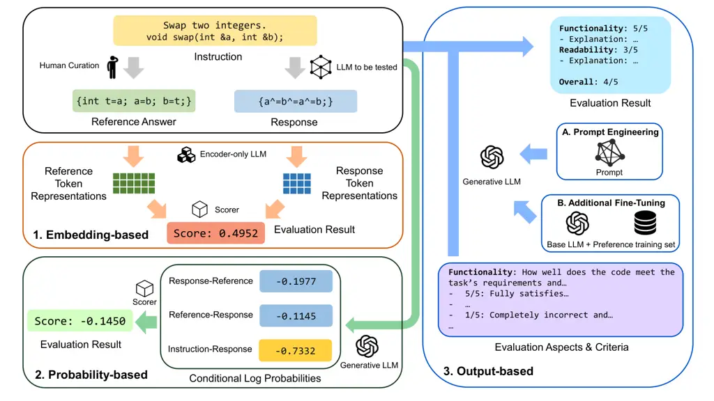
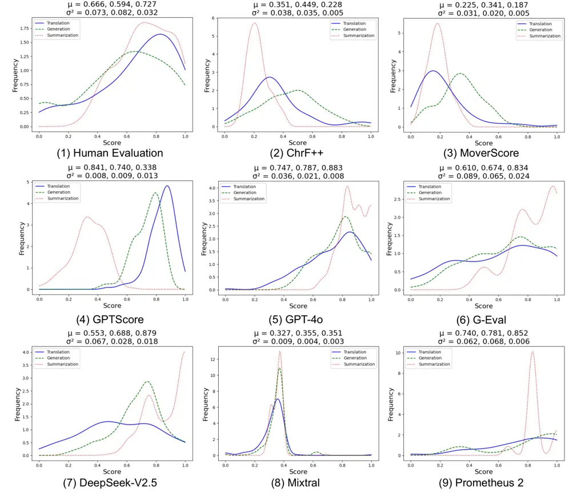

# Can LLMs Replace Human Evaluators? An Empirical Study of LLM-as-a-Judge in Software Engineering

DOI: [10.1145/3728963](https://doi.org/10.1145/3728963)Journal: PACMSEVolume: 2ISSTAISSTA0867CCS: Software
and its engineeringCCS: Computing methodologies Artificial intelligence

Ruiqi Wang

Affiliation: Harbin Institute of Technology, Shenzhen, Shenzhen, China
email: <24s151158@stu.hit.edu.cn> , Jiyu Guo

Affiliation: Harbin Institute of Technology, Shenzhen, Shenzhen, China
email: <220110126@stu.hit.edu.cn> , Cuiyun Gao

Note: Corresponding author. Affiliation: Harbin Institute of Technology,
Shenzhen, Shenzhen, China email: <gaocuiyun@hit.edu.cn> , Guodong Fan

Affiliation: Harbin Institute of Technology, Shenzhen, Shenzhen, China
email: <guodong.fan@126.com> , Chun Yong Chong

Affiliation: Monash University Malaysia, Bandar Sunway, Malaysia email:
<chunyong@ieee.org> and Xin Xia

Affiliation: Zhejiang University, Hangzhou, China email:
<xin.xia@acm.org>

Received  2025-03-31

###### Abstract.

Recently, large language models (LLMs) have been deployed to tackle
various software engineering (SE) tasks like code generation,
significantly advancing the automation of SE tasks. However, assessing
the quality of these LLM-generated code and text remains challenging.
The commonly used Pass@$`k`$ metric necessitates extensive unit tests
and configured environments, demands a high labor cost, and is not
suitable for evaluating LLM-generated text. Conventional metrics like
BLEU, which measure only lexical rather than semantic similarity, have
also come under scrutiny. In response, a new trend has emerged to employ
LLMs for automated evaluation, known as LLM-as-a-judge. These
LLM-as-a-judge methods are claimed to better mimic human assessment than
conventional metrics without relying on high-quality reference answers.
Nevertheless, their exact human alignment in SE tasks remains
unexplored.

In this paper, we empirically explore LLM-as-a-judge methods for
evaluating SE tasks, focusing on their alignment with human judgments.
We select seven LLM-as-a-judge methods that utilize general-purpose
LLMs, alongside two LLMs specifically fine-tuned for evaluation. After
generating and manually scoring LLM responses on three recent SE
datasets of code translation, code generation, and code summarization,
we then prompt these methods to evaluate each response. Finally, we
compare the scores generated by these methods with human evaluation. The
results indicate that output-based methods reach the highest Pearson
correlation of 81.32 and 68.51 with human scores in code translation and
generation, achieving near-human evaluation, noticeably outperforming
ChrF++, one of the best conventional metrics, at 34.23 and 64.92. Such
output-based methods prompt LLMs to output judgments directly, and
exhibit more balanced score distributions that resemble human score
patterns. Finally, we provide insights and implications, concluding that
current state-of-the-art LLM-as-a-judge methods can potentially replace
human evaluations in certain SE tasks.

###### Keywords: 

large language models, model evaluation, human preference

^(†)^(†)cc-license: by

## 1. Introduction

Since BERT (Devlin et al., 2019) and GPT (Radford, 2018), pre-trained
language models (PLMs) have been widely used in various natural language
processing (NLP) tasks, such as machine translation and text
summarization. With the scaling of PLM parameters, the concept of large
language models (LLMs) has been proposed. Featuring up to hundreds of
billions of parameters, LLMs emerge new capabilities absent on smaller
models (Wei et al., 2022a), beyond solving simple linguistic tasks.
These capabilities include, but are not limited to, instruction
following and multi-step reasoning, enabling LLMs to simulate human
experts and achieve state-of-the-art performance in certain domains.
Software engineering (SE) is one of the specialized domains that
benefits from this trend. Many researchers and companies either
emphasize their LLMs’ strong coding performance (OpenAI, 2023; Reid
et al., 2024), or develop specialized code LLMs. For instance,
DeepSeek-Coder-V2 (DeepSeek-AI et al., 2024) correctly generates code
for 75.3% instructions in HumanEval (Chen et al., 2021) and MBPP (Austin
et al., 2021) with 236B parameters, second only to GPT-4o. Qwen2.5-Coder
(Hui et al., 2024) achieves 88.4% Pass@1 on HumanEval with merely 7B
parameters.

However, there has been limited progress in evaluating LLM-generated
content for SE. The commonly used Pass@$`k`$ metric executes the first
$`k`$ generated code snippets on human-curated unit tests. While
Pass@$`k`$ evaluates the code’s functional correctness accurately, it
has several limitations, such as requiring comprehensive unit tests and
manual configuration of test environments. What is more, Pass@$`k`$ is
unable to evaluate code from non-functional aspects, such as readability
and adherence to good practice, nor can it be used to judge
text-generating SE tasks like code summarization and code review (Hou
et al., 2023). Therefore, some SE datasets (Feng et al., 2024; Yan
et al., 2023) resort to use conventional metrics such as BLEU (Papineni
et al., 2002) and CodeBLEU (Ren et al., 2020), which also have downsides
like inability to perform multi-aspect evaluation and requiring
human-annotated reference answers. These metrics also focus on lexical
rather than semantic similarity, making the evaluation results
questionable.

Meanwhile, NLP researchers attempt to apply LLMs to evaluate the quality
of LLM-generated content, known as LLM-as-a-judge (Zheng et al., 2023a).
While human effort remains reliable for evaluation and for curating the
reference answers in datasets, it is both slow and expensive, defeating
the purpose of automatic evaluation. Therefore, researchers prompt or
train LLMs to align with human preference, as an attempt to replace
human evaluators. Since both code and text can be viewed as sequences of
tokens, LLM-as-a-judge methods can be potentially adopted on SE tasks.
Unfortunately, current meta-evaluation benchmarks feature a limited
number of simple coding tasks as they mostly target NLP tasks. The lack
of test samples and the insufficient task difficulty create a gap
between benchmarking on existing datasets and real-world SE scenarios,
where the instructions, code, and responses are usually more complex and
varied.

To bridge the gap, we conduct an empirical study to apply a range of
LLM-as-a-judge methods on realistic SE datasets. Specifically, we select
a task for each of the three input-output type combinations, and a
recent representative dataset for each task: CodeTransOcean (Yan et al., 2023) for Code Translation (Code-Code), ComplexCodeEval (Feng et al., 2024) for Code Generation (Text-Code), and CodeXGLUE (Lu et al., 2021)
for Code Summarization (Code-Text). Their corresponding papers only
adopt conventional metrics like Exact Match (EM), BLEU, and CodeBLEU. We
randomly sample 50 instructions from each dataset, and three out of 12
code LLMs to generate responses for each instruction. For each response,
we manually assign a score indicating its quality, resulting in a
dataset of 450 samples of (instruction, response, score) triplets in
total. Then we perform meta-evaluation of different types of
LLM-as-a-judge methods by calculating their score alignment with human
scores, to validate whether their judgments match human preference in
real-world scenarios.

We design the following three research questions (RQs):

- •
  RQ1: Which LLM-as-a-judge method aligns with human preference better,
  and do they outperform conventional metrics?

  We aim to assess whether various LLM-as-a-judge methods can replace
  human evaluators due to high human alignment and superior performance
  to conventional metrics. We select seven methods across
  embedding-based, probability-based, and output-based categories, along
  with two LLMs fine-tuned specifically for NLP evaluation along with
  their base model, and conventional metrics such as BLEU. We compute
  the correlations between human scores and scores from these methods to
  indicate how well they align with human preference on the selected SE
  tasks.

- •
  RQ2: What are the characteristics of LLM scores, more specifically
  their alignments with one another and score distributions?

  We aim to characterize the score distributions from LLM-as-a-judge
  methods with their distributions and correlations. Specifically, we
  measure the correlations among all methods, to determine if similar
  methods yield similar results, and to assess whether they actually
  mimic human evaluators beyond merely measuring lexical similarity. We
  also analyze the score distribution of each method to investigate
  their ability to generate varied scores.

- •
  RQ3: How do LLMs perform when prompted to make pairwise comparisons
  instead of individual scoring?

  Comparing two responses is also a common choice for LLM-as-a-judge
  methods, with some studies claiming its superiority over scoring
  individual responses (Li et al., 2023). We conduct similar experiments
  to evaluate the performance of these methods when LLMs are instead
  prompted to select a better response from two, or declare a tie. Since
  embedding-based and probability-based methods cannot perform this
  ternary classification without scoring each response first, we focus
  solely on output-based methods in this RQ.

Through answering the RQs, we conclude that:

- •
  The human alignments of studied methods heavily depend on the SE
  tasks. Among them, output-based methods with large LLMs perform best,
  achieving near-human performance in code translation and generation.
- •
  Similar methods yield similar score distributions, most of which
  differ from those of conventional metrics. The best human-aligning
  methods demonstrate more balanced and human-like distributions.
- •
  Studied methods fail to deliver accurate and consistent comparison
  results. Output-based methods with large LLMs still provide the
  highest accuracy, but often yield inconsistent results after swapping
  the positions of two responses.

Our contributions can be summarized as follows:

- •
  Our work serves as the first empirical study to investigate applying
  LLM-as-a-judge methods specifically to SE tasks, with much more
  difficult code-specific instructions and responses compared to
  previous studies.
- •
  We manually curate a meta-evaluation dataset based on three existing
  SE datasets for different tasks, to evaluate human alignment of
  LLM-as-a-judge methods.
- •
  We explore how different LLM-as-a-judge methods prefer to score
  responses, and discuss the findings and possible implications for
  their future studies and applications in SE.

The rest of the paper is organized as follows: Section 2 introduces
research relevant to code LLMs, SE task evaluation, and notable
LLM-as-a-judge methods. Section 3 offers more details in different
categories of LLM-as-a-judge methods. Section 4 presents the overall
study design. Section 5 records the experimental results and analyzes
our findings. Section 6 analyzes score explanations as a case study and
possible future directions based on our findings. Section 7 concludes
the paper.

## 2. Related Work

### 2.1. Code LLMs for SE

LLMs are large-scale PLMs. Some of them are instruction-tuned to follow
instructions in human language. In this paper, we do not distinguish
between PLMs and LLMs, and use LLMs to refer to pre-trained Transformers
(Vaswani et al., 2017) in general.

While many general-purpose LLMs demonstrate satisfying performance on SE
tasks, especially code generation, there are many LLMs pre-trained
specifically for code-related tasks. CodeBERT (Feng et al., 2020) is one
of the earliest attempts to pre-train a Transformer on both code and
text data. It is an encoder-only model with 125M parameters, pre-trained
on over 8M datapoints from CodeSearchNet (Husain et al., 2019). CodeT5
(Wang et al., 2021) is an encoder-decoder Transformer with up to 770M
parameters, pre-trained with a denoising sequence-to-sequence objective
on the same dataset. UniXcoder (Guo et al., 2022) supports encoder-only,
decoder-only, and encoder-decoder modes, allowing abstract syntax trees
(ASTs) as input after transforming ASTs into sequences.

Recently, larger decoder-only LLMs have been increasingly popular in
generation tasks. Codex (Chen et al., 2021) is a series of GPT-based
LLMs with up to 12B parameters, achieving a Pass@1 score of 28.81% on
HumanEval. CodeLlama (Rozière et al., 2023) is another LLM family with
up to 70B parameters from Meta AI, trained from Llama 2 (Touvron et al., 2023) to follow human instructions. DeepSeek-Coder (Guo et al., 2024) is
a family of LLMs with up to 33B parameters, supporting both normal
generation and fill-in-the-middle (FIM). Its successor,
DeepSeek-Coder-V2 (DeepSeek-AI et al., 2024), is a mixture-of-experts
(MoE) LLM with 16B or 236B parameters, claiming to have GPT-4 (OpenAI, 2023) level performance at a Pass@1 score of 90.2% on HumanEval.

### 2.2. SE Benchmarks and Metrics

Many SE benchmarks focus solely on code generation, where LLMs generate
code for the given requirements and function signatures. HumanEval (Chen
et al., 2021) is one of the most adopted code generation benchmarks,
featuring 164 human-curated Python problems. It uses Pass@$`k`$ as the
evaluation metric. MBPP (Austin et al., 2021) is another popular
benchmark with 974 Python problems, aiming at entry-level development.
APPS (Hendrycks et al., 2021) is a much larger Python benchmark with
10000 problems, ranging from being solvable in one-line to presenting
substantial challenges in algorithms. ClassEval (Du et al., 2023)
challenges LLMs with 100 class-level code generation problems in Python,
and measure class-level and method-level Pass@$`k`$.

Some benchmarks target other SE tasks. CodeReviewer (Li et al., 2022)
aims at three tasks in the code review process: commit quality
estimation, reviewer comment generation, and code editing. CodeXGLUE (Lu
et al., 2021) supports 10 SE tasks such as code summarization and code
search. ComplexCodeEval (Feng et al., 2024) collects code from
influential GitHub repositories for 4 tasks such as code generation and
unit test generation. These benchmarks all evaluate responses with
conventional metrics including Exact Match, Edit Similarity, BLEU, and
CodeBLEU instead of Pass@$`k`$, even for code-generating tasks. CRUXEval
(Gu et al., 2024) evaluates LLMs from other aspects such as code
understanding and execution with 800 short Python functions for input or
output predictions. It requires LLMs to output assert statements to
obtain Pass@$`k`$ scores.

However, limited efforts are made to curate meta-evaluation benchmarks
to test evaluation metrics, as most datasets only contain instructions
and reference answers, without responses of different quality or
human-annotated scores. NoFunEval (Singhal et al., 2024) designs six
evaluation aspects, including functional correctness and non-functional
aspects like latency and maintainability. It tests whether LLMs can
improve code based on a specific aspect or select the better of two code
snippets from that perspective. CodeUltraFeedback (Weyssow et al., 2024)
evaluates LLMs’ alignment with human evaluation from five non-functional
code aspects like instruction following and coding style.

### 2.3. LLM-as-a-Judge in NLP

#### 2.3.1. Embedding-Based Methods

Some researchers obtain contextual token representations of the response
and reference answer using encoder-only LLMs, and compute pairwise
similarity to obtain the score. BERTScore (Zhang et al., 2020)
calculates Recall, Precision and F₁ score based on token representations
obtained from BERT (Devlin et al., 2019). It also applies inverse
document frequencies (IDFs) to reduce the weight of overly common and
thus less essential tokens. MoverScore (Zhao et al., 2019) constructs a
transportation cost matrix based on token representations and computes
Word Mover’s Distance (Kusner et al., 2015). CodeBERTScore (Zhou et al., 2023) is a code-specific adaptation of BERTScore with CodeBERT,
approximating functional correctness and human scores with F₃ and F₁
scores respectively. While these methods match contextual embeddings
instead of n-grams, unlike many conventional metrics, they still measure
how a response resembles the reference answer.

#### 2.3.2. Probability-Based Methods

Since more LLMs come with decoders, it becomes possible to use
generating probabilities for evaluation. BARTScore (Yuan et al., 2021)
assumes that BART (Lewis et al., 2020) is more likely to generate a
higher-quality response. It uses the probability of BART generating a
given response as the score. GPTScore (Fu et al., 2024) applies a
similar approach with 19 LLMs of sizes from 80M to 175B, supporting both
reference-free and reference-based evaluation from multiple aspects.
FFLM (Jia et al., 2023) is a reference-free method designed to evaluate
the faithfulness of summaries. It calculates the probabilities of
generating the summary with and without the original text as posterior
and prior probabilities respectively. FFLM assumes that a faithful
summary has higher posterior than prior probability, and calculates
their difference as the score.

#### 2.3.3. Output-Based Methods

While the above methods usually align with human evaluation better than
conventional metrics, they do not explain their scores or support
certain closed-source LLMs that do not provide probabilities or
representations. Output-based methods prompt LLMs to output the
judgments, and do not require access to their internal implementations.
G-Eval (Liu et al., 2023) utilizes Chain-of-Thought (CoT) (Wei et al.,
2022b) to request evaluation steps, samples multiple scores and then
averages them as the final score. ChatEval (Chan et al., 2024) assigns
different personas to several LLM agents, asking them to discuss and
select a better response from two.

Some researchers construct training sets to fine-tune LLMs instead of
designing prompting or inference strategies. InstructScore (Xu et al., 2023) is fine-tuned on GPT-4-synthesized data to generate error reports
of text from various domains. PandaLM (Wang et al., 2024b) is fine-tuned
on pairwise comparison results and reference answers generated by
GPT-3.5, aiming at addressing subjective aspects including conciseness
and clarity. X-Eval (Liu et al., 2024) has an extra training stage to
learn the connections between fine-grained evaluation aspects, allowing
evaluating from aspects not seen during training.

However, these methods have not been tested on a sufficient number of
challenging SE samples, leaving it unclear whether they achieve reliable
human alignment for SE applications.

## 3. LLM-as-a-Judge Framework Overview

Figure 1. Overview of different LLM-as-a-judge methods.

In this section, we offer an overview of existing LLM-as-a-judge
methods. As seen in Fig. 1, we categorize these methods based on the
types of LLM features used¹¹ 1 Our categorization is inspired by (Gao
et al., 2024). We merge similar categories based on LLM feature types.,
including embedding-based, probability-based, and output-based methods.
We denote the instruction (source) as $`src=s_{1}...s_{|src|}`$, the
response (target) as $`tgt=t_{1}...t_{|tgt|}`$, and the reference answer
as $`ref=r_{1}...r_{|ref|}`$.

- •
  Embedding-based: These methods first obtain token representations of
  the response and reference answer $`f(tgt)=f(t_{1})...f(t_{|tgt|})`$
  and $`f(ref)=f(r_{1})...f(r_{|ref|})`$ from the LLM encoder $`f`$. We
  then evaluate $`tgt`$ via fusing token-wise cosine similarities
  $`s_{ij}=\frac{f(t_{i})\cdot f(r_{j})}{\lVert f(t_{i})\rVert\lVert f(r_{j})\rVert}`$.
- •
  Probability-based: The LLM receives an input-output pair $`(in,out)`$,
  and returns the conditional log-probability of generating $`out`$,
  i.e.
  $`\log p(out|in)=\frac{1}{|out|}\sum_{k=1}^{|out|}\log p(out_{k}|in,out_{<k})`$.
  Typical $`(in,out)`$ combinations include $`(src,tgt)`$,
  $`(ref,tgt)`$, $`(tgt,ref)`$, and $`(none,tgt)`$, where $`none`$ means
  no input is provided. We then score $`tgt`$ with these
  log-probabilities. Additional content may be present in the prompt,
  such as evaluation aspects like clarity.
- •
  Output-based: These methods first craft a prompt $`prompt`$ with
  $`src`$ and $`tgt`$. Depending on the design, $`prompt`$ may also
  feature $`ref`$, evaluation aspects and criteria, and evaluation
  steps. After obtaining the judgment $`jud=\text{LLM}(prompt)`$, we
  extract the final score from $`jud`$. Many prompting and inference
  strategies can also be applied, such as multi-agent and repeated
  sampling, where multiple scores are often combined using methods like
  a majority vote or averaging.

  LLMs can also be fine-tuned as specialized judges, usually applied
  with a single inference pass and no additional strategies.
  State-of-the-art LLMs like GPT-4 are often used to generate reference
  judgments for training. In this paper, we discuss the performance of
  these LLMs, instead of focusing on the detailed training process.

  Unlike embedding-based and probability-based methods, which usually
  have scoring ranges of $`[0,1]`$ and $`(-\infty,0)`$ (or
  $`(-\infty,\infty)`$) respectively without rescaling, most
  output-based methods require LLMs to score on a scale of 1 to 5 or 1
  to 10. They can also compare two responses and decide the better one
  or declare a tie. In our study, we investigate individual scoring in
  RQ1 and RQ2, and pairwise comparison in RQ3.

## 4. Study Design

In this section, we elaborate on the details of our study design. In our
study, we focus on leveraging different types of LLM-as-a-judge methods
to evaluate the responses of three SE tasks. We collect instructions and
generate responses from representative datasets, then perform human and
LLM evaluation on these responses, and analyze their correlations.

### 4.1. Datasets and Preprocessing

#### 4.1.1. Instruction Collection

To ensure the difficulty of instructions and to approximate real-world
development scenarios, we collect instructions from a recent dataset for
each of the three widely-studied SE tasks for our empirical evaluation:

- •
  Code Translation is a code-to-code task demanding translating code
  between two languages while preserving the functionality. It
  challenges LLMs’ skills to understand syntax and library usages in
  both languages, and to choose replacements when certain
  functionalities are unavailable in the target language.
- •
  Code Summarization is a code-to-text task involving generating a
  concise and fluent description of a given code snippet. It challenges
  LLMs’ abilities to abstract the code, leaving only critical
  information about core functionality rather than explaining
  step-by-step.
- •
  Code Generation is a text-to-code task requiring generating a function
  based on a natural language description and the signature. It tests
  LLMs’ capabilities to breakdown the functional requirement into steps,
  and to utilize provided dependencies.

We select the MultilingualTrans²² 2 Collected from Rosetta Code,
[https://rosettacode.org/wiki/Rosetta_Code](https://rosettacode.org/wiki/Rosetta_Code).
subset of CodeTransOcean (Yan et al., 2023) for code translation.
CodeTransOcean contains three translation subsets for different
purposes, with the MultilingualTrans subset covering eight popular
languages with 7545 samples. Compared to previous benchmarks,
CodeTransOcean offers more pairs of programming languages of longer
code, with the average length of test sets reaching 491 tokens in
MultilingualTrans, as opposed to 58 tokens in CodeTrans featured in
CodeXGLUE, which only supports Java and C#. CodeTransOcean evaluates
translations with conventional metrics such as Exact Match, BLEU, and
CodeBLEU, rather than execution-based metrics like Pass@$`k`$, since
they require constructing unit tests and testing environments.

We select the code-text subset of CodeXGLUE (Lu et al., 2021) for code
summarization, which is a filtered version of CodeSearchNet³³ 3
Collected from public GitHub repositories. (Husain et al., 2019).
Initially developed for code search, i.e. retrieving relevant code based
on natural language queries, CodeSearchNet contains two million code
snippets in six programming languages accompanied by docstrings. These
docstrings come from the associated function documentation and serve as
summaries. CodeXGLUE removes samples with syntactically incorrect code,
or docstrings that are either non-English, overly lengthy, or too short.
After filtering, 14918 Python samples and 10955 Java samples remain,
along with samples in four other programming languages. CodeXGLUE uses
BLEU to evaluate generated summaries.

We select ComplexCodeEval⁴⁴ 4 Collected from GitHub repositories. (Feng
et al., 2024) for code generation. ComplexCodeEval is a benchmark with
3897 and 7184 Java and Python samples respectively, supporting four
tasks: code generation, code completion, unit test generation, and API
recommendation. Compared to previous benchmarks, ComplexCodeEval
provides comprehensive supplemental material for each code snippet,
including functional dependencies, timestamps, and unit tests. It
expects LLMs to learn project-specific dependencies beyond standard
library or popular third-party APIs. ComplexCodeEval evaluates
code-generating tasks with conventional metrics such as Edit Similarity,
BLEU, and CodeBLEU.

When training, validation, and test sets are available, we only adopt
the test set for our evaluation. To ensure the accuracy of manual
evaluation, we limit the programming languages to Java, Python, C, and
C++ according to the human evaluators’ expertise. Following previous
work’s (Wang et al., 2023; Kim et al., 2024) context length of 4096
tokens, we also apply length limits of 1536, 1536, and 1024 tokens⁵⁵ 5
Measured with OpenAI’s Tiktoken,
[https://github.com/openai/tiktoken](https://github.com/openai/tiktoken),
with GPT-4o’s vocabulary o200k_base. for instructions, responses⁶⁶ 6
Here we limit the length of reference answers instead of actual
responses generated in the next step., and output-based judgments
respectively, removing samples with lengthy instructions or reference
answers. We sample 50 instructions from each filtered dataset, resulting
in 150 instructions in total.

#### 4.1.2. Response Generation

We deploy 12 recent code LLMs with different sizes from seven families
shown in Table 1 from Hugging Face (Wolf et al., 2019). We generate
responses using these LLMs with vLLM (Kwon et al., 2023) on an Ubuntu
20.04 server with two Intel Xeon Platinum 8276L CPUs, four NVIDIA
A100-40GB GPUs, and 256 GB RAM. For each instruction, we randomly select
three LLMs to respond, yielding three responses $`A,B,C`$. For pairwise
comparisons, we create three response pairs $`(A,B),(A,C),(B,C)`$, and
another three pairs $`(B,A),(C,A),(C,B)`$ in order to check if studied
methods yield consistent judgment after reversing the order within a
response pair. Thus, we obtain 150 responses and 300 response pairs per
task, resulting in 450 responses and 900 pairs in total.

| LLM Family                                                                                                | Developer      | Size        | Date    |
| --------------------------------------------------------------------------------------------------------- | -------------- | ----------- | ------- |
| CodeLlama-Instruct (Rozière et al., 2023)                                                                 | Meta AI        | 7/13/34B    | 2023.8  |
| DeepSeek-Coder (Guo et al., 2024)                                                                         | DeepSeek AI    | 1.3/6.7/33B | 2023.11 |
| MagiCoder-S-DS (Wei et al., 2024)                                                                         | UIUC & THU     | 6.7B        | 2023.12 |
| Codestral-v0.1⁷⁷ 7 Announced at [https://mistral.ai/news/codestral/](https://mistral.ai/news/codestral/). | Mistral AI     | 22B         | 2024.5  |
| DeepSeek-Coder-V2-Lite (DeepSeek-AI et al., 2024)                                                         | DeepSeek AI    | 16B         | 2024.6  |
| CodeGeeX4-ALL (Zheng et al., 2023b)                                                                       | Zhipu AI & THU | 9.4B        | 2024.7  |
| Qwen2.5-Coder (Hui et al., 2024)                                                                          | Alibaba        | 1.5/7B      | 2024.9  |

Table 1. Selected LLMs for response generation, sorted by their release
date.

| Task               | Contextual Information               |
| ------------------ | ------------------------------------ |
| Code Translation   | Original Code                        |
| Code Summarization | Original Code                        |
| Code Generation    | Signature, Description, Dependencies |

Table 2. Contextual information provided for each task in response
generation.

As part of the prompt, contextual information in Table 2 is provided for
LLMs. The full prompts are available in our repository (Wang et al.,
2024a). LLMs are permitted to generate at most 3072 tokens, two times
the maximum reference answer length, to minimize the need for
truncation.

After preliminary experiments, we discover that many reference summaries
in CodeXGLUE are in fact incorrect. Therefore, we require the reference
summary to at least have 15 tokens, reselect the instructions, and
manually examine each instruction. We also find that in code generation,
selected LLMs struggle to generate interpretable code because they
cannot use dependencies effectively, as the only available dependency
information in ComplexCodeEval is their names, which makes human
evaluation almost impossible to yield meaningful scores. Consequently,
we reselect the instructions with at most five dependencies to reduce
difficulty, and augment the dependency information with GPT-4o⁸⁸ 8 We
use the 2024-08-06 version for all experiments. The prompt for
augmentation is available in our repository., prompting it to extract
the signature from the reference answer⁹⁹ 9 The authors of
ComplexCodeEval extract dependency names from reference answers as well,
and we follow their practice to utilize reference answers. and generate
a short description for each dependency. We manually examine the
descriptions to ensure that no other information about the reference
answers is included. Responses are generated with the updated dependency
information as well as other contextual information.

#### 4.1.3. Manual Evaluation

For manual evaluation, we design two evaluation aspects per task to
guide human evaluators, enabling more fine-grained assessment without
overwhelming evaluators with too many aspects and complicated criteria.
The first aspect assesses the response’s alignment with the instruction,
e.g. Consistency with Code for summarization, requiring the summary to
capture the code’s core functionality. The second aspect judges the
response’s intrinsic quality, e.g. Readability & Idiomatic Usage for
translation, demanding the responded code to be both readable and follow
common coding styles in the target language. We also curate the criteria
for each integer score ranging from 1 to 5 for both aspects. In general,
a 5-point response is near perfect, a 4- or 3-point response contains
minor or major issues but still makes sense, and a 2- or 1-point
response is practically useless. Below, we show an example of
Readability aspect and its corresponding criteria for code summarization
as an example, while the remaining aspects and criteria can be found in
our repository:

Two human evaluators with expertise in the chosen programming languages
are involved in judging each of the 450 responses. During manual
evaluation, we provide the corresponding instruction and the reference
answer along with the response to be evaluated. Each evaluator is
required to score both aspects before assigning an overall score, which
is not necessarily the average of the former. The final human score for
each response is the average of overall scores from two evaluators¹⁰¹⁰
10 The two human evaluators reach a high level of agreement, achieving
Spearman’s $`\rho`$ of (83.07, 75.42, 74.20), Pearson’s $`R`$ of (85.86,
79.70, 73.74), and Kendall’s $`\tau`$ of (72.26, 63.40, 62.57) on code
translation, generation, and summarization respectively.. For pairwise
comparison, we calculate the absolute difference between the final human
scores of two responses in a pair, declaring a tie when the difference
is smaller than 0.5¹¹¹¹ 11 The value is chosen so that ties occur for
about a third of the response pairs for each task., or deciding the
higher-scored response is better otherwise.

### 4.2. Selected Methods

#### 4.2.1. Conventional Metrics

We choose five popular conventional metrics, each requiring the response
$`tgt`$ and the reference answer $`ref`$ but not the instruction. We
verify if these metrics align better or worse with human evaluation
compared to LLM-as-a-judge methods. For details about Recall, Precision,
and F\_(n) scores, please refer to their original papers.

BLEU (Papineni et al., 2002) calculates modified n-gram precision
($`n=1,2,3,4`$) for $`tgt`$ and $`ref`$, and applies a brevity penalty
to penalize overly short responses.

ROUGE-L (Lin, 2004) measures the length of the longest common
subsequence LCS between $`tgt`$ and $`ref`$. It computes the F₁ score
based on LCS.

METEOR (Banerjee and Lavie, 2005) matches tokens in $`tgt`$ and $`ref`$,
and computes the F₃ score based on the number of matched tokens. It also
penalizes fragmented alignment by counting the number of contiguous
match chunks in $`tgt`$.

ChrF++ (Popovic, 2017) computes F₂ scores using character n-grams (up to
6-grams) and token n-grams (up to 2-grams). The average character F₂
score and the average token F₂ score are then averaged to produce the
final score.

CrystalBLEU (Eghbali and Pradel, 2022) is specifically designed to
measure code similarity. It removes the most common n-grams in a corpus
from $`tgt`$ and $`ref`$, as these trivial n-grams can obscure
meaningful differences between them, before calculating BLEU score. For
each task, we use the test set from its corresponding dataset as the
corpus, including all instructions and reference answers.

We implement the first four methods with Hugging Face Evaluate, and the
last with the CrystalBLEU package. For methods with replaceable
tokenizers, we substitute them with OpenAI Tiktoken with o200k_base
vocabulary because the built-in tokenizers are usually not designed for
code.

#### 4.2.2. Embedding-Based Methods

We choose two methods based on embedding, i.e. token representations of
the response $`tgt`$ and the reference answer $`ref`$. We use UniXcoder
(Guo et al., 2022) in place of BERT or other non-code LLMs as our
encoder, due to its ability to process both code and text.

BERTScore (Zhang et al., 2020) calculates pairwise token similarity
between $`tgt`$ and $`ref`$ with token representations, and obtains the
average Recall and Precision, which are combined into the F₁ score as
the final score. BERTScore also applies inverse document frequencies
(IDFs) as token weights.

MoverScore (Zhao et al., 2019) proposes to use Word Mover’s Distance
(Kusner et al., 2015), measuring semantic dissimilarity as the minimum
cost flow between n-gram representations, which is the IDF-weighted
average of token representations. For each $`n`$, it constructs a cost
matrix for each n-gram in $`tgt`$, and flow requirements based on IDF.
The final score is the minimum cost to establish such a flow.

#### 4.2.3. Probability-Based Methods

We select two probability-based methods. These methods may take at least
two of the following as input: instruction $`src`$, response $`tgt`$,
and reference $`ref`$, plus supplementary information like evaluation
aspects¹²¹² 12 Aspects are identical to those in human evaluation.
$`a`$. We use davinci-002 here, since later OpenAI models only return
probabilities of newly generated tokens instead of prompt tokens.

GPTScore (Fu et al., 2024) simply uses the sequence log probability
$`\log p(tgt|src,a)`$ as the score according to their paper, which is
the average of all token log probabilities. However, their code instead
uses the harmonic mean of $`\log p(tgt|ref,a)`$ and
$`\log p(ref|tgt,a)`$. To mitigate this difference, we additionally
include $`src`$ in both conditions, i.e. using $`\log p(tgt|ref,src,a)`$
and $`\log p(ref|tgt,src,a)`$.

FFLM (Jia et al., 2023) is a reference-free metric that obtains both the
prior probability $`P(tgt)`$ and the posterior probability
$`P(tgt|src)`$. It claims that high-loss (low-probability) tokens
contribute more to low-quality content, thus assigning a higher weight
to them. FFLM also introduces the prefix probability $`P(tgt|tgt:src)`$
by prepending $`tgt`$ to $`src`$, assuming that the prefix increases the
generating probability if $`tgt`$ is inconsistent with $`src`$. These
three probabilities are fused into the final score.

#### 4.2.4. Output-Based Methods

We select two methods: G-Eval and BatchEval, which apply different
inference strategies, in addition to a control group (Vanilla) with no
strategies applied, to assess if these strategies improve alignment with
human evaluation for general-purpose LLMs. Unless otherwise stated, we
use GPT-4o for these methods.

We also include a supervised fine-tuning (SFT) group, with two LLMs
fine-tuned for NLP evaluation, along with their base LLMs without
fine-tuning, to determine if fine-tuning for NLP evaluation also
enhances human alignment in SE evaluation.

We provide only the instruction $`src`$, response $`tgt`$, and
evaluation aspects¹³¹³ 13 Aspects are identical to those in human
evaluation. in the prompt. For the detailed prompts, please refer to our
repository. Note that these methods can also perform pairwise
comparison, where we include both responses in the prompt.

Vanilla performs inference once with greedy decoding (temperature set to
0), where LLMs score each aspect first before assigning the final score.
For pairwise comparison, LLMs compare on each aspect and then make the
final decision. We use DeepSeek-Coder-V2-Lite locally, and DeepSeek-V2.5
and GPT-4o via API.

G-Eval (Liu et al., 2023) requires the LLM to generate the evaluation
steps first and embeds it into the prompt, followed by 20 inference
passes with a high temperature of 1.0 and averaging the scores.
Following their practice, we prompt the LLM to return the score first
with a limit of 20 generated tokens. Judgments without a score are
discarded. For pairwise comparison, we consider comparison results as
scores of 1 or -1 when one response is better, or 0 for a tie. If the
absolute value of the average score is less than 0.7¹⁴¹⁴ 14 The value is
chosen so that ties occur for about a third of the response pairs., we
declare a draw, otherwise considering one response better.

BatchEval (Yuan et al., 2024) performs multi-round scoring. In each
round, it first batches all responses and then scores each batch in one
inference pass. During batching, it diversifies the scores of responses
in each batch, so that the LLM can learn an unbiased score distribution
for more accurate scoring. We follow their practice by setting
temperature to 0.2, batch size to 10, and number of rounds to 5.

SFT involves two LLMs fine-tuned for NLP evaluation, Auto-J (Li et al., 2024) and Prometheus-v2-BGB-8x7B (Kim et al., 2024), as well as their
base LLMs Llama2-13B-Chat (Touvron et al., 2023) and
Mixtral-8x7B-Instruct (Jiang et al., 2024). We apply the default prompt
template of each judge LLM to itself and its base LLM, and exclude the
evaluation aspects for Auto-J and Llama-2-13B-Chat since Auto-J’s
template does not provide a place for aspects. We perform greedy
decoding locally with temperature 0.

We only consider the final verdict (score or comparison result) in our
meta-evaluation and discard the explanations. For verdict extraction, we
use G-Eval’s code for itself, and, for all other methods in this
category, we set several rules to match with regular expressions, such
as "Overall: X" and "\[\[X\]\]" where X is the non-negative final score,
or comparison result "First", "Second", or "Draw". If no valid verdict
is found or the extracted score exceeds 10, which we consider invalid,
we assign a score of -1 or a comparison result as draw as a penalty.

### 4.3. Meta-Evaluation

Meta-evaluation refers to the process of evaluating different evaluation
metrics. For the default method of individual scoring, we meta-evaluate
the metrics via their correlation with human scores, including
Spearman’s $`\rho`$, Pearson correlation coefficient $`R`$, and
Kendall’s $`\tau`$. For pairwise comparison in RQ3, we compute the
Accuracy of LLM-generated labels, in addition to the Agreement which
checks if an LLM makes the same judgment when two responses in the
prompt swap their positions.

For the ease of reading, all correlation coefficients, Accuracies, and
Agreements in this paper are multiplied by 100. We also check if the
$`p`$-value of each correlation coefficient in RQ1 is smaller than 0.05
to ensure a 95% confidence interval.

## 5. Study Results

In this section, we present experimental results and our analysis to
answer the research questions.

### 5.1. RQ1: Alignment with Human Scores

|                                    |             |       |          |            |       |          |               |        |          |
| ---------------------------------- | ----------- | ----- | -------- | ---------- | ----- | -------- | ------------- | ------ | -------- |
| Method                             | Translation |       |          | Generation |       |          | Summarization |        |          |
|                                    | $`\rho`$    | $`R`$ | $`\tau`$ | $`\rho`$   | $`R`$ | $`\tau`$ | $`\rho`$      | $`R`$  | $`\tau`$ |
| Conventional Metrics               |             |       |          |            |       |          |               |        |          |
| BLEU                               | 31.12       | 28.08 | 22.43    | 58.08      | 55.83 | 41.90    | 19.80         | 24.77  | 16.78    |
| ROUGE-L                            | 28.55       | 28.57 | 20.29    | 55.72      | 57.62 | 40.81    | 48.45         | 47.01  | 35.47    |
| METEOR                             | 22.48       | 31.79 | 15.98    | 67.11      | 65.55 | 49.66    | 38.83         | 40.01  | 28.27    |
| ChrF++                             | 31.30       | 34.23 | 22.65    | 64.02      | 64.92 | 46.60    | 47.26         | 44.65  | 33.86    |
| CrystalBLEU                        | 23.63       | 25.26 | 17.43    | 59.02      | 56.65 | 42.88    | 23.19         | 24.96  | 17.24    |
| Embedding-based                    |             |       |          |            |       |          |               |        |          |
| BERTScore                          | 27.72       | 32.49 | 19.54    | 41.39      | 44.74 | 30.36    | 21.71         | 21.89  | 15.57    |
| MoverScore                         | 28.29       | 26.22 | 19.99    | 46.64      | 47.35 | 33.66    | 31.86         | 29.44  | 22.82    |
| Probability-based                  |             |       |          |            |       |          |               |        |          |
| GPTScore                           | 33.53       | 34.77 | 25.12    | 46.65      | 45.42 | 35.00    | -13.34        | -15.04 | -9.28    |
| FFLM                               | 34.03       | 29.37 | 25.50    | 29.31      | 29.62 | 21.65    | -2.29         | -8.71  | -1.94    |
| Output-based: Vanilla              |             |       |          |            |       |          |               |        |          |
| DSC2-Lite                          | 33.10       | 46.26 | 26.56    | 15.71      | 28.28 | 12.50    | -17.76        | -17.47 | -15.25   |
| DS2.5                              | 62.43       | 70.27 | 49.48    | 66.39      | 68.51 | 54.74    | 17.73         | 18.10  | 14.14    |
| GPT-4o                             | 70.67       | 79.11 | 57.85    | 54.70      | 57.02 | 43.56    | 24.52         | 23.15  | 19.27    |
| Output-based: Inference strategies |             |       |          |            |       |          |               |        |          |
| G-Eval                             | 68.96       | 77.14 | 52.90    | 60.71      | 63.05 | 46.36    | 23.34         | 26.19  | 17.18    |
| BatchEval                          | 73.67       | 81.32 | 59.80    | 59.54      | 63.04 | 48.62    | 22.56         | 22.46  | 18.39    |
| Output-based: SFT                  |             |       |          |            |       |          |               |        |          |
| Llama2                             | 2.61        | 1.03  | 1.92     | 23.91      | 22.89 | 18.94    | -15.61        | -15.81 | -12.82   |
| Auto-J                             | 20.99       | 14.43 | 17.45    | 36.53      | 38.92 | 29.79    | -5.13         | -4.92  | -4.36    |
| Mixtral                            | 24.67       | 34.07 | 19.52    | 14.41      | 25.32 | 11.18    | -3.97         | -8.98  | -3.39    |
| Prometheus                         | 32.42       | 39.25 | 26.60    | 29.03      | 40.33 | 23.09    | -17.12        | -17.14 | -14.24   |

Table 3. Experimental results for individual scoring. DS2.5 means
DeepSeek-V2.5 while DSC2-Lite means DeepSeek-Coder-V2-Lite. The best
alignment in each column is marked bold. The best conventional metric
alignment and better results in other categories are underlined.
Coefficients with $`p>0.05`$ are marked red.

We use LLM-as-a-judge methods to score individual responses and evaluate
their correlation with human scores. Table 3 presents the alignment
between human scores and scores generated by various methods, including
both LLM-as-a-judge methods and conventional metrics. We notice that the
three types of correlation coefficients display similar trends, and make
the following discoveries:

Current LLM-as-a-judge methods lack generalizability, as they
demonstrate drastically different performance in different tasks and
scenarios. In Code Translation, BatchEval reaches the highest human
alignment, offering near-human performance at $`\rho=73.67`$,
$`R=81.32`$, and $`\tau=59.80`$, while G-Eval, DeepSeek-V2.5, and GPT-4o
also reach a high correlation of $`R>70`$ or $`\rho>60`$, greatly
outperforming conventional metrics capped at $`R=34.23,\rho=31.30`$. We
attribute this to the characteristic of responses and reference answers:
LLMs often copy statements from the original code with subtle
language-specific modifications as the response. Meanwhile, although the
reference answer maintain unchanged core functionality, its exact
implementation and behavior might noticeably differ. This presents a
disadvantage for reference-based methods including most non-output-based
methods and conventional metrics. Output-based methods, however, are
designed to work without reference and can utilize LLMs’ knowledge of
programming languages in evaluation.

On the contrary, LLM-as-a-judge methods struggle to outperform
conventional metrics in evaluating code generation outputs and are
completely surpassed in evaluating code summarization. For code
generation, conventional metrics can reach a mid-high correlation of
$`\rho=67.11`$, $`R=65.55`$, and $`\tau=49.66`$, while DeepSeek-V2.5 is
the only LLM outperforming them at $`\rho=66.39`$, $`R=68.51`$, and
$`\tau=54.74`$ without any additional inference strategies. This can be
attributed to the characteristics of the ComplexCodeEval dataset, which
emphasizes the usage of complicated dependencies by filling out the
correct arguments and calling them at the right time instead of
designing sophisticated algorithms. Therefore, a response-reference
comparison at the lexical level can offer an insight of the response’s
quality, while the LLMs’ limited understanding of the dependencies fail
to provide benefits in evaluation. With that said, for code generation,
LLM-as-a-judge methods with large LLMs like GPT-4o are still applicable,
since they display similar performance as conventional metrics but
provide the benefits of not requiring reference answers. For code
summarization, LLM-as-a-judge techniques are completely defeated by
conventional metrics, hardly reaching a score of 30 in any correlation
coefficient or even demonstrating a negative correlation with human
evaluation. Nonetheless, conventional metrics also fail to deliver
satisfying alignment with human evaluation, with $`\rho,R<50`$ and
$`\tau<40`$. This is potentially due to the fact that many LLMs try to
explain the code step-by-step instead of summarizing the core
functionality, which is difficult for these LLM-as-a-judge methods to
detect. While conventional metrics can assign low scores to these
responses, they have trouble handling paraphrasing, which is common in
summaries. It is an interesting future direction to explore new metrics
that align with humans for code summarization.

Finding 1: Current LLM-as-a-judge methods demonstrate low
generalizability in aligning with human evaluation, outperforming
conventional metrics in code translation, performing on par with them in
code generation, while being outperformed in code summarization.

Inference using large LLMs yields the best human alignment across all
tasks, while inference strategies only provide marginal improvement.
Embedding-based and probability-based methods underperform output-based
methods in most scenarios, capped at $`R=34.77,47.35,29.44`$ versus the
top performance of the latter at $`R=81.32,68.51,26.19`$, and the top
performance of conventional metrics at $`R=34.23,65.55,47.01`$ in code
translation, code generation, and code summarization respectively.
Furthermore, embedding-based and probability-based methods require
access to internal states, while the API services of many
state-of-the-art LLMs only allow access to the final output. Therefore,
these methods cannot be applied with such LLMs, limiting their
applicability. Based on the low human alignment and limited applicable
LLMs, we conclude that embedding-based and probability-based methods are
impractical for evaluating SE tasks.

Among the output-based methods, we find that DeepSeek-V2.5 and GPT-4o
outperform other LLMs without further training. Although Auto-J and
Prometheus 2, trained to match human preference, provide better
performance than their base model, with a 5.18% to 16.03% increase in
Pearson’s $`R`$, achieving $`R=38.92`$ and $`R=40.33`$ in evaluating
code generation respectively, the overall performance is still inferior.
This is likely due to the limited number of parameters, as Auto-J and
Prometheus 2 only have 13B and 47B parameters. Another possible reason
is the misalignment between evaluating NLP tasks during training, and
evaluating SE tasks during inference. Though many NLP training datasets
contain programming tasks, they may only present common tasks like code
generation and fail to present sufficiently challenging instructions.
Unfortunately, to the best of our knowledge, no multi-task human
preference training sets for SE task evaluation have been curated so
far. Hence, we are unable to investigate LLMs fine-tuned on such
SE-specific datasets.

Similarly, current inference strategies, when employed to GPT-4o,
produce an inadequate performance boost of $`\Delta R=2.21,6.03,3.04`$
at maximum. Despite recent work claiming the effectiveness of scaling
inference (Snell et al., 2024), we found that existing inference
strategies for SE evaluation only bring marginal improvement in human
alignment. Moreover, they have different downsides: G-Eval forces LLMs
to generate the overall score first, restricting the efficacy of the
Chain-of-Thought procedure, while greatly increasing inference cost if
the full explanations are needed; BatchEval increases the token count,
leading to more expensive inference due to multi-round evaluation.
Therefore, greedy decoding remains a viable LLM-as-a-judge solution with
satisfactory performance and lower requirements of token count, when
equipped with colossal state-of-the-art LLMs.

Finding 2: Among the LLM-as-a-judge methods studied, output-based
methods with large state-of-the-art LLMs perform best, regardless of
inference strategies.

### 5.2. RQ2: Score Characteristics

| Category             | Translation            |                         |                         | Generation             |                         |                         | Summarization          |                         |                         |
| -------------------- | ---------------------- | ----------------------- | ----------------------- | ---------------------- | ----------------------- | ----------------------- | ---------------------- | ----------------------- | ----------------------- |
|                      | $`\rho_{\text{conv}}`$ | $`\rho_{\text{other}}`$ | $`\rho_{\text{inner}}`$ | $`\rho_{\text{conv}}`$ | $`\rho_{\text{other}}`$ | $`\rho_{\text{inner}}`$ | $`\rho_{\text{conv}}`$ | $`\rho_{\text{other}}`$ | $`\rho_{\text{inner}}`$ |
| Embedding-based      | 81.45                  | 37.81                   | 74.83                   | 79.78                  | 46.74                   | 84.20                   | 57.07                  | 23.32                   | 66.61                   |
| Probability-based    | 32.18                  | 28.60                   | 31.30                   | 63.69                  | 46.74                   | 60.92                   | 32.78                  | 23.32                   | 63.13                   |
| Output-based w/o SFT | 30.60                  | 35.64                   | 90.64                   | 47.25                  | 39.56                   | 88.25                   | 20.04                  | 48.21                   | 79.43                   |
| Output-based w/ SFT  | 37.14                  | 37.81                   | 24.25                   | 30.96                  | 37.52                   | 27.44                   | 11.21                  | 48.21                   | 23.44                   |

Table 4. Category-wise correlation. $`\rho_{\text{conv}}`$,
$`\rho_{\text{other}}`$, and $`\rho_{\text{inner}}`$ are the maximum
Spearman’s $`\rho`$ between the specified category with either
conventional metrics, metrics from the other three categories, and other
metric(s) from the same category. Coefficients above 50 are underlined,
while those above 75 are marked bold.

| LLM Sizes Compared | Translation     |                 | Generation      |                 | Summarization   |                 |
| ------------------ | --------------- | --------------- | --------------- | --------------- | --------------- | --------------- |
|                    | $`\rho_{\min}`$ | $`\rho_{\max}`$ | $`\rho_{\min}`$ | $`\rho_{\max}`$ | $`\rho_{\min}`$ | $`\rho_{\max}`$ |
| Small-Small        | -4.10           | 24.25           | -2.74           | 27.44           | -5.55           | 23.44           |
| Large-Large        | 83.04           | 90.64           | 68.63           | 88.25           | 31.50           | 79.43           |
| Small-Large        | 4.16            | 48.92           | 11.70           | 37.84           | -16.15          | 48.21           |

Table 5. Correlation between output-based LLM-as-a-judge methods grouped
by the sizes of the LLMs they use. Methods are categorized based on the
underlying model size: "Small" (using \<50B LLMs), which includes all
methods from the SFT group and DeepSeek-Coder-V2-Lite from the Vanilla
group, and "Large" (using \>100B LLMs), including DeepSeek-V2.5 and
GPT-4o, the latter used by G-Eval and BatchEval.

We investigate the score characteristics of various LLM-as-a-judge
methods. Table 4 shows the maximum correlation between metrics from the
same or different categories of LLM-as-a-judge methods, while Fig. 2
displays the score distributions¹⁵¹⁵ 15 Frequency estimated using Kernel
Density Estimation (KDE). All scores rescaled into range $`[0,1]`$. of
different methods: (1) for manual evaluation, (2) for conventional
metrics, (3) for embedding-based methods, (4) for probability-based
methods, (5)(6)(7) for output-based methods without SFT, and (8)(9) for
output-based methods with SFT. For each distribution, rather than
focusing on the specific shape of the curve, we examine whether it is
unimodal and note the peak frequency and the corresponding score.

We make the following discoveries:

Most non-SFT LLM-as-a-judge methods have low correlations with those
from other categories and high correlations with those from the same
category. In Table 4, we observe that $`\rho_{\text{other}}<50`$ for all
categories, meaning that each category demonstrates a unique
distribution of scores instead of resembling others. Conversely,
$`\rho_{\text{inner}}>60`$ under most non-SFT circumstances, exhibiting
a medium to high level of agreement among similar methods. This
phenomenon suggests that the mechanics governing each category may
significantly influence their score distributions. In contrast, scores
from SFT methods correlate poorly even within the same category, likely
due to variations in their base LLMs and fine-tuning datasets. Given the
high level of disagreement among current fine-tuned LLMs, we argue that
selecting an appropriate fine-tuned LLM is crucial for evaluating under
specific SE contexts. Otherwise, it may produce entirely unexpected
scores.

Output-based methods using large LLMs tend to align well with each
other, whereas those using smaller LLMs exhibit low correlations with
other methods. Since output-based methods offer the best human
alignment, we further investigate whether LLM size influences
correlations between methods by grouping these LLM-as-a-judge methods
into those using large LLMs (\>100B) and those using small LLMs (\<50B).
In Table 5, we observe that methods employing large LLMs achieve high
correlations of $`\rho>80`$ for code translation and $`\rho>65`$ for
code generation with each other. These methods use DeepSeek-V2.5 and
GPT-4o, and maintain strong alignment despite the difference in LLMs and
inference strategies. In contrast, methods using small LLMs yield
$`\rho<50`$ when compared to methods in the "large" group, and
$`\rho<30`$ within the "small" group. This pattern reflects a
performance gap, as the "large" group align substantially better with
human evaluations than the "small" group.

Finding 3: As anticipated, methods within the same category generally
exhibit high correlations with each other and low correlations with
those in different categories. Among output-based methods, those using
large LLMs not only align well with human scores but also show strong
correlations with each other.

Figure 2. Score distributions of selected metrics. $`\mu,\sigma^{2}`$
refer to the means and variances of scores for code translation, code
generation, and code summarization. All scores are rescaled into range
$`[0,1]`$.

Only embedding-based methods resemble conventional metrics. We discover
in Table 4 that $`\rho_{\text{conv}}=81.45`$, 79.78, 57.07 for the 3
tasks with embedding-based methods, indicating a high correlation with
conventional metrics. As shown in Fig. 2, MoverScore from this category
exhibits a distribution similar to that of ChrF++, one of the most
human-aligning conventional metrics, as both tend to assign low to
medium scores to responses. This similarity is anticipated, given that
both metrics are designed to assess the similarity between the response
and the reference. While MoverScore leverages contextual token
representations beyond simple lexical matching, the underlying
principles remain fundamentally aligned. On the other hand,
distributions from other categories differ markedly from those of ChrF++
as shown by their low $`\rho_{\text{conv}}`$ values, further
underscoring their limited resemblance to conventional metrics.

The best human-aligning methods closely replicate the distribution of
human scores. As shown in Fig. 2, GPT-4o, G-Eval, and DeepSeek-V2.5 in
plots (5)(6)(7) demonstrate the highest alignment with human judgment in
plot (1), with similar peak frequencies and corresponding scores between
0.6 and 0.8. GPTScore in plot (4) also shows similar peaks for code
translation and code generation, though its scores are less evenly
distributed compared to these top methods, as seen in the high peak
frequency and reduced variance values $`\sigma^{2}`$. In contrast, the
underperforming methods, such as ChrF++ in plot (2) and MoverScore in
plot (3), peak at much lower scores, resulting in average scores notably
below those of human evaluators. Interestingly, Prometheus 2 in plot (9)
shows a comparable peak location and a relatively balanced distribution
after fine-tuning on Mixtral outside code summarization, yet this does
not correspond to a high human alignment.

Finding 4: Only embedding-based methods align closely with conventional
metrics, while the most human-aligned output-based methods display more
balanced score distributions that mirror human scoring patterns.

### 5.3. RQ3: Pairwise Comparison versus Individual Scoring

Since embedding-based and probability-based methods can only score
individual responses, we only analyze output-based methods for pairwise
comparison. Table 6 presents the results.

In general, current LLM-as-a-judge methods fail to deliver satisfactory
and consistent comparison performance on SE tasks. For code translation,
G-Eval and BatchEval reach the highest Accuracy of 64.67 and 65.33,
followed by GPT-4o and DeepSeek-V2.5, and all other methods fall below
50 Accuracy. On code generation, even the best-performing methods
struggle to achieve 50 Accuracy, while all methods become completely
unusable on code summarization.

We also evaluate their consistency by reversing the order of the two
responses in the prompt to check if methods yield the same comparison
results, measured as Agreement. Table 6 shows that methods with the
highest accuracy on code translation and generation yield extremely low
Agreement below 25, indicating poor consistency. Meanwhile, the most
consistent methods from the SFT category barely outperform random
guessing, where each outcome (selecting a better response or declaring a
tie) has an equal $`\frac{1}{3}`$ chance.

Although unreliable and inconsistent, their comparison Accuracy displays
a similar trend as in individual scoring. For the first two tasks,
methods applying inference strategies on large LLMs, such as G-Eval and
BatchEval with GPT-4o, exhibit the highest Accuracy, followed by
DeepSeek-V2.5 and GPT-4o with greedy decoding and no further strategies,
though the performance impact of inference strategies is noticeably
larger than in individual scoring. For example, BatchEval provides up to
+8 Accuracy boost here for GPT-4o compared to +3 in Spearman’s $`\rho`$
in RQ1 on code translation. Besides, DeepSeek-Coder-V2-Lite, a code LLM
with merely 16B parameters, also defeats LLMs fine-tuned to evaluate NLP
tasks, but again lags behind large LLMs.

Finding 5: Current LLM-as-a-judge methods exhibit disappointing Accuracy
in pairwise comparisons and often yield inconsistent results when the
order of two responses is reversed. As with individual scoring,
output-based methods using large LLMs achieve the highest Accuracy, yet
inference strategies provide a larger performance boost than in
individual scoring. However, these strategies do not fully resolve the
inconsistency issue.

|                      |             |       |            |       |               |       |
| -------------------- | ----------- | ----- | ---------- | ----- | ------------- | ----- |
| Method               | Translation |       | Generation |       | Summarization |       |
|                      | Acc.        | Agr.  | Acc.       | Agr.  | Acc.          | Agr.  |
| Random guess         | 33.33       | 33.33 | 33.33      | 33.33 | 33.33         | 33.33 |
| Vanilla              |             |       |            |       |               |       |
| DSC2-Lite            | 44.67       | 36.00 | 38.67      | 36.67 | 30.33         | 32.00 |
| DS2.5                | 51.00       | 10.67 | 48.33      | 16.67 | 26.67         | 16.67 |
| GPT-4o               | 57.33       | 13.33 | 49.33      | 13.33 | 25.00         | 16.00 |
| Inference strategies |             |       |            |       |               |       |
| G-Eval               | 64.67       | 17.33 | 54.67      | 15.33 | 34.33         | 32.67 |
| BatchEval            | 65.33       | 21.33 | 52.67      | 24.00 | 36.33         | 38.00 |
| SFT                  |             |       |            |       |               |       |
| Llama2               | 36.00       | 78.67 | 34.67      | 72.67 | 31.67         | 56.00 |
| Auto-J               | 33.33       | 52.00 | 38.33      | 28.67 | 23.33         | 16.00 |
| Mixtral              | 29.00       | 48.67 | 32.00      | 40.00 | 32.67         | 48.67 |
| Prometheus           | 33.67       | 35.33 | 37.67      | 31.33 | 42.00         | 26.00 |

Table 6. Experimental results for pairwise comparison, where Acc. means
Accuracy and Agr. means agreement. The best result in each column is
marked bold. Results higher than 50 are underlined.

## 6. Discussion

### 6.1. Case Study

In Section 5, we only study the human alignment of scores from various
LLM-as-a-judge methods. However, output-based methods usually generate
explanations for scores as well. Thus, we study two cases of scoring
explanations here. Both judgments are generated by GPT-4o from group
Vanilla in the output-based category.

We present a passing case of code translation on the left side of Fig. 3. In this example, the original C code implements a seeded custom
pseudo-random function to generate random integers from 0 to 999999.
However, the translated Python code simply invokes a similar function
from the standard library without setting the seed, which clearly
disregards the original purpose, and produces an incorrect range of
$`[0,1000000]`$. GPT-4o accurately identifies this discrepancy and
highlights the failure to preserve the original intention, aligning with
its moderate score of 3/5, although it overlooks the subtle difference
in the range of possible random integers.

We also present a failing case of code summarization on the right side
of Fig. 3. Here, the responding LLM produces an overly detailed method
summary, including excessive specifics such as identifier names and
internal procedures, contrary to the instruction to summarize
functionality without extensive details. Despite this, GPT-4o assigns a
perfect score of 5/5, viewing the entire step-by-step explanation as
essential information, while an ideal summary can be as concise as "The
method iterates over a directory stream and filters out non-directory
files." This case aligns with LLMs’ verbosity bias introduced in related
work (Saito et al., 2023).

Figure 3. Case study. The successful case from code translation is on
the left while the failing case from code summarization is on the right.

### 6.2. Implications of Findings

For developers: Our findings indicate the potential of LLM-as-a-judge
methods to replace human evaluators, to effectively evaluate the quality
of LLM-generated content in certain SE tasks and save developers’ time
on selecting the best LLMs. We further conclude the following insights:

1.  (1)
    Developers should carefully select LLM-as-a-judge methods, as their
    performance varies significantly across different categories of
    methods.
    - •
      Output-based methods with large LLMs like GPT-4o or DeepSeek-V2.5
      offer the most human-aligning evaluation with proper prompt and
      inference strategies.
    - •
      Individual scoring should be preferred over pairwise comparison
      with current methods.

2.  (2)
    For different tasks, developers should leverage LLM-as-a-judge
    methods in diverse ways to exploit their strengths, as their
    performance is highly task-dependent:
    - •
      For code translation and generation, state-of-the-art methods
      demonstrate mid-to-strong performance and can be used standalone,
      particularly when reference answers are unavailable or scoring
      explanations are required.
    - •
      For code summarization, LLM-as-a-judge methods should not be used
      directly or alone due to their insufficient alignment with human
      judgments. However, with carefully designed prompts to mitigate
      common LLM biases, they can still serve as a valuable complement
      to conventional metrics.

For researchers: Our study reveals the effectiveness and limitations of
LLM-as-a-judge methods in SE tasks and shows some potential future
directions, specifically:

1.  (1)
    Current methods lack generalizability across SE tasks, as evidenced
    by their task-dependent performance:
    - •
      While SFT methods for evaluation exist, their performance on SE
      tasks is likely limited by the absence of challenging SE-specific
      data in training sets. Future research could benefit from curating
      difficult, SE-specific human preference datasets for fine-tuning
      smaller LLMs. Instructions in these datasets can originate from
      challenging benchmarks or even complicated real-world scenarios.
      It is also important to design strategies for state-of-the-art
      LLMs to generate responses and human-like judgments.
    - •
      Non-SFT methods use uniform prompt formats and inference
      strategies across tasks, without task-specific adaptations or
      utilizing code-specific features or structures. We therefore
      propose that designing SE- or even task-specific evaluation
      methods may yield more accurate and robust results than
      general-purpose evaluation frameworks.

2.  (2)
    There are still gaps to be bridged between LLM and human evaluators:
    - •
      During evaluation, LLMs typically rely solely on the predefined
      evaluation criteria. In contrast, human evaluators can compare
      multiple responses, implicitly identifying common strengths and
      weaknesses to streamline the evaluation process. To bridge this
      gap, researchers could enhance LLM-as-a-judge methods by asking
      LLMs to summarize insights from previous evaluation sessions.
      These insights could be included in the prompt to provide
      additional evaluation context. Multiple responses in the prompt
      are also valuable for LLMs to make comparisons.
    - •
      Human evaluators often discuss and reach a consensus, whereas
      LLM-as-a-judge frameworks typically contain a single LLM instance.
      To bridge this gap, researchers could develop multi-agent
      evaluation systems, where multiple LLM instances evaluate
      responses from different perspectives. This approach would enable
      more comprehensive and nuanced evaluations, akin to collaborative
      human judgment.
    - •
      The underperformance of LLM-as-a-judge in evaluating code
      summaries reveals a critical misalignment between benchmark task
      definitions and LLM interpretations. In our experiments, CodeXGLUE
      expects concise, docstring-style summaries while LLMs default to
      detailed explanations due to their verbosity bias. To improve
      evaluation reliability, researchers should mitigate LLMs’
      implicit, bias-influenced assumptions about the task to ensure
      they correctly understand task objectives.

## 7. Conclusion

In this paper, we empirically investigate the effectiveness of different
types of LLM-as-a-judge methods on three SE datasets. We generate and
manually score LLM responses, and assess these methods’ alignment with
human scores. Our results indicate that these methods demonstrate
task-dependent performance, ranging from near-human to unusable when
scoring individual responses, and generally perform worse in pairwise
comparisons. We further analyze score characteristics, discovering that
the most human-aligning methods display a balanced human-like
distribution. Finally, we discuss key findings and implications for
future development and application of LLM-as-a-judge in SE evaluation,
hoping that these insights can assist future research in this area.

## Data Availability

Our source code and data is publicly available at (Wang et al., 2024a).

## References

- Austin et al. (2021) Jacob Austin, Augustus Odena, Maxwell I. Nye,
  Maarten Bosma, Henryk Michalewski, David Dohan, Ellen Jiang, Carrie J.
  Cai, Michael Terry, Quoc V. Le, and Charles Sutton. 2021. Program
  Synthesis with Large Language Models. _CoRR_ abs/2108.07732 (2021).
- Banerjee and Lavie (2005) Satanjeev Banerjee and Alon Lavie. 2005.
  METEOR: An Automatic Metric for MT Evaluation with Improved
  Correlation with Human Judgments. In _Proceedings of the Workshop on
  Intrinsic and Extrinsic Evaluation Measures for Machine Translation
  and/or Summarization@ACL 2005, Ann Arbor, Michigan, USA, June 29,
  2005_. Association for Computational Linguistics, 65–72.
- Chan et al. (2024) Chi-Min Chan, Weize Chen, Yusheng Su, Jianxuan Yu,
  Wei Xue, Shanghang Zhang, Jie Fu, and Zhiyuan Liu. 2024. ChatEval:
  Towards Better LLM-based Evaluators through Multi-Agent Debate. In
  _The Twelfth International Conference on Learning Representations,
  ICLR 2024, Vienna, Austria, May 7-11, 2024_.
- Chen et al. (2021) Mark Chen, Jerry Tworek, Heewoo Jun, Qiming Yuan,
  Henrique Pondé de Oliveira Pinto, Jared Kaplan, Harri Edwards, Yuri
  Burda, Nicholas Joseph, Greg Brockman, Alex Ray, Raul Puri, Gretchen
  Krueger, Michael Petrov, Heidy Khlaaf, Girish Sastry, Pamela Mishkin,
  Brooke Chan, Scott Gray, Nick Ryder, Mikhail Pavlov, Alethea Power,
  Lukasz Kaiser, Mohammad Bavarian, Clemens Winter, Philippe Tillet,
  Felipe Petroski Such, Dave Cummings, Matthias Plappert, Fotios
  Chantzis, Elizabeth Barnes, Ariel Herbert-Voss, William Hebgen Guss,
  Alex Nichol, Alex Paino, Nikolas Tezak, Jie Tang, Igor Babuschkin,
  Suchir Balaji, Shantanu Jain, William Saunders, Christopher Hesse,
  Andrew N. Carr, Jan Leike, Joshua Achiam, Vedant Misra, Evan Morikawa,
  Alec Radford, Matthew Knight, Miles Brundage, Mira Murati, Katie
  Mayer, Peter Welinder, Bob McGrew, Dario Amodei, Sam McCandlish, Ilya
  Sutskever, and Wojciech Zaremba. 2021. Evaluating Large Language
  Models Trained on Code. _CoRR_ abs/2107.03374 (2021).
- DeepSeek-AI et al. (2024) DeepSeek-AI, Qihao Zhu, Daya Guo, Zhihong
  Shao, Dejian Yang, Peiyi Wang, Runxin Xu, Y. Wu, Yukun Li, Huazuo Gao,
  Shirong Ma, Wangding Zeng, Xiao Bi, Zihui Gu, Hanwei Xu, Damai Dai,
  Kai Dong, Liyue Zhang, Yishi Piao, Zhibin Gou, Zhenda Xie, Zhewen Hao,
  Bingxuan Wang, Junxiao Song, Deli Chen, Xin Xie, Kang Guan, Yuxiang
  You, Aixin Liu, Qiushi Du, Wenjun Gao, Xuan Lu, Qinyu Chen, Yaohui
  Wang, Chengqi Deng, Jiashi Li, Chenggang Zhao, Chong Ruan, Fuli Luo,
  and Wenfeng Liang. 2024. DeepSeek-Coder-V2: Breaking the Barrier of
  Closed-Source Models in Code Intelligence. _CoRR_ abs/2406.11931
  (2024).
- Devlin et al. (2019) Jacob Devlin, Ming-Wei Chang, Kenton Lee, and
  Kristina Toutanova. 2019. BERT: Pre-training of Deep Bidirectional
  Transformers for Language Understanding. In _Proceedings of the 2019
  Conference of the North American Chapter of the Association for
  Computational Linguistics: Human Language Technologies, NAACL-HLT
  2019, Minneapolis, MN, USA, June 2-7, 2019, Volume 1 (Long and Short
  Papers)_. Association for Computational Linguistics, 4171–4186.
- Du et al. (2023) Xueying Du, Mingwei Liu, Kaixin Wang, Hanlin Wang,
  Junwei Liu, Yixuan Chen, Jiayi Feng, Chaofeng Sha, Xin Peng, and
  Yiling Lou. 2023. ClassEval: A Manually-Crafted Benchmark for
  Evaluating LLMs on Class-level Code Generation. _CoRR_ abs/2308.01861
  (2023).
- Eghbali and Pradel (2022) Aryaz Eghbali and Michael Pradel. 2022.
  CrystalBLEU: Precisely and Efficiently Measuring the Similarity of
  Code. In _37th IEEE/ACM International Conference on Automated Software
  Engineering, ASE 2022, Rochester, MI, USA, October 10-14, 2022_. ACM,
  28:1–28:12.
- Feng et al. (2024) Jia Feng, Jiachen Liu, Cuiyun Gao, Chun Yong Chong,
  Chaozheng Wang, Shan Gao, and Xin Xia. 2024. ComplexCodeEval: A
  Benchmark for Evaluating Large Code Models on More Complex Code.
  _CoRR_ abs/2409.10280 (2024).
- Feng et al. (2020) Zhangyin Feng, Daya Guo, Duyu Tang, Nan Duan,
  Xiaocheng Feng, Ming Gong, Linjun Shou, Bing Qin, Ting Liu, Daxin
  Jiang, and Ming Zhou. 2020. CodeBERT: A Pre-Trained Model for
  Programming and Natural Languages. In _Findings of the Association for
  Computational Linguistics: EMNLP 2020, Online Event, 16-20 November
  2020_ _(Findings of ACL, Vol. EMNLP 2020)_. Association for
  Computational Linguistics, 1536–1547.
- Fu et al. (2024) Jinlan Fu, See-Kiong Ng, Zhengbao Jiang, and Pengfei
  Liu. 2024. GPTScore: Evaluate as You Desire. In _Proceedings of the
  2024 Conference of the North American Chapter of the Association for
  Computational Linguistics: Human Language Technologies (Volume 1: Long
  Papers), NAACL 2024, Mexico City, Mexico, June 16-21, 2024_.
  Association for Computational Linguistics, 6556–6576.
- Gao et al. (2024) Mingqi Gao, Xinyu Hu, Jie Ruan, Xiao Pu, and Xiaojun
  Wan. 2024. LLM-based NLG Evaluation: Current Status and Challenges.
  _CoRR_ abs/2402.01383 (2024).
  [https://doi.org/10.48550/arXiv.2402.01383](https://doi.org/10.48550/arXiv.2402.01383)
- Gu et al. (2024) Alex Gu, Baptiste Rozière, Hugh James Leather,
  Armando Solar-Lezama, Gabriel Synnaeve, and Sida Wang. 2024. CRUXEval:
  A Benchmark for Code Reasoning, Understanding and Execution. In
  _Forty-first International Conference on Machine Learning, ICML 2024,
  Vienna, Austria, July 21-27, 2024_.
- Guo et al. (2022) Daya Guo, Shuai Lu, Nan Duan, Yanlin Wang, Ming
  Zhou, and Jian Yin. 2022. UniXcoder: Unified Cross-Modal Pre-training
  for Code Representation. In _Proceedings of the 60th Annual Meeting of
  the Association for Computational Linguistics (Volume 1: Long Papers),
  ACL 2022, Dublin, Ireland, May 22-27, 2022_. Association for
  Computational Linguistics, 7212–7225.
- Guo et al. (2024) Daya Guo, Qihao Zhu, Dejian Yang, Zhenda Xie, Kai
  Dong, Wentao Zhang, Guanting Chen, Xiao Bi, Y. Wu, Y. K. Li, Fuli Luo,
  Yingfei Xiong, and Wenfeng Liang. 2024. DeepSeek-Coder: When the Large
  Language Model Meets Programming - The Rise of Code Intelligence.
  _CoRR_ abs/2401.14196 (2024).
- Hendrycks et al. (2021) Dan Hendrycks, Steven Basart, Saurav Kadavath,
  Mantas Mazeika, Akul Arora, Ethan Guo, Collin Burns, Samir Puranik,
  Horace He, Dawn Song, and Jacob Steinhardt. 2021. Measuring Coding
  Challenge Competence With APPS. In _Proceedings of the Neural
  Information Processing Systems Track on Datasets and Benchmarks 1,
  NeurIPS Datasets and Benchmarks 2021, December 2021, virtual_.
- Hou et al. (2023) Xinyi Hou, Yanjie Zhao, Yue Liu, Zhou Yang, Kailong
  Wang, Li Li, Xiapu Luo, David Lo, John C. Grundy, and Haoyu
  Wang. 2023. Large Language Models for Software Engineering: A
  Systematic Literature Review. _CoRR_ abs/2308.10620 (2023).
- Hui et al. (2024) Binyuan Hui, Jian Yang, Zeyu Cui, Jiaxi Yang,
  Dayiheng Liu, Lei Zhang, Tianyu Liu, Jiajun Zhang, Bowen Yu, Kai Dang,
  et al. 2024. Qwen2.5-coder technical report. _CoRR_ abs/2409.12186
  (2024).
- Husain et al. (2019) Hamel Husain, Ho-Hsiang Wu, Tiferet Gazit,
  Miltiadis Allamanis, and Marc Brockschmidt. 2019. CodeSearchNet
  Challenge: Evaluating the State of Semantic Code Search. _CoRR_
  abs/1909.09436 (2019).
- Jia et al. (2023) Qi Jia, Siyu Ren, Yizhu Liu, and Kenny Q. Zhu. 2023.
  Zero-shot Faithfulness Evaluation for Text Summarization with
  Foundation Language Model. In _Proceedings of the 2023 Conference on
  Empirical Methods in Natural Language Processing, EMNLP 2023,
  Singapore, December 6-10, 2023_. Association for Computational
  Linguistics, 11017–11031.
- Jiang et al. (2024) Albert Q. Jiang, Alexandre Sablayrolles, Antoine
  Roux, Arthur Mensch, Blanche Savary, Chris Bamford, Devendra Singh
  Chaplot, Diego de Las Casas, Emma Bou Hanna, Florian Bressand, Gianna
  Lengyel, Guillaume Bour, Guillaume Lample, Lélio Renard Lavaud, Lucile
  Saulnier, Marie-Anne Lachaux, Pierre Stock, Sandeep Subramanian,
  Sophia Yang, Szymon Antoniak, Teven Le Scao, Théophile Gervet, Thibaut
  Lavril, Thomas Wang, Timothée Lacroix, and William El Sayed. 2024.
  Mixtral of Experts. _CoRR_ abs/2401.04088 (2024).
- Kim et al. (2024) Seungone Kim, Juyoung Suk, Shayne Longpre,
  Bill Yuchen Lin, Jamin Shin, Sean Welleck, Graham Neubig, Moontae Lee,
  Kyungjae Lee, and Minjoon Seo. 2024. Prometheus 2: An Open Source
  Language Model Specialized in Evaluating Other Language Models. _CoRR_
  abs/2405.01535 (2024).
- Kusner et al. (2015) Matt J. Kusner, Yu Sun, Nicholas I. Kolkin, and
  Kilian Q. Weinberger. 2015. From Word Embeddings To Document
  Distances. In _Proceedings of the 32nd International Conference on
  Machine Learning, ICML 2015, Lille, France, 6-11 July 2015_ _(JMLR
  Workshop and Conference Proceedings, Vol. 37)_. JMLR.org, 957–966.
- Kwon et al. (2023) Woosuk Kwon, Zhuohan Li, Siyuan Zhuang, Ying Sheng,
  Lianmin Zheng, Cody Hao Yu, Joseph Gonzalez, Hao Zhang, and Ion
  Stoica. 2023. Efficient Memory Management for Large Language Model
  Serving with PagedAttention. In _Proceedings of the 29th Symposium on
  Operating Systems Principles, SOSP 2023, Koblenz, Germany, October
  23-26, 2023_. ACM, 611–626.
- Lewis et al. (2020) Mike Lewis, Yinhan Liu, Naman Goyal, Marjan
  Ghazvininejad, Abdelrahman Mohamed, Omer Levy, Veselin Stoyanov, and
  Luke Zettlemoyer. 2020. BART: Denoising Sequence-to-Sequence
  Pre-training for Natural Language Generation, Translation, and
  Comprehension. In _Proceedings of the 58th Annual Meeting of the
  Association for Computational Linguistics, ACL 2020, Online, July
  5-10, 2020_. Association for Computational Linguistics, 7871–7880.
- Li et al. (2024) Junlong Li, Shichao Sun, Weizhe Yuan, Run-Ze Fan, Hai
  Zhao, and Pengfei Liu. 2024. Generative Judge for Evaluating
  Alignment. In _The Twelfth International Conference on Learning
  Representations, ICLR 2024, Vienna, Austria, May 7-11, 2024_.
- Li et al. (2022) Zhiyu Li, Shuai Lu, Daya Guo, Nan Duan, Shailesh
  Jannu, Grant Jenks, Deep Majumder, Jared Green, Alexey Svyatkovskiy,
  Shengyu Fu, and Neel Sundaresan. 2022. Automating code review
  activities by large-scale pre-training. In _Proceedings of the 30th
  ACM Joint European Software Engineering Conference and Symposium on
  the Foundations of Software Engineering, ESEC/FSE 2022, Singapore,
  Singapore, November 14-18, 2022_. ACM, 1035–1047.
- Li et al. (2023) Zongjie Li, Chaozheng Wang, Pingchuan Ma, Daoyuan Wu,
  Shuai Wang, Cuiyun Gao, and Yang Liu. 2023. Split and Merge: Aligning
  Position Biases in Large Language Model based Evaluators. _CoRR_
  abs/2310.01432 (2023).
- Lin (2004) Chin-Yew Lin. 2004. Rouge: A package for automatic
  evaluation of summaries. In _Text summarization branches out_. 74–81.
- Liu et al. (2024) Minqian Liu, Ying Shen, Zhiyang Xu, Yixin Cao, Eunah
  Cho, Vaibhav Kumar, Reza Ghanadan, and Lifu Huang. 2024. X-Eval:
  Generalizable Multi-aspect Text Evaluation via Augmented Instruction
  Tuning with Auxiliary Evaluation Aspects. In _Proceedings of the 2024
  Conference of the North American Chapter of the Association for
  Computational Linguistics: Human Language Technologies (Volume 1: Long
  Papers), NAACL 2024, Mexico City, Mexico, June 16-21, 2024_.
  Association for Computational Linguistics, 8560–8579.
- Liu et al. (2023) Yang Liu, Dan Iter, Yichong Xu, Shuohang Wang,
  Ruochen Xu, and Chenguang Zhu. 2023. G-Eval: NLG Evaluation using
  Gpt-4 with Better Human Alignment. In _Proceedings of the 2023
  Conference on Empirical Methods in Natural Language Processing, EMNLP
  2023, Singapore, December 6-10, 2023_. Association for Computational
  Linguistics, 2511–2522.
- Lu et al. (2021) Shuai Lu, Daya Guo, Shuo Ren, Junjie Huang, Alexey
  Svyatkovskiy, Ambrosio Blanco, Colin B. Clement, Dawn Drain, Daxin
  Jiang, Duyu Tang, Ge Li, Lidong Zhou, Linjun Shou, Long Zhou, Michele
  Tufano, Ming Gong, Ming Zhou, Nan Duan, Neel Sundaresan, Shao Kun
  Deng, Shengyu Fu, and Shujie Liu. 2021. CodeXGLUE: A Machine Learning
  Benchmark Dataset for Code Understanding and Generation. In
  _Proceedings of the Neural Information Processing Systems Track on
  Datasets and Benchmarks 1, NeurIPS Datasets and Benchmarks 2021,
  December 2021, virtual_.
- OpenAI (2023) OpenAI. 2023. GPT-4 Technical Report. _CoRR_
  abs/2303.08774 (2023).
- Papineni et al. (2002) Kishore Papineni, Salim Roukos, Todd Ward, and
  Wei-Jing Zhu. 2002. Bleu: a Method for Automatic Evaluation of Machine
  Translation. In _Proceedings of the 40th Annual Meeting of the
  Association for Computational Linguistics, July 6-12, 2002,
  Philadelphia, PA, USA_. ACL, 311–318.
- Popovic (2017) Maja Popovic. 2017. chrF++: words helping character
  n-grams. In _Proceedings of the Second Conference on Machine
  Translation, WMT 2017, Copenhagen, Denmark, September 7-8, 2017_.
  Association for Computational Linguistics, 612–618.
- Radford (2018) Alec Radford. 2018. Improving language understanding by
  generative pre-training. (2018).
- Reid et al. (2024) Machel Reid, Nikolay Savinov, Denis Teplyashin,
  Dmitry Lepikhin, Timothy P. Lillicrap, Jean-Baptiste Alayrac, Radu
  Soricut, Angeliki Lazaridou, Orhan Firat, Julian Schrittwieser,
  Ioannis Antonoglou, Rohan Anil, Sebastian Borgeaud, Andrew M. Dai,
  Katie Millican, Ethan Dyer, Mia Glaese, Thibault Sottiaux, Benjamin
  Lee, Fabio Viola, Malcolm Reynolds, Yuanzhong Xu, James Molloy, Jilin
  Chen, Michael Isard, Paul Barham, Tom Hennigan, Ross McIlroy, Melvin
  Johnson, Johan Schalkwyk, Eli Collins, Eliza Rutherford, Erica
  Moreira, Kareem Ayoub, Megha Goel, Clemens Meyer, Gregory Thornton,
  Zhen Yang, Henryk Michalewski, Zaheer Abbas, Nathan Schucher, Ankesh
  Anand, Richard Ives, James Keeling, Karel Lenc, Salem Haykal, Siamak
  Shakeri, Pranav Shyam, Aakanksha Chowdhery, Roman Ring, Stephen
  Spencer, Eren Sezener, and et al. 2024. Gemini 1.5: Unlocking
  multimodal understanding across millions of tokens of context. _CoRR_
  abs/2403.05530 (2024).
- Ren et al. (2020) Shuo Ren, Daya Guo, Shuai Lu, Long Zhou, Shujie Liu,
  Duyu Tang, Neel Sundaresan, Ming Zhou, Ambrosio Blanco, and Shuai
  Ma. 2020. CodeBLEU: a Method for Automatic Evaluation of Code
  Synthesis. _CoRR_ abs/2009.10297 (2020).
- Rozière et al. (2023) Baptiste Rozière, Jonas Gehring, Fabian
  Gloeckle, Sten Sootla, Itai Gat, Xiaoqing Ellen Tan, Yossi Adi, Jingyu
  Liu, Tal Remez, Jérémy Rapin, Artyom Kozhevnikov, Ivan Evtimov, Joanna
  Bitton, Manish Bhatt, Cristian Canton-Ferrer, Aaron Grattafiori,
  Wenhan Xiong, Alexandre Défossez, Jade Copet, Faisal Azhar, Hugo
  Touvron, Louis Martin, Nicolas Usunier, Thomas Scialom, and Gabriel
  Synnaeve. 2023. Code Llama: Open Foundation Models for Code. _CoRR_
  abs/2308.12950 (2023).
- Saito et al. (2023) Keita Saito, Akifumi Wachi, Koki Wataoka, and
  Youhei Akimoto. 2023. Verbosity Bias in Preference Labeling by Large
  Language Models. _CoRR_ abs/2310.10076 (2023).
- Singhal et al. (2024) Manav Singhal, Tushar Aggarwal, Abhijeet
  Awasthi, Nagarajan Natarajan, and Aditya Kanade. 2024. NoFunEval:
  Funny How Code LMs Falter on Requirements Beyond Functional
  Correctness. _CoRR_ abs/2401.15963 (2024).
- Snell et al. (2024) Charlie Snell, Jaehoon Lee, Kelvin Xu, and Aviral
  Kumar. 2024. Scaling LLM Test-Time Compute Optimally can be More
  Effective than Scaling Model Parameters. _CoRR_ abs/2408.03314 (2024).
- Touvron et al. (2023) Hugo Touvron, Louis Martin, Kevin Stone, Peter
  Albert, Amjad Almahairi, Yasmine Babaei, Nikolay Bashlykov, Soumya
  Batra, Prajjwal Bhargava, Shruti Bhosale, Dan Bikel, Lukas Blecher,
  Cristian Canton-Ferrer, Moya Chen, Guillem Cucurull, David Esiobu,
  Jude Fernandes, Jeremy Fu, Wenyin Fu, Brian Fuller, Cynthia Gao,
  Vedanuj Goswami, Naman Goyal, Anthony Hartshorn, Saghar Hosseini, Rui
  Hou, Hakan Inan, Marcin Kardas, Viktor Kerkez, Madian Khabsa, Isabel
  Kloumann, Artem Korenev, Punit Singh Koura, Marie-Anne Lachaux,
  Thibaut Lavril, Jenya Lee, Diana Liskovich, Yinghai Lu, Yuning Mao,
  Xavier Martinet, Todor Mihaylov, Pushkar Mishra, Igor Molybog, Yixin
  Nie, Andrew Poulton, Jeremy Reizenstein, Rashi Rungta, Kalyan Saladi,
  Alan Schelten, Ruan Silva, Eric Michael Smith, Ranjan Subramanian,
  Xiaoqing Ellen Tan, Binh Tang, Ross Taylor, Adina Williams, Jian Xiang
  Kuan, Puxin Xu, Zheng Yan, Iliyan Zarov, Yuchen Zhang, Angela Fan,
  Melanie Kambadur, Sharan Narang, Aurélien Rodriguez, Robert Stojnic,
  Sergey Edunov, and Thomas Scialom. 2023. Llama 2: Open Foundation and
  Fine-Tuned Chat Models. _CoRR_ abs/2307.09288 (2023).
- Vaswani et al. (2017) Ashish Vaswani, Noam Shazeer, Niki Parmar, Jakob
  Uszkoreit, Llion Jones, Aidan N. Gomez, Lukasz Kaiser, and Illia
  Polosukhin. 2017. Attention is All you Need. In _Advances in Neural
  Information Processing Systems 30: Annual Conference on Neural
  Information Processing Systems 2017, December 4-9, 2017, Long Beach,
  CA, USA_. 5998–6008.
- Wang et al. (2023) Danqing Wang, Kevin Yang, Hanlin Zhu, Xiaomeng
  Yang, Andrew Cohen, Lei Li, and Yuandong Tian. 2023. Learning
  Personalized Story Evaluation. _CoRR_ abs/2310.03304 (2023).
- Wang et al. (2024a) Ruiqi Wang, Jiyu Guo, Cuiyun Gao, Guodong Fan,
  Chun Yong Chong, and Xin Xia. 2024a. Replication package for paper
  "Can LLMs Replace Human Evaluators? An Empirical Study of
  LLM-as-a-Judge in Software Engineering".
  [https://github.com/BackOnTruck/llm-judge-empirical](https://github.com/BackOnTruck/llm-judge-empirical)
- Wang et al. (2021) Yue Wang, Weishi Wang, Shafiq R. Joty, and Steven
  C. H. Hoi. 2021. CodeT5: Identifier-aware Unified Pre-trained
  Encoder-Decoder Models for Code Understanding and Generation. In
  _Proceedings of the 2021 Conference on Empirical Methods in Natural
  Language Processing, EMNLP 2021, Virtual Event / Punta Cana, Dominican
  Republic, 7-11 November, 2021_. Association for Computational
  Linguistics, 8696–8708.
- Wang et al. (2024b) Yidong Wang, Zhuohao Yu, Wenjin Yao, Zhengran
  Zeng, Linyi Yang, Cunxiang Wang, Hao Chen, Chaoya Jiang, Rui Xie,
  Jindong Wang, Xing Xie, Wei Ye, Shikun Zhang, and Yue Zhang. 2024b.
  PandaLM: An Automatic Evaluation Benchmark for LLM Instruction Tuning
  Optimization. In _The Twelfth International Conference on Learning
  Representations, ICLR 2024, Vienna, Austria, May 7-11, 2024_.
- Wei et al. (2022a) Jason Wei, Yi Tay, Rishi Bommasani, Colin Raffel,
  Barret Zoph, Sebastian Borgeaud, Dani Yogatama, Maarten Bosma, Denny
  Zhou, Donald Metzler, Ed H. Chi, Tatsunori Hashimoto, Oriol Vinyals,
  Percy Liang, Jeff Dean, and William Fedus. 2022a. Emergent Abilities
  of Large Language Models. _Trans. Mach. Learn. Res._ 2022 (2022).
- Wei et al. (2022b) Jason Wei, Xuezhi Wang, Dale Schuurmans, Maarten
  Bosma, Brian Ichter, Fei Xia, Ed H. Chi, Quoc V. Le, and Denny Zhou.
  2022b. Chain-of-Thought Prompting Elicits Reasoning in Large Language
  Models. In _Advances in Neural Information Processing Systems 35:
  Annual Conference on Neural Information Processing Systems 2022,
  NeurIPS 2022, New Orleans, LA, USA, November 28 - December 9, 2022_.
- Wei et al. (2024) Yuxiang Wei, Zhe Wang, Jiawei Liu, Yifeng Ding, and
  Lingming Zhang. 2024. Magicoder: Empowering Code Generation with
  OSS-Instruct. In _Forty-first International Conference on Machine
  Learning, ICML 2024, Vienna, Austria, July 21-27, 2024_.
- Weyssow et al. (2024) Martin Weyssow, Aton Kamanda, and Houari A.
  Sahraoui. 2024. CodeUltraFeedback: An LLM-as-a-Judge Dataset for
  Aligning Large Language Models to Coding Preferences. _CoRR_
  abs/2403.09032 (2024).
- Wolf et al. (2019) Thomas Wolf, Lysandre Debut, Victor Sanh, Julien
  Chaumond, Clement Delangue, Anthony Moi, Pierric Cistac, Tim Rault,
  Rémi Louf, Morgan Funtowicz, and Jamie Brew. 2019. HuggingFace’s
  Transformers: State-of-the-art Natural Language Processing. _CoRR_
  abs/1910.03771 (2019).
- Xu et al. (2023) Wenda Xu, Danqing Wang, Liangming Pan, Zhenqiao Song,
  Markus Freitag, William Wang, and Lei Li. 2023. INSTRUCTSCORE: Towards
  Explainable Text Generation Evaluation with Automatic Feedback. In
  _Proceedings of the 2023 Conference on Empirical Methods in Natural
  Language Processing, EMNLP 2023, Singapore, December 6-10, 2023_.
  Association for Computational Linguistics, 5967–5994.
- Yan et al. (2023) Weixiang Yan, Yuchen Tian, Yunzhe Li, Qian Chen, and
  Wen Wang. 2023. CodeTransOcean: A Comprehensive Multilingual Benchmark
  for Code Translation. In _Findings of the Association for
  Computational Linguistics: EMNLP 2023, Singapore, December 6-10,
  2023_. Association for Computational Linguistics, 5067–5089.
- Yuan et al. (2024) Peiwen Yuan, Shaoxiong Feng, Yiwei Li, Xinglin
  Wang, Boyuan Pan, Heda Wang, Yao Hu, and Kan Li. 2024. BatchEval:
  Towards Human-like Text Evaluation. In _Proceedings of the 62nd Annual
  Meeting of the Association for Computational Linguistics (Volume 1:
  Long Papers), ACL 2024, Bangkok, Thailand, August 11-16, 2024_.
  Association for Computational Linguistics, 15940–15958.
- Yuan et al. (2021) Weizhe Yuan, Graham Neubig, and Pengfei Liu. 2021.
  BARTScore: Evaluating Generated Text as Text Generation. In _Advances
  in Neural Information Processing Systems 34: Annual Conference on
  Neural Information Processing Systems 2021, NeurIPS 2021, December
  6-14, 2021, virtual_. 27263–27277.
- Zhang et al. (2020) Tianyi Zhang, Varsha Kishore, Felix Wu, Kilian Q.
  Weinberger, and Yoav Artzi. 2020. BERTScore: Evaluating Text
  Generation with BERT. In _8th International Conference on Learning
  Representations, ICLR 2020, Addis Ababa, Ethiopia, April 26-30, 2020_.
- Zhao et al. (2019) Wei Zhao, Maxime Peyrard, Fei Liu, Yang Gao,
  Christian M. Meyer, and Steffen Eger. 2019. MoverScore: Text
  Generation Evaluating with Contextualized Embeddings and Earth Mover
  Distance. In _Proceedings of the 2019 Conference on Empirical Methods
  in Natural Language Processing and the 9th International Joint
  Conference on Natural Language Processing, EMNLP-IJCNLP 2019, Hong
  Kong, China, November 3-7, 2019_. Association for Computational
  Linguistics, 563–578.
- Zheng et al. (2023a) Lianmin Zheng, Wei-Lin Chiang, Ying Sheng, Siyuan
  Zhuang, Zhanghao Wu, Yonghao Zhuang, Zi Lin, Zhuohan Li, Dacheng Li,
  Eric P. Xing, Hao Zhang, Joseph E. Gonzalez, and Ion Stoica. 2023a.
  Judging LLM-as-a-Judge with MT-Bench and Chatbot Arena. In _Advances
  in Neural Information Processing Systems 36: Annual Conference on
  Neural Information Processing Systems 2023, NeurIPS 2023, New Orleans,
  LA, USA, December 10 - 16, 2023_.
- Zheng et al. (2023b) Qinkai Zheng, Xiao Xia, Xu Zou, Yuxiao Dong, Shan
  Wang, Yufei Xue, Lei Shen, Zihan Wang, Andi Wang, Yang Li, Teng Su,
  Zhilin Yang, and Jie Tang. 2023b. CodeGeeX: A Pre-Trained Model for
  Code Generation with Multilingual Benchmarking on HumanEval-X. In
  _Proceedings of the 29th ACM SIGKDD Conference on Knowledge Discovery
  and Data Mining, KDD 2023, Long Beach, CA, USA, August 6-10, 2023_.
  ACM, 5673–5684.
- Zhou et al. (2023) Shuyan Zhou, Uri Alon, Sumit Agarwal, and Graham
  Neubig. 2023. CodeBERTScore: Evaluating Code Generation with
  Pretrained Models of Code. In _Proceedings of the 2023 Conference on
  Empirical Methods in Natural Language Processing, EMNLP 2023,
  Singapore, December 6-10, 2023_. Association for Computational
  Linguistics, 13921–13937.
